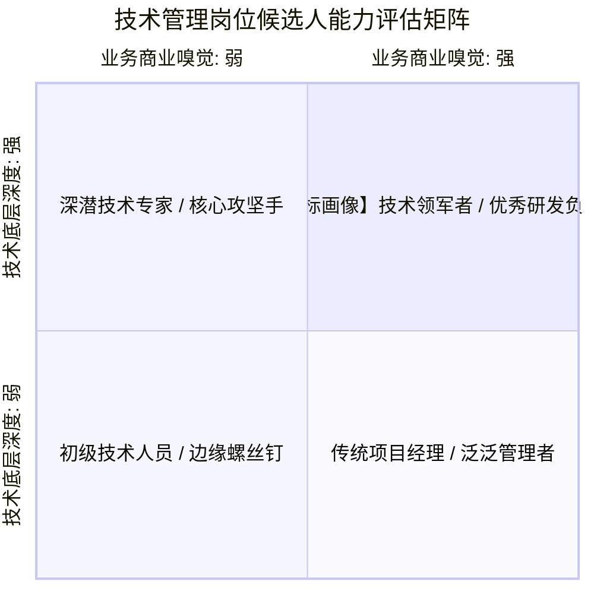
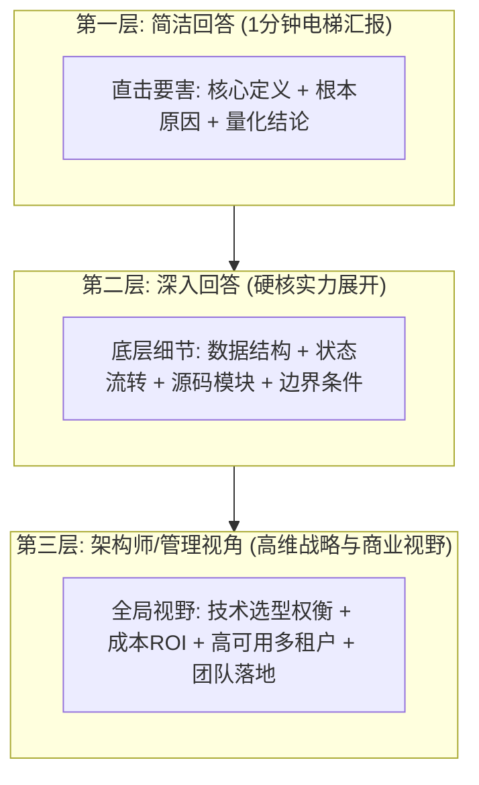

# 技术管理面试心法与三层表达模型

> **核心目标**：帮助拥有14年研发和管理背景的资深专家，打破“技术细节回忆不起导致心虚”或“只讲管理空话缺乏技术说服力”的常见误区，建立沉着、有深度、成体系的技术领导者面试表达风格。

---

## 一、技术管理面试的四种核心考核维度

技术总监、大数据研发负责人、架构师面试与普通高级研发面试有本质差异：



1. **技术深度与技术审美（Technical Depth & Taste）**：
   - 不考核“手写快速排序”或无意义的语法八股。
   - 考核核心技术组件的底层机制、边界极限、性能拐点与技术演进路线。
2. **架构权衡与商业成本意识（Architecture Trade-offs & Cost）**：
   - 任何架构设计都有代价。能否结合业务阶段、硬件成本、运维复杂度和团队学习曲线做出最优妥协？
3. **团队管理与体系化赋能（Team Leadership & Systematization）**：
   - 不是靠个人英雄主义单打独斗，而是靠制度、机制、自动化工具链（CI/CD、代码门禁、效能看板）打造高战斗力团队。
4. **复杂项目交付与商务闭环（Delivery & Business Alignment）**：
   - 面对多方利益冲突、需求蔓延、交付延期风险，如何守住底线、协调供应商并赢得客户信任？（如太原项目的正式验收）。

---

## 二、经典“三层金字塔”表达模型

在回答任何技术、架构或管理问题时，养成固定的三层思考习惯：



### 范例演练：当被问到“你们为什么从 Hive 迁移到 Doris？”
- **第一层（简洁回答）**：
  > “我们在数据中台将核心交互式分析和实时报表从 Hive 迁移到 Doris，本质是为了解决海量数据下秒级多维分析与高并发点查的性能瓶颈。迁移后，复杂聚合查询由分钟级缩短到 300ms 以内，集群资源开销节省了近 40%。”
- **第二层（深入机制）**：
  > “从底层机制看，主要受益于三点：第一是 Doris 的 MPP 架构与全向量化执行引擎，极大降低了虚函数调用与 CPU Cache Miss；第二是前缀索引与智能物化视图机制，可以在存储层直接完成数据剪裁过滤；第三是其轻量化架构，FE 负责元数据与协调，BE 负责高并发存储计算，相比 Hive 依赖外部 MapReduce/Tez 和繁重的 Metastore 启动开销，延迟大幅降低。”
- **第三层（架构师/管理取舍）**：
  > “在选型决策时，我们横向对比了 ClickHouse 与 Doris。ClickHouse 在单表极限性能上很强，但运维复杂、对分布式 Join 和标准 SQL 支持不够友好，且无法原生支持高频 Upsert。我们数据中台面向的是太原客户现场具有复杂权限和多表关联的业务场景，Doris 的 MySQL 协议高度兼容、无外部 ZK 依赖，降低了我们现场交付团队的运维难度和客户的学习门槛，这是典型的在极限性能与工程交付可维护性之间的合理架构取舍。”

---

## 三、真实履历的结构化表达（STAR-L 法则）

面试官追问项目时，严格遵循 **STAR-L** 原则组织语言：
- **S (Situation)**：项目背景与面临的尖锐危机。
- **T (Task)**：你作为负责人承诺交付的核心硬指标（技术与业务）。
- **A (Action)**：你采取的**两手抓策略**（一手抓技术攻坚，一手抓流程/团队协调）。
- **R (Result)**：量化结果（验收回款、SLA提升、成本降低）。
- **L (Learning)**：反思复盘（如果重新来过，哪一点可以做得更好）。

---

### 技术管理面试心法一页纸速记卡（5大金字塔心法）

```
========================================================================================
           【技术管理面试心法：从资深专家到技术统帅 5 大金字塔心法】
========================================================================================

【心法一：三层递进定乾坤，先给结论后推演】
  - 1分钟电梯破题：直击痛点 + 根本原因 + 量化指标；
  - 深入机制：拓扑协议 + 状态机流转 + 边界极值；
  - 架构总监视角：Trade-off 选型权衡 + 成本ROI + SLA隔离 + 团队SOP。

【心法二：摆脱初级死背源码，聚焦运行哲学】
  - 严禁死背类名与私有变量，多讲为什么在延迟、吞吐、一致性与容错间做此妥协；
  - 关注“强一致性延迟代价 vs 业务最终一致幂等补偿”的商业与技术平衡。

【心法三：STAR-L结构化，量化战果显功底】
  - 讲项目绝不平铺直叙：背景危机(S) -> 扛旗指标(T) -> 攻坚行动(A) -> 量化数字(R) -> 反思复盘(L)；
  - 始终突出个人作为“架构决策者与团队主心骨”的核心增量贡献。

【心法四：真实经历铸底座，事实隔离显严谨】
  - 真实履历（思科、美的、Zoom、瑞纳）对齐事实基准，绝不编造虚假数据；
  - 教学推演与生产实战严格区隔，客观展现从外企到民企复合背景的独特优势。

【心法五：平视考官成伙伴，大局为重展帅才】
  - 把挑剔质询当做技术探讨，把压力质疑化为展示从容气场的舞台；
  - 用架构师的深度洞察代码，用技术总监的高度校准商业航向！
========================================================================================
```
