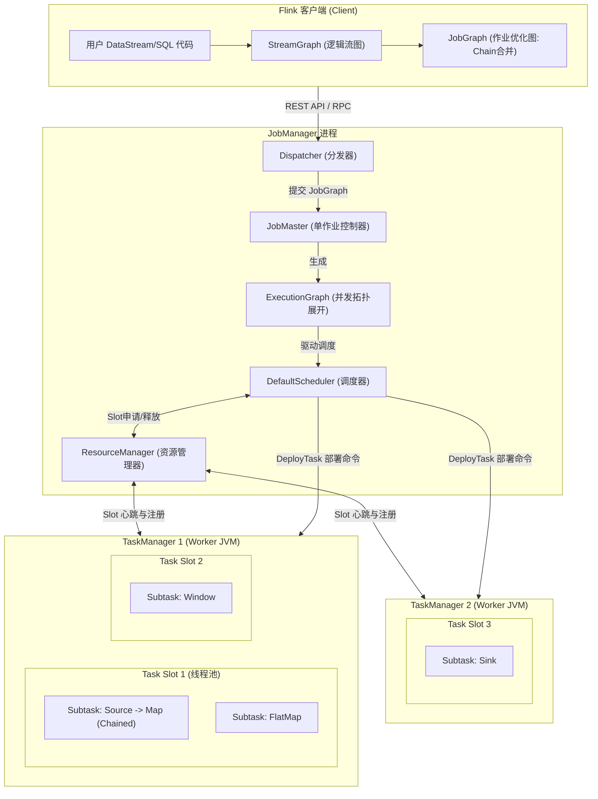
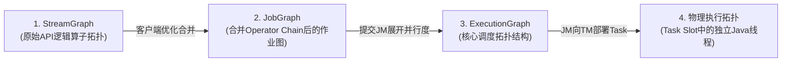
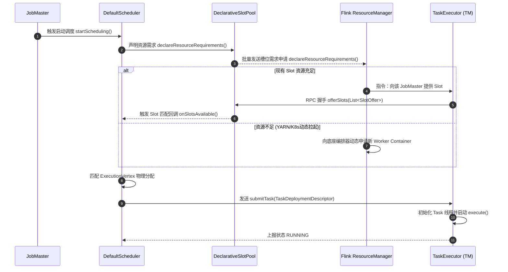
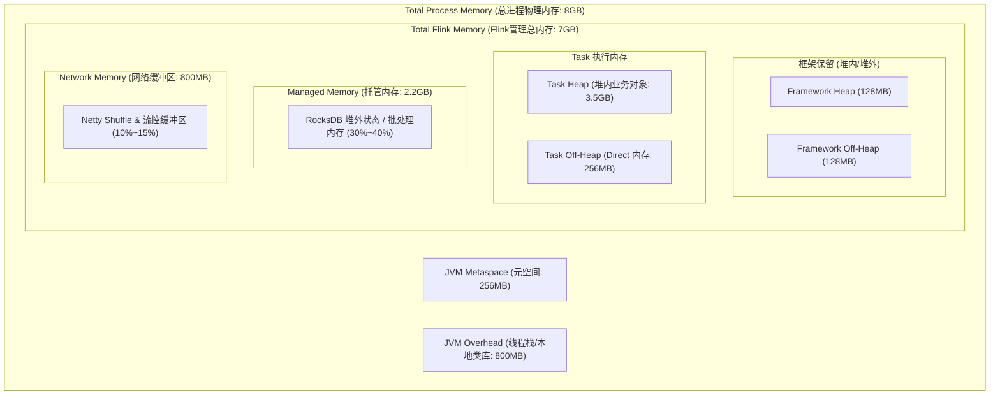
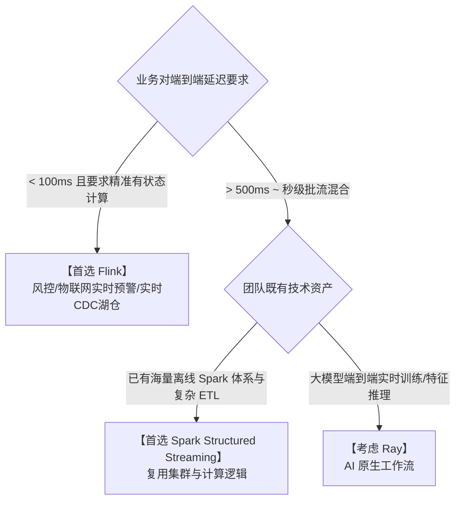
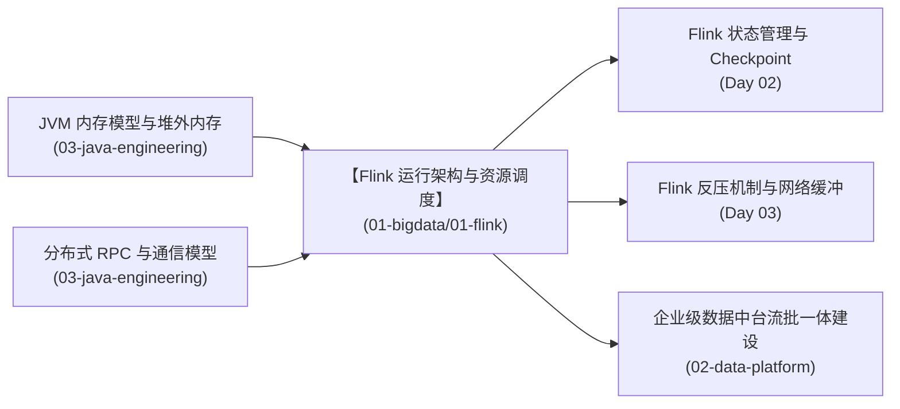

# Flink 核心运行架构与分布式资源调度深入剖析

> **学习目标定位**：系统性掌握 Flink 分布式运行拓扑、核心组件职责、图演进模型（StreamGraph -> JobGraph -> ExecutionGraph -> 物理拓扑）、Operator Chain 链化机制、Task Slot 内存与并发隔离机制，以及基于 `DefaultScheduler` 的资源声明式调度协商链路。在技术总监与高级架构师面试中，能从底层源码、生产调优、故障排障及平台架构维度进行降维答辩。

---

## 1. 知识概述

### 1.1 是什么（What）
Apache Flink 是一个分布式、有状态、事件驱动的大数据流处理与批处理统一计算框架。其核心运行架构采用了经典的 **Master-Worker（主从）去中心化协作模型**，由主控协调服务 **JobManager** 与执行工作节点 **TaskManager** 构成，结合轻量级的声明式资源分配机制（Declarative Resource Management），在亚秒级延迟下实现高吞吐和高容错的状态计算。

### 1.2 解决什么问题（Why）
在 Flink 诞生前，传统流处理系统（如 Apache Storm 早期版本）缺乏原生一致性状态支持，数据语义多为 At-Least-Once，且计算拓扑僵化；而以 Spark Streaming 为代表的微批处理架构（Micro-batching）虽然具有高吞吐与容错优势，但其结构决定了端到端延迟难以突破百毫秒级极限，且在事件时间（Event Time）与复杂窗口计算上机制较为繁重。
Flink 通过原生流驱动（Record-by-record 流式流水线处理）、分布式快照算法（Chandy-Lamport 改良版异步屏障快照 ABS）以及细粒度动态 Task Slot 隔离机制，彻底兼顾了**超低延迟（亚毫秒至毫秒级）**与**千万级 TPS 极高吞吐**。

### 1.3 适用场景与技术边界（Where & When）
- **最佳适用场景**：
  - 实时风控告警、物联网传感器规则引擎计算（如瑞纳智能供热设备状态实时检测）。
  - 电商/大促实时多维指标大屏、实时特征工程计算。
  - 湖仓一体（Lakehouse）实时数据摄入与实时 CDC 管道。
- **技术边界与反模式**：
  - 极小数据量的简单批任务（启动资源与协调开销占比过大，不如轻量 SQL 引擎）。
  - 超大规模冷数据离线探索性 Ad-hoc 查询（更适合 Presto/Trino/Doris/StarRocks）。

---

## 2. 核心概念与关系

### 2.1 核心术语定义
| 术语名称 | 英文术语 | 核心定义与工程职责 | 资源/生命周期级别 |
| :--- | :--- | :--- | :--- |
| **作业管理器** | JobManager (JM) | 整个作业集群的主控大脑，负责资源协调、作业图转换、任务调度与 Checkpoint 协调。包含 Dispatcher、ResourceManager、JobMaster。 | 进程级 (JVM) |
| **任务执行器** | TaskManager (TM) | 实际干活的 Worker 节点，负责执行具体的 Subtask，管理内存与网络缓冲池，向 JM 上报心跳与状态。 | 进程级 (JVM) |
| **任务槽** | Task Slot | TaskManager 内部用于执行任务的最小静态资源切片，**独占平分 JVM 托管内存（Managed Memory）**，但同一 TM 内多个 Slot **共享 CPU 核心与 JVM 堆内存**。 | 线程执行环境 |
| **并行度** | Parallelism | 一个特定算子（Operator）在物理执行时并发执行的 Subtask 实例数量。可以在代码、配置文件或 CLI 中全局/局部设定。 | 逻辑算子级 |
| **子任务** | Subtask | 算子根据并行度切分后的最小独立并发执行单元，运行在 Task Slot 的独立 Java 线程（`Task` 线程）中。 | 线程级 |
| **算子链** | Operator Chain | Flink 将多个满足特定条件的上下游算子融合为一个统一物理 Task 的机制，消除线程上下文切换与序列化开销。 | 物理执行级 |
| **槽位共享组**| SlotSharingGroup (SSG) | 允许不同算子的 Subtask 共享同一个 Task Slot 的逻辑分组。默认属于同一个 `default` 分组，大幅提高资源利用率。 | 资源拓扑级 |

### 2.2 核心概念全景关系拓扑


---

## 3. 底层原理

### 3.1 四层图演进模型（从代码到分布式执行）

Flink 作业从客户端编写到集群物理执行，经历了 **四层图的递进转换**：



1. **StreamGraph**：
   - 产生时机：客户端调用 `env.execute()` 前，遍历 `DataStream` 链表构建的纯逻辑拓扑。
   - 核心节点：`StreamNode`（对应 Source, FlatMap, KeyBy, Sink 等算子）和 `StreamEdge`（代表算子间数据流动与分区策略）。
2. **JobGraph**：
   - 产生时机：客户端由 `StreamingJobGraphGenerator` 生成，也是**客户端向集群 RPC 提交的唯一定义对象**（避免在网络中传输笨重的逻辑图）。
   - 核心优化：依据算子链规则，将可链化的 `StreamNode` 合并为 `JobVertex`，减少 RPC 依赖；边被抽象为 `JobEdge`。
3. **ExecutionGraph**：
   - 产生时机：JobMaster 接收到 `JobGraph` 后，依据算子配置的 `Parallelism` 将其进行分布式并发展开。
   - 核心节点：
     - `ExecutionJobVertex`：对应一个逻辑 `JobVertex`。
     - `ExecutionVertex`：对应每个具体并行度的子任务实例。
     - `IntermediateResultPartition`：算子产生的数据分区缓冲区。
4. **物理执行拓扑（Physical Execution Graph）**：
   - 运行时实例：JobMaster 调度器向 TaskManager 发送 `TaskDeploymentDescriptor (TDD)` RPC 报文后，TaskManager 反序列化后生成的 `Task` 对象，由 TM 内部的线程池驱动运行。

### 3.2 Operator Chain（算子链）底层链化机制
将两个相邻的算子链化为一个 Task 是 Flink 最重要的本地性能优化手段之一。

#### 链化（Chaining）的核心收益：
- **零序列化与反序列化**：同 Chain 内数据传递直接通过 Java 对象引用（In-memory Object Passing），不经过内存段切片。
- **零线程切换（Context Switch）**：上游算子直接在同一个线程内同步调用下游算子的 `processElement()` 方法。
- **零网络与通信缓冲区开销**：不经过 Netty 和网络内存段缓冲区。

#### 算子能够链化的“六大硬性条件”：
1. **上下游算子并行度完全一致**（Parallelism 相同）。
2. **下游算子输入策略必须是 ForwardPartitioner**（直连传递），非 KeyBy、Rebalance、Rescale 或 Shuffle。
3. **上下游算子的 SlotSharingGroup（槽位共享组）必须完全一致**（默认均为 `default`）。
4. **上下游算子的 ChainStrategy 允许链化**（上游需为 `ALWAYS` 或 `HEAD`，下游必须为 `ALWAYS`，非 `NEVER`）。
5. **作业运行时配置允许链化**（`ExecutionConfig.isChainingEnabled() == true`）。
6. **未禁用算子 Chain**（未显式调用 `.disableChaining()` 或 `.startNewChain()`）。

```mermaid
flowchart LR
    subgraph NonChained["未链化模式 (跨线程通信)"]
        S1["Source [Thread 1]"] -->|序列化/放入网络Buffer| Buffer["Netty Buffer"]
        Buffer -->|反序列化/唤醒线程| M1["Map [Thread 2]"]
    end
    subgraph Chained["算子链化模式 (极高吞吐)"]
        S2["Source"] -->|同线程直接调用 processElement()| M2["Map"]
        subgraph OneTask["单一Task (单个线程执行)"]
            S2
            M2
        end
    end
```

### 3.3 Task Slot 内存模型与资源共享

#### Slot 的本质：
Task Slot 是 TaskManager 进程内部**静态划分的资源单位**。
- **CPU 层面**：当前版本的 Task Slot **不做 CPU 物理隔离（不做 cgroups 强限制）**，同一个 TM 内所有 Slot 共享该 JVM 进程的所有 CPU 核心。
- **内存层面**：TaskManager 的 `Managed Memory`（托管内存，供 RocksDB 状态、批处理排序与堆外算子使用）被该 TM 下的所有 Task Slot **严格等分**。

#### 槽位共享（Slot Sharing）原理：
默认情况下，Flink 允许来自**不同 JobVertex** 但属于**同一 SlotSharingGroup** 的 Subtask 共享同一个 Task Slot。
- **共享示例**：一个包含 `Source(P=4) -> FlatMap(P=4) -> KeyBy -> Sink(P=4)` 的流作业，若全部共享，仅需要 **4 个 Task Slot**，而不是 4+4+4=12 个 Slot！
- **共享优势**：
  1. 避免由于算子负载不均导致某些 Slot 极忙（如计算密集的 KeyBy/Window）而另一些 Slot 极闲（如简单的 FlatMap），实现**资源互补均衡**。
  2. 简化集群资源容量规划，**作业所需的最大 Slot 数量 = 整个拓扑中各算子并行度的最大值**。

---

## 4. 核心实现与源码分析 (Flink 1.17+)

> [!NOTE]
> 在 Flink 1.12 之后，调度架构进行了彻底重构，弃用了旧的遗留调度器，全面引入以 `DefaultScheduler` 和 `DeclarativeSlotPool` 为核心的声明式调度体系。以下分析基于 **Apache Flink 1.17.2** 核心源码。

### 4.1 核心源码类体系与职责映射
| 核心模块 | 关键类名 (含包路径) | 核心入口方法 | 核心源码职责 |
| :--- | :--- | :--- | :--- |
| **作业图生成** | `org.apache.flink.streaming.api.graph.StreamingJobGraphGenerator` | `createJobGraph()` | 遍历 StreamGraph，执行 Chain 合并并输出 JobGraph |
| **作业主控** | `org.apache.flink.runtime.jobmaster.JobMaster` | `startScheduling()` | 管理作业单次执行生命周期，持有 SchedulerNG 与 SlotPool |
| **调度引擎** | `org.apache.flink.runtime.scheduler.DefaultScheduler` | `allocateSlotsAndDeploy()` | 驱动 ExecutionGraph 状态机流转，申请槽位并下发部署 |
| **执行顶点** | `org.apache.flink.runtime.executiongraph.ExecutionVertex` | `deploy()` | 维护单个 Subtask 状态（CREATED -> SCHEDULED -> DEPLOYING -> RUNNING） |
| **槽位声明池** | `org.apache.flink.runtime.jobmaster.slotpool.DefaultDeclarativeSlotPool` | `increaseResourceRequirementsBy()` | 声明式资源管理，向上游 ResourceManager 声明 Slot 需求 |
| **工作执行器** | `org.apache.flink.runtime.taskexecutor.TaskExecutor` | `submitTask(TaskDeploymentDescriptor)` | TaskManager 真正接收 RPC 报文并创建 `Task` 线程的入口 |

### 4.2 调度与 Slot 协商底层调用时序



### 4.3 关键源码调用片段剖析

#### 1. 算子链合并核心判断（`StreamingJobGraphGenerator.java`）
```java
// 截取自 Flink 1.17 核心逻辑：isChainable 判断两个算子能否融合成 Chain
public static boolean isChainable(StreamEdge edge, StreamGraph streamGraph) {
    StreamNode upStreamVertex = streamGraph.getSourceVertex(edge);
    StreamNode downStreamVertex = streamGraph.getTargetVertex(edge);

    StreamOperatorFactory<?> headOperator = upStreamVertex.getOperatorFactory();
    StreamOperatorFactory<?> outOperator = downStreamVertex.getOperatorFactory();

    return downStreamVertex.getInEdges().size() == 1
            && outOperator != null
            && headOperator != null
            && upStreamVertex.isSameSlotSharingGroup(downStreamVertex)
            && outOperator.getChainingStrategy() == ChainingStrategy.ALWAYS
            && (headOperator.getChainingStrategy() == ChainingStrategy.HEAD ||
                headOperator.getChainingStrategy() == ChainingStrategy.ALWAYS)
            && (edge.getPartitioner() instanceof ForwardPartitioner)
            && edge.getShuffleMode() == ShuffleMode.PIPELINED
            && upStreamVertex.getParallelism() == downStreamVertex.getParallelism()
            && streamGraph.isChainingEnabled();
}
```

#### 2. Subtask 状态驱动与部署（`Execution.java`）
在 `Execution.java` 中，Subtask 在获取到分配的 `LogicalSlot` 后，构建 `TaskDeploymentDescriptor` 并通过 Gateway 发送给远程 TaskManager：
```java
// 核心部署逻辑片段
public void deploy() throws JobException {
    final LogicalSlot slot = assignedResource;
    // 校验状态流转合规性，必须为 SCHEDULED 才能转换为 DEPLOYING
    if (!transitionState(ExecutionState.SCHEDULED, ExecutionState.DEPLOYING)) {
        throw new IllegalStateException("Execution is not in SCHEDULED state");
    }
    
    // 构建 Task 部署描述符，包含执行代码 JAR 引用、Checkpoint 凭证、网络通道拓扑
    final TaskDeploymentDescriptor deployment =
            TaskDeploymentDescriptorFactory.fromExecution(this)
                    .createDeploymentDescriptor(
                            slot.getAllocationId(),
                            attemptNumber,
                            taskRestore,
                            producedPartitions.values());

    final TaskExecutorGateway taskExecutorGateway = slot.getTaskExecutorGateway();
    // 异步 RPC 投递
    taskExecutorGateway.submitTask(deployment, rpcTimeout)
            .whenCompleteAsync((ack, throwable) -> {
                if (throwable != null) {
                    markFailed(throwable); // 部署失败，触发容错重启机制
                }
            }, executor);
}
```

---

## 5. 工程实践与落地

### 5.1 生产级 TaskManager 内存全景配置（以 8GB TM 为例）

生产环境中，如果对 TaskManager 内存机制理解不透，极易导致频繁被 YARN/K8s 强行 Kill（`Exit Code 137: OOM-Killed`）。



#### 生产推荐配置参考（YARN / K8s Deployment 模式）：
```properties
# ==================== 资源与槽位 ====================
# 单 TM 分配 4 个 Slot，结合机器物理 CPU 核心配比（建议 1 Slot 对应 1~2 Physical Core）
taskmanager.numberOfTaskSlots: 4

# ==================== 内存参数调控 (基于 8GB 总进程配比) ====================
taskmanager.memory.process.size: 8192m

# 针对 RocksDB 状态计算，必须保障托管内存比例（默认 0.4，高状态作业保持 0.4）
taskmanager.memory.managed.fraction: 0.4

# 网络缓冲区保障高吞吐（默认 min: 64mb, max: 1gb, fraction: 0.1）
taskmanager.memory.network.fraction: 0.1
taskmanager.memory.network.min: 256m
taskmanager.memory.network.max: 1024m

# 针对类加载隔离与频繁反射调用场景，扩大元空间防止 OOM
taskmanager.memory.jvm-metaspace.size: 512m

# 防止 JVM 本地内存（如 JNI、网络堆外分配）溢出被操作系统或容器强杀
taskmanager.memory.jvm-overhead.fraction: 0.15
taskmanager.memory.jvm-overhead.max: 1024m
```

### 5.2 核心可观测监控指标（SLA 黄金指标）
技术管理者在搭建监控看板（Prometheus + Grafana）时，应重点把控以下四个维度：
1. **反压指标（Backpressure）**：`job.task.backPressuredTimeMsPerSecond`（若 `> 500ms` 则触发黄色预警，`> 800ms` 严重红色预警）。
2. **Checkpoint 耗时与对齐延迟**：`job.lastCheckpointDuration` 和 `job.task.checkpointAlignmentTime`。
3. **网络缓冲利用率**：`job.task.buffers.inputQueueLength` 与 `outputQueueLength`。
4. **垃圾回收 STW 耗时**：`taskmanager.Status.JVM.GarbageCollector.G1_Old_Generation.Time`。

---

## 6. 常见生产问题与排查指南

### 6.1 Task Slot 倾斜与“长尾 Task”故障
- **现象**：整个作业吞吐上不去，个别 TM 的 CPU 跑满（100%），而其他 TM 处于闲置状态（CPU < 20%）。
- **根因剖析**：
  1. 上游 Key 分布极度不均匀（热点 Key），导致通过 `keyBy()` 路由至同一个 Subtask 处理。
  2. 算子未配置 SlotSharingGroup，所有繁重算子被调度在同一组有限的 Slot 内。
- **治理策略**：
  - **应用层加盐打散**：两阶段聚合，第一阶段对 key 进行拼装随机前缀（如 `sensor_id + "_" + random.nextInt(10)`），预聚合后再去掉前缀二次全局汇总。
  - **拆解槽位共享组**：将高负荷的计算密集算子显式分配到独立的 SlotSharingGroup，强制其与轻量算子物理隔离：
    ```java
    dataStream.keyBy(...).window(...).apply(...)
              .slotSharingGroup("heavy-compute-group");
    ```

### 6.2 容器异常退出（Exit Code 137 / OutOfMemoryError: Direct Buffer Memory）
- **现象**：K8s Pod 频繁重启并报 `OOMKilled`，查看 JVM GC 日志堆内存却依然平稳（无 Heap OOM）。
- **根因分析**：
  - Netty 网络堆外内存使用超出限制，或者使用 RocksDB 作为状态后端时，RocksDB 底层 C++ 申请的 Direct Memory 超出了 `taskmanager.memory.managed.size` 上限。
  - 用户自定义函数（UDF）内部调用了第三方 JNI 或未关闭的本地资源。
- **解决路径**：
  1. 开启 RocksDB 内存自动受控模式：确保 `state.backend.rocksdb.memory.managed: true`（默认启用，自动限制 RocksDB 内存不超出 Managed Memory）。
  2. 调大容器缓冲外溢余量：提升 `taskmanager.memory.jvm-overhead.fraction` 至 `0.15~0.2`。

---

## 7. 技术选型对比与取舍

### 7.1 横向架构对比矩阵
| 评估维度 | Apache Flink (1.17+) | Apache Spark (Structured Streaming) | Apache Storm (Trident) | Ray (Streaming) |
| :--- | :--- | :--- | :--- | :--- |
| **计算底层模型** | **原生流式 (Event-driven)** | 微批驱动 (Micro-batching) | 原生流水线流式 | 动态分布式 Task / Actor |
| **端到端延迟** | **毫秒级 / 亚毫秒级** | 100ms ~ 数秒 | 毫秒级 | 毫秒级 |
| **状态机制与容错** | 完善分布式快照 (ABS + RocksDB) | 依赖 Checkpoint 目录重算 | 状态支持较弱，依赖外部存储 | Actor 状态快照 |
| **流批一体成熟度** | **高**（流批一套核心与生态） | **极高**（批底座极为成熟） | 低（批处理已淘汰） | 高（面向通用分布式计算/AI）|
| **SQL与生态完备度** | 高（Flink SQL/CDC/Paimon） | 极高（Spark SQL/Delta/Iceberg）| 低 | 偏向 AI/大模型生态扩展 |
| **运维与调优门槛** | 较高（需深入理解内存与状态） | 中等（运维工具成熟） | 较低 | 中高 |

### 7.2 架构师选型决策树


---

## 8. 面试高频问题

### 8.1 基础题
1. **Q1**：Flink 中的 JobManager 和 TaskManager 各自承担什么职责？
2. **Q2**：什么是 Task Slot？它与 Parallelism（并行度）之间是什么数学关系？
3. **Q3**：如何理解 SlotSharingGroup？为什么 Flink 默认推荐共享 Slot？

### 8.2 原理题
4. **Q4**：请详细阐述 Flink 从源码逻辑代码到最终物理执行，所经历的四层图演进全过程。
5. **Q5**：Flink Operator Chain 链化的触发条件有哪些？链化能带来哪些性能提升？
6. **Q6**：Task Slot 隔离的是 CPU 还是内存？为什么 Flink 默认不对 Slot 实施 CPU 核心隔离？

### 8.3 生产场景题
7. **Q7**：生产环境下发现作业整体吞吐急剧下降，TaskManager 频繁发生 Full GC 或 OOM 崩溃，你的系统化排查路径是什么？
8. **Q8**：在 K8s 上部署 Flink 作业，容器频繁报 Exit Code 137（OOMKilled），如何准确定位是堆内溢出还是堆外溢出？

### 8.4 架构设计题
9. **Q9**：作为数据平台架构师，请针对某制造业（如物联网供热设备数据摄入）每日 5 亿条时序数据场景，设计一套具备高吞吐、多租户资源隔离与秒级容错的 Flink 计算资源配置与调度平台架构方案。

---

## 9. 标准参考答案

### 题目1（原理深挖）：请详细阐述 Flink 从代码到物理执行的四层图演进过程与 Operator Chain 机制。

#### 简洁回答（1分钟电梯破题）：
> “Flink 的作业拓扑演进经历四层形态：首先是客户端生成的 `StreamGraph`，代表纯 API 逻辑调用；接着客户端通过 `StreamingJobGraphGenerator` 依据链化条件将相邻算子打包成 JobVertex，生成向集群提交的 `JobGraph`；随后 JobMaster 依据算子并行度将其展开为并发拓扑 `ExecutionGraph`；最后由调度器向 TaskManager 发送任务描述符（TDD），实例化为 `Task` 并在具体 Task Slot 线程中执行。Operator Chain 的核心意义在于将满足条件的算子融合同一个线程，完全规避序列化与线程切换开销，极大提升系统吞吐。”

#### 深入回答（机制与源码调用展开）：
> “从底层实现来看，四层图演进包含关键设计细节：
> 1. **JobGraph 生成时的 Chain 合并条件**：在 `StreamingJobGraphGenerator.isChainable()` 中有严格判断，要求两个算子上下游必须属于同一 SlotSharingGroup、并行度相同、下游输入必须为 `ForwardPartitioner` 直连、Chain 策略为 ALWAYS 且系统未全局关闭 Chaining。
> 2. **JobMaster 内部的 ExecutionGraph**：在 Flink 1.17 中，JobMaster 启动后调用 `DefaultScheduler` 创建 `ExecutionGraph`。一个 `JobVertex` 会被展开为多个 `ExecutionJobVertex`，其下包含对应并行度个数的 `ExecutionVertex`。每个 `ExecutionVertex` 维护自身状态机流转。
> 3. **调度与部署交互**：调度器通过 `DeclarativeSlotPool` 向 ResourceManager 申请 Slot。资源就绪后，由 `Execution.deploy()` 构建 `TaskDeploymentDescriptor`，通过 RPC 发送给 TaskManager 的 `TaskExecutorGateway.submitTask()`，TM 解析后在独立线程中执行，完成物理落地。”

#### 架构师视角（取舍、SLA 与成本）：
> “在实际技术管理与架构演进中，图机制与 Chain 不仅是性能优化点，更是系统治理的核心抓手：
> 第一，**链化是一把双刃剑**。Chain 极大提升了吞吐，但也模糊了算子间的独立度量。生产中若某一个算子计算变慢，整个 Chain 的指标都会显示反压，给故障定位带来干扰。我们在瑞纳智能数据中台针对特别复杂的动态规则解析算子，会显式调用 `.startNewChain()` 截断链路，换取清晰的算子级 Metric 隔离。
> 第二，**资源规划视角**。理解四层图有助于精准进行机器配额估算。一个作业的最小 Slot 消耗量等于整个拓扑中最大的并行度。结合 SlotSharingGroup 的合理划定，我们能在保障高优先级作业隔离的同时，把集群常驻硬件成本压缩 30% 以上。”

---

### 题目2（高频原理）：Task Slot 到底隔离了什么？为什么不对 CPU 进行强隔离？

#### 简洁回答：
> “Task Slot 静态隔离了 TaskManager 的**托管内存（Managed Memory）**，每个 Slot 严格平分该部分堆外内存；但同一 TM 内的多个 Slot **共享 CPU 核心与 JVM 堆内存**。不对 CPU 强隔离是因为流处理作业中不同算子的 CPU 消耗随数据潮汐动态变化，共享 CPU 能更好地削峰填谷，避免线程被操作系统或 cgroups 强行限流带来的额外调度延迟。”

#### 深入回答：
> “深入到 JVM 与操作系统层级：
> 1. **内存切分真相**：TaskManager 的进程内存在启动时被划分为框架堆内/堆外、Task 堆内存、Managed Memory 与网络缓冲区。其中，仅有 `Managed Memory`（由 `MemoryManager` 统一管理）在 Task Slot 初始化时按 slot 数量静态严格等分。Task 堆内存实质上是由该 TM 内所有 Slot 运行的 Task 线程在同一个 JVM 堆空间内动态分配，因此单个 Slot 内代码的不良对象分配仍可能导致整个 TM 产生 Full GC。
> 2. **CPU 调度哲学**：Slot 在底层只是 TM 内部线程池的一个逻辑概念。Flink 依靠操作系统的线程调度机制来利用多核。如果像 Docker/cgroups 那样对每个 Slot 进行严格的 CFS 配额限制（如固定绑定 1 个核），在突发流量时极易出现 CPU Throttling（节流），从而在毫秒级实时计算中引起严重的级联反压。共享 CPU 配合 SlotSharingGroup，能让 I/O 密集型算子和计算密集型算子在同一台宿主机上天然互补。”

#### 架构师视角：
> “从平台治理角度来看，原生 Slot 的软 CPU 隔离机制在单租户独享集群中非常高效，但在**多租户企业级数据中台**中容易引发‘吵闹邻居（Noisy Neighbors）’问题。
> 我们在构建数据中台底层资源平台时，架构设计原则是：**在底座编排层（K8s）做粗粒度硬隔离，在 Flink 引擎层（Slot）做细粒度软协同**。即通过 K8s Deployment 模式为不同业务租户或关键 P0/P1 作业隔离不同的 Pod 资源池，确保 SLA；而在单个作业内部，充分发挥 Slot 共享与动态 CPU 调度的吞吐优势。”

---

## 10. 知识自检清单

- [ ] 能否在白板上脱稿默写出 Flink 运行时完整的四大主控组件（Client、Dispatcher、ResourceManager、JobMaster）与 TaskManager 的 RPC 握手流程？
- [ ] 能否准确说出 6 个阻断 Operator Chain 链化的先决条件？
- [ ] 能否清晰计算出：一个含 5 个算子、并行度分别为 2, 4, 4, 8, 8 的作业，在默认配置下至少需要多少个 Task Slot？（答案：8 个）。
- [ ] 能否说出 Flink 1.12+ 引入的声明式调度（Declarative Scheduling）与旧版本的本质区别？

---

## 11. 知识脉络与上下游关联



- **前置技术依赖**：
  - `03-java-engineering/jvm-memory-model.md`（JVM 堆内外内存、GC机制）
  - `03-java-engineering/distributed-concurrency.md`（RPC 通信、Akka/Pekko 与 Netty）
- **核心承接进阶**：
  - `01-bigdata/01-flink/02-flink-checkpoint-state.md`（状态持久化与容错）
  - `01-bigdata/01-flink/03-flink-backpressure.md`（反压流控与 Credit 机制）

---

## 12. 权威参考资料与原始出处

1. **Apache Flink 官方官方文档 (v1.17)**：[Flink Architecture Documentation](https://nightlies.apache.org/flink/flink-docs-release-1.17/docs/concepts/flink-architecture/)
2. **Flink 核心设计提案 (FLIP-53)**：[Fine-grained Slot Management Design](https://cwiki.apache.org/confluence/display/FLINK/FLIP-53)
3. **Flink 核心设计提案 (FLIP-56)**：[Dynamic Slot Allocation for JobManager](https://cwiki.apache.org/confluence/display/FLINK/FLIP-56)
4. **GitHub 官方代码库**：[apache/flink @ GitHub](https://github.com/apache/flink/tree/release-1.17.2)
   - 核心类路径：`flink-runtime/src/main/java/org/apache/flink/runtime/scheduler/DefaultScheduler.java`
   - 核心类路径：`flink-streaming-java/src/main/java/org/apache/flink/streaming/api/graph/StreamingJobGraphGenerator.java`
