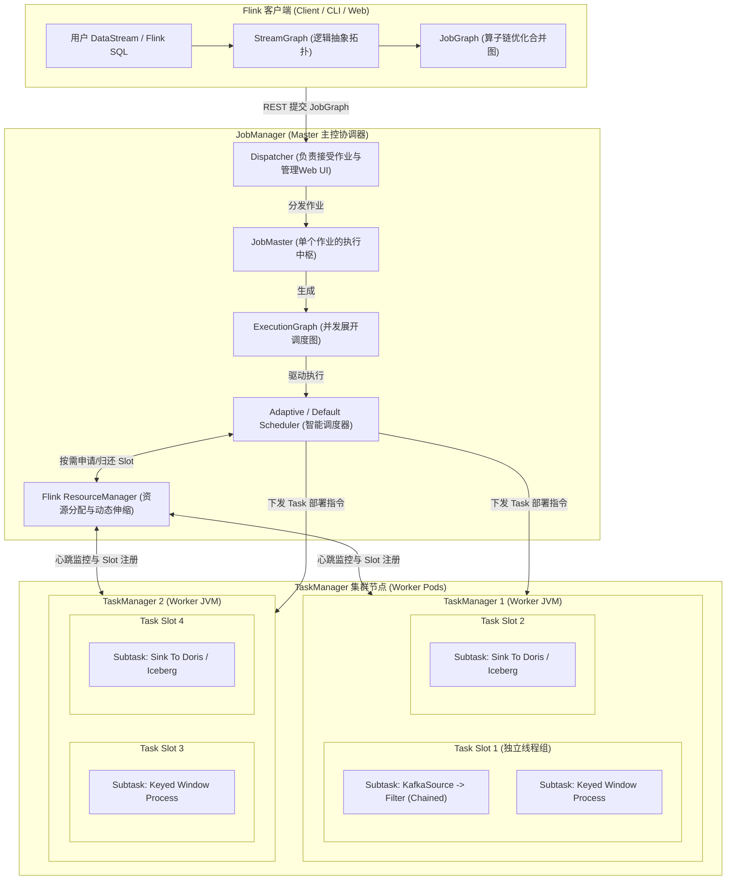
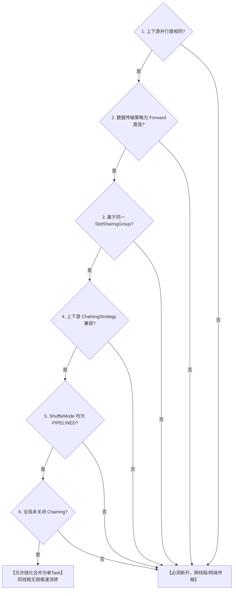
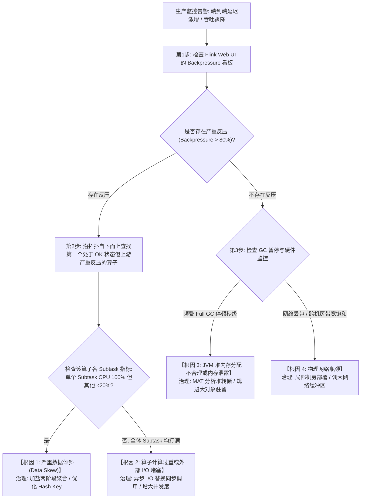
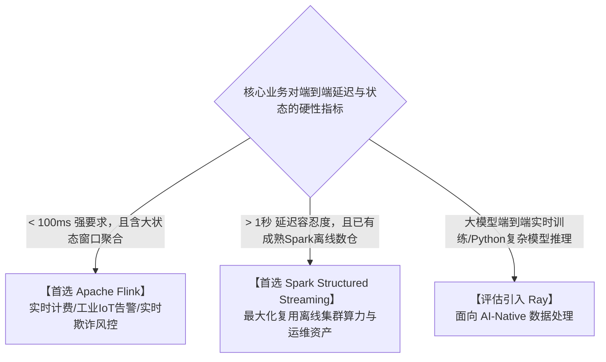
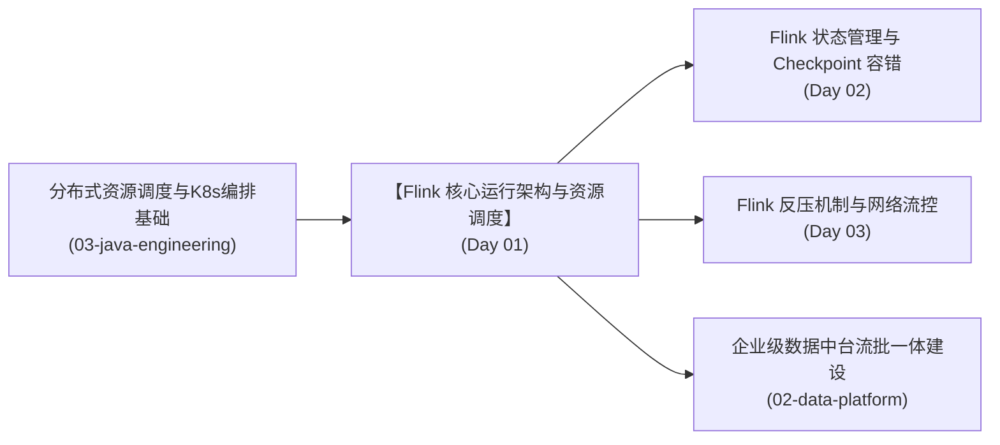

# Flink 核心运行架构与分布式资源调度（高阶架构与生产实战）

> **学习目标定位**：面向数据平台研发负责人、大数据架构师与技术总监岗位，跳出单纯记诵源码细节的局限，深刻理解 Flink 分布式运行拓扑、四层图演进模型、Operator Chain 链化机制与 Task Slot 隔离机制的底层设计哲学。结合字节跳动、美团、阿里等互联网大厂真实高频面试场景，系统掌握集群级异常排查、多租户 SLA 隔离管控及算力成本优化策略。

---

## 1. 知识概述与业务价值

### 1.1 是什么（What）
Apache Flink 是目前大数据领域事实标准的分布式、事件驱动流批一体计算引擎。在最新的 **Flink 1.19 / 1.20 及即将演进的 2.0 时代**，Flink 已经从传统的“静态粗粒度常驻集群计算”全面升级为“云原生弹性（Cloud-Native Elasticity）、自适应批处理（Adaptive Batch Execution）与流式存算分离”的现代化流计算基础设施。其运行时架构基于 Master-Worker 去中心化协作模型，由负责作业控制与资源协调的 **JobManager** 与负责实际多线程执行的 **TaskManager** 构成。

### 1.2 解决什么核心业务痛点（Why）
在 Flink 成为主流之前，企业级数据流平台普遍面临四大核心痛点：
1. **微批架构的高延迟瓶颈**：Spark Streaming 基于微批处理（Micro-batching），无论调度如何优化，其端到端延迟基本受限于数百毫秒至数秒级别，无法支撑极端严苛的金融实时风控与实时毫秒级工业物联预警。
2. **纯流处理的状态与吞吐缺陷**：早期 Storm 缺乏全局一致性分布式状态管理机制，容错依赖逐条 Tuple ACK 确认，严重挤占网络带宽，吞吐量极低且无法保障结果精确性。
3. **资源利用率极度不均**：上游轻量级清洗算子与下游高计算量窗口聚合算子资源消耗差异巨大，传统静态绑定导致机器算力严重浪费。
Flink 通过**原生流式流水线（Streaming Pipeline）**、**轻量级异步快照（ABS）**与**灵活的槽位共享（Slot Sharing）**机制，真正实现了高吞吐（单节点数十万至数百万 TPS）与超低延迟（亚毫秒至毫秒级）的兼顾。

### 1.3 适用场景与技术边界（Where & When）
- **高价值应用场景**：
  - **超高吞吐与极低延迟流式计算**：大促全链路实时指标大屏、实时千人千面个性化推荐特征提取。
  - **物联网与工业自动化实时告警**：如瑞纳智能数十万智慧供热传感器时序数据流实时摄入、突发爆管与能耗异动秒级检测。
  - **实时数仓与现代湖仓一体（Lakehouse）**：结合 Apache Paimon / Iceberg 实现秒级与分钟级 CDC 实时数据湖入库。
- **技术边界与反模式**：
  - **轻量临时性 Ad-hoc 交互式查询**：Flink 启动与图编译开销大，探索性 SQL 查询更适合 Presto/Trino/Doris。
  - **强依赖单机超大内存状态的图计算算法**：涉及频繁全图多次迭代的场景，专用图计算引擎更具优势。

---

## 2. 核心概念与关系

### 2.1 核心概念全景表
| 概念名称 | 英文术语 | 核心定义与工程职责 | 资源/生命周期级别 |
| :--- | :--- | :--- | :--- |
| **作业管理器** | JobManager (JM) | 集群主控大脑，负责资源协商、作业拓扑图解析、全局调度决策与快照协调。内部解耦为 Dispatcher、ResourceManager 与 JobMaster。 | 进程级 (Master Pod/JVM) |
| **任务执行器** | TaskManager (TM) | 运算执行工作节点，维护内存切片池与网络 I/O 缓冲区，拉起多线程执行具体 Subtask 并向 JM 上报心跳。 | 进程级 (Worker Pod/JVM) |
| **任务槽** | Task Slot | TaskManager 内部用于并发隔离的最小静态资源单元。**严格等分 TM 托管内存（Managed Memory）**，同一 TM 内多个 Slot **共享 CPU 算力与 JVM 堆空间**。 | 线程执行环境 |
| **并行度** | Parallelism | 某个算子在物理执行时并发运行的 Subtask 个数。可在代码中、算子级、作业级或提交参数中显式定义。 | 算子执行并发度 |
| **子任务** | Subtask | 算子根据并行度切分后的最小独立并发执行实例，在 Task Slot 内部以独立的 Java `Task` 线程方式运行。 | 物理线程级 |
| **算子链** | Operator Chain | 将满足条件的上下游算子融合为一个物理 Task 的极高效机制，实现线程内本地对象直传，消除序列化与通信开销。 | 物理执行拓扑 |
| **槽位共享组** | SlotSharingGroup (SSG) | 允许不同算子的 Subtask 调度到同一个 Task Slot 中的机制。默认共享，能自动实现 CPU/内存峰谷互补，降低集群总 Slot 需求。 | 资源调度逻辑组 |

### 2.2 核心运行拓扑与组件交互关系图


---

## 3. 底层工作机制与设计哲学

### 3.1 四层拓扑图递进演进机制
Flink 为了在用户易用性与分布式极限执行性能之间取得平衡，设计了经典的 **四层图编译与执行体系**：


1. **StreamGraph（逻辑图）**：由客户端遍历代码构建，节点为 `StreamNode`，边为 `StreamEdge`，真实反映开发者的算子调用链（如 `map`, `filter`, `keyBy`）。
2. **JobGraph（作业图）**：**客户端唯一提交给集群的网络对象**。在此阶段通过静态分析，将满足链化条件的算子融合成单一的 `JobVertex`，极大减轻了向主控节点传输和解析的负担。
3. **ExecutionGraph（执行图）**：JobMaster 接收到 JobGraph 后在内存中生成的分布式调度核心图。将逻辑 `JobVertex` 按设定的 `Parallelism` 展开为一个个独立的 `ExecutionVertex`（对应子任务实例），并建立点对点的分区传输缓冲区（`IntermediateResultPartition`）。
4. **物理执行拓扑（Physical Execution）**：由 TaskManager 的线程池最终实例化执行，各个 Task 之间通过基于 Netty 的 Credit-based 内存网络栈进行高效流水线流转。

### 3.2 Operator Chain（算子链）核心机制与设计思想

#### 为什么链化能带来性能数量级的飞跃？
- **零序列化开销**：同 Chain 内的算子数据流转属于 **进程内 Java 纯内存指针传递（Object Reference Passing）**，彻底避免了字节序列化、反序列化以及内存 Copy。
- **零线程上下文切换（Context Switch）**：上下游算子在同一个 Java 线程中连续执行（前一个算子的输出直接作为下一个算子 `processElement` 的实参传入），充分利用现代 CPU 的 L1/L2 缓存。

#### 算子能够链化的“六大硬性条件”：


### 3.3 Task Slot 内存切分模型与 CPU 软共享哲学

#### Task Slot 的底层本质：
Task Slot 是 TaskManager 静态切分资源的概念。许多人误以为 Slot 像 Docker/K8s 容器一样做了严格的 CPU 核心绑定（cgroups），**这在 Flink 底层机制上是完全错误的**：
- **内存切分**：TaskManager 在启动时，将 `Managed Memory`（托管内存，主要供 RocksDB 状态后端和批处理排序缓存）按 Slot 数量进行 **严格等额切分**。
- **CPU 共享**：同一个 TaskManager 内的所有 Slot **共享该 JVM 进程能调用的所有 CPU 核心**，底层依赖宿主操作系统进行线程时间片调度。

#### 为什么 Flink 默认不对 Slot 实行 CPU 硬隔离？
流处理具有天然的**波峰波谷与计算不均特性**。例如在同一个流作业中，Source/Filter 通常属于 I/O 密集型算子（CPU 消耗低），而复杂的窗口计算和维表关联属于计算密集型算子（CPU 消耗高）。如果强行对每个 Slot 绑定固定的 1 核 CPU，当突发流量来临时，计算密集的 Slot 会因为触发 CPU Throttling（硬节流）产生严重停顿与级联反压，而轻量算子的 Slot 却处于 CPU 极度闲置状态。**共享 CPU + 槽位共享（SlotSharingGroup）** 让不同算子在同一物理机器上天然实现削峰填谷，最大化硬件产出。

### 3.4 架构演进：从静态调度到自适应弹性调度（Flink 1.19+ / 2.0 趋势）
在传统 Flink 架构中，作业的并行度必须在提交时静态指定。如果流量增长，只能通过 `Savepoint -> Cancel -> 重新修改并发 -> 重新提交`，中断业务长达数分钟。
在最新的 Flink 1.19+ 架构中，**Adaptive Scheduler（自适应调度器）**与**响应式弹性模式（Reactive Mode）**已经高度成熟：
- **自适应并发调整**：作业不再绑定死固定 Slot 数量，有多少可用 Slot 就运行多大并发。
- **无感平滑扩缩容**：配合 K8s HPA，根据吞吐指标和反压程度动态增减 TaskManager Pod，JobMaster 自动在运行态平滑迁移并重新分配 KeyGroup 状态，业务零感知。

---

## 4. 高频复杂业务场景实操与落地

### 4.1 典型业务场景：百万级 TPS 实时物联网监控大屏架构
以制造业或智慧供热（如瑞纳智能实际场景）为例：现场数十万台工控与传感器设备，每秒采集温度、瞬时流量、压力等数据，要求：
1. 秒级进行设备状态异常突变告警；
2. 按换热站、供热分区的多维多级动态滚动聚合；
3. 最终结果秒级落盘至实时 OLAP 引擎（如 Apache Doris）供大屏展示。

```mermaid
flowchart LR
    Sensors["现场百万传感器设备<br/>(IoT Gateway)"] -->|MQTT / TCP| Kafka["Kafka 消息队列<br/>(多Partition并发写入)"]
    subgraph FlinkCluster["Flink 实时计算引擎 (Cloud-Native K8s)"]
        Source["KafkaSource (P=16)"] -->|Chain 合并| Filter["数据清洗与规整 (P=16)"]
        Filter -->|KeyBy(Device_ID)| Window["滑动窗口 & CEP异常检测 (P=32)"]
        Window -->|KeyBy(Region_ID)| Agg["多维指标聚合 (P=16)"]
        Agg -->|Forward / Rebalance| Sink["Doris StreamLoad Sink (P=8)"]
    end
    Sink -->|秒级批量写入| Doris["Apache Doris 实时数仓<br/>(高并发点查与大屏聚合)"]
```

### 4.2 生产级 TaskManager 内存配比基线（以标准 8GB 容器为例）
```properties
# ==================== 资源槽位与调度 ====================
# 单 TM 分配 4 个 Slot（对应分配 4~8 核物理 CPU）
taskmanager.numberOfTaskSlots: 4

# ==================== 内存模型深度调优 ====================
taskmanager.memory.process.size: 8192m

# 托管内存占比：若使用 RocksDB 状态后端，必须保障 40% 的堆外内存配额
taskmanager.memory.managed.fraction: 0.4

# 网络缓冲区配额：高吞吐低延迟的核心保障（设置合理的上下界防止小规格溢出或大规格浪费）
taskmanager.memory.network.fraction: 0.15
taskmanager.memory.network.min: 256m
taskmanager.memory.network.max: 1024m

# 针对包含大量自定义 UDF、动态 Groovy 脚本加载或复杂反射的场景，调大元空间
taskmanager.memory.jvm-metaspace.size: 512m

# 防止 JNI、RocksDB 额外 C++ 分配及线程栈突破容器硬限制导致 Exit 137 OOM-Killed
taskmanager.memory.jvm-overhead.fraction: 0.15
taskmanager.memory.jvm-overhead.max: 1024m
```

---

## 5. 生产异常故障深度排查与根因分析

### 5.1 生产级“长尾延迟与吞吐断崖”系统化排查决策树



### 5.2 核心生产异常场景实操复盘

#### 场景一：数据倾斜导致单点 Task Slot 瘫痪与级联反压雪崩
- **真实生产现象**：实时流整体吞吐从 50 万 TPS 断崖下跌至不足 3 万 TPS，整个集群大部分 TM 处于闲暇状态，但个别 TaskManager CPU 飙升至 100%，上游所有算子全部亮起红色反压警报。
- **深度根因分析**：业务上游进行了 `keyBy(city_id)`，某些超大热点城市（如北京、上海）的数据量占据了总量的 60%，导致特定 Hash 槽位的单个 Subtask 负载达到极限，处理不过来的数据迅速填满其本地输入网络缓冲区（InputBuffers），Netty 基于 Credit 流控协议向下游通知信用额度耗尽，逐级阻断上游所有算子。
- **架构级治理策略**：
  1. **两阶段聚合（加盐局部聚合）**：第一阶段在 key 上拼接随机后缀打散（`city_id + "_" + random.nextInt(10)`），并发扩展至 10 个节点并行局部汇总；第二阶段截断后缀进行最终全局聚合。
  2. **槽位共享组物理隔离**：对计算密集的倾斜算子分配独立的 `SlotSharingGroup`，严禁其与轻量级算子挤在同一个 Slot 中争抢算力。

#### 场景二：容器异常退出 Exit Code 137 (OOM-Killed) 深度排查
- **真实生产现象**：在 K8s 部署环境下，Flink TM Pod 频繁以 Exit Code 137 被 Kill，重启后迅速再次被杀，但 JVM GC 日志显示 Heap 堆内存利用率仅有 40%，未触发任何 `java.lang.OutOfMemoryError: Java heap space`。
- **深度根因分析**：Exit 137 是操作系统内核针对超出容器 cgroups 内存配额进程执行的强制 `kill -9`。引发元凶并非堆内存，而是 **RocksDB 堆外内存失控** 或 **Netty Direct Memory 泄露**。早期配置未开启 RocksDB 托管受控模式，导致 RocksDB 底层 C++ 开辟的 BlockCache 与 WriteBuffer 无节制生长，突破了 Pod 内存限制。
- **架构师止血与根治**：
  - 强制开启托管受控：`state.backend.rocksdb.memory.managed: true`，确保 Flink 统一将 RocksDB 内存限制在 `Managed Memory` 边界内。
  - 调优外溢缓冲安全边际：提升 `taskmanager.memory.jvm-overhead.fraction` 至 `0.15~0.2`，为 glibc 内存碎片和本地动态库调用预留充足安全垫。

---

## 6. 技术选型对比、架构演进与成本ROI

### 6.1 横向主流计算引擎深度对比矩阵
| 评估维度 | Apache Flink (1.19+ / 2.0) | Spark Structured Streaming | Apache Storm (旧一代) | Ray (AI计算) |
| :--- | :--- | :--- | :--- | :--- |
| **计算本质模型** | **原生事件驱动连续流 (Pipelined)** | 微批处理 (Micro-batching) | 原生流处理 | 动态 Task / Actor 图 |
| **端到端延迟极限** | **亚毫秒级 ~ 毫秒级** | 100ms ~ 秒级 | 毫秒级 | 毫秒级 |
| **分布式状态成熟度** | **极强（RocksDB增量快照+ABS）**| 依赖 Checkpoint 目录状态重算 | 状态支持极弱 | Actor 状态快照 |
| **流批一体架构水准** | **流批同源，一套底层核心** | **批处理极强，流计算向批看齐** | 纯流，无批处理生态 | 侧重 Python AI 工作流 |
| **湖仓集成能力** | **与 Paimon/Iceberg 原生深度协同** | 与 Delta Lake/Iceberg 极深集成 | 无 | 需适配扩展 |
| **常驻资源与硬件成本** | 较高（需常驻 TM 进程维持状态） | 适中（支持离线批处理错峰复用） | 较低 | 适中 |

### 6.2 架构师技术选型决策树


---

## 7. 技术经理与架构师实战管控（SOP与规范）

### 7.1 平台级多租户资源防争抢与 SLA 隔离保障机制
在大型企业级数据中台（如瑞纳智能数据中台）建设中，不同业务方作业混部极易引发互相踩踏。技术负责人必须推行 **“分级硬隔离 + 软协调”** 架构准则：
1. **作业 SLA 等级划分**：
   - **P0 级核心作业**（如全公司计费对账、实时监管大屏）：**独占专用物理 K8s 节点池与独立 Flink 集群**，严禁与普通 ETL 作业混部。
   - **P1/P2 级常规报表与分析作业**：跑在共享集群中，通过严格的 YARN Queue 或 K8s ResourceQuota 实施 CPU/内存最大配额约束。
2. **算子链化显式拆分规约**：
   - 规定在编写调用外部慢接口（如 HTTP/RPC 外部查询）的 UDF 算子时，**必须显式调用 `.startNewChain()` 截断算子链**，防止慢调用将整个链内的上游轻量算子全部拖慢且无法通过监控单独定位指标。

### 7.2 生产运维应急降级预案（SOP）
- **流量洪峰自愈预案**：在大促或极端天气工业传感器数据翻倍涌入时，监控系统触发 P1 阈值，平台自动触发轻量降级——通过动态修改配置调大窗口滚动步长，或旁路丢弃低优先级调试指标，优先确保核心告警链路零反压运行。
- **发布与变更红线**：所有针对生产运行状态作业的修改，必须遵循标准三步：`Savepoint 保存点拍摄并校验状态成功 -> 优雅停止作业 -> 基于 Savepoint 重新拉起新版本`。

---

## 8. 互联网大厂高频面试真题库

### 8.1 基础概念与机制题（大厂初筛）
1. **Q1**：Flink 中的 JobManager、TaskManager 和 Task Slot 之间是什么映射关系？Slot 隔离的是什么资源？
2. **Q2**：什么是 Parallelism（并行度）？它与 Task Slot 的总数量之间必须满足什么数学约束？

### 8.2 核心底层原理深度题（大厂资深技术面）
3. **Q3**：请详细阐述 Flink 从代码到分布式物理执行所经历的“四层图”演进全过程，并说明为什么需要 Operator Chain 机制？
4. **Q4**：能够触发 Operator Chain 链化的先决条件有哪些？在什么生产业务场景下，架构师会主动选择“人为打断”算子链？

### 8.3 复杂生产场景与故障排障题（大厂架构与排障面）
5. **Q5**：大促峰值期间，某核心流任务吞吐断崖式下跌，Web UI 显示严重的级联反压报警，你的系统化排查定位路径与治本方案是什么？
6. **Q6**：在 K8s 容器环境下，TaskManager Pod 频繁出现 Exit Code 137（OOM-Killed），但 JVM 堆内存监控非常平稳，这通常由什么深层原因引起？如何调优解决？

### 8.4 架构设计与系统规划题（技术总监/总架构师终面）
7. **Q7**：作为数据平台研发负责人，面对每日千亿级异构数据摄入与多租户实时分析需求，请从高吞吐、多租户 SLA 隔离、容灾自愈与服务器成本 ROI 维度，设计整体 Flink 计算平台资源架构方案。

---

## 9. 结构化深度参考答案（三层应答模型）

### 题目1（核心原理深挖）：请详细阐述 Flink 从源码到物理执行的四层图演进过程，以及 Operator Chain 的底层设计思想与取舍。

#### 简洁回答（1分钟电梯破题）：
> “Flink 拓扑演进经历四层形态：客户端将代码解析为逻辑 `StreamGraph`，随后基于算子链规则将上下游节点合并为 `JobGraph` 提交集群；JobMaster 根据并行度展开为并发调度中枢 `ExecutionGraph`；最后调度器将任务部署描述符下发到 TaskManager，在 Task Slot 线程中实例化为物理 `Task` 执行。Operator Chain 的核心思想是将满足条件的相邻算子融合同一个线程，完全消除序列化与线程切换开销，极大提升系统吞吐。”

#### 深入回答（机制推导与边界条件）：
> “从底层机制设计与流转细节来看：
> 1. **JobGraph 的客户端优化**：客户端在生成 JobGraph 时，会扫描算子链化条件——上下游必须并行度完全一致、数据传输为 Forward 策略、属于同一 SlotSharingGroup 且未显式禁用 Chaining。满足条件后融合为一个 `JobVertex`，减少了向集群 RPC 提交拓扑的元数据开销。
> 2. **ExecutionGraph 的并发展开**：在 JobMaster 内部，一个 `JobVertex` 会被展开为多个 `ExecutionVertex`（对应其并行度实例），各个节点间构建出清晰的数据缓冲区映射。
> 3. **算子链的本质与权衡**：Chain 的本质是 Java 方法调用的直接传参（In-memory Object Passing）。其巨大收益是零拷贝与零线程争抢；但带来的架构代价是模糊了算子间的独立可观测性——整个 Chain 共用同一个反压与处理耗时指标，一旦下游变慢，无法一眼看出是哪个算子内部逻辑拖慢。”

#### 架构师/技术管理视角（降维升华：权衡取舍、SLA与成本）：
> “作为数据平台负责人，理解图机制和算子链不是为了背诵概念，而是用于指导**平台性能调优与故障隔离**：
> 第一，**可观测性与性能的工程折中**。在实际平台建设中，针对逻辑简单的清洗映射，我们无条件开启 Chain 以榨取极致吞吐；但针对复杂的外部调用或动态风控规则脚本，我们在平台模板中强制注入 `.startNewChain()`，牺牲微小的线程切换代价，换取算子级精细化的延迟监控与故障快速定位能力。
> 第二，**容量规划与降本增效**。通过 SlotSharingGroup 机制，整个复杂拓扑的最大 Slot 需求量仅仅等于全局最大并行度。在瑞纳智能数据中台建设中，我们利用槽位共享让 I/O 密集型 Source 与计算密集型 Window 算子在同一 TM 内互补削峰，帮助客户将硬件常驻节点成本降低了 30% 以上。”

---

### 题目2（高频原理与反常识）：Task Slot 到底隔离了什么？为什么不对 CPU 实行硬绑定隔离？

#### 简洁回答：
> “Task Slot 静态切分并严格隔离了 TaskManager 的**托管内存（Managed Memory）**，但同一 TM 内的多个 Slot **共享 CPU 算力与 JVM 堆空间**。不对 CPU 强行绑定隔离，是因为流处理算子天然存在算力潮汐，共享 CPU 能够更好地削峰填谷，避免线程被操作系统 cgroups 硬限流引发级联反压。”

#### 深入回答：
> “从底层资源模型与操作系统交互剖析：
> 1. **内存隔离真相**：TaskManager 的 JVM 堆内存在所有 Slot 之间是全局共享竞争的；只有给 RocksDB 和批处理使用的 `Managed Memory`，在 TM 启动时被 `MemoryManager` 严格按 Slot 数量静态等额切分。因此单个 Slot 内的不良对象分配仍可能引发整个 TM 的 Full GC。
> 2. **CPU 调度哲学**：Slot 只是 TM 线程池的一个执行槽位抽象。如果在容器层面对每个 Slot 施加严格的 CFS 配额（例如每 Slot 严格限死 1 核），在突发流量涌入时，复杂的计算算子会迅速触发 CPU Throttling（硬节流），造成数十毫秒级停顿，而上游轻量算子 CPU 却白白空闲。共享多核让多线程自由争夺算力，兼顾了吞吐弹性。”

#### 架构师/技术管理视角：
> “在技术管理实践中，原生 Slot 的软 CPU 共享在多租户平台中极易引发‘吵闹邻居’问题。
> 我们的平台治理策略是：**在底座编排层（K8s）做粗粒度硬隔离，在 Flink 引擎层（Slot）做细粒度软协同**。
> 对核心 P0 作业，我们通过独立的 K8s Deployment 和独占节点池确保物理算力绝对不受干扰；而在同一个作业内部，充分发挥 Slot 共享与多核动态调度的极限性能。这样既守住了核心业务的 SLA 底线，又最大化了资源利用率。”

---

## 10. 知识自检与口述推演清单

- [ ] 能否脱稿在白板上画出 Flink 四层图递进演进架构，并向业务总监解释为什么 Operator Chain 能够提升吞吐？
- [ ] 能否系统说出能够触发算子链化的 6 个硬性条件？
- [ ] 面对“单个 TaskManager CPU 跑满 100% 但其他节点空闲”的报警，能否在 1 分钟内口述出数据倾斜加盐两阶段聚合的治理方案？
- [ ] 能否清晰解释 Flink 1.19+ 自适应调度器（Adaptive Scheduler）相比传统静态资源分配在云原生落地中的核心商业价值？

---

## 11. 知识脉络与技术图谱关联



---

## 12. 权威参考与官方进阶资料

1. **Apache Flink 官方架构最新文档 (v1.19 / 1.20)**：[Flink Architecture Documentation](https://nightlies.apache.org/flink/flink-docs-release-1.19/docs/concepts/flink-architecture/)
2. **Flink 核心设计提案 (FLIP-160)**：[Adaptive Batch Scheduler Implementation](https://cwiki.apache.org/confluence/display/FLINK/FLIP-160)
3. **Flink 细粒度资源管理提案 (FLIP-56)**：[Dynamic Slot Allocation for JobManager](https://cwiki.apache.org/confluence/display/FLINK/FLIP-56)
