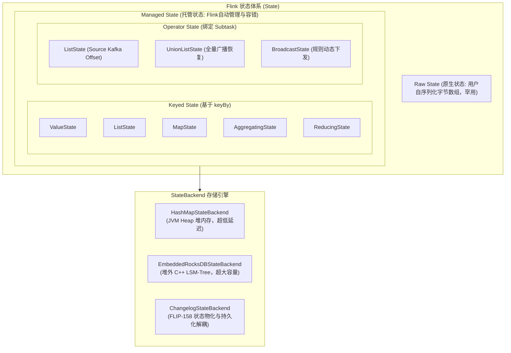
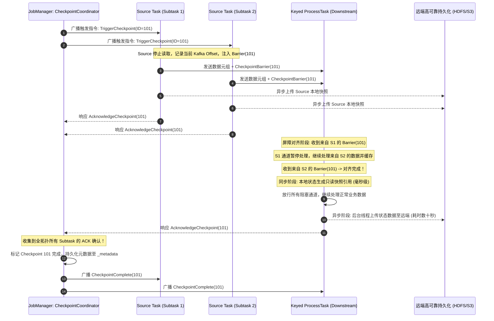
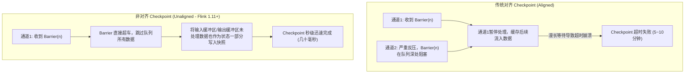
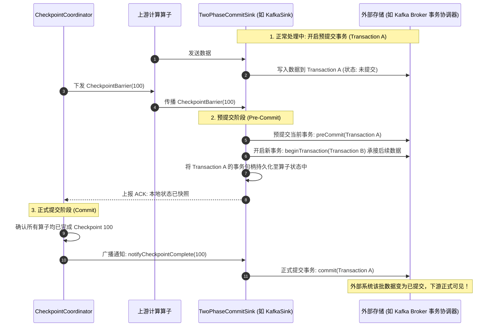
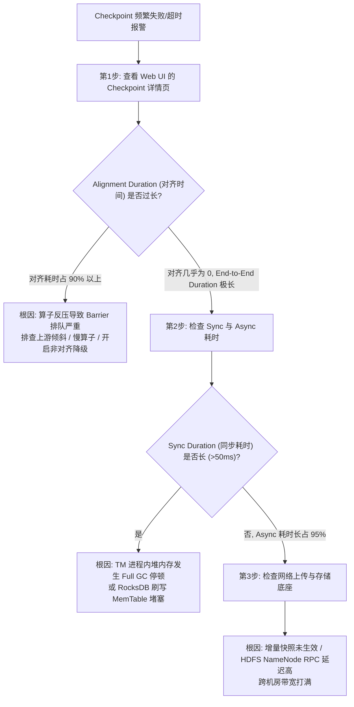
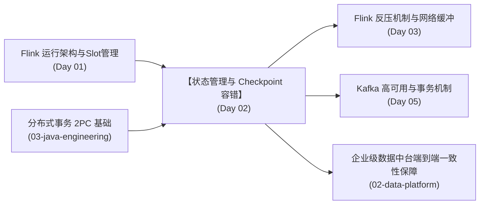

# Flink 状态管理机制、Checkpoint容错与端到端Exactly-Once深入剖析

> **学习目标定位**：全面掌握 Flink 托管状态（Managed State）分类、内部存储结构、StateBackend 演进（HashMap vs RocksDB vs Changelog）、改良版 Chandy-Lamport 异步屏障快照（ABS）算法、对齐与非对齐 Checkpoint 机制，以及基于 `TwoPhaseCommitSinkFunction` 的端到端 Exactly-Once（EOS）闭环。在技术总监与高级架构师面试中，能够从容应对状态暴涨、Checkpoint 超时崩溃排查及大促级数据一致性系统设计。

---

## 1. 知识概述

### 1.1 是什么（What）
在分布式流计算中，**状态（State）**指算子在处理连续事件流过程中为了保留中间计算结果（如聚合值、历史窗口数据、CEP模式匹配状态）而暂存的数据。**Checkpoint（检查点）**则是 Flink 周期性、异步地为全拓扑分布式有状态算子拍摄的全局一致性快照，持久化写入远程高可靠存储（如 HDFS / S3 / OSS）。

### 1.2 解决什么问题（Why）
传统流处理框架在故障容错上面临经典困境：
- **Storm 早期机制**：依赖 Acker 机制进行逐条 Tuple 确认，只能实现 At-Least-Once，且故障重发导致数据大量重复，无法原生支持聚合状态回滚。
- **Spark Streaming 微批处理**：依赖 RDD 血缘重算或批次 Checkpoint，虽然能保证一致性，但无法做到持续事件级别的毫秒级状态更新。
Flink 通过**异步屏障快照（Asynchronous Barrier Snapshotting, ABS）**算法，在无需暂停流水线（Stop-the-World）的前提下，实现极低开销的全局一致性快照生成，并在作业崩溃时精确回滚至上一次成功的 Checkpoint，实现状态与数据流位点的完美对齐。

### 1.3 适用场景与技术边界（Where & When）
- **适用场景**：
  - 核心交易计费对账、实时大屏精准去重（千万级 HyperLogLog 或精准 BitMap 状态）。
  - 物联网设备复杂事件处理（CEP）（如供热管网压力突降、温度异常窗口报警）。
  - 实时数仓 ODS 层到 DWD/DWS 层端到端金融级 Exactly-Once 流批一体管道。
- **反模式与技术边界**：
  - 将海量静态维度全量数据放入 Flink 算子内存状态中做 Join（应通过广播流、异步 I/O 查询 Redis/HBase 或分批维表缓存处理）。
  - 超长窗口（如保留 30 天以上的明细数据在状态中），会导致 RocksDB 膨胀几十 TB，引发 Checkpoint 严重超时（此类场景应将中间聚合沉淀至 OLAP 引擎如 Doris）。

---

## 2. 核心概念与关系

### 2.1 核心概念定义
| 概念名称 | 英文术语 | 核心定义与工程职责 | 存储与生命周期 |
| :--- | :--- | :--- | :--- |
| **键控状态** | Keyed State | 只能在 `KeyedStream`（即执行了 `keyBy()`）后使用的状态。每个 Key 拥有独立的 State 隔离实例。支持 ValueState, ListState, MapState 等。 | 随 Key 路由绑定，支持细粒度 TTL |
| **算子状态** | Operator State | 绑定在单个物理 Subtask 上的状态，与 Key 无关。常见于 Source（记录 Kafka Topic-Partition Offset）或 BroadcastState。 | Subtask 级别，重缩放时按轮询或合并广播切分 |
| **状态后端** | StateBackend | 负责决定状态在运行时如何存储、管理以及在 Checkpoint 时如何持久化的底层引擎（如内存堆、RocksDB）。 | 进程内堆内存 / 堆外 RocksDB 实例 |
| **异步屏障快照** | ABS (Barrier) | 一种特殊的注入数据流中的控制元组（`CheckpointBarrier`），协调上下游算子在流水线中划分快照边界。 | 随数据流在网络流控中平流传递 |
| **端到端精准一次** | End-to-End EOS | 保证从上游输入源、中间流处理计算到下游外部存储输出，即使系统发生任何节点宕机崩溃，最终结果均等价于严格被处理且仅处理一次。 | 全链路事务闭环 |
| **保存点** | Savepoint | 由运维人员手动触发的用户控制的快照（带全局作业元数据）。拥有统一格式，用于版本升级、迁移集群、修改并行度。 | 独立持久化，生命周期由用户掌控 |

### 2.2 状态结构与分类全景关系


---

## 3. 底层原理

### 3.1 异步屏障快照（Chandy-Lamport 与 ABS 算法演进）

Flink 的 Checkpoint 机制是经典分布式快照算法 **Chandy-Lamport** 在有向无环数据流图（DAG）中的工程化剪裁改良版。



#### 关键两阶段划分：
1. **同步阶段（Synchronous Phase）**：
   - 算子在消费完所有上游通道发来的对应 ID 的 Barrier 后，触发本地快照。
   - 仅对内存数据结构或 RocksDB 拍摄本地快照视图（RocksDB 内部执行 `checkpoint` 生成轻量级 SST 硬链接）。
   - **此过程极快（通常 < 10ms）**，完毕后立刻放行数据流，最大程度降低对实时吞吐的冲击。
2. **异步阶段（Asynchronous Phase）**：
   - 算子派生独立的后台异步线程池（`AsyncCheckpointRunnable`），将本地快照产生的状态数据块通过网络上传到 HDFS/S3。
   - 上传成功后向 JM 发送 `AcknowledgeCheckpoint`。

---

### 3.2 对齐（Aligned） vs 非对齐（Unaligned）Checkpoint

在生产高负载场景下，反压（Backpressure）会导致 Checkpoint 严重超时，其根本原因就在于 **Barrier 对齐等待**。



| 评估维度 | 对齐 Checkpoint (Aligned) | 非对齐 Checkpoint (Unaligned) |
| :--- | :--- | :--- |
| **快照内容** | 仅包含算子内部业务状态 | 算子内部业务状态 + **输入/输出网络缓冲区中的积压数据** |
| **反压下表现** | Barrier 在网络队列中排队，极易导致超时失败 | **秒级迅速完成**，完全不受反压阻塞影响 |
| **快照体积** | 小（只存纯业务状态） | 较大（额外持久化了通道中飞行的数据） |
| **恢复开销** | 极低（恢复后直接从 Source Offset 消费） | 稍高（需要回放重放网络缓冲区中未处理的数据） |
| **适用场景** | 流量平稳、无长期严重反压的标准业务 | **大促/高负载有严重反压、且无法容忍 Checkpoint 失败的场景** |

---

### 3.3 端到端 Exactly-Once 闭环：两阶段提交（2PC）协议

要实现真正意义上的端到端 Exactly-Once，仅靠 Flink 内部快照是不够的，必须满足 **三位一体**：
1. **Source 端**：必须具备**可重设消费位点（Replayable Source）**能力（如 Kafka Offset、 Pulsar、Socket File）。
2. **Flink 内部**：开启 Checkpoint 并配置一致性保证为 `CheckpointingMode.EXACTLY_ONCE`。
3. **Sink 端**：必须支持**幂等写入（Idempotent Sink）**或**事务性写入（Transactional Sink）**。

#### 基于 `TwoPhaseCommitSinkFunction` 的 2PC 协同全流程：


> [!WARNING]
> **生产踩坑核心预警**：Kafka 的默认事务超时时间 `transaction.timeout.ms` 是 15 分钟，而 Flink 的 Checkpoint 超时参数（`checkpoint.timeout`）若设置得过长，当发生反压且 Checkpoint 耗时逼近 15 分钟时，Kafka Broker 会判定该事务超时而强行将其 Abort 丢弃，导致 Flink 后续正式提交报 `InvalidProducerEpoch` 异常引起整个作业反复雪崩重启！

---

## 4. 核心实现与源码分析 (Flink 1.17+)

### 4.1 核心源码类与职责映射
| 核心模块 | 关键类名 (含包路径) | 核心入口方法 | 核心源码职责 |
| :--- | :--- | :--- | :--- |
| **协调总控** | `org.apache.flink.runtime.checkpoint.CheckpointCoordinator` | `triggerCheckpoint()` | 周期调度或手动触发快照，注入 Barrier，跟踪全网 ACK |
| **子任务协调**| `org.apache.flink.streaming.runtime.tasks.SubtaskCheckpointCoordinatorImpl` | `checkpointState()` | 拦截 Barrier 对齐，协调同步与异步快照任务分发 |
| **快照执行器**| `org.apache.flink.streaming.runtime.tasks.AsyncCheckpointRunnable` | `run()` | 在独立线程池中执行异步状态上传并回调 ACK |
| **RocksDB引擎**| `org.apache.flink.contrib.streaming.state.RocksDBKeyedStateBackend` | `snapshot()` | 调用 RocksDB JNI 创建快照，硬链接 SST 并筛选增量变更 |
| **两阶段Sink** | `org.apache.flink.streaming.api.functions.sink.TwoPhaseCommitSinkFunction` | `preCommit()` / `commit()` | 封装 2PC 模板方法，将外部事务生命周期绑定 Checkpoint |

### 4.2 核心实现流程剖析

#### 1. JM 触发快照逻辑（`CheckpointCoordinator.java`）
```java
// 截取自 CheckpointCoordinator 触发入口逻辑片段
private CompletableFuture<CompletedCheckpoint> startCheckpoint(...) {
    // 1. 前置条件检查: 作业状态必须为 RUNNING，且当前未达到最大并发 Checkpoint 上限
    if (isMaxCheckpointBoostrapExceeded()) {
        throw new CheckpointException(CheckpointFailureReason.TOO_MANY_CONCURRENT_CHECKPOINTS);
    }
    
    // 2. 生成全局递增单调唯一 CheckpointID
    final long checkpointId = checkpointIdCounter.getAndIncrement();
    
    // 3. 构建元数据描述 PendingCheckpoint
    final PendingCheckpoint checkpoint = new PendingCheckpoint(
            jobId, checkpointId, timestamp, checkpointStorageLocation, ...);
            
    // 4. 向所有 Source 算子的 ExecutionVertex 发送 RPC 触发广播
    for (Execution execution : tasksToTrigger) {
        execution.triggerCheckpoint(checkpointId, timestamp, checkpointOptions);
    }
    return checkpoint.getCompletionFuture();
}
```

#### 2. RocksDB 增量快照实现机制（`RocksDBKeyedStateBackend.java`）
在 RocksDB 增量快照中，Flink 利用了 LSM-Tree 中 **SST 文件只写不改（Immutable）**的特性：
- 每次 Checkpoint，RocksDB 调用 JNI 执行 `checkpoint`，在本地创建当前数据目录的**硬链接（Hard Link）**，阻止 Compaction 删除这些正在使用的文件。
- 比较上一次成功 Checkpoint 的 SST 文件清单：
  - 若某个 `.sst` 文件在上一次已经上传过，**则跳过本次物理上传**，直接在元数据中引用旧的远程路径。
  - 仅物理上传全新写入或 Compaction 新生成的 `.sst` 文件。
- 收益：海量状态下，原本需要数分钟的全量快照上传，增量模式下几百毫秒即可完成。

---

## 5. 工程实践与落地

### 5.1 生产级 Checkpoint 核心调优配置

```properties
# ==================== Checkpoint 基础控制 ====================
# 开启 Checkpoint，设置合理周期为 1~3 分钟（过短导致集群压力大，过长导致宕机回滚数据量多）
execution.checkpointing.interval: 60000ms

# 设置 Checkpoint 模式为精准一次
execution.checkpointing.mode: EXACTLY_ONCE

# 必须设置超时时间，防止个别长尾 Subtask 永久吊死整个 Checkpoint
execution.checkpointing.timeout: 600000ms

# 关键参数：两次 Checkpoint 之间的最小暂停时间（强制给业务处理留出空闲 I/O，防止连续触发导致系统雪崩）
execution.checkpointing.min-pause-between-checkpoints: 30000ms

# 生产环境强烈建议将并发 Checkpoint 数设为 1，避免多快照并发抢占 I/O 和造成逻辑混乱
execution.checkpointing.max-concurrent-checkpoints: 1

# 允许连续 Checkpoint 失败的最大次数，避免因为偶发网络抖动导致整个流任务直接退出
execution.checkpointing.tolerable-failed-checkpoints: 3

# 作业被取消或失败退出时，保留外部持久化 Checkpoint 元数据（便于故障手动恢复）
execution.checkpointing.externalized-checkpoint-retention: RETAIN_ON_CANCELLATION

# ==================== 高负载自愈优化 (Flink 1.13+) ====================
# 开启非对齐 Checkpoint 对齐超时自动降级：正常情况下先走对齐 Checkpoint，
# 若超过 8 秒未对齐完成，自动动态平滑降级为非对齐 Checkpoint，兼顾快照体积与抗反压能力！
execution.checkpointing.unaligned.enabled: true
execution.checkpointing.aligned-checkpoint-timeout: 8000ms

# ==================== RocksDB 状态性能微调 ====================
state.backend: embedded-rocksdb
state.backend.incremental: true

# 开启托管内存自动受控（防止 RocksDB 堆外内存突破容器上限导致 Exit 137 OOM-Killed）
state.backend.rocksdb.memory.managed: true
state.backend.rocksdb.memory.write-buffer-ratio: 0.5
state.backend.rocksdb.memory.high-prio-pool-ratio: 0.1
```

### 5.2 状态清理 TTL（Time-To-Live）生产规约

未设置 TTL 的 Keyed State 是生产高频 OOM 与状态无限制膨胀的罪魁祸首。
```java
// 生产规范：针对用户画像、实时统计状态必须配置 StateTtlConfig
StateTtlConfig ttlConfig = StateTtlConfig
    .newBuilder(Time.hours(24)) // 状态保留 24 小时
    .setUpdateType(StateTtlConfig.UpdateType.OnCreateAndWrite) // 仅写入/创建时重置时间
    .setStateVisibility(StateTtlConfig.StateVisibility.NeverReturnExpired) // 过期数据绝不可见
    .cleanupInRocksdbCompactFilter(1000) // 在 RocksDB 后台 Compaction 期间静默清理过期 Key
    .build();

ValueStateDescriptor<DeviceStatus> descriptor = 
    new ValueStateDescriptor<>("device-status-state", DeviceStatus.class);
descriptor.enableTimeToLive(ttlConfig);
```

---

## 6. 常见生产问题与排查指南

### 6.1 Checkpoint 耗时激增与超时（Timeout）排查四步法



### 6.2 大促压测下 Kafka 事务超时引发反复重启
- **现象**：业务洪峰期，Flink 作业反复崩溃，错误堆栈指向 `ProducerFencedException: TransactionalId ... was fenced`。
- **根因分析**：
  Kafka Broker 的 `transaction.timeout.ms` 默认为 15 分钟（900000ms）。由于大促时 Flink Checkpoint 发生反压延期，使得一次 Checkpoint 耗时达到了 16 分钟。当 JM 终于广播 `CheckpointCompleted` 指令时，Kafka 事务协调器早已将该事务判定超时并宣告死亡，强制回滚。此时 Flink 尝试提交该无效事务，立刻被 Kafka 拒绝。
- **解决方案**：
  1. 调大 Kafka 集群 `transaction.timeout.ms`（如设为 2 小时，给予容灾留量）。
  2. 调小 Flink `execution.checkpointing.timeout`（必须严格小于 Kafka 超时时间，例如设为 10 分钟，确保在 Kafka 事务失效前 Flink 提前判定失败并回滚）。

---

## 7. 技术选型对比与取舍

### 7.1 StateBackend 状态后端对比矩阵
| 选型维度 | HashMapStateBackend | EmbeddedRocksDBStateBackend | ChangelogStateBackend (FLIP-158) |
| :--- | :--- | :--- | :--- |
| **存储介质** | JVM 堆内存（Java 对象） | 堆外 C++ 本地磁盘 + 缓存 | 内存/RocksDB + 外部分布式日志 |
| **读写延迟** | **极低（纳秒级）**，纯内存指针寻址 | 较低（微秒级），涉及 JNI 与序列化 | 极低（写入只需 append 日志） |
| **支持状态容量** | 受限于单 TM 堆内存大小（通常 < 50GB） | **极其庞大（TB/PB级）**，受本地磁盘限制 | 极其庞大 |
| **Checkpoint机制** | 全量复制上传（大状态时极慢） | **原生支持高效增量快照** | **秒级超轻量持续快照** |
| **运维门槛** | 低（调优标准 JVM 参数即可） | 中高（需调优 JNI、C++ 缓存与本地目录）| 较高（依赖高吞吐消息流日志存储） |
| **适用业务** | 小状态、对延迟要求极致（如毫秒级规则监控）| **企业级海量状态计算、双11大促大屏** | 对 Checkpoint 间隔要求极致（秒级）场景 |

### 7.2 架构师选型决策
- 如果单个 TaskManager 的总状态量在 **10GB 以内**，且对处理延迟敏感度在微秒级：首选 **HashMapStateBackend**。
- 如果涉及海量窗口聚合、多维历史去重、状态量突破 **100GB ~ 数十 TB**：必须选择 **EmbeddedRocksDBStateBackend + 增量 Checkpoint**。
- 如果业务场景存在持续反压，且要求 Checkpoint 必须做到 1 秒级甚至亚秒级以降低故障恢复数据重放量：探索引入 **ChangelogStateBackend**。

---

## 8. 面试高频问题

### 8.1 基础题
1. **Q1**：Flink 的 Checkpoint 和 Savepoint 有什么本质区别？分别在什么场景下使用？
2. **Q2**：什么是 Keyed State 和 Operator State？各自的生命周期和重缩放（Rescaling）行为是怎样的？
3. **Q3**：HashMapStateBackend 和 EmbeddedRocksDBStateBackend 在内存管理机制上有何根本不同？

### 8.2 原理题
4. **Q4**：请详细阐述 Flink 的异步屏障快照（ABS）算法是如何保证分布式全局一致性的？
5. **Q5**：什么是 Checkpoint Barrier 对齐？为什么非对齐 Checkpoint（Unaligned Checkpoint）能够在反压下秒级完成？其带来的额外代价是什么？
6. **Q6**：RocksDB 增量 Checkpoint（Incremental Checkpoint）在底层是依靠什么机制做到只上传增量数据的？

### 8.3 生产场景题
7. **Q7**：生产环境下某核心 Flink 作业 Checkpoint 频繁报 `Checkpoint expired before completing` 超时报警，作为平台负责人，你的系统化排查定位步骤是什么？
8. **Q8**：生产使用 Flink 写入 Kafka 时，作业恢复后下游消费者读到了被回滚掉的“脏数据”，为什么会出现这个现象？如何彻底解决？
9. **Q9**：某业务使用了超大 RocksDB 状态（单作业超 5TB），集群频繁报出容器 Exit Code 137（被系统 OOM-Killed），但在 Grafana 上观察堆内存只有 30%，如何排查和根治？

### 8.4 架构设计题
10. **Q10**：请设计一套从数据摄入、实时清洗聚合到外部存储的端到端 Exactly-Once 企业级数据中台流计算架构方案，讲清异常节点宕机时数据不丢不重的完整恢复推演流程。

---

## 9. 标准参考答案

### 题目1（高频原理）：请详细阐述基于 `TwoPhaseCommitSinkFunction` 的端到端 Exactly-Once 闭环工作流程。

#### 简洁回答（1分钟电梯破题）：
> “端到端 Exactly-Once 要求 Source 可重设位点、内部精确快照与 Sink 事务协同。Flink 通过 `TwoPhaseCommitSinkFunction` 实现了标准的分布式两阶段提交协议：
> 在两次 Checkpoint 之间，Sink 将数据写入外部系统的预提交事务；当 Checkpoint Barrier 到达 Sink 时，执行 `preCommit` 结束当前事务并开启新事务承接后续数据，并将旧事务句柄存入状态；当 JobManager 确认全拓扑快照成功并广播通知后，Sink 执行 `commit` 正式提交事务，此时外部数据才对下游可见。若期间发生任何宕机，作业基于上次 Checkpoint 重启，未提交的预提交事务被 Abort 丢弃，Source 回滚 Offset 重新计算，从而实现全链路精准一次。”

#### 深入回答（机制与异常分支推导）：
> “从底层协作与异常恢复流转看，分为四个关键阶段：
> 1. **事务初始化与预提交（Pre-commit）**：
>    在 `initializeState()` 时恢复未决事务；在处理数据时调用 `beginTransaction()`。当当前 Subtask 收到上游所有通道的 Barrier 时，触发快照同步阶段，调用 `preCommit()`。在 Kafka 场景下，这对应将 Kafka 生产者当前的 Transaction 刷新并标记为 Prepare 状态，此后该事务不再接受新写入。
> 2. **新事务交接**：
>    调用 `beginTransaction()` 创建全新事务（Transaction B），后续流入的数据全部打入 Transaction B 中，保证流水线处理零中断。
> 3. **协调者裁决与正式提交（Commit）**：
>    所有 Subtask 上报 ACK 到 JM，JM 判定快照成功后将元数据写入高可靠存储，并向所有算子广播 `notifyCheckpointComplete()`。Sink 收到回调后调用 `commit()` 执行底层外部事务的真实 Commit 标记。
> 4. **异常回滚场景推演**：
>    - **如果在 JM 收到全员 ACK 之前某 TM 宕机**：JM 判定该 Checkpoint 失败，触发全局恢复。所有算子回滚至上一次成功 Checkpoint 的状态，未决的预提交事务因从未收到 Commit 指令，在恢复时被 `abort()` 显式中止或等待外部系统超时回滚。
>    - **如果在收到 Commit 指令后、执行 commit 操作时 TM 宕机**：由于该 Checkpoint 已经在 JM 处标记为成功（元数据已持久化），作业重启时，`initializeState()` 会从快照中读取之前持久化下来的处于预提交状态的事务句柄，**在重启恢复阶段重新触发 commit() 操作**。因此，外部系统必须支持事务提交的幂等性（即重复 commit 同一个 TransactionId 不报错）。”

#### 架构师视角（取舍、SLA 与成本）：
> “在实际技术选型与架构设计中，端到端 2PC 并非万灵药，作为技术负责人必须清醒评估其带来的架构代价：
> 第一，**端到端延迟的放大**。下游消费者如果要求读已提交数据（`isolation.level = read_committed`），其数据可见延迟不再是毫秒级，而是**直接取决于 Checkpoint 的触发间隔**（通常在 1 分钟左右）。对于秒级响应的实时大屏，不能盲目强推 2PC 强一致，更适合通过**幂等写入（Idempotent Upsert，如写入 Doris/HBase/Redis 主键覆盖）**来实现最终一致性。
> 第二，**系统复杂性与稳定性风险**。2PC 强依赖外部系统的事务可靠性，极易出现跨系统超时冲突（如 Kafka 事务超时与 Checkpoint 超时的配置对抗）。在瑞纳智能数据中台中，我们对实时计费与核心审计链条采用 2PC 确保强一致；而在设备监控、实时大屏这类高吞吐容忍轻微重复的链路上，果断采用‘At-Least-Once + 业务主键幂等 Sink’，以极低的管理复杂度换取极高的系统韧性。”

---

### 题目2（生产排障）：大促期间，某核心 Flink 作业 Checkpoint 频繁超时，导致作业反复重启崩溃，你如何系统化排查与治理？

#### 简洁回答：
> “我的排查三步法是：第一，登录 Flink Web UI 查看 Checkpoint 详情，对比 `Alignment Duration` 与 `Async Duration` 定位瓶颈是在对齐阶段还是异步上传阶段；第二，若对齐耗时长，顺藤摸瓜定位产生反压的瓶颈算子或数据倾斜 Key；若异步耗时长，检查网络带宽、HDFS 存储性能与增量快照是否开启；第三，短期应急调大 Checkpoint 超时参数并开启‘非对齐快照超时自动降级’止血，长期治理则优化数据倾斜与底层存储资源。”

#### 深入回答：
> “详细排查与调优路径如下：
> 1. **区分瓶颈阶段**：
>    - **情况 A（对齐阻塞）**：`Checkpoint Alignment Duration` 占总体耗时的 80% 以上。这说明算子消费能力不足导致反压，Barrier 在网络 Buffer 队列中被阻塞。此时通过 Web UI 的 Backpressure 监控自下而上查找反压发源算子，结合 Flame Graph 火焰图判断是 UDF 逻辑存在密集计算、外部数据库慢查询，还是产生了 Hash Key 数据倾斜。
>    - **情况 B（异步持久化慢）**：对齐耗时几毫秒，但 `Async Duration` 长达几分钟。说明本地状态到 HDFS/S3 的 I/O 打满。此时检查是否误使用了全量快照而非 RocksDB 增量快照（`state.backend.incremental: true`），以及 HDFS NameNode 是否存在 RPC 拥堵。
> 2. **针对性工程治理招式**：
>    - **开启自适应非对齐快照**：配置 `execution.checkpointing.aligned-checkpoint-timeout: 8s`。平时走对齐保证最小快照体积，一旦遭遇大促流量脉冲导致 8 秒未对齐，自动无缝切换为非对齐快照，彻底根治 Barrier 被反压阻塞导致的超时失败。
>    - **设置安全缓冲时间**：务必配置 `execution.checkpointing.min-pause-between-checkpoints: 30s`，杜绝一次 Checkpoint 超时失败后立刻触发下一次导致的‘雪崩效应’。
>    - **防范连锁重启**：提高 `tolerable-failed-checkpoints`（例如设为 3~5 次），避免单次偶发失败就强杀作业。”

#### 架构师视角：
> “在技术管理与大促保障层面，这不仅是一个技术调优问题，更是一个**生产容灾与 SLA 治理流程**：
> 1. **大促前建立资源红线**：在大促压测阶段，我们设立硬性指标——核心 P0 作业的 Checkpoint 耗时不得超过周期的 30%，若超过必须前置进行算子拆分与并发扩容。
> 2. **建立自动化降级机制**：在平台管理层，支持一键动态调整 Checkpoint 间隔（从 1 分钟调大至 5 分钟），在大促峰值期间降低存储底座压力。
> 3. **监控告警分级**：区分‘单次 Checkpoint 耗时增加（P3预警）’与‘连续失败达到阈值（P1告警）’，在故障真正导致作业重启前，留出充足的人工介入处理窗口。”

---

## 10. 知识自检清单

- [ ] 能否不看文档，手绘出 2PC 两阶段提交协议在 Flink 与外部 Sink 交互时的 6 个关键动作时序？
- [ ] 能否清晰解释非对齐 Checkpoint（Unaligned Checkpoint）为什么能抵抗反压，其落盘的状态数据比对齐 Checkpoint 多了什么？
- [ ] 为什么生产环境使用 RocksDB 时必须配置 `state.backend.incremental: true`？其底层利用了 LSM-Tree 的什么物理文件特性？
- [ ] 能否准确说出 Kafka 事务超时参数与 Flink Checkpoint 超时参数产生冲突时的生产现象与配置底线？

---

## 11. 知识脉络与上下游关联



- **前置技术依赖**：
  - `01-bigdata/01-flink/01-flink-runtime-architecture.md`（JobMaster、TaskManager 协作拓扑）
  - `03-java-engineering/distributed-concurrency.md`（分布式一致性、两阶段提交协议）
- **核心承接进阶**：
  - `01-bigdata/01-flink/03-flink-backpressure.md`（Credit-based 反压机制与网络流控）
  - `01-bigdata/02-kafka/02-kafka-transactions.md`（Kafka 事务协调器与幂等 Producer）

---

## 12. 权威参考资料与原始出处

1. **分布式快照奠基论文**：*Chandy, K. Mani, and Leslie Lamport. "Distributed snapshots: determining global states of distributed systems." ACM Transactions on Computer Systems (TOCS) 3.1 (1985): 63-75.*
2. **Flink 异步屏障快照官方论文**：*Carbone, Paris, et al. "Lightweight asynchronous snapshots for distributed dataflows." arXiv preprint arXiv:1506.08603 (2015).*
3. **Apache Flink 官方状态与容错文档 (v1.17)**：[Flink State & Fault Tolerance Documentation](https://nightlies.apache.org/flink/flink-docs-release-1.17/docs/dev/datastream/fault-tolerance/checkpointing/)
4. **Flink 官方设计提案 (FLIP-158)**：[Unified Log-Based Changelog State Backend](https://cwiki.apache.org/confluence/display/FLINK/FLIP-158)
5. **GitHub 核心代码路径**：
   - `flink-runtime/src/main/java/org/apache/flink/runtime/checkpoint/CheckpointCoordinator.java`
   - `flink-streaming-java/src/main/java/org/apache/flink/streaming/api/functions/sink/TwoPhaseCommitSinkFunction.java`
   - `flink-state-backends/flink-statebackend-rocksdb/src/main/java/org/apache/flink/contrib/streaming/state/RocksDBKeyedStateBackend.java`
