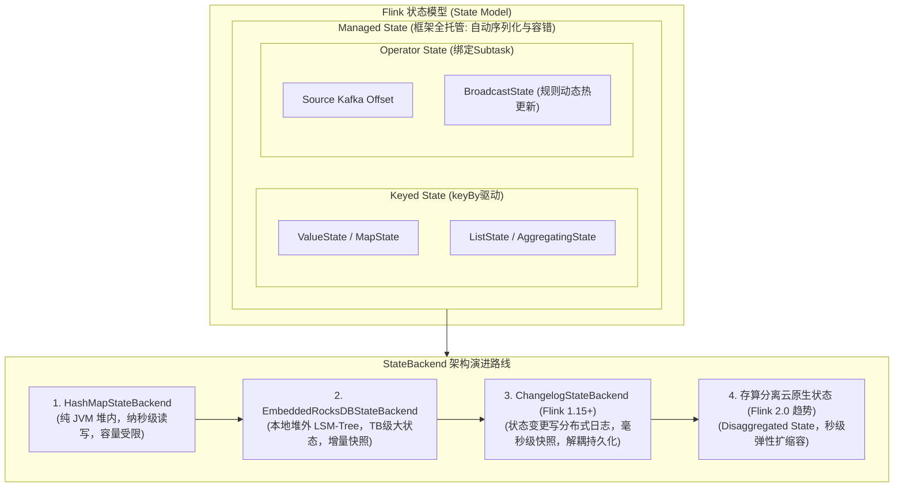
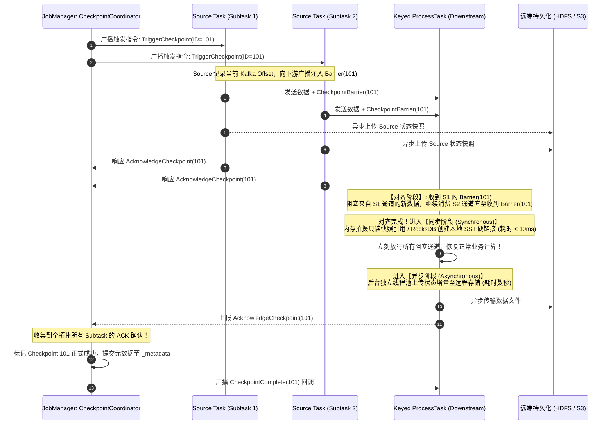
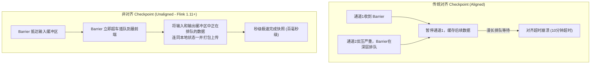
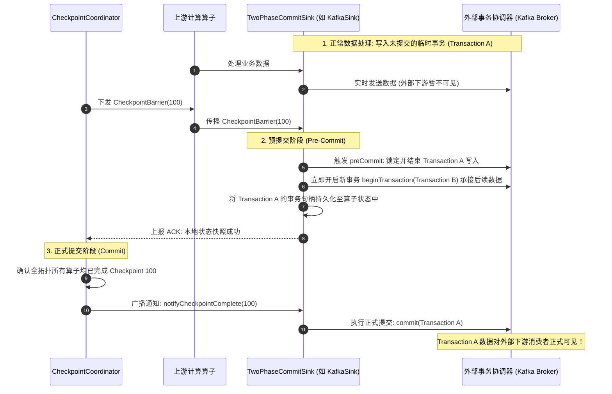
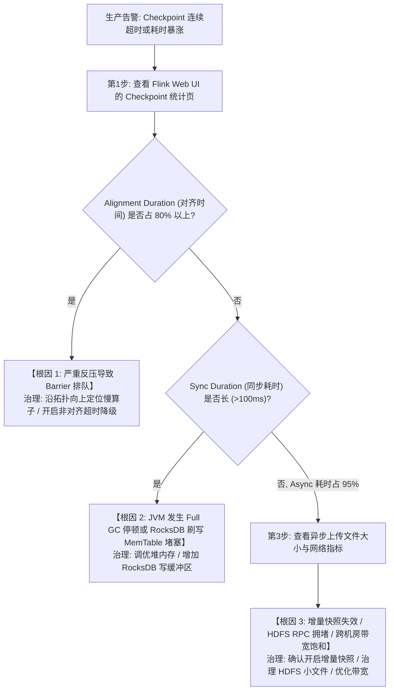
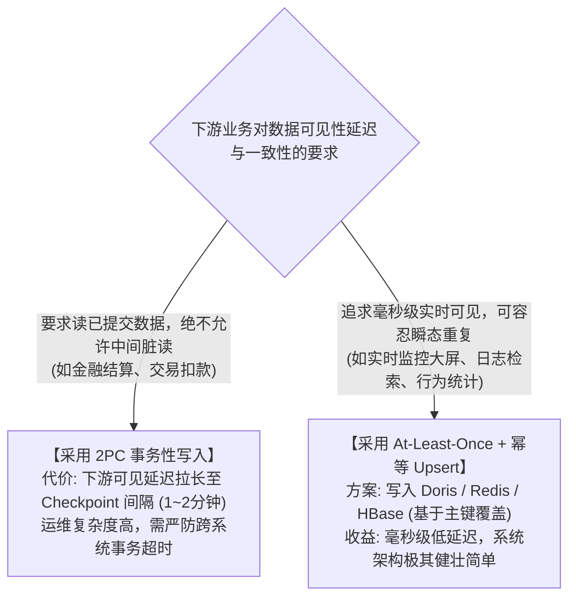
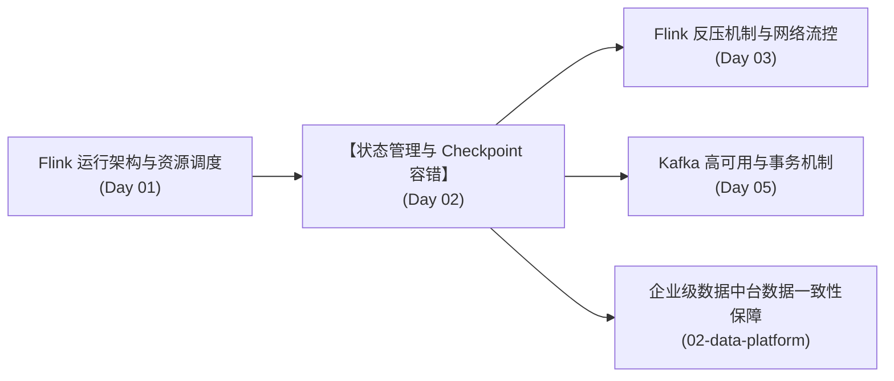

# Flink 状态管理、Checkpoint容错与端到端Exactly-Once（高阶架构与生产实战）

> **学习目标定位**：面向数据平台研发负责人、大数据架构师与技术总监岗位，深刻掌握 Flink 托管状态（Managed State）的存储模型、StateBackend 演进（HashMap vs RocksDB vs Changelog vs 存算分离）、异步屏障快照（ABS）算法及基于两阶段提交（2PC）的端到端 Exactly-Once 机制。结合字节跳动、美团等互联网大厂真实高频面试场景，系统掌握大促状态暴涨治理、Checkpoint 超时雪崩排查及“强一致延迟 vs 幂等最终一致”的架构权衡。

---

## 1. 知识概述与业务价值

### 1.1 是什么（What）
在流计算领域，**状态（State）**是算子保留历史中间结果（如窗口内聚合值、维表缓存、CEP规则序列）的本地数据载体。**Checkpoint（检查点）**则是 Flink 周期性、异步地为全分布式拓扑拍摄的全局一致性数据快照，持久化写入远程高可靠存储（如 HDFS / S3 / OSS）。在最新的 **Flink 1.19 / 1.20 及 2.0 时代**，状态机制正在经历从“本地磁盘紧耦合绑定”向“**存算分离（Disaggregated State）与日志化持续快照（Changelog）**”的划时代架构跃迁。

### 1.2 解决什么核心业务痛点（Why）
传统流处理框架在故障容错上面临经典困境：
1. **At-Least-Once 的数据重复代价**：传统消息流处理系统在节点宕机时只能简单回滚上游 Offset 重新发送，导致下游报表统计翻倍、计费扣款重复，不得不依赖外部存储进行昂贵的全局去重。
2. **全局暂停（Stop-the-World）的快照代价**：早期分布式系统若要获取全局一致性状态，必须短暂停顿所有算子数据流入，严重伤害实时流的低延迟 SLA。
3. **海量状态下的故障恢复漫长**：若采用全量快照，数十 TB 级状态的拉取恢复动辄需要数十分钟，无法满足企业核心交易链路秒级自愈的要求。
Flink 采用改良版 **Chandy-Lamport 异步屏障快照（ABS）**与**增量/非对齐快照机制**，实现了“不停机、不阻塞正常流转、毫秒级本地快照切片、秒级故障恢复”的金融级容错能力。

### 1.3 适用场景与技术边界（Where & When）
- **高价值适用场景**：
  - **金融与计费对账系统**：严禁任何由于网络抖动或节点重启导致的数据丢失或重复。
  - **工业与物联网时序状态追踪**：如瑞纳智能数万换热站设备的持续滑动窗口均值计算与突变判定。
  - **实时数仓 ODS -> DWD 流式 ETL 管道**：结合 Kafka 与 Doris/Iceberg 构建端到端精准一次数据入湖入仓。
- **技术边界与反模式**：
  - **将海量超长生命周期明细存入状态**：例如在状态中保留 30 天以上的全量用户明细做宽表拼接，会导致 RocksDB 状态膨胀至数百 TB 引发雪崩（此类场景应将明细沉淀至实时 OLAP 引擎中）。

---

## 2. 核心概念与关系

### 2.1 核心概念全景表
| 概念名称 | 英文术语 | 核心定义与工程职责 | 存储与生命周期级别 |
| :--- | :--- | :--- | :--- |
| **键控状态** | Keyed State | 只能在 `KeyedStream`（即 `keyBy()` 之后）使用的状态。状态按 Key 逻辑隔离，支持 ValueState, ListState, MapState 等。 | 随 KeyGroup 分布，支持细粒度 TTL |
| **算子状态** | Operator State | 绑定在单个物理 Subtask 上的状态，与 Key 无关。常见于 Source（保存 Kafka Partition Offset）或广播状态（BroadcastState）。 | Subtask 实例级，重缩放时轮询或合并广播 |
| **状态后端** | StateBackend | 负责决定状态在运行时如何存储读写，以及在 Checkpoint 时如何打包持久化的底层存储引擎。 | JVM 堆内存 / 本地 RocksDB / 远程日志 |
| **屏障快照** | Checkpoint Barrier | 随数据流在网络流控队列中同向流动的特殊控制元组，用于在连续事件流中精确划分不同快照世代（Epoch）。 | 流水线传输级 |
| **端到端精准一次** | End-to-End EOS | 保证上游数据源、中间流计算与下游外部存储在发生任何单点崩溃时，最终对外输出结果等价于“严格被处理且仅处理一次”。 | 全链路强一致闭环 |
| **保存点** | Savepoint | 由运维或自动化平台显式手动触发的用户级快照。格式全版本兼容，主要用于版本平滑发布、修改并发与集群搬迁。 | 永久独立存储，生命周期由人工管控 |

### 2.2 状态结构与 StateBackend 演进全景关系图


---

## 3. 底层工作机制与设计哲学

### 3.1 异步屏障快照（ABS 算法）底层流转机制

Flink 的 Checkpoint 机制是经典分布式快照算法 **Chandy-Lamport** 在 DAG 流水线中的工程改良版。其核心思想是：**通过注入轻量控制屏障（Barrier），将连续数据流切分为不同的逻辑世代，利用异步写入实现快照拍摄与正常数据处理的高效并行**。



### 3.2 深度对比：对齐（Aligned） vs 非对齐（Unaligned）Checkpoint

在生产高负载场景下，反压（Backpressure）会导致 Checkpoint 严重超时，其根本原因就在于 **Barrier 在网络输入缓冲区中的排队阻塞**。



| 评估维度 | 对齐 Checkpoint (Aligned) | 非对齐 Checkpoint (Unaligned) |
| :--- | :--- | :--- |
| **快照内容** | 仅包含算子内部业务状态 | 算子业务状态 + **网络输入/输出缓冲区中的积压数据** |
| **抗反压能力** | 差（反压严重时 Barrier 无法推进，导致超时失败） | **极强（秒级完成快照，完全免疫反压堵塞）** |
| **快照体积** | 小（纯业务数据） | 较大（额外持久化了通道内“飞行中的数据”） |
| **恢复重放成本** | 极低（恢复后直接从 Source 消费） | 稍高（启动时需先回放并重放网络缓冲区积压数据） |
| **架构师权衡建议**| 流量平稳、无长期严重反压的标准业务 | **大促/高负载脉冲流量、不允许因反压引发作业重启的场景** |

### 3.3 端到端 Exactly-Once 闭环：两阶段提交（2PC）协议机制

要实现真正意义上的端到端 Exactly-Once，必须实现 **可重设位点的 Source + Flink 内部状态快照 + 事务性/幂等 Sink** 的三位一体。



---

## 4. 高频复杂业务场景实操与落地

### 4.1 生产典型业务场景：全链路金融级实时对账与计费平台
以交易计费场景为例：上游订单与支付流水通过 Kafka 摄入，Flink 负责双流 Join 并在滑动窗口内计算商户应结算金额与手续费。要求：
1. 绝对严禁重复扣费或漏记扣款（端到端强一致性）；
2. 面对大促流量脉冲，Checkpoint 不能因反压延期而拖垮业务；
3. 状态随时间自动滑动清理，防止内存泄漏。

```mermaid
flowchart LR
    Orders["订单流水 (Kafka)"] --> Source["KafkaSource (P=16)"]
    Payments["支付流水 (Kafka)"] --> Source
    Source -->|KeyBy(OrderID)| Join["双流 Interval Join 算子<br/>(RocksDB 状态暂存 2小时)"]
    Join -->|KeyBy(MerchantID)| Agg["商户结算滑动窗口聚合<br/>(配置 State TTL 24小时)"]
    Agg -->|2PC 事务提交| KafkaSink["Kafka Transactional Sink<br/>(精准一次产出计费结果)"]
    KafkaSink --> Downstream["下游银行结算与账务系统"]
```

### 4.2 生产级 Checkpoint 核心调优参数基线

```properties
# ==================== Checkpoint 基础行为 ====================
# 周期设为 1~2 分钟（太短导致存储底座 I/O 承压，太长导致故障回滚数据量过大）
execution.checkpointing.interval: 60000ms

# 设置强一致模式
execution.checkpointing.mode: EXACTLY_ONCE

# 设置合理超时（必须严格小于下游如 Kafka 事务超时时间，预留 20% 安全余量）
execution.checkpointing.timeout: 600000ms

# 关键防雪崩参数：两次 Checkpoint 之间的最小暂停时间（强制给业务处理预留纯净 I/O）
execution.checkpointing.min-pause-between-checkpoints: 30000ms

# 并发 Checkpoint 数必须锁死为 1（防止多个快照并发抢占 I/O 与带宽引发雪崩）
execution.checkpointing.max-concurrent-checkpoints: 1

# 允许偶发连续失败的最大容忍次数（防止偶发网络微抖动直接把 P0 任务强杀）
execution.checkpointing.tolerable-failed-checkpoints: 3

# 作业被取消或失败时保留外部快照元数据（便于手动恢复）
execution.checkpointing.externalized-checkpoint-retention: RETAIN_ON_CANCELLATION

# ==================== 抗反压自适应平滑降级 (Flink 1.13+) ====================
# 开启非对齐快照平滑降级：优先走对齐 Checkpoint，若超过 8 秒未对齐，自动无缝降级为非对齐快照！
execution.checkpointing.unaligned.enabled: true
execution.checkpointing.aligned-checkpoint-timeout: 8000ms

# ==================== RocksDB 状态与内存受控 ====================
state.backend: embedded-rocksdb
state.backend.incremental: true
state.backend.rocksdb.memory.managed: true
state.backend.rocksdb.memory.write-buffer-ratio: 0.5
```

---

## 5. 生产异常故障深度排查与根因分析

### 5.1 Checkpoint 耗时激增与超时崩溃排查树



### 5.2 核心生产异常场景实操复盘

#### 场景一：Kafka 事务超时与 Checkpoint 超时冲突引发的反复雪崩
- **真实生产现象**：在大促流量高峰期，Flink 任务突然崩溃，报错堆栈出现 `ProducerFencedException: TransactionalId ... was fenced`。重启后刚运行几分钟再次崩溃，形成无限恶性循环。
- **深度根因分析**：
  Kafka Broker 的 `transaction.timeout.ms` 默认为 15 分钟。在大促期间，由于 Flink 出现反压，某次 Checkpoint 耗时被拉长到了 16 分钟。当 JobManager 终于发出 `CheckpointComplete` 广播通知 Sink 提交事务时，Kafka 事务协调器早已将该事务判定为死事务强行 Abort 回滚。此时 Flink 尝试提交无效事务被拒，抛出致命异常导致全拓扑重启。
- **治本方案**：
  1. 调大 Kafka 集群 `transaction.timeout.ms`（如统一配置为 1 小时）。
  2. 调小 Flink `execution.checkpointing.timeout`（严格限制在 10 分钟以内，必须保证 Flink 在 Kafka 事务死掉前主动超时回滚）。

#### 场景二：无界状态未配置 TTL 导致 RocksDB 磁盘打满与 OOM-Killed
- **真实生产现象**：业务上线运行 3 个月后，TaskManager Pod 本地磁盘利用率达到 95%，且 Pod 频繁以 Exit Code 137 重启。
- **深度根因分析**：在实时去重或特征计算逻辑中，开发者直接使用了 `MapState` 记录设备 ID 或用户 ID，但**未配置 State TTL（状态存活时间）**。随着时间推移，历史无界数据无限累积，RocksDB 产生海量 SST 文件，不仅占满磁盘，更导致后台 Compaction 线程占用大量堆外内存，突破容器配额触发 OOM。
- **架构级治理规约**：
  - 强制对所有 Keyed State 开启 TTL 并在后台静默清理：
    ```java
    StateTtlConfig ttlConfig = StateTtlConfig.newBuilder(Time.days(7))
        .setUpdateType(StateTtlConfig.UpdateType.OnCreateAndWrite)
        .setStateVisibility(StateTtlConfig.StateVisibility.NeverReturnExpired)
        .cleanupInRocksdbCompactFilter(1000) // 利用 RocksDB 后台压缩高效清理过期数据
        .build();
    ```

---

## 6. 技术选型对比、架构演进与成本ROI

### 6.1 StateBackend 演进与选型对比矩阵
| 评估维度 | HashMapStateBackend | EmbeddedRocksDBStateBackend | ChangelogStateBackend (FLIP-158) |
| :--- | :--- | :--- | :--- |
| **状态存储介质** | JVM 堆内存（Java 对象） | 本地堆外 C++ 磁盘 + 缓存 | 内存/RocksDB + 外部高吞吐日志 |
| **单点状态容量** | 受限（单节点通常 < 50GB） | **极其庞大（TB 级无界状态）** | **极其庞大** |
| **读写性能** | **极致（纯内存指针，纳秒级）** | 极高（微秒级，受限于 JNI 与序列化）| 极高（写入只需 Append 日志） |
| **快照完成耗时** | 全量拷贝，大状态时耗时长 | **原生高效增量快照** | **秒级/亚秒级超轻量快照** |
| **故障恢复耗时** | 较快（网络下载全量状态） | 适中（下载增量 SST 文件） | 较快（加载基线 + 回放日志） |
| **硬件与运维成本** | 需配置大规格 JVM 堆内存 | 依赖高性能 NVMe 本地 SSD 磁盘 | 依赖高吞吐日志存储基础设施 |

### 6.2 架构师选型决策权衡
- **场景 A（极速规则匹配）**：如果单任务总状态量在 **10GB 以内**，且业务对单条数据处理延迟要求在微秒级（如毫秒级高频量化交易）：首选 **HashMapStateBackend**。
- **场景 B（海量企业级中台）**：对于包含多维滑动窗口、超大去重 BitMap、状态量突破 **100GB ~ 数十 TB** 的常态业务：必须选择 **EmbeddedRocksDBStateBackend + 增量 Checkpoint**。
- **场景 C（极端敏感容灾）**：如果业务要求故障恢复的数据重放量必须控制在秒级以内：规划演进引入 **ChangelogStateBackend**。

---

## 7. 技术经理与架构师实战管控（SOP与规范）

### 7.1 架构权衡：端到端 2PC 强一致 vs 业务幂等最终一致
作为技术负责人，切忌盲目技术崇拜而全链路强推 2PC：


### 7.2 生产规约与质量红线门禁（SOP）
1. **状态定义红线**：严禁在代码中直接使用静态全局 `HashMap` 或 `ArrayList` 暂存数据，必须使用 Flink 托管状态（Managed State），否则在任务重启时数据彻底丢失且无法参与快照。
2. **TTL 审计门禁**：在 CI/CD 流水线中加入 Sonar/AST 代码扫描规则，凡是声明 `ValueStateDescriptor` 或 `MapStateDescriptor` 未显式配置 `StateTtlConfig` 的，阻断合并并报警。
3. **Savepoint 升级规约**：生产作业版本迭代发布时，必须显式调用 `bin/flink stop --savepointPath ... <JobID>` 优雅下线，严禁直接 `kill -9` 强杀导致事务悬挂。

---

## 8. 互联网大厂高频面试真题库

### 8.1 基础概念与机制题（大厂初筛）
1. **Q1**：Flink 的 Checkpoint 和 Savepoint 有什么本质区别？分别在什么工程场景下使用？
2. **Q2**：什么是 Keyed State 和 Operator State？两者的生命周期和在并发扩缩容（Rescaling）时的重新分配策略是什么？

### 8.2 核心底层原理深度题（大厂资深技术面）
3. **Q3**：请详细阐述 Flink 异步屏障快照（ABS）算法是如何保证全拓扑分布式状态一致性的？
4. **Q4**：什么是 Checkpoint Barrier 对齐？为什么非对齐快照（Unaligned Checkpoint）能够在反压下秒级完成？它落盘的数据相比对齐快照多了什么？

### 8.3 复杂生产场景与故障排障题（大厂架构与排障面）
5. **Q5**：大促峰值期间，某核心 Flink 作业频繁报 `Checkpoint expired before completing` 超时警报，作为平台负责人，你的系统化排查路径与优化手段是什么？
6. **Q6**：使用 Flink 写入 Kafka 时，作业发生异常重启后，下游消费者读到了被回滚掉的“脏数据”，这是什么原因导致的？如何彻底解决？

### 8.4 架构设计与系统规划题（技术总监/总架构师终面）
7. **Q7**：作为数据平台架构师，请针对某百亿级交易数据处理链路，设计一套兼顾极高吞吐、毫秒级告警与端到端 Exactly-Once 强一致性的架构方案，并对比分析 2PC 与幂等写入的利弊取舍。

---

## 9. 结构化深度参考答案（逐题三层应答）

### 题目1（大厂初筛·概念对比）：Flink 的 Checkpoint 和 Savepoint 有什么本质区别？分别在什么工程场景下使用？

#### 简洁回答（1分钟电梯破题）：
> “Checkpoint 是系统自动触发、面向**故障自愈（Fault Tolerance）**的周期性轻量快照，其文件格式针对性能极致优化（通常为 RocksDB SST 增量二进制格式），生命周期由 Flink 框架管理，作业退出默认销毁；
> 而 Savepoint 是由**运维人员手动显式触发**、面向**版本升级与运维变更**的全局一致性镜像，采用跨平台通用的标准二进制格式，状态生命周期完全由用户掌控，除非手动删除否则永久保留。”

#### 深入回答（底层机制与格式差异）：
> “深入到格式定义、触发机制与生命周期：
> 1. **快照触发与开销**：Checkpoint 由 JobManager 的定时器根据 `checkpointing.interval` 自动调度，高度追求轻量化，采用增量存储（仅上传自上次快照以来变动的 SST 文件）；而 Savepoint 必须由客户端显式调用（如 `flink savepoint <jobID>`），通常需要将整个作业拓扑的全量状态以规范统一格式序列化持久化，耗时较长、体积较大。
> 2. **兼容性与演进（Evolution）**：Checkpoint 与底层的状态后端实现（如特定版本的 RocksDB）紧密绑定，升级 Flink 大版本或修改底层算子逻辑时通常无法直接跨版本从旧 Checkpoint 恢复；而 Savepoint 写入了全局自包含的规范元数据（Metadata），不仅支持 Flink 跨大版本升级迁移，还支持在恢复时修改作业的并发度（Rescaling）。
> 3. **算子 UID 绑定原则**：Savepoint 能够顺利恢复的关键是状态必须通过 `.uid("unique-operator-id")` 与算子强绑定。若代码中未显式指定 UID，Flink 会自动基于拓扑生成 Hash，一旦代码稍作修改重新编译，Hash 突变就会导致 Savepoint 状态无法找到对应的算子而恢复失败。”

#### 架构师/技术管理视角（权衡取舍、SLA与成本）：
> “在技术管理与生产发布规范中，必须严格区分两者的使用边界并制定 SOP：
> 1. **线上发布红线规约**：生产发布、参数调整、集群搬迁严禁直接重启依赖 Checkpoint；所有生产发布必须遵循**‘Savepoint 标准发布流’**：先触发带有统一存储路径的 Savepoint，验证元数据写入成功后执行优雅停机，新版本启动时显式指定 `--fromSavepoint` 启动。
> 2. **代码门禁审查**：我们在数据平台代码评审中设立强制门禁——凡是状态算子（Stateful Operator）未声明明确 `.uid()` 的，阻断合并代码，坚决杜绝因自动生成 Hash 变动导致的发布丢状态事故。”

---

### 题目2（大厂初筛·状态分类）：什么是 Keyed State 和 Operator State？两者的生命周期和在并发扩缩容（Rescaling）时的重新分配策略是什么？

#### 简洁回答（1分钟电梯破题）：
> “Keyed State 是只能在 `keyBy()` 之后使用的状态，每个 Key 拥有独立的状态隔离，其生命周期与所属 Key 强绑定；在扩缩容时，基于 **KeyGroup（键组）** 机制按整块在 Subtask 之间平滑重分配；
> Operator State 绑定在具体的物理 Subtask 实例上，与业务 Key 无关（典型如 Kafka Source 的 Offset 状态），生命周期随 Subtask 创建而产生；在扩缩容时，支持 **List 均匀轮询重分配（Even-split）** 或 **全量联合广播恢复（Union List）**。”

#### 深入回答（底层重缩放机制剖析）：
> “从底层数据结构与扩缩容重新映射流转来看：
> 1. **Keyed State 的 KeyGroup 机制**：
>    - Flink 为每个 Keyed 作业预设了一个不可变更的 `MaxParallelism`（最大并行度，默认通常为 128 或根据并发计算）。系统将所有 Key 映射到固定的 $[0, MaxParallelism - 1]$ 个虚拟 KeyGroup 桶中。
>    - 算子并发度为 $P$ 时，每个 Subtask 负责分配一段连续的 KeyGroup 区间（即 $\frac{MaxParallelism}{P}$ 个）。当并发扩容或缩容时，Key 无需重新打散 Hash 重算，**只需要在 Subtask 之间重新分配这些预先切分好的 KeyGroup 数据块文件句柄**，恢复耗时仅取决于元数据切分与文件拉取，实现秒级伸缩。
> 2. **Operator State 的切分策略**：
>    - **Round-robin List Redistribution**：若 Source 包含 10 个 Kafka Partition 的 Offset 记录，在并发从 2 扩容到 5 时，原先每个 Subtask 拥有的 5 个 Partition 会被轮询等额平分给 5 个新 Subtask，每个持有 2 个。
>    - **Union List State**：所有 Subtask 的状态在快照时合并，扩容恢复时每个 Subtask 都会拿到一份**全量完整的状态列表拷贝**（典型用于需要感知全网广播配置的特殊算子）。”

#### 架构师/技术管理视角（权衡取舍、SLA与成本）：
> “在架构设计中，KeyGroup 机制直接决定了集群伸缩的上限与成本弹性：
> 第一，**生产最大并行度设定红线**：`MaxParallelism` 一旦作业首次运行便**不可动态修改**（除非清空历史状态）。很多团队在初期为了省事不配，默认采用了较小的值，导致后期业务流量增长数倍需要扩并发时，受限于该上限无法扩容，只能被迫重算。因此我们在架构规范中要求所有核心业务显式设定足够大的 `maxParallelism`（如 1024 或 4096），为未来 3 年的弹性伸缩留足空间。
> 第二，**避免滥用 UnionListState**：全量广播恢复意味着每个节点都要持有一份全量数据，若列表数据量达到 GB 级，并发一扩容很容易引发全集群节点内存瞬间被打爆。”

---

### 题目3（大厂资深·算法核心）：请详细阐述 Flink 异步屏障快照（ABS）算法是如何保证全拓扑分布式状态一致性的？

#### 简洁回答（1分钟电梯破题）：
> “ABS 算法是 Chandy-Lamport 算法在 DAG 流图中的工程改良。核心是通过由 Source 注入并随数据同向流动的 **Checkpoint Barrier（屏障）**，将连续无界流划分为不同的逻辑世代。
> 算子在消费到所有上游通道的 Barrier 时完成**屏障对齐**，接着在**毫秒级同步阶段**快速获取本地内存/RocksDB 的只读快照引用并立刻放行数据流，随后在**独立的后台异步线程池**中完成向远端持久化存储的数据上传，所有算子完成后上报 ACK。通过屏障划分边界与异步解耦上传，实现了不停机、不阻塞实时计算的全局一致性保障。”

#### 深入回答（状态机流转与边界条件）：
> “深入到 ABS 的运行细节与异常应对：
> 1. **世代切分与平流注入**：JobManager 的 `CheckpointCoordinator` 发起快照后，各个 Source 算子停止读取外部源微秒级时间，记录当前位点并将 `CheckpointBarrier(N)` 广播写入所有下游网络输出通道中。
> 2. **对齐机制（Alignment）与一致性保证**：
>    - 对于拥有多个输入通道的中间算子，若通道 A 的 Barrier 优先到达，算子必须**暂停处理通道 A 后续流入的属于世代 N+1 的数据**，将其暂存到本地输入缓冲区；
>    - 算子继续消费来自通道 B 的数据，直至通道 B 的 Barrier(N) 也到达该算子。此时，算子本地的状态严格反映了‘所有通道在 Barrier(N) 之前流入的所有数据处理完毕后的精确状态’，彻底杜绝了状态与位点超前或滞后的脏读。
> 3. **两阶段执行与快速恢复**：
>    - **同步阶段**：仅做轻量原子操作（如获取 Java 堆指针、RocksDB JNI 创建本地 SST 硬链接），耗时仅几毫秒，随后立即解除所有通道的阻塞恢复业务处理。
>    - **异步阶段**：后台 I/O 线程将本地状态数据传输至 HDFS。若传输期间节点宕机，由于该快照尚未在 JM 处标记为成功，作业直接回滚到上次快照重放，完全不破坏全局一致性。”

#### 架构师/技术管理视角（权衡取舍、SLA与成本）：
> “ABS 算法是流计算史上的经典创新，但架构师必须看清其工程妥协点：
> ABS 保障了‘纯计算内部状态’的全局一致性，但**无法天然保证外部系统输出的一致性**。如果 Sink 算子直接把数据往外部数据库实时写，即使 ABS 再完美，节点一旦回滚，外部数据库就已经写入了重复的脏数据。因此，在技术平台建设中，必须将 ABS 算力与下游的**两阶段提交（2PC）或幂等 Upsert** 结合，才能完成端到端一致性的真正闭环。”

---

### 题目4（大厂资深·抗反压机制）：什么是 Checkpoint Barrier 对齐？为什么非对齐快照（Unaligned Checkpoint）能够在反压下秒级完成？它落盘的数据相比对齐快照多了什么？

#### 简洁回答（1分钟电梯破题）：
> “Barrier 对齐是指算子为了保证状态切片属于同一快照世代，等待所有上游输入通道的 Barrier 全部到达的同步过程；在严重反压下，排在队列深处的 Barrier 无法推进，导致对齐超时失败。
> 非对齐快照（Unaligned Checkpoint）的核心思想是**‘允许 Barrier 超车’**：一旦 Barrier 抵达输入通道，立即跳过所有排队的数据包直接进行快照。它落盘的数据相比对齐快照，**额外持久化了算子输入网络缓冲区与输出网络缓冲区中所有‘正在排队飞行中（In-flight）的数据包’**，以此为代价换取在任何严重反压下百毫秒级完成快照的能力。”

#### 深入回答（底层流转与性能代价剖析）：
> “深入到底层缓冲区流转与恢复成本：
> 1. **非对齐快照的流转细节**：
>    - 当 `CheckpointBarrier(N)` 到达 TaskManager 的网络输入通道时，网络栈不再等待前面的业务数据消费，而是直接将 Barrier 提升到最顶端，优先触发本地状态快照；
>    - 算子同时对该通道中已经存在的未处理数据（In-flight Data）、以及该算子输出缓冲区中尚未发送给下游网络的数据，做一次原子性持久化。
> 2. **恢复机制的额外开销**：
>    - 传统对齐快照恢复时，算子只需拉取本地状态，接着通知 Source 从 Offset 重新拉取数据；
>    - 非对齐快照恢复时，系统在拉取状态后，**必须先将上次快照中保存的输入/输出网络缓冲区中的积压数据重新灌回网络队列并严格按序回放处理**，之后才能放行上游新流入的数据，因此重启恢复阶段的 CPU 和内存瞬时开销稍高于对齐模式。
> 3. **快照体积与网络 I/O 激增**：在反压极重的情况下，全拓扑网络缓冲区可能积压数十 GB 的待处理数据，非对齐快照会把这些飞行数据全部写入远端存储，造成快照体积成倍膨胀，消耗更多 HDFS/S3 带宽。”

#### 架构师/技术管理视角（权衡取舍、SLA与成本）：
> “在技术管理与大促保障中，盲目全局开启非对齐快照是危险的，必须采取**‘自适应动态降级架构策略’**：
> 生产环境最佳实践是配置 `aligned-checkpoint-timeout: 8s`（对齐超时自动降级）：
> 在平时流量平稳期，系统优先走传统的对齐快照，保持最小的快照体积与最低的存储成本；只有在大促流量洪峰突发反压、导致 Barrier 超过 8 秒仍未完成对齐时，系统自动无缝降级为非对齐快照，瞬间打通快照通路，阻断因超时引发的作业连锁雪崩。这种平滑折中方案兼顾了日常存储成本（ROI）与极端高负载下的业务可用性（SLA）。”

---

### 题目5（大厂场景·大促排障）：大促峰值期间，某核心 Flink 作业频繁报 `Checkpoint expired before completing` 超时警报，作为平台负责人，你的系统化排查路径与优化手段是什么？

#### 简洁回答（1分钟电梯破题）：
> “排查遵循**‘四步诊断法’**：
> 第一，打开 Flink Web UI 的 Checkpoint 详情页，查看 `Alignment Duration` 与 `Async Duration`；
> 第二，若对齐耗时占 90%，断定为**严重反压导致 Barrier 阻塞**，结合 Backpressure 面板定位倾斜算子或慢节点；
> 第三，若对齐几毫秒但异步持久化耗时几分钟，断定为**增量快照失效、单节点状态暴涨或底层存储（HDFS/S3）写入吞吐瓶颈**；
> 第四，应急调大超时并开启非对齐超时降级，治本则治理数据倾斜、配置 RocksDB 增量快照与状态 TTL。”

#### 深入回答（排查实操与针对性解法）：
> “详细排查与调优路径闭环：
> 1. **对齐耗时过长的深度处置**：
>    - 顺着拓扑往上找，排查下游是否有调用外部接口超时的慢算子（如同步调用了慢 SQL 或外部未加缓存的 HTTP 服务）；强制开启异步 I/O 并加本地 Guava 缓存。
>    - 检查是否存在数据倾斜：若由于倾斜导致某个 Subtask 输入队列被打满，采用两阶段加盐打散。
> 2. **异步持久化耗时过长的深度处置**：
>    - 检查配置：确认是否错误配置了全量快照，必须配置 `state.backend.incremental: true`，利用 RocksDB SST 文件的硬链接特性只上传增量文件。
>    - 检查小文件风暴与 NameNode 压力：如果集群作业数上千，每个 Checkpoint 产生数万小文件，会导致 HDFS NameNode RPC 延迟飙升几十倍。此时应配置状态合并（`state.backend.rocksdb.compaction.level.max-file-size`），或切换到具备更高并发吞吐的对象存储底座。
> 3. **核心参数避坑三件套**：
>    - 强制配置 `min-pause-between-checkpoints: 30s`，给业务预留纯净处理时间，彻底解决超时后连续触发的雪崩。
>    - 配置 `tolerable-failed-checkpoints: 3`，防范偶发网络微抖动直接导致 P0 作业退出。”

#### 架构师/技术管理视角（权衡取舍、SLA与成本）：
> “在大促保障与技术管理层面，这不仅是一个技术调优问题，更是一套**生产容灾与 SLA 治理流程**：
> 1. **容量规划与前置压测**：大促前通过全链路压测，将 Checkpoint 耗时作为核心容量红线（要求 P99 耗时不得超过周期的 30%）。
> 2. **建立自动化降级机制**：在平台管理端，支持在高峰期动态调大 Checkpoint 间隔（从 1 分钟拉长至 5 分钟），瞬间释放底层存储和网络 50% 以上的 I/O 压力。
> 3. **告警分级与人工介入窗口**：区分单次超时预警（P3）与连续多次失败报警（P1），为值班专家争取至少 15 分钟的排障处置窗口，绝不让系统直接进入雪崩式连锁重启。”

---

### 题目6（大厂场景·生产事故）：使用 Flink 写入 Kafka 时，作业发生异常重启后，下游消费者读到了被回滚掉的“脏数据”，这是什么原因导致的？如何彻底解决？

#### 简洁回答（1分钟电梯破题）：
> “这是由于**下游消费者没有开启事务隔离读取（使用了默认的 `read_uncommitted` 隔离级别），或者 Flink Sink 没有启用严格的两阶段提交（2PC）事务**所致。
> 默认情况下，Flink 即使通过 2PC 写入 Kafka，预提交阶段的数据已经物理落到了 Kafka Broker 的日志分段中；如果下游消费者按未提交读消费，就会立刻读到这些尚未确认的数据；当 Flink 异常回滚后，这些数据在 Kafka 中被打上 Abort 标记，但下游已经处理了脏数据。
> 彻底解法是：**Flink 启用 `DeliveryGuarantee.EXACTLY_ONCE`，且下游消费端必须显式配置 `isolation.level = read_committed`**。”

#### 深入回答（Kafka 事务协调底层机制展开）：
> “深入到 Kafka 事务底层工作细节：
> 1. **Kafka 事务标记原理**：Kafka 的事务并不是在提交前将数据扣押在内存中，而是**实时追加到 Partition 的物理 Log Segment 中**。只是在数据之后会写入一条特殊的控制报文（Control Batch），标注该事务是 `COMMIT` 还是 `ABORT`。
> 2. **下游隔离级别对抗**：
>    - 若下游 Consumer 的 `isolation.level` 为默认的 `read_uncommitted`，消费者会直接读取到最新的 Log End Offset (LEO)，无视控制标记，导致在 Flink 发生崩溃回滚时直接产生脏读与重复消费。
>    - 若下游 Consumer 配置为 `read_committed`，Kafka 内部的 Last Stable Offset (LSO) 机制会生效——消费者在遇到未完成的事务时会暂停等待，只有当 Flink 触发 Checkpoint 完成并写入 COMMIT 标记后，LSO 才会向前推进，消费者才能读到这批数据；若收到 ABORT 标记，Consumer 会在客户端底层直接将这些数据过滤丢弃，确保绝对干净。
> 3. **跨系统事务超时协同防坑**：Kafka Broker 端必须配置 `transaction.timeout.ms`（建议设为 1 小时），且 Flink 的 `checkpoint.timeout` 必须设置得更短（如 10 分钟），严防快照延期引发 Kafka 强行中止事务导致的数据回滚失败。”

#### 架构师/技术管理视角（权衡取舍、SLA与成本）：
> “在技术架构选型中，很多技术团队配置了 Flink 的两阶段提交后，就以为万事大吉，结果依然频频出现数据重复和脏读，核心原因就是**缺乏全链路一致性闭环意识**：
> 作为架构负责人，在推动实时数仓建设时，我推行了**‘端到端契约责任制’**：
> 凡是接入 Flink 事务性 Topic 的下游业务方（无论是下游微服务还是 Flink 二级计算），其消费者配置文件必须通过配置中心强制注入 `isolation.level: read_committed`，并对下游明确告知‘数据可见性会存在 1~2 分钟的 Checkpoint 周期延迟’；如果下游必须毫秒级消费且不容忍延迟，则链路从源头就推翻 2PC 架构，改用‘At-Least-Once + 业务主键去重/状态机幂等’，从系统契约层面杜绝脏数据事故。”

---

### 题目7（架构设计·高管终面）：作为数据平台架构师，请针对某百亿级交易数据处理链路，设计一套兼顾极高吞吐、毫秒级告警与端到端 Exactly-Once 强一致性的架构方案，并对比分析 2PC 与幂等写入的利弊取舍。

#### 简洁回答（1分钟电梯破题）：
> “面对百亿级交易链路，单一技术方案无法同时满足毫秒级告警与严格对账要求。我的架构设计是**‘双流异构、冷热解耦、按需保证一致性’**：
> 1. **链路 A（交易对账与计费清算）**：走主链路，采用 **Flink + Kafka 2PC 事务提交 + 湖仓存储（Iceberg/Paimon）**，保障金融级端到端 Exactly-Once 强一致性，容忍分钟级 Checkpoint 可见性延迟；
> 2. **链路 B（实时欺诈风控与大屏告警）**：从主流通过广播或分流旁路剥离，采用 **At-Least-Once + 内存/Doris 基于订单号主键天然幂等 Upsert**，保障毫秒级端到端极速响应；
> 既彻底解决了 2PC 带来的延迟放大问题，又彻底保障了核心资产数据的零误差。”

#### 深入回答（系统拓扑推导与利弊深度对比）：
> “全链路架构设计与技术取舍剖析：
> 1. **分流解耦系统拓扑**：
>    - **数据接入**：分布式 Kafka 集群，按 `merchant_id` 或 `order_id` 分区，保证同一订单所有状态变更严格保序。
>    - **计算引擎核心（Flink）**：开启 RocksDB 增量 Checkpoint（周期 1 分钟），开启非对齐超时自适应降级（8 秒阈值）；算子内部配置 State TTL（24 小时过期自动静默清理）。
>    - **输出端分流**：
>      - 对账清算 Sink：写入 Kafka 事务 Topic 或写入 Iceberg/Paimon 数据湖（利用其基于快照机制的原生 ACID 提交）。
>      - 实时大屏与风控 Sink：通过批量攒批 + 写入 Apache Doris Unique 模型的聚合表，基于业务主键覆盖（Upsert）实现秒级最终一致。
> 2. **两阶段提交（2PC）与幂等写入的深度利弊对比**：
>    - **2PC 事务方案**：
>      - *优势*：业务端无感知，天然具备通用原子性，任何外部系统只要支持 XA/2PC 即可接入。
>      - *劣势*：延迟被绑定死在 Checkpoint 间隔上；运维极其脆弱（依赖锁和事务协调器，超时易雪崩）。
>    - **幂等写入方案（Idempotent Upsert）**：
>      - *优势*：低延迟（数据随时写入外部存储，毫秒级可见）；系统鲁棒性极高，无分布式事务死锁风险。
>      - *劣势*：强依赖外部存储的特定数据结构（如必须有唯一主键、支持覆盖更新）；对非幂等操作（如简单的累加 `count = count + 1`）无法适用，必须在状态中维护最新绝对值或引入增量聚合。”

#### 架构师/技术管理视角（商业价值、领导力与落地抓手）：
> “在技术总监与数据负责人的高度，**没有最好的技术，只有最匹配业务 ROI 的架构取舍**：
> 在瑞纳智能主导数据中台从0到1研发以及太原项目正式验收落地中，我总结的核心架构法则是：
> **‘永远不要为了架构师自己的技术情怀，用高昂的复杂度去满足伪需求’**。
> 90% 的实时大屏和报表业务，业务方口头上说‘必须绝对精准’，实际上其本质诉求是‘结果不能重复’，通过 Doris 主键替换或 Redis 去重表就能完美满足，且毫秒级响应深得业务方赞誉；而真正需要 2PC 的仅仅是涉及资金、电表计费和合规审计的 10% 核心链路。将复杂性压缩在最小局部，让全平台大部分链路保持轻量透明与高可用，是数据架构师保障平台长治久安的最核心技术领导力体现。”


---

## 10. 知识自检与口述推演清单

- [ ] 能否脱稿在白板上完整画出 2PC 两阶段提交协议在 Flink 与外部外部存储交互的时序图？
- [ ] 面对“Kafka 事务超时导致 Flink 反复崩溃”的故障，能否在 1 分钟内指出 `transaction.timeout.ms` 与 `checkpoint.timeout` 的参数配置底线？
- [ ] 能否系统说出为什么非对齐快照（Unaligned Checkpoint）能够在严重反压下秒级完成？其落盘数据比普通快照多了什么？
- [ ] 能否站在技术总监视角，向业务方深入阐明“为什么不建议在所有流作业中都使用 2PC 强一致，而推荐主键幂等写入”？

---

## 11. 知识脉络与技术图谱关联



---

## 12. 权威参考与官方进阶资料

1. **分布式快照奠基论文**：*Chandy, K. Mani, and Leslie Lamport. "Distributed snapshots: determining global states of distributed systems." ACM TOCS 3.1 (1985).*
2. **Flink 官方容错与状态最新文档 (v1.19 / 1.20)**：[Flink State & Fault Tolerance](https://nightlies.apache.org/flink/flink-docs-release-1.19/docs/dev/datastream/fault-tolerance/checkpointing/)
3. **Flink 存算分离与持续日志快照提案 (FLIP-158)**：[Unified Log-Based Changelog State Backend](https://cwiki.apache.org/confluence/display/FLINK/FLIP-158)
4. **Flink 非对齐快照设计提案 (FLIP-76)**：[Unaligned Checkpoints Design](https://cwiki.apache.org/confluence/display/FLINK/FLIP-76)
