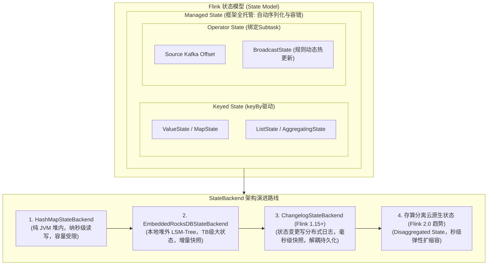
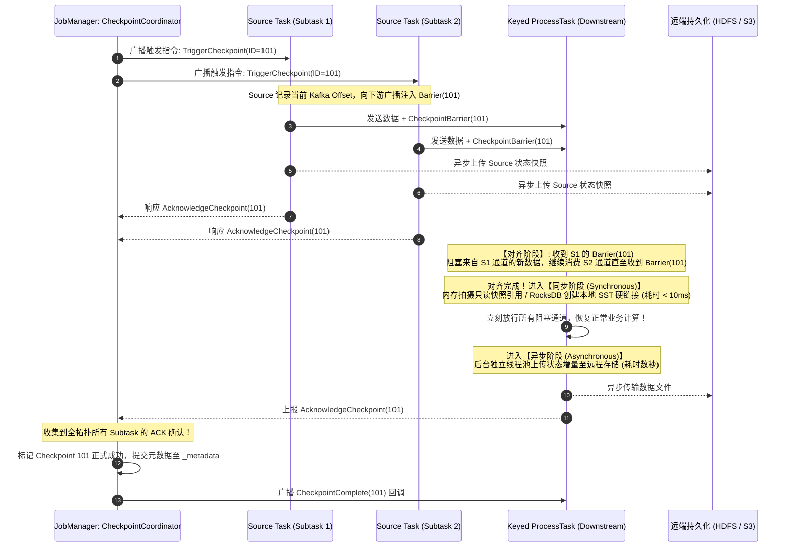
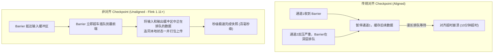
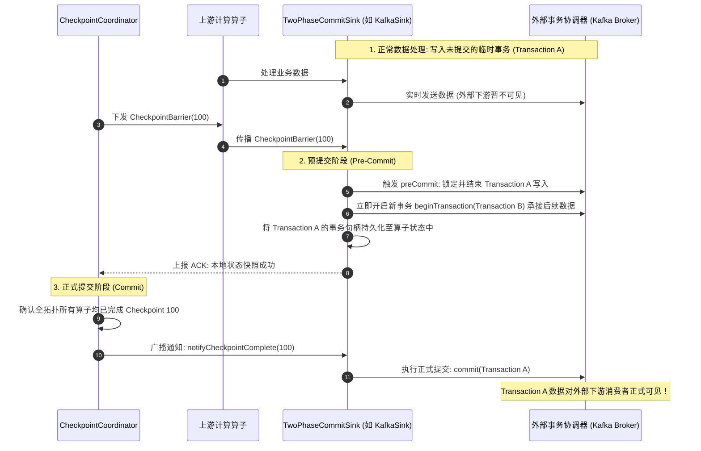
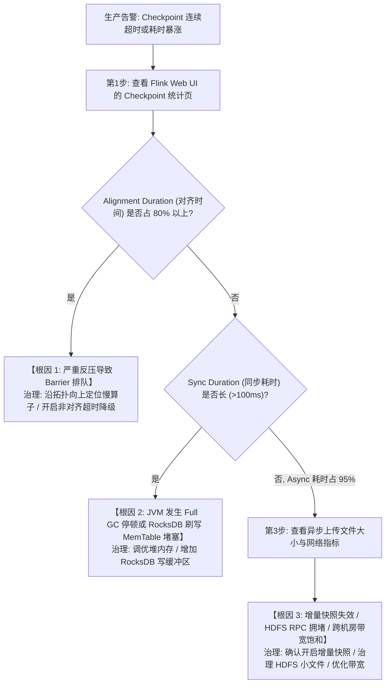
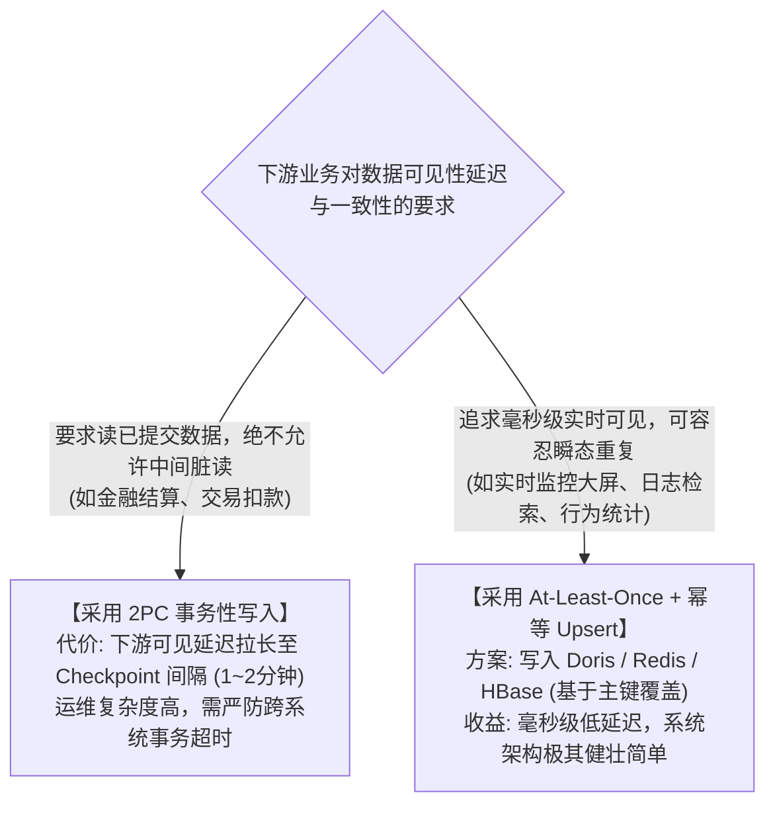
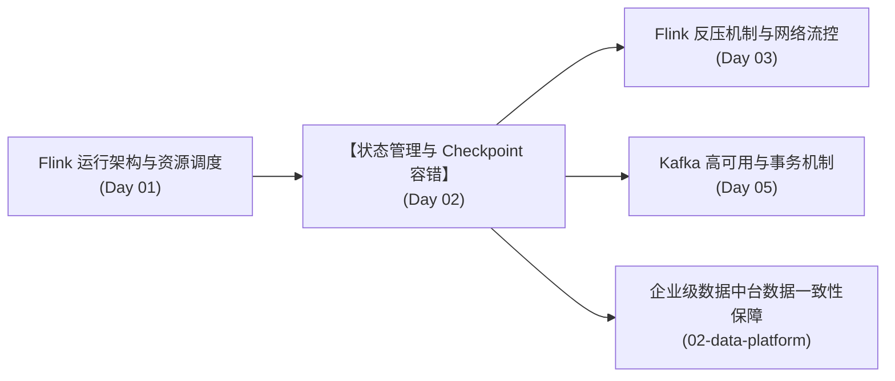

# Flink 状态管理、Checkpoint容错与端到端Exactly-Once（高阶架构与生产实战）

> **学习目标定位**：面向数据平台研发负责人、大数据架构师与技术总监岗位，深刻掌握 Flink 托管状态（Managed State）的存储模型、StateBackend 演进（HashMap vs RocksDB vs Changelog vs 存算分离）、异步屏障快照（ABS）算法及基于两阶段提交（2PC）的端到端 Exactly-Once 机制。结合字节跳动、美团等互联网大厂真实高频面试场景，系统掌握大促状态暴涨治理、Checkpoint 超时雪崩排查及“强一致延迟 vs 幂等最终一致”的架构权衡。

---

## 1. 知识概述与业务价值

### 1.1 是什么（What）
在流计算领域，**状态（State）**是算子保留历史中间结果（如窗口内聚合值、维表缓存、CEP规则序列）的本地数据载体。**Checkpoint（检查点）**则是 Flink 周期性、异步地为全分布式拓扑拍摄的全局一致性数据快照，持久化写入远程高可靠存储（如 HDFS / S3 / OSS）。在最新的 **Flink 1.19 / 1.20 及 2.0 时代**，状态机制正在经历从“本地磁盘紧耦合绑定”向“**存算分离（Disaggregated State）与日志化持续快照（Changelog）**”的划时代架构跃迁。

### 1.2 解决什么核心业务痛点（Why）
传统流处理框架在故障容错上面临经典困境：
1. **At-Least-Once 的数据重复代价**：传统消息流处理系统在节点宕机时只能简单回滚上游 Offset 重新发送，导致下游报表统计翻倍、计费扣款重复，不得不依赖外部存储进行昂贵的全局去重。
2. **全局暂停（Stop-the-World）的快照代价**：早期分布式系统若要获取全局一致性状态，必须短暂停顿所有算子数据流入，严重伤害实时流的低延迟 SLA。
3. **海量状态下的故障恢复漫长**：若采用全量快照，数十 TB 级状态的拉取恢复动辄需要数十分钟，无法满足企业核心交易链路秒级自愈的要求。
Flink 采用改良版 **Chandy-Lamport 异步屏障快照（ABS）**与**增量/非对齐快照机制**，实现了“不停机、不阻塞正常流转、毫秒级本地快照切片、秒级故障恢复”的金融级容错能力。

### 1.3 适用场景与技术边界（Where & When）
- **高价值适用场景**：
  - **金融与计费对账系统**：严禁任何由于网络抖动或节点重启导致的数据丢失或重复。
  - **工业与物联网时序状态追踪**：如瑞纳智能数万换热站设备的持续滑动窗口均值计算与突变判定。
  - **实时数仓 ODS -> DWD 流式 ETL 管道**：结合 Kafka 与 Doris/Iceberg 构建端到端精准一次数据入湖入仓。
- **技术边界与反模式**：
  - **将海量超长生命周期明细存入状态**：例如在状态中保留 30 天以上的全量用户明细做宽表拼接，会导致 RocksDB 状态膨胀至数百 TB 引发雪崩（此类场景应将明细沉淀至实时 OLAP 引擎中）。

---

## 2. 核心概念与关系

### 2.1 核心概念全景表
| 概念名称 | 英文术语 | 核心定义与工程职责 | 存储与生命周期级别 |
| :--- | :--- | :--- | :--- |
| **键控状态** | Keyed State | 只能在 `KeyedStream`（即 `keyBy()` 之后）使用的状态。状态按 Key 逻辑隔离，支持 ValueState, ListState, MapState 等。 | 随 KeyGroup 分布，支持细粒度 TTL |
| **算子状态** | Operator State | 绑定在单个物理 Subtask 上的状态，与 Key 无关。常见于 Source（保存 Kafka Partition Offset）或广播状态（BroadcastState）。 | Subtask 实例级，重缩放时轮询或合并广播 |
| **状态后端** | StateBackend | 负责决定状态在运行时如何存储读写，以及在 Checkpoint 时如何打包持久化的底层存储引擎。 | JVM 堆内存 / 本地 RocksDB / 远程日志 |
| **屏障快照** | Checkpoint Barrier | 随数据流在网络流控队列中同向流动的特殊控制元组，用于在连续事件流中精确划分不同快照世代（Epoch）。 | 流水线传输级 |
| **端到端精准一次** | End-to-End EOS | 保证上游数据源、中间流计算与下游外部存储在发生任何单点崩溃时，最终对外输出结果等价于“严格被处理且仅处理一次”。 | 全链路强一致闭环 |
| **保存点** | Savepoint | 由运维或自动化平台显式手动触发的用户级快照。格式全版本兼容，主要用于版本平滑发布、修改并发与集群搬迁。 | 永久独立存储，生命周期由人工管控 |

### 2.2 状态结构与 StateBackend 演进全景关系图


---

## 3. 底层工作机制与设计哲学

### 3.1 异步屏障快照（ABS 算法）底层流转机制

Flink 的 Checkpoint 机制是经典分布式快照算法 **Chandy-Lamport** 在 DAG 流水线中的工程改良版。其核心思想是：**通过注入轻量控制屏障（Barrier），将连续数据流切分为不同的逻辑世代，利用异步写入实现快照拍摄与正常数据处理的高效并行**。



### 3.2 深度对比：对齐（Aligned） vs 非对齐（Unaligned）Checkpoint

在生产高负载场景下，反压（Backpressure）会导致 Checkpoint 严重超时，其根本原因就在于 **Barrier 在网络输入缓冲区中的排队阻塞**。



| 评估维度 | 对齐 Checkpoint (Aligned) | 非对齐 Checkpoint (Unaligned) |
| :--- | :--- | :--- |
| **快照内容** | 仅包含算子内部业务状态 | 算子业务状态 + **网络输入/输出缓冲区中的积压数据** |
| **抗反压能力** | 差（反压严重时 Barrier 无法推进，导致超时失败） | **极强（秒级完成快照，完全免疫反压堵塞）** |
| **快照体积** | 小（纯业务数据） | 较大（额外持久化了通道内“飞行中的数据”） |
| **恢复重放成本** | 极低（恢复后直接从 Source 消费） | 稍高（启动时需先回放并重放网络缓冲区积压数据） |
| **架构师权衡建议**| 流量平稳、无长期严重反压的标准业务 | **大促/高负载脉冲流量、不允许因反压引发作业重启的场景** |

### 3.3 端到端 Exactly-Once 闭环：两阶段提交（2PC）协议机制

要实现真正意义上的端到端 Exactly-Once，必须实现 **可重设位点的 Source + Flink 内部状态快照 + 事务性/幂等 Sink** 的三位一体。



---

## 4. 高频复杂业务场景实操与落地

### 4.1 生产典型业务场景：全链路金融级实时对账与计费平台
以交易计费场景为例：上游订单与支付流水通过 Kafka 摄入，Flink 负责双流 Join 并在滑动窗口内计算商户应结算金额与手续费。要求：
1. 绝对严禁重复扣费或漏记扣款（端到端强一致性）；
2. 面对大促流量脉冲，Checkpoint 不能因反压延期而拖垮业务；
3. 状态随时间自动滑动清理，防止内存泄漏。

```mermaid
flowchart LR
    Orders["订单流水 (Kafka)"] --> Source["KafkaSource (P=16)"]
    Payments["支付流水 (Kafka)"] --> Source
    Source -->|KeyBy(OrderID)| Join["双流 Interval Join 算子<br/>(RocksDB 状态暂存 2小时)"]
    Join -->|KeyBy(MerchantID)| Agg["商户结算滑动窗口聚合<br/>(配置 State TTL 24小时)"]
    Agg -->|2PC 事务提交| KafkaSink["Kafka Transactional Sink<br/>(精准一次产出计费结果)"]
    KafkaSink --> Downstream["下游银行结算与账务系统"]
```

### 4.2 生产级 Checkpoint 核心调优参数基线

```properties
# ==================== Checkpoint 基础行为 ====================
# 周期设为 1~2 分钟（太短导致存储底座 I/O 承压，太长导致故障回滚数据量过大）
execution.checkpointing.interval: 60000ms

# 设置强一致模式
execution.checkpointing.mode: EXACTLY_ONCE

# 设置合理超时（必须严格小于下游如 Kafka 事务超时时间，预留 20% 安全余量）
execution.checkpointing.timeout: 600000ms

# 关键防雪崩参数：两次 Checkpoint 之间的最小暂停时间（强制给业务处理预留纯净 I/O）
execution.checkpointing.min-pause-between-checkpoints: 30000ms

# 并发 Checkpoint 数必须锁死为 1（防止多个快照并发抢占 I/O 与带宽引发雪崩）
execution.checkpointing.max-concurrent-checkpoints: 1

# 允许偶发连续失败的最大容忍次数（防止偶发网络微抖动直接把 P0 任务强杀）
execution.checkpointing.tolerable-failed-checkpoints: 3

# 作业被取消或失败时保留外部快照元数据（便于手动恢复）
execution.checkpointing.externalized-checkpoint-retention: RETAIN_ON_CANCELLATION

# ==================== 抗反压自适应平滑降级 (Flink 1.13+) ====================
# 开启非对齐快照平滑降级：优先走对齐 Checkpoint，若超过 8 秒未对齐，自动无缝降级为非对齐快照！
execution.checkpointing.unaligned.enabled: true
execution.checkpointing.aligned-checkpoint-timeout: 8000ms

# ==================== RocksDB 状态与内存受控 ====================
state.backend: embedded-rocksdb
state.backend.incremental: true
state.backend.rocksdb.memory.managed: true
state.backend.rocksdb.memory.write-buffer-ratio: 0.5
```

---

## 5. 生产异常故障深度排查与根因分析

### 5.1 Checkpoint 耗时激增与超时崩溃排查树



### 5.2 核心生产异常场景实操复盘

#### 场景一：Kafka 事务超时与 Checkpoint 超时冲突引发的反复雪崩
- **真实生产现象**：在大促流量高峰期，Flink 任务突然崩溃，报错堆栈出现 `ProducerFencedException: TransactionalId ... was fenced`。重启后刚运行几分钟再次崩溃，形成无限恶性循环。
- **深度根因分析**：
  Kafka Broker 的 `transaction.timeout.ms` 默认为 15 分钟。在大促期间，由于 Flink 出现反压，某次 Checkpoint 耗时被拉长到了 16 分钟。当 JobManager 终于发出 `CheckpointComplete` 广播通知 Sink 提交事务时，Kafka 事务协调器早已将该事务判定为死事务强行 Abort 回滚。此时 Flink 尝试提交无效事务被拒，抛出致命异常导致全拓扑重启。
- **治本方案**：
  1. 调大 Kafka 集群 `transaction.timeout.ms`（如统一配置为 1 小时）。
  2. 调小 Flink `execution.checkpointing.timeout`（严格限制在 10 分钟以内，必须保证 Flink 在 Kafka 事务死掉前主动超时回滚）。

#### 场景二：无界状态未配置 TTL 导致 RocksDB 磁盘打满与 OOM-Killed
- **真实生产现象**：业务上线运行 3 个月后，TaskManager Pod 本地磁盘利用率达到 95%，且 Pod 频繁以 Exit Code 137 重启。
- **深度根因分析**：在实时去重或特征计算逻辑中，开发者直接使用了 `MapState` 记录设备 ID 或用户 ID，但**未配置 State TTL（状态存活时间）**。随着时间推移，历史无界数据无限累积，RocksDB 产生海量 SST 文件，不仅占满磁盘，更导致后台 Compaction 线程占用大量堆外内存，突破容器配额触发 OOM。
- **架构级治理规约**：
  - 强制对所有 Keyed State 开启 TTL 并在后台静默清理：
    ```java
    StateTtlConfig ttlConfig = StateTtlConfig.newBuilder(Time.days(7))
        .setUpdateType(StateTtlConfig.UpdateType.OnCreateAndWrite)
        .setStateVisibility(StateTtlConfig.StateVisibility.NeverReturnExpired)
        .cleanupInRocksdbCompactFilter(1000) // 利用 RocksDB 后台压缩高效清理过期数据
        .build();
    ```

---

## 6. 技术选型对比、架构演进与成本ROI

### 6.1 StateBackend 演进与选型对比矩阵
| 评估维度 | HashMapStateBackend | EmbeddedRocksDBStateBackend | ChangelogStateBackend (FLIP-158) |
| :--- | :--- | :--- | :--- |
| **状态存储介质** | JVM 堆内存（Java 对象） | 本地堆外 C++ 磁盘 + 缓存 | 内存/RocksDB + 外部高吞吐日志 |
| **单点状态容量** | 受限（单节点通常 < 50GB） | **极其庞大（TB 级无界状态）** | **极其庞大** |
| **读写性能** | **极致（纯内存指针，纳秒级）** | 极高（微秒级，受限于 JNI 与序列化）| 极高（写入只需 Append 日志） |
| **快照完成耗时** | 全量拷贝，大状态时耗时长 | **原生高效增量快照** | **秒级/亚秒级超轻量快照** |
| **故障恢复耗时** | 较快（网络下载全量状态） | 适中（下载增量 SST 文件） | 较快（加载基线 + 回放日志） |
| **硬件与运维成本** | 需配置大规格 JVM 堆内存 | 依赖高性能 NVMe 本地 SSD 磁盘 | 依赖高吞吐日志存储基础设施 |

### 6.2 架构师选型决策权衡
- **场景 A（极速规则匹配）**：如果单任务总状态量在 **10GB 以内**，且业务对单条数据处理延迟要求在微秒级（如毫秒级高频量化交易）：首选 **HashMapStateBackend**。
- **场景 B（海量企业级中台）**：对于包含多维滑动窗口、超大去重 BitMap、状态量突破 **100GB ~ 数十 TB** 的常态业务：必须选择 **EmbeddedRocksDBStateBackend + 增量 Checkpoint**。
- **场景 C（极端敏感容灾）**：如果业务要求故障恢复的数据重放量必须控制在秒级以内：规划演进引入 **ChangelogStateBackend**。

---

## 7. 技术经理与架构师实战管控（SOP与规范）

### 7.1 架构权衡：端到端 2PC 强一致 vs 业务幂等最终一致
作为技术负责人，切忌盲目技术崇拜而全链路强推 2PC：


### 7.2 生产规约与质量红线门禁（SOP）
1. **状态定义红线**：严禁在代码中直接使用静态全局 `HashMap` 或 `ArrayList` 暂存数据，必须使用 Flink 托管状态（Managed State），否则在任务重启时数据彻底丢失且无法参与快照。
2. **TTL 审计门禁**：在 CI/CD 流水线中加入 Sonar/AST 代码扫描规则，凡是声明 `ValueStateDescriptor` 或 `MapStateDescriptor` 未显式配置 `StateTtlConfig` 的，阻断合并并报警。
3. **Savepoint 升级规约**：生产作业版本迭代发布时，必须显式调用 `bin/flink stop --savepointPath ... <JobID>` 优雅下线，严禁直接 `kill -9` 强杀导致事务悬挂。

---

## 8. 互联网大厂高频面试真题库

### 8.1 基础概念与机制题（大厂初筛）
1. **Q1**：Flink 的 Checkpoint 和 Savepoint 有什么本质区别？分别在什么工程场景下使用？
2. **Q2**：什么是 Keyed State 和 Operator State？两者的生命周期和在并发扩缩容（Rescaling）时的重新分配策略是什么？

### 8.2 核心底层原理深度题（大厂资深技术面）
3. **Q3**：请详细阐述 Flink 异步屏障快照（ABS）算法是如何保证全拓扑分布式状态一致性的？
4. **Q4**：什么是 Checkpoint Barrier 对齐？为什么非对齐快照（Unaligned Checkpoint）能够在反压下秒级完成？它落盘的数据相比对齐快照多了什么？

### 8.3 复杂生产场景与故障排障题（大厂架构与排障面）
5. **Q5**：大促峰值期间，某核心 Flink 作业频繁报 `Checkpoint expired before completing` 超时警报，作为平台负责人，你的系统化排查路径与优化手段是什么？
6. **Q6**：使用 Flink 写入 Kafka 时，作业发生异常重启后，下游消费者读到了被回滚掉的“脏数据”，这是什么原因导致的？如何彻底解决？

### 8.4 架构设计与系统规划题（技术总监/总架构师终面）
7. **Q7**：作为数据平台架构师，请针对某百亿级交易数据处理链路，设计一套兼顾极高吞吐、毫秒级告警与端到端 Exactly-Once 强一致性的架构方案，并对比分析 2PC 与幂等写入的利弊取舍。

---

## 9. 结构化深度参考答案（三层应答模型）

### 题目1（大厂高频深度真题）：请详细阐述基于 `TwoPhaseCommitSinkFunction` 的端到端 Exactly-Once 闭环机制与宕机恢复推演。

#### 简洁回答（1分钟电梯破题）：
> “端到端 Exactly-Once 需要 Source 可重设位点、内部精确快照与 Sink 事务协同。Flink 通过 `TwoPhaseCommitSinkFunction` 实现了标准的分布式两阶段提交：
> 在两次 Checkpoint 之间，Sink 将数据写入外部系统的预提交事务；当 Barrier 到达 Sink 时，执行预提交（Pre-commit）并持久化事务句柄，同时开启新事务承接后续数据；当 JobManager 确认全拓扑快照成功后广播通知，Sink 正式提交事务，外部数据变为正式可见。若期间发生崩溃，作业回滚至上次快照，未提交的事务被放弃，Source 回滚 Offset 重新计算，实现全链路不重不丢。”

#### 深入回答（状态流转与边界异常推演）：
> “深入到底层交互与故障恢复分支来看：
> 1. **预提交（Pre-commit）阶段**：当 Subtask 收到所有输入通道的 Barrier 时，触发同步快照。Sink 调用 `preCommit()` 锁定当前外部事务（如标记 Kafka Transaction 为 Prepare 状态），此后该事务不再接受新数据；同时立刻调用 `beginTransaction()` 开启新事务承接流水线后续数据。
> 2. **正式提交（Commit）阶段**：所有算子向 JM 上报 ACK。JM 将 Checkpoint 元数据写入高可靠存储（宣告快照成功），并向下游广播 `notifyCheckpointComplete()`。Sink 收到回调后调用外部系统的 `commit()` 正式标记数据可见。
> 3. **节点崩溃与异常恢复推演**：
>    - **分支 A（在 JM 宣布快照成功前崩溃）**：未决的预提交事务从未收到 Commit 命令，作业重启从上一次成功快照恢复时，未决事务被显式 `abort()` 丢弃，Source 从旧 Offset 重新消费，**保证数据不重复**。
>    - **分支 B（在 JM 宣布快照成功后、Sink 执行 Commit 时崩溃）**：由于该快照在 JM 端已经成功持久化，作业重启时会从快照中读取处于预提交状态的事务句柄，**在 `initializeState()` 阶段重新触发 commit() 操作**。因此外部存储必须支持事务提交的幂等性。”

#### 架构师/技术管理视角（降维升华：权衡取舍、SLA与成本）：
> “作为数据平台研发负责人，在技术选型中必须清醒看到 2PC 的架构代价与边界：
> 第一，**数据可见性延迟的放大**。下游若开启读已提交（`read_committed`），其数据可见延迟不再是毫秒级，而是**直接取决于 Checkpoint 触发间隔**（通常在 1 分钟左右）。对于要求秒级响应的实时监控大屏，强推 2PC 是典型的架构过度设计。
> 第二，**稳定性对抗风险**。2PC 强依赖外部事务协调器的可靠性，极易发生超时参数冲突（如 Kafka 事务超时与 Checkpoint 超时对抗）。
> 在瑞纳智能数据中台中，我们推行分类分级架构策略：对计费结算核心链路采用 2PC 保障强一致；而对设备指标监控等绝大多数链路，采用 **‘At-Least-Once + 下游引擎（Doris/HBase）基于主键天然幂等 Upsert’**，用极低的管理复杂度换取极高的系统吞吐与可用性。”

---

### 题目2（生产排障与大促实战）：大促期间，某核心 Flink 作业 Checkpoint 频繁超时，导致作业反复雪崩重启，你如何系统化排查与治理？

#### 简洁回答：
> “我的排查三步法是：第一，登录 Flink Web UI 查看 Checkpoint 详情页，对比 `Alignment Duration`（对齐耗时）与 `Async Duration`（异步耗时）定位瓶颈是在反压阻塞还是持久化网络 I/O；第二，若对齐耗时占 90%，定位产生反压的瓶颈算子或热点倾斜；若异步耗时长，检查 RocksDB 增量快照配置与远程存储性能；第三，短期应急开启非对齐快照超时自动降级并设置最小暂停时间止血，长期治理则解决数据倾斜与算子逻辑优化。”

#### 深入回答：
> “详细排查与调优路径如下：
> 1. **阶段耗时剖析定位**：
>    - **情况 A（对齐阻塞）**：对齐时间长达数分钟，说明下游消费不畅导致反压，Barrier 在网络输入缓冲区深层排队。结合 Backpressure 看板与火焰图，排查是 UDF 存在外部同步慢查询、计算密集还是 KeyBy 产生了严重数据倾斜。
>    - **情况 B（异步持久化慢）**：对齐毫秒级完成，但异步上传耗时几分钟。排查是否误配置了全量快照而非 RocksDB 增量快照（`state.backend.incremental: true`），或者 HDFS NameNode 出现 RPC 瓶颈导致文件创建阻塞。
> 2. **生产实操治理招式**：
>    - **开启自适应非对齐快照**：配置 `execution.checkpointing.aligned-checkpoint-timeout: 8s`。平时走对齐保证最小快照体积，一旦遭遇大促脉冲流量导致 8 秒未对齐，系统自动无缝切换为非对齐快照，彻底解除 Barrier 排队阻塞，确保大促期间 Checkpoint 百毫秒级稳定完成。
>    - **配置安全最小暂停时间**：务必设置 `min-pause-between-checkpoints: 30s`，强制在两次快照之间留出空闲 I/O，杜绝快照连续超时引发的级联崩溃。
>    - **调大容忍失败阈值**：配置 `tolerable-failed-checkpoints: 3~5`，避免偶发网络抖动导致任务直接自杀。”

#### 架构师/技术管理视角：
> “在技术管理与大促保障层面，这不仅是一个技术调优问题，更是一套**生产容灾与 SLA 治理流程**：
> 1. **容量规划与前置压测**：大促前通过全链路压测，将 Checkpoint 耗时作为核心容量红线（要求 P99 耗时不得超过周期的 30%）。
> 2. **建立自动化降级机制**：在平台管理端，支持在高峰期动态调大 Checkpoint 间隔（从 1 分钟拉长至 5 分钟），瞬间释放底层存储和网络 50% 以上的 I/O 压力。
> 3. **告警分级与人工介入窗口**：区分单次超时预警（P3）与连续多次失败报警（P1），为值班专家争取至少 15 分钟的排障处置窗口，绝不让系统直接进入雪崩式连锁重启。”

---

## 10. 知识自检与口述推演清单

- [ ] 能否脱稿在白板上完整画出 2PC 两阶段提交协议在 Flink 与外部外部存储交互的时序图？
- [ ] 面对“Kafka 事务超时导致 Flink 反复崩溃”的故障，能否在 1 分钟内指出 `transaction.timeout.ms` 与 `checkpoint.timeout` 的参数配置底线？
- [ ] 能否系统说出为什么非对齐快照（Unaligned Checkpoint）能够在严重反压下秒级完成？其落盘数据比普通快照多了什么？
- [ ] 能否站在技术总监视角，向业务方深入阐明“为什么不建议在所有流作业中都使用 2PC 强一致，而推荐主键幂等写入”？

---

## 11. 知识脉络与技术图谱关联



---

## 12. 权威参考与官方进阶资料

1. **分布式快照奠基论文**：*Chandy, K. Mani, and Leslie Lamport. "Distributed snapshots: determining global states of distributed systems." ACM TOCS 3.1 (1985).*
2. **Flink 官方容错与状态最新文档 (v1.19 / 1.20)**：[Flink State & Fault Tolerance](https://nightlies.apache.org/flink/flink-docs-release-1.19/docs/dev/datastream/fault-tolerance/checkpointing/)
3. **Flink 存算分离与持续日志快照提案 (FLIP-158)**：[Unified Log-Based Changelog State Backend](https://cwiki.apache.org/confluence/display/FLINK/FLIP-158)
4. **Flink 非对齐快照设计提案 (FLIP-76)**：[Unaligned Checkpoints Design](https://cwiki.apache.org/confluence/display/FLINK/FLIP-76)
