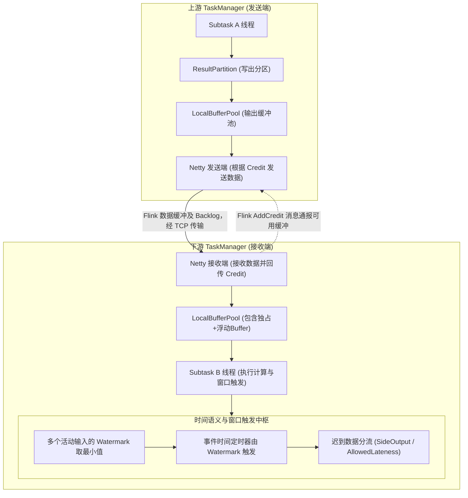
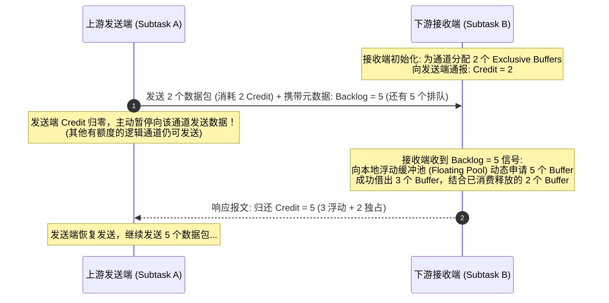
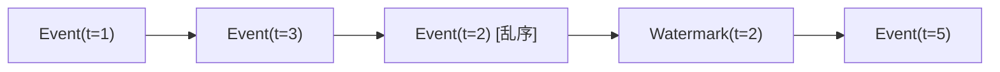
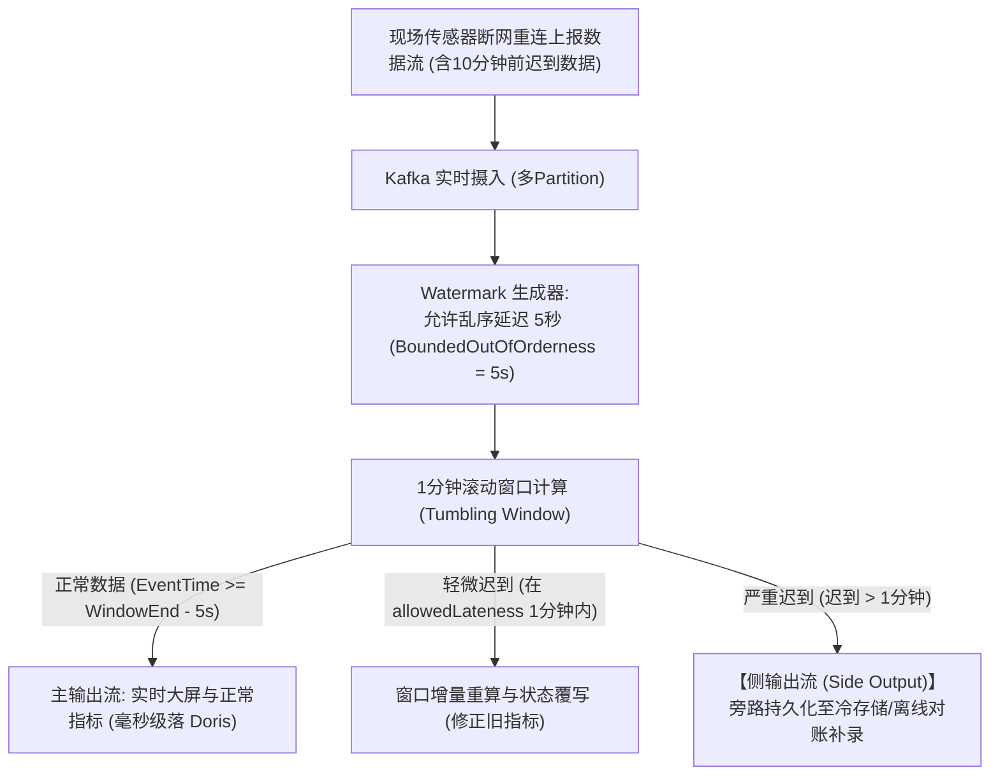
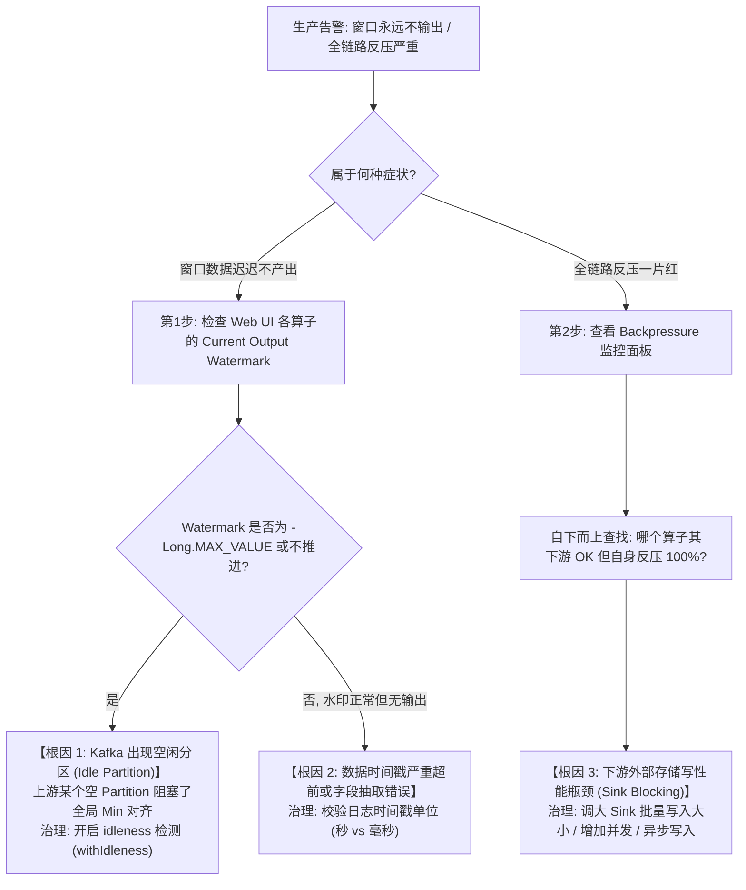
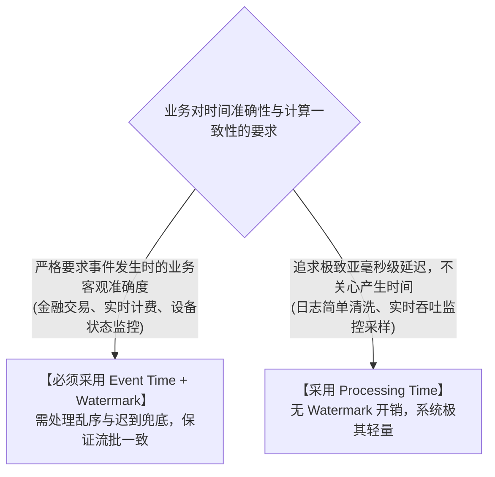
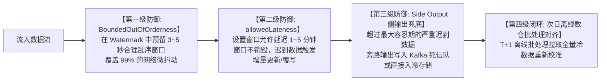
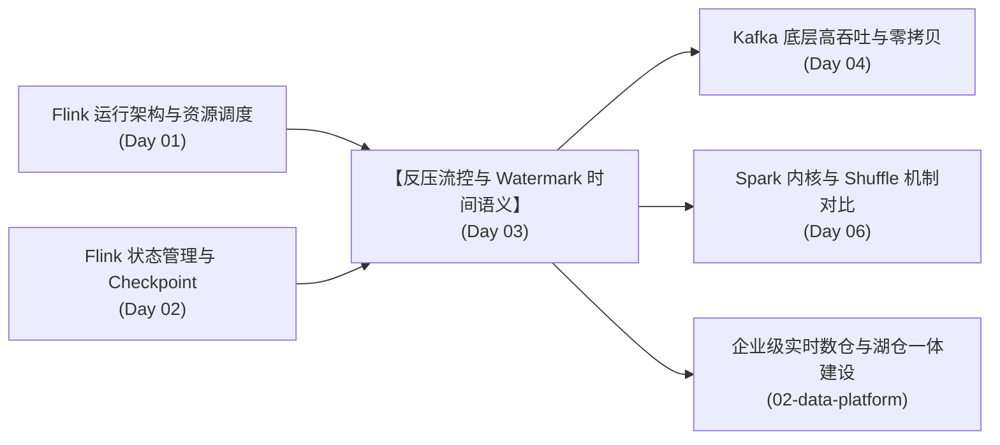

# Flink 反压流控机制、网络缓冲调优与 Watermark 时间语义（高阶架构与生产实战）

> **学习目标定位**：面向数据平台研发负责人、大数据架构师与技术总监岗位，深刻掌握 Flink 应用层 Credit-based 流控协议、Netty 网络栈与动态缓冲去膨胀（Buffer Debloating）底层设计哲学；透彻理解分布式事件时间（Event Time）推进本质、多流/多分区 Watermark 对齐裁剪机制与迟到数据多级防御闭环。结合教学排障场景与架构取舍练习，建立可复述的技术判断。

---

## 1. 知识概述与业务价值

### 1.1 是什么（What）
- **反压机制（Backpressure）**：当流计算下游节点的消费处理速率低于上游节点的生产速率时，下游通过网络流控协议逐级向上游反馈阻力，迫使上游降低发送速率甚至暂停拉取源头数据的**自适应流控保护机制**。在最新的 **Flink 1.19 / 1.20 体系**中，Flink 采用基于信用额度的应用层流控（Credit-based Flow Control）与动态缓冲去膨胀技术（Buffer Debloating）。
- **Watermark 时间语义**：在分布式无界流处理中，事件产生的物理时间与流经计算引擎的时间天然存在不可预测的网络延迟与乱序。**Watermark（水印）**是一种特殊注入数据流中的时间戳单调递增控制元组，在物理上代表**“系统断言当前流中时间戳小于等于该 Watermark 的所有事件均已全部到达”**，用于精确驱动基于事件时间（Event Time）的窗口触发与状态清理。

### 1.2 解决什么核心业务痛点（Why）
1. **防范节点级内存爆仓（OOM）**：若没有反压，突发流量洪峰会导致数据无限制堆积在下游 JVM 内存或网络队列中，瞬间打满堆外内存导致进程崩溃。
2. **解决网络乱序与分布式延迟导致的数据失真**：若单纯依赖服务器物理时间（Processing Time），网络拥堵或断网重连会导致同批业务数据被切分到完全错误的统计窗口中，使风控指标与交易大屏报表失真。
3. **平衡流计算的“时效性”与“精准度”矛盾**：真实业务中无法无限期等待迟到数据，Watermark 机制允许架构师以量化的时间窗口显式定义容忍度，在低延迟与高完整性之间建立确定性边界。

### 1.3 适用场景与技术边界（Where & When）
- **高价值适用场景**：
  - **金融与电商实时风控**：依赖严格事件发生时间计算“用户近 5 分钟转账频次”，规避网络抖动造成的跨窗口统计偏差。
  - **物联网与智慧工业监控**：如瑞纳智能数十万车载或工控传感器断网重连后成批补发历史乱序数据的平滑对齐处理。
  - **双11/大促流量洪峰平滑削峰**：利用反压将压力无损传导至源头 Kafka，防止流计算平台被瞬时脉冲压垮。
- **技术边界与反模式**：
  - **无界乱序超长等待**：设置数小时的 Watermark 延迟容忍度（会导致状态长达数小时不释放，引发 RocksDB 状态爆炸与内存耗尽）。

---

## 2. 核心概念与关系

### 2.1 核心概念全景表
| 概念名称 | 英文术语 | 核心定义与工程职责 | 资源/生命周期级别 |
| :--- | :--- | :--- | :--- |
| **信用额度** | Credit | 下游算子向对应上游算子通报的“自身当前可用的空闲输入缓冲区数量”。每个 Credit 对应一个固定内存段（MemorySegment）。 | 传输通道级 (Channel) |
| **积压报文** | Backlog | 上游算子向对应下游算子通报的“自身当前在输出队列中排队等待发送的数据包数量”。 | 传输通道级 (Channel) |
| **独占/浮动缓冲区** | Exclusive / Floating Buffers | 独占缓冲区保证每个 Channel 的最低通信可用性（防死锁）；浮动缓冲区由同一个 TM 内部的 BufferPool 动态调度，按需分配给积压严重的 Channel。 | 进程与连接级 |
| **缓冲去膨胀** | Buffer Debloating | Flink 1.14+ 引入的动态机制。根据实时吞吐动态调小网络队列容量，确保反压下数据在缓冲区停留时间保持在毫秒级。 | 动态计算级 |
| **事件时间** | Event Time | 数据产生时本身携带的时间戳（由客户端或业务日志打印的时间决定），客观不随网络波动而改变。 | 数据自身属性 |
| **水印推进机制** | Watermark Alignment | 多通道汇聚时，下游算子维护所有输入通道的 Watermark，**始终以各通道中最小的 Watermark 作为当前算子的全局 Watermark**。 | 算子物理级 |
| **空闲分区感知** | Idle Partition | 当某 Partition 长期无新数据时，将其标记为空闲，使其不参与下游最小 Watermark 决策，防止全链路假死。 | 逻辑分区级 |

### 2.2 反压与时间语义协作全景图


---

## 3. 底层工作机制与设计哲学

### 3.1 反压流控演进：从 TCP 阻塞到 Credit-based 应用层流控

#### 早期基于 TCP 滑动窗口反压的致命缺陷（Flink 1.5 之前）：
早期 Flink 依赖操作系统的底层 TCP 流控机制（Socket Receive Window）。当 TaskManager B 的某 Task 消费慢时，Socket 缓冲区被填满，TCP 窗口缩减为 0，导致 TaskManager A 的网络发送端阻塞。
- 多个逻辑输入通道可复用一条 TCP 连接。早期实现中一个接收方耗尽缓冲区，可能影响同连接上其他数据通道。作业协调使用独立的 RPC 通道。

#### Credit-based 应用层流控设计哲学（当前标准）：
Flink 1.5+ 将反压控制**从操作系统 TCP 层彻底上提到应用层**，接收端按逻辑输入通道通报可用缓冲，TCP 仍承担传输层流控：



#### 为什么说 Credit 流控带来了质的飞跃？
1. **消除了 TCP 多路复用踩踏**：某一个 Subtask 阻塞时，仅仅该 Channel 的 Credit 为 0，发送端在该逻辑通道上暂停推流，但 其他有额度的逻辑通道可继续发送，仍受共享带宽限制。
2. **极大降低排队延迟**：发送端只有在下游确定有接收内存时才发包，数据不会盲目积压在操作系统 Socket 缓冲区中。

### 3.2 动态缓冲去膨胀（Buffer Debloating）底层机制 (Flink 1.14+ / 1.19+)
传统 Credit 机制虽然避免了死锁，但在高吞吐场景下，若配置了较大的缓冲区，数据在缓冲区中排队的时间可能长达数秒甚至数十秒，这直接导致 **Checkpoint Barrier 穿越网络耗时极长，引发快照频繁超时**。
- **Buffer Debloating 原理**：系统周期性统计过去的消费吞吐率（Throughput），根据目标缓冲时间（默认 `1000ms`）动态计算当前需要的最小缓冲区大小：
$$\text{BufferSize} = \text{Throughput} \times \text{TargetDuration}$$
- **收益**：在发生轻微反压或流量突增时，自动缩小 Buffer 规格（如从 32KB 动态降为 4KB），在保证吞吐的同时，将排队在网络队列中的**在途数据量缩减 80% 以上**，使反压下的 Checkpoint 耗时从分钟级直接下降到秒级。

---

### 3.3 Watermark 底层推进机制与设计思想

#### Watermark 的本质：
Watermark 是一条特殊的单调递增控制流元组：`Watermark(T)`。其核心语义是：**“本算子向后承诺，后续流入该算子的数据中，再也不会出现时间戳 $t \le T$ 的事件”**。



#### 多流合并与多分区 Watermark 对齐裁剪规则：
当一个算子（如 Keyed ProcessFunction 或 Window 算子）从上游 $N$ 个并行 Channel 接收数据时：
1. **各通道独立推进**：算子内部维护一个数组，记录每个输入 Channel 上接收到的最新 Watermark。
2. **木桶原理（Min Watermark）**：该算子自身的全局 Watermark **严格取所有输入通道 Watermark 的最小值**：
$$WM_{current} = \min(WM_{channel\_1}, WM_{channel\_2}, \dots, WM_{channel\_n})$$
3. **设计哲学**：只有当所有通道的时间戳都推进过了 $T$，算子才能确信全局范围内小于 $T$ 的数据都已经到达，此时触发 $[0, T)$ 的窗口计算才是绝对安全的。

---

## 4. 高频复杂业务场景实操与落地

### 4.1 典型业务场景：物联网传感器断网续传与多源聚合
在智慧工业或供热场景（如瑞纳智能实际业务）中：
- 传感器由于现场基站通信异常，断网 10 分钟；恢复后，设备一次性打包上报这 10 分钟内积压的 5000 条历史时序数据。
- 业务要求：按每 1 分钟滚动窗口计算管网平均压力。
- **痛点**：若无合理的时间语义控制，这批断网数据要么直接被系统当成垃圾丢弃（导致报表漏计），要么直接打乱当前正常窗口的计算。



### 4.2 生产级反压与时间语义核心参数配置基线

```properties
# ==================== 网络缓冲与 Credit 调优 ====================
# 单 TM 网络内存比例 (建议 15%，保障高吞吐下的通信顺畅)
taskmanager.memory.network.fraction: 0.15
taskmanager.memory.network.min: 256m
taskmanager.memory.network.max: 1024m

# 开启 Buffer Debloating (缓冲去膨胀)，目标排队延迟设为 1 秒 (Flink 1.14+)
taskmanager.network.memory.buffer-debloat.enabled: true
taskmanager.network.memory.buffer-debloat.target: 1000ms
taskmanager.network.memory.buffer-debloat.period: 200ms

# ==================== 时间语义与 Watermark 调优 ====================
# Watermark 周期性发射间隔 (默认 200ms，高吞吐低延迟作业保持 200ms 即可)
pipeline.auto-watermark-interval: 200ms

# 关键防卡死参数：Kafka 空闲分区检测超时时间
# 若某 Partition 超过 30 秒无新数据流入，自动将其置为 Idle，解除下游 Watermark 阻塞！
table.exec.source.idle-timeout: 30000ms
```

---

## 5. 生产异常故障深度排查与根因分析

### 5.1 生产级“反压级联雪崩与 Watermark 停滞”排查决策树



### 5.2 核心生产异常场景实操复盘

> [!NOTE] 案例性质说明：下列故障和数值用于教学推演。

#### 场景一：Kafka 空闲分区导致下游窗口彻底“假死”不输出
- **推演现象**：线上实时大屏的 1 分钟统计指标突然停止刷新，且长期没有任何输出。查看 Flink 进程无任何异常报错，CPU 处于闲置状态，上游 Kafka 也有持续数据流入。
- **深度根因分析**：
  上游 Kafka Topic 共 16 个分区，其中分区 0~14 流量很大，但分区 15 对应的现场网关设备临时断电，导致该分区完全没有新数据写入。
  Flink 的 Kafka Source 的 Subtask 消费到了分区 15，由于一直没有事件到来，该通道的 Watermark 始终停留在初始极小值（`-Long.MAX_VALUE`）。下游算子依据**“取所有输入通道 Watermark 最小值（Min）”**的对齐原则，全局 Watermark 被牢牢锁死在负无穷大，永远无法推进到当前时间，导致所有基于 Event Time 的窗口永远无法满足触发条件（$WM \ge WindowEnd$）！
- **治理策略**：
  在生成 Watermark 时显式添加空闲分区超时检测：
  ```java
  WatermarkStrategy.<SensorEvent>forBoundedOutOfOrderness(Duration.ofSeconds(5))
      .withIdleness(Duration.ofSeconds(30)); // 超过 30秒无数据，强制标记该通道为空闲，不参与 Min 计算！
  ```

#### 场景二：迟到数据直接丢弃引发跨日对账“财务级差额”
- **推演现象**：实时计费系统计算的每日营收总额，与次日凌晨离线批处理数仓对账时，出现数十万元的资金差额。排查发现所有缺失金额均属于“跨网络慢速迟到”的支付流水。
- **深度根因分析**：流处理作业采用了默认窗口策略，未配置 `allowedLateness` 也未开启 `sideOutputLateData`。当某些移动端支付结果因网络信号差在 10 秒后才到达时，当时的 1 分钟窗口早已触发并销毁，Flink 默认将这些迟到数据**静默丢弃（Silently Dropped）**，导致严重资金漏计。
- **治本工程规范**：推行**“三级迟到防御体系”**（见第 7 节）。

---

## 6. 技术选型对比、架构演进与成本ROI

### 6.1 反压流控机制横向对比矩阵
| 评估维度 | Apache Flink (Credit-based) | Spark Streaming (PID 速率控制器) | Apache Storm (旧一代) |
| :--- | :--- | :--- | :--- |
| **流控生效层级** | **应用层通道级精细流控** | 驱动端（Driver）批次级反压 | 拓扑级线程中断 |
| **流控响应速度** | **微秒级（网络通信内嵌 Credit 报文）** | 批次级延迟（滞后 1~2 个 Batch） | 较慢 |
| **对其他通道影响**| **完全零影响（仅阻塞当前通道）** | 影响整个 Job 的整体拉取速率 | 容易连带阻塞其他线程 |
| **动态自适应调节**| **支持 Buffer Debloating 动态去膨胀** | 基于 PID 算法动态估算下批次大小 | 静态阈值限制 |
| **抗死锁能力** | 极强（独占 Buffer 兜底机制） | 强 | 较弱 |

### 6.2 时间语义选型决策树


---

## 7. 技术经理与架构师实战管控（SOP与规范）

### 7.1 迟到数据“三级防御”标准工程规范（SOP）
针对企业级核心数据链路，技术负责人必须推行标准化的迟到数据处理规约：



1. **第一级（水印缓冲）**：配置 `forBoundedOutOfOrderness(Duration.ofSeconds(5))`，解决 99% 的常态网络网络抖动。
2. **第二级（窗口增量修正）**：关键业务配置 `.allowedLateness(Time.minutes(2))`，窗口触发后不销毁状态，每来一条迟到数据触发一次增量发出，修正下游指标。
3. **第三级（侧输出旁路兜底）**：配置 `.sideOutputLateData(lateOutputTag)`，彻底封死数据静默丢弃漏洞，将严重迟到数据打入冷存储或人工对账流。
4. **第四级（离线批流对齐）**：架构师要向业务方明确传达——流处理保证 99.9% 实时准确性，次日凌晨通过离线数仓批处理任务执行全量校准，达成最终一致。

---

## 8. 互联网大厂高频面试真题库

本节为按岗位能力设计的练习与追问。带候选人回忆原帖的题目见 [Flink 面经专项](../../08-interview-questions/01-flink.md)。

### 8.1 基础概念与机制题（大厂初筛）
1. **Q1**：什么是 Flink 反压？早期基于 TCP 的反压有什么致命缺陷？
2. **Q2**：Event Time 和 Processing Time 有什么本质区别？Watermark 的物理本质是什么？

### 8.2 核心底层原理深度题（大厂资深技术面）
3. **Q3**：请详细阐述 Flink 1.5 引入的 Credit-based 流控机制是如何工作的？什么是 Backlog 和 Credit？
4. **Q4**：当一个算子接收来自上游多个并行度通道的数据时，下游算子的 Watermark 是如何推进的？底层为什么采用这种设计？

### 8.3 复杂生产场景与故障排障题（大厂架构与排障面）
5. **Q5**：在消费 Kafka 多分区时，若某个 Partition 突然没有数据（空闲分区），下游基于 Event Time 的窗口彻底停止输出，这是什么原因导致的？如何彻底解决？
6. **Q6**：生产线上某核心流作业出现严重迟到的数据（Late Data），作为架构师，你有哪些标准应对与兜底方案？各自的适用场景和代价是什么？

### 8.4 架构设计与系统规划题（技术总监/总架构师终面）
7. **Q7**：作为数据平台架构师，请针对某跨境电商大促场景（包含跨洋网络严重抖动乱序、突发流量脉冲反压与迟到对账需求），设计一套兼顾极低延迟、高吞吐与数据最终闭环的 Watermark 与反压流控综合架构调优方案。

---

## 9. 结构化深度参考答案（逐题三层应答）

### 题目1（大厂初筛·反压机制）：什么是 Flink 反压？早期基于 TCP 的反压有什么致命缺陷？

#### 简洁回答（1分钟电梯破题）：
> “反压是流计算系统下游消费能力不足时，逐级向上游反馈阻力、迫使上游降速以防内存爆仓的自我保护机制。
> 早期 Flink 依赖操作系统的底层 TCP 滑动窗口进行流控，其致命缺陷在于**‘TCP 多路复用导致的级联阻塞与互相踩踏’**：由于两个 TaskManager 之间所有并发 Subtask 共享单条物理 TCP 连接，单个慢 Task 的反压会导致整个 TCP 窗口缩为零，同一连接上原本能接收数据的任务也可能被迫等待。”

#### 深入回答（机制推导与边界条件）：
> “从网络协议栈与多路复用细节剖析：
> 1. **早期 TCP 反压传导链路**：当 Task B 消费缓慢，其本地网络输入缓冲满，接着操作系统 Socket 接收缓冲区（SocketReceiveBuffer）被填满；TCP 协议栈自动向发送端返回 `Window=0` 的确认包；发送端操作系统 Socket 发送缓冲区被填满，最终导致 Netty 传输阻塞，上游 Task A 的输出缓冲池用尽，Task A 线程被挂起。
> 2. **致命痛点展开**：
>    - **通道相互影响**：数据和随流传递的屏障可能一起被延迟。TaskManager 与 JobManager 的心跳走控制面 RPC，应独立观察协调日志和超时。
>    - **资源争抢死锁**：不同数据流在同一个连接上相互依赖时，底层 TCP 的全量阻塞极易引发分布式死锁。”

#### 架构师/技术管理视角（权衡取舍、SLA与成本）：
> “在技术管理与系统架构中，理解反压机制是解决线上性能问题的基本功：
> 反压本身不是 Bug，而是系统的**一种防御性生理反应**。面对线上反压报警，技术团队的第一直觉不应是盲目调大缓冲区‘捂盖子’，因为增大缓冲区只是推迟了反压暴露的时间，反而会导致数据在网络队列中大量排队，把端到端延迟从百毫秒拉长到几分钟。
> 我们的技术管理策略是：**通过应用层流控保证集群底层通信永不崩溃，通过建立基于 InPool/OutPool 的细粒度监控，快速定位业务逻辑瓶颈并进行针对性算力扩容**。”

---

### 题目2（大厂初筛·时间语义）：Event Time 和 Processing Time 有什么本质区别？Watermark 的物理本质是什么？

#### 简洁回答（1分钟电梯破题）：
> “Processing Time 是数据在计算节点物理服务器上的本地系统时间，易受机器性能和网络延迟影响；Event Time 是事件在产生端打上的客观业务时间戳，能够真实反映业务发生的时序。
> Watermark 的物理本质是**一条插入数据流中、时间戳单调递增的特殊控制元组**，它在数学上代表系统向算子作出的单向承诺：‘当前流中时间戳小于等于该 Watermark 的所有事件均已被处理完毕’，以此作为触发窗口关闭与计算的确定性时钟。”

#### 深入回答（机制推导与边界条件）：
> “深入到时序偏差与系统时钟推进：
> 1. **时钟维度的解耦**：在 Processing Time 模式下，系统依赖本地 JVM 物理时钟触发窗口。若网络发生 10 秒抖动，原本属于上一个 1 分钟窗口的数据会被错误划入下一个窗口，导致指标失真；而在 Event Time 下，系统由数据流内部自带的 Watermark 推动逻辑时钟向前走，哪怕整体断网停顿 1 小时，恢复后窗口计算结果与流速均匀时完全一致，实现了**‘可重放与确定性（Determinism）’**。
> 2. **Watermark 的推进机制**：
>    - 周期性生成（`PeriodicWatermarks`）：后台线程根据设定的 `pipeline.auto-watermark-interval`（如 200ms）定期抽取最大时间戳减去乱序容忍阈值，发射一条 `Watermark(maxEventTime - delay)`。
>    - 传输行为：Watermark 和普通数据包一样，严格遵守网络传输的 FIFO 先入先出顺序，在算子链和网络缓冲区中平流传递。”

#### 架构师/技术管理视角（权衡取舍、SLA与成本）：
> “在架构设计中，选择 Event Time 还是 Processing Time 是**系统精度与复杂度之间的核心取舍**：
> 1. **核心业务红线**：对于涉及资金、计费、交易转化率与工业安全报警的场景，**强制一律使用 Event Time**，坚决维护计算结果的业务确定性；
> 2. **轻量采样妥协**：对于服务器 CPU 监控、网络流量实时打点等纯运维类看板，采用 **Processing Time**，免去提取时间戳、处理乱序和维护 Watermark 的状态开销，榨取极致性能与极低资源消耗。”

---

### 题目3（大厂资深·流控深度）：请详细阐述 Flink 1.5 引入的 Credit-based 流控机制是如何工作的？什么是 Backlog 和 Credit？

#### 简洁回答（1分钟电梯破题）：
> “Credit-based 是 Flink 在应用层实现的反向信用流控。核心是接收端向发送端通报可用配额（Credit），发送端向接收端通报待发积压量（Backlog）：
> 接收端通过连接握手赋予发送端初始 Credit（等于独占缓冲区数）；发送端严格在 Credit 配额内发包，同时在报文头中附带 Backlog 大小；接收端根据 Backlog 动态向本地浮动缓冲池借用内存，并将新 Credit 回传给发送端。以此实现了**按每个逻辑通道的可用缓冲调节发送速率，避免单个慢接收方阻塞所有通道**的高性能流控。”

#### 深入回答（机制推导与边界条件）：
> “从缓冲区结构与通信交互闭环展开：
> 1. **两级缓冲池架构**：
>    - **独占缓冲区（Exclusive Buffers）**：每个 Channel 在接收端固定分配 2 个 Buffer，保障无论全局内存多么紧张，该通道始终能接收控制信令与最小批次数据，防止分布式死锁。
>    - **浮动缓冲区（Floating Buffers）**：属于 TaskManager 的 `LocalBufferPool`，由所有 Channel 动态共享。
> 2. **Backlog 与 Credit 的闭环流转**：
>    - 当上游产生数据积压（如队列中有 10 个包待发），发送端在发出当前数据包时，在 Frame Header 写入 `Backlog = 10`。
>    - 下游 Netty 收到该报文后，解析出 `Backlog = 10`，立即向本地浮动池申请额外 Buffer（如申请到了 8 个）。
>    - 下游在随后的确认响应或反向通信中，告知上游 `Credit = 8 + 释放的独占Buffer`。
>    - 上游获得新 Credit 后继续推进，若 Credit 为 0 则主动挂起发送逻辑，其他有额度的逻辑通道仍可竞争传输带宽。”

#### 架构师/技术管理视角（权衡取舍、SLA与成本）：
> “作为数据平台研发负责人，理解 Credit 流控能够指导平台**底层网络参数的精细化配置**：
> 在千亿级高吞吐集群中，若浮动缓冲池配额过小，高并发 Shuffle 时会导致 Credit 频繁耗尽，引发频繁的应用层微暂停（Micro-stalls），严重压低吞吐；反之若配额过大，突发反压时会导致过多数据滞留在队列中。
> 我们的调优策略是：**开启 Flink 1.14+ 引入的 Buffer Debloating（缓冲去膨胀）技术**，将固定 Buffer 申请改造为基于实际消费速率动态计算的自适应模型，既保障了洪峰期 Credit 充足，又将反压下的在途积压数据减少了 80%。”

---

### 题目4（大厂资深·多流对齐）：当一个算子接收来自上游多个并行度通道的数据时，下游算子的 Watermark 是如何推进的？底层为什么采用这种设计？

#### 简洁回答（1分钟电梯破题）：
> “下游算子维护所有输入 Channel 的最新 Watermark 记录，**全局 Watermark 始终以所有输入通道中最小的那个 Watermark（Min Alignment）为基准推进**。
> 采用这种设计是遵循分布式系统的**木桶理论（安全底线原则）**：只有当最慢通道的 Watermark 推进到了时间点 $T$，算子才能绝对确信全局所有通道中小于等于 $T$ 的数据都已经到达，此时触发 $[0, T)$ 窗口计算才不会产生漏算。”

#### 深入回答（机制推导与边界条件）：
> “从状态机流转与边界对齐推导：
> 1. **对齐推导过程**：假设下游算子有两个上游输入通道 $C_1$ 和 $C_2$。$C_1$ 传来了 $WM(100)$，此时 $C_2$ 的最新水印仍为 $WM(80)$。下游算子的本地全局水印只能推进到 $\min(100, 80) = 80$。只有当 $C_2$ 随后也传来了 $WM(95)$ 时，算子的全局水印才推进到 $\min(100, 95) = 95$。
> 2. **推进引发的窗口触发**：每当全局 Watermark 发生向前跃升时，算子内部的时间服务调度器（`InternalTimerService`）会扫描所有注册的 EventTime 定时器，将所有 `TimerTimestamp <= CurrentWatermark` 的窗口依次出队并执行 `onTimer()` 触发计算。
> 3. **底层的妥协代价**：这种严格的 Min 机制虽然确保了 100% 正确性，但天然放大了‘木桶短板效应’——只要有一个通道由于网络慢、数据倾斜或无数据发生卡顿，整个算子的时间时钟便停滞不前。”

#### 架构师/技术管理视角（权衡取舍、SLA与成本）：
> “在技术管理实践中，**必须高度警惕 Min 对齐机制在多源流 Join 场景下的‘雪崩效应’**：
> 在双流 Join 业务中（如订单流与支付流关联），如果支付流发生上游故障导致水位线停滞，订单流虽然流量巨大，其对应的窗口也会被彻底卡死不输出，导致内存迅速被积压的订单状态打满。
> 架构师的解法是：**建立多流倾斜监控门禁**，当两流的水位线差值（Watermark Skew）超过预设安全红线（如 5 分钟）时，触发告警并启动自动降级方案，避免单一数据源拖垮全局平台。”

---

### 题目5（大厂场景·分区卡死）：在消费 Kafka 多分区时，若某个 Partition 突然没有数据（空闲分区），下游基于 Event Time 的窗口彻底停止输出，这是什么原因导致的？如何彻底解决？

#### 简洁回答（1分钟电梯破题）：
> “这是由**多通道 Watermark 取最小（Min Alignment）对齐规则与无数据分区 Watermark 永久停滞**共同导致的。当某个 Partition 无数据流入时，其对应的 Source Subtask 通道的水位线停留在初始极小值（`-Long.MAX_VALUE`），下游算子取全局最小值时直接被拉回负无穷，导致下游窗口触发条件永远无法满足。
> 彻底解法是在 Watermark 生成策略中配置**空闲分区感知（`withIdleness(Duration)`）**，当某个分区超过设定阈值（如 30 秒）没有数据时，自动将其标记为 `Idle` 状态，临时剔除出下游 Min 对齐计算，让全局 Watermark 正常向前推进。”

#### 深入回答（状态流转与恢复闭环）：
> “详细底层机制与状态恢复流转：
> 1. **Idle 状态机的标记与广播**：当 Source 算子检测到某个 Partition 超过了 `withIdleness` 设定的超时时间未收到新消息，它会向该通道发射一条特殊的 `WatermarkStatus.IDLE` 控制元组。
> 2. **下游对齐时的忽略逻辑**：下游算子在计算当前全局最小水印时，如果发现输入 Channel 处于 `IDLE` 状态，在执行 $\min()$ 算法时**直接跳过该通道**，仅依据剩余 `ACTIVE` 活跃通道的水印计算最小值。这样全局时钟立刻恢复推进，积压的窗口被正常触发。
> 3. **空闲分区复活（Re-active）机制**：当该断流分区恢复生产、新数据再次到来时，Source 会立刻发射 `WatermarkStatus.ACTIVE` 状态报文，该通道重新加入全局 Min 对齐计算，实现全自动化自愈。”

#### 架构师/技术管理视角（权衡取舍、SLA与成本）：
> “这是一个非常经典的‘线上隐蔽事故’，很多团队排查半天看代码毫无问题、看机器毫无压力，却不知道是大屏假死了。
> 作为平台架构负责人，我将此沉淀为**平台化强制规则**：
> 在自研数据中台的流计算 SQL / 代码生成器中，**强制将 `withIdleness(30s)` 作为所有 Kafka 数据源的默认底座配置注入**。同时在 Grafana 看板中配置‘各 Partition 水位线离散度’监控，防止业务开发人员因疏忽引发核心大屏假死线上事故。”

---

### 题目6（大厂场景·迟到数据）：生产线上某核心流作业出现严重迟到的数据（Late Data），作为架构师，你有哪些标准应对与兜底方案？各自的适用场景和代价是什么？

#### 简洁回答（1分钟电梯破题）：
> “架构师应对迟到数据的业界标准是**‘四级纵深防御体系’**：
> 1. **第一级（乱序容忍）**：在 Watermark 中预留 3~5 秒延迟等待（解决 99% 的微抖动）；
> 2. **第二级（窗口延迟关闭）**：配置 `allowedLateness` 允许窗口保留状态延迟 1~2 分钟，迟到数据到达时增量重算并覆写下游；
> 3. **第三级（侧输出旁路兜底）**：配置 `sideOutputLateData` 将超过最大等待期的严重迟到数据打入冷存储或补录队列，**坚决杜绝静默丢弃**；
> 4. **第四级（离线批流校准）**：次日凌晨由离线数仓拉取全量数据重跑对账，达成最终一致。”

#### 深入回答（技术方案、代价与适用边界）：
> “四级方案的底层代价与边界对比：
> 1. **第一级（BoundedOutOfOrderness）**：
>    - *代价*：端到端输出延迟直接增加预设的秒数。
>    - *适用*：基石方案，所有 Event Time 作业必配。
> 2. **第二级（allowedLateness）**：
>    - *代价*：窗口状态必须在内存/RocksDB 中额外保留预设时长，如果 Key 规模极大，**状态存储成本成倍增加**；且每次迟到数据都会重新触发一次下游输出，下游外部存储必须支持**幂等覆写（Upsert）**，否则会造成数据重复。
>    - *适用*：重要指标大屏、允许局部小幅波动的财务结算。
> 3. **第三级（Side Output 侧输出流）**：
>    - *代价*：需要额外的分支存储与下游补录消费逻辑。
>    - *适用*：核心金融流水、交易审计、严禁丢弃任何单据的 P0 链路。
> 4. **第四级（离线对账补录）**：
>    - *代价*：需要维护一套离线批处理 ETL 链路（Lambda 架构妥协）。
>    - *适用*：企业级数仓全量结算。”

#### 架构师/技术管理视角（权衡取舍、SLA与成本）：
> “在技术管理高度，**迟到数据治理的本质是‘业务 SLA 契约与计算资源成本的平衡’**：
> 我们绝不能为了等待 0.01% 的极端迟到数据，盲目将 `allowedLateness` 开到数小时，这会导致 RocksDB 状态暴涨数十倍，集群面临 OOM 风险。
> 我的管理策略是：**明确与业务方签署数据 SLA 契约**——流计算提供 99.9% 精确度的秒级输出；0.1% 的极端迟到数据自动落入侧输出死信表；次日凌晨通过离线数仓执行全量对账修数，以极高的性价比保障企业整体数据资产的最终精准无误。”

---

### 题目7（架构设计·高管终面）：作为数据平台架构师，请针对某跨境电商大促场景（包含跨洋网络严重抖动乱序、突发流量脉冲反压与迟到对账需求），设计一套兼顾极低延迟、高吞吐与数据最终闭环的 Watermark 与反压流控综合架构调优方案。

#### 简洁回答（1分钟电梯破题）：
> “面对跨境超大复杂链路，我的架构设计是**‘应用层 Credit 自适应削峰、动态去膨胀控时延、分级水位线保精度、流批一体闭环对账’**：
> 传输层开启 Buffer Debloating 将网络积压延迟压缩至 1 秒以内，保障反压下 Checkpoint 稳定；时间语义采用‘5秒水印等待 + 1分钟窗口增量重算 + 侧输出写入 Kafka 死信 Topic’三级兜底；结合下游 Apache Doris 唯一键模型实现幂等覆写，次日离线湖仓执行增量对账，打造兼顾高吞吐、高抗压与金融级精度的跨境计算平台。”

#### 深入回答（技术方案、拓扑推导与权衡）：
> “整体架构落地分为四大核心板块：
> 1. **抗反压流控与网络调优（Network & Debloating）**：
>    - 针对跨洋网络高延迟特性，调大单个 TaskManager 的网络缓冲区上限至 1GB，并将独占 Buffer 维持在 2 个以保障通信活性。
>    - 强制开启 `taskmanager.network.memory.buffer-debloat.enabled: true`，将目标排队时间锁定在 800ms。当突发大促流量涌入下游算子变慢时，系统自动动态压小单个 Buffer 容量，确保网络队列中的在途数据排队时间不超标，使得 Checkpoint Barrier 能够毫秒级穿越网络，彻底解决大促反压导致的快照超时。
> 2. **精细化 Watermark 与乱序控制（Event Time Alignment）**：
>    - 针对跨洋网络抖动，Watermark 策略采用 `forBoundedOutOfOrderness(Duration.ofSeconds(5))`，并在数据源端配置 `withIdleness(Duration.ofSeconds(30))`，杜绝空闲分区造成的时钟阻塞。
>    - 针对订单金额统计窗口，配置 `.allowedLateness(Time.minutes(1))`，在窗口关闭后 1 分钟内到达的数据自动触发增量更新。
> 3. **迟到数据流向闭环（Side Output & Dead Letter Queue）**：
>    - 超过 1 分钟的严重迟到数据，通过 `sideOutputLateData` 导入专属的 Kafka 死信主题，由独立的补偿服务异步消费并入库。
> 4. **存储端幂等收敛与流批一致（Storage Convergence）**：
>    - 下游存储选型采用 **Apache Doris 的 Unique Key 模型**，在 Flink 侧 Sink 配置按 `order_id + window_end` 作为主键。这样无论是正常窗口输出、还是 `allowedLateness` 带来的增量触发二次修正，写入 Doris 时均通过主键覆盖（Upsert）自动收敛，业务端展示零重复。”

#### 架构师/技术管理视角（商业价值、领导力与落地抓手）：
> “在技术管理与产品交付维度（以下为项目交付推演）：
> 一个优秀的架构方案不仅要有深厚的技术方案，更要有**极强的平台产品化约束与交付保障机制**：
> 第一，**验证时间语义**。评审时用乱序、空闲分区恢复和超过允许迟到时间的样例验证窗口输出。补算作业按同一业务键和版本更新报表。
> 第二，**验证收益**。在同样的压测流量与输入分布下，比较调整前后的积压时间、每个任务的网络内存和迟到数据率。下游已经饱和时，优先提高其处理能力。”

---

### 9.8 面试现场自然口述示范与一页纸速记卡（Day 03 复盘精华）

#### 口述示范 A：Flink 生产反压的底层原理是什么？Credit-based 基于信用的流控与 Buffer Debloating 是如何协同工作的？
> “在早期 Flink 版本中，反压主要依赖 TCP 接收窗口，容易引发跨算子‘线头阻塞’与连接共享踩踏。从 1.5 开始，Flink 重构为**应用层 Credit-based 基于信用额度的流控协议**，并在 1.14+ 引入了 **Buffer Debloating（缓冲去膨胀）**：
> 1. **Credit-based 流控运行闭环**：
>    - 下游算子的每个输入通道（InputChannel）默认分配固定数量的**独占缓冲区（Exclusive Buffers，通常为 2 个）**，同时整个 TaskManager 维护一个共享的**浮动缓冲池（Floating BufferPool）**；
>    - 下游定期向上游发送当前通道可用的空闲 Buffer 数量作为**‘信用额度（Credit）’**；
>    - 上游算子（ResultSubpartition）在发送数据时，严格遵循**‘有 Credit 才能发、发多少扣多少’**的契约，并在数据包包头附带自身队列中排队的待发数据量（Backlog）；
>    - 下游收到 Backlog 提示后，根据积压严重程度向本地缓冲池动态申请浮动缓冲区并反馈更多 Credit；一旦下游处理变慢、缓冲区被打满导致 Credit 降为 0，上游立刻暂停 Netty 发送，压力自然逐级向上游反馈至 Source，迫使 Kafka Consumer 暂停拉取，实现优雅削峰。
> 2. **Buffer Debloating 动态去膨胀解决快照超时**：
>    - 传统固定 Buffer 大小（如 32KB）在网络队列深积压时，会导致数据在队列中排队等待数分钟，阻断 Checkpoint Barrier 的推进；
>    - 开启 Buffer Debloating（`buffer-debloat.enabled: true`）后，系统实时监控吞吐量，**动态将单个 Buffer 的有效容量调小，硬性将数据在网络管道中的排队耗时锁定在 800ms~1s 以内**；
>    - 这一机制确保了即使线上发生严重反压，Barrier 也能在 1 秒内穿透全链路网络缓冲区，从根源上杜绝了大促反压引发的 Checkpoint 连续超时雪崩。”

#### 口述示范 B：多分区 Watermark 对齐裁剪机制是什么？为什么某个 Kafka 分区没有数据会导致全链路下游窗口假死？
> “这是分布式流计算中极其经典但隐蔽的‘短板效应’故障：
> 1. **多流/多通道 Watermark 对齐推进机制**：
>    - 当下游算子汇聚来自多个上游分区或通道的数据流时（如从拥有 8 个 Partition 的 Kafka 消费数据），下游会为每个输入通道独立维护一个当前通道的 Watermark；
>    - **推进铁律：下游算子对外广播的全局 Watermark，始终等于所有输入通道中最小的那个 Watermark（即 $\text{Watermark}_{\text{global}} = \min(\text{WM}_1, \text{WM}_2, \dots, \text{WM}_n)$）**；
>    - 这样设计的核心逻辑是确保**‘木桶理论’**——绝不漏掉走得最慢的那个通道的任何一条未到达数据。
> 2. **空闲分区引发全链路假死的根因**：
>    - 假设 Kafka 某个分区由于上游 Key 路由倾斜或数据源故障，长期没有新数据流入；
>    - 该分区通道内部的 Watermark 就会永远停留在最后的旧时间戳（甚至初始的负无穷小）；
>    - 下游算子因为必须等待最小 Watermark 推进，导致其全局 Watermark 彻底被这个空闲分区‘卡死锚定’无法向前滚动；
>    - **故障表现**：整个拓扑无报错、CPU 极低，但所有基于事件时间的滑动/滚动窗口再也无法触发，线上大屏和实时报表瞬间假死。
> 3. **架构师治本方案**：
>    - 在 Source 端必须配置空闲分区检测机制：`.watermark.withIdleness(Duration.ofSeconds(30))`；
>    - 当某个分区超过 30 秒没有新数据产生时，系统自动将其标记为 **IDLE（空闲状态）**，下游算子在计算最小 Watermark 时直接忽略 IDLE 分区，时钟得以平稳推进；一旦该分区恢复数据写入，又会自动唤醒恢复对齐。”

#### 口述示范 C：生产线上迟到数据（Late Data）作为架构师如何构建四级纵深防御体系？迟到数据重算引发的下游重复如何彻底解决？
> “在真实生产中，网络抖动与断网重连必然导致迟到数据。作为架构师，绝不能抱有‘迟到数据可以直接丢弃’的侥幸心理，必须构建**四级纵深防御体系**：
> 1. **四级纵深防御体系**：
>    - **第一级（乱序容忍）**：在 Watermark 生成时配置有界乱序容忍度（`forBoundedOutOfOrderness(Duration.ofSeconds(5))`），等待 5 秒，解决 99% 的网络微抖动；
>    - **第二级（窗口延迟关闭）**：在窗口上配置 `.allowedLateness(Time.minutes(1))`，在窗口正常触发后继续保留状态 1 分钟。若此期间有迟到数据到达，立即触发增量重算并向外部输出更新结果；
>    - **第三级（侧输出流兜底）**：配置 `.sideOutputLateData(lateOutputTag)`，将超过 1 分钟的最大迟到数据旁路输出到独立的 Kafka 死信 Topic，由离线任务或对账服务捕获，**做到数据 100% 不丢、行行可审计**；
>    - **第四级（T+1 离线批流校准）**：次日凌晨由离线数仓重跑全量数据进行最终对账兜底，达成跨日数据绝对一致。
> 2. **迟到增量重算引发下游重复的彻底解法**：
>    - 开启 `allowedLateness` 后，同一个窗口会被多次触发并发出多条数据（如 10:00 窗口在 10:01 和 10:02 各发了一条更新金额）；
>    - 如果下游是简单的追加写入（Append），就会导致金额累加重复、报表统计翻倍；
>    - **彻底解法是存储端幂等收敛（Idempotent Upsert）**：下游存储首选 **Apache Doris 的 Unique Key 模型**（或 MySQL/HBase），将 `order_id + window_end` 或 `device_id + timestamp` 作为联合唯一主键。下游接收到迟到增量更新时，直接执行主键替换（Replace/Upsert），在业务端毫秒级呈现最新正确数值，彻底消灭重复污染。”

#### Day 03 一页纸速记卡
1. **Credit-based 应用层流控**：下游上报空闲缓冲区配额（Credit），上游依额发送并携带积压量（Backlog）；Credit 为 0 立即挂起发送，逐级向上反压至 Kafka 暂停消费，缓解共用连接的逻辑通道互相阻塞。
2. **Buffer Debloating 动态去膨胀**：根据实时吞吐动态压小缓冲区容量，**将网络管道在途数据排队时间硬性压至 800ms 以内**，确保严重反压下 Checkpoint Barrier 毫秒级穿透，阻断快照超时雪崩。
3. **Watermark 推进短板效应**：多通道汇聚时，下游以**所有通道中最小的 Watermark** 推进全局时钟（$\min(\text{WM}_1, \dots, \text{WM}_n)$）；Kafka 空闲分区会导致时钟假死，必须在源头配置 `withIdleness(30s)` 忽略空闲分区。
4. **迟到数据四级防御体系**：① `BoundedOutOfOrderness`（等 5 秒） $\to$ ② `allowedLateness`（窗口延留 1 分钟增量重算） $\to$ ③ `sideOutputLateData`（死信侧输出流保底） $\to$ ④ 离线 T+1 全量批流对账校准。
5. **增量触发幂等收敛**：`allowedLateness` 多次触发必然带来多条流更新，下游存储必须采用 **Apache Doris / HBase 基于业务主键 + 窗口结束时间（Unique Key）幂等覆盖（Upsert）**，杜绝报表金额重复翻倍。

---

## 10. 知识自检与口述推演清单

- [ ] 能否脱稿在白板上完整画出 Credit-based 流控协议在发送端（Backlog）与接收端（Credit）之间的闭环交互时序？
- [ ] 面对“线上实时大屏突然停止输出、无任何报错但 Kafka 有数据”的假死故障，能否在 1 分钟内口述指出 Kafka 空闲分区与 `withIdleness` 的根因与解法？
- [ ] 能否系统阐述 Buffer Debloating（缓冲去膨胀）为什么能解决大促反压下的 Checkpoint 超时问题？
- [ ] 能否站在技术总监视角，向业务高管和财务总监清晰阐明迟到数据“四级防御”体系与离线 T+1 批流对齐的必要性与商业价值？

---

## 11. 知识脉络与技术图谱关联



---

## 12. 权威参考与官方进阶资料

按逻辑通道通报 Credit 与底层 TCP 流控的关系见 [Flink 网络栈设计](https://flink.apache.org/2019/06/05/a-deep-dive-into-flinks-network-stack/)。

1. **Apache Flink 官方流控与反压深度文档 (v1.19 / 1.20)**：[Flink Network Memory & Credit Flow Control](https://nightlies.apache.org/flink/flink-docs-release-1.19/docs/deployment/memory/network_mem_tuning/)
2. [Flink 1.20 网络缓冲区与 Buffer Debloating](https://nightlies.apache.org/flink/flink-docs-release-1.20/docs/deployment/memory/network_mem_tuning/)

3. [Flink 1.20 Watermark 与空闲输入检测](https://nightlies.apache.org/flink/flink-docs-release-1.20/docs/dev/datastream/event-time/generating_watermarks/)

4. **Google 流计算时间语义奠基论文**：*Akidau, Tyler, et al. "The dataflow model: a practical approach to balancing correctness, latency, and cost in massive-scale, unbounded, out-of-order data processing." VLDB 2015.*
