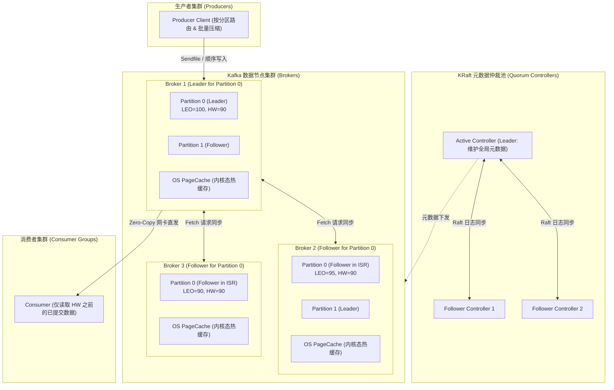
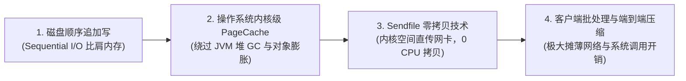
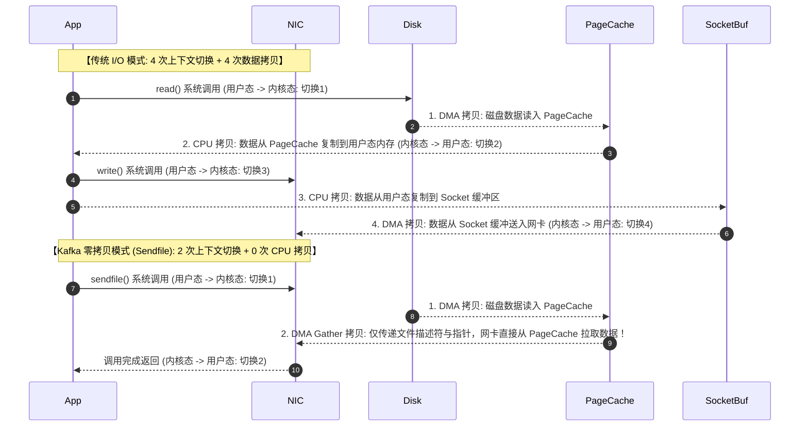
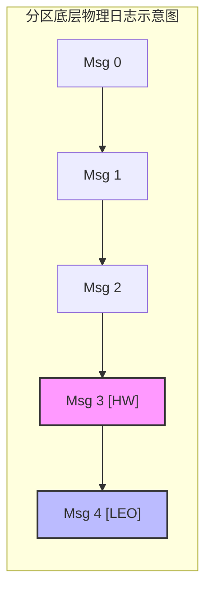
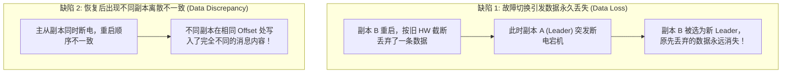
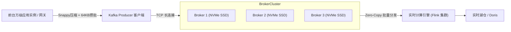
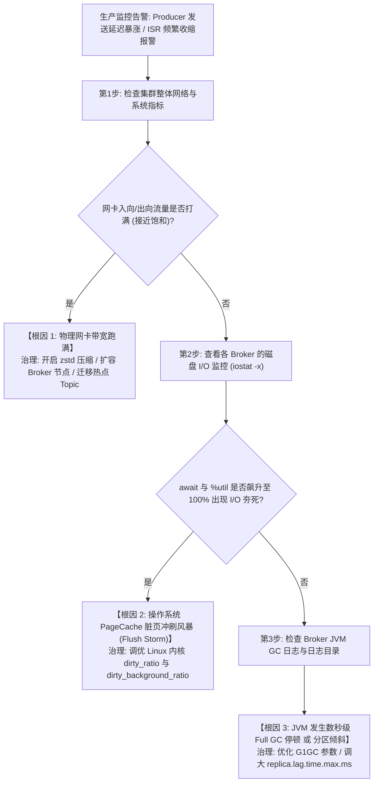
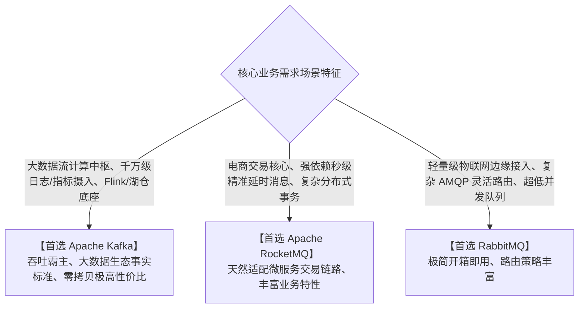
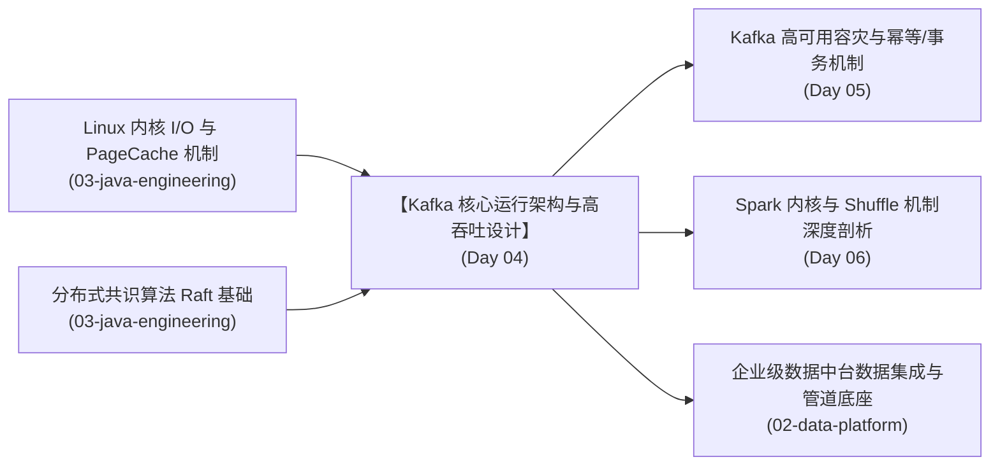

# Kafka 核心运行架构、高吞吐底层设计与分区一致性模型（高阶架构与生产实战）

> **学习目标定位**：面向数据平台研发负责人、大数据架构师与技术总监岗位，深刻掌握 Apache Kafka 在现代大数据基础设施中的中枢定位。跳出表层 API 调用的局限，透彻剖析其高吞吐底座（顺序写、PageCache、Sendfile 零拷贝与批处理压缩）、KRaft 时代去 ZooKeeper 元数据仲裁机制、基于 Leader Epoch 的分区复制一致性模型，以及 ISR 动态收缩机制。结合字节跳动、阿里、美团等互联网大厂高频面试真题，系统建立千亿级流量大促压测调优、生产级 ISR 抖动排查与金融级零丢失（acks=all）的架构设计与技术管理能力。

---

## 1. 知识概述与业务价值

### 1.1 是什么（What）
Apache Kafka 是分布式事件流处理与高吞吐发布/订阅消息系统的行业事实标准。在当前最新的 **Kafka 3.6 / 3.7+ 及 4.0 时代**，Kafka 彻底完成了划时代的架构演进——**全面弃用外部 ZooKeeper，转为基于自身实现的 Raft 仲裁协议 KRaft（KIP-500）**，实现了集群单控制面支撑千万级分区、秒级元数据恢复与毫秒级 Controller 故障转移的云原生现代化底座。

### 1.2 解决什么核心业务痛点（Why）
在 Kafka 出现之前，传统企业级消息队列（如 ActiveMQ、RabbitMQ）主要面临三大结构性瓶颈：
1. **单机高并发瓶颈与吞吐瓶颈**：传统 MQ 深度依赖单机内存与复杂的队列路由（如 Exchange、AMQP 协议），在大并发高吞吐（每秒数万条以上）时性能急剧衰退，无法承接现代互联网和工业物联网的千亿级日志与传感器时序流。
2. **海量历史数据的存储与重放缺陷**：传统 MQ 遵循“消费即删除”的瞬态队列模型，不支持基于位点（Offset）的自由时间旅行回溯与多次重播。
3. **元数据强依赖外部组件引发的性能天花板**：旧版依赖 ZooKeeper 存储集群元数据，当单集群分区数达到数十万时，ZK 的 ZNode 监听事件爆炸与状态同步延迟成为整个大数据链路的核心单点瓶颈。
Kafka 凭借**“以磁盘日志为核心、充分榨取操作系统内核特性、去中心化分区复制与轻量级元数据管理”**的设计哲学，颠覆性地将分布式消息流吞吐推向了每秒数百万甚至千万级 TPS 的物理极限。

### 1.3 适用场景与技术边界（Where & When）
- **高价值应用场景**：
  - **大数据生态的实时数据中枢**：作为上游业务数据库（CDC）、微服务日志与物联网时序数据向 Flink、Spark、Doris/湖仓分发的核心缓冲底座。
  - **超大规模大促削峰与异步解耦**：在双 11、秒杀等极端脉冲流量下暂存数百亿消息，保护下游脆弱的 OLTP 数据库免遭压垮。
  - **事件驱动微服务架构（Event Sourcing）**：依托持久化不可变日志（Append-only Log）构建完整的业务审计与事件回溯链路。
- **技术边界与反模式**：
  - **超长延时消息调度（如 7 天后精准消费）**：Kafka 原生并不适合高精度任意时间延时队列（此类场景更适合 RocketMQ 或 Redis 时间轮）。
  - **海量单条点对点消费队列（Queue 模式）**：Kafka 是以 Partition 为单位进行并发消费与保序的，若需要上万个彼此独立、互不干扰的细粒度工作队列，RabbitMQ 或 SQS 更具灵活性。

---

## 2. 核心概念与关系

### 2.1 核心概念全景表
| 概念名称 | 英文术语 | 核心定义与工程职责 | 资源/生命周期级别 |
| :--- | :--- | :--- | :--- |
| **主题与分区** | Topic / Partition | Topic 是消息的逻辑分类；Partition 是物理存储与并发扩展的最小单元，内部消息严格有序且追加写入。 | 逻辑业务级 / 物理存储级 |
| **日志与分段** | Log / LogSegment | 分区在磁盘上表现为命名目录，内部切分为多个 LogSegment（含 `.log` 数据文件、`.index` 偏移量索引与 `.timeindex` 时间索引）。 | 磁盘物理文件级 |
| **高水位与日志末端** | HW / LEO | **LEO (Log End Offset)** 是当前副本最新写入消息的下一个偏移量；**HW (High Watermark)** 是 ISR 中所有副本都已成功同步的最小偏移量，决定了下游消费者可见的最大安全边界。 | 分区位点级 |
| **同步副本集合** | ISR (In-Sync Replicas) | 与 Leader 副本保持紧密同步的所有副本（含 Leader 本身）的动态集合。只有处于 ISR 内的副本才有资格在 Leader 宕机时参与竞选。 | 分区副本拓扑级 |
| **世代标记** | Leader Epoch | 每次 Leader 发生切换时全局自增的整数代数（KIP-101 引入），用于替代早期的纯 HW 截断，彻底解决宕机恢复中的数据丢失与离散不一致。 | 分区世代元数据 |
| **KRaft 仲裁节点** | KRaft Controller | 替代 ZooKeeper 的内置元数据控制节点，基于 Raft 协议在仲裁池中选主，通过日志复制（`@metadata` Topic）分发集群全局状态。 | 集群主控级 |

### 2.2 Kafka 核心系统架构与组件交互全景图


---

## 3. 底层工作机制与设计哲学

### 3.1 深度揭秘：为什么 Kafka 单节点吞吐能够突破百万级 TPS？

这是互联网大厂技术面试中最经典的核心考点。许多初级工程师只知道“顺序写和零拷贝”，但架构师必须从**操作系统内核与计算机体系结构**的四个维度讲透其设计哲学：



#### 1. 顺序追加写磁盘（Sequential Disk I/O）
- **物理本质**：机械硬盘和 SSD 的性能瓶颈均在于“随机寻址（Random Seek）”。随机 I/O 需要磁头物理移动（寻道时间达毫秒级）或 SSD 内部进行复杂的垃圾回收与写入放大；而**顺序 I/O 只需顺序写入磁道或顺序追加 Flash Block，性能可达 600MB/s 以上，完全不输甚至超越内存随机写入**。
- **Kafka 的设计**：所有消息只能追加（Append-only）到分区末端，严禁就地修改，彻底消除磁盘随机 I/O 开销。

#### 2. 深度榨取操作系统 PageCache（跳过 JVM 堆内存）
- **设计哲学**：传统 Java 系统倾向于在 JVM 堆内缓存数据，带来两大弊端：① Java 对象的内存开销极大（往往是原始数据的 2~4 倍）；② 堆内存一旦超过数十 GB，GC 停顿（STW）长达数秒，足以引发全集群心跳超时。
- **Kafka 的反常识设计**：**Broker 进程内不维护任何大型数据缓存，完全依赖 Linux 操作系统的 PageCache（页缓存）**：
  - 数据写入时，仅仅通过 `write()` 写入操作系统内核的 PageCache 即视为成功，随后由操作系统内核线程（`pdflush/flush`）异步刷盘；
  - 进程重启后，操作系统维护的 PageCache 依然热缓存在物理内存中，无需漫长的冷启动预热。

#### 3. 零拷贝（Zero-Copy）技术：Sendfile 深度演进
在将磁盘中的数据通过网络发送给消费者的过程中，传统模式与零拷贝模式存在本质性能鸿沟：



- **零拷贝收益**：
  - **上下文切换从 4 次骤降为 2 次**；
  - **CPU 拷贝从 2 次彻底降为 0 次（全程由硬件 DMA 控制器搬运数据）**；
  - 数据在整个网络发送链路上从不进入 JVM 进程空间，CPU 利用率保持在极低水位，千兆/万兆网卡直接被打满。

#### 4. 批处理（Batching）与端到端压缩（End-to-End Compression）
- **合并系统调用**：Producer 并不按单条消息发送，而是通过 `batch.size`（如 64KB）与 `linger.ms`（如 10ms）在客户端将多条消息打包成一个 `ProducerBatch`，一次网络请求打入 Broker，将每秒百万级的系统调用压缩数千倍。
- **端到端直接压缩**：Producer 针对 Batch 数据采用高效的 **Zstandard（zstd）或 Snappy** 压缩，Broker 接收后**不进行解压，直接以压缩二进制形态写入磁盘与 PageCache**，消费者拉取后自行解压，最大化压榨网络带宽与存储空间。

---

### 3.2 分区一致性复制机制：HW/LEO 演进与 Leader Epoch 革命

在 Kafka 分区内部，Leader 负责所有读写，Follower 仅仅作为冷备节点向 Leader 发送 `FetchRequest` 异步拉取数据。



- **LEO (Log End Offset)**：当前副本中写入的下一条消息的 offset。
- **HW (High Watermark)**：ISR 集合中所有副本都已经同步完毕的 offset 最小值。**消费者只能看到并读取到 HW 之前的已提交消息**。

#### 早期仅依赖 HW 截断存在的两大致命缺陷（Kafka 0.11 之前）：
在旧版中，当某个 Follower 宕机重启后，它会**直接将自己的 LEO 强制截断到上次保存的 HW 位置**，然后重新向 Leader 发起同步。这种纯粹依赖 HW 的策略在两类异常场景下会导致灾难性后果：



#### 终极解法：Leader Epoch 机制的底层革新（当前主流标准）
为了根治上述缺陷，Kafka 引入了 **Leader Epoch（世代标记，格式如 `(Epoch, StartOffset)`）**：
- 当 Follower 宕机重启后，**绝不再机械地根据自身的 HW 盲目截断日志**！
- 而是首先向当前的 Leader 发送 `OffsetForLeaderEpochRequest`，询问：*“在我的这个 LeaderEpoch 世代内，你那里的最大 Offset 是多少？”*
- Leader 依据自身保存的权威 Epoch 映射表返回该世代的真实终止位点，Follower **基于 Leader 返回的精准位点进行精准截断**。
- **成果**：彻底规避了因节点重启与 Leader 切换并发交织导致的数据丢失和分区脏数据覆盖！

---

### 3.3 ISR 动态伸缩机制与存活判定

#### 什么是 ISR？
ISR（In-Sync Replicas）是当前所有与 Leader 保持“健康同步”的副本集合。
- 只有处于 ISR 内部的 Follower，才有资格在 Leader 宕机时被选为新 Leader；
- 决定一个 Follower 是否被踢出 ISR 的**唯一核心参数是：`replica.lag.time.max.ms`（默认 30000ms 即 30 秒）**。

#### 关键演进：彻底摒弃消息条数落后判定（`replica.lag.max.messages`）
- 早期 Kafka 支持配置“落后超过 $N$ 条踢出 ISR”。但在大促业务峰值时，瞬时流量暴增很容易导致 Follower 瞬时落后超过 $N$ 条，导致全集群副本被频繁踢出 ISR，随后流量回落又重新加入，引发高频的集群元数据震荡风暴。
- 当前版本**仅以时间延迟（`replica.lag.time.max.ms`）作为唯一健康准则**：只要 Follower 在过去 30 秒内持续向 Leader 发送 Fetch 请求，无论此时其物理 Offset 落后多少条，都判定其处于健康同步状态。

---

## 4. 高频复杂业务场景实操与落地

### 4.1 典型业务场景：千亿级双 11 大促流量削峰与日志汇聚架构
某大型电商平台或车联网平台，在双 11 期间峰值并发突破 **150 万 TPS**，要求：
1. 保证金融与交易核心 Topic **绝对零数据丢失（Zero Data Loss）**；
2. 极端洪峰下 Broker 磁盘 I/O 平稳，杜绝 PageCache 刷盘风暴（Flush Storm）；
3. 消费者端能根据集群性能进行批量拉取，平滑消费。



### 4.2 生产级 Broker 与 Client 核心调优参数基线

```properties
# ==================== Broker 生产级高可靠配置 ====================
# 必须配置：禁止非同步副本竞选为 Leader (彻底封死数据丢失风险，保一致性)
unclean.leader.election.enable: false

# 必须配合生产端 acks=all 使用：ISR 中至少有 2 个副本写入成功才算确认
min.insync.replicas: 2

# 彻底依赖操作系统内核 PageCache，严禁开启应用层定时强制刷盘 (强制刷盘破坏顺序写，性能暴跌)
# flush.messages 和 flush.ms 保持默认 null，交由 Linux pdflush 调度！

# 网络与 I/O 线程比调优 (建议：网络线程数 = CPU核数，I/O线程数 = 磁盘数 * 2)
num.network.threads: 16
num.io.threads: 32

# 副本同步超时时间 (针对大促大并发，适当调大防止网络瞬间拥堵导致误踢)
replica.lag.time.max.ms: 45000

# ==================== Producer 生产级高吞吐零丢失配置 ====================
# 金融级零丢失底线：所有 ISR 副本全部确认
acks: all

# 开启幂等性保证 (单分区内严格保序与去重，默认开启)
enable.idempotence: true

# 调大批处理参数，榨取极致吞吐 (批大小 64KB，微秒级攒批等待 10ms)
batch.size: 65536
linger.ms: 10

# 推荐选用更高压缩比且极低 CPU 消耗的压缩算法
compression.type: zstd

# 发送缓冲区与内存池大小 (防止大促脉冲打满导致阻塞)
buffer.memory: 67108864 # 64MB
max.in.flight.requests.per.connection: 5
```

---

## 5. 生产异常故障深度排查与根因分析

### 5.1 生产级“Kafka 写入延迟突增与 ISR 频繁抖动”排查决策树



### 5.2 核心生产异常场景实操复盘

#### 场景一：操作系统 PageCache 脏页冲刷风暴（Flush Storm）导致 P99 延迟暴涨
- **真实生产现象**：在大促流量洪峰期，Kafka 的平均写入延迟只有 2ms，但 P99 甚至 P999 尾部延迟突然出现长达 2~5 秒的尖刺，导致上游网关连接池被打满。查看 CPU 和堆内存非常正常。
- **深度根因分析**：
  在 Linux 默认内核参数中，`vm.dirty_ratio` 较高（默认 20%~30%）。当短时间内产生海量写入时，内存中堆积的未落盘脏页（Dirty Pages）迅速达到该物理阈值。此时，Linux 内核会**强行暂停所有向 PageCache 写入的进程（强制同步阻塞写），调动所有内核资源向磁盘执行物理刷盘**！这就是著名的 PageCache 刷盘风暴，导致原本基于内存的写入瞬间被降级为阻塞等待物理磁盘写完。
- **架构级内核治理调优**：
  在生产服务器中优化 Linux 虚拟内存内核参数，让内核在脏页极低水位时就在后台静默平滑刷盘，杜绝硬卡死：
  ```bash
  # 将脏页后台异步刷盘阈值调小至 5% (只要脏页达 5% 即由后台线程平滑刷写)
  sysctl -w vm.dirty_background_ratio=5
  # 将强制同步阻塞刷盘阈值压低到 10%
  sysctl -w vm.dirty_ratio=10
  ```

#### 场景二：ISR 频繁剧烈抖动与集群元数据风暴
- **真实生产现象**：告警平台频繁报出“Partition X Shrink from ISR, then Expand into ISR”，每天报警上千次。伴随 Controller CPU 升高，作业吞吐不稳定。
- **深度根因分析**：
  1. 某个 Topic 的分区数虽然多，但由于业务 Key 设计不当产生了严重**数据倾斜**，导致某些 Broker 承载了 80% 的写入，该 Broker 的网卡或磁盘 I/O 瞬时被打满。
  2. 运维人员误将 `replica.lag.time.max.ms` 配得很小（如 5 秒），只要发生一次微小的网络抖动或 G1GC 停顿 5 秒，Follower 便被强行踢出 ISR；随后它重新发 Fetch 请求又在第 6 秒被拉回 ISR。频繁的状态变更迫使 Controller 不断向全集群几百个 Broker 广播更新元数据，引发级联震荡。
- **治本工程方案**：
  - 将 `replica.lag.time.max.ms` 统一调优至 30000ms（30 秒），提供充足的容错缓冲区；
  - 检查生产者 Partitioner，修复数据倾斜。

---

## 6. 技术选型对比、架构演进与成本ROI

### 6.1 横向主流分布式消息流引擎深度对比矩阵
| 评估维度 | Apache Kafka (KRaft模式) | Apache Pulsar | Apache RocketMQ (5.x) | RabbitMQ |
| :--- | :--- | :--- | :--- | :--- |
| **存储架构模型** | **本地磁盘分段日志 (存算一体优化)**| 存算分离 (依托 BookKeeper) | 本地 CommitLog 集中存储 | 纯内存为主，磁盘为辅 |
| **极限吞吐能力** | **极致（单机百万级 TPS，零拷贝）**| 极高（存算解耦，水平扩展强）| 极高（十万至百万级） | 中等（数万级） |
| **延迟表现** | 毫秒级 / 亚毫秒级 | 毫秒级 | 毫秒级 | **极低（微秒级）** |
| **百万级超多分区支持**| **极强（KRaft消除元数据瓶颈）** | **极强（天然分块分层设计）** | 极强（单个 CommitLog 天然支持多Topic）| 较弱（超多队列性能雪崩）|
| **延迟消息支持** | 较弱（无原生任意时间轮） | 强（支持定时与延迟消息） | **极强（原生支持秒级任意延迟）**| 需安装插件支持 |
| **运维复杂度** | **中等（KRaft免去外部ZK，极简化）**| 较高（需维护 Broker + BK + ZK）| 较低（轻量 NameServer） | 较低（Erlang环境） |

### 6.2 架构师技术选型决策树


---

## 7. 技术经理与架构师实战管控（SOP与规范）

### 7.1 平台级“金融级高可靠”与“极致成本”三层参数模型
在企业级数据中台管理中，技术负责人切忌让业务方随意申请配置，必须制定**三类标准化规格底线**：

| 规格类型 | 适用业务场景 | Producer 配置 | Broker 约束 | 架构权衡点（SLA vs 成本） |
| :--- | :--- | :--- | :--- | :--- |
| **金融强一致型 (P0)** | 支付清算、交易对账、审计日志 | `acks=all`, `idempotence=true` | 3副本, `min.insync=2`, `unclean=false` | 绝对零丢失，延迟稍高（约 5~10ms），硬件成本 3 倍 |
| **高吞吐日志型 (P1)** | 用户行为埋点、性能指标监控 | `acks=1`, `linger.ms=20` | 2副本, `min.insync=1`, `unclean=true` | 允许极端单机双节点连环损坏丢微量数据，换取吞吐翻倍与成本降 33% |
| **轻量抽样型 (P2)** | 调试采样数据、非关键链路 | `acks=0` (纯发送不等待) | 1副本 (单副本存储) | 吞吐最高，硬件成本最低（仅 1 倍），用于丢弃完全不心疼的旁路 |

### 7.2 生产代码与消息体设计门禁规约（SOP）
1. **消息体大小红线**：严禁单条消息大小超过 **1MB**！在 API 网关和平台层实施强制拦截。大文件（如图片、视频、大报表）必须先上传对象存储（S3/OSS），Kafka 内部仅传递元数据 URL 指针。单条大消息会破坏 PageCache 的连续命中，使整个集群瞬间产生剧烈的内存置换抖动。
2. **Key 设计门禁**：对使用 `keyBy` 发送到特定分区的消息，禁止使用低基数枚举字段（如“性别”、“订单状态”）作为 Key，必须强制加上随机散列值或采用高基数业务 ID（如 `User_ID` / `Order_ID`），从根源杜绝数据倾斜。

---

## 8. 互联网大厂高频面试真题库

### 8.1 基础概念与机制题（大厂初筛）
1. **Q1**：为什么 Kafka 单节点能够支撑数十万至数百万的极高 TPS？其四大底层核心机制是什么？
2. **Q2**：请详细阐述操作系统的零拷贝（Zero-Copy）技术在 Kafka 中是如何落地的？相比传统 I/O 减少了哪些开销？

### 8.2 核心底层原理深度题（大厂资深技术面）
3. **Q3**：什么是 LEO 和 HW？Follower 副本与 Leader 副本之间的同步复制流程是怎样的？
4. **Q4**：早期 Kafka 仅依赖 HW 截断进行故障恢复时，存在哪两种致命的数据一致性缺陷（数据丢失与数据不一致）？Leader Epoch 是如何彻底解决这一问题的？

### 8.3 复杂生产场景与故障排障题（大厂架构与排障面）
5. **Q5**：什么是 ISR？Kafka 是如何判定一个 Follower 是否被踢出 ISR 的？参数依据是什么？
6. **Q6**：生产环境下，某核心 Topic 频繁报警出现“ISR 抖动、Follower 频繁被踢出又重新加入”，你如何系统化排查定位并解决？

### 8.4 架构设计与系统规划题（技术总监/总架构师终面）
7. **Q7**：作为数据平台架构师，请针对千亿级时序与日志数据摄入场景，从高吞吐、绝对零数据丢失（金融级可靠性）与服务器成本 ROI 维度，设计整体 Kafka 集群参数配置与架构方案。

---

## 9. 结构化深度参考答案（逐题三层应答）

### 题目1（大厂初筛·高吞吐本质）：为什么 Kafka 单节点能够支撑数十万至数百万的极高 TPS？其四大底层核心机制是什么？

#### 简洁回答（1分钟电梯破题）：
> “Kafka 能够实现超高吞吐，并非应用层代码跑得有多快，而是其架构设计**‘深度顺应并榨取了操作系统内核与底层硬件特性’**。核心由四大底层支柱共同支撑：
> 第一，**磁盘顺序追加写（Sequential Write）**，性能比肩内存；
> 第二，**完全依赖操作系统内核级 PageCache**，规避了 JVM 堆对象开销与 GC 停顿；
> 第三，**消费端 Sendfile 零拷贝（Zero-Copy）**，内核空间直接把数据送入网卡，零 CPU 拷贝；
> 第四，**客户端端到端批处理与压缩（Batching & Compression）**，合并系统调用，将网络利用率榨取到极致。”

#### 深入回答（机制推导与体系结构分析）：
> “深入到计算机体系结构剖析：
> 1. **顺序写的物理优势**：机械硬盘和 SSD 的根本瓶颈是随机寻址开销。顺序写利用磁盘磁道连续追加，避免了磁头寻道与 SSD 写入放大，其吞吐能轻松达到 600MB/s。
> 2. **跳出 JVM 堆内存的枷锁**：Java 对象的内存存储存在巨大冗余（对象头、对齐填充等），数十 GB 堆内存容易引发数秒级的 GC STW。Kafka 的 Broker 进程内几乎不维护业务缓存，所有消息直接打入 Linux 内核的 PageCache，进程崩溃重启数据依然在内存中热缓存，彻底消除了 GC 影响。
> 3. **零拷贝底层指令**：消费端通过 `FileChannel.transferTo()` 映射到 Linux `sendfile` 系统调用。数据从磁盘被 DMA 拷入 PageCache 后，网卡直接基于文件描述符从 PageCache 抓取数据，**全程在内核态完成，上下文切换从 4 次减少到 2 次，CPU 拷贝从 2 次彻底降为 0 次**。
> 4. **分层批处理**：消息从 Producer 经过网络到 Broker 再到磁盘，全程以 `ProducerBatch` 为单位保持二进制压缩格式（如 zstd），直到消费者客户端才解压，端到端节省了 70% 的网络带宽与 I/O 次数。”

#### 架构师/技术管理视角（权衡取舍、SLA与成本）：
> “作为数据平台负责人，理解高吞吐四大机制对于**硬件选型与资源成本优化（ROI）**至关重要：
> 第一，**破除盲目采购高价 SSD 的迷信**。由于顺序写特性，在预算受限的非极端点查场景下，多块高容量机械硬盘（SATA HDD）组建 RAID 0 或 JBOD，其顺序吞吐足以抗住数十万 TPS，硬件成本降低 60% 以上；
> 第二，**内存规划黄金法则**。Kafka Broker 的 JVM 堆内存切忌分配过大（通常配置 6GB~8GB 即可满足内部元数据运转），必须**将物理机 70% 以上的富余内存无保留地留给操作系统的 PageCache**，让内核自由进行页面换入换出，这是保障万亿级大促平稳运行最核心的运维红线。”

---

### 题目2（大厂初筛·零拷贝技术）：请详细阐述操作系统的零拷贝（Zero-Copy）技术在 Kafka 中是如何落地的？相比传统 I/O 减少了哪些开销？

#### 简洁回答（1分钟电梯破题）：
> “传统网络 I/O 经历**‘4次上下文切换 + 4次数据拷贝（2次 CPU 拷贝 + 2次 DMA 拷贝）’**，数据频繁在内核态与用户态之间来回搬运，严重浪费 CPU 算力与内存带宽。
> Kafka 在数据消费时通过底层调用 Linux `sendfile` 系统调用（Java 的 `FileChannel.transferTo`），实现了硬件级的零拷贝：**上下文切换直接砍半为 2 次，且完全消除了 2 次 CPU 拷贝**。网卡通过 DMA Gather Copy 机制直接从操作系统内核 PageCache 读取数据并发往网络，全程无需 CPU 搬运数据，极大释放了 CPU 算力。”

#### 深入回答（状态机流转与边界条件）：
> “深入到系统调用与操作系统内核态/用户态流转：
> 1. **传统读写流程（Read + Write）**：
>    - 步骤 1：调用 `read()`，发生第 1 次切换（用户态 $\rightarrow$ 内核态），DMA 将磁盘数据读入内核 PageCache；
>    - 步骤 2：CPU 将数据从 PageCache 拷贝到用户态内存缓冲区，发生第 2 次切换（内核态 $\rightarrow$ 用户态）；
>    - 步骤 3：调用 `write()`，发生第 3 次切换（用户态 $\rightarrow$ 内核态），CPU 将数据从用户态内存拷贝到 Socket 缓冲区；
>    - 步骤 4：DMA 将 Socket 缓冲区数据搬运至网卡协议引擎，发生第 4 次切换（内核态 $\rightarrow$ 用户态）。
>    - *总计*：4 次上下文切换，4 次内存拷贝（2次 CPU 参与，2次 DMA 参与）。
> 2. **Kafka Sendfile 零拷贝流程**：
>    - 步骤 1：调用 `sendfile()`，发生第 1 次切换（用户态 $\rightarrow$ 内核态），DMA 将磁盘数据拷贝至内核 PageCache；
>    - 步骤 2：在支持 SG-DMA（Scatter-Gather DMA）的现代网卡上，CPU **仅将带有数据位置和长度的文件描述符（FD）写入 Socket 缓冲区**；
>    - 步骤 3：网卡的 DMA 引擎直接根据指针，**直接跨过用户态、直接从内核 PageCache 读取数据打包发射到网线**！调用完成返回，发生第 2 次切换（内核态 $\rightarrow$ 用户态）。
>    - *总计*：仅 2 次上下文切换，2 次 DMA 硬件拷贝，**CPU 拷贝完全为 0**！”

#### 架构师/技术管理视角（权衡取舍、SLA与成本）：
> “从架构设计角度看，零拷贝的巨大威力在于**将原本受限于 CPU 主频的 I/O 吞吐瓶颈，彻底转化为单纯受限于物理网卡带宽的纯硬件瓶颈**：
> 这解释了为什么在 Kafka 节点监控上，即使网卡已经跑满 10Gbps，Broker 的 CPU 使用率往往还不到 20%。
> 但架构师必须清醒认识到零拷贝的**先决条件**：**数据在传输过程中绝不能进行任何业务层面的解密、解包或二次篡改**。如果业务架构要求在 Broker 端对消息进行敏感信息字段脱敏或修改，零拷贝将立刻失效，数据必须强行读回用户态内存，导致吞吐瞬间断崖式下跌 70%。我们在数据平台治理中严格规定‘Broker 绝不做任何计算，仅作哑巴管道’，就是为了全力捍卫零拷贝通道的纯净性。”

---

### 题目3（大厂资深·复制流程）：什么是 LEO 和 HW？Follower 副本与 Leader 副本之间的同步复制流程是怎样的？

#### 简洁回答（1分钟电梯破题）：
> “LEO（Log End Offset）是各副本内部当前日志写入的末端偏移量；HW（High Watermark）是当前分区中 ISR 集合内所有副本都已经同步完成的最小位点，代表下游消费者可读的安全水位。
> 复制流程采用**‘Follower 主动向 Leader 发起 Fetch 请求’**的 Pull 模式：Leader 收到消息后首先追加到本地 LEO；Follower 异步发送带有自身当前 LEO 的 Fetch 请求拉取数据并写入本地更新 LEO；Leader 在收到所有 ISR 副本的最新 Fetch 位点后，推进全局 HW，并在下一次 Fetch 响应中将更新后的 HW 带给 Follower。”

#### 深入回答（状态机流转与边界条件）：
> “深入到消息拉取与 HW 推进的微观时序细节：
> 1. **Leader 写入与初态**：假设此时各副本 HW=0。生产者写入一条新消息到 Leader，Leader 本地写入其 PageCache，Leader 的 LEO 更新为 1。此时由于尚未有 Follower 确认同步，该分区的 HW 保持为 0，外部消费者无法读取这条消息。
> 2. **Follower 发起 Fetch 请求**：Follower 发送 `FetchRequest(offset=0)`。Leader 接收到后，从自己的 PageCache 中读取消息包装在响应报文中，同时 Leader 在内存中更新该 Follower 的记录状态 `remoteLEO = 0`。
> 3. **Follower 写入本地**：Follower 收到消息写入本地日志，将其本地 LEO 推进为 1。
> 4. **第二次 Fetch 与 HW 推进**：
>    - Follower 发起第二次请求 `FetchRequest(offset=1)`；
>    - Leader 收到后，获知该 Follower 已经成功消费到了 1，将该 Follower 的 `remoteLEO` 更新为 1；
>    - Leader 检查当前 ISR 中所有副本的 LEO，发现全体 LEO 均达到了 1，**Leader 遂正式将分区的 HW 推进到 1**！
>    - Leader 将最新的 `HW=1` 附带在第二次 Fetch 响应报文中回传给 Follower；
>    - Follower 收到响应，将其本地的 HW 也更新为 1。此时，该消息正式对外部消费者可见。”

#### 架构师/技术管理视角（权衡取舍、SLA与成本）：
> “在技术管理与大促容量评估中，必须深刻理解**‘HW 推进天然滞后于 Follower 实际写入’**这一事实：
> Follower 往往需要经历‘拉取写入 $\rightarrow$ 下一次 Fetch 握手’这两个 RTT（往返网络延迟）才能将 HW 更新。
> 这直接指导了我们对**端到端延迟（Latency）的真实预期**：配置了 `acks=all` 时，消息的可见延迟并不是网络传输单程耗时，而是包含了至少两次 Broker 间 RPC 通信开销。在做微服务同步接口架构设计时，不能拿 Kafka 的延迟去和 Redis 强比，必须给业务调用预留至少 5~15ms 的平滑水位。”

---

### 题目4（大厂资深·一致性痛点）：早期 Kafka 仅依赖 HW 截断进行故障恢复时，存在哪两种致命的数据一致性缺陷（数据丢失与数据不一致）？Leader Epoch 是如何彻底解决这一问题的？

#### 简洁回答（1分钟电梯破题）：
> “早期版本 Follower 宕机重启后，**机械地将本地日志强行截断到上次保存的旧 HW 处**。这种粗暴机制在特定故障交叉下会触发两大致命事故：
> 第一是**数据永久丢失（Data Loss）**：Follower 先截断旧数据，紧接着原 Leader 宕机，该 Follower 竞选为新 Leader，原先被截断但已被确认的数据永久蒸发；
> 第二是**副本离散不一致（Data Discrepancy）**：主从同时断电重启后，在相同 Offset 处写入了完全不同的消息内容。
> **Leader Epoch 机制**彻底打破了按旧 HW 截断的盲目做法：Follower 重启后必须先向新 Leader 询问该世代的权威起始/终止位点，基于协商结果执行精准安全截断，从根源上消除了数据丢失与内容错乱。”

#### 深入回答（故障推演与 Leader Epoch 状态机解决推导）：
> “以经典故障时序推导演进过程：
> 1. **数据丢失场景推演（旧版 HW 缺陷）**：
>    - 初始状态：Broker A (Leader) 与 Broker B (Follower) 均在 ISR 中，各自本地 LEO=2，但由于通知延迟，两者的 HW 均为 1。
>    - 此时 Broker B 突发宕机；Broker B 重启后，**根据旧版规则将自己的日志直接截断到旧 HW=1，删除了 Offset=1 的那条消息**（此时 B 的 LEO 变为 1）；
>    - 就在 B 准备向 A 发起 Fetch 的瞬间，Broker A 突发断电！Broker B 顺理成章被选为新 Leader；
>    - Broker A 稍后重启，由于 B 是 Leader，A 只能向 B 对齐，也将自己的日志截断到 1。结果：**Offset=1 的那条原本已经被两节点全部写完的数据，被永久彻底丢失**！
> 2. **Leader Epoch 如何彻底根治（KIP-101）**：
>    - Leader Epoch 是一个递增代数加上该代起始位点组成的元组，例如 `(Epoch_0, Offset_0)`, `(Epoch_1, Offset_2)`。
>    - 在同样场景下，Broker B 重启后**绝不主动执行截断**！
>    - 当 Broker A 宕机、Broker B 变为新 Leader 时，B 将自身的 Leader Epoch 递增并记入本地元数据；
>    - Broker A 重启后，作为 Follower 向 B 发送 `OffsetForLeaderEpochRequest(Epoch_0)`，询问在世代 0 中你的最大位点是多少；
>    - B 查阅自身记录，发现自己的世代 0 实际上写到了 Offset=2，遂告知 A：‘在世代 0 中可以保留到 Offset=2’；
>    - 结果：**A 与 B 均完整保留了 Offset=1 的数据，零丢失完美自愈**！”

#### 架构师/技术管理视角（权衡取舍、SLA与成本）：
> “从架构演进的角度看，Leader Epoch 是分布式系统共识协议（Consensus Protocols）思想在日志存储层面的典型胜利：
> 它用‘权威世代协商机制’彻底替代了‘本地单点盲目推断’。
> 作为架构负责人，在选型和评估开源组件时必须具备前瞻视角：**严禁在生产核心链路使用低于 Kafka 0.11 的古董版本**。我们强制要求全平台必须运行在 Kafka 3.6+ / 3.7+ 上，不仅是为了享受 KRaft 的轻量，更是为了利用完全成熟的 Leader Epoch 彻底杜绝金融账目在节点异常重启时出现的一致性悬案。”

---

### 题目5（大厂场景·ISR机制）：什么是 ISR？Kafka 是如何判定一个 Follower 是否被踢出 ISR 的？参数依据是什么？

#### 简洁回答（1分钟电梯破题）：
> “ISR（In-Sync Replicas）是与 Leader 保持健康同步的所有副本（包含 Leader 自身）的动态集合。只有留在 ISR 内的副本，才有资格在 Leader 发生宕机时参与竞选新 Leader，是保障高可用与零数据丢失的核心屏障。
> 当前标准 Kafka **仅依据时间延迟作为唯一判定标准**：核心参数是 **`replica.lag.time.max.ms`（默认 30000ms 即 30 秒）**。只要 Follower 在该时间窗口内持续向 Leader 发送有效的 Fetch 请求，无论此时由于流量洪峰其物理 Offset 落后多少条，均被视为健康合规留在 ISR 中；一旦超过 30 秒未发起请求，Leader 立即将其踢出 ISR。”

#### 深入回答（底层心跳检测与历史废弃参数剖析）：
> “深入到算法演进与底层检测细节：
> 1. **判定逻辑的底层实现**：
>    - Leader 内存中为每个 Follower 维护了一个时间戳 `lastCaughtUpTimeMs`。
>    - 当 Follower 发来的 Fetch 请求赶上了当前 Leader 的最新 LEO，或者 Follower 持续在发送 Fetch 并在处理流水线中推进，Leader 便更新该时间戳。
>    - Leader 周期性扫描所有副本，一旦发现 `currentTime - lastCaughtUpTimeMs > replica.lag.time.max.ms`，立即触发 ISR 收缩（Shrink），并将最新的 ISR 集合持久化并通报 Controller。
> 2. **为什么彻底废弃 `replica.lag.max.messages`？**
>    - 在旧版 Kafka 中，允许配置‘落后超过 4000 条即踢出 ISR’。
>    - **致命缺陷**：在生产流量脉冲下，生产者一个瞬时大 Batch 涌入数万条消息，Leader 瞬间写入，Follower 哪怕网络完全健康，物理上也必然在短时间内落后数万条。这导致该分区下的 Follower 被频繁踢出 ISR，几秒后拉完数据又重新加入，造成全集群 Controller 频繁向所有 Broker 广播元数据更新，引发可怕的**集群元数据雪崩震荡**。因此现代版本只看时间活跃度，彻底移除了按条数判定的参数。”

#### 架构师/技术管理视角（权衡取舍、SLA与成本）：
> “在技术管理与大促保障中，参数配置体现着系统架构的稳定性哲学：
> 很多初级工程师为了追求所谓的‘极致同步’，盲目把 `replica.lag.time.max.ms` 调小到 5 秒甚至 2 秒，结果一到大促流量高峰或遭遇一次 JVM 几秒的垃圾回收，整个集群瞬间到处报警 ISR 频繁收缩与扩张。
> 架构师的黄金法则是：**大促前必须将 `replica.lag.time.max.ms` 保障在 30 秒至 45 秒之间**，给跨节点网络微抖动、GC 暂停与大批次处理留出充足的弹性容忍余量，以稳定的拓扑换取全集群的高可用。”

---

### 题目6（大厂场景·生产排障）：生产环境下，某核心 Topic 频繁报警出现“ISR 抖动、Follower 频繁被踢出又重新加入”，你如何系统化排查定位并解决？

#### 简洁回答（1分钟电梯破题）：
> “排查遵循**‘四步定界法’**：
> 第一，排查 **JVM GC 停顿**，查看 Follower 所在的 Broker 是否发生了数秒以上的长 GC，导致无法在 30 秒内发出 Fetch 请求；
> 第二，排查 **物理网卡带宽**，监控各 Broker 入向与出向流量，判断是否有突发流量将网卡打满导致网络丢包；
> 第三，排查 **磁盘 I/O 争抢与 PageCache 脏页堵塞**（使用 `iostat -x` 查看 await 是否飙升），排查是否有其他繁重进程或大消息冲击磁盘；
> 第四，排查 **数据倾斜**，查看该 Topic 各 Partition 的流入速率与消息大小是否极不均匀。
> 治理手段包括调大容忍时间参数、配置网络带宽流量限制、开启数据压缩与消除热点 Key 倾斜。”

#### 深入回答（排查实战与根因治理）：
> “系统化排查与治理闭环链路：
> 1. **指标初筛与定位**：
>    - 查看 Grafana 看板：统计触发 ISR 踢出的 Follower 节点集中在固定的某台机器，还是全集群随机发生。
>    - 若集中在某台机器：优先排查该机器的硬件健康度（坏道、网卡丢包率、CPU Steal）。
> 2. **三大隐蔽根因的深度处理**：
>    - **根因 A（GC 停顿导致超时假死）**：检查 Broker 的 GC 日志。如果 JVM 堆配置不当（例如开了 64GB 堆且未良好调优 G1GC），单次 Mixed GC 或 Full GC 停顿若超过 `replica.lag.time.max.ms`，Leader 就会判定其失联。治本方案：压减 Broker 堆内存至 8GB~12GB，大部分空间还给 PageCache，优化 G1 参数 `-XX:MaxGCPauseMillis=20`。
>    - **根因 B（物理网卡被大吞吐打满）**：在千兆/万兆网卡环境下，多个大 Topic 并发消费将出口带宽打满至 95% 以上，Fetch 响应在队列中排队超时。治本方案：在 Producer 端全量推行 `compression.type=zstd` 降低 60% 网络带宽，并在集群层面对重度消费者开启 `quota` 消费限流。
>    - **根因 C（单条大消息拖慢 I/O 管道）**：生产端偶尔打入数十 MB 的异常单条大消息，导致传输与解析单包耗时剧增。治本方案：严格在网关层限制 `max.message.bytes = 1MB`。”

#### 架构师/技术管理视角（权衡取舍、SLA与成本）：
> “在技术管理高度，ISR 抖动是**集群亚健康的最核心前兆**，绝不能只当成普通告警忽略：
> 1. **设立红线报警门禁**：将‘连续 10 分钟内发生 3 次以上 ISR 收缩’定义为 P2 级故障预警，前置安排专家介入排查，绝不让隐患拖到大促当天爆发。
> 2. **推行多租户配额（Quotas）隔离机制**：利用 Kafka 原生的 Client Quotas，为不同业务系统分配生产速率（`producer_byte_rate`）与消费速率配额。一旦某个边缘业务突然写爆，直接在其客户端触发延时限流（Throttling），绝不允许边缘业务的野蛮流量把底层 Broker 的网卡挤爆，捍卫核心业务的 ISR 稳定性。”

---

### 题目7（架构设计·高管终面）：作为数据平台架构师，请针对千亿级时序与日志数据摄入场景，从高吞吐、绝对零数据丢失（金融级可靠性）与服务器成本 ROI 维度，设计整体 Kafka 集群参数配置与架构方案。

#### 简洁回答（1分钟电梯破题）：
> “面对千亿级高吞吐与高可靠兼顾的严苛诉求，我的整体架构原则是**‘底座现代化（全面上 KRaft）、生产端极致批压缩、Broker 端零丢失刚性闭环、平台化多租户限流防踩踏’**：
> 采用 Kafka 3.7+ 的 KRaft 存算一体优化架构彻底解除元数据瓶颈；生产端配置 `acks=all + 幂等性 + 64KB攒批 + zstd压缩`；Broker 严格锁死 `3副本 + min.insync=2 + 禁止非同步选主`；底层依托 Linux 内核调优杜绝 PageCache 刷盘风暴，以标准化规范兼顾千亿级吞吐吞吐、金融级零丢失与服务器最高 ROI。”

#### 深入回答（技术方案、拓扑推导与权衡）：
> “系统化架构设计拆解为四大支柱：
> 1. **集群元数据与拓扑规划（Cluster & Metadata Topology）**：
>    - 彻底告别 ZooKeeper，采用 **KRaft 独立仲裁池模式**：配置 3 台专用轻量级 Controller 节点负责 Raft 选举与元数据分发，与数据 Broker 物理节点解耦分离，避免高并发 I/O 挤占元数据带宽，轻松承载单集群数十万级分区。
>    - 分区数容量规划：按照每个 Partition 承载 20MB/s 写入的标准公式，单 Topic 预设 32~64 个分区，均匀散列在 10~20 台 NVMe SSD 高性能 Broker 节点上。
> 2. **金融级零丢失刚性契约（Zero Data Loss Assurance）**：
>    - **Producer 侧**：`acks=all`, `enable.idempotence=true`, `retries=Integer.MAX_VALUE`, `max.in.flight.requests.per.connection=5`（保持保序与高吞吐并行）。
>    - **Broker 侧**：设置 `replication.factor=3`, `min.insync.replicas=2`。这保证了哪怕任意 1 台机器宕机，只要还剩 2 个副本存活，系统依然能强一致写入；若只剩 1 个副本，系统主动拒绝写入并报 `NotEnoughReplicasException` 向上游熔断，坚决杜绝在单点状态下盲目落单导致丢失。
>    - **灾难选主红线**：配置 `unclean.leader.election.enable=false`，坚决禁止落后的 OSR 副本越权竞选为 Leader。
> 3. **极限吞吐与操作系统内核调优（OS Kernel Tuning）**：
>    - 调整内核脏页回写参数：`vm.dirty_background_ratio=5`, `vm.dirty_ratio=10`，彻底消除大促峰值期间 PageCache 的 Flush Storm 硬卡死。
>    - 生产端调优：`batch.size=65536`（64KB）, `linger.ms=10~20ms`，开启 `compression.type=zstd`，将千亿级网络带宽开销直降 60% 以上。
> 4. **精细化多租户与成本治理（Cost ROI & Quotas）**：
>    - 开启 Client Quotas，按业务部门配置网卡生产与拉取带宽硬上限，超标自动平滑限流。
>    - 结合云原生弹性：非核心日志 Topic 开启分层存储（Tiered Storage，KIP-405），本地 SSD 仅保留 4 小时热数据，历史冷数据异步转储至低成本对象存储（S3/OSS），将集群整体存储硬件成本砍掉 50%！”

#### 架构师/技术管理视角（商业价值、领导力与落地抓手）：
> “在技术管理与产品交付维度（结合在大型复杂中台研发中的真实落地经验）：
> 一个优秀的平台架构不仅要看技术参数有多华丽，更要看**平台化易用性与工程落地确定性**：
> 第一，**研发规约与治理门禁**。在自研数据中台产品中，我们将上述复杂的参数封装为‘金融级（acks=all）’与‘高性能日志型（acks=1）’标准模板，严禁业务方在代码里私自写 Producer 配置。同时在网关层建立单条消息大小不得超 1MB 的刚性校验，从源头消灭 90% 的生产抖动隐患。
> 第二，**大促应急预案（SOP）的实操兑现**。大促前执行标准化全链路混沌工程压测（如随机宕机单台 Broker，验证 `min.insync=2` 是否能在 3 秒内平滑重选 Leader 且生产端无报错重试成功）。技术总监的底气来自日常严谨的体系化防御与 SOP 机制，而不是寄希望于大促当天的运气。”

---

## 10. 知识自检与口述推演清单

- [ ] 能否脱稿在白板上画出 Linux Sendfile 零拷贝在内核态与网卡之间的完整数据流向，并准确说出它相比传统 I/O 减少了几次上下文切换与几次 CPU 拷贝？
- [ ] 面对“Kafka Broker 写入平均延迟正常但 P99 出现数秒毛刺尖刺”的告警，能否在 1 分钟内指出 Linux 内核 PageCache 刷盘风暴（Flush Storm）的根因与内核调优参数？
- [ ] 能否系统说清早期基于 HW 截断为什么会导致数据丢失和离散不一致，而 Leader Epoch 是如何通过世代协商彻底根除这一缺陷的？
- [ ] 能否站在技术总监视角，向业务高管和运维团队讲透金融级高可靠配置（`acks=all + min.insync.replicas=2 + unclean.leader.election.enable=false`）在 SLA 与成本 ROI 之间的权衡逻辑？

---

## 11. 知识脉络与技术图谱关联



---

## 12. 权威参考与官方进阶资料

1. **Apache Kafka 官方架构最新文档 (v3.6 / 3.7 KRaft)**：[Kafka Documentation](https://kafka.apache.org/documentation/#design)
2. **Kafka 核心世代协议提案 (KIP-101)**：[Alter Replication Protocol to use Leader Epoch](https://cwiki.apache.org/confluence/display/KAFKA/KIP-101+-+Alter+Replication+Protocol+to+use+Leader+Epoch+rather+than+High+Watermark+for+Truncation)
3. **Kafka 去 ZooKeeper 现代化架构提案 (KIP-500)**：[Replace ZooKeeper with a Self-Managed Metadata Quorum](https://cwiki.apache.org/confluence/display/KAFKA/KIP-500%3A+Replace+ZooKeeper+with+a+Self-Managed+Metadata+Quorum)
4. **美团技术团队经典生产复盘**：[Kafka在美团的实践与踩坑实录](https://tech.meituan.com/2016/02/12/kafka-fs-design-theory.html)
5. **分布式日志系统经典论文**：*Kreps, Jay, Neha Narkhede, and Jun Rao. "Kafka: A distributed messaging system for log processing." NetDB (2011).*

