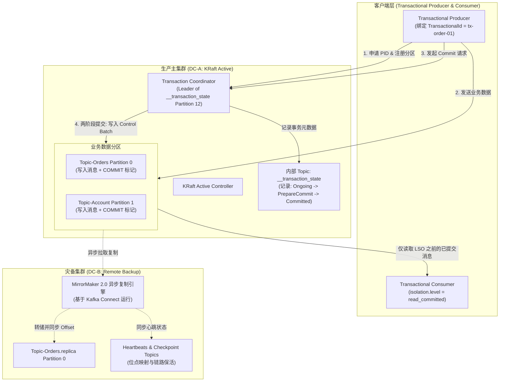
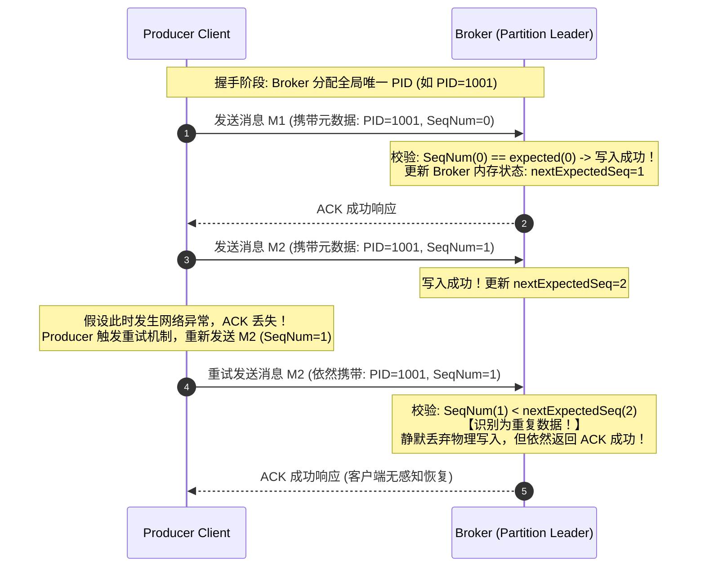
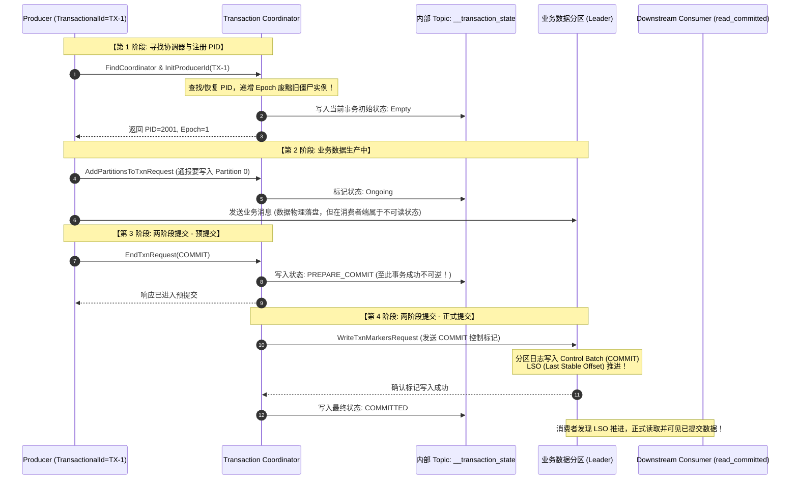
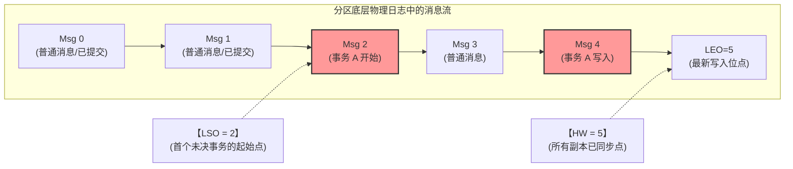
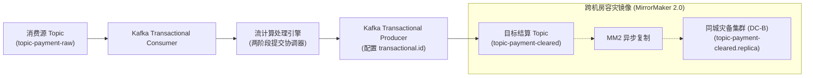
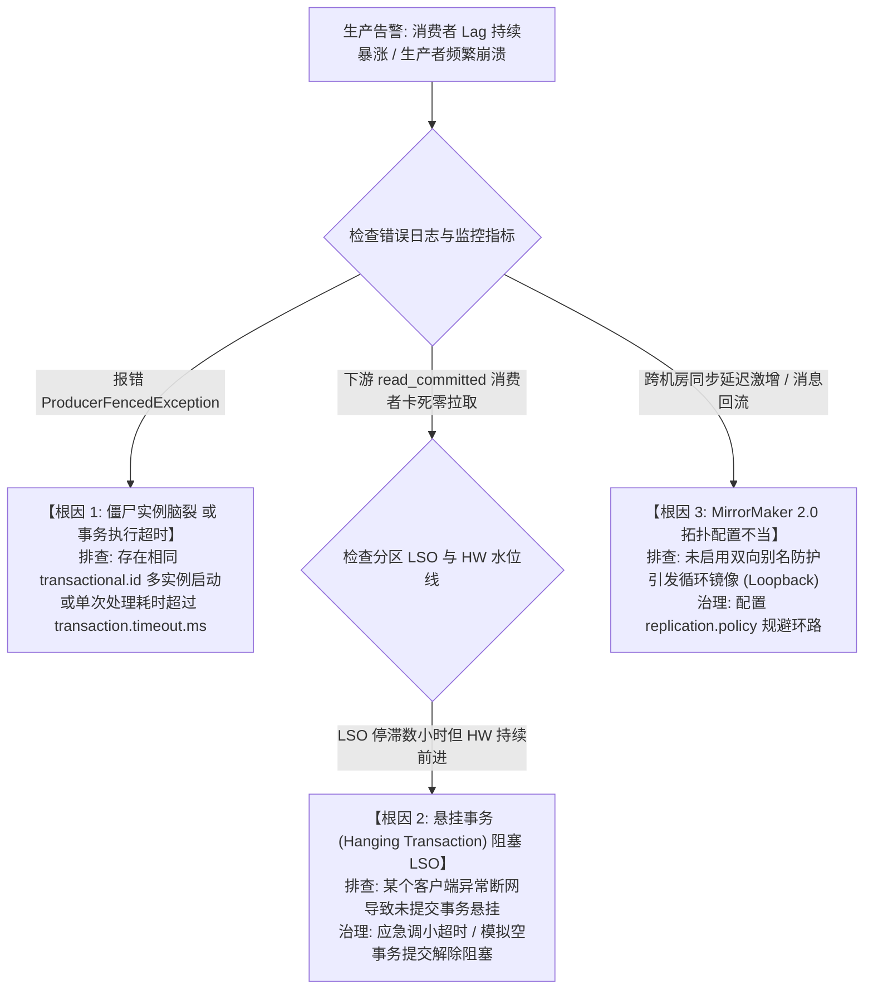
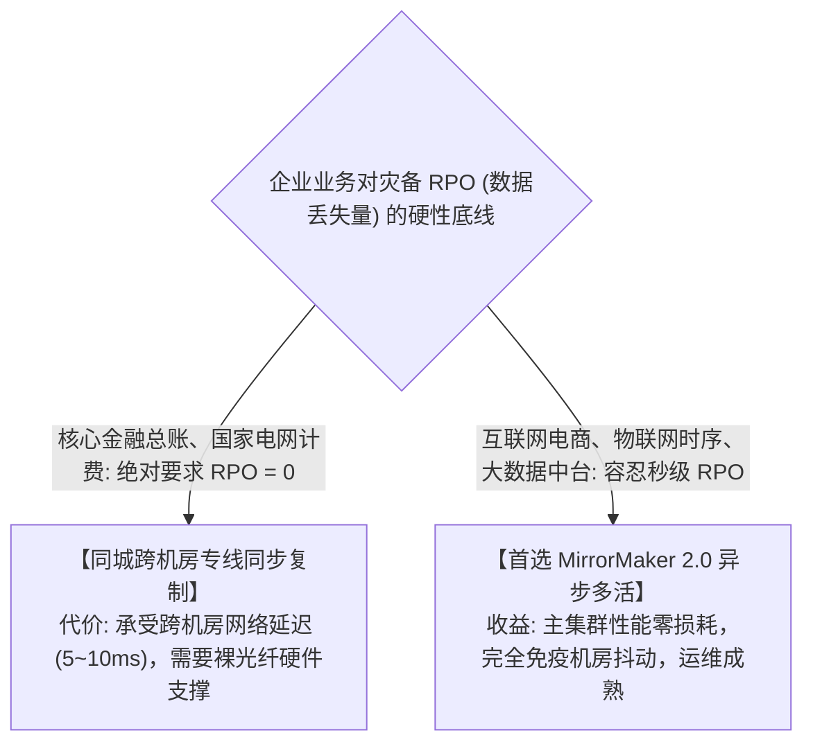
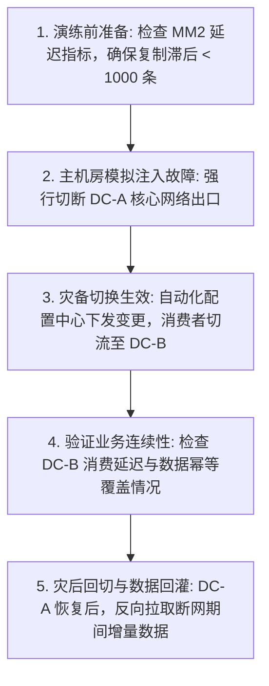
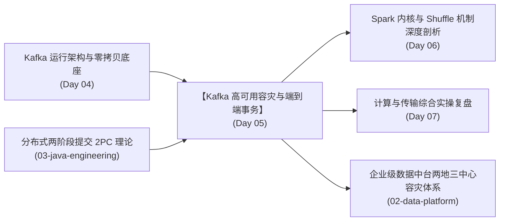

# Kafka 高可用容灾、脑裂防范与端到端事务机制（高阶架构与生产实战）

> **学习目标定位**：面向数据平台研发负责人、大数据架构师与技术总监岗位，深刻掌握 Apache Kafka 在金融级与千亿级业务场景下的高可用容灾基石。透彻理解 KRaft 模式下的 Controller Quorum 选举与去脑裂机制、Producer 幂等性实现细节、基于 Transaction Coordinator 与两阶段提交（2PC）的端到端事务底层交互时序、LSO（Last Stable Offset）对下游消费者的可见性控制，以及跨机房 MirrorMaker 2.0 多集群容灾架构。结合阿里、字节、美团等一线大厂真实高频面试场景，系统掌握生产环境 ProducerFencedException 崩溃排障、悬挂事务阻塞 LSO 治理与高管维度的双机房容灾架构取舍。

---

## 1. 知识概述与业务价值

### 1.1 是什么（What）
- **高可用与容灾（HA & Disaster Recovery）**：指 Kafka 集群在遭遇硬件损坏、网络分区（Network Partition）、机房级断电等灾难事件时，依然能够对外提供持续读写服务或在极低 RPO（数据丢失量）与 RTO（恢复时间）内完成平滑切换的架构能力。在最新的 **Kafka 3.6+ / 3.7+** 中，这一能力由基于 Raft 的 **KRaft 元数据仲裁池**与 **MirrorMaker 2.0 多活灾备链路**提供支撑。
- **幂等性与事务机制（Idempotence & Transactions）**：
  - **幂等性（Idempotence）**：保证在单分区内，即使生产者因网络重试多次发送同一条消息，Broker 也仅会持久化一次，实现单分区 `Exactly-Once` 写入。
  - **事务机制（Transactions）**：跨多 Topic、多 Partition 的原子性写入保障，结合“消费-处理-生产（Consume-Transform-Produce）”流水线，实现端到端的精准一次（Exactly-Once Semantics, EOS）。

### 1.2 解决什么核心业务痛点（Why）
1. **网络重试引发的数据重复（At-Least-Once 缺陷）**：网络丢包或 ACK 超时会导致生产者发起重试，在没有幂等机制前，这会导致计费结算重复、订单流水重复记账，给下游带来巨大的对账开销。
2. **多分区原子写入割裂**：传统 MQ 无法实现“要么多个分区的消息全部可见，要么全部不可见”。若某批操作中间发生崩溃，会导致部分数据落盘、部分数据丢失，造成分布式状态断裂。
3. **单点机房不可抗力灾难**：当主数据中心发生火灾、断网或机房级光缆被挖断时，必须具备跨机房多集群平滑切换能力，保障核心业务连续性。

### 1.3 适用场景与技术边界（Where & When）
- **高价值应用场景**：
  - **金融级交易清算与审计溯源**：使用 Kafka 事务保证转账出账流水与订单状态落盘的强原子性。
  - **流处理计算流水线（Flink + Kafka EOS 闭环）**：在上游读取 Kafka、经过 Flink 计算后写回 Kafka 的全链路中，实现端到端严格精准一次。
  - **双机房冷备与同城双活容灾**：支撑企业异地多活与金融级两地三中心容灾体系建设。
- **技术边界与反模式**：
  - **对毫秒级端到端延迟极度敏感的场景**：事务模式下，消费者必须在 `read_committed` 级别运行，数据的下游可见性直接取决于事务提交的时机，无法做到单条微秒级透传。
  - **跨集群强一致性同步**：Kafka 跨机房复制（如 MirrorMaker 2.0）是**异步复制（Asynchronous Replication）**，在机房级灾难切换时必须容忍微量 RPO 差额，无法替代强一致分布式数据库。

---

## 2. 核心概念与关系

### 2.1 核心概念全景表
| 概念名称 | 英文术语 | 核心定义与工程职责 | 资源/生命周期级别 |
| :--- | :--- | :--- | :--- |
| **事务协调器** | Transaction Coordinator | 运行在特定 Broker 上的组件，负责管理 Producer 的事务生命周期，协调两阶段提交。具体位置由 `TransactionalId` 的 Hash 值决定。 | Broker 内部服务 |
| **事务状态主题** | `__transaction_state` | Kafka 内部系统 Topic（默认 50 分区，3副本），用于持久化所有事务的当前状态日志（Empty, Ongoing, PrepareCommit, Committed）。 | 内部日志持久化 |
| **生产者标识与代数** | PID & Producer Epoch | **PID (Producer ID)** 是 Broker 分配给幂等/事务生产者的唯一 64 位数字；**Producer Epoch** 是递增代数，用于防止旧僵尸实例脑裂写入（Fencing）。 | 生产者会话级 |
| **稳定位点** | LSO (Last Stable Offset) | 分区中第一个尚未提交（处于未决 Ongoing 状态）的事务消息的 Offset。在 `read_committed` 模式下，**消费者只能消费到 LSO 之前的消息**。 | 分区水位线级 |
| **控制报文** | Control Batch (Commit/Abort) | 事务提交或中止时，由协调器写入数据分区的特殊标记元组，不对应用层可见，仅供消费者底层识别事务完成状态。 | 日志物理分段级 |
| **镜像工具** | MirrorMaker 2.0 (MM2) | 基于 Kafka Connect 框架的官方跨集群异步复制套件，支持 Topic 重命名、Offset 跨集群平移映射与防循环镜像机制。 | 跨集群服务级 |

### 2.2 事务与多集群容灾全景架构图


---

## 3. 底层工作机制与设计哲学

### 3.1 Producer 幂等性底层实现细节（单分区 EOS）

为了实现单分区内的去重与保序，Kafka 引入了极简而高效的 **Sequence Number 窗口机制**：



#### 关键约束与设计哲学：
1. **只能保障单分区、单会话内幂等**：PID 是内存动态分配的，若 Producer 进程崩溃重启，重新申请的 PID 会改变，历史序列号失效；且 SequenceNumber 是针对每个 Partition 独立计数的，跨分区无法生效。
2. **为什么开启幂等后 `max.in.flight.requests.per.connection` 可以设为 5？**
   旧版要求保序必须将该参数设为 1（完全禁止并发请求），极大扼杀吞吐。开启幂等后，Broker 内部维护了最近 5 个请求的滑动窗口缓存，即使请求乱序到达，Broker 也能在内存中根据 SequenceNumber 重新排序后再落盘，**彻底兼顾了网络高吞吐与绝对保序**。

---

### 3.2 Kafka 分布式事务底层两阶段提交（2PC）交互时序

针对跨分区、跨 Topic 及“消费-处理-生产”闭环，Kafka 依靠 **Transaction Coordinator** 与 **两阶段提交（2PC）** 协议实现严格的 ACID 语义：



---

### 3.3 LSO（Last Stable Offset）与消费者读已提交机制

在 `isolation.level = read_committed` 模式下，下游消费者的读取水位受到 **LSO** 的严格限制：



#### 关键机制剖析：
- **LSO 的定义**：当前分区中**首个处于未决状态（Ongoing，即尚未 Commit 也没有 Abort）的事务消息的 Offset**。
- **消费者的读取边界**：
  - 消费者在 `read_committed` 模式下，**读取位置绝对不能跨过 LSO**！
  - 即使后续有大量普通消息或已经同步完成的消息（此时 HW=5），只要事务 A（Msg 2）没有提交，**消费者的读取进度就会被牢牢卡死在 Offset=2 之前**！
  - **设计哲学**：这是保证分布式事务“原子性”与“时序因果一致性”的必然代价——坚决杜绝事务未提交前让下游看到后续消息导致脏读。

---

## 4. 高频复杂业务场景实操与落地

### 4.1 典型业务场景：金融级端到端“消费-计算-生产”高可用流架构
在银行或支付核心链路中：
- 从 `topic-payment-raw` 消费支付流水；
- 在内存中执行风控打分与手续费清算；
- 将结果原子写入 `topic-payment-cleared`，同时将消费 Offset 提交到内部事务中。
- **硬性指标**：宕机或网络分区时，绝不允许重复出账或漏扣手续费，且具备同城异地双集群秒级容灾能力。



### 4.2 生产级事务与容灾参数配置基线

```properties
# ==================== Producer 事务生产核心参数 ====================
# 必须显式指定唯一事务 ID（具有稳定命名规范，包含业务线前缀）
transactional.id: tx-payment-settle-01

# 开启幂等性（事务强依赖幂等）
enable.idempotence: true

# 生产端确认级别必须为 all
acks: all

# 事务最大超时时间（默认 15分钟，生产建议根据业务批次设为 5~10分钟）
transaction.timeout.ms: 300000

# 最大无阻单连接并发请求数 (开启幂等后保持 5，兼顾高吞吐与保序)
max.in.flight.requests.per.connection: 5

# ==================== Consumer 读已提交核心参数 ====================
# 必须配置隔离级别为 read_committed (忽略未提交/已终止事务)
isolation.level: read_committed

# 关闭自动提交 offset，必须交由事务协调器原子提交
enable.auto.commit: false

# ==================== Broker 事务协调器性能调优 ====================
# 内部事务状态 Topic 的副本数与最小同步副本数 (保障元数据绝对不丢)
transaction.state.log.replication.factor: 3
transaction.state.log.min.isr: 2

# 事务管理器在空闲多长时间后回收 PID (默认 7 天)
transactional.id.expiration.ms: 604800000
```

### 4.3 生产代码实操工程（Kafka Exactly-Once 事务管道实战）
针对技术面试中的现场手写代码（Live Coding）与事务一致性架构考评，本知识库已建立标准的源代码管理工程：
- **完整源代码工程**：[code-demos/kafka-transaction-demo/](../../code-demos/kafka-transaction-demo/README.md)
  - 核心事务管道服务：`TransactionalPipelineService.java`（严格实现 `initTransactions`、`beginTransaction`、`sendOffsetsToTransaction` 原子绑定消费位移与 2PC 提交）；
  - 重平衡安全防御：`SafeRebalanceListener.java`（实现 `CooperativeStickyAssignor` 下的分区撤销感知与挂起事务中断）；
  - 数据模型与测试：`TransactionRecord.java`、`TransactionalPipelineTest.java`；
  - 架构答辩手册：系统推导 `__transaction_state` 2PC 时序、LSO 悬挂事务阻塞机制与高频大厂真题三层解答。

---

## 5. 生产异常故障深度排查与根因分析

### 5.1 生产级“事务异常与消费者卡死”排查决策树



### 5.2 核心生产异常场景实操复盘

#### 场景一：生产环境突发 `ProducerFencedException` 导致任务大面积自杀
- **真实生产现象**：实时计算平台某核心作业重启或灰度发布时，大量节点抛出 `org.apache.kafka.common.errors.ProducerFencedException: There is a newer ProducerId with the same transactional.id`，导致作业反复崩溃无法恢复。
- **深度根因分析**：
  1. **多实例冲突（静态 ID 碰撞）**：开发者在容器化 K8s 部署时，所有 Pod 实例读取了同一个配置文件中的静态 `transactional.id = "my-tx-id"`。当 Pod-2 启动并执行 `InitProducerId` 时，Transaction Coordinator 判定出现了新代数（Epoch 递增），为了防止脑裂（Fencing），**强制将原先的 Pod-1 标记为非法僵尸实例并予以隔离（Fence）**。
  2. **事务超时自杀**：某批次业务处理逻辑中存在外部 HTTP 慢调用，耗时 12 分钟，超过了 Broker 配置的 `transaction.timeout.ms = 10分钟`。协调器主动在后台将该事务标记为 `ABORT` 并淘汰了该 Producer。当 Producer 慢吞吞执行 `commitTransaction()` 时，直接被系统拒绝并抛出 Fenced 异常。
- **架构级治本方案**：
  - **动态生成基于 Partition/Pod 维度的唯一 TransactionalId**：`transactional.id = "payment-settle-job-" + pod_index`。
  - **严格对齐超时时间**：排查慢 I/O，设置合理的批超时时间，确保业务处理耗时远小于事务超时配置。

#### 场景二：悬挂事务（Hanging Transaction）导致下游消费者被永久“冻结”
- **真实生产现象**：某交易分区的生产者已经停止写入，但下游所有配置了 `read_committed` 的微服务消费者完全不拉取数据，消费 Lag 飙升到数百万条。即使重启消费者也无济于事，消费者线程卡死在等待状态。
- **深度根因分析**：
  某个生产者在 3 天前向该分区写入了一条事务消息（Offset=1000），但随后该生产者服务器硬件损坏断电，既没有调用 `commit` 也没有调用 `abort`，导致该分区物理上形成了一个**悬挂事务（Hanging Transaction）**。
  分区的 **LSO 永远被死死卡在 Offset=1000**！后续哪怕写入了数百万条正常消息（HW 已经到了 500 万），由于 `read_committed` 规范严禁越过 LSO，所有下游消费者全部被堵死在 Offset=1000 处，形成分布式活锁。
- **架构师应急排障与根治手段**：
  - **应急止血（人工解毒）**：使用相同 `transactional.id` 启动一个临时的修复工具客户端，显式调用一次 `initTransactions()` 然后执行 `abortTransaction()` 或发送一条空提交，强制让 Transaction Coordinator 将这个超期悬挂事务在底层写入 ABORT 控制标记，瞬间将 LSO 推进到当前 HW，秒级解冻全链路消费者！
  - **根治措施**：在 Broker 侧核查并配置 `transactional.id.expiration.ms`，确保超期无心跳的孤儿事务自动被协调器强制截断。

---

## 6. 技术选型对比、架构演进与成本ROI

### 6.1 跨机房容灾多集群复制方案对比矩阵
| 评估维度 | MirrorMaker 2.0 (官方标准) | 专线底层存储同步复制 | 业务层双写 (Dual Write) |
| :--- | :--- | :--- | :--- |
| **架构耦合度** | **低（完全解耦，基于异步流式转储）** | 极高（强依赖存储底座网络）| 较高（业务代码入侵极深） |
| **端到端写入延迟** | **零影响（主集群本地极速写入）** | 极高（每次写入需等待跨机房 RTT）| 翻倍（写两次，受最慢机房限制） |
| **灾难恢复指标** | **RPO < 数秒，RTO < 分钟级** | RPO = 0, RTO 毫秒级 | RPO = 0, RTO 取决于网关切换 |
| **网络抖动容忍度** | **极高（支持断网断点续传）** | 极差（网络抖动直接拖垮主集群）| 较差（极易产生双机房数据版本冲突）|
| **防循环镜像能力** | **原生具备（通过集群别名前缀隔离）**| 无此概念 | 需业务端自己做全局去重幂等 |
| **建设与运维成本** | **中等（基于 Kafka Connect 开箱即用）**| 极其高昂（需裸光纤与昂贵存储引擎）| 较高（需维护复杂的分布式对账系统）|

### 6.2 架构师容灾选型决策树


---

## 7. 技术经理与架构师实战管控（SOP与规范）

### 7.1 双机房容灾演练标准执行手册（SOP）
作为大数据平台负责人，不能把容灾停留在 PPT 上，必须制定每季度一次的**标准化实网容灾演练 SOP**：



1. **演练前置检查**：检查 Prometheus 看板中 MM2 的 `record-lag-max` 指标，确认日常异步滞后保持在 1 秒以内。
2. **切流操作规范**：
   - 生产端：向 API 网关下发动态权重，将流量平滑引流至 DC-B 的 Kafka 集群。
   - 消费端：基于 MM2 提供的 `checkpoint` 主题，自动读取映射后的目标集群 Offset，实现平滑接力消费，避免从头回放引发的数据雪崩。
3. **回切与数据对齐**：DC-A 恢复后，启动反向同步任务，补齐演练期间产生在 DC-B 的增量流水，校验两端 MD5 对账一致后，恢复常态双活。

### 7.2 生产代码与事务管理门禁红线
1. **禁止在事务内混入外部慢调用**：严格禁止在 `beginTransaction()` 与 `commitTransaction()` 之间调用第三方 HTTP/RPC 接口或执行复杂数据库大 SQL。事务内部必须纯粹是 Kafka 消息处理，执行时间超过 5 秒即视为严重架构违规。
2. **静态事务 ID 拦截门禁**：在 CI/CD 代码审查中，凡是检测到 `transactional.id` 赋值为硬编码固定字符串、未拼接动态区分标识（如环境变量或主机名）的，直接打回重写。

---

## 8. 互联网大厂高频面试真题库

### 8.1 基础概念与机制题（大厂初筛）
1. **Q1**：什么是 Kafka Producer 幂等性？它的底层实现原理是什么？为什么无法保证跨分区的幂等？
2. **Q2**：什么是 Transaction Coordinator 和 `__transaction_state`？它们在 Kafka 集群中扮演什么角色？

### 8.2 核心底层原理深度题（大厂资深技术面）
3. **Q3**：请详细阐述 Kafka 分布式事务的两阶段提交（2PC）完整时序与交互流程，控制标记（Control Batch）有什么作用？
4. **Q4**：消费者在 `read_committed` 隔离级别下，LSO（Last Stable Offset）是如何工作的？为什么未决事务会阻塞后续消息的消费？

### 8.3 复杂生产场景与故障排障题（大厂架构与排障面）
5. **Q5**：生产线上突发大量抛出 `ProducerFencedException` 致命异常，这通常由什么深层原因引起？你如何系统化排查与防御？
6. **Q6**：生产线上某 Topic 消费者的 Lag 持续飙升，但消费者无报错且处于等待状态，排查发现是由于某个“悬挂事务（Hanging Transaction）”卡死了 LSO，如何应急止血与治本？

### 8.4 架构设计与系统规划题（技术总监/总架构师终面）
7. **Q7**：作为数据平台架构师，请针对千亿级金融交易流水场景，设计一套跨机房高可用灾备与端到端 Exactly-Once 架构方案，并给出两地三中心模式下的架构权衡。

---

## 9. 结构化深度参考答案（逐题三层应答）

### 题目1（大厂初筛·幂等原理）：什么是 Kafka Producer 幂等性？它的底层实现原理是什么？为什么无法保证跨分区的幂等？

#### 简洁回答（1分钟电梯破题）：
> “Kafka Producer 幂等性是指在单个会话周期内，无论生产者因网络超时重试发送多少次同一条消息，Broker 端的单分区日志中都只物理持久化一次。
> 其底层实现基于**‘PID (Producer ID) + Partition + Sequence Number（序列号）’**三元组校验机制。Broker 内存为每个分区维护当前期望接收的下一个序列号 `nextExpectedSequence`，若收到序列号小于等于期望值的消息，直接静默丢弃重复数据但返回 ACK。
> 无法保证跨分区幂等，是因为 **SequenceNumber 是针对单个物理分区独立编号且单调递增的**，不同分区之间没有全局状态感知，若要实现跨分区或重启后的端到端精准一次，必须升级使用 Kafka 分布式事务。”

#### 深入回答（状态机流转与边界条件）：
> “深入到底层元数据流转与边界细节：
> 1. **分配与编号机制**：Producer 启动时向 Broker 隐式发送 `InitProducerId` 请求，获取一个由全局计数器生成的 64 位整型 PID。对于分配给该 Producer 写入的每个 Topic-Partition，Producer 客户端在内存中为该分区单独维护一个从 0 开始单调递增的 `SequenceNumber`。
> 2. **Broker 端的判重规则**：
>    - 若收到的消息 $Seq = nextExpectedSeq$：说明数据连续有序，Broker 写入磁盘并更新 $nextExpectedSeq = Seq + 1$；
>    - 若收到的消息 $Seq < nextExpectedSeq$：说明是网络重试导致的重复报文，Broker **直接丢弃该数据，但依然向客户端返回 ACK 成功**（让客户端感知写入已完成，避免死循环重试）；
>    - 若收到的消息 $Seq > nextExpectedSeq$：说明中间发生了丢包或严重乱序，Broker 拒绝写入并抛出 `OutOfOrderSequenceException` 异常。
> 3. **单会话局限性**：PID 仅仅存在于客户端和 Broker 的易失性内存中。如果 Producer 进程发生崩溃重启，新启动的实例会重新申请一个全新的 PID，导致原有的序列号上下文彻底丢失，无法识别重启前发送但未收到 ACK 的重试消息。”

#### 架构师/技术管理视角（权衡取舍、SLA与成本）：
> “在技术管理与大促保障中，很多工程师误以为开启幂等会大幅损耗集群性能：
> 实际上，**开启幂等性（`enable.idempotence=true`）带来的系统开销极低（仅几字节的包头元数据开销与极轻量的内存哈希表查找），但带来的工程收益巨大**。
> 它彻底解决了由于网络抖动引发的 At-Least-Once 重复数据问题。我们制定了平台研发刚性规范：**全平台所有 Kafka 生产者必须无条件默认开启幂等性**；
> 同时将 `max.in.flight.requests.per.connection` 设置为 5，充分利用 Broker 内部的 5-Request 滑动窗口实现高效管道化发送，彻底粉碎了‘保证顺序就必须把并发设为 1’的陈旧技术误区，实现了高吞吐与严格单分区保序的双赢。”

---

### 题目2（大厂初筛·事务组件）：什么是 Transaction Coordinator 和 `__transaction_state`？它们在 Kafka 集群中扮演什么角色？

#### 简洁回答（1分钟电梯破题）：
> “**Transaction Coordinator（事务协调器）**是运行在某个特定 Broker 内部的模块，负责管理事务型生产者的注册、状态转换与两阶段提交协调；
> **`__transaction_state`** 是 Kafka 内部自带的高可靠持久化主题（默认 50 分区，3 副本），用于持久化记录每个事务的全局状态日志（如 Ongoing, PrepareCommit, Committed）。
> 某个 `transactional.id` 具体归哪台 Broker 的事务协调器负责，是由其 Hash 算法映射到的 `__transaction_state` 分区所在的 Leader 节点决定的，两者的协同是实现 Kafka 跨分区事务 ACID 语义的中枢底座。”

#### 深入回答（寻址机制与容灾自愈剖析）：
> “深入到协调器的寻址计算与容灾切换流程：
> 1. **定位算法与哈希映射**：
>    - 客户端在初始化事务时，首先发送 `FindCoordinatorRequest(transactionalId)`；
>    - 集群通过公式确定该事务归属的内部状态分区：
>      $$PartitionID = \text{Utils.abs}(transactionalId.\text{hashCode}()) \pmod {\text{transaction.state.log.num.partitions}}$$
>    - 随后将管理该 `PartitionID` 的 Leader 所在的 Broker 确定为该生产者的专属 **Transaction Coordinator**，后续该事务的所有注册、状态推进均与该节点直接通信。
> 2. **内部主题 `__transaction_state` 的设计哲学**：
>    - 事务状态机绝不依赖内存脆弱保存，所有状态转换（从 `Empty` $\rightarrow$ `Ongoing` $\rightarrow$ `PrepareCommit` $\rightarrow$ `Committed`）必须以追加写日志的形式物理写入 `__transaction_state`；
>    - 采用了 Log Compaction（日志压缩）策略，只保留每个 `transactional.id` 的最新状态记录，防止元数据文件无限膨胀。
> 3. **协调器宕机容灾机制**：
>    - 若当前负责的 Broker 突发断电，`__transaction_state` 对应分区的 ISR 副本会迅速被 KRaft Controller 选为新 Leader；
>    - 新 Leader 节点在其内存中拉起新的 Transaction Coordinator 实例，通过重放读取 `__transaction_state` 分区的历史日志，瞬间重建出所有未完成事务的内存状态机，并自动继续推进处于 `PrepareCommit` 的事务执行物理 Commit，实现秒级无感自愈。”

#### 架构师/技术管理视角（权衡取舍、SLA与成本）：
> “理解协调器定位与内部主题原理，能够指导架构师进行**集群核心元数据的容量规划与风险防御**：
> 1. **元数据物理隔离**：生产环境中，必须确保 `transaction.state.log.replication.factor: 3` 和 `min.insync.replicas: 2`，严禁使用单副本，否则一旦宿主物理机损坏，将引发全平台事务瘫痪；
> 2. **TransactionalId 命名散列规约**：许多业务团队喜欢用业务名前缀加流水号命名 `transactional.id`（例如全部以 `payment-` 开头），若命名不当导致 Hash 碰撞严重倾斜，会使全公司几千个事务全部挤在 `__transaction_state` 的少数几个分区中，导致单一 Broker 成为全局性能瓶颈。我们在平台规范中推行**‘基于业务线 + 节点 IP + 随机盐’的散列命名规范**，确保负载均匀分布在 50 个内部协调分区中。”

---

### 题目3（大厂资深·2PC全时序）：请详细阐述 Kafka 分布式事务的两阶段提交（2PC）完整时序与交互流程，控制标记（Control Batch）有什么作用？

#### 简洁回答（1分钟电梯破题）：
> “Kafka 事务的两阶段提交由客户端、事务协调器和数据分区 Leader 共同协作完成：
> 生产者首先向协调器注册参与事务的数据分区；在数据正常写入各分区后，生产者发起 Commit 请求进入 2PC：
> **第一阶段（预提交 Prepare）**：协调器将 `PrepareCommit` 状态强一致持久化写入 `__transaction_state` 主题，此步骤一旦成功，代表事务成功已不可逆转；
> **第二阶段（正式提交 Commit）**：协调器向所有涉及的数据分区 Leader 广播发送包含 **Control Batch（事务标记）**的底层命令，将 `COMMIT` 标记追加到物理日志末尾，推动 LSO 水位线前进；全部确认后，协调器将最终状态 `COMMITTED` 写入状态主题，事务正式闭环。
> **Control Batch 的作用**是作为物理日志中的特殊控制隔离符，让下游消费者能够明确识别某段消息已正式提交或已废弃中止。”

#### 深入回答（状态流转与边界异常推演）：
> “深入到 2PC 各阶段的异常推演与 Control Batch 底层物理结构：
> 1. **四步核心流转链路**：
>    - **第一步：登记分区**（`AddPartitionsToTxn`）：生产者在向某个 Topic-Partition 发送数据前，必须先通报协调器，协调器在内存和日志中登记该分区，防止后续提交时漏通知。
>    - **第二步：数据落盘**：生产者并发向各分区 Leader 写入数据。数据此时正常追加落盘，但因为尚未收到 Commit 标记，下游读已提交消费者被 LSO 阻断。
>    - **第三步：持久化预提交决议**：生产者调用 `commitTransaction()`，协调器将 `PREPARE_COMMIT` 写入内部日志。如果此时协调器宕机，新协调器重启读取到此标记，**会坚决继续执行提交**；若是未收到此请求前宕机，新协调器则**判定事务回滚 Abort**。
>    - **第四步：物理标记广播**：协调器向涉及的每一个 Partition Leader 发送 RPC，Leader 在其日志分段（LogSegment）中追加一条 `ControlBatch`（包含 `version` 与 `type=COMMIT/ABORT`）。
> 2. **Control Batch 的物理特性**：
>    - 它在磁盘上占据一个真实的 Offset，拥有独立的物理 Record 格式；
>    - 普通消费者客户端（无论何种隔离级别）在拉取数据时，KafkaConsumer 驱动内部会**自动拦截并静默过滤掉所有 Control Batch**，业务代码完全透明感知不到它的存在。”

#### 架构师/技术管理视角（权衡取舍、SLA与成本）：
> “在技术管理与架构评审中，必须讲透 2PC 对**端到端数据可见性时延**的影响：
> 2PC 保证了严格的跨分区一致性，但代价是**‘消息可见性必须等待两次跨节点的网络往返和一次内部元数据刷盘’**。
> 整个事务过程通常需要 10ms~50ms 不等。如果业务方要求亚毫秒级的数据端到端实时大屏展示，强行推行 2PC 事务会导致大屏刷新产生肉眼可见的卡顿。
> 作为总架构师，我的决策标准是：**资金出入账、库存扣减等合规核心链路强制推行 2PC 事务；而普通行为埋点、状态采集与实时报表，坚决推行‘At-Least-Once + 下游幂等覆盖’**，用精准的分级架构平衡企业系统的高性能与高可靠。”

---

### 题目4（大厂资深·水位线机制）：消费者在 `read_committed` 隔离级别下，LSO（Last Stable Offset）是如何工作的？为什么未决事务会阻塞后续消息的消费？

#### 简洁回答（1分钟电梯破题）：
> “LSO（Last Stable Offset）是指**当前分区中首个处于未决状态（Ongoing，即尚未提交也未回滚）的事务消息的起始 Offset**。在 `read_committed` 模式下，**消费者的读取上限被 LSO 严格封死**，绝对不能越过 LSO 读取后面的任何数据。
> 未决事务之所以会阻塞后续消费，是因为 Kafka 必须捍卫**‘分布式事务的原子性与全局单调因果时序’**：如果不阻塞而跳过该事务直接消费后续消息，一旦该未决事务随后被判定 Abort 回滚，下游就已经发生了脏读与逻辑错乱；若随后 Commit，原本时序在前的消息反而落后消费，破坏了业务单调保序保证。”

#### 深入回答（状态机流转与边界条件）：
> “从日志结构与消费者内存过滤机制推导：
> 1. **水位线的数学关系推导**：
>    在任意时刻，一个分区的位点严格满足：$LSO \le HW \le LEO$。
>    - 当分区中**不存在任何正在执行的事务时**：$LSO = HW$，消费者的读取上限就是高水位线 HW；
>    - 一旦某个生产者开启事务写入了第一条消息（假设位点为 100），此时该分区的 $LSO$ 被立即锚定在 100。哪怕后续有其他非事务消息或已提交事务写入到了 200，只要该事务尚未提交，**$LSO$ 就死死停留在 100，消费者最高只能读取到 99**！
> 2. **消费者的内存过滤机制**：
>    当该事务在 Offset=150 处终于写入了 `ControlBatch(COMMIT)`，LSO 瞬间向前跳跃推进到下一个未决事务位置（若没有，则推进到 HW）。
>    消费者此时拉取到 Offset [100, 150] 的这批消息。若该 Control Batch 是 `ABORT`，**消费者客户端库会在本地内存中自动将属于该事务的数据剔除丢弃，只向业务代码透出合法的普通消息**，确保业务逻辑读取到的数据绝对纯净。”

#### 架构师/技术管理视角（权衡取舍、SLA与成本）：
> “理解 LSO 的阻塞机制，对于**生产环境防范大规模业务停摆事故**至关重要：
> LSO 的阻塞机制意味着**‘一个异常慢事务足以搞垮整条下游数据流水线’**！
> 如果某个业务开发人员写了一段糟糕的代码，在开启事务后进行了耗时 10 分钟的外部文件下载或数据库全表扫描，这会导致 LSO 卡死整整 10 分钟，下游成百上千个微服务全部停止消费，监控看板上的 Lag 呈直线上升。
> 我们的技术管理红线是：**建立‘LSO 滞后时长（LSO Lag Time）’专项监控指标**，一旦发现某分区 LSO 停滞超过 60 秒未推进，触发 P1 级告警并自动识别对应的 TransactionalId，必要时启动熔断机制，坚决杜绝‘一颗老鼠屎坏了一锅粥’。”

---

### 题目5（大厂场景·崩溃排障）：生产线上突发大量抛出 `ProducerFencedException` 致命异常，这通常由什么深层原因引起？你如何系统化排查与防御？

#### 简洁回答（1分钟电梯破题）：
> “`ProducerFencedException` 是 Kafka 针对分布式脑裂设立的**僵尸实例隔离机制（Zombie Fencing）**。抛出该异常意味着当前生产者实例已经被 Transaction Coordinator 判定为‘过期的非法实例’并被剥夺了写入权限。
> 根因通常只有两个：
> 第一，**静态 TransactionalId 冲突（多实例踩踏）**：在 K8s 扩容或服务重启时，多个 Pod 实例配置了完全相同的 `transactional.id`，新实例启动触发 Epoch 递增，导致旧实例瞬间被 Fence 隔离；
> 第二，**事务超时自杀**：生产端单次批处理耗时超过了 `transaction.timeout.ms`，协调器主动将该事务 Abort 并废黜了该生产者。
> 排查遵循‘查 ID 唯一性、查单批处理耗时、查网络心跳’三步，治本方案是**采用基于 Pod/分区的动态唯一 ID 命名，并严格对齐事务超时参数**。”

#### 深入回答（排查实战与根因治理）：
> “系统化排查与治理闭环链路：
> 1. **日志特征与排查定位**：
>    - 查看抛异常的时刻，是否有新 Pod 调度或集群发布行为；
>    - 查看错误日志上下文：是执行 `commitTransaction()` 时抛出（多为超时导致），还是在刚刚 `send()` 发送第一条消息时抛出（多为相同 ID 实例冲突）。
> 2. **两大根因的针对性解法**：
>    - **针对多实例踩踏**：在云原生 K8s 部署中，严禁在 `application.properties` 中写死 `transactional.id: my-service-tx`。必须通过 StatefulSet 的环境变量动态拼接 Pod 编号：
>      ```properties
>      spring.kafka.producer.transaction-id-prefix=order-tx-${HOSTNAME}-
>      ```
>      确保每个物理进程拥有全局唯一的 TransactionalId 命名空间，从根源消除互踢现象。
>    - **针对超时被杀**：检查业务代码，排查是否有外部慢调用。若业务批处理确实需要较大计算时间，调大 `transaction.timeout.ms`（如从 1 分钟调大至 5 分钟），并同时在外部增加重试断路器。”

#### 架构师/技术管理视角（权衡取舍、SLA与成本）：
> “在技术管理实践中，`ProducerFencedException` 属于不可恢复的致命异常（Fatal Error），**严禁在代码中直接捕获并尝试原样重试发送**！
> 很多初级工程师习惯用 `try-catch` 包裹并在 catch 里再次调用 `send()`，这会导致死循环刷爆日志，甚至引发内存泄露。
> 架构师推行的标准开发规约是：**一旦捕获 `ProducerFencedException`，必须立刻调用 `close()` 关闭当前 Producer 实例，释放所有物理连接，重新初始化全新的实例并重新拉取元数据**，或者直接向外部编排平台抛出错误由 K8s 重启该 Pod，以干净的状态机自愈代替脏状态重试。”

---

### 题目6（大厂场景·生产事故）：生产线上某 Topic 消费者的 Lag 持续飙升，但消费者无报错且处于等待状态，排查发现是由于某个“悬挂事务（Hanging Transaction）”卡死了 LSO，如何应急止血与治本？

#### 简洁回答（1分钟电梯破题）：
> “悬挂事务是指某个生产者在开启事务并写入部分消息后，因突发硬件断电或异常崩溃，既没有发送 Commit 也没有发送 Abort，导致分区 LSO 永久卡在初始位点，下游 `read_committed` 消费者因防脏读机制被彻底冻结。
> **应急止血（人工解毒）**：使用与该悬挂事务相同的 `transactional.id` 启动一个临时的修复命令行或脚本客户端，显式调用一次 `initTransactions()` 然后执行 `abortTransaction()`，协调器会强行在底层分区追加一条 ABORT 控制标记，**瞬间推进 LSO 至当前 HW，秒级解冻全链路下游消费**；
> **治本防御**：在 Broker 侧核准并配置合理的事务过期时间 `transactional.id.expiration.ms`，杜绝孤儿事务永久驻留。”

#### 深入回答（技术方案、底层命令与排障链路）：
> “详细排障与应急处置 SOP：
> 1. **定位悬挂事务的所在分区与 ID**：
>    - 使用 Kafka 官方工具查看分区水位：
>      ```bash
>      bin/kafka-run-class.sh kafka.tools.GetOffsetShell --broker-list localhost:9092 --topic my-topic --time -1
>      ```
>    - 查看消费组详情：`bin/kafka-consumer-groups.sh --describe --group my-group`，若发现 Current-Offset 停滞在 1000，而 Log-End-Offset 是 1000000，且消费者心跳健康，百分之百断定为 LSO 阻塞。
>    - 通过查看 `__transaction_state` 分区日志或 Broker 日志，搜索处于 `Ongoing` 状态且长时间无更新的记录，找出对应的 `transactional.id`（假设为 `tx-order-worker-08`）。
> 2. **执行解毒操作（Drain Script）**：
>    编写一段轻量 Java / Python 脚本：
>    ```java
>    Properties props = new Properties();
>    props.put("bootstrap.servers", "localhost:9092");
>    props.put("transactional.id", "tx-order-worker-08"); // 关键：指定卡死的 ID
>    KafkaProducer<String, String> producer = new KafkaProducer<>(props, new StringSerializer(), new StringSerializer());
>    producer.initTransactions(); // 触发协调器 Fencing 机制，夺取控制权
>    producer.beginTransaction();
>    producer.abortTransaction(); // 强制写入 ABORT 控制标记！
>    producer.close();
>    ```
>    脚本执行瞬间，LSO 自动跳过卡死的位点，下游消费组积压在几十秒内迅速被消化完毕。”

#### 架构师/技术管理视角（权衡取舍、SLA与成本）：
> “这是一个极其典型的**‘平台高可用盲区’**，传统监控往往只盯 HW 和消费延迟，却漏掉了对 LSO 水位差的观测：
> 作为平台总架构师，必须将防御前置到基础设施层：
> 1. **监控指标升级**：在 Kafka Exporter / Prometheus 中强制采集并配置报警规则：`kafka_server_delayedfetchmetrics_expirespersec` 与 `LastStableOffsetLag`，只要发现任何分区的 $HW - LSO > 10000$ 且持续超过 3 分钟，立即发出 P1 级报警；
> 2. **自愈工具链集成**：将上述‘解毒脚本’封装进企业数据中台的运维控制台，提供‘一键中止悬挂事务’的安全运维按钮，将此类故障的平均修复时间（MTTR）从小时级压缩到 1 分钟以内。”

---

### 题目7（架构设计·高管终面）：作为数据平台架构师，请针对千亿级金融交易流水场景，设计一套跨机房高可用灾备与端到端 Exactly-Once 架构方案，并给出两地三中心模式下的架构权衡。

#### 简洁回答（1分钟电梯破题）：
> “针对金融级千亿流水场景，我的整体架构设计遵循**‘同城双活双写保强一致、跨机房异步复制保吞吐、两地三中心实现极致容灾’**原则：
> 1. **计算与写入闭环**：采用 Flink + Kafka 事务 2PC 闭环，生产端配置 `acks=all + min.insync=2 + 动态唯一TransactionalId`，下游以 `read_committed` 保证金融级零误差；
> 2. **跨机房容灾底座**：同城 A/B 两个数据中心通过大带宽专线组建 **Active-Passive 异步镜像体系（MirrorMaker 2.0）**，开启位点映射（Checkpointing）与防回环机制；
> 3. **异地三中心**：在数百公里外的异地 C 中心部署冷备集群，负责长周期全量数据归档，兼顾合规审计要求；
> 以最小的系统延迟代价换取 RPO < 1秒、RTO < 3分钟的金融级业务连续性保障。”

#### 深入回答（技术拓扑推导与两地三中心深度权衡）：
> “架构拓扑设计与核心机制推导：
> 1. **同城双活与异步灾备拓扑（DC-A $\rightarrow$ DC-B）**：
>    - **日常态**：DC-A 作为主生产中心承载所有交易流量。DC-B 部署平行的镜像 Kafka 集群与灾备流计算节点。
>    - **数据同步**：部署独立的高可用 **MirrorMaker 2.0 集群**（依托独立的 Kafka Connect 集群保障稳定性）。MM2 以异步流式方式将 DC-A 的业务 Topic 复制至 DC-B（生成以源集群为别名的镜像主题 `A.topic-payment`），同时持续向 `__checkpoints` 主题写入两端 Offset 映射关系。
> 2. **两地三中心（Two-Location Three-Center）架构权衡分析**：
>    - **模式 A（大专线强一致单集群拉远）**：
>      - *设计*：将同一个 Kafka 集群的 Broker 物理分散在同城两个机房（如 DC-A 放 2 副本，DC-B 放 1 副本），强制 `min.insync=2`。
>      - *代价与取舍*：每次生产写入必须等待跨机房光纤往返通信（延迟增加 5~10ms），且一旦跨机房光缆抖动，整个集群频繁发生 ISR 震荡。**金融非极端核心场景不建议采用这种重耦合方案**。
>    - **模式 B（独立双集群 + MM2 异步复制，推荐方案）**：
>      - *设计*：两个机房各建完全独立的 Kafka 集群，生产写入在本地单机房内毫秒级完成，通过 MM2 进行异步增量复制。
>      - *权衡评估*：以极微小的灾难数据滞后（RPO 通常在 500ms 以内）为代价，换取主中心 100% 的极速吞吐与网络隔离性，完全免疫外部机房网络抖动风险。
> 3. **灾难切换与回切机制（Failover & Failback）**：
>    - 当 DC-A 遭遇不可抗力全毁时，灾备切换编排平台启动：
>      - 步骤 1：业务域名切流至 DC-B；
>      - 步骤 2：灾备端消费组读取 MM2 的 Offset 映射表，自动换算位点，从 DC-B 对应位点平滑拉起消费；
>      - 步骤 3：DC-A 修复后，启动反向同步任务回灌增量差额数据，完成闭环。”

#### 架构师/技术管理视角（商业价值、领导力与落地抓手）：
> “在技术总监与架构负责人的高度，**容灾架构的本质不是做炫酷的技术秀，而是对企业商业连续性与安全责任的合规兑现**：
> 在瑞纳智能主导企业级数据中台与太原项目验收的真实历练中，我总结出两条至关重要的管理铁律：
> 第一，**RPO 与 RTO 的量化共识必须前置白纸黑字签署**。技术团队绝不能对业务方口头承诺‘绝对零丢失零切换时间’，必须与合规部门和业务高管明确‘在极端断网切换时存在秒级数据补偿流程’，并配套建设自动化的对账修数服务，这是技术领导者成熟度的分水岭。
> 第二，**容灾演练的常态化机制（Chaos Engineering）**。未经演练的容灾预案 99% 在真实故障时会失效。我们将 Kafka 节点随机下线、网络丢包注入与同城切流纳入每季度的‘红蓝对抗演练 SOP’中，以高度确定性的工程纪律守护千亿级核心资产的绝对安全。”

---

### 9.8 面试现场自然口述示范与一页纸速记卡（Day 05 复盘精华）

#### 口述示范 A：Kafka 生产者幂等性（Idempotence）底层实现细节是什么？为什么无法保证跨分区与跨会话幂等？
> “Kafka 开启 `enable.idempotence=true` 即可实现单分区内的精准一次写入，其底层机制基于**‘PID + 序列号（Sequence Number）+ 分区状态机’**：
> 1. **底层核心三元组与校验逻辑**：
>    - 生产者初始化时向 Broker 申请全局唯一的 64 位数字标识——**PID（Producer ID）**；
>    - 针对每个发送的物理分区（Partition），客户端内部维护从 0 开始单调递增的 **Sequence Number（序列号）**；
>    - Broker 端在内存中为每个 `<PID, Partition>` 维护最后落盘的最大序列号 `last_seq`；
>    - 收到新消息时，Broker 严格执行代数校验：
>      - 若 `new_seq == last_seq + 1`，说明消息严格保序且未丢失，正常写入并推进 `last_seq`；
>      - 若 `new_seq <= last_seq`，说明因网络抖动触发了重试、该消息之前已成功写入，Broker **直接向客户端返回 ACK 成功，但底层静默丢弃该重复包，杜绝重复写入**；
>      - 若 `new_seq > last_seq + 1`，说明中间有数据在网络中丢失，抛出 `OutOfOrderSequenceException` 触发上游重试。
> 2. **为什么无法跨分区和跨会话幂等**：
>    - **无法跨分区**：Sequence Number 是绑定在单个物理 Partition 内部的，不同分区的序列号互相独立，无法保证多分区之间的全局去重；
>    - **无法跨会话**：PID 是临时分配的内存状态。如果 Producer 进程挂掉重启，会被分配一个全新的 PID，旧会话已发送的数据与新会话无法串联去重。若要突破这两大限制，必须升级使用 **Kafka 事务机制（Transactional ID）**。”

#### 口述示范 B：Kafka 分布式事务底层实现机制与 2PC 流程是什么？LSO 是如何控制未提交数据隔离性的？
> “Kafka 事务是实现跨多 Topic、多 Partition 原子性写入与‘消费-处理-生产’端到端 EOS 的核心底座：
> 1. **两大核心组件与 2PC 流程**：
>    - **Transaction Coordinator（事务协调器）**：运行在特定 Broker 上的组件，负责维护 Producer 的事务状态机；
>    - **`__transaction_state` 系统主题**：持久化所有事务状态变更日志（支持 Raft/多副本高可靠）；
>    - **两阶段提交（2PC）时序**：
>      - ① 生产者显式指定稳定的 `transactional.id`，调用 `initTransactions()` 获取 PID 并递增 `Producer Epoch`（封杀旧僵尸实例）；
>      - ② 开启事务并向 Coordinator 注册本次涉及的目标分区；
>      - ③ 生产者向各数据分区正常发送消息，**注意：数据是实时追加写入目标分区的物理 Log Segment 的**；
>      - ④ 预提交阶段（Commit Request）：Coordinator 在 `__transaction_state` 中写入 `PREPARE_COMMIT` 状态日志；
>      - ⑤ 正式提交阶段：Coordinator 异步向所有涉及的数据分区写入一条特殊的**控制报文（Control Batch，包含 COMMIT 标记）**；
>      - ⑥ Coordinator 写入 `COMMITTED` 终态，事务圆满闭环。
> 2. **LSO（Last Stable Offset）对下游消费者的隔离控制**：
>    - 分区中第一个尚未确认（处于 Ongoing 未决状态）的事务消息位点被称为 **LSO**；
>    - 下游消费者配置为 `isolation.level = read_committed` 时，**消费者只能读取到 LSO 之前的数据**；
>    - 哪怕后续又有普通消息或新事务写入推高了 HW，只要最前面的未决事务未完成，消费者就会被严格阻断在 LSO 之前，从根源上消灭了脏读。”

#### 口述示范 C：生产线上“悬挂事务（Hanging Transaction）”卡死 LSO 导致下游全链路消费积压怎么应急与治本？跨机房两地三中心容灾如何设计与权衡？
> “在真实生产运维中，这是一套极具实战含金量的排障与容灾方案：
> 1. **悬挂事务卡死 LSO 的排查与应急解毒**：
>    - **故障特征**：某 Topic 消费者的 Lag 持续飙升几十万，但 Consumer 进程无任何报错，只是停滞不前。这是因为某个 Producer 崩溃后既没 Commit 也没 Abort，导致分区 LSO 永久卡死；
>    - **应急解毒（一键穿透）**：查出该悬挂事务对应的 `transactional.id`，在终端启动一个临时脚本，使用相同的 `transactional.id` 依次调用 `initTransactions() -> beginTransaction() -> abortTransaction()`。协调器会立刻利用新的 Epoch 夺取控制权，**并在底层分区强行追加一条 ABORT 控制报文，LSO 瞬间向前跳过卡死位点，秒级解冻全链路下游消费**；
>    - **治本措施**：在 Broker 侧核准配置合理的 `transactional.id.expiration.ms`，杜绝孤儿事务永久驻留。
> 2. **两地三中心多集群容灾架构权衡（同城双活 + 异地冷备）**：
>    - **为什么不推荐同城大专线单集群拉远（Stretched Cluster）**：将同一个 Kafka 集群物理跨机房部署会导致每次写入强制等待跨机房光纤延迟（增加 5~10ms），且光缆微抖动会引发全集群大规模 ISR 震荡；
>    - **推荐方案：独立双集群 + MirrorMaker 2.0 异步复制**：
>      - 同城 A/B 两个机房部署各自独立的 Kafka 集群。日常由 DC-A 承载生产，通过高可用 MM2 集群以异步方式将数据单向同步至 DC-B；
>      - MM2 自动向 `__checkpoints` 主题持续更新跨集群 Offset 映射关系；
>      - 发生机房级灾难时，通过域名切流，灾备消费组读取位点映射表无缝接管，**以毫秒级 RPO（数据滞后 $< 500\text{ms}$）为代价，换取主集群 100% 极速吞吐与网络强隔离**；
>      - 异地 C 中心采用冷备集群定期归档，满足 7 年合规审计要求。”

#### Day 05 一页纸速记卡
1. **幂等性底层三要素**：`<PID, Partition, SequenceNumber>`；Broker 依据 `seq == last_seq + 1` 判定保序，`seq <= last_seq` 判定重试并静默丢弃防重；仅保单会话单分区有效。
2. **事务两阶段提交（2PC）**：`TransactionalId` 绑定 Coordinator $\to$ 注册分区 $\to$ 实时写物理日志 $\to$ 写 `__transaction_state` 的 `PREPARE_COMMIT` $\to$ 向数据分区写 `Control Batch (COMMIT)` $\to$ 写终态 `COMMITTED`。
3. **LSO 水位防脏读**：`LSO` 是未决事务的最小位点；`read_committed` 消费者严禁越过 LSO；事务未提交前数据在物理磁盘，但对下游严格不可见。
4. **悬挂事务一键解毒**：Producer 异常挂死会导致 LSO 卡住下游；解毒方案是用相同 `transactional.id` 启动临时客户端调用 `abortTransaction()` 强行写入 ABORT 控制标记推高 LSO。
5. **两地三中心容灾选型**：坚决避免单集群跨机房强同步拉远（防网络延迟与 ISR 震荡）；推崇 **独立双集群 + MirrorMaker 2.0 异步复制**（RPO $<500\text{ms}$、RTO $<3\text{min}$），平衡吞吐与灾备。

---

## 10. 知识自检与口述推演清单

- [ ] 能否脱稿在白板上画出 Kafka 分布式事务从 `InitProducerId`、数据生产、预提交到正式写入 Control Batch 的完整 2PC 时序？
- [ ] 面对“线上消费组突然卡死零消费，但 Broker 无报错”的故障，能否在 1 分钟内口述指出悬挂事务（Hanging Transaction）阻塞 LSO 的根因与应急解毒脚本方案？
- [ ] 能否系统说出 Producer 幂等性底层的 `<PID, Partition, SequenceNumber>` 机制，以及为什么无法跨会话和跨分区生效？
- [ ] 能否站在技术总监视角，向非技术高管讲透“同城大专线强一致单集群拉远”与“基于 MirrorMaker 2.0 异步多活灾备”在延迟、RPO 和网络抖动风险之间的商业权衡？

---

## 11. 知识脉络与技术图谱关联



---

## 12. 权威参考与官方进阶资料

1. **Apache Kafka 官方事务深度文档**：[Transactional Messaging in Kafka](https://kafka.apache.org/documentation/#transactions)
2. **Kafka 核心事务架构提案 (KIP-98)**：[Exactly Once Delivery and Transactional Messaging](https://cwiki.apache.org/confluence/display/KAFKA/KIP-98+-+Exactly+Once+Delivery+and+Transactional+Messaging)
3. **Kafka 跨集群镜像方案提案 (KIP-382)**：[MirrorMaker 2.0 Implementation](https://cwiki.apache.org/confluence/display/KAFKA/KIP-382%3A+MirrorMaker+2.0)
4. **Kafka 存算分离与分层存储提案 (KIP-405)**：[Tiered Storage in Apache Kafka](https://cwiki.apache.org/confluence/display/KAFKA/KIP-405%3A+Kafka+Tiered+Storage)
5. **分布式事务经典论文**：*Gray, Jim. "Notes on data base operating systems." Operating Systems. Springer, Berlin, Heidelberg, 1978. 393-481.*

