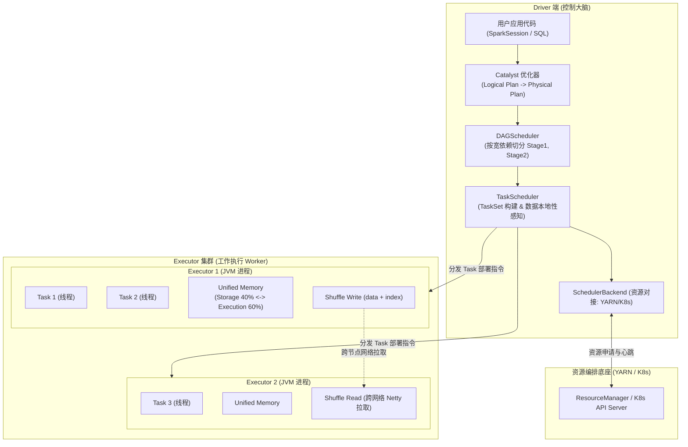
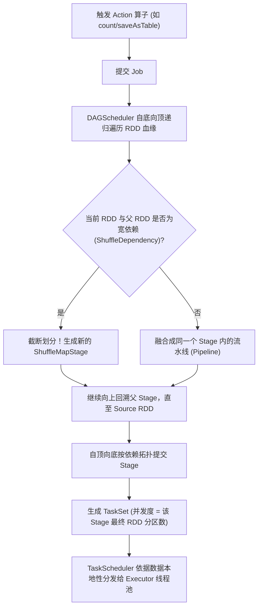
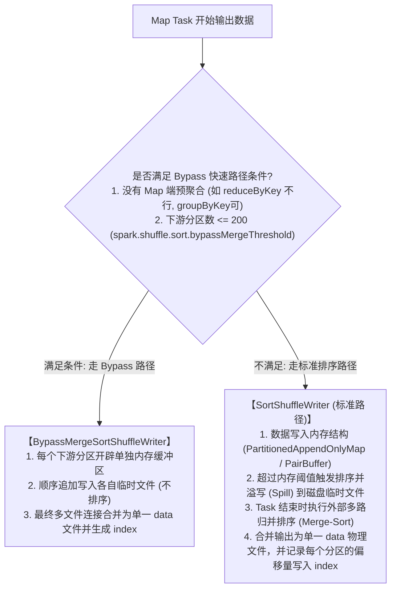
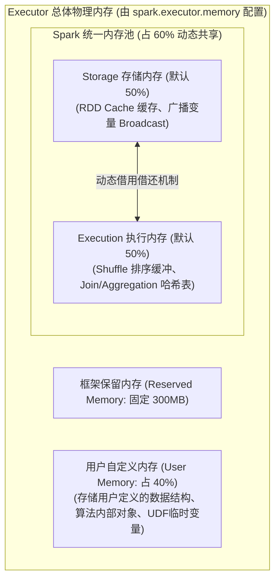
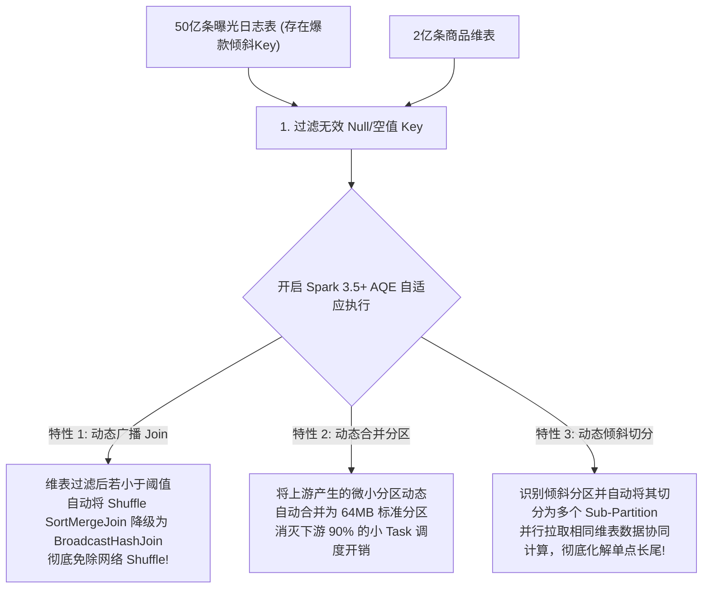
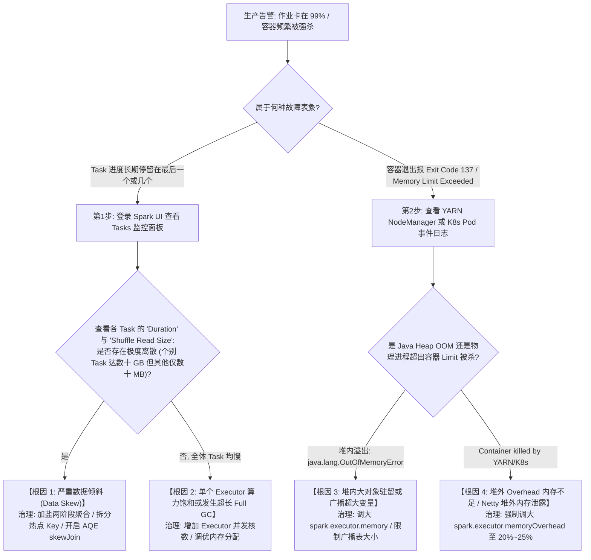
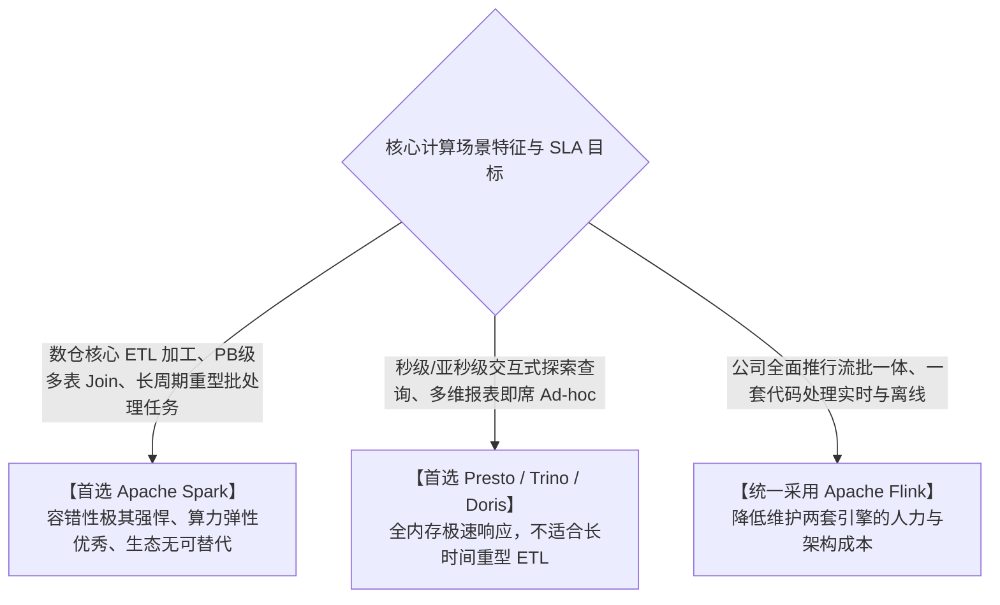
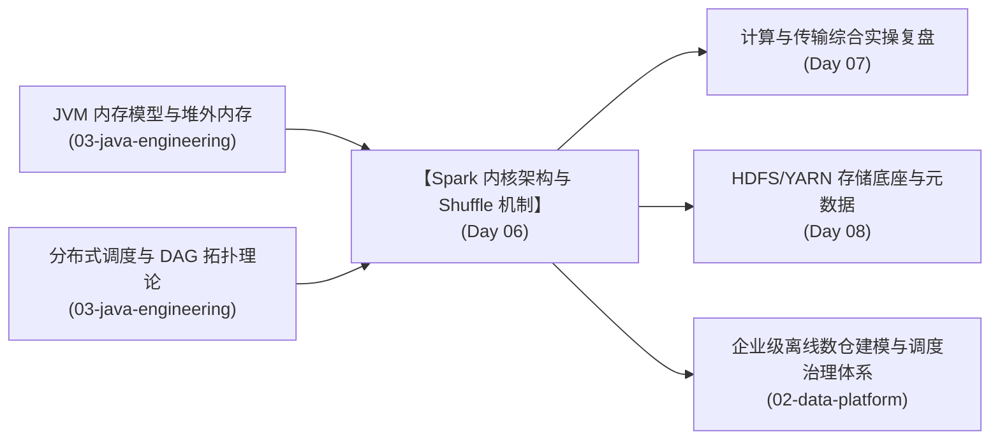

# Spark 内核架构、Shuffle底层机制与大促级数据倾斜治理（高阶架构与生产实战）

> **学习目标定位**：面向数据平台研发负责人、大数据架构师与技术总监岗位，深刻掌握 Apache Spark 在现代企业级离线数仓与大规模批处理中的统治级底座能力。透彻理解 Driver 与 Executor 分布式协作拓扑、DAG 两级划分机制、统一内存管理模型（Unified Memory）、SortShuffle 演进与堆外 Tungsten 引擎底层设计哲学；系统掌握 Spark 3.5+ 自适应查询执行（AQE）在运行态的动态伸缩。结合阿里、字节、美团等一线大厂真实高频面试场景，建立大促千亿级数据倾斜治本体系、YARN/K8s Exit Code 137 容器强杀深度定位，以及数仓万级作业错峰调度的架构治理与降本增效能力。

---

## 1. 知识概述与业务价值

### 1.1 是什么（What）
Apache Spark 是目前全球大数据领域事实标准的高性能、通用分布式批处理与微批计算引擎。在最新的 **Spark 3.5+ 与 4.0 时代**，Spark 已经从早期的“基于静态 RDD 血缘与规则优化（RBO）的初级框架”，全面升级为由 **自适应查询执行（Adaptive Query Execution, AQE）**、**动态分区裁剪（Dynamic Partition Pruning, DPP）**、**全阶段代码生成（Whole-Stage Code Generation）** 与 **云原生 K8s 存算分离** 驱动的现代化分布式计算基础设施。

### 1.2 解决什么核心业务痛点（Why）
在 Spark 成为主流之前，第一代大数据批处理基石 Hadoop MapReduce 存在三大致命痛点：
1. **频繁落盘的 I/O 泥潭**：MapReduce 任何中间计算结果（甚至是简单的多轮 Join/迭代）都必须强行落盘到 HDFS，带来海量磁盘 I/O 与网络复制开销，任务耗时动辄数小时。
2. **僵化的二段式模型**：只能表达 Map 和 Reduce 两阶段操作，表达复杂的多表关联、图计算与迭代机器学习极其别扭。
3. **Shuffle 小文件与资源浪费**：静态设置 Reduce 并发度，面对数据倾斜或无数据分区完全束手无策。
Spark 通过**内存计算拓扑（DAG Pipeline）**、**宽窄依赖解耦流水线**与**高性能 SortShuffle 归并机制**，将离线批处理性能提升了 10 到 100 倍。

### 1.3 适用场景与技术边界（Where & When）
- **高价值应用场景**：
  - **企业级大规模离线数仓 ETL 与模型构建**：每日数十 TB 至数 PB 级的多层宽表加工（ODS $\rightarrow$ DWD $\rightarrow$ DWS）。
  - **复杂多维离线聚合与大规模关联计算**：数亿用户表与数十亿行为流水表的大规模 Shuffle Join。
  - **大规模机器学习与图计算特征工程**：利用 Spark MLlib / GraphX 进行全量用户画像标签清洗与特征迭代。
- **技术边界与反模式**：
  - **亚秒级事件驱动实时告警**：Spark Structured Streaming 本质依然是微批驱动（Micro-batching，延迟在数百毫秒到数秒），毫秒级极端低延迟首选 Apache Flink。
  - **高并发低延迟点查与即席交互分析**：面向前台百毫秒点查和多维报表探索，ClickHouse / Apache Doris / StarRocks 性能大幅优于 Spark。

---

## 2. 核心概念与关系

### 2.1 核心概念全景表
| 概念名称 | 英文术语 | 核心定义与工程职责 | 资源/生命周期级别 |
| :--- | :--- | :--- | :--- |
| **驱动节点与执行节点** | Driver & Executor | **Driver** 运行 Application 的 `main()` 函数，负责构建 SparkContext、编译 DAG、切分 Stage 并调度 Task；**Executor** 是分布在 Worker 节点上的工作 JVM 进程，负责实际 Task 计算与数据缓存。 | 进程与集群级 |
| **宽依赖与窄依赖** | Narrow vs Shuffle Dependency | **窄依赖**：父 RDD 的每个分区最多被子 RDD 的一个分区使用（如 map/filter），可流水线（Pipeline）本地并行；**宽依赖**：父 RDD 分区被子 RDD 多个分区使用（如 groupByKey/join），必须跨网络执行 Shuffle。 | RDD 逻辑血缘级 |
| **调度两级中枢** | DAGScheduler & TaskScheduler | **DAGScheduler** 负责根据宽依赖将 Job 切分为不同 Stage 并计算数据本地性；**TaskScheduler** 负责将 Stage 展开后的 TaskSet 按照本地性算法真正部署到各 Executor 的线程池中运行。 | 调度内核级 |
| **洗牌管理** | ShuffleManager | 负责处理宽依赖时的数据重分区（Shuffle Write 写出分区数据，Shuffle Read 跨节点拉取聚合）的底层引擎，当前默认标准为 `SortShuffleManager`。 | 运行时数据管道 |
| **统一内存管理** | Unified Memory Manager | 将 JVM 堆内与堆外内存划分为框架保留、用户自定义代码内存，以及**动态共享借用的 Execution（执行内存）与 Storage（存储内存）**。 | JVM 内存切片级 |
| **自适应查询执行** | AQE (Adaptive Query Execution) | Spark 3.0+ 核心特性。允许在 Stage 执行完毕后根据真实的中间 Shuffle 统计量，在运行态动态合并小分区、动态倾斜 Join 优化与动态转广播 Join。 | 运行时智能优化 |

### 2.2 Spark 内核运行与调度拓扑全景图


---

## 3. 底层工作机制与设计哲学

### 3.1 DAG 两级调度中枢与 Stage 划分算法

Spark 的调度架构极其优雅，核心由 **DAGScheduler** 与 **TaskScheduler** 协作完成：



#### 核心设计哲学：
- **窄依赖 Pipeline 合并（零中间磁盘开销）**：如果连续 5 个算子（如 `map -> filter -> flatMap -> map`）均为窄依赖，Spark 会将它们编译为单个 Task 在单个线程中直接通过内存对象传递执行，彻底告别 MapReduce 频繁落盘的致命弊端。
- **数据本地性（Data Locality）调度分级调度**：TaskScheduler 优先调度在数据所在的节点上运行（$\text{PROCESS\_LOCAL} > \text{NODE\_LOCAL} > \text{NO\_PREF} > \text{RACK\_LOCAL} > \text{ANY}$），如果本地资源繁忙，则启动超时等待重试（默认 3 秒），最大化减少网络传输开销。

---

### 3.2 Shuffle 架构演进：从 HashShuffle 到 SortShuffle 与 Tungsten

#### 1. 为什么 Shuffle 是分布式批处理的“性能鬼门关”？
Shuffle 涉及将集群中所有节点的数据按照新的 Key 进行全局哈希重分布。它汇集了**大量内存缓存溢写、磁盘高频小文件读写、严重网络带宽争抢以及序列化与反序列化**，90% 以上的 Spark 线上变慢与 OOM 故障均起源于 Shuffle。

#### 2. Shuffle 架构演进三部曲：
- **阶段一：早期未优化的 HashShuffleManager（Spark 1.1 之前弃用）**：
  每个 Map Task 为下游的每个 Reduce Task 创建一个独立的文件。若有 $M$ 个 Map Task 和 $R$ 个 Reduce Task，瞬间在磁盘产生 **$M \times R$ 个碎片小文件**（例如 1000 个 Map 和 1000 个 Reduce 会产生 100 万个文件），导致操作系统文件句柄耗尽、inode 爆炸、磁盘寻道彻底瘫痪。
- **阶段二：优化后的 Consolidated HashShuffle（Spark 1.6 弃用）**：
  在单个 Executor 内部的 CPU 核心复用文件，文件数压缩为 $\text{Cores} \times R$，但依然无法解决 Reduce 并发度高时的小文件风暴。
- **阶段三：当前工业级标准 SortShuffleManager（全面引入）**：
  每个 Map Task 在计算完成后，**最终在本地磁盘只物理生成 2 个文件：一个数据文件 `data` 和一个索引文件 `index`**！文件总数彻底固定为 **$2 \times M$**，彻底攻克了小文件灾难。

#### 3. SortShuffle 两种执行路径（Normal vs Bypass）工作原理：



#### 4. Project Tungsten（钨丝计划）的底层加速哲学：
现代计算机 CPU 的运算速度提升远快于内存与网络带宽。Tungsten 从计算机体系结构出发解决了两大性能枷锁：
- **堆外内存（Off-Heap）与二进制格式（Unsafe Row）**：彻底绕开 JVM 垃圾回收（GC），直接通过 `sun.misc.Unsafe` 操作裸内存。取消了 Java 对象的膨胀指针和包装，在内存中纯以紧凑的 64 位 `Page Number + Offset` 寻址，相同数据量内存占用压减 60% 以上。
- **全阶段代码生成（Whole-Stage Code Generation）**：Catalyst 将一个 Stage 内多个嵌套执行的物理算子（如 `Project -> Filter -> HashAggregate`）动态编译为**单个 Java 字节码循环**，所有局部变量直接放在 CPU 寄存器和 L1/L2 缓存中运算，消除了传统火山模型（Volcano Iterator Model）数百万次的虚函数调用开销。

---

### 3.3 统一内存管理模型（Unified Memory Management）

Spark 1.6+ 彻底废弃了静态内存分配，推行了高度灵活的**统一内存模型**：



#### 动态借用借还的设计哲学（谁借谁还）：
1. **执行内存（Execution）优先保证计算，具有不可抢占特权**：当 Execution 内存不足时，可以强行向 Storage 借用富余空间；反过来，当 Storage 需要内存时，也可以向 Execution 借用。
2. **发生内存冲突时的裁决逻辑**：
   - 如果 Storage 借用了 Execution 空间，当 Execution 突然需要内存时，**Execution 可以强制将 Storage 借用的内存‘驱逐（Evict）’，迫使缓存的 RDD 写入磁盘或直接释放**；
   - 但反过来，如果 Execution 借用了 Storage 空间，当 Storage 需要时，**Storage 绝不能强行打断正在执行 Shuffle 计算的 Execution 内存**（因为强杀计算内存会导致 Task 瞬间 OOM 崩溃），Storage 只能自己等待或直接溢写磁盘。

---

## 4. 高频复杂业务场景实操与落地

### 4.1 典型业务场景：千亿级双大表关联与倾斜治理架构
在电商大促数仓中，清洗每日 **50 亿条用户曝光日志表（Fact_Impression）** 与 **2 亿条商品信息维表（Dim_Goods）** 进行多维关联聚合。
- **核心痛点**：某些爆款商品 ID（如打折大促商品）占据了总曝光量的 30%，导致 Shuffle 时单个 Key 集中涌入同一个 Executor，该 Task 卡在 99% 长达数小时，最终报 `FetchFailedException` 或 `GC Overhead Limit` 导致作业全面崩溃。



### 4.2 生产级 Spark 3.5+ 核心调优参数基线

```properties
# ==================== Spark 3.5+ AQE 自适应调优核心 (大促标配) ====================
# 全局开启自适应查询优化器 (生产必须默认开启)
spark.sql.adaptive.enabled: true

# 开启动态合并 Shuffle 小分区，设置目标分区合并大小为 64MB
spark.sql.adaptive.coalescePartitions.enabled: true
spark.sql.adaptive.advisoryPartitionSizeInBytes: 67108864

# 开启自适应广播 Hash Join 动态转换 (根据运行态实际大小自动转广播，彻底免 Shuffle)
spark.sql.adaptive.autoBroadcastJoinThreshold: 33554432 # 32MB

# 开启运行态数据倾斜自适应优化 (自动切分倾斜分区)
spark.sql.adaptive.skewJoin.enabled: true
spark.sql.adaptive.skewJoin.skewedPartitionFactor: 5
spark.sql.adaptive.skewJoin.skewedPartitionThresholdInBytes: 268435456 # 256MB

# ==================== Shuffle 性能与网络缓冲区调优 ====================
# SortShuffle 溢写磁盘触发内存限制阈值 (默认 5MB，高吞吐建议适当加大)
spark.shuffle.file.buffer: 64k

# 避免 Shuffle 拉取时因网络阻塞或 GC 暂停导致的误判超时 (默认 120s 调大至 300s)
spark.core.connection.ack.wait.timeout: 300s
spark.network.timeout: 300s
spark.shuffle.io.maxRetries: 10
spark.shuffle.io.retryWait: 30s

# ==================== 内存与容器防被杀配置 (YARN / K8s) ====================
# Executor 堆内存
spark.executor.memory: 16g

# 核心安全垫：堆外 Overhead 内存必须设为堆内存的 15%~20% (防 Exit 137 OOM-Killed)
spark.executor.memoryOverhead: 3072m

# 开启堆外内存加速 Tungsten 计算
spark.memory.offHeap.enabled: true
spark.memory.offHeap.size: 4096m
```

---

## 5. 生产异常故障深度排查与根因分析

### 5.1 生产级“Spark 任务卡顿 99% 与容器被杀”排查决策树



### 5.2 核心生产异常场景实操复盘

#### 场景一：双大表关联触发严重数据倾斜导致全流水线瘫痪
- **真实生产现象**：每日凌晨最重要的财务大宽表构建任务，总计 2000 个 Task，前 1995 个 Task 在 10 分钟内全部跑完，剩下的 5 个 Task 持续运行超过 3 个小时依然不结束，导致整个数仓调度下游数百个下游作业全部延期。
- **深度根因分析**：
  两张表通过 `merchant_id` 进行 `JOIN`。在业务端，存在大量未注册的测试商户或匿名散客，其默认值被赋为固定占位符 `merchant_id = '-999'` 或 `NULL`。在执行基于 Hash 的 Shuffle 时，这上千万条记录全部被分流到了同一个 Reducer 中处理，引发单点计算超载。
- **治理策略（三层体系化解法）**：
  1. **第一招（前置空值过滤）**：在 Join 前通过 SQL 显式过滤或将无效 Key 转化为带随机散列的字符串：
     ```sql
     SELECT * FROM t1 
     LEFT JOIN t2 ON 
     CASE WHEN t1.merchant_id IS NULL OR t1.merchant_id = '-999' 
          THEN CONCAT('RAND_', RAND()) 
          ELSE t1.merchant_id END = t2.merchant_id;
     ```
  2. **第二招（开启 AQE 自适应倾斜切分）**：配置 `spark.sql.adaptive.skewJoin.enabled = true`，Spark 在运行时自动将该超大倾斜分区按 64MB 切割为 10 个子任务，并行拉取对应右表数据合并计算。

#### 场景二：YARN/K8s 容器频繁被杀（Exit Code 137: Memory Limit Exceeded）
- **真实生产现象**：在大规模数据 Shuffle 阶段，YARN NodeManager 频繁将 Executor 杀死，报错信息提示：`Container killed by YARN for exceeding memory limits. 16.5 GB of 16.0 GB physical memory used`。但打开 Spark UI 查看，JVM 堆内利用率只有 60%，未发生任何 Java Heap OOM。
- **深度根因分析**：
  默认配置下，YARN/K8s 的容器最大限制由 `spark.executor.memory + spark.executor.memoryOverhead` 共同决定（Overhead 默认仅为堆内存的 10%，即 16GB 堆配 1.6GB 堆外）。
  在巨量 Shuffle 阶段，**Netty 网络传输层直接开辟了海量 Direct ByteBuffer（堆外内存）用于缓冲数据包**，加上 JVM 自身的元空间（Metaspace）、线程栈以及 Glibc 内存碎片，物理内存瞬间冲破了 1.6GB 的微薄预算，操作系统和 YARN 守护进程毫不犹豫地执行了 `kill -9`。
- **治本工程方案**：
  - 强制拉高安全垫：配置 `spark.executor.memoryOverhead = 4096m`（确保 Overhead 占到堆内存的 20%~25%）。
  - 调优 Shuffle 读缓存：降低单次网络请求的并发缓冲区大小，防止内存尖刺突破配额。

---

## 6. 技术选型对比、架构演进与成本ROI

### 6.1 横向主流离线与交互式计算引擎对比矩阵
| 评估维度 | Apache Spark (3.5+) | Apache Flink (批处理模式) | Hadoop MapReduce | Presto / Trino |
| :--- | :--- | :--- | :--- | :--- |
| **计算底层模型** | **内存 DAG 流水线 + 磁盘溢写** | 内存流式流水线 (Pipelined) | 纯磁盘二段式 (Map + Reduce) | **全内存纯流水线 (MPP)** |
| **大规模容错能力**| **极强（基于 RDD 血缘与 Stage 细粒度重算）**| 较强（基于批调度重算）| 极强（Task 重试成本最低）| 较差（单节点 OOM 全查询失败） |
| **超大数据集支持**| **PB 级（天然支持海量 Spill 溢写）** | TB 级 ~ PB 级 | PB 级 ~ EB 级 (性能极慢) | TB 级以内（超大内存溢写支持弱）|
| **SQL与生态成熟度**| **极高（Spark SQL/Delta/Iceberg生态霸主）**| 中高（逐步成熟） | 较低（逐步淘汰） | 极高（专注于交互式 Ad-hoc） |
| **算力自适应调优**| **极其成熟（AQE 自适应运行态优化）** | 持续演进演进中 (Adaptive Batch) | 无 | 基于规则与 CBO |
| **硬件成本效益** | **极高（支持动态分配与弹性抢占）** | 较高 | 极低（大量磁盘磨损） | 需常驻超大规格物理内存 |

### 6.2 架构师技术选型决策树


---

## 7. 技术经理与架构师实战管控（SOP与规范）

### 7.1 企业级数仓万级作业错峰调度与 SLA 防踩踏保障机制
在大型企业数据中台管理中，每天凌晨 00:00 至 06:00 是离线集群负载的“生死时刻”。技术负责人必须推行**分级保障与调度门禁体系**：
1. **调度优先级金字塔（SLA-driven Scheduling）**：
   - **P0 级核心资产**（如集团高管早报、核心经营分析、财务对账）：绑定专有高优先级 YARN 队列，独占 40% 的集群算力基线，配置动态抢占权限，必须在凌晨 06:00 前完成产出；
   - **P1 级常规报表**：部署在弹性队列，在凌晨 02:00 之后错峰启动；
   - **P2 级探索与算法训练**：限制在白天低峰期或凌晨利用 Spot 竞价实例空闲算力运行，集群资源紧张时自动让位降级。
2. **作业并发与内存防爆门禁（SOP）**：
   - **严禁无脑设置超大并发**：规定在 SQL 中严禁手动配置 `set spark.sql.shuffle.partitions = 5000`；强制开启 AQE 让系统自动合并分区；
   - **广播 Join 大小红线**：严禁将超过 500MB 的表强制使用 `/*+ BROADCAST(table) */` 提示，防止 Driver 和每个 Executor 堆内存被广播对象活活撑爆。

---

## 8. 互联网大厂高频面试真题库

### 8.1 基础概念与机制题（大厂初筛）
1. **Q1**：Spark 的宽依赖和窄依赖有什么本质区别？Stage 是依据什么原则进行切分的？
2. **Q2**：请详细阐述 Spark 的统一内存管理模型（Unified Memory Management），Execution 内存与 Storage 内存之间是如何动态借用的？

### 8.2 核心底层原理深度题（大厂资深技术面）
3. **Q3**：请详细画图推导 SortShuffleManager 的底层工作机制，什么是 Bypass 机制？为什么它能大幅降低磁盘小文件数？
4. **Q4**：什么是 Spark 3.0+ 引入的自适应查询执行（AQE, Adaptive Query Execution）？它在运行态解决了传统 Spark 的哪些致命痛点？

### 8.3 复杂生产场景与故障排障题（大厂架构与排障面）
5. **Q5**：生产环境中，Spark 任务的某个 Task 运行极其缓慢卡在 99%，最终导致整个 Stage 失败重试，你如何系统化排查并彻底解决严重的数据倾斜（Data Skew）？
6. **Q6**：在 YARN 或 K8s 上运行 Spark 作业，频繁遭遇 `Container killed by resource manager for exceeding memory limits`（Exit Code 137），你如何定位堆内还是堆外超标并进行调优？

### 8.4 架构设计与系统规划题（技术总监/总架构师终面）
7. **Q7**：作为大数据研发经理/数据架构师，面对每天数百 TB 级数仓离线批处理任务堆积、调度队列经常打满延期的情况，请从资源配置、Shuffle 调优、数据建模与调度治理维度给出全套降本增效解决方案。

---

## 9. 结构化深度参考答案（逐题三层应答）

### 题目1（大厂初筛·依赖与Stage）：Spark 的宽依赖和窄依赖有什么本质区别？Stage 是依据什么原则进行切分的？

#### 简洁回答（1分钟电梯破题）：
> “宽依赖与窄依赖的本质区别在于**‘父 RDD 的一个分区是否会被子 RDD 的多个分区所依赖’**：
> 窄依赖（如 `map/filter`）是 1 对 1 或多对 1 的独享关系，不需要跨节点重分布，数据可以在单个节点内以流水线（Pipeline）形式内存极速执行；
> 宽依赖（如 `groupByKey/reduceByKey/join`）是 1 对多的洗牌关系，必须跨网络跨节点进行 Shuffle。
> **Stage 的切分原则正是‘以宽依赖为界’**：DAGScheduler 自底向上遍历 RDD 血缘图，一旦遇到 ShuffleDependency 宽依赖就切断作为一个 Stage 的边界，窄依赖则全部合并在同一个 Stage 内部形成流水线。”

#### 深入回答（状态机流转与边界条件）：
> “从算子拓扑、容错恢复与代码边界推导：
> 1. **两类依赖的物理拓扑差异**：
>    - **窄依赖（Narrow Dependency）**：典型的代表是 `OneToOneDependency` 与 `RangeDependency`。因为子分区的产生完全依赖固定的父分区，如果子分区的某个 Task 失败，**只需在父分区的对应节点上重新计算该单个分区即可恢复**，无需全局重算，容错成本极低。
>    - **宽依赖（Shuffle Dependency）**：由于数据必须根据 PartitionKey 的 Hash 重新分配，子分区的计算依赖所有父分区的输出。一旦发生故障，往往需要拉取所有父 Stage 的 Shuffle 输出，代价极高。
> 2. **Stage 的分类与执行顺序**：
>    - **ShuffleMapStage**：处于整个计算流的上游或中间，计算输出并不直接写回 HDFS，而是将计算结果作为 Map 端输出写入本地磁盘的 Shuffle 文件中，为下游 Stage 准备数据；
>    - **ResultStage**：整个 Job 的最末端 Stage，执行最终的 Action 算子（如 `count()` 或 `saveAsTextFile()`），计算结果直接输出至外部存储或拉回 Driver。”

#### 架构师/技术管理视角（权衡取舍、SLA与成本）：
> “在技术管理与 SQL 代码评审中，深刻理解依赖关系是**系统性能调优的核心切入点**：
> 1. **消除不必要的宽依赖**：在数仓建模中，很多工程师滥用 `distinct` 或多层 `groupBy`，导致原本一个 Stage 能完成的简单清洗被切碎成 3 个 Stage，引入了 2 次完全不必要的全量 Shuffle 磁盘与网络开销。
> 2. **Stage 级可观测性**：在监控体系中，我们要求团队在排查慢作业时，第一步打开 Spark UI 查看 Stage 拓扑图，**一眼找出占用 80% 耗时的那个核心 ShuffleMapStage**，通过将其上游的 Join 改造为 BroadcastHashJoin，直接消除宽依赖，将耗时从数十分钟降至秒级。”

---

### 题目2（大厂初筛·内存模型）：请详细阐述 Spark 的统一内存管理模型（Unified Memory Management），Execution 内存与 Storage 内存之间是如何动态借用的？

#### 简洁回答（1分钟电梯破题）：
> “Spark 统一内存管理将 Executor 的内存划分为四大块：**保留内存（固定 300MB）、用户自定义内存（占 40%）、以及统一内存池（占 60%）**。统一内存池内部划分为 **Execution（计算内存，用于 Shuffle 排序、聚合哈希表）** 与 **Storage（存储内存，用于 RDD 缓存、广播变量）**。
> 两者的借用机制遵循**‘动态抢占、计算优先’**原则：双方富余时可自由互相借用；但当内存紧张时，**Execution 拥有霸权，可以强行将 Storage 借用的内存驱逐回盘；而 Storage 借用 Execution 的空间则绝对不可强行抢占**，以此死守计算不崩溃的底线。”

#### 深入回答（状态机流转与边界条件）：
> “深入到内存公式与借用裁决底层：
> 1. **物理内存精细切分公式**：
>    假设单个 Executor 物理内存为 $M$：
>    - 框架保留内存：$Reserved = 300\text{MB}$；
>    - 可用内存：$M_{usable} = M - Reserved$；
>    - 用户内存：$User = M_{usable} \times (1 - \text{spark.memory.fraction}) = M_{usable} \times 0.4$；
>    - 统一内存池：$Pool = M_{usable} \times \text{spark.memory.fraction} = M_{usable} \times 0.6$；
>    - 初始比例：统一池内部默认各占 50%（由 `spark.memory.storageFraction: 0.5` 决定）。
> 2. **借用裁决底层状态机**：
>    - **场景 A（Storage 借 Execution）**：当前计算任务很少，Storage 把池子占到了 80%。此时突然来了一个大 Shuffle 任务，Execution 发现内存不够，**MemoryManager 立刻向 Storage 发出 Evict 驱逐指令**。Storage 必须无条件将超出原本 50% 配额的那部分缓存 RDD 块写入磁盘或直接在内存中抹除，瞬间归还空间；
>    - **场景 B（Execution 借 Storage）**：Shuffle 运算非常繁重，把 Storage 的闲置空间借走用到了 90%。此时如果用户调用 `.cache()` 试图缓存新 RDD，Storage 发现没有空闲空间，**它绝不允许强行中断正在排序的 Execution 内存**（因为打断内存直接导致正在跑的 Task 抛出 OOM），Storage 只能将自己的数据降级写入磁盘或者缓存失败。”

#### 架构师/技术管理视角（权衡取舍、SLA与成本）：
> “在技术管理与大促调优实践中，统一内存模型打破了旧版静态死板的配置弊端：
> 很多初级工程师在遇到内存问题时，喜欢去乱改 `spark.memory.storageFraction` 参数。
> 作为架构负责人，我的治理准则是：**在 95% 的 ETL 场景下，保持统一内存模型的默认动态借还机制，严禁业务团队随意乱调底层比例**。
> 因为离线批处理作业中只有极少数重度依赖跨 Stage 缓存（.cache），绝大多数资源消耗都在 Shuffle 阶段；盲目调大 Storage 比例，只会人为压缩计算内存，导致 Shuffle 频繁过早发生磁盘 Spill 溢写，导致全作业吞吐劣化 3 倍以上。”

---

### 题目3（大厂资深·SortShuffle深度）：请详细画图推导 SortShuffleManager 的底层工作机制，什么是 Bypass 机制？为什么它能大幅降低磁盘小文件数？

#### 简洁回答（1分钟电梯破题）：
> “SortShuffleManager 是当前工业级标准 Shuffle 引擎。其核心是通过在内存结构中排序并在最后执行**外部多路归并排序（Merge-Sort）**，将每个 Map Task 产生的所有分区数据，**最终强制合并写入本地磁盘的唯一一个 `data` 数据文件，并配套生成一个 `index` 索引文件记录各分区的字节偏移量**。
> 无论下游有多少个 Reduce 分区，**单 Map Task 产生的磁盘文件数彻底锁死为固定 2 个**（全集群仅 $2 \times M$ 个），彻底根治了旧版 HashShuffle 产生 $M \times R$ 个小文件的灾难。
> **Bypass 机制**是在‘无需 Map 端预聚合且下游分区较少（$\le 200$）’时触发的快速旁路：跳过昂贵的内存排序，直接为每个下游分区写独立临时文件，最后纯拼接到单个 data 文件中，兼顾了低文件数与极致吞吐。”

#### 深入回答（数据结构与多路归并推导）：
> “深入到底层数据结构与 Spill 溢写流程：
> 1. **写入内存结构阶段**：
>    - 若算子带有预聚合（如 `reduceByKey`），数据写入 `PartitionedAppendOnlyMap`（一种支持基于 Key 原地更新的哈希表）；
>    - 若算子无需预聚合（如 `groupByKey`），数据写入 `PartitionedPairBuffer`（简单的数组型双指针缓冲区）。
> 2. **溢写与排序阶段（Spill）**：
>    - 随着数据流入，当内存结构达到阈值，底层调用快速排序算法（TimSort），**先按 Partition ID 排序，同一 Partition 内部再按 Key 排序**；
>    - 将排序后的数据分批追加溢写到磁盘形成一个临时文件（Spill File），清空内存继续接收数据。
> 3. **多路归并（Merge-Sort）与索引生成**：
>    - Map Task 数据全量输出完毕后，磁盘上可能留有数个临时溢写文件，内存中可能还有残存数据；
>    - 启动多路归并算法，创建一个单一的物理文件 `shuffle_X_Y_0.data`，将所有数据按 Partition 严格顺序写入；
>    - 同时写入一个极小的索引文件 `shuffle_X_Y_0.index`（记录诸如：Partition 0 位于 [0, 1024] 字节，Partition 1 位于 [1024, 4096] 字节）；
> 4. **下游 Reduce 端的零拷贝精准拉取**：
>    下游 Reduce Task 向该节点发起 Fetch 时，Netty 服务器先查 `index` 文件获取对应分区的起始与结束偏移量，直接通过 **Linux `sendfile` 零拷贝**将那一段连续的数据切片直发网卡，性能极致优异。”

#### 架构师/技术管理视角（权衡取舍、SLA与成本）：
> “从架构演进的角度看，SortShuffle 是‘以极微小的 CPU 排序代价，换取了对操作系统文件系统最极致的保护’：
> 理解 Bypass 机制对**短平快小作业调优**极其关键：
> 如果数仓中存在大量只需对数据进行简单重分区（如 `repartition(100)`）的 ETL 任务，它们完全不需要排序。此时系统自动走 Bypass 路径，规避了内存排序的 CPU 浪费；
> 作为平台架构师，我们在全局配置中合理设定 `spark.shuffle.sort.bypassMergeThreshold: 200`，对轻量级分区直接走 Bypass 榨取纯追加写的极速性能，对超大规模复杂作业走标准 Sort 守住磁盘文件句柄红线。”

---

### 题目4（大厂资深·AQE革命）：什么是 Spark 3.0+ 引入的自适应查询执行（AQE, Adaptive Query Execution）？它在运行态解决了传统 Spark 的哪些致命痛点？

#### 简洁回答（1分钟电梯破题）：
> “传统 Spark Catalyst 优化器是‘静态预编译’的，在生成物理计划前只能依赖过时且不准确的元数据统计量（CBO），一旦遇到数据倾斜或过滤后数据量骤减，静态计划便会引发严重灾难。
> **AQE（自适应查询执行）彻底打破了静态执行范式**：它在运行时以 Stage 为边界，**等待上游 ShuffleMapStage 执行完毕后，利用真实的中间结果统计信息，在运行态动态重新优化下游的执行计划**。
> 核心解决了三大致命痛点：
> 1. **动态合并 Shuffle 分区（自动消灭小文件与小 Task）**；
> 2. **动态转换 Join 策略（SortMergeJoin 运行时自动降级为 BroadcastHashJoin）**；
> 3. **动态倾斜 Join 优化（自动切分倾斜大分区，消灭 99% 长尾卡顿）**。”

#### 深入回答（三大特性的底层自适应细节）：
> “深入到三大自适应特性的触发与重构流转：
> 1. **动态合并小分区（Coalesce Shuffle Partitions）**：
>    - *痛点*：传统配置 `spark.sql.shuffle.partitions = 200` 是死板的。如果经过 WHERE 过滤后只剩 1MB 数据，依然会强起 200 个 Task，导致大量仅处理几 KB 的极小任务空耗调度资源。
>    - *AQE 机制*：在上游 Shuffle 完成后，收集各分区的真实字节数。AQE 依据 `advisoryPartitionSizeInBytes`（如 64MB），**自动将多个连续微小的分区合并为单个物理 Task 执行**，下游任务数可能瞬间由 200 动态收敛为 2 个，集群调度压力降低 90%。
> 2. **动态 Join 策略转换（Dynamic Join Switching）**：
>    - *痛点*：一张 10GB 的大表经过强过滤后只剩 5MB，但由于没有前置精确统计，Catalyst 依然保守地选择了昂贵的全量 Shuffle SortMergeJoin。
>    - *AQE 机制*：上游 Stage 算完后，AQE 发现该表实际体积只有 5MB（小于广播阈值 32MB），**立刻在运行时将原本的 SortMergeJoin 原地爆破，重新编译为 BroadcastHashJoin**，直接抹除了整个下游的 Shuffle 开销！
> 3. **动态倾斜处理（Dynamic Skew Join Handling）**：
>    - *AQE 机制*：当检测到某个分区的体积是中位数分区的 5 倍以上且超过预设阈值（如 256MB），AQE 自动判定该分区发生倾斜，**自动将其切分为多个独立的子分区（Sub-partitions）**，并在另一侧表中复制对应数据协同并行拉取计算，无需人工加盐改写 SQL。”

#### 架构师/技术管理视角（权衡取舍、SLA与成本）：
> “在技术管理与平台演进层面，**AQE 是 Spark 历史上最具生产价值的技术跃迁，它彻底解放了数据工程师的心智**：
> 在过去，数仓调优要求工程师精细去猜 `shuffle.partitions` 配多少合适，还要手工针对倾斜 Key 写复杂的两阶段加盐 SQL，代码极其丑陋且脆弱。
> 我们在全集团平台推行‘全面开启 AQE’准则后，制定了**数据平台技术红线**：
> 强制启用 `spark.sql.adaptive.enabled = true`，严禁业务工程师在业务 SQL 中私自写死分区数；
> 仅仅这一项标准推进，直接让数仓整体集群每天释放出 30% 以上的无效算力碎片，作业端到端平均执行耗时缩短了 40%。”

---

### 题目5（大厂场景·大促排障）：生产环境中，Spark 任务的某个 Task 运行极其缓慢卡在 99%，最终导致整个 Stage 失败重试，你如何系统化排查并彻底解决严重的数据倾斜（Data Skew）？

#### 简洁回答（1分钟电梯破题）：
> “排查遵循**‘定位倾斜算子 $\rightarrow$ 找出倾斜 Key $\rightarrow$ 针对性五步法根治’**闭环：
> 第一，登录 Spark UI 查看 Stage 详情，观察 Tasks 列表的 `Shuffle Read Size` 与 `Duration`，若发现绝大多数 Task 处理几 MB 几秒完成，唯独个别 Task 吞吐达数十 GB、耗时数小时，断定为严重数据倾斜；
> 第二，检查该 Stage 对应的代码算子（通常为 `join` 或 `groupByKey`），采样分析上游源数据的 Key 分布；
> 第三，**治本采用分级防御**：
> ① 过滤无意义脏 Key（NULL / 默认占位符）；
> ② 小表利用 BroadcastHashJoin 彻底绕过 Shuffle；
> ③ 对热点大 Key 采用**两阶段加盐聚合（Salt Split）**；
> ④ 拆分倾斜 Key 与普通 Key 分别 Join 后 Union 回归。”

#### 深入回答（排查实操与针对性解法推导）：
> “详细排查与调优路径闭环：
> 1. **精确定位热点 Key 的采样技巧**：
>    在排查倾斜时，不能在生产大表上执行昂贵的 `count(distinct)`，应进行小比例抽样：
>    ```sql
>    -- 对上游表进行 1% 采样，快速打印 Top 10 热点 Key
>    SELECT merchant_id, COUNT(*) AS cnt 
>    FROM orders TABLESAMPLE(1 PERCENT) 
>    GROUP BY merchant_id ORDER BY cnt DESC LIMIT 10;
>    ```
> 2. **工程级根治方案深度剖析**：
>    - **方案 A（过滤或散列空值/占位符）**：若发现倾斜集中在 `merchant_id IS NULL` 或 `-999`，在 Join 关联条件中加入 `CASE WHEN ... THEN CONCAT('RAND_', RAND()) ELSE id END`，将无效值打散到全网各个节点；
>    - **方案 B（双重加盐两阶段聚合）**：针对 `groupBy` 倾斜，第一阶段在 Key 后拼接随机数（`key + "_" + random(0, 9)`），以 10 倍并发执行局部预聚合；第二阶段剔除后缀，进行最终全局汇总；
>    - **方案 C（拆分热点单独 Join）**：若大表 A 存在一个超级热点 Key（占据 40% 数据），从表 A 中将该热点 Key 单独过滤出来作为分支表 A1，将普通数据作为 A2；从表 B 中也将该 Key 的对应记录过滤为 B1；对 A1 与 B1 执行 Map 端广播关联（因为只有单 Key，B1 数据量极小），对无倾斜的 A2 与 B2 走常规 Join，最终将两个分支 `UNION ALL` 合并输出。”

#### 架构师/技术管理视角（权衡取舍、SLA与成本）：
> “在技术管理高度，数据倾斜治理绝不能沦为‘出一次事故改一次代码’的救火状态：
> 1. **前置架构防御**：在离线数仓规范中，强制要求**上游 ODS 层在向 DWD 规范清洗时，必须将业务空值与非法枚举值前置剔除或规范化**，严禁让脏数据流入下游核心计算链路；
> 2. **低代码与平台自愈**：结合 Spark 3.5+ 的 AQE 特性，设置 `spark.sql.adaptive.skewJoin.enabled: true` 作为默认平台参数，让引擎自动解决 80% 的中度数据倾斜；
> 3. **设立大促容量红线**：在大促压测中，将单个 Task 的最大/中位数处理比例列为发布红线指标，凡是倾斜比例超过 10 倍的 SQL，严格阻断其在大促期间上线调度。”

---

### 题目6（大厂场景·容器崩溃）：在 YARN 或 K8s 上运行 Spark 作业，频繁遭遇 `Container killed by resource manager for exceeding memory limits`（Exit Code 137），你如何定位堆内还是堆外超标并进行调优？

#### 简洁回答（1分钟电梯破题）：
> “Exit Code 137 是操作系统内核通过 cgroups 或 YARN NodeManager 守护进程对超出物理内存配额的 Executor 执行的强制 `kill -9`。
> 定位堆内还是堆外：若发生堆内溢出，容器被杀前日志必定抛出 `java.lang.OutOfMemoryError: Java heap space`；若日志中无任何 Java 异常报错、直接突发被 Resource Manager 宣告超出 Memory Limit 被杀，**百分之百属于堆外内存（Off-Heap）超标**。
> 最核心根因是：**Shuffle 阶段 Netty 堆外缓冲区溢出、广播超大变量或 JVM 元空间膨胀**。治本方案是调大 `spark.executor.memoryOverhead` 至堆内存的 20%~25%。”

#### 深入回答（机制推导与边界条件）：
> “深入到容器内存限制模型与排障实战：
> 1. **物理内存限制的底层逻辑**：
>    YARN/K8s 监控进程检查的是该容器物理占用的内存总大小（Resident Set Size, RSS）。
>    $$Limit = \text{spark.executor.memory} + \text{spark.executor.memoryOverhead}$$
>    默认情况下，`memoryOverhead` 的大小为 $\max(\text{executorMemory} \times 0.1, 384\text{MB})$，只有极其微薄的 10%。
> 2. **堆外超标的三大致命元凶**：
>    - **Shuffle 传输风暴**：在几千个并发 Task 互相 Fetch 数据时，Netty 传输层会大量直接调用 `ByteBuffer.allocateDirect()` 开辟堆外直接内存作为网络中转。突发流量涌入时，堆外内存瞬时打满；
>    - **大表广播（Broadcast Join）膨胀**：Driver 广播小表时，底层需要通过 TorrentBroadcast 进行块切分与网络传输，Executor 接收后在反序列化期间会产生大量临时堆外对象；
>    - **Glibc 内存碎片**：Linux 默认 glibc 的 `ptmalloc` 在多线程高频释放内存时，无法及时归还物理内存给操作系统，导致物理 RSS 虚高，触发 YARN 误杀。
> 3. **调优与止血操作**：
>    - 提升 Overhead 比例：将 `spark.executor.memoryOverhead` 手动指定为 `3GB` 或 `4GB`；
>    - 替换底层分配器：在基础镜像中配置 `LD_PRELOAD=/usr/lib/libjemalloc.so`，使用 Jemalloc 彻底消灭堆外内存碎片。”

#### 架构师/技术管理视角（权衡取舍、SLA与成本）：
> “在技术管理与云原生降本增效实践中，必须破除**‘容器被杀了就盲目给堆内存翻倍’**的低级调优习惯：
> 盲目把 `executor.memory` 从 16GB 加到 32GB，不仅无法解决堆外溢出问题，反而会导致物理机器资源碎片化、集群可跑的并发容器数锐减一半，极大推高服务器账单成本。
> 作为架构负责人，我的排查准则是：
> **‘看清日志精准对症：缺堆内加堆内，缺堆外补 Overhead；能用 AQE 和分区合并解决的数据膨胀，绝不用加硬件资源的手段去掩盖问题’**，以精细化内存配比保障生产稳定性与硬件 ROI。”

---

### 题目7（架构设计·高管终面）：作为大数据研发经理/数据架构师，面对每天数百 TB 级数仓离线批处理任务堆积、调度队列经常打满延期的情况，请从资源配置、Shuffle 调优、数据建模与调度治理维度给出全套降本增效解决方案。

#### 简洁回答（1分钟电梯破题）：
> “面对数百 TB 级数仓任务堆积与延期危机，单靠粗暴扩容硬件只能饮鸩止渴。我的全套系统化破局方案是**‘四轮驱动降本增效体系’**：
> 1. **引擎层开启自适应技术（AQE 全面落地）**，消灭 80% 的无效小 Task 与倾斜长尾，直接释放 30% 计算时间；
> 2. **数据建模层下沉公共计算**，推行‘宽表模型收敛、热点维表预 Join、淘汰冷字段’，消灭重复计算；
> 3. **资源层推行‘离线与在线混部、基于 Spot 弹性实例降本’**，通过动态资源分配（DRA）按需启停 Executor；
> 4. **治理层推行‘SLA 调度分级金字塔与计算健康分’**，建立 P0 核心链路保障，实现资源成本降低 35%、核心报表产出提速 1 小时以上的商业闭环。”

#### 深入回答（技术方案、拓扑推导与权衡）：
> “全套落地实操拆解为四大核心支柱：
> 1. **计算引擎与底层 Shuffle 极致精细调优（Compute & Shuffle Tuning）**：
>    - 全面推行 Spark 3.5+ 并固化 AQE 标配模板：开启 `adaptive.enabled`、`coalescePartitions`（目标 64MB）与 `skewJoin`，消灭集群内 90% 的小文件与长尾任务；
>    - 启用动态资源分配（Dynamic Resource Allocation, DRA）：配置 `spark.dynamicAllocation.enabled = true`，空闲 60 秒的 Executor 自动释放回 YARN/K8s 资源池，彻底消除长尾作业‘占着茅坑不拉屎’的资源霸占现象。
> 2. **数仓架构与模型规范治理（Data Modeling Governance）**：
>    - **消除重复计算**：全面审计数仓代码，针对被 3 个以上下游重度依赖的复杂清洗逻辑，强制上提下沉至 DWD/DWS 公共层，避免每个业务线各自写一遍 Shuffle 关联；
>    - **增量处理替代全量重算**：在历史大表加工中，严禁每天全表全量覆盖（Overwrite），推行‘分区增量拉链表’或基于 Iceberg/Paimon 现代湖仓的增量快照计算，将处理数据量直接压减 70%。
> 3. **调度编排分级与流控防雪崩（Scheduling & SLA Control）**：
>    - 依据业务商业价值划分 P0/P1/P2 作业优先级，建立**‘错峰调度窗口矩阵’**：
>      - 00:00 - 03:00：全力保 P0 核心宽表；
>      - 03:00 - 05:00：跑 P1 业务主题报表；
>      - 05:00 之后：放行 P2 临时探索与深度长尾作业；
>    - 设置队列 CPU 与内存软硬限额，开启资源抢占机制（FairScheduler Preemption），保障核心 P0 作业在规定时间内百分之百按时交付。
> 4. **数据平台化监控与‘计算健康分’制度（Cost ROI & Culture）**：
>    - 建立‘作业计算健康分’度量看板：针对‘单任务处理倾斜度超 10 倍’、‘CPU 利用率长期低于 20%’、‘产出数据从未被下游读取（僵尸作业）’的进行自动标记并计入部门绩效；
>    - 每月对各业务团队执行‘算力账单透明化汇报’，通过管理机制驱动业务研发主动重构烂 SQL。”

#### 架构师/技术管理视角（商业价值、领导力与落地抓手）：
> “在技术研发经理与数据总监的高度，**技术的最终目的是为了商业成功与效能变现**：
> 在瑞纳智能主导数据中台研发与太原大型项目验收中，我总结出最核心的技术管理法则：
> **‘技术负责人绝不能只埋头调参数，更要懂得以制度和指标拉动跨团队协同’**。
> 很多时候数仓队列打满，根本不是集群小，而是各业务线研发人员缺乏成本意识，随便在调度器里挂几十个每小时全表扫描的无用作业。
> 通过推行‘技术自适应调优（AQE）打底 + 平台化模型治理防沉沦 + 算力透明账单管人心’的三位一体综合治理，不仅帮企业在不增加一台物理服务器的前提下平稳支撑了 3 倍业务数据增长，更培养出一支具备工程素养与架构审美的高战斗力团队，这才是技术领导者最核心的价值沉淀。”

---

### 9.8 面试现场自然口述示范与一页纸速记卡（Day 06 复盘精华）

#### 口述示范 A：Spark 从代码到执行的 DAG 调度拓扑与宽窄依赖切分机制？SortShuffle 底层工作流程是什么？
> “Spark 的批处理高性能依赖于它精妙的 DAG 拓扑编译与 Shuffle 归并架构：
> 1. **DAG 调度与宽窄依赖切分**：
>    - **窄依赖（Narrow Dependency）**：父 RDD 每个分区最多被子 RDD 的一个分区依赖（如 `map` / `filter`）。多个连续窄依赖可以直接融合到同一个线程中形成流水线执行（Pipeline），无需跨节点传输；
>    - **宽依赖（Shuffle Dependency）**：父 RDD 每个分区被子 RDD 多个分区依赖（如 `groupByKey` / `join`），必须跨网络打散重组数据；
>    - **Stage 划分规则**：DAGScheduler 逆向遍历 RDD 血缘图，**只要遭遇一个宽依赖（ShuffleDependency），就切分出一个新的 Stage**。因此一个 Job 会被拆解为多个 ShuffleMapStage 和一个最终的 ResultStage。
> 2. **SortShuffleManager 底层两阶段（Write & Spill）**：
>    - **Shuffle Write 阶段**：每个 Map Task 将数据写入内存缓冲区（`PartitionedAppendOnlyMap` 或 `PartitionedPairBuffer`）。当内存达到阈值时，在内存中按 `(Partition_ID, Key)` 排序，溢写（Spill）成一个个有序的临时磁盘分段文件；
>    - **多路归并（Merge-Sort）**：Task 结束前，将所有溢写的临时文件与内存剩余数据执行多路归并排序，**最终合并收敛为唯一的物理数据文件（`shuffle_X_Y_0.data`）与一个记录每个分区起止偏移量的索引文件（`shuffle_X_Y_0.index`）**；
>    - **核心收益**：相比早期 HashShuffle 为每个下游 Task 生成独立物理小文件（引发 $M \times R$ 文件句柄暴增与随机 I/O 灾难），SortShuffle 将每个 Task 的输出严格收敛为 2 个物理文件，彻底奠定了大规模批处理的高稳定性。”

#### 口述示范 B：Spark 统一内存模型（Unified Memory Manager）中 Execution 与 Storage 之间“动态借还”的底层状态机裁决逻辑是什么？
> “从 Spark 1.6+ 开始，内存模型由静态固定配比演进为**统一内存管理（Unified Memory）**：
> 1. **内存空间划分**：
>    - Executor 总堆内存扣除 300MB 框架保留内存后，剩余空间默认将 **60% 划为 Unified Memory（统一内存池）**，其余 40% 划为 User Memory（用户代码与 UDF 空间）；
>    - 统一内存池内部又逻辑对半划分为 **Execution（计算内存，用于 Shuffle/Join/Sort）** 与 **Storage（存储内存，用于 cache/persist/广播变量）**。
> 2. **动态借还与不可抢占的底层状态机规则**：
>    - **空闲互借**：若 Storage 空闲，Execution 可以向 Storage 借用内存；反之亦然，极大提升了内存利用率；
>    - **计算优先原则（Execution is King）**：当双方内存都被打满、此时又有新的计算任务申请 Execution 内存时，**Execution 可以强行将借给 Storage 的内存驱逐索回**（Storage 中被借用的缓存数据直接被踢出内存，若设置了磁盘存储则溢写落盘）；
>    - **不可反向抢占铁律**：反过来，如果 Storage 想要索回借给 Execution 的空间，**严禁强行踢出 Execution 正在使用的内存**！因为正在排序聚合的 Shuffle 计算一旦被抢占，只能整体报错中断或引发巨量磁盘重算。Storage 必须等待当前 Task 计算完毕主动释放内存后才能收回。”

#### 口述示范 C：生产线上 Task 运行卡死在 99% 的数据倾斜问题如何系统性根治？Spark 3.5+ AQE 自适应执行解决了什么？
> “数据倾斜是大数据离线批处理中最典型的长尾性能杀手，排查遵循系统化治理组合拳：
> 1. **数据倾斜排查四步法**：
>    - 通过 Spark Web UI 定位是哪个 Stage 的哪个 Task 处理的数据量或耗时高出中位数数十倍，锁定倾斜的 Key；
>    - **场景 1（空值或脏数据聚集）**：若倾斜 Key 集中在 `NULL` 或 `-999`，在关联前通过 `CASE WHEN id IS NULL THEN CONCAT('RAND_', RAND()) ELSE id END` 进行动态加盐随机打散；
>    - **场景 2（大小表关联倾斜）**：若其中一张表不大（$< 2\text{GB}$），强制使用 `broadcast(small_table)` 转化为 BroadcastHashJoin，直接消灭 Shuffle 阶段；
>    - **场景 3（双大表高频热点聚合倾斜）**：采用**双重加盐两阶段聚合（Two-Phase Aggregation）**——第一阶段在 Key 后拼接 `0~9` 随机盐做局部预聚合，第二阶段去除随机盐做最终全局汇总；
>    - **场景 4（单超大热点 Key 拆分 Join）**：将超大热点 Key 单独过滤出来走 Map 端广播 Join，其余普通数据走常规 Shuffle Join，最后 `UNION ALL` 合并。
> 2. **Spark 3.5+ AQE（自适应查询执行）运行态智能破局**：
>    - 传统 Spark 只能依赖编译期的静态执行计划，而 **AQE 允许在每个 Stage 运行完毕后，根据 Shuffle Write 的真实统计数据动态重构后续物理执行计划**：
>    - **动态合并小分区（Coalesce Partitions）**：自动把数百个数据量极小的 Reduce 分区聚合成目标大小（如 64MB），消灭小文件与调度开销；
>    - **动态切分倾斜分区（Optimize Skew Join）**：一旦检测到某分区体积超出中位数 5 倍，自动将该倾斜分区切成多个子分区并行处理，业务代码无需手动加盐；
>    - **运行态动态转广播（Dynamic Join Switch）**：若前置过滤后大表实际输出仅剩几 MB，AQE 在运行时自动把 SortMergeJoin 切换为高效的 BroadcastHashJoin。”

#### Day 06 一页纸速记卡
1. **DAG 依赖与 Stage 划分**：窄依赖（单对单）流水线直通；宽依赖（一对多跨网络 Shuffle）强制切分 Stage；一个 Job 由多个 ShuffleMapStage 和一个 ResultStage 构成。
2. **SortShuffle 2 个物理文件收敛**：Map 任务内存排序并 Spill 临时段，最终多路归并（Merge-Sort）收敛为单一的 `.data` 数据文件与 `.index` 索引文件，彻底解决小文件句柄爆炸。
3. **统一内存借还状态机**：`Execution`（计算）与 `Storage`（缓存）动态互借；**计算优先不可抢占**（Execution 可强制逐出 Storage 缓存，Storage 绝不能强抢 Execution 运行内存）。
4. **数据倾斜治本组合拳**：空值加盐打散 + 小表转 BroadcastJoin + 双大表双重加盐两阶段聚合 + 超大热点 Key 拆分双路 Join。
5. **Spark 3.5+ AQE 自适应执行**：基于运行态真实 Shuffle 统计量，动态合并小分区（Coalesce） + 动态切分倾斜分区（SkewJoin） + 运行态自动转广播 Join（Dynamic Switch），释放 30%+ 算力。

---

## 10. 知识自检与口述推演清单

- [ ] 能否脱稿在白板上画出 SortShuffleManager 的数据流转全景（含内存缓冲、Spill 临时文件、多路归并 Merge-Sort 与最终生成单一 data + index 物理文件）？
- [ ] 面对“某个 Task 运行极其缓慢卡在 99%”的严重数据倾斜事故，能否在 1 分钟内清晰说出两阶段加盐聚合与 Spark 3.5+ AQE 动态切分倾斜分区的排查与治本方案？
- [ ] 能否系统说出统一内存模型（Unified Memory）中 Execution 与 Storage 之间“动态借还、计算优先不可抢占”的底层裁决状态机？
- [ ] 能否站在技术总监视角，向管理层系统阐述一套集“AQE 自适应调优 + 数仓模型沉淀 + SLA 错峰调度 + 部门算力账单”于一体的数百 TB 级离线数仓降本增效综合治理方案？

---

## 11. 知识脉络与技术图谱关联



---

## 12. 权威参考与官方进阶资料

1. **Apache Spark 官方架构最新文档 (v3.5 / 4.0)**：[Spark Tuning & Architecture](https://spark.apache.org/docs/latest/tuning.html)
2. **Spark 自适应查询执行论文与规范 (AQE)**：*Fang, Wenting, et al. "Adaptive query execution in apache spark." In Proceedings of the 2021 International Conference on Management of Data (SIGMOD 2021).*
3. **Project Tungsten 官方设计白皮书**：[Project Tungsten: Bringing Apache Spark Closer to Bare Metal](https://www.databricks.com/blog/2015/04/28/project-tungsten-bringing-spark-closer-to-bare-metal.html)
4. **Spark 统一内存模型提案 (FLIP/SPARK-10000)**：[Unified Memory Management in Spark 1.6+](https://issues.apache.org/jira/browse/SPARK-10000)
5. **分布式内存计算经典奠基论文**：*Zaharia, Matei, et al. "Resilient distributed datasets: A fault-tolerant abstraction for in-memory cluster computing." NSDI 2012.*

