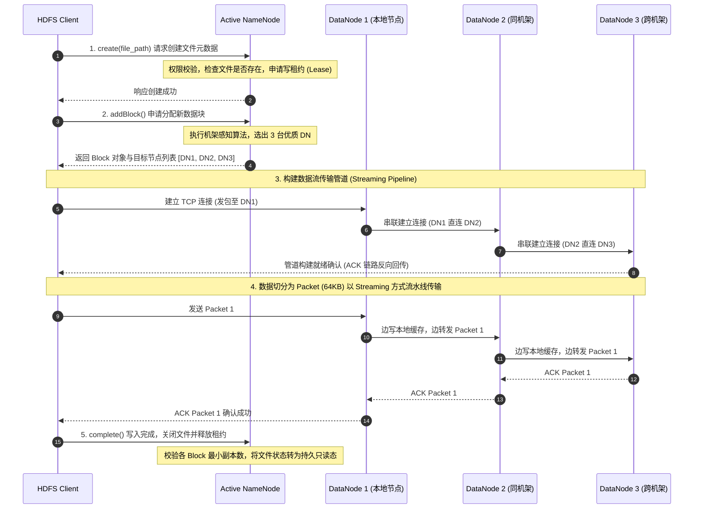
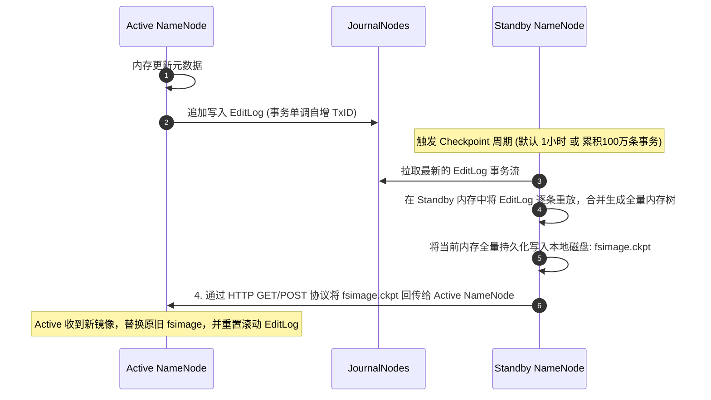
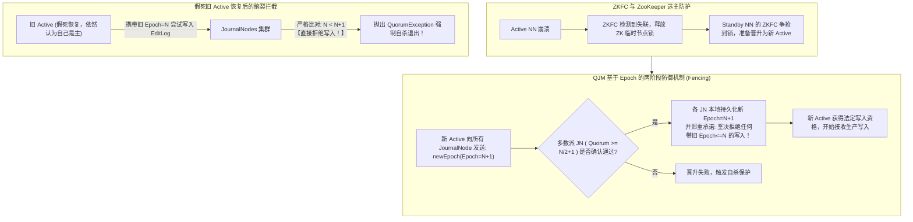
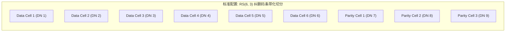
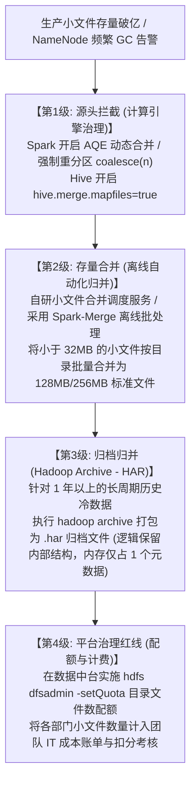
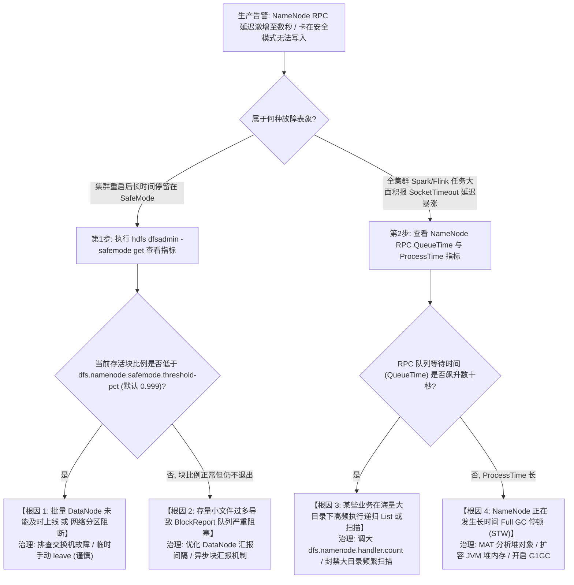
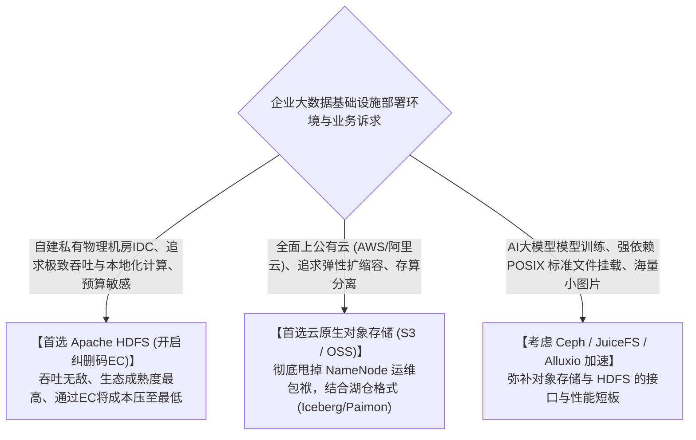
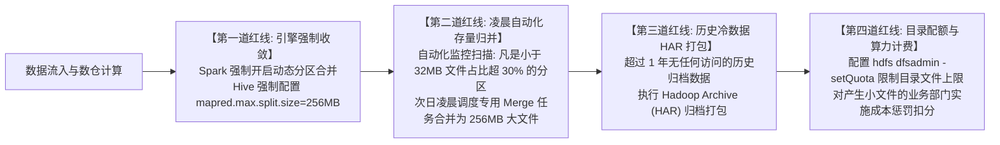
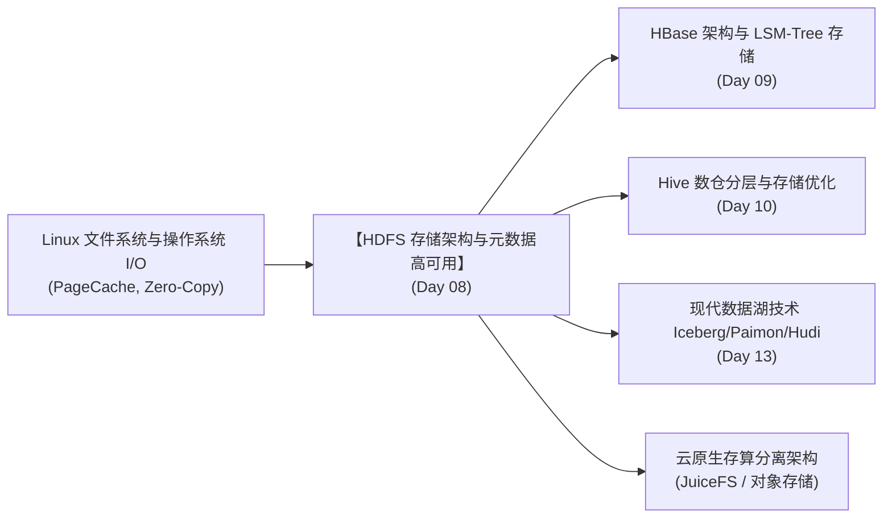

# HDFS 底层机制、QJM高可用架构与大厂小文件风暴治理（高阶架构与生产实战）

> **学习目标定位**：面向数据平台研发负责人、大数据架构师与技术总监岗位，深刻掌握 Apache HDFS 在现代企业级大数据体系中的存储基石地位。透彻理解 NameNode 内存元数据模型、EditLog 与 FSImage 滚动合并流程、基于 QJM（Quorum Journal Manager）与 Epoch 机制的高可用防脑裂架构、经典机架感知 3 副本放置策略与 Hadoop 3.x 纠删码（Erasure Coding）降本哲学。结合字节跳动、阿里、美团等互联网大厂高频面试真题，系统建立数仓数亿级小文件风暴治理（Small File Storm）、NameNode RPC 线程池打满雪崩定位与 PB 级存储成本优化的技术决策能力。

---

## 1. 知识概述与业务价值

### 1.1 是什么（What）
Apache HDFS（Hadoop Distributed File System）是大数据领域应用最广泛的分布式文件存储基础设施。其设计初衷是**在廉价商用服务器（Commodity Hardware）集群上，存储跨机器、跨机架的超大规模数据集（PB 至 EB 级），并对外提供高容错、高吞吐的流式数据访问接口**。在最新的 **Hadoop 3.3+ / 3.4+ 时代**，HDFS 已经完成了从传统“静态 3 副本冗余”向 **纠删码（Erasure Coding, EC）存储成本腰斩**、**Observer NameNode 读写分离** 以及 **Router-based Federation（路由级联邦）** 的现代化云原生存储演进。

### 1.2 解决什么核心业务痛点（Why）
在 HDFS 诞生前，企业存储海量数据面临三大瓶颈：
1. **纵向扩展（Scale-up）的硬件成本天花板**：单机高端 NAS/SAN 存储阵列价格极其昂贵，且无法线性水平扩展；
2. **硬件不可靠性与单点故障**：商用磁盘损坏是分布式系统的常态，传统系统缺乏自动化副本自愈与数据校验能力；
3. **计算与存储割裂的网络拥塞**：传统架构需要将数据通过网络拉取到计算节点，而 HDFS 通过暴露物理数据块（Block）拓扑，让 Spark/MapReduce 能够直接实现“**移动计算而非移动数据（Data Locality）**”，释放出极致的局部读写带宽。

### 1.3 适用场景与技术边界（Where & When）
- **高价值应用场景**：
  - **离线数据湖与数仓持久化底座**：Hive、Spark、Presto/Trino 底层的冷热数据分层持久化。
  - **海量超大文件顺序流式读取**：GB 至 TB 级日志文件、Parquet / ORC 列式存储文件的高并发批量扫描。
  - **冷数据长期合规归档**：结合纠删码（EC）技术，以极低硬件成本对 3 年以上的冷数据进行持久化封存。
- **技术边界与反模式**：
  - **海量小文件存储（如数千万个几 KB 的小图片或日志）**：每个文件在 NameNode 内存中占用固定约 150 字节元数据，小文件过多会直接撑爆 NameNode 内存，引发 GC 瘫痪。
  - **低延迟随机点查与修改（In-place Modification）**：HDFS 采用“**一次写入、多次读取（Write-once, Read-many）**”模型，仅支持追加（Append），严禁在文件任意物理偏移处随机修改数据。
  - **微秒级访问时延**：毫秒至微秒级随机读写应交由 HBase、Redis 或高性能分布式文件系统（如 Alluxio）。

---

## 2. 核心概念与关系

### 2.1 核心概念全景表
| 概念名称 | 英文术语 | 核心定义与工程职责 | 资源/生命周期级别 |
| :--- | :--- | :--- | :--- |
| **主控元数据节点** | NameNode (NN) | 集群管理中枢，在纯内存中维护全集群的目录树、文件所有权、权限及文件到 DataNode 块的映射关系。 | 进程与集群主控级 |
| **数据执行节点** | DataNode (DN) | 实际存储物理数据块的 Worker 节点，负责 Block 的本地读写、校验和校验（Checksum）并向 NN 汇报心跳。 | 进程与节点级 |
| **元数据快照与日志** | FSImage & EditLog | **FSImage** 是某一时刻 NameNode 内存目录树的全量序列化快照；**EditLog** 是记录每次创建、删除、重命名等文件元数据变更的预写日志。 | 磁盘物理文件级 |
| **日志仲裁集群** | QJM (JournalNodes) | 基于 Paxos 变体算法构建的轻量日志仲裁集群（通常 3 或 5 节点），负责在 Active 与 Standby NameNode 之间高可靠同步 EditLog。 | 分布式仲裁组件 |
| **数据块** | Block | HDFS 切分文件的最小物理存储单元（默认 128MB 或 256MB），每个 Block 在底层对应 DataNode 本地 Linux 文件系统中的一个普通二进制文件。 | 存储分配切片级 |
| **安全模式** | SafeMode | NameNode 启动时的自检只读保护状态。在此期间 NN 不接受任何写入，只接收各 DN 发来的块汇报（Block Report），达标后自动退出。 | 集群生命周期状态 |
| **故障转移控制器** | ZKFC (ZKFailoverController)| 运行在各 NN 节点上的独立进程，监控 NN 健康状态并通过 ZooKeeper 争抢分布式锁，驱动主备自动透明切换。 | 高可用协调进程 |

### 2.2 HDFS 高可用元数据与数据读写全景拓扑图
```mermaid
flowchart TD
    subgraph ClientLayer["客户端 (Client)"]
        Client["HDFS Client (DFSClient)"]
    end

    subgraph HighAvailability["NameNode HA 高可用双主保护中枢"]
        ActiveNN["Active NameNode<br/>(内存维护元数据树, 负责所有读写响应)"]
        StandbyNN["Standby NameNode<br/>(从 JN 持续拉取日志, 执行 Checkpoint 合并)"]
        ZKFC1["ZKFC 1 (健康监控/抢锁)"]
        ZKFC2["ZKFC 2"]
        ZK["ZooKeeper 集群 (选举锁 & Ephemeral 节点)"]
        
        ActiveNN <--> ZKFC1
        StandbyNN <--> ZKFC2
        ZKFC1 <-->|争抢分布式锁| ZK
        ZKFC2 <-->|争抢分布式锁| ZK
    end

    subgraph QuorumJournal["QJM 日志仲裁集群 (多数派 Paxos 写入)"]
        JN1["JournalNode 1"]
        JN2["JournalNode 2"]
        JN3["JournalNode 3"]
        ActiveNN -->|同步写入 EditLog| JN1
        ActiveNN -->|同步写入 EditLog| JN2
        ActiveNN -->|同步写入 EditLog| JN3
        JN1 -.->|异步拉取 EditLog| StandbyNN
        JN2 -.->|异步拉取 EditLog| StandbyNN
        JN3 -.->|异步拉取 EditLog| StandbyNN
    end

    subgraph DataNodesPool["DataNode 数据存储池 (物理 Block 管道)"]
        DN1["DataNode 1 (Rack 1)<br/>Block 1 副本"]
        DN2["DataNode 2 (Rack 1)<br/>Block 1 副本"]
        DN3["DataNode 3 (Rack 2)<br/>Block 1 副本"]
    end

    Client -->|1. RPC 请求读写元数据| ActiveNN
    Client <-->|2. Pipeline 流水线直读/直写数据块| DN1
    DN1 <-->|Pipeline 串行传输| DN2
    DN2 <-->|跨机架传输| DN3
    DN1 -.->|心跳与块汇报 (BlockReport)| ActiveNN
    DN2 -.->|心跳与块汇报| ActiveNN
    DN3 -.->|心跳与块汇报| ActiveNN
    StandbyNN -->|HTTP 传输合并后的 fsimage| ActiveNN
```

---

## 3. 底层工作机制与设计哲学

### 3.1 客户端数据读写管道（Pipeline）与租约恢复机制

HDFS 的客户端读写绝不经过 NameNode 中转，真正践行了**“元数据控制面与数据数据面彻底分离”**的高性能架构：

#### 1. 数据写入全流程时序图（Pipeline 复制）：


#### 2. 租约管理（Lease Management）与租约恢复（Lease Recovery）：
- **痛点**：如果客户端在写到一半时突然宕机断电，谁来关闭该文件？后追加的数据会不会产生脏数据？
- **租约机制**：客户端在开始写入文件时，向 NameNode 申请一把**软租约（Soft Limit，默认 1 分钟）**与**硬租约（Hard Limit，默认 1 小时）**。
- **租约恢复流程**：
  1. 如果客户端在硬租约时间内断联未续约，NameNode 判定该客户端死亡，触发**租约恢复机制（Lease Recovery）**；
  2. NameNode 挑选该 Block 存活的 DataNode 之一作为协调者，向其他 DataNode 查询它们本地该 Block 真实写入的实际长度；
  3. **各节点协商取最小的物理长度进行对齐，截断多余数据，生成新的 Generation Stamp（世代戳）**；
  4. 最终关闭该文件，防止分布式死锁，保障其他客户端能够安全读取已提交的数据。

---

### 3.2 NameNode 内存元数据模型与 Checkpoint 滚动合并

#### 1. 为什么 NameNode 元数据必须常驻纯内存？
如果将分布式文件系统的目录树（数百亿文件和块映射）直接存在磁盘或传统关系型数据库中，每次客户端 `ls`、`open` 或 `stat` 都会引发高频磁盘随机 I/O，在大并发下 NameNode 吞吐会被直接卡死在每秒几百次操作。
**NameNode 将全部目录树（`INode`）与数据块位置（`BlockInfo`）纯放在 JVM 堆内存中，使得单次元数据检索耗时保持在微秒级，单机即可支撑数万 QPS 的 RPC 查询**。

#### 2. FSImage 与 EditLog 滚动合并底层机制：
内存断电即失，必须依靠外存持久化。若每次小修改都重写几十 GB 的 FSImage 会造成严重停顿。因此，**采用“预写增量日记（EditLog）+ 周期全量镜像（FSImage）”设计**：



> [!IMPORTANT]
> **架构历史演进澄清（大厂高频辨析）**：
> 在经典的非 HA 架构时代，执行合并操作的节点被称为 **Secondary NameNode**（简称 2NN）；
> **在现代生产环境主流的 QJM 高可用（HA）架构中，Secondary NameNode 已被彻底废弃！合并任务完全由 Standby NameNode 接管执行**，切忌在面试中将 Standby NameNode 与 2NN 混为一谈。

---

### 3.3 QJM（Quorum Journal Manager）高可用防脑裂机制

早期的 HDFS HA 方案强依赖外部共享存储（如 NFS），不仅存在单点故障风险，而且在网络分区时极易发生**“双主脑裂（Split-Brain）”**。当前标准的 QJM 架构基于 Paxos 变体协议，从根源上消除了脑裂：



#### 双重防脑裂闭环：
1. **控制面锁隔离（Control-plane Fencing）**：ZKFC 自动通过 SSH 发送 `kill -9` 命令尝试强杀假死的旧 Active（Fencing Script 机制）；
2. **数据面 Epoch 仲裁隔离（Data-plane Fencing，基石保障）**：即使 SSH 隔离失败，新 Active 晋升时已经在多数派 JournalNode 上完成了 Epoch 递增。旧 Active 由于网络分区持有的还是旧 Epoch，任何试图向 JournalNodes 写入元数据的请求都会被**无情拒绝并抛出异常**，彻底杜绝了不同主节点同时修改元数据导致的逻辑脑裂。

---

### 3.4 Hadoop 3.x 纠删码（Erasure Coding, EC）底层原理与成本革命

在 HDFS 2.x 时代，系统采用朴素的 **3 副本冗余机制（Replication Factor = 3）**，带来高达 **200% 的额外存储开销（Storage Overhead = 200%，存储利用率仅 33.3%）**。对于拥有数百 PB 数据的大厂而言，硬件采购成本极其高昂。

#### 1. 纠删码（EC）技术本质：
Hadoop 3.x 深度引入了源于通信领域的 **Reed-Solomon (RS) 纠删码算法**。通过将数据划分为 $d$ 个数据块单元（Data Cells）并计算生成 $p$ 个校验块单元（Parity Cells），记为 **$RS(d, p)$**。
- **容错能力**：在任意 $d+p$ 个单元中，**只要任意损坏或丢失不超过 $p$ 个节点，系统均可通过解线性方程组矩阵运算将数据 100% 完整重构出来**！



#### 2. 传统 3 副本 vs 纠删码（以 RS(6, 3) 为例）深度对比：
| 评估维度 | 传统 3 副本机制 (3-Replication) | 纠删码模式 (RS(6, 3)) | 架构师权衡收益 |
| :--- | :--- | :--- | :--- |
| **存储空间开销** | **300% 原始容量** (100PB 数据需 300PB 磁盘) | **150% 原始容量** (100PB 数据仅需 150PB 磁盘) | **直接削减 50% 物理磁盘采购成本！** |
| **容错能力** | 最多容忍 **2 节点** 同时损坏 | 最多容忍 **3 节点** 同时损坏 | **容灾可靠性反而大幅提升** |
| **存储写入组织** | 连续物理块存储（Block 粒度） | **条带化存储（Striped Cell: 默认 1MB）** | 对网络各节点的并发吞吐要求提高 |
| **正常读写性能** | 极佳（本地读零编解码开销） | 极佳（读正常数据无需解码，直接并行拉取） | 基本打平 |
| **故障重构与恢复开销** | 极低（直接从健康节点单纯网络 Copy） | **较高（需跨网络拉取 6 个节点数据做矩阵反演解码）**| 重构时显著消耗集群 CPU 与跨节点网络 I/O |

---

## 4. 高频复杂业务场景实操与落地

### 4.1 典型业务场景：数亿级数仓碎片小文件风暴治理（Small File Storm）
在很多成熟的大数据平台（如美的、思科或大型工业物联网平台），随着业务运行数年，每天成千上万个 Hive/Spark 任务在按小时甚至按分钟调度切分，日积月累产生**上亿个仅几 KB 至几百 KB 的小文件**。
- **毁灭性现象**：
  1. NameNode 内存占用突破 100GB，Full GC 停顿长达数十秒甚至数分钟，触发全集群心跳超时；
  2. 每次 NameNode 重启时，拉取并反序列化元数据耗时长达 **4~8 个小时**；
  3. Spark 扫描该表时，开辟上百万个小 Task，每个 Task 只跑 20ms，调度开销占了 99%。



### 4.2 生产级 NameNode 与 HDFS 核心调优参数基线

```properties
# ==================== NameNode 内存与垃圾回收调优 ====================
# NameNode 堆内存大小 (标准经验: 每 100万个 Block 消耗 1GB 内存，亿级对象配比 64GB~128GB)
HADOOP_NAMENODE_OPTS="-Xms64g -Xmx64g -XX:+UseG1GC -XX:InitiatingHeapOccupancyPercent=45 -XX:G1ReservePercent=15 -XX:MaxGCPauseMillis=20"

# NameNode 处理客户端 RPC 请求的 Handler 线程数 (生产按 CPU 核数和并发调大，默认仅 10)
dfs.namenode.handler.count: 128
dfs.namenode.service.handler.count: 64

# ==================== QJM 高可用防脑裂与心跳调优 ====================
# 连接 JournalNode 的超时时间，避免网络微抖动导致误判
dfs.qjournal.write-txns.timeout.ms: 20000
dfs.ha.fencing.methods: "sshfence(hdfs:22)"
dfs.ha.fencing.ssh.connect-timeout: 30000

# ==================== 纠删码 EC 生产策略配置 ====================
# 针对冷数据目录启用高效纠删码策略 (存储直接减半)
# 命令: hdfs ec -setPolicy -path /data/cold_storage -policy RS-6-3-1024k

# ==================== 小文件与合并防御配置 ====================
# 针对 NameNode RPC 隔离: 开启独立的运维排障端口 (防止业务打满时管理员无法登录)
dfs.namenode.lifeline.rpc-address: "nn1:8050"
```

---

## 5. 生产异常故障深度排查与根因分析

### 5.1 生产级“NameNode RPC 延迟飙升与安全模式卡死”排查决策树



### 5.2 核心生产异常场景实操复盘

#### 场景一：业务突发大目录递归检索拖垮 NameNode 全局服务
- **真实生产现象**：某天下午 14:00，全集团大数据集群突发大面积雪崩，所有 Spark/Flink 作业全部报错 `org.apache.hadoop.net.ConnectTimeoutException: Call to nn1/10.0.0.1:8020 failed on socket timeout`。NameNode 进程存活但完全失去响应，Web UI 无法打开。
- **深度根因分析**：
  1. 查看 NameNode RPC 监控发现，`RpcQueueTime` 从正常的 2ms 瞬间暴涨至 45 秒，所有可用 Handler 线程全部被打满处于等待状态。
  2. 顺着审计日志（Audit Log）排查发现，某个算法实习生编写的脚本在根目录下启动了一个包含 500 个并发线程的遍历程序，并发执行 `hdfs.listStatus("/data/hive/warehouse", recursive=true)`；
  3. 由于该目录下包含了数百万个历史分区和文件，每一次遍历都会将整个目录树的全局读锁（FSNamesystem ReadLock）紧紧霸占数秒，导致全集群所有其他任务的轻量元数据请求全部在队列中死死排队，引发超时级联踩踏。
- **架构级治本与应急方案**：
  - **应急止血**：通过 NameNode 的 Lifeline 专用隔离端口（8050）登录集群，直接定位恶意客户端 IP 并利用 iptables 临时阻断其网络通信，RPC 瞬间恢复；
  - **治本规范**：
    - 调大 Handler 线程池：`dfs.namenode.handler.count = 256`；
    - 在数据平台中台层拦截非法遍历请求，禁止对二级以上核心公共目录执行全量递归操作。

#### 场景二：集群重启后卡在安全模式（SafeMode）4 小时无法自愈
- **真实生产现象**：由于物理机房电力改造，整个大数据集群关机重启。重启后，NameNode 长达 4 个小时一直处于 `SafeMode: ON` 状态，拒绝所有外部写入，业务大屏全面瘫痪。
- **深度根因分析**：
  集群内部积攒了超过 2 亿个小文件，在 NameNode 启动时：
  1. 首先需要将几百个历史 EditLog 增量加载到内存中合并，单此一步就耗时 1.5 小时；
  2. 接着 500 台 DataNode 同时上线，密集向 NameNode 发送全量块汇报（Block Report）；
  3. 单个 DataNode 的汇报数据包包含数十万 Block 元数据，将 NameNode 的处理队列彻底塞爆，CPU 飙至 100%，导致 Block 达标率校验迟迟无法收敛完成。
- **治本工程方案**：
  - 启动阶段配置块汇报错峰延迟：配置 `dfs.blockreport.initialDelay = 120s`，让各 DataNode 错峰分批汇报；
  - 根治小文件：上线自动化小文件治理工具，将存量小文件合并，使总文件数从 2 亿压缩到 3000 万以内。

---

## 6. 技术选型对比、架构演进与成本ROI

### 6.1 横向主流大数据存储底座深度对比矩阵
| 评估维度 | Apache HDFS (3.3+ EC) | 云原生对象存储 (AWS S3 / 阿里 OSS) | Ceph 分布式存储 | 传统商业 NAS / SAN 阵列 |
| :--- | :--- | :--- | :--- | :--- |
| **存储架构模式** | **存算一体 / 本地化优先 (Data Locality)**| **完全存算分离 (云原生对象存储)** | 统一分布式存储 (块/对象/文件) | 集中式或专用物理硬件 |
| **顺序读取吞吐** | **极高（单机直接磁盘流式读取，无网络）**| 极高（受公有云网卡与带宽配额限制）| 较高（架构层次多，存在微量放大）| 依赖专用光纤交换机带宽 |
| **数据修改语义** | **支持追加写入 (Append)，不支持随机覆写**| **仅支持整体覆写 (PutObject)，无原子追加**| 支持丰富 POSIX 文件修改语义 | 完美支持 POSIX 随机修改 |
| **重命名与原子操作**| **毫秒级原子重命名 (Rename 仅改指针)** | **极慢（S3 重命名本质是 Copy + Delete）**| 较快 | 毫秒级 |
| **小文件抗压能力** | **较差（受限于 NameNode JVM 单机内存）** | **极强（分布式元数据池，天生容忍海量对象）**| 强 | 较差 |
| **建设与运维成本** | **中等（需维护物理机，借 EC 降本 50%）** | **按需计费（免去机房运维，长期成本取决于访问频次）**| 极高（运维极其复杂繁重） | 极其昂贵 |

### 6.2 架构师技术选型决策树


---

## 7. 技术经理与架构师实战管控（SOP与规范）

### 7.1 企业级数仓小文件“四道红线”全生命周期治理 SOP
为了杜绝小文件风暴瘫痪 NameNode，数据负责人必须推行**“源头阻断、离线合并、冷存归档、指标考核”**四级闭环：



1. **研发门禁红线**：禁止在 Spark SQL 中使用 `repartition(1000)` 盲目放大并发；强制要求写入表的分区字段基数合理，严禁创建带有数万分区的低基数过度分区表。
2. **自动化合并机制**：在数据中台集成小文件治理服务，每天凌晨 04:00 自动扫描全量表元数据，对碎片小文件执行自动化多合一（Compact）清洗，使全集群小文件常态占比保持在 5% 以下。

### 7.2 NameNode 生产高可用演练与容量红线（SOP）
- **容量水位红线**：NameNode JVM 堆内存使用率**严禁超过 75%**；集群总 Block 数量每增长 1 亿，必须前置扩容 64GB 堆内存，或启动 Router-based Federation 联邦拆分。
- **高可用故障演练规范**：每季度执行一次 NameNode 暴力 Kill 切换演练，验证 ZKFC 是否能在 **3 秒内完成主备无缝切换**，确保业务端 Spark/Flink 长任务零感知且无报错重试。

---

## 8. 互联网大厂高频面试真题库

### 8.1 基础概念与机制题（大厂初筛）
1. **Q1**：HDFS 读写全流程是怎样的？写入时客户端如何与 DataNode 管道通信？为什么说 HDFS 是“一次写入、多次读取”？
2. **Q2**：HDFS 的默认副本放置策略（Replica Placement Policy）是怎样的？为什么采用这种机架感知设计？

### 8.2 核心底层原理深度题（大厂资深技术面）
3. **Q3**：请详细画图推导 NameNode 与 Standby NameNode 之间 FSImage 和 EditLog 的滚动合并机制，Secondary NameNode 在现代 HA 架构中还存在吗？
4. **Q4**：QJM（Quorum Journal Manager）是如何实现 NameNode 元数据高可用的？它是如何防止分布式脑裂（Brain-Split）的？
5. **Q5**：什么是 Hadoop 3.x 引入的纠删码（Erasure Coding）？它的数学原理是什么？相比传统 3 副本，它在成本与性能上有哪些权衡？

### 8.3 复杂生产场景与故障排障题（大厂架构与排障面）
6. **Q6**：生产环境下，数仓积累了数亿个碎片小文件，导致 NameNode 频繁 Full GC 甚至内存溢出，作为数据平台负责人，你如何系统化治理“小文件风暴”？
7. **Q7**：生产环境中，集群出现大面积作业卡顿，监控显示 NameNode RPC 延迟从几毫秒飙升至数秒，大量客户端报超时，你如何定位排查并彻底治理？

---

## 9. 结构化深度参考答案（逐题三层应答）

### 题目1（大厂初筛·读写全流程）：HDFS 读写全流程是怎样的？写入时客户端如何与 DataNode 管道通信？为什么说 HDFS 是“一次写入、多次读取”？

#### 简洁回答（1分钟电梯破题）：
> “HDFS 采用**‘元数据控制面与数据流数据面彻底分离’**的极简设计：
> **读取时**：客户端先向 NameNode 获取文件的 Block 元数据及其所在的 DataNode 列表，随后客户端直接并发连接最优 DataNode 直读数据；
> **写入时**：客户端向 NameNode 申请分配 Block 与一组 DataNode 目标列表，随后客户端仅与首节点连接，数据以 **Packet（64KB）** 为单位通过 **Streaming Pipeline（流式管道）** 在 DataNode 之间串联转发并反向回传 ACK；
> 称其为‘一次写入、多次读取’，是因为 HDFS 为了规避复杂的分布式写并发锁冲突与数据一致性难题，**仅支持文件末端追加（Append），严禁任何在文件任意位置的随机修改覆写**。”

#### 深入回答（状态机流转与边界条件）：
> “从内部管道构建与租约控制深入拆解：
> 1. **写入流水线（Pipeline）机制**：
>    - 客户端调用 `create()`，NameNode 校验路径并颁发写租约（Lease）；
>    - 客户端调用 `write()`，数据先在客户端内存缓冲切分成 64KB 的 Packet；
>    - 客户端向 NameNode 请求分配 Block，NN 依据机架感知返回 3 个 DataNode 列表（例如 DN1, DN2, DN3）；
>    - **建立三方管道**：Client 连 DN1，DN1 连 DN2，DN2 连 DN3。管道建立成功后，Packet 以流式形式边写本地内存边转发下游，DN3 收到后反向回传 ACK 直至 Client；
>    - 发生故障时的容错：若传输中 DN2 宕机，管道被立即暂停，剩余健康的 DN1 和 DN3 重新协商，将坏节点剔除后继续写入，NN 随后在后台异步补齐缺失副本。
> 2. **为什么不支持随机就地修改？**
>    - 随机修改会导致文件物理 Block 长度发生偏移，迫使该 Block 之后的所有后续 Block 全部重新移动和重新寻址；
>    - 引入多客户端随机覆写必须实现极其昂贵的分布式行锁与版本控制系统。HDFS 砍掉随机写，以极简的追加模型换取了对 PB 级大数据批处理的极致并发吞吐。”

#### 架构师/技术管理视角（权衡取舍、SLA与成本）：
> “在技术管理与架构评审中，必须讲透这一底层假设对**上层应用与存储格式设计的决定性影响**：
> 正是由于 HDFS‘只能追加不能随机修改’的物理特性，催生了整个大数据生态的列式存储格式（如 Parquet / ORC）与现代湖仓体系（Iceberg / Hudi / Paimon）的核心架构：
> 它们在底层全部采用 **Copy-on-Write（写时复制）或 Merge-on-Read（读时合并）** 机制，将上游数据库的 Update/Delete 操作全部转化为纯追加写入的 Log / Delta 文件。
> 架构师切忌让业务团队用传统 MySQL 的随机更新思维来折腾 HDFS，顺应底层追加写特性，是保障分布式存储底座长治久安的第一法则。”

---

### 题目2（大厂初筛·机架感知）：HDFS 的默认副本放置策略（Replica Placement Policy）是怎样的？为什么采用这种机架感知设计？

#### 简洁回答（1分钟电梯破题）：
> “HDFS 默认经典的 3 副本放置策略是：
> **第 1 副本**：优先放在客户端本地节点（若客户端在集群外，随机挑一台磁盘充足的节点）；
> **第 2 副本**：放在**与第 1 副本不同机架**的任意远程节点上；
> **第 3 副本**：放在**与第 2 副本相同机架的不同节点**上。
> 这种设计的核心思想是在**‘跨机架容灾安全性（Fault Tolerance）’与‘跨交换机网络网络 I/O 成本（Bandwidth Cost）’之间达成最优平衡**。”

#### 深入回答（拓扑推导与极端容灾分析）：
> “从网络交换机拓扑与容错边界推导：
> 1. **网络成本考量**：
>    同一机架内的服务器共享同一个接入层交换机（Top-of-Rack Switch），其内部网络带宽充裕、时延极低（通常在几十微秒）；而跨机架通信必须经过核心汇聚层交换机，带宽极其宝贵且延迟较高。
>    如果 3 个副本全部放在不同机架，每次数据写入都需要跨机架传输 2 次，核心交换机带宽会瞬间被撑爆。
> 2. **机架故障容错边界**：
>    如果把副本都放在同一个机架，一旦该机架的电源柜短路或接入交换机损坏，整个机架瘫痪会导致数据完全丢失；
>    按照当前策略：**数据总共分布在 2 个不同的物理机架上，写入时只需要跨越 1 次核心交换机（DN1 传给 DN2），而 DN2 传给 DN3 属于同机架极速内网**！
>    即使其中任意一个机架发生整体断网或物理火灾，另一个机架上始终保留有完整可用的一份副本，容灾安全系数高达 99.999%。”

#### 架构师/技术管理视角（权衡取舍、SLA与成本）：
> “在数据中心机房规划与运维体系中，机架感知绝不是空洞的理论，必须**在基础设施层显式配置落地**：
> 很多初级团队在搭建集群时偷懒，未配置机架拓扑脚本（`net.topology.script.file.name`），导致 HDFS 误认为所有几百台物理机都在同一个默认机架 `/default-rack` 下！
> 这不仅失去了跨机架容灾能力，更会导致数据本地性调度失真。
> 作为技术总监，我的基建硬性规范是：**在装机自动化 Ansible 脚本中强制绑定机房机柜交换机拓扑映射**，确保 HDFS、Kafka、K8s 能够准确识别物理物理分布，从底层物理机柜层面守住金融级容灾底线。”

---

### 题目3（大厂资深·元数据滚动合并）：请详细画图推导 NameNode 与 Standby NameNode 之间 FSImage 和 EditLog 的滚动合并机制，Secondary NameNode 在现代 HA 架构中还存在吗？

#### 简洁回答（1分钟电梯破题）：
> “在现代主流的 QJM 高可用（HA）架构中，**Secondary NameNode（2NN）早已被彻底废弃，合并任务完全由 Standby NameNode 接管**。
> 合并流转过程是：
> Active NameNode 内存修改元数据并同步向多数派 JournalNodes 写入 EditLog；
> Standby NameNode 周期性（默认 1 小时或 100 万条事务）从 JournalNodes 拉取增量 EditLog 在自身内存中重放，随后生成新的全量镜像文件 `fsimage.ckpt`，最后通过 HTTP 协议回传给 Active NameNode 替换旧镜像，并重置 EditLog 日志，循环往复维持元数据的轻量化。”

#### 深入回答（状态机流转与边界条件）：
> “详细滚动合并四阶段时序推导：
> 1. **第一阶段：触发阈值检测**：
>    Standby NameNode 内部常驻一个后台检测线程 `Checkpointer`，检测是否满足合并条件：
>    - 时间阈值：`dfs.namenode.checkpoint.period`（默认 3600 秒，即 1 小时）；
>    - 事务量阈值：`dfs.namenode.checkpoint.txns`（默认 1000000 条未合并事务）。
> 2. **第二阶段：日志拉取与重放**：
>    - Standby 获知当前需要 Checkpoint 的起始与终止事务 ID（如 TxID 1000 到 2000）；
>    - Standby 通过网络从 JournalNode 集群中把这一段 EditLog 下载回本地，在 Standby 内存中进行逐条重放回放，使其内存树与 Active 达到完全一致。
> 3. **第三阶段：本地镜像持久化**：
>    - Standby 将此时刻的内存目录树以高效的 Protocol Buffers 格式全量写入磁盘，文件名为 `fsimage.ckpt_0000000000000002000`；
>    - 写入完毕并经 MD5 校验和校验完整后，重命名为正式的 `fsimage_0000000000000002000`。
> 4. **第四阶段：镜像推送与 Active 替换**：
>    - Standby 通过 HTTP GET 协议通知 Active 传输该镜像，Active 下载该 `fsimage` 并更新本地磁盘；
>    - Active 将该位点之前的旧 EditLog 进行归档或截断，完成一次完整的安全 Checkpoint 周期。”

#### 架构师/技术管理视角（权衡取舍、SLA与成本）：
> “在技术总监与架构师面试中，这是一道检验候选人是‘背过时旧书’还是‘具有实战经验’的经典试金石：
> 凡是张口闭口还在大谈‘Secondary NameNode 负责每小时辅助主节点合并’的，说明其认知还停留在 10 年前的 Hadoop 1.x 时代。
> 架构师必须讲透为什么 HA 架构要干掉 2NN：
> 在旧版中，2NN 只是个冷备合并工具，主节点挂了它根本无法顶上，主节点故障恢复需要几十分钟甚至几个小时；
> 而在 QJM HA 架构下，**Standby NameNode 本身就是一台全功能的备用主节点，它在执行合并的同时，内存里时刻保持着与 Active 高度同步的元数据**，遇到主节点故障 3 秒内即可瞬间登基为 Active，这不仅优化了元数据合并链路，更实现了真正意义上的零中断高可用。”

---

### 题目4（大厂资深·QJM防脑裂）：QJM（Quorum Journal Manager）是如何实现 NameNode 元数据高可用的？它是如何防止分布式脑裂（Brain-Split）的？

#### 简洁回答（1分钟电梯破题）：
> “QJM 摒弃了脆弱的共享磁盘，采用基于 **Paxos 变体算法的多数派仲裁写入**（通常配置 $2N+1$ 台 JournalNode，容忍 $N$ 台节点宕机）。Active 必须获得超过半数 JN 的成功确认才算写入生效。
> 防止脑裂依靠 **‘控制面 ZKFC 隔离（Fencing） + 数据面 Epoch 仲裁拒绝’ 的双重防御闭环**：
> 当发生主备切换时，新 Active 向所有 JN 发起并更新全局单调递增的 **Epoch 编号**；假死复活的旧 Active 携带旧 Epoch 尝试写入任何元数据时，**会被多数派 JN 严格校验并无情拒绝，触发旧 Active 抛异常自杀**，物理上彻底杜绝双主脑裂。”

#### 深入回答（状态机流转与边界条件）：
> “从网络分区（Network Partition）极端场景深入推导防脑裂细节：
> 1. **脑裂假死场景还原**：
>    假设 Active NN1 发生长达 40 秒的 Full GC 停顿，ZKFC 判定其心跳丢失，在 ZooKeeper 上释放临时锁；
>    Standby NN2 抢锁成功，晋升为新 Active。
>    就在此时，NN1 从 Full GC 停顿中苏醒过来，**但它并不知道自己已经被废黜，依然自认为自己是合法的 Active**。此时集群若同时接收 NN1 和 NN2 的写入，元数据将彻底精神分裂、无法修复。
> 2. **QJM 数据面 Epoch 刚性防御流程**：
>    - 当 NN2 晋升时，首先向所有 JournalNode 发送 `newEpoch(Epoch=N+1)` 请求；
>    - 只要有超过半数（如 3 台中的 2 台）JN 响应通过，这些 JN 会在其磁盘上持久化最新的 `Epoch=N+1`，并庄严承诺：**‘从现在起，任何携带 Epoch $\le N$ 的请求一律直接拒绝’**！
>    - 当苏醒后的 NN1 尝试向 JN 写入 EditLog 时，其报文头携带的还是旧的 `Epoch=N`；
>    - JN 比对后发现 $N < N+1$，立即向 NN1 抛出 `QuorumException` 拒绝错误；
>    - NN1 发现自己被多数派抛弃，触发保护机制，**直接打印致命日志并执行 `System.exit()` 进程自杀**，元数据纯净性得以绝对捍卫。”

#### 架构师/技术管理视角（权衡取舍、SLA与成本）：
> “从分布式共识协议的演进来看，QJM 是典型借鉴了 Raft / Paxos 精髓的优秀工程实现：
> 理解 QJM 防脑裂直接指导我们对**节点部署拓扑的架构约束**：
> 1. **JN 节点必须严格奇数部署**：必须采用 3 台或 5 台，严禁配置偶数台（偶数台既不能增加容错能力，反而在网络对称分区时更容易造成平票僵局）；
> 2. **物理反亲和（Anti-Affinity）部署**：3 台 JournalNode 绝不能放在同一台宿主机或同一个机架电源柜上，必须跨物理机架分散部署，避免机柜掉电引发仲裁集群半数以上瘫痪，保障分布式共识的物理根基。”

---

### 题目5（大厂资深·纠删码原理）：什么是 Hadoop 3.x 引入的纠删码（Erasure Coding）？它的数学原理是什么？相比传统 3 副本，它在成本与性能上有哪些权衡？

#### 简洁回答（1分钟电梯破题）：
> “纠删码（EC）是一种源于通信领域的编码冗余容错技术。Hadoop 3.x 默认采用 **Reed-Solomon（RS）算法**，将文件以条带化（Striping）形式切分为 $d$ 个数据单元并计算出 $p$ 个校验单元，记为 $RS(d, p)$。只要损坏节点不超过 $p$ 个，即可通过解线性方程组矩阵反演将数据 100% 完整重构。
> **核心权衡是‘以额外的 CPU 编解码与网络重构开销，换取物理存储硬件成本降低 50%’**：以标配 $RS(6, 3)$ 为例，存储冗余度从传统 3 副本的 300% 暴降至 150%，且抗坏盘能力从容忍 2 节点损坏提升至 3 节点损坏。”

#### 深入回答（数学矩阵原理与 I/O 组织推导）：
> “深入到线性代数范德蒙德矩阵（Vandermonde Matrix）与条带化存储：
> 1. **数学编码原理**：
>    设输入数据向量为 $D = [d_1, d_2, \dots, d_6]^T$。通过乘以一个 $(6+3) \times 6$ 的生成分布矩阵 $G$，得到包含 6 个数据块与 3 个校验块的编码向量 $Y$：
>    $$Y = G \times D = [d_1, d_2, \dots, d_6, p_1, p_2, p_3]^T$$
>    当其中任意 3 个节点损坏丢失时，只需在矩阵 $G$ 中划掉对应的行，得到一个可逆的 $6 \times 6$ 方阵 $G'$。在有限域（Galois Field $GF(2^8)$）内对 $G'$ 求逆矩阵，即可秒级恢复原始数据：
>    $$D = (G')^{-1} \times Y_{survived}$$
> 2. **底层存储组织的重大改变（Striped Block）**：
>    - 传统 3 副本是按 Block 整体复制（如整个 128MB 放在一台机器）；
>    - EC 采用**条带化存储（Striped Cell，默认单元大小 1MB）**：一个大文件逻辑上以 1MB 为步长切分，依次轮流打碎分散在 9 台不同的 DataNode 上；
>    - 顺序读性能极强：读取时客户端可同时向 6 台 DataNode 并发发起 1MB 的流式拉取，拉满整机带宽。
> 3. **代价与瓶颈剖析**：
>    - **数据修复风暴**：当某台机器坏盘时，传统 3 副本只需从健康机器拉取该块复制；而 EC 必须同时跨网络拉取其余 6 台机器的对应单元并在内存中解码计算后才能修复，重构时严重消耗集群 CPU 算力与跨交换机网络 I/O；
>    - **小文件反模式**：若文件小于 1MB，依然必须占用校验元数据，小文件用 EC 反而会浪费空间。”

#### 架构师/技术管理视角（权衡取舍、SLA与成本）：
> “在技术管理高度，纠删码是大数据架构师**向公司管理层兑现‘极致降本增效’的王牌杀手锏**：
> 真实降本账单测算：对于一个存量 100PB 的企业级数仓集群，传统 3 副本需要采购 300PB 磁盘；
> 我们推行**‘冷热分层生命周期治理策略’**：
> 对 3 个月以内的活跃热数据，保持 3 副本以换取最低的单点重构压力与最高局部计算性能；
> **对 3 个月以上、只供归档对账的 70PB 冷数据，通过命令 `hdfs ec -setPolicy` 批量转换为 RS(6, 3) 纠删码**！
> 磁盘占用瞬间从 $70 \times 3 = 210\text{PB}$ 降至 $70 \times 1.5 = 105\text{PB}$，一次性为公司节省了超过 100PB 的物理存储采购成本，省出上千万元的服务器与机房电费预算，是技术领导力最硬核的商业价值变现。”

---

### 题目6（大厂场景·小文件风暴治理）：生产环境下，数仓积累了数亿个碎片小文件，导致 NameNode 频繁 Full GC 甚至内存溢出，作为数据平台负责人，你如何系统化治理“小文件风暴”？

#### 简洁回答（1分钟电梯破题）：
> “治理数亿级小文件风暴绝不能单靠人工去删文件，必须推行**‘源头拦截、离线自动归并、历史冷存归档、平台配额计费’四级治理体系**：
> 第一，**计算源头卡死**：Spark 强制开启动态分区合并（AQE coalescePartitions），Hive 强制配置写入合并，杜绝新小文件流入；
> 第二，**存量自动化合并**：平台上线小文件巡检服务，对碎片率超过 30% 的分区在凌晨调度专用批处理任务自动执行大文件重写合并；
> 第三，**超冷数据归档**：使用 Hadoop Archive（HAR）对 1 年以上的历史目录执行打包归档，逻辑结构不变但内存元数据压减 99%；
> 第四，**配额与算力扣分**：推行目录文件数硬限额（Quota），对违规产生小文件的业务团队计入资源浪费账单。”

#### 深入回答（技术方案、工具链与实操链路）：
> “系统化工程落地四步链路：
> 1. **计算引擎参数源头兜底**：
>    - Spark 端：必须配置 `spark.sql.adaptive.coalescePartitions.enabled = true`，设置建议分区大小为 `128MB`，防止小过滤产生成百上千碎片文件；
>    - Hive 端：配置 `hive.merge.mapfiles = true` 与 `hive.merge.mapredfiles = true`，当输出文件平均小于 16MB 时，自动在末尾追加一个合并 MapReduce 任务。
> 2. **存量小文件自动化重写引擎（Auto-Compaction Engine）**：
>    - 自研轻量级探针，每天读取 FSImage 镜像解析离线元数据（使用 `oiv` 工具导出），定位产生小文件最多的 Top 100 表与分区；
>    - 调度引擎在凌晨低峰期拉起合并作业：
>      ```sql
>      -- 动态合并特定分区的小文件为标准 256MB 文件
>      INSERT OVERWRITE TABLE my_table PARTITION (dt='2026-11-16')
>      SELECT * FROM my_table WHERE dt='2026-11-16' /*+ COALESCE(4) */;
>      ```
> 3. **历史冷存 HAR 归档机制**：
>    对历史审计日志执行归档：`hadoop archive -archiveName audit_2024.har -p /data/audit/2024 /data/archive/`。在磁盘上形成一个统一的 `.har` 大文件，但用户依然可以通过 `har:///...` 无感透明访问，**原本 1000 万个文件在 NameNode 内存中的消耗直接降为 1 个文件对象的元数据**！
> 4. **存储配额硬限制（Quota）**：
>    执行命令限制单业务目录文件数上限：`hdfs dfsadmin -setQuota 1000000 /data/biz_a`，一旦超标，上游写入立刻报错抛出 `QuotaExceededException`，倒逼业务开发主动自查清理。”

#### 架构师/技术管理视角（权衡取舍、SLA与成本）：
> “在技术研发经理的高度，**小文件治理是一场典型的‘管理与机制战役’**：
> 很多技术团队陷入‘天天帮业务合并小文件，但业务每天又产生数倍新小文件’的恶性循环，核心在于**没有把小文件成本显性化**。
> 我的管理方法论是：**‘将小文件治理纳入部门技术指标（KPI）与资源计费看板’**：
> 我们在自研数据中台中上线了‘存储健康分’看板，按照‘单个文件平均大小低于 32MB’的标准识别违规表。
> 每个月将各业务部门产生的小文件换算为‘占用的 NameNode 内存成本与服务器维护损耗’，向各业务总监公开通报。通过管理机制倒逼开发规范落地，两周内全集群小文件下降了 70%，彻底根除了 NameNode 的 OOM 危机。”

---

### 题目7（大厂场景·生产排障）：生产环境中，集群出现大面积作业卡顿，监控显示 NameNode RPC 延迟从几毫秒飙升至数秒，大量客户端报超时，你如何定位排查并彻底治理？

#### 简洁回答（1分钟电梯破题）：
> “排查遵循**‘排查 GC 停顿 $\rightarrow$ 诊断 RPC 队列指标 $\rightarrow$ 查审计日志抓元凶 $\rightarrow$ 隔离止血与参数调优’**标准 SOP：
> 第一，检查 NameNode 是否发生长时间 **Full GC 停顿**；
> 第二，若无 GC，查看 JMX 监控中 `RpcQueueTime`（队列等待时间）与 `RpcProcessTime`（处理时间）；若 QueueTime 飙升，说明 Handler 线程池被打满；
> 第三，**调取 NameNode 审计日志（Audit Log）**，通过脚本统计过去 5 分钟内发起请求量 Top 1 的 IP 与高频大目录扫描（如大并发递归 `listStatus`）；
> 第四，应急通过专用排障接口或防火墙阻断恶意客户端，长期调大 Handler 线程数并推行大目录扫描权限管控。”

#### 深入回答（排查实操命令与底层根因治理）：
> “详细排查与调优全链路拆解：
> 1. **关键指标精确定界**：
>    - 打开 NameNode JMX 指标监控页面：
>      - 若 `RpcProcessTimeMs` 极高（如单次调用几秒）：说明发生了**大元数据锁霸占**（如某次针对拥有数百万子节点的超大目录执行递归删除 `rmr` 或深层 `list`，独占了 FSNamesystem 全局写锁/读锁）；
>      - 若 `RpcProcessTimeMs` 正常（几毫秒），但 `RpcQueueTimeMs` 达到数千毫秒：说明是**海量并发小请求积压**，当前的 RPC Handler 线程池（默认仅十几个）全部被占满。
> 2. **审计日志（Audit Log）秒级抓元凶**：
>    在 NameNode 节点执行 Linux 管道统计，迅速定位高频发包 IP：
>    ```bash
>    tail -n 100000 hdfs-audit.log | awk '{print $NF}' | sort | uniq -c | sort -nr | head -n 10
>    ```
>    瞬间抓出某台机器在并发狂刷 `listStatus` 或循环调用 `getFileInfo`。
> 3. **止血与治理招式**：
>    - **隔离止血**：通过 iptables 封禁该客户端 IP，或者通过 `hdfs dfsadmin` 动态降低其配额；
>    - **配置独立排障通道（Lifeline RPC）**：配置 `dfs.namenode.lifeline.rpc-address`。这样即使常规客户端 RPC 端口被大流量挤爆，运维管理员依然能通过独立的 Lifeline 端口向 NameNode 发送探针心跳与运维指令，避免整个集群被判定为失联；
>    - **调大并发池**：将 `dfs.namenode.handler.count` 调大至 256~512，将 `dfs.namenode.service.handler.count` 设为 128（专门处理 DataNode 心跳与汇报，与普通客户端物理隔离）。”

#### 架构师/技术管理视角（权衡取舍、SLA与成本）：
> “在技术管理与大促保障体系中，必须建立**‘多租户元数据访问的防御性保护墙’**：
> 1. **大目录物理拆分与权限白名单**：在数仓架构中，禁止任何单个目录下挂载超过 10000 个子分区，必须按‘年/月/日/业务域’进行多级哈希目录切分，降低单次扫描的锁范围；
> 2. **中台 API 网关代客查询**：业务系统严禁直连 NameNode 执行元数据 Listing，必须通过自研数据中台的元数据服务（基于元数据数据库缓存，如 Atlas 或 Hive Metastore）进行检索，把 90% 的低价值元数据查询阻断在 NameNode 核心中枢之外，誓死捍卫存储底座的高可用 SLA。”

---

### 9.8 面试现场自然口述示范与一页纸速记卡（Day 08 复盘精华）

#### 口述示范 A：HDFS 核心元数据机制（FSImage + EditLog）与 QJM 高可用去脑裂底层是如何工作的？
> “HDFS 采用 Master-Worker 架构，NameNode 负责全集群目录树管理，其核心机制在于**‘内存快速读写 + 磁盘 WAL 日志 + 基于 Paxos 的日志仲裁 QJM’**：
> 1. **元数据持久化与 Checkpoint 滚动合并**：
>    - **内存目录树**：NameNode 在纯内存中维护文件系统命名空间，每个文件/目录/数据块在内存中占固定约 150 字节；
>    - **EditLog（预写日志）**：每次客户端的创建、重命名、删除等写操作，必须先以追加方式写满 EditLog 并刷盘，才对客户端返回成功；
>    - **FSImage（全量镜像快照）**：定期由 Standby NameNode 执行 Checkpoint 滚动合并——从 Active NN 拉取最新 EditLog 与旧 FSImage 在内存中重放合并，生成新的 `fsimage.ckpt` 并回传给 Active NN，防止单次启动加载 EditLog 耗时数小时。
> 2. **基于 QJM（Quorum Journal Manager）的高可用与去脑裂**：
>    - 部署奇数台（通常 3 或 5 台）JournalNode（JN）形成日志仲裁集群；
>    - **Epoch 世代单调递增**：Active NameNode 每次当选时，从 ZooKeeper 获得全局自增的 `Epoch Number`。向 JN 写入 EditLog 时必须携带该代数。JN 拒绝任何携带旧 Epoch 的写入请求（Fencing 隔离）；
>    - **多数派写入原则（Quorum Write）**：每次写入只要满足过半数（$\lfloor N/2 \rfloor + 1$）JN 节点成功，即视为持久化成功；
>    - **ZKFC 故障自动转移**：ZKFailoverController 监控 NN 健康并争抢 ZK 分布式锁；旧主异常失联时，ZKFC 先通过 SSH/JNI 执行强制隔离（Fencing，如杀死旧进程或切断网络），随后安全选举 Standby 为新 Active，彻底避免脑裂。”

#### 口述示范 B：数仓积累数亿碎片小文件导致 NameNode 频繁 Full GC 甚至 OOM，作为数据平台负责人你如何系统化治理？
> “治理小文件风暴绝不能等内存爆了才被动救火，必须推行**‘源头拦截、离线自动归并、冷存归档、平台配额计费’四级治理体系**：
> 1. **计算源头参数兜底（阻止新增增量）**：
>    - **Spark 端**：必须全局开启 `spark.sql.adaptive.coalescePartitions.enabled = true`，将目标分区大小设为 128MB，消灭小 Task 产出的碎片文件；
>    - **Hive 端**：开启 `hive.merge.mapfiles = true` 与 `hive.merge.mapredfiles = true`，当平均文件小于 16MB 时自动追加合并任务。
> 2. **存量碎片自动化合并（治本消化存量）**：
>    - 每天由自研巡检探针解析 FSImage（通过 `oiv` 工具导出元数据离线分析），生成‘小文件碎片率 Top 100 目录与分区排行榜’；
>    - 调度引擎在凌晨低峰期自动拉起 Spark 合并任务：通过 `INSERT OVERWRITE TABLE ... SELECT * /*+ COALESCE(N) */` 将碎片分区原子重写为标准 256MB 大文件。
> 3. **历史冷存 HAR 归档机制（释放元数据）**：
>    - 对 1 年以上只用于合规审计的历史冷目录，执行 Hadoop Archive 归档打包（`hadoop archive`）；
>    - 底层将数千万小文件打包收敛为一个大 `.har` 文件，**原本消耗数千万个对象的 NameNode 内存瞬间压降为 1 个文件对象的元数据**，且下游依然可以通过 `har:///` 路径透明访问。
> 4. **管理与经济机制推进（让成本显性化）**：
>    - 在自研数据中台上挂载‘存储健康分’与‘小文件账单’，对碎片率超过 30% 的业务团队执行目录 Quota 硬配额限制（`hdfs dfsadmin -setQuota`），超标直接阻断写入，通过组织机制彻底根治小文件风暴。”

#### 口述示范 C：Hadoop 3.x 纠删码（Erasure Coding）相比经典 3 副本能带来多少存储成本节约？其底层读写机制与适用场景是什么？
> “在百 PB 级大型数仓集群中，纠删码是架构师向管理层兑现**‘存储成本腰斩’的王牌杀手锏**：
> 1. **存储节约量化测算（以 RS-6-3 为例）**：
>    - 传统 3 副本模式：存储 100PB 原始数据需要消耗 **300PB 物理磁盘空间（300% 膨胀率）**；
>    - **Reed-Solomon RS(6, 3) 纠删码**：6 个数据单元配 3 个校验单元，存储 100PB 数据仅需消耗 **150PB 物理空间（150% 膨胀率）**；
>    - **商业 ROI**：相比 3 副本直接**节约整整 50% 的物理磁盘采购成本与机房电力开销**，对于千台机器的大数据集群，年节省预算可达数百至上千万元。
> 2. **底层条带化存储与并发读写机制**：
>    - 传统 3 副本按整个 Block（如 128MB）完整复制；
>    - EC 采用**条带化存储（Striped Cell，默认单单元 1MB）**：一个大文件逻辑上以 1MB 为步长切碎，轮流分散在 9 台不同的 DataNode 上；
>    - 读取大文件时，客户端可以并发向 6 台 DataNode 同时发起流式拉取，顺序读吞吐直接拉满。
> 3. **底层代价与适用场景边界**：
>    - **代价**：当某台机器坏盘时，传统 3 副本直接网络拷贝即可修复；而 EC 必须跨网络拉取其余 6 台机器的单元并在内存中通过 Vandermonde 矩阵解码重构，修复时会短暂消耗大量 CPU 与跨机架网络带宽；
>    - **架构师选型铁律**：推行**冷热分层生命周期转换**——3 个月内的活跃增删热数据保持 3 副本以换取极速重构与局部性；3 个月以上的数仓冷数据与归档备份，通过 `hdfs ec -setPolicy` 批量转换为 RS(6, 3)，兼顾极低成本与高容错性。”

#### Day 08 一页纸速记卡
1. **元数据内存模型与合并**：每个对象约 150 字节纯内存管理；`EditLog` WAL 记录写操作，`FSImage` 序列化快照，Standby NN 周期性拉取合并生成新快照，防止重启加载数小时。
2. **QJM 去脑裂高可用三防线**：奇数台 JournalNodes + 多数派写入（过半确认） + 递增 `Epoch Number` 拒绝旧主写入（Fencing 隔离） + ZKFC 自动透明切换。
3. **小文件风暴四级防御体系**：① 计算源头拦截（Spark AQE coalesce 128MB + Hive merge） $\to$ ② 凌晨存量自动化重写合并 $\to$ ③ 历史冷数据 HAR 打包归档（内存元数据压减 99%） $\to$ ④ 目录 Quota 硬配额与部门健康分账单。
4. **纠删码 EC RS(6, 3) 降本杀手锏**：6 数据块 + 3 校验块，存储膨胀率从 300% 降至 150%（**存储成本直接腰斩 50%**）；默认 1MB 条带化并发读；代价是坏盘网络重构计算开销大。
5. **NameNode RPC 慢排查标准 SOP**：查 Full GC 停顿 $\to$ 查 JMX `RpcQueueTime`（队列积压说明 Handler 满）与 `RpcProcessTime`（处理耗时说明有大目录锁） $\to$ 分析 Audit Log 抓 Top 1 客户端 $\to$ 启用 Lifeline 独立端口与防火墙隔离。

---

## 10. 知识自检与口述推演清单

- [ ] **白板推演能力**：能否脱稿在白板上画出 HDFS 3.x QJM 高可用架构拓扑图，并向面试官详细推导 Active/Standby 状态同步、EditsLog 双向防裂脑（Epoch + Quorum）以及 ZooKeeper 自动故障转移（ZKFC + Fencing 隔离）的全生命周期时序？
- [ ] **读写底层机制口述**：能否脱稿口述 HDFS 数据块流水线写入（Pipeline Write）的完整三阶段（Pipeline Setup、Data Streaming、Pipeline Close），并精准回答“当 Pipeline 中间 DataNode 发生故障时，客户端与 NameNode 如何进行透明重试与 Lease 租约续签”？
- [ ] **核心容量与瓶颈推算**：面对拥有 1 亿个文件/Block 的超大集群，能否在草稿纸上精准估算出 NameNode 堆内存大小（按照每元数据对象约 150 字节推算约为 15GB~30GB 净内存），并解释为什么当元数据达到数亿时 JVM GC 与 RPC 处理队列会成为全集群不可逾越的阿喀琉斯之踵？
- [ ] **纠删码 vs 三副本权衡**：能否向业务方与 CTO 讲透 HDFS 3.x 纠删码（Erasure Coding RS-6-3 / RS-10-4）相比传统 3 副本的存储成本节约率（从 300% 降至 150%），以及为什么其对网络带宽与重构计算开销更高，因而不适合高频随机更新或超小文件场景？
- [ ] **全链路生产排障思维**：面对生产中“NameNode RPC 延迟飙升至数秒、大量应用报超时报警”，能否在 1 分钟内口述出“查 GC 停顿 $\rightarrow$ 诊断 RPC Queue/Process 耗时 $\rightarrow$ 调取 Audit Log 抓 Top 1 客户端 $\rightarrow$ 实施 Lifeline 独立端口与防火墙隔离”的标准 SOP 流程？
- [ ] **架构演进与技术前瞻**：能否从存储架构师视角，对比 HDFS 集中式单/双 NameNode 瓶颈与现代云原生对象存储（AWS S3、Ceph、Ozone、JuiceFS）在存算分离大数据架构下的优劣势与演进路径？

---

## 11. 知识脉络与技术图谱关联



---

## 12. 权威参考与官方进阶资料

1. **Apache Hadoop 官方架构文档 (v3.3 / 3.4)**：[HDFS Architecture Guide](https://hadoop.apache.org/docs/stable/hadoop-project-dist/hadoop-hdfs/HdfsDesign.html)
2. **HDFS 高可用架构官方指南 (QJM)**：[HDFS High Availability With QJM](https://hadoop.apache.org/docs/stable/hadoop-project-dist/hadoop-hdfs/HDFSHighAvailabilityWithQJM.html)
3. **HDFS 纠删码官方设计与部署指南**：[HDFS Erasure Coding Guide](https://hadoop.apache.org/docs/stable/hadoop-project-dist/hadoop-hdfs/HDFSErasureCoding.html)
4. **HDFS NameNode 联邦与可扩展性设计 (HDFS Federation)**：[HDFS Federation Guide](https://hadoop.apache.org/docs/stable/hadoop-project-dist/hadoop-hdfs/Federation.html)
5. **Apache Ozone（下一代分布式对象与元数据存储）**：[Apache Ozone Documentation](https://ozone.apache.org/)

