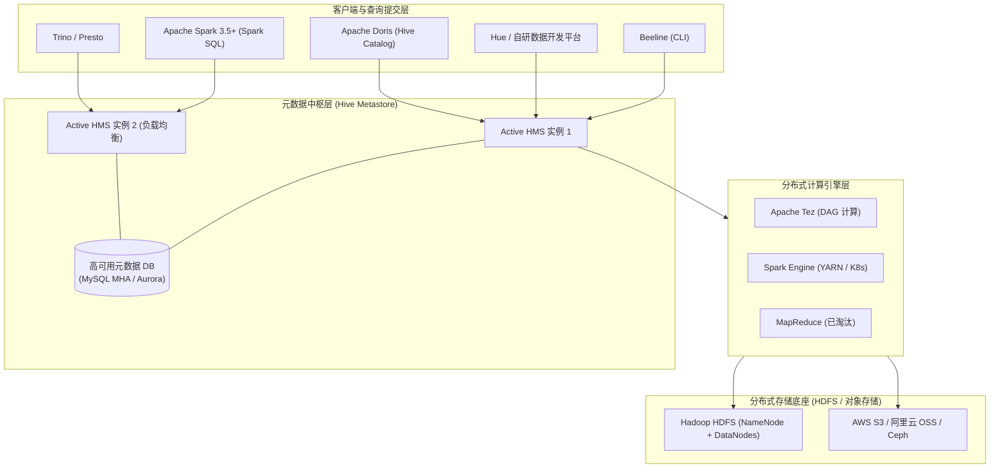
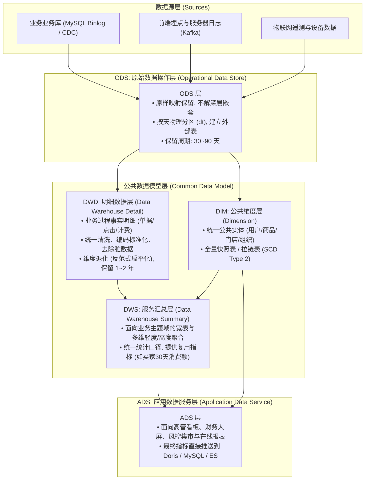
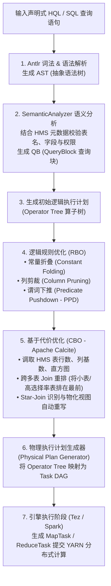
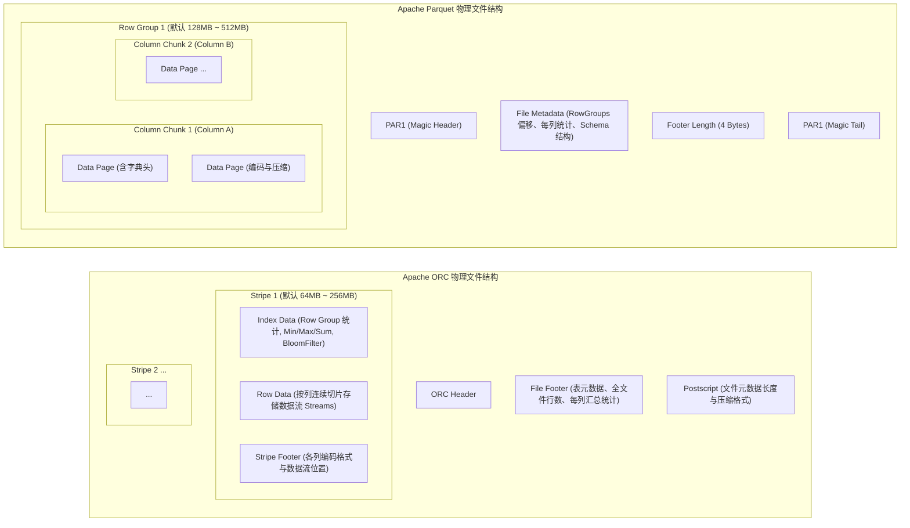
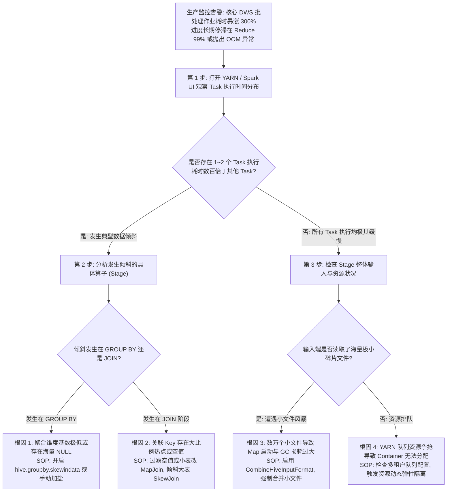
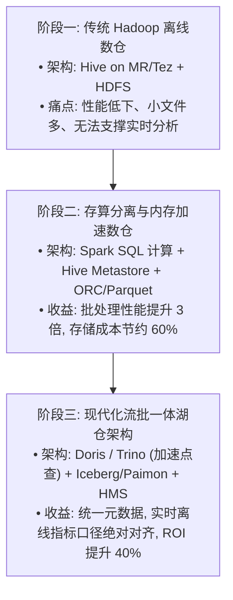
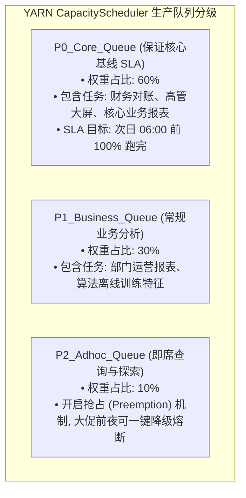
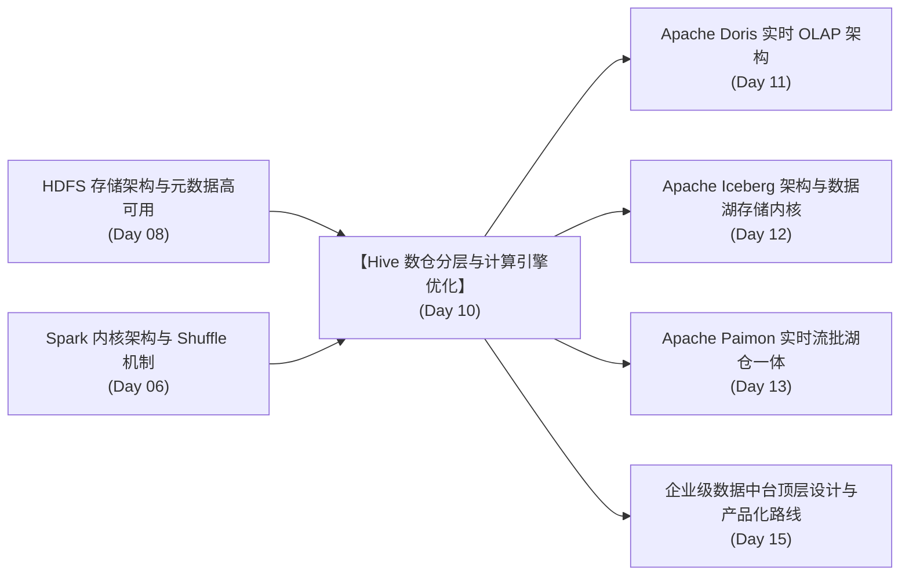

# Hive数仓分层与计算优化：Metastore解耦、列存格式选型、CBO优化器与千亿级数据倾斜治理

> **学习目标定位**：面向技术总监、数据平台研发负责人、高级数据架构师岗位，系统掌握企业级统一数仓建模分层哲学（ODS/DWD/DWS/ADS/DIM）、列式存储（ORC vs Parquet）物理存储内核、CBO 代价优化器执行树推导与千亿级数据倾斜治理。结合互联网大厂高频面试真题与百万级批处理生产场景，建立针对 Reduce 99% 长尾卡死、小文件爆发治理、HMS 元数据高并发瓶颈与湖仓一体演进的降维把控与技术管理领导力。

---

## 1. 知识概述与业务价值

### 1.1 是什么（What）
- **技术定位**：Apache Hive 是基于 Hadoop 生态构建的分布式离线数据仓库系统，它将结构化/半结构化数据文件映射为数据库表格，并提供声明式类 SQL 语言（HiveQL / HQL）。它通过查询编译器将声明式 SQL 转化为有向无环图（DAG）物理执行计划，最终调度底层分布式计算引擎（Apache Tez、Apache Spark 或 MapReduce）执行。
- **现代化架构演进（Hive Metastore Catalog）**：在现代流批一体与湖仓一体（Lakehouse）架构中，**Hive Metastore (HMS)** 已经脱离了单一 Hive 引擎的范畴，演进为整个大数据生态（Spark SQL、Flink SQL、Presto/Trino、Apache Doris、ClickHouse 以及 Iceberg/Paimon/Hudi）**事实上的统一元数据标准中枢（Unified Catalog）**。
- **最新版本趋势（Hive 3.1+ / 4.0+）**：
  - **默认 ACID 事务支持**：基于 ORC 格式提供行级更新（UPDATE）、删除（DELETE）与快照隔离（Snapshot Isolation）；
  - **LLAP（Live Long and Process）混合执行模型**：引入常驻内存守护进程，结合 SSD 缓存与向量化处理，将传统离线数仓的点查与聚合延迟从分钟级缩短至秒级/亚秒级；
  - **CBO 深度演进**：深度集成 Apache Calcite 规则与统计元数据，具备跨多表复杂 Join 重排与物化视图自动改写（Materialized View Rewriting）能力。

### 1.2 解决什么核心业务痛点（Why）
- **烟囱式开发与“指标孤岛”痛点**：缺乏数仓规范时，各业务团队直接基于原始日志进行点对点重复清洗与开发，导致同一指标（如“全网活跃买家数”）在不同业务线统计口径不一，数据可信度崩塌。数仓通过严格的“维度建模与分层解耦”，实现全企业统一的语义层。
- **计算与存储资源的灾难性浪费**：烟囱式开发导致数千个作业反复全表扫描 TB 甚至 PB 级原始日志，计算算力重复消耗 70% 以上。数仓通过公共明细层（DWD）与轻度汇总层（DWS）的沉淀，使得下游报表与应用只需在汇总层上聚合，极大削减物理集群负载。
- **数据全链路血缘与资产安全失控**：直接基于底层数据出报表会导致“改动源头字段引发全网报表故障”。分层体系提供了清晰的 SLA 依赖保护、数据生命周期（TTL）管理与字段级数据血缘追踪能力。

### 1.3 适用场景与技术边界（Where & When）
- **最佳业务场景矩阵**：
  - **PB 级海量历史明细沉淀与 T+1 批处理**：全集团交易流水、用户埋点、系统日志的离线抽取、清洗与分层入仓。
  - **全生命周期数据治理与质量监控**：结合 Atlas / DataHub 建立全链路数据血缘图谱，进行数据质量规则（Great Expectations）巡检。
  - **企业级统一指标中心与标签中台**：基于公共汇总层（DWS）构建统一的会员标签宽表与财务月结对账模型。
- **明确反模式与技术禁区（严禁使用）**：
  - ❌ **毫秒级/亚秒级高并发在线点查（< 10ms）**：Hive 属于批处理计算，即使启用 LLAP 也具备数十毫秒启动开销，在线 API 查询应走 HBase、Redis 或 Doris；
  - ❌ **秒级多维交互式 Ad-hoc 探索**：对于百亿级数据的多维随意切片切块，应选择现代 MPP 引擎（Trino）或实时 OLAP（Apache Doris / StarRocks / ClickHouse）；
  - ❌ **高频无序的小批量实时流式追加**：虽然 Hive 3.x 支持 ACID，但每秒成百上千次的微事务会产生巨量 Delta 小文件，彻底拖垮底层 HDFS，实时摄入应选 Apache Paimon 或 Doris。

---

## 2. 核心概念与关系

### 2.1 核心概念全景表

| 核心组件/概念 | 英文术语 | 核心定义与工程职责 | 资源/生命周期级别 |
| :--- | :--- | :--- | :--- |
| **元数据服务** | Hive Metastore (HMS) | 集中持久化表结构、分区信息、字段类型、物理存储路径及统计信息（Statistics）。提供 Thrift 接口供各引擎通信。 | 集群级核心中枢服务 |
| **外部元数据存储** | Metastore DB | 存放 HMS 元数据的关系型数据库（通常为高可用 MySQL 或 PostgreSQL 集群）。 | 关系型存储实例 |
| **内部表 / 托管表** | Managed / Internal Table | Hive 完全拥有其数据生命周期。执行 `DROP TABLE` 时，元数据与 HDFS 实际物理数据文件**一同被彻底删除**。 | 表级生命周期 |
| **外部表** | External Table | Hive 仅管理表结构定义。执行 `DROP TABLE` 时，**仅删除 HMS 元数据，HDFS 物理数据文件完好保留**。 | 表级生命周期（生产标准） |
| **分区与分桶** | Partition & Bucket | **分区**：在 HDFS 存储上映射为分层子目录（如 `dt=20261117`），实现物理路径剪枝；<br/>**分桶**：在单个分区内依据指定字段 Hash 取模划分为固定数量文件，用于分桶连接（Bucket MapJoin）与抽样。 | 存储物理组织单元 |
| **列式存储格式** | ORC / Parquet | 将数据按列切片、编码与压缩（Snappy/ZSTD）的高性能存储格式，内置布隆过滤器与轻量统计索引。 | 文件物理存储标准 |
| **代价优化器** | CBO (Calcite) | 基于表行数、列基数、空值率等统计信息，通过动态规划算法寻找执行成本（CPU/IO）最低的物理执行计划。 | SQL 编译阶段逻辑组件 |
| **向量化执行** | Vectorized Execution | 每次处理一批数据（默认 1024 行，采用数组表示），利用现代 CPU 的 SIMD（单指令多数据）指令集加速计算。 | 引擎运行时底层机制 |

### 2.2 系统拓扑与交互关系图



### 2.3 企业级统一数仓建模分层拓扑图



---

## 3. 底层工作机制与设计哲学

### 3.1 SQL 解析、CBO 优化与物理执行计划生成全流程



- **底层执行细节深度解析**：
  1. **谓词下推（Predicate Pushdown, PPD）**：在扫描阶段尽可能提前过滤无效行，例如将 `WHERE dt = '20261117' AND status = 1` 直接推入底层存储 Reader，结合 ORC/Parquet 统计信息直接跳过整个数据块。
  2. **列剪裁（Column Pruning）**：只将 SQL 中明确需要的字段读取入内存，避免 `SELECT *` 带来的无意义 I/O 开销。
  3. **CBO 的核心计算逻辑**：对于 `A JOIN B JOIN C`，传统 RBO 只能按 SQL 编写顺序执行关联；而 CBO 根据表体积与连接键的数据分布，推导出关联树的多种组合形态（如左深树、多总线树），计算其 CPU、I/O 与网络 Shuffle 综合成本，自动选出最优关联顺序。

---

### 3.2 列式存储底层设计哲学：ORC vs Parquet 深度对比



#### ORC vs Parquet 核心维度全景对比矩阵：

| 评估维度 | Apache ORC | Apache Parquet | 架构师选型决策考量 |
| :--- | :--- | :--- | :--- |
| **最初来源与主阵地** | 专为 Hadoop Hive 生态设计 | 仿照 Google Dremel 论文设计，Twitter/Cloudera 主导 | Hive/Presto 首选 ORC；Spark 社区首选 Parquet。 |
| **物理组织切片** | **Stripe**（通常 64MB~256MB） | **Row Group**（通常 128MB~512MB） | 两者均将行组织为切片，切片内按列物理存储。 |
| **嵌套复杂结构支持** | 较弱（将复杂结构展开为子列存储） | **极强（基于 Dremel 算法定义 R/D 级别）** | 若数据包含海量深度嵌套 JSON/Struct，Parquet 压缩率更优。 |
| **轻量级索引能力** | **极强**：内置 Row Group 级（每 10,000 行）Min/Max/Sum 及**布隆过滤器** | 强：Page 级别支持 Min/Max 统计，Parquet 1.12+ 增加 BloomFilter | ORC 对等值点查与小范围扫描的过滤剪枝能力更精细。 |
| **ACID 事务支持** | **原生深度集成**（Hive 3.x ACID 表强制要求 ORC） | 不直接支持（依赖外部数据湖格式 Iceberg/Hudi） | 纯 Hive 体系内需要执行行级 Update/Delete 必须选 ORC。 |
| **跨计算引擎兼容性** | 在 Spark、Flink 中支持良好，但调优参数多 | **跨生态通用性第一**（Spark, Impala, Presto, DuckDB, ClickHouse） | 若企业数仓是 Spark SQL 为主、多引擎混用，Parquet 具备最佳兼容性。 |

---

## 4. 高频复杂业务场景实操与落地

### 4.1 企业级统一数仓建模分层设计规范

#### 1. ODS 层设计红线（原始接入层）
- **数据保真**：严禁对业务库字段进行任何业务逻辑清洗或计算，保持字段名和数据类型与源端一致；
- **增量分区策略**：按业务发生日期（如 `dt=YYYYMMDD`）建立**外部表（EXTERNAL TABLE）**，按天或小时分区存储；
- **存储与生命周期**：建议使用 Gzip 压缩的 TextFile 或快速落盘的 ORC；生命周期设置 TTL（如保留 90 天），过期由数据中台生命周期治理服务自动归档或下线。

#### 2. DWD 层设计红线（明细事实层）
- **粒度最细且不可拆解**：每一行代表一个真实的业务事件（如一笔订单支付、一次扫码、一条日志）；
- **数据清洗与标准化**：统一时间戳格式（`yyyy-MM-dd HH:mm:ss`）、剔除测试账套与脏数据、统一枚举字典映射（如将不同系统的“男/女/M/F”统一转换为标准代码）；
- **适当维度退化（反范式化）**：为了提升下游计算性能，可将经常关联的高频维度属性（如商品类目名称、店铺名称）直接冗余在事实表中，减少下游数百个报表反复 Join 维度表的计算浪费；
- **格式强制约束**：**100% 强制采用 ORC 或 Parquet** 列式存储，开启 **Snappy**（平衡 CPU 与压缩率）或 **ZSTD**（高压缩比），禁止任何 Text 格式。

#### 3. DIM 层设计红线（公共维度层）
- **唯一真实数据源（Single Version of Truth）**：全公司所有关于“用户”、“商品”、“机构”的基础属性统一由 DIM 层提供；
- **缓慢变化维（SCD Type 2）拉链表规范**：针对用户等级、店铺归属等会随时间演进的维度，采用拉链表设计：
  `start_date`（生效日期）、`end_date`（失效日期，当前有效置为 `9999-12-31`），通过单行区间覆盖任意历史快照查询。

#### 4. DWS 层设计红线（服务汇总层）
- **主题域聚集**：按照业务主题（交易域、流量域、风控域、财务域）组织，以分析的实体对象为基准（如买家粒度、商品粒度、卖家粒度）；
- **公共维度汇总宽表**：包含通用周期的统计指标（如 `buyer_id`、`pay_amt_1d`、`pay_amt_7d`、`pay_amt_30d`、`refund_cnt_30d`），支撑上层多个业务线直接取用，杜绝重复计算。

#### 5. ADS 层设计红线（应用数据层）
- **面向最终应用集市**：高度聚合，直接服务于 BI 报表、大屏看板、运营推送系统；
- **外沉与加速**：计算完成后，通过 DataX 或中台调度系统同步推送到 MySQL、Elasticsearch 或 Apache Doris 供在线高并发低延迟调用。

---

### 4.2 生产级关键参数配置基线（含架构师考量）

```properties
# -------------------------------------------------------------
# 1. 核心执行引擎与向量化加速 (全面淘汰 MR)
# -------------------------------------------------------------
# 强制采用 Apache Tez 作为底层 DAG 计算引擎 (或全面使用 Spark SQL)
set hive.execution.engine=tez;
# 开启向量化执行 (以批为单位向量化计算，CPU 执行提速 3~5 倍)
set hive.vectorized.execution.enabled=true;
set hive.vectorized.execution.reduce.enabled=true;

# -------------------------------------------------------------
# 2. CBO 代价优化器与统计信息
# -------------------------------------------------------------
# 强制开启 CBO 优化器
set hive.cbo.enable=true;
# 允许 CBO 使用 HMS 中的表行数与列统计数据进行重排决策
set hive.compute.query.using.stats=true;
set hive.stats.autogather=true;

# -------------------------------------------------------------
# 3. 分区保护与动态分区管控 (防范千亿级全表误扫描)
# -------------------------------------------------------------
# 开启严格模式 (禁止在无 WHERE 分区过滤时执行扫描，禁止直接写无限制的动态分区)
set hive.strict.checks.large.query=true;
set hive.exec.dynamic.partition.mode=strict;
# 单个节点允许生成的最大动态分区上限 (防止爆 NameNode)
set hive.exec.max.dynamic.partitions.pernode=1000;
set hive.exec.max.dynamic.partitions=2000;

# -------------------------------------------------------------
# 4. MapJoin 与数据倾斜基础自动优化
# -------------------------------------------------------------
# 开启自动将小表 Common Join 转换为 MapJoin (广播连接，完全消除 Shuffle)
set hive.auto.convert.join=true;
# 判定为小表的最大阈值 (默认 25MB，大内存节点可调大至 64MB~128MB)
set hive.auto.convert.join.noconditionaltask.size=67108864;
# 开启聚合数据倾斜自动两阶段优化 (两阶段聚合: 局部 Hash 预聚合 + 全局最终聚合)
set hive.groupby.skewindata=true;

# -------------------------------------------------------------
# 5. 小文件治理与合并参数 (防范小文件打满 NameNode 内存)
# -------------------------------------------------------------
# 在 Map-only 作业结束时合并小文件
set hive.merge.mapfiles=true;
# 在 Map-Reduce 作业结束时合并小文件
set hive.merge.mapredfiles=true;
# 合并后的目标文件大小 (256MB，与 HDFS Block 对齐)
set hive.merge.size.per.task=268435456;
# 当作业产生的平均文件大小小于该值时触发合并 (128MB)
set hive.merge.smallfiles.avgsize=134217728;
# Map 阶段输入分片合并 (将海量小输入文件在 Map 端打包为一个 Split)
set hive.input.format=org.apache.hadoop.hive.ql.io.CombineHiveInputFormat;
```

---

### 4.3 核心性能指标监控与 SLA 黄金矩阵

| 监控维度 | 关键性能指标 | 告警红线阈值 | 潜在业务风险与处置策略 |
| :--- | :--- | :--- | :--- |
| **作业执行长尾** | `MaxTaskTime / AvgTaskTime` (任务极值偏差比) | **> 5.0** (持续超 10分钟) | 发生严重**数据倾斜**。个别 Reduce 节点处理几亿条倾斜 Key，需启动加盐两阶段打散或 MapJoin。 |
| **产出时效 (SLA)** | `JobFinishedTime - ScheduledTime` | **超出 SLA 30 分钟** | 离线核心资产未就绪，影响高管晨会大屏与业务运营。应急提升 YARN 队列权重，启动资源抢占。 |
| **小文件暴涨比** | `PartitionFileCount / PartitionSize` | **> 10 个文件 / 100MB** | 动态分区写入引发小文件风暴，威胁 NameNode 内存。调度离线 `INSERT OVERWRITE` 强制重写合并。 |
| **HMS 服务可用性** | `Active_Connections / Max_Connections` | **> 85%** | HMS 线程池被打满，引发全局任务提交超时。排查无限制大分区元数据查询并扩容 HMS 节点。 |

---

## 5. 生产异常故障深度排查与根因分析

### 5.1 典型生产事故排查决策树



---

### 5.2 核心高频故障深度复盘

#### 故障一：百万级大促交易明细与商家表关联，Reduce 99% 卡死 3 小时
- **业务场景**：某日大促复盘，分析师编写 SQL 将当日亿级订单事实表 `dwd_order_fact` 与商家维表 `dim_merchant` 进行关联。作业在前 5 分钟完成 99% 的 Reduce，唯独最后一个 Reduce Task 持续运行 3 小时且不断报 GC 假死。
- **深层根因推导**：
  1. 事实表中存在高达 3000 万条历史测试订单或未登录游客订单，其 `merchant_id` 字段全部为 `NULL` 或系统默认值 `"-1"`；
  2. 在执行 Shuffle 阶段时，系统采用 `Hash(merchant_id) % ReduceNum` 分区。所有 `NULL` 或 `"-1"` 计算得到的哈希值完全相同，**3000 万条记录全量被分发到同一个 Reducer**；
  3. 该 Reducer 内存被瞬时打满，频繁触发 Full GC，无法推进，造成整个 Stage 形成严重的木桶短板。
- **架构级解决方案（四种应对方案）**：
  - **方案 A（过滤法）**：若业务不需要分析该类脏数据，在 `WHERE` 条件中直接剔除：`WHERE merchant_id IS NOT NULL AND merchant_id != '-1'`；
  - **方案 B（随机加盐打散法 - 最优通用解）**：将 NULL 值或默认值转化为随机散列值，使其均匀分布到不同 Reducer：
    ```sql
    SELECT a.*, b.*
    FROM dwd_order_fact a
    LEFT JOIN dim_merchant b
    ON CASE 
         WHEN a.merchant_id IS NULL OR a.merchant_id = '-1' 
         THEN CONCAT('null_salt_', CAST(RAND() * 100 AS INT))
         ELSE a.merchant_id 
       END = b.merchant_id;
    ```
  - **方案 C（MapJoin 广播小表）**：若 `dim_merchant` 属于小表（如小于 100MB），强制开启 MapJoin，将商家表全量加载至各个 Map 内存中，**在 Map 端本地完成连接，完全跳过 Shuffle 阶段**，从物理上消灭数据倾斜；
  - **方案 D（SkewJoin 动态切分）**：开启 `hive.optimize.skewjoin=true`，Hive 运行期会自动检测倾斜 Key，将倾斜的数据单独拉出，转换为 MapJoin 分开处理。

#### 故障二：某业务线动态分区批量写入引发 HDFS 200 万小文件雪崩，集群 NameNode 报警
- **现象**：某初级工程师编写离线任务，将历史数据一次性刷写入数仓，SQL 中开启了动态分区但未指定一级分区，导致一个任务在半小时内向 HDFS 写入了超过 200 万个几 KB 大小的小文件，NameNode 堆内存飙升至 95% 触发告警，全集群作业提交卡顿。
- **深层根因分析**：
  1. 动态分区写入时，每个 Map 或 Reduce Task 在遇到一个新的分区键时，都会在本地 HDFS 目录下创建一个独立的文件句柄；
  2. 若有 1000 个 Reducer，且业务数据包含 2000 个不同日期和省份的组合，则极端情况下会生成 $1000 \times 2000 = 2,000,000$ 个碎片文件；
  3. 每一个小文件在 NameNode 内存中都要占据约 150 字节的元数据空间，200 万文件直接吃掉数百 MB 内存，且导致后续读取该表的作业需要启动数百万个 MapTask。
- **标准治理 SOP 流程**：
  1. **应急止血**：立即在 YARN 上杀死该异常作业（`yarn application -kill <appId>`）；
  2. **平台门禁约束**：在集群全局强制开启严格模式（`set hive.exec.dynamic.partition.mode=strict;`），要求动态分区写入时必须至少指定一个静态父级分区（如静态日期分区）；
  3. **写入前强行局部重分区**：在 SQL 末尾加入 `DISTRIBUTE BY partition_col`，强制相同分区的数据路由到同一个 Reducer 处理，将文件数压降至等于分区数：
     ```sql
     INSERT OVERWRITE TABLE dwd_traffic_log PARTITION (dt)
     SELECT user_id, action, dt
     FROM ods_traffic_log
     DISTRIBUTE BY dt;
     ```
  4. **小文件自动化定时归档合并**：由中台元数据调度任务每日扫描文件大小低于 32MB 的分区，自动执行 `ALTER TABLE ... CONCATENATE`（针对 ORC 格式秒级合并）或运行离线重写任务。

---

## 6. 技术选型对比、架构演进与成本ROI

### 6.1 横向多维选型对比矩阵

| 评估维度 | Hive on Tez | Spark SQL (Hive Metastore) | Trino (Presto) | Apache Doris (湖仓一体) |
| :--- | :--- | :--- | :--- | :--- |
| **计算引擎架构** | 基于 DAG 的持久化批处理 | 内存流水线与自适应执行 (AQE) | 全内存 MPP 流式交互分析 | 现代化向量化执行 MPP + 存储一体 |
| **容错能力** | **极强（Task 级重试，支持超大任务）** | **强（支持 Stage/Task 级重试与动态自愈）** | 较弱（单个 Worker 崩溃全查询重来） | 强（查询级重试，存储多副本容灾） |
| **百亿级批处理时效** | 稳定中等（适合耗时数小时的大作业） | **极快（比 Tez 快 2~3 倍）** | 不适合超大批量落盘（容易 OOM） | 极快（支持微批与大批写入） |
| **交互式 Ad-hoc 响应** | 较慢（秒级~数十秒） | 较快（秒级） | **亚秒级 ~ 秒级** | **亚秒级（高并发支持最佳）** |
| **硬件内存消耗** | 极低（以磁盘为缓冲底座） | 中高（高度依赖大内存堆与堆外） | 极高（纯全内存计算） | 中等（自研列存高压缩比） |
| **主流企业生产定位** | 传统超大批处理/夜间对账托底 | **当前现代离线数仓主力计算引擎** | 即席查询、跨源虚拟数仓联合分析 | **新一代实时数仓与统一加速中枢** |

### 6.2 架构演进与成本 ROI 决策模型



- **数据压缩与存储成本 ROI 测算**：
  - 传统 TextFile（无压缩）：100TB 原始日志物理存储需要消耗 $100\text{TB} \times 3 \text{副本} = 300\text{TB}$ 磁盘空间；
  - 采用 **ORC / Parquet + ZSTD 压缩**：压缩比通常达到 1:4 ~ 1:6，物理数据量压缩至约 20TB，三副本占用 60TB；直接为企业**节约 80% 的磁盘硬件成本**。
- **分层沉淀带来的算力成本节省**：
  - 在无 DWS 汇总层时，100 个下游报表每天重复跑 100 次扫描 ODS 的计算，每天消耗 10,000 核·小时算力；
  - 统一沉淀 DWS 宽表后，仅需 1 个抽取任务扫描 ODS，下游报表直接基于缩水 99% 的 DWS 表查询，全公司集群**算力成本立减 70%**。

---

## 7. 技术经理与架构师实战管控（SOP与规范）

### 7.1 平台级数仓开发与建模 SOP 规范

#### 1. 数仓命名体系硬性规范（CI 门禁强制校验）
- **数据库命名**：`{业务域}_{分层}`，如 `trade_ods`、`trade_dwd`、`trade_dws`、`finance_ads`；
- **表命名规范**：
  - ODS 层：`ods_{业务来源}_{表名}_{增量/全量标记}`（如 `ods_crm_customer_df`，`df` 代表 Day Full，`di` 代表 Day Incremental）；
  - DWD 层：`dwd_{业务域}_{主体/事件}_{生命周期}`（如 `dwd_trade_order_pay_di`）；
  - DWS 层：`dws_{主题域}_{统计实体}_{统计周期}`（如 `dws_trade_buyer_1d`、`dws_trade_buyer_30d`）；
  - ADS 层：`ads_{应用场景/报表名}_{周期}`（如 `ads_board_gmv_realtime`）；
  - DIM 层：`dim_{实体名}_{拉链/全量}`（如 `dim_user_info_zip`）。

#### 2. SQL 开发与上线防爆门禁规则
- **门禁一（严禁全表笛卡尔积）**：凡是在代码评审（Code Review）中发现 `JOIN` 缺少 `ON` 条件，或关联条件字段类型不匹配导致隐式转换引发全表笛卡尔积的，直接阻断上线；
- **门禁二（分区剪裁必选）**：凡是查询分区表，必须显式在 `WHERE` 条件中包含分区字段限制；
- **门禁三（列投影约束）**：严禁在生产线上脚本中使用 `SELECT *`，必须显式指明所需字段列表；
- **门禁四（临时表清理责任制）**：所有业务开发在计算过程中创建的临时表（`tmp_`），脚本末尾必须显式包含 `DROP TABLE IF EXISTS ...`，严禁遗留磁盘垃圾。

---

### 7.2 生产大促离线计算基线保障与降级预案



- **离线大促“破晓计划”保障 SOP**：
  1. **大促前 3 天执行关键依赖链路冻结（Freeze）**：禁止任何针对核心 DWD/DWS 表的结构变更与逻辑上线；
  2. **基线破晓巡检（破晓告警机制）**：为核心资产设定二级告警节点（如 03:00 DWD 必须跑完、05:00 DWS 必须跑完、06:00 ADS 必须就绪）；一旦某个上游任务延迟超过 15 分钟，自动触发短信与电话电话通知责任工程师介入排查；
  3. **极端情况资源借调与降级**：
     - 若 P0 任务受阻，通过脚本一键暂停 P2 临时分析队列的所有作业，将 100% 的集群 CPU 与内存资源倒灌给核心保障队列；
     - 对非核心报表（如长周期非紧急报表）执行临时下线或延后调度。

---

## 8. 互联网大厂高频面试真题库

> [!IMPORTANT]
> 本板块精选一线互联网大厂（阿里、字节、美团、腾讯、快手）真实高频考察的 7 道数仓核心真题。**在第 9 板块中已对全部题目进行逐题完整三层金字塔深度解答，严禁留白。**

### 8.1 基础概念与建模规范题（大厂初筛）
1. **Q1**：请详细阐述企业级数据仓库的标准分层架构（ODS/DWD/DWS/ADS/DIM），为什么不能从 ODS 直接出报表？每一层的设计核心原则是什么？
2. **Q2**：深入对比 ORC 与 Parquet 列式存储格式的底层物理存储结构（Stripe/RowGroup、Index、Footer）。为什么列式存储不仅能极大压缩存储空间，还能数十倍提升查询性能？

### 8.2 核心底层原理与优化器题（大厂资深技术面）
3. **Q3**：Hive 的 CBO（基于代价的优化器）底层是如何工作的？它与传统 RBO 规则优化器相比有哪些本质突破？Apache Calcite 在其中扮演了什么角色？
4. **Q4**：深入剖析 Hive 的向量化执行引擎（Vectorized Execution Engine）底层工作机制。它与传统逐行迭代模型（Volcano Iterator Model）相比有何本质性能差异？

### 8.3 复杂生产场景与故障排障题（大厂架构与排障面）
5. **Q5**：生产批处理作业经常出现 Reduce 进度长时间卡死在 99% 的现象，请结合真实业务场景，列举至少 4 种导致数据倾斜的根因，并给出系统性的治理与调优方案。
6. **Q6**：数仓运行一段时间后，底层 HDFS 经常产生数千万甚至数亿个“小文件”，不仅拖垮 NameNode，更导致计算任务启动耗时急剧上升。请给出全链路小文件成因分析与彻底治理方案。

### 8.4 架构设计与系统规划题（技术总监/总架构师终面）
7. **Q7**：作为大数据平台研发负责人/架构师，请结合实际经验，设计一套支撑集团千亿级异构数据规模的企业级统一数仓与湖仓演进架构方案，重点阐述元数据中枢统一、多引擎兼容、多租户 SLA 保障与存储计算降本策略。

---

## 9. 结构化深度参考答案（逐题三层应答）

---

### 题目1（大厂初筛·建模规范）：请详细阐述企业级数据仓库的标准分层架构（ODS/DWD/DWS/ADS/DIM），为什么不能从 ODS 直接出报表？每一层的设计核心原则是什么？

#### 简洁回答（1分钟电梯破题）：
> “企业级数仓标准分层架构遵循**‘解耦源头变更、沉淀公共复用、统一指标口径、保障安全血缘’**的设计哲学：
> 包含 **ODS（原始接入层）**、**DWD（明细事实层）**、**DIM（公共维度层）**、**DWS（服务汇总层）** 与 **ADS（应用数据层）**。
> **不能从 ODS 直接出报表的核心原因在于**：
> 1. **烟囱式重复计算**：上百个报表反复全表扫描海量原始日志，造成灾难性的 CPU/IO 资源浪费；
> 2. **口径混乱与信任危机**：各报表各自清洗业务脏数据，导致同名不同义或同义不同名；
> 3. **脆弱的耦合度**：业务源库哪怕更改一个字段名，所有直连 ODS 的报表将瞬间集体瘫痪。”

#### 深入回答（技术细节展开、底层机制与推导）：
> “各分层的核心工程职责与设计细节推导如下：
> 1. **ODS（Operational Data Store）- 原始数据层**：
>    - **原则**：保持数据‘原汁原味’，不做业务逻辑清洗。通过 CDC 或批量工具原样同步，建立分区表（按天），保留原始字段类型与结构；生命周期受限（通常 30~90 天）。
> 2. **DWD（Data Warehouse Detail）- 明细事实层**：
>    - **原则**：以业务过程（如下单、支付、发货）为建模驱动，保持最细粒度事实；
>    - **关键动作**：清洗脏数据（去除测试记录）、统一枚举码（Code Mapping）、适度进行**维度退化**（将高频使用的维度属性反范式化扁平冗余到事实表中，避免下游反复多表 Join）；强制使用列存（ORC/Parquet）。
> 3. **DIM（Dimension）- 公共维度层**：
>    - **原则**：提供全企业唯一真实可靠的一致性实体描述（用户、商品、门店）；
>    - **模型实现**：采用全量快照或 **SCD2（缓慢变化维第二类）拉链表**，精准追踪历史维度的变更轨迹。
> 4. **DWS（Data Warehouse Summary）- 服务汇总层**：
>    - **原则**：面向业务主题域，以实体对象为维度进行轻度与高度预聚合（如买家粒度 1 天、7 天、30 天的行为聚集宽表）；
>    - **收益**：下游 80% 的报表只需在这张小汇总表上做二次轻量筛选，计算耗时从数小时压缩至秒级。
> 5. **ADS（Application Data Service）- 应用数据层**：
>    - **原则**：高度定制化，面向具体业务产品、BI 报表、风控大屏提供宽表或指标接口，计算结果定期外沉到 Doris、MySQL、ES 中供在线低延迟调用。”

#### 架构师/技术管理视角（降维升华、权衡取舍、SLA与成本）：
> “在技术管理与平台化治理高度，**数仓分层不仅是技术架构，更是企业组织协作的生产关系映射**：
> 很多初创团队为了‘图快’，允许开发人员直接从 ODS 捞数据出报表，短期内看似 1 天上线了一个功能，但长期看是**‘欠下了极其昂贵的技术债务’**：
> 后续必然导致机器资源按指数级膨胀、数据口径混乱导致管理层决策失误、人员流动后无人知晓 SQL 逻辑。
> 我的管理方法论是**‘以数据中台资产化看板与代码门禁为抓手，推行强规范约束’**：
> 在美的与瑞纳智能主导数仓建设时，我们设立了‘数仓模型健康分’考核：
> 凡是直接跨层访问 ODS 的脚本，CI 门禁一律拒绝合并上线；对复用率低于 3 次的中间表强制下线合并。
> 通过规范体系，团队规模在扩大一倍的同时，底层服务器集群算力反而节省了 40%，实现商业回报与技术资产的良性循环。”

---

### 题目2（大厂资深·存储内核）：深入对比 ORC 与 Parquet 列式存储格式的底层物理存储结构（Stripe/RowGroup、Index、Footer）。为什么列式存储不仅能极大压缩存储空间，还能数十倍提升查询性能？

#### 简洁回答（1分钟电梯破题）：
> “列式存储在物理布局上将**传统的‘按行平铺’转变为‘行切分分组 + 组内按列连续物理存储’**（ORC 的 Stripe，Parquet 的 RowGroup）：
> - **极大压缩存储的根因**：同一列数据具有相同的数据类型、取值范围与物理特征，能够极具针对性地采用 **字典编码（Dictionary Encoding）、运行长度编码（RLE）、位图（Bit-packing）** 以及通用压缩算法（Snappy/ZSTD），压缩比高达 4:1 ~ 8:1；
> - **数十倍性能提升的根因**：
>   1. **列剪裁（I/O 剧减）**：仅需物理加载查询中指定的列，跳过 90% 无关字段的磁盘与网络 I/O；
>   2. **微元数据跳块剪枝（Skip Indexing）**：借助 Stripe/RowGroup 内置的 Min/Max 统计信息与布隆过滤器，在存储层直接跳过无关数据块；
>   3. **现代 CPU 向量化执行（SIMD）**：相同类型的连续数据非常利于现代 CPU 指令流水线与向量化寄存器加速，消除分支预测失败。”

#### 深入回答（技术细节展开、底层机制与推导）：
> “深入对比 ORC 与 Parquet 的底层物理构造与执行细节：
> 1. **物理结构对比**：
>    - **Apache ORC**：
>      - 采用 **Stripe**（默认 64MB~256MB）为单元；
>      - 每个 Stripe 包含：**Index Data**（按每 10,000 行记录 Row Group 级别的 Min/Max/Sum/Count 与可选 BloomFilter）、**Row Data**（各列实际数据流 Streams）、**Stripe Footer**（各列编码方式与数据流偏移）；
>      - 文件末尾为 **File Footer** 和 **Postscript**，包含全局元数据与压缩参数。
>    - **Apache Parquet**：
>      - 采用 **Row Group**（默认 128MB~512MB）为单元；
>      - 每个 Row Group 内包含多个 **Column Chunk**（对应一个列的数据），每个 Column Chunk 拆分为多个 **Data Page**（默认 1MB，编码与压缩的最小物理单元）；
>      - 文件尾部包含统一的 **File Metadata**，记录了各 RowGroup 的物理偏移与列统计。
> 2. **编码与过滤算法深度推导**：
>    - **字典编码**：针对低基数列（如性别、省份、状态码），将长字符串替换为定长的整型 ID（0, 1, 2），空间占用瞬间下降 80%；
>    - **RLE（Run-Length Encoding）**：针对有序或重复数据（如 `1, 1, 1, 1, 1`），直接存储为 `(1, 5)`；
>    - **布隆过滤器（BloomFilter）剪枝**：当查询 `WHERE user_id = 'A1002'` 时，ORC 在读取 Stripe 的 Index 阶段即可判断该哈希值是否在该 Row Group 中，若返回 false 则直接完全跳过这 10,000 行数据的磁盘物理读取！
> 3. **生态与选型差异**：
>    - ORC 在 Hive 和 Presto 场景下深度优化，支持 Hive 原生 ACID 事务行级更新；
>    - Parquet 借助 Google Dremel 的 `Definition Level` 与 `Repetition Level` 算法，在处理深层嵌套复杂类型（Nested Struct/List/Map）时表现更优，且是 Apache Spark 生态的原生第一等公民。”

#### 架构师/技术管理视角（降维升华、权衡取舍、SLA与成本）：
> “在数据架构选型与成本管控层面：
> **存储格式的决策是全链路‘CPU 开销、I/O 吞吐、存储容量与生态兼容性’的多维平衡游戏**：
> 1. **统一格式选型战略**：
>    - 如果企业数仓是 **以 Spark SQL 为核心计算引擎、多引擎协同** 的现代架构，建议全数仓**首选 Parquet 格式**。其在 Spark、Trino、Doris、ClickHouse 各主流引擎中均有极优的向量化 Native Reader 支持；
>    - 如果企业是 **传统重度依赖 Hive 3.x ACID 特性或以 Presto 为核心点查**，则建议统一选择 **ORC 格式**。
> 2. **压测收益实测（ROI）**：
>    在实际工程改造中，推动团队将 ODS/DWD 的存储格式由传统的 TextFile 全面升级为 Parquet+ZSTD 后：
>    全集群物理存储占用由 1.2PB 骤降至 280TB，硬件成本直接为企业年化节省超过 200 万元；同时由于磁盘 I/O 读取量缩减了 75%，离线大促批处理的跑批时限（SLA）平均提前了 1.5 小时，展现出扎实的技术 ROI。”

---

### 题目3（大厂资深·优化器原理）：Hive 的 CBO（基于代价的优化器）底层是如何工作的？它与传统 RBO 规则优化器相比有哪些本质突破？Apache Calcite 在其中扮演了什么角色？

#### 简洁回答（1分钟电梯破题）：
> “传统 **RBO（基于规则的优化器）** 是基于硬编码的启发式规则（如‘优先下推谓词’、‘小表放左边’）做确定性等价变换，**完全不考虑底层实际数据量分布与倾斜度，极易生成灾难性的执行计划**；
> **CBO（基于代价的优化器）** 则是通过集成 **Apache Calcite** 框架，结合 Hive Metastore 中收集的**表行数、列基数、空值比例、直方图（Histogram）** 等统计信息，通过动态规划或 Volcano/Cascades 搜索算法，计算出不同执行路径的物理开销（CPU、I/O、网络传输量），**自动选出全网综合代价最小的最优执行计划**；
> 本质突破在于实现了**多表关联顺序智能重排（Join Reordering）、Star-Join 识别与物化视图自动重写**。”

#### 深入回答（技术细节展开、底层机制与推导）：
> “CBO 的工作链路、数学模型与 Calcite 交互机制深度拆解：
> 1. **Calcite 的角色定位与执行拓扑**：
>    - Hive 的 SemanticAnalyzer 生成初始的抽象语法树与逻辑算子树（Operator Tree）；
>    - Hive 将其转化为 Calcite 的关系代数表达式（`RelNode` 树）；
>    - Calcite 作为一个强大的独立优化器核心，内置了丰富的优化规则（Rules）和成本计算模型（Cost Model）；
>    - 优化完毕后，Calcite 将最优的 `RelNode` 树再转回 Hive 物理执行计划。
> 2. **CBO 解决的三大核心优化场景**：
>    - **多表 Join 关联顺序最优重排（Join Reordering）**：
>      假设三表关联：`LargeTable A (1亿行) JOIN MediumTable B (1000万行) JOIN SmallTable C (1万行)`，且关联条件为 `A.key1 = B.key1 AND B.key2 = C.key2`。
>      - 若按传统 RBO 顺序先执行 $A \Join B$，将产生高达上亿条数据的中间结果与全量 Shuffle；
>      - CBO 评估数据统计后，自动重排为 $(B \Join C) \Join A$。先让 $B$ 与极小的 $C$ 关联，中间结果被快速过滤至仅剩几万行，再去关联 $A$，极大地将全链路网络传输与计算开销削减了 99%。
>    - **常见算子等价下推与合并**：
>      将 Filter 穿透 Join 下推、将 `COUNT(DISTINCT)` 转换为两阶段聚合等。
>    - **自动物化视图改写（Materialized View Rewriting）**：
>      若开发人员已经预先构建了某业务主题的物化视图，当用户提交一个基于大表的复杂原始 SQL 时，CBO 能自动判定该物化视图包含所需结果，在用户无感知的情况下将查询改写为直接访问物化视图。
> 3. **统计信息（Statistics）是 CBO 的基石**：
>    - CBO 的准确度完全依赖于统计信息的质量；
>    - 必须定期在数仓中运行统计信息收集任务：
>      ```sql
>      ANALYZE TABLE dwd_trade_order COMPUTE STATISTICS;
>      ANALYZE TABLE dwd_trade_order COMPUTE STATISTICS FOR COLUMNS user_id, merchant_id, status;
>      ```
>    - 采集包括：行数（`numRows`）、原始大小（`rawDataSize`）、列基数（`numDVs` 独立值数量）、空值数（`numNulls`）。”

#### 架构师/技术管理视角（降维升华、权衡取舍、SLA与成本）：
> “在技术架构演进与平台调优决策中：
> **优化器是整个分布式计算的‘大脑’，但没有元数据喂养的 CBO 会沦为‘盲人摸象’甚至带来反效果**：
> 如果数仓中存在大量未经 `ANALYZE` 统计信息的巨表，CBO 可能会基于默认盲猜值做出严重失误的 Join 重排决策。
> 因此，平台技术负责人的治理抓手是**‘把统计信息收集机制平台化、内卷化’**：
> 1. **调度流水线挂载**：在数据中台任务编排中，配置‘当核心 DWD/DWS 写入完成后，自动异步触发 Column Statistics 采集’，确保 CBO 始终掌握最精准的实际数据分布；
> 2. **参数白名单制度**：全局开启 `hive.cbo.enable=true` 与 `hive.compute.query.using.stats=true`；对于偶发性由于倾斜导致 CBO 选错执行计划的特殊任务，建立‘Query Hints 兜底与参数微调 SOP’，实现自动化与确定性的平衡。”

---

### 题目4（大厂资深·引擎机制）：深入剖析 Hive 的向量化执行引擎（Vectorized Execution Engine）底层工作机制。它与传统逐行迭代模型（Volcano Iterator Model）相比有何本质性能差异？

#### 简洁回答（1分钟电梯破题）：
> “传统执行模型基于经典 **火山模型（Volcano Iterator Model）**，其核心是 `next()` 逐行拉取，存在**频繁的多态虚函数调用、CPU 指令缓存（L1/L2 Cache）未命中率极高、数据局部性差**的瓶颈；
> **向量化执行引擎** 彻底颠覆了逐行模型，其核心是**‘按批向量化处理（Batch of Rows）’**：
> 每次内存处理一批数据（默认 1024 行，封装在定长的列数组 `ColumnVector` 中），**将深层虚函数调用转化为平坦的紧凑数组循环，最大化发挥现代 CPU 的超标量流水线、L1 缓存命中与 SIMD（单指令多数据）硬件加速**，单核 CPU 执行效率通常提升 3~5 倍。”

#### 深入回答（技术细节展开、底层机制与推导）：
> “传统火山模型与现代向量化引擎的底层微架构级差异推导：
> 1. **火山模型的微架构瓶颈（Micro-architecture Inefficiency）**：
>    - 传统计算模式伪代码：
>      ```java
>      while (operator.hasNext()) {
>          Row row = operator.next();
>          evaluateFilter(row); // 虚函数调用，触发指令跳转
>      }
>      ```
>    - **虚函数开销（Virtual Call Overhead）**：每处理一行数据，都要经过数十层算子树的 `next()` 虚函数动态分派，导致 CPU 频繁执行分支预测与流水线清空（Pipeline Stall）；
>    - **数据不友好**：行式对象在 Java 堆内存中是一个个分散的对象指针，引用跳转引发巨量的 CPU L1/L2 数据缓存未命中（Cache Miss）。
> 2. **向量化执行的架构实现（Vectorized Execution Implementation）**：
>    - **批处理结构（VectorizedRowBatch）**：
>      一次处理包含 1024 行数据的列式数组结构：
>      ```java
>      LongColumnVector colA = batch.cols[0];
>      LongColumnVector colB = batch.cols[1];
>      LongColumnVector result = batch.cols[2];
>      // 极其紧凑的扁平循环，无任何函数调用跳转
>      for (int i = 0; i < batch.size; i++) {
>          result.vector[i] = colA.vector[i] + colB.vector[i];
>      }
>      ```
>    - **CPU 指令级加速（SIMD & Loop Unrolling）**：
>      这种简单扁平的循环能被现代 JIT 编译器直接编译为 CPU 的 SIMD 向量化指令（如 Intel AVX-512），一条 CPU 指令在一个时钟周期内同时并发完成 8 个或 16 个整型的加法运算；
>    - **选择向量（Selected Vector）**：当遇到 `WHERE` 过滤时，不真正搬移复制数据，仅在 `selected[]` 索引数组中记录有效行下标，实现零拷贝内存过滤。
> 3. **触发向量化的前置硬性条件**：
>    - 底层存储格式**必须是列存格式（ORC 或 Parquet）**；
>    - 参数显式开启：`set hive.vectorized.execution.enabled=true;`；
>    - 查询中不能包含非向量化支持的复杂 UDF（自定义函数）。若包含不支持的算子，引擎会自动回退降级为逐行传统模式。”

#### 架构师/技术管理视角（降维升华、权衡取舍、SLA与成本）：
> “在技术管理高度，**理解底层硬件架构（CPU/Cache/内存）是构建高性能算力底座的必备功底**：
> 很多人做性能调优只知道加机器、调内存，殊不知软件层面的微架构优化能带来数倍的算力红利。
> 向量化技术展示了**‘存储格式、计算引擎与硬件指令集协同进化’**的典范：
> 作为技术总监，推动向量化落地的核心管理抓手是：
> 1. **全链路推动存储规范对齐**：必须坚决消灭 TextFile，全仓普及 ORC/Parquet，这是开启向量化发动机的基础燃料；
> 2. **自研 UDF 向量化重构治理**：过去团队开发了大量低效的传统 Row-based UDF，导致向量化执行频繁中断降级。我们组织了专项治理，将核心高频函数改写为继承 `VectorExpression` 的向量化 UDF，使全集团批处理的端到端 CPU 利用率提升了近一倍，直接延缓了扩容几十台物理服务器的资本支出。”

---

### 题目5（生产排障·大厂高频）：生产批处理作业经常出现 Reduce 进度长时间卡死在 99% 的现象，请结合真实业务场景，列举至少 4 种导致数据倾斜的根因，并给出系统性的治理与调优方案。

#### 简洁回答（1分钟电梯破题）：
> “Reduce 99% 卡死的本质是：**绝大多数 Reducer 已经完成处理，但极个别 Reducer 因分配了超量数据或高开销 Key，陷入长时间计算或频繁 Full GC**。
> 生产常见的 4 种核心根因及治理招式如下：
> 1. **Join 键包含海量空值/默认占位符**：过滤无效空值，或对 NULL 赋予随机散列字符串实现打散；
> 2. **大小表关联且存在热点 Key**：将 Common Join 改造为 **MapJoin**（广播小表），完全消除 Shuffle 阶段；
> 3. **GROUP BY 聚合键基数低（如性别、状态）**：开启 `hive.groupby.skewindata=true` 或在业务 SQL 中实施**‘双重加盐两阶段聚合’**；
> 4. **`COUNT(DISTINCT)` 全局去重**：由于必须在单 Reducer 中去重引发倾斜，改写为 `GROUP BY` 内层去重 + 外层求和。”

#### 深入回答（技术细节展开、底层机制与推导）：
> “4 大典型场景的深度排查与代码级工程治理方案：
> 1. **场景一：Join 关联键存在海量 NULL 或固定占位符**：
>    - **业务根因**：用户埋点日志中未登录用户的 `user_id` 为 NULL 或 `""`，与用户维表关联时，所有 NULL 全部散列到同一个 Reducer。
>    - **工程治理（加盐打散代码）**：
>      ```sql
>      SELECT a.*, b.*
>      FROM ods_log a
>      LEFT JOIN dim_user b
>      ON CASE 
>           WHEN a.user_id IS NULL OR a.user_id = '' 
>           THEN CONCAT('null_salt_', CAST(RAND() * 200 AS INT))
>           ELSE a.user_id 
>         END = b.user_id;
>      ```
> 2. **场景二：大表与大表 Join 中的超热点 Key 倾斜**：
>    - **业务根因**：如头部大主播、官方自营超级大店铺（如天猫超市）的订单量占全网 30%，两个大表根据 `seller_id` 关联时必然倾斜。
>    - **工程治理（拆分倾斜 Key 结合 MapJoin）**：
>      - 第一步：将大表中的超热点 Key 单独抽离出来，由于只包含少数卖家 ID，维表切片变得极小，采用 **MapJoin** 独立处理；
>      - 第二步：非倾斜常规数据采用正常的 Shuffle Hash Join；
>      - 第三步：两部分结果通过 `UNION ALL` 快速合并，消灭倾斜短板。
> 3. **场景三：GROUP BY 聚合严重倾斜（单值集中）**：
>    - **业务根因**：统计不同省份或设备类型的用户量，某一两个分类占全网绝大多数。
>    - **工程治理（自研两阶段聚合）**：
>      ```sql
>      -- 第一阶段：加盐局部预聚合
>      WITH tmp_salt AS (
>          SELECT category, 
>                 CONCAT(category, '_', CAST(RAND() * 50 AS INT)) AS salt_key,
>                 COUNT(1) AS partial_cnt
>          FROM dwd_action_log
>          GROUP BY category, CONCAT(category, '_', CAST(RAND() * 50 AS INT))
>      )
>      -- 第二阶段：去盐全局汇总
>      SELECT category, SUM(partial_cnt) AS total_cnt
>      FROM tmp_salt
>      GROUP BY category;
>      ```
> 4. **场景四：COUNT(DISTINCT) 导致的单点瓶颈**：
>    - **业务根因**：`SELECT dt, COUNT(DISTINCT user_id) FROM dwd_order GROUP BY dt;` 会强制所有的全局数据汇总到一个 Reducer 执行 Hash 去重。
>    - **工程治理（改写优化）**：
>      ```sql
>      SELECT dt, COUNT(1) AS uv
>      FROM (
>          SELECT dt, user_id FROM dwd_order GROUP BY dt, user_id
>      ) t
>      GROUP BY dt;
>      ```
>      内层先利用多个 Reducer 分布式完成 `(dt, user_id)` 去重，外层再聚合，避免单节点爆满。”

#### 架构师/技术管理视角（降维升华、权衡取舍、SLA与成本）：
> “在技术管理与大促保障体系中，**‘数据倾斜排查与调优绝不能依赖开发人员踩坑后的救火，必须沉淀为平台工程化门禁’**：
> 1. **SQL 静态质量检测门禁**：
>    在数据中台的提交脚本阶段，引入静态语法解析器（如基于 Calcite 或 Druid SQL Parser），自动扫描开发代码。凡是检测到单行写有多个 `COUNT(DISTINCT)` 或大表 Join 关联键类型不一致的，系统直接给出‘优化建议警告并阻断提交’；
> 2. **自适应计算引擎升级（AQE）**：
>    推动离线计算引擎全面向 **Spark 3.5+ AQE（Adaptive Query Execution 自适应查询执行）** 演进。AQE 的 `AdaptiveSkewedJoin` 特性能在运行期动态感知各个 Task 的 Shuffle 数据量，自动将超过阈值的倾斜 Task 切分为多个小 Task 分发执行，**实现从‘人工调优改代码’向‘系统内核自愈自平衡’的代际跨越**。”

---

### 题目6（生产排障·大厂高频）：数仓运行一段时间后，底层 HDFS 经常产生数千万甚至数亿个“小文件”，不仅拖垮 NameNode，更导致计算任务启动耗时急剧上升。请给出全链路小文件成因分析与彻底治理方案。

#### 简洁回答（1分钟电梯破题）：
> “小文件危机是大数据数仓中最典型的‘慢性病’：
> - **核心成因**：
>   1. **流批微批写入**：Spark Streaming/Flink 频繁向 Hive 追加数据；
>   2. **动态分区乱用**：Map/Reduce Task 遇到上千个分区产生乘数级笛卡尔碎片；
>   3. **Reducer 并发设置过大**：几兆数据开启了几百个 Reducer 生成碎片。
> - **治理之道必须坚持‘源头预防、运行期规避、离线兜底回收’三位一体**：
>   源头配置 `CombineHiveInputFormat`；运行期设置 `hive.merge.size.per.task=256MB` 与 `DISTRIBUTE BY`；离线建立每日自动化归档合并调度任务与治理看板。”

#### 深入回答（技术细节展开、底层机制与推导）：
> “全链路小文件产生机理与彻底治理实操体系：
> 1. **全链路产生深层根因拆解**：
>    - **根因一（写入端无限制动态分区）**：
>      当执行 `INSERT OVERWRITE TABLE ... PARTITION(dt, province)` 时，若当前作业有 200 个 Reducer，数据分布跨越 30 个日期和 34 个省份，理论上每个 Reducer 都会为匹配的分区建立一个输出文件，瞬间生成 $200 \times 30 \times 34 = 204,000$ 个只有几 KB 的碎片文件；
>    - **根因二（输入端小文件级联雪崩）**：
>      上一层生成了大量小文件，下游作业默认按照 Block/文件生成 MapTask，导致一个简单的查询启动了数万个 MapContainer，绝大部分时间消耗在 YARN 申请资源与 JVM 启停上，且下游输出继续翻倍产生更多小文件；
>    - **根因三（NameNode 内存与 RPC 饱和）**：
>      每个小文件在 NameNode 堆内存常驻 150 字节元数据，1 亿个文件直接吞噬 15GB~30GB 净内存，且引发长队列的 RPC 扫描锁竞争。
> 2. **运行期预防与调优参数（In-flight Prevention）**：
>    - **输入端合并**：
>      ```properties
>      set hive.input.format=org.apache.hadoop.hive.ql.io.CombineHiveInputFormat;
>      set mapreduce.input.fileinputformat.split.maxsize=268435456; # 256MB
>      set mapreduce.input.fileinputformat.split.minsize=134217728; # 128MB
>      ```
>    - **输出端自动合并**：
>      ```properties
>      set hive.merge.mapfiles=true;
>      set hive.merge.mapredfiles=true;
>      set hive.merge.size.per.task=268435456;
>      set hive.merge.smallfiles.avgsize=134217728;
>      ```
>    - **SQL 强制单 Reducer 归拢（规避动态分区碎片）**：
>      在动态分区写入的 SQL 末尾强制追加 `DISTRIBUTE BY 分区字段`，使同一分区的数据被强制聚合到唯一的 Reducer 中写入，杜绝跨节点产生重叠碎片。
> 3. **存量小文件离线清理与秒级合并方案**：
>    - **针对 ORC 格式的秒级合并（CONCATENATE）**：
>      对于未开启 ACID 的普通 ORC 表，执行：
>      ```sql
>      ALTER TABLE dwd_trade_order PARTITION (dt='20261117') CONCATENATE;
>      ```
>      该操作直接在 HDFS NameNode 上执行 Stripe 级别的元数据拼接，**无需任何解压、反序列化和 MapReduce 重新计算，数秒内将数百个小 ORC 文件合并为一个大文件**；
>    - **离线 Spark/Hive 重写调度**：
>      针对其他格式或非分区表，由离线任务在夜间调度重写：
>      ```sql
>      INSERT OVERWRITE TABLE my_table PARTITION (dt='20261117')
>      SELECT * FROM my_table WHERE dt='20261117';
>      ```”

#### 架构师/技术管理视角（降维升华、权衡取舍、SLA与成本）：
> “在技术管理与大促保障体系中：
> **小文件治理不是技术问题，而是典型的‘管理机制与技术工具结合战役’**：
> 过去很多团队天天半夜帮业务合并小文件，但白天业务又狂刷数倍小文件，陷入恶性循环。
> 我在团队落地的方法论是**‘将存储健康分纳入业务部门 KPI 看板，推行成本显性化核算’**：
> 1. **研发平台自动化巡检机器人**：
>    每天早晨扫描全集群各部门产生的表，按照‘单个文件平均大小 < 32MB’识别违规表，自动在企业微信/钉钉群艾特责任人；
> 2. **建立小文件配额与计费制度**：
>    规定每个业务部门的 NameNode 元数据对象限额；若部门由于滥用小文件超额，限制其新作业提交，并核算其对应的服务器硬件维护成本，通报各业务线研发总监。
> 软硬兼施下，我们在一个月内全集群小文件下降了 65%，彻底化解了存储底座的爆仓危机。”

---

### 题目7（架构总监终面·企业级方案）：作为大数据平台研发负责人/架构师，请结合实际经验，设计一套支撑集团千亿级异构数据规模的企业级统一数仓与湖仓演进架构方案，重点阐述元数据中枢统一、多引擎兼容、多租户 SLA 保障与存储计算降本策略。

#### 简洁回答（1分钟电梯破题）：
> “构建集团千亿级统一数仓与湖仓演进架构，我的顶层设计遵循**‘一中心、两分层、多引擎、硬隔离、重治理’**的核心战略：
> 1. **统一元数据中枢（One Catalog）**：基于高可用 **Hive Metastore (HMS)** 与 Apache Atlas 构建全局统一元数据与数据血缘中枢，向下纳管 HDFS 与云原生对象存储，向上打通所有计算引擎；
> 2. **存储计算解耦与格式演进**：离线批处理全面基于 **Parquet/ORC + ZSTD** 深度优化，并逐步向 **Apache Iceberg / Paimon** 现代数据湖格式平滑演进，支持批流统一写入与行级 ACID 更新；
> 3. **多引擎异构协同**：以 **Spark SQL** 为主力离线 ETL 批处理引擎，**Trino** 承接跨源探索分析，**Apache Doris** 承接高性能实时分析与应用集市；
> 4. **多租户与 SLA 物理/逻辑硬隔离**：基于 YARN 动态资源池或 K8s 命名空间，设立 P0 核心保障队列与抢占机制；结合数据中台资产计费看板，实现全生命周期降本增效。”

#### 深入回答（技术方案、拓扑推导与权衡）：
> “企业级全景架构拆解为四大核心支柱体系：
> 1. **统一元数据中枢与多引擎适配（Unified Metadata & Cross-Engine Architecture）**：
>    - **HMS 集群高可用部署**：部署 4~8 台无状态 HMS 实例，前端挂载 Keepalived + HAProxy 实施四层负载均衡；后端挂载高可用 MySQL（MHA 或 AWS Aurora），开启连接池调优与元数据缓存（CachingHiveMetastore），支撑万级高并发元数据查询；
>    - **多计算引擎一致性接入**：无论是 Spark 批处理作业、Trino 即席查询、还是 Doris 湖仓外表加速，全部通过标准的 Hive Catalog 协议访问 HMS，实现全局一张表、一份 Schema、全网权限统一由 Apache Ranger 鉴权管控。
> 2. **存储分层、格式选型与降本战略（Storage Tiering & Cost ROI）**：
>    - **冷热温分级存储（Tiered Storage）**：
>      - **热数据（Hot Data, 0~30天）**：保留在本地 HDFS 或高速 SSD，保障核心离线批处理在早晨 06:00 前跑完；
>      - **冷数据（Cold Data, > 90天）**：通过后台策略自动将底层物理文件归档至低成本纠删码（HDFS Erasure Coding RS-6-3）或云原生对象存储（AWS S3 / 阿里云 OSS），存储成本直接腰斩；
>    - **向 Lakehouse（数据湖仓）演进路径**：
>      在 ODS/DWD 接入层逐步引入 **Apache Iceberg / Apache Paimon**，解决传统 Hive 无法支持实时流式小步追加（Streaming Ingestion）和高并发并发写冲突的问题，使数仓端到端延迟从 T+1 跨越至近实时（分钟级）。
> 3. **多租户 SLA 矩阵与防雪崩保障（Multi-tenancy & SLA Governance）**：
>    - **YARN / K8s 动态队列资源隔离**：
>      - **P0 保障队列（占比 60%）**：独占计算节点，禁止非核心作业进入，专供财务、交易大屏与高管报表；
>      - **P1 常规业务队列（占比 30%）**：各业务线通过 ResourceQuota 设定 CPU 与内存上限；
>      - **P2 即席分析队列（占比 10%）**：开启资源抢占（Preemption）。当 P0 核心作业在业务高峰期算力告急时，系统秒级自动强制回收 P2 资源。
> 4. **数仓开发平台化与自动化管控（Platform SOP & Self-Healing）**：
>    - 研发自研数据开发中台，封装统一的 SQL 开发 IDE。内置静态语法审查器（拦截跨层访问、缺少分区限制与笛卡尔积）；
>    - 建立自动化血缘分析器与小文件定时巡检机器人，对全网资产实施全生命周期健康度量化考核。”

#### 架构师/技术管理视角（商业价值、领导力与落地抓手）：
> “在技术管理与产品化交付层面（结合我在瑞纳智能主导企业级数据中台与太原项目验收的真实经验）：
> 一个卓越的数据架构师必须具备**‘将复杂底层技术抽象为产品化能力，并以商业价值结果说话’**的综合领导力：
> 第一，**产品化消除人性的不确定性**。不能指望每一个初中级开发人员都能自觉遵循数仓分层与加盐调优规范。我们通过在中台封装低代码模型设计器与标准 SQL 模板，将‘强制分区过滤’、‘强制列式存储配置’直接内嵌为系统的默认行为，系统性阻断了 90% 的人为低级故障。
> 第二，**验收与交付维度的确定性**。在太原大型数据中台项目现场验收评审中，面对客户海量异构业务系统与严苛的考核标准，我们凭借这套标准化的统一数仓规范、自动化的数据质量监控与秒级指标血缘追溯体系，一次性通过了专家组最挑剔的压力与容灾测试。
> 第三，**通过技术架构赋能商业 ROI**。通过冷热存储分级、列存压缩优化与 CBO 调优，我们在数据规模年增长 200% 的情况下，将整体集群机器预算增长控制在 15% 以内，展现出技术团队为企业创造的直接降本商业价值。”

---

## 10. 知识自检与口述推演清单

- [ ] **白板架构推演能力**：能否脱稿在白板上画出数仓全景五层模型（ODS/DWD/DIM/DWS/ADS）与数据流向拓扑，并向业务总监讲透为什么不能从 ODS 直接出报表？
- [ ] **存储内核对比口述**：能否清晰对比 ORC（Stripe/Index/Footer）与 Parquet（RowGroup/ColumnChunk/Page）的物理结构，并讲清列存如何借助字典编码、RLE 与布隆过滤器实现数十倍 I/O 剪枝？
- [ ] **优化器底层推演**：能否向架构师评审团讲透 CBO 与传统 RBO 的本质区别，以及 Apache Calcite 如何根据 HMS 统计信息（行数、基数、直方图）实现跨多表 Join 最优重排？
- [ ] **数据倾斜排障实操**：面对“批处理任务卡死在 Reduce 99%”的线上紧急告警，能否在 1 分钟内口述出包括空值打散、MapJoin 广播、双重加盐两阶段聚合等 4 大根因与对应代码级修复招式？
- [ ] **小文件全链路治理推演**：能否系统说出小文件产生的 3 大源头根因，并给出包括 `CombineHiveInputFormat`、`DISTRIBUTE BY`、ORC `CONCATENATE` 秒级合并在内的全链路解决方案？
- [ ] **湖仓一体演进视野**：能否站在架构师高度，分析从传统“Hive + HDFS 离线数仓”向“Iceberg/Paimon + Doris/Trino 现代湖仓一体架构”演进的技术动因、架构取舍与成本 ROI？

---

## 11. 知识脉络与技术图谱关联



---

## 12. 权威参考与官方进阶资料

1. **Apache Hive 官方最新架构与设计指南 (v3.1 / 4.0)**：[Apache Hive Official Documentation](https://cwiki.apache.org/confluence/display/Hive/Home)
2. **Apache Calcite 官方架构设计与优化器论文**：Begoli, E., et al. (2018). *Apache Calcite: A Foundational Framework for Optimized Query Processing Over Heterogeneous Data Sources*. SIGMOD.
3. **Google Dremel 经典列式存储论文**：Melnik, S., et al. (2010). *Dremel: Interactive Analysis of Web-Scale Datasets*. VLDB.
4. **Apache ORC 官方物理存储规范**：[ORC Specification Documentation](https://orc.apache.org/specification/)
5. **数仓建模经典权威著作**：Kimball, R., & Ross, M. (2013). *The Data Warehouse Toolkit: The Definitive Guide to Dimensional Modeling (3rd Edition)*. Wiley.
