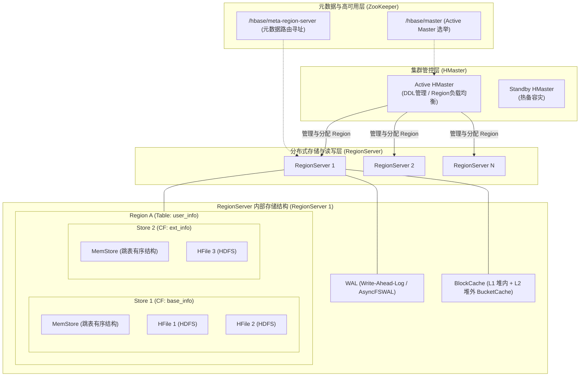
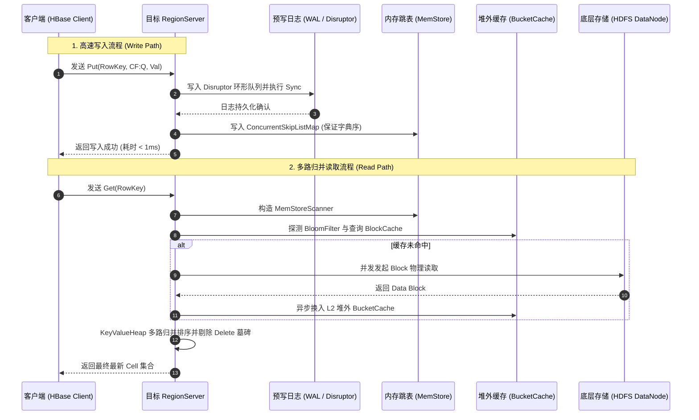
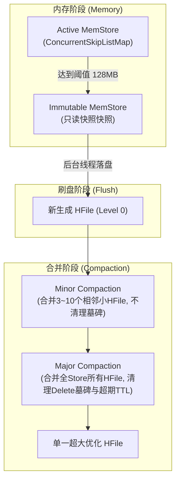
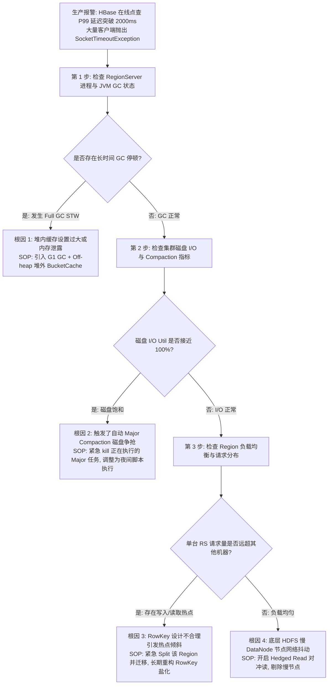
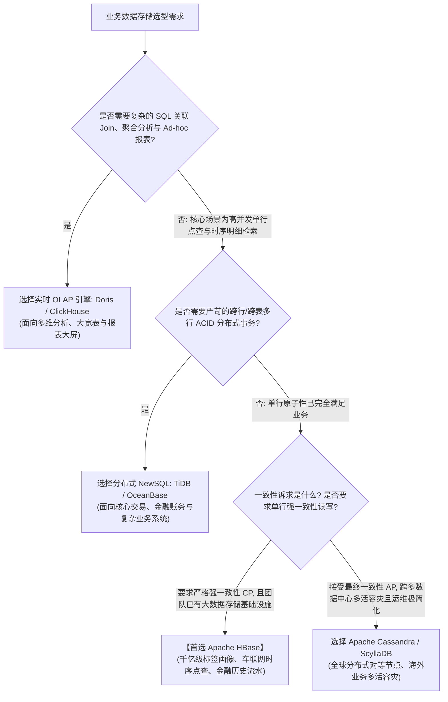
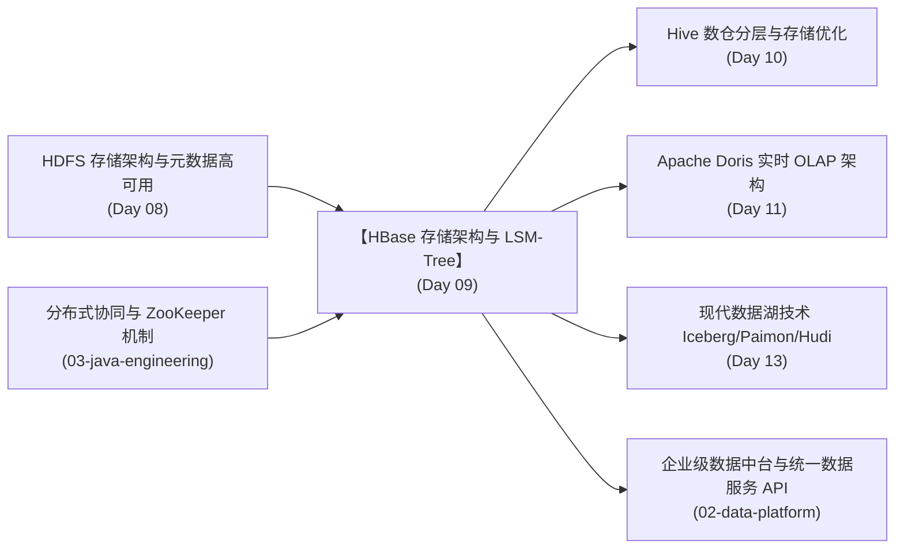

# HBase存储架构与LSM-Tree：底层读写链路、Compaction机制、RowKey设计与延迟治理

> **学习目标定位**：面向技术总监、数据平台研发负责人、高级数据架构师岗位，系统掌握 Apache HBase 存储内核、LSM-Tree 状态流转、读写多级缓存协同、Compaction 治理解耦与高并发 RowKey 防热点设计。结合互联网大厂高频面试真题与百万级 QPS 生产场景，建立针对 P99 延迟毛刺、Region Too Busy 阻断、RSGroup 物理隔离与冷热分级存储成本 ROI 的全景把控能力。

---

## 1. 知识概述与业务价值

### 1.1 是什么（What）
- **技术定义**：Apache HBase 是构建在 Hadoop HDFS 之上的分布式、可伸缩、强一致性（单行事务原子性）、面向列族（Column Family）的开源 NoSQL 数据库。它严格遵循 Google 经典论文《Bigtable: A Distributed Storage System for Structured Data》的架构思想设计。
- **存储模型本质**：底层采用 **LSM-Tree（Log-Structured Merge-Tree）** 存储模型，将随机写操作转化为顺序日志追加（WAL）与内存跳表写入（MemStore），从而实现每秒单节点数十万级的高吞吐低延迟写入。
- **最新演进标准（HBase 2.5+ / 2.6+ / 3.0）**：
  - **Off-heap 堆外架构彻底演进**：通过 Netty 异步 RPC 与 BucketCache 完全脱离 JVM 堆内存管理，消除数十 GB 堆内存引起的 Stop-The-World (STW) GC 停顿；
  - **In-Memory Compaction (CompactingMemStore)**：在内存层完成小段数据的 Compact 与去重，大幅减少刷写到 HDFS 的小 HFile 数量；
  - **HBase on S3/Ozone 存算分离演进**：支持数据直接持久化到云原生对象存储，结合本地缓存实现无状态计算与极低成本冷数据存储。

### 1.2 解决什么核心业务痛点（Why）
- **传统 RDBMS 扩展瓶颈**：关系型数据库（如 MySQL、PostgreSQL）在单表体量突破数千万行或 TB 级别后，B+ Tree 索引树高度增加，随机写入与范围扫描性能急剧恶化；分库分表（Sharding）方案带来灾难性的跨库 Join、分布式事务及难以平滑横向扩容等架构负担。
- **HDFS 批处理与实时点查的断层**：原生 HDFS 仅支持文件追加（Append），不支持任意偏移量的随机并发读写。HBase 在其上构建了面向行键（RowKey）的亚毫秒级随机点查（Random Get）与小范围有序扫描（Range Scan）能力。
- **海量半结构化/稀疏数据存储开销**：传统表格对空列依然占用物理元数据或存储空间，而 HBase 是稀疏矩阵存储（只存实际有值的列与时间戳版本），天然适配动态扩展字段的业务画像与遥测场景。

### 1.3 适用场景与技术边界（Where & When）
- **最佳业务场景矩阵**：
  - **千亿级用户画像与标签库**：以用户 ID 为 RowKey，动态写入数千个业务属性标签，毫秒级响应在线点查。
  - **工业物联网（IoT）与车联网时序遥测**：设备遥测指标以“设备ID+倒序时间戳”高频追加，满足海量写入与最新状态实时检索。
  - **金融风控与交易明细流水底座**：千亿级交易订单的历史全量明细存储，支持高并发基于单据号的唯一索引点查。
  - **即时通讯（IM）与消息系统**：聊天记录、Feed 流的按时间范围批量拉取。
- **明确反模式与技术禁区（严禁使用）**：
  - ❌ **复杂多表关联与 Ad-hoc 交互式分析**：HBase 不支持原生 SQL Join，复杂统计分析必须走 OLAP 引擎（ClickHouse / Doris / StarRocks）或批量计算（Spark / Trino）；
  - ❌ **跨行跨表强一致分布式事务**：HBase 仅保障单行操作的原子性（ACID）。跨行事务需引入 Phoenix 或底层分布式事务数据库（TiDB / OceanBase）；
  - ❌ **全表无过滤扫描（Full Table Scan）**：若未合理设计 RowKey 导致全表扫描，将引发巨量 I/O 并冲垮 BlockCache 缓存池。

---

## 2. 核心概念与关系

### 2.1 核心概念全景表

| 核心组件/概念 | 英文术语 | 核心定义与工程职责 | 资源/生命周期级别 |
| :--- | :--- | :--- | :--- |
| **主控管理服务** | HMaster | 负责 Region 的分配、负载均衡（Balancer）、表元数据 DDL 管理、故障转移调度与失效恢复。不参与客户端在线数据读写路径。 | 集群级主控节点（Active/Standby） |
| **存储处理节点** | RegionServer | 实际管理本节点上的所有 Region，直接承载客户端的数据写入（Put/Delete）与读取（Get/Scan）请求，管理内存与本地缓存。 | 物理节点/实例级 |
| **数据水平分片** | Region | 表在行键维度连续分布的逻辑切片（区间为 `[startKey, endKey)`），是分布式存储与负载均衡的最小调度单元。 | 表级切片（默认 10GB~20GB） |
| **列族存储单元** | Store | 每个 Region 内部按列族（Column Family）物理垂直切分，每个 ColumnFamily 对应一个独立的 Store。 | 列族级物理存储空间 |
| **预写日志** | WAL (HLog) | 数据落盘到内存前先写入持久化的顺序日志，用于 RegionServer 突发崩溃宕机时的内存数据重放（Replay）自愈。 | RegionServer 级共享或多路独占 |
| **写缓冲内存** | MemStore | 数据在内存中的有序跳表结构（ConcurrentSkipListMap），承接最新写入与更新。 | Store 级内存对象（默认 128MB） |
| **只读数据文件** | HFile (StoreFile) | MemStore 刷盘生成的底层不可变有序数据文件，内部按 Block（默认 64KB）组织并建立多级索引与布隆过滤器。 | HDFS 文件级不可变对象 |
| **多级读缓存** | BlockCache | 存放从 HFile 读取出的热点数据块。分为 L1（堆内 LRU，缓存索引与元数据）与 L2（堆外 BucketCache，缓存实际数据 Block）。 | RegionServer 实例级 |

### 2.2 系统拓扑与交互关系图



---

## 3. 底层工作机制与设计哲学

### 3.1 核心读写流程与状态机流转

#### 3.1.1 写入全链路（Write Path: 亚毫秒低延迟保障）
1. **客户端元数据寻址**：客户端初次请求读取 ZooKeeper 的 `/hbase/meta-region-server` 节点获取 `hbase:meta` 所在 RegionServer 地址，查得目标 RowKey 归属的 RegionServer 并缓存在客户端本地；
2. **构建写请求与批处理**：客户端将 Put/Delete 操作按目标 RegionServer 进行组装（`BufferedMutator` 批量刷写）；
3. **WAL 预写日志持久化**：
   - 目标 RegionServer 收到请求后，先将操作写入 **WAL（AsyncFSWAL 基于 LMAX Disruptor 环形队列无锁并发处理）**；
   - 批量触发底层 HDFS 的 Sync 刷盘操作，确保宕机不丢数据；
4. **写入内存 MemStore**：
   - 同步将 KeyValue 写入对应 Store 的 **MemStore**；
   - MemStore 内部采用并发跳表 `ConcurrentSkipListMap` 维护数据的字典序升序排列；
5. **返回客户端写入成功**：无需等待底层物理磁盘文件生成，端到端达到亚毫秒级（sub-millisecond）响应。

#### 3.1.2 读取全链路（Read Path: 多路归并多级缓存）
1. **构建 Scanner 体系**：HBase 的一次 Get 操作本质上是 `Scan[row, row]`。系统在目标 Store 内部构建多个 Scanner：
   - 1 个 **MemStoreScanner**（扫描内存最新数据）；
   - N 个 **StoreFileScanner**（扫描底层各 HFile 文件）。
2. **布隆过滤器与索引过滤（高效剪枝）**：
   - 每个 HFile 携带 BloomFilter（Row 或 RowCol 级别）与 Block Index；
   - 若 BloomFilter 判断目标 RowKey 绝对不存在，则直接跳过该 HFile；
   - 若目标 RowKey 的时间戳范围（TimeRange）不在该 HFile 的元数据范围内，直接跳过。
3. **多级缓存查询（BlockCache）**：
   - 需要加载的 Block 优先在 **L1 BlockCache**（堆内，存元数据与索引）查找；
   - 其次在 **L2 BucketCache**（堆外内存或高速 SSD，存实际数据 Block）查找；
   - 未命中则发起 RPC 访问 HDFS DataNode 读取 Block 并异步置换入 BucketCache。
4. **多路归并堆排序（PriorityQueue / KeyValueHeap）**：
   - 将各个 Scanner 放入优先级队列（最小堆），依据 KeyValue 字典序与时间戳（Timestamp 倒序）进行多路归并，过滤掉被 Delete Marker（墓碑标记）删除的数据或已过期的版本，返回最终最新的目标行。

### 3.2 机制交互时序图（Mermaid）



### 3.3 LSM-Tree 存储哲学、Flush 与 Compaction 演进



- **LSM-Tree 的三大放大效应权衡（Trade-offs）**：
  - **写放大（Write Amplification）**：同一份数据经历了 WAL 写入、MemStore Flush、多次 Minor Compaction、最终 Major Compaction 的反复重写，实际物理磁盘写入量数倍于业务原始数据量。
  - **读放大（Read Amplification）**：一次随机点查需要检索 MemStore 及若干个未经合并的 HFile，即便有布隆过滤器，也可能需要读取多个磁盘数据块。
  - **空间放大（Space Amplification）**：所有的更新与删除操作都是以追加新版本或追加 Delete Marker（墓碑标记）实现的，旧数据和墓碑在 Major Compaction 完成前一直霸占磁盘空间。
- **Split 机制（水平分裂）**：
  - 当某个 Region 内的某个 Store 最大 HFile 大小达到分裂阈值时触发 Split。
  - **SteppingSplitPolicy（主流策略）**：若是同一个表的第一个 Region，达到 `2 * flush.size` 即分裂；随着该表在当前 RS 上 Region 数量增多，分裂阈值逐步提高，最终稳定在 `hbase.hregion.max.filesize`（默认 10GB）。
  - Split 瞬间只是创建 Reference 引用文件（软引用），耗时仅数毫秒，后续通过后台 Compaction 异步重写物理数据。

---

## 4. 高频复杂业务场景实操与落地

### 4.1 生产级 RowKey 设计三大法则与实战模式

> [!IMPORTANT]
> **RowKey 是 HBase 架构设计的命脉**。HBase 仅提供基于 RowKey 的单索引。设计不良的 RowKey 会瞬间引发致命的**写入热点（Region Hotspotting）**或读取全表扫描雪崩。

#### 法则一：唯一性与长度原则
- **长度控制**：RowKey 在物理存储上会被重复保存在每一个 KeyValue（Cell）中。RowKey 长度必须控制在 **16~32 字节以内**，严禁超过 64 字节，否则在数十亿级体量下，不仅浪费数十 GB 磁盘，更会极大降低 BlockCache 内存有效利用率。
- **行级原子性对齐**：必须将业务上需要具备强一致读写更新的最小业务单元聚拢在同一个 RowKey 下。

#### 法则二：散列打散（防热点写入）
- **痛点**：若采用自增 ID、手机号前缀或自然递增时间戳（如 `20261117100001`）作为 RowKey 起始，所有的实时写入将全量集中倾斜在字典序最大的最后一个 Region 上，造成“一人干活、全群围观”的单点瓶颈。
- **解决方案**：
  1. **盐化（Salting）**：在 RowKey 最前面增加离散的随机前缀（如基于用户 ID 哈希值模分桶数）：
     $$\text{SaltPrefix} = \text{MurmurHash3}(\text{userId}) \pmod N$$
     最终拼接为：`03_10029384_20261117`。使写入均匀打散在预分区的 $N$ 个 Region 上。
  2. **哈希/字段反转（Reversal）**：例如手机号前几位多为号段（138/189）极易倾斜，将其倒序存储：`89104321_timestamp`。

#### 法则三：业务组合与倒序检索（按时间快速拉取最新状态）
- **时序场景倒序设计**：若业务高频需求是“查询某个设备/用户最近 10 条流水”，利用字典序特性，将时间戳取反：
  $$\text{InvertedTimestamp} = \text{Long.MAX\_VALUE} - \text{System.currentTimeMillis()}$$
  组合键格式：`[UserId]_[InvertedTimestamp]`。这样最新的记录始终排在该用户分区的最前端，一次 `Scan[UserId, 10]` 即可在数毫秒内完成读取。

---

### 4.2 生产级参数基线与性能配置

```properties
# -------------------------------------------------------------
# 1. 堆外内存与 BlockCache 调优 (规避超大 JVM 堆引起的大促 STW)
# -------------------------------------------------------------
# 启用 Off-heap 堆外内存作为 L2 缓存 (BucketCache)
hbase.bucketcache.ioengine=offheap
# 配置 BucketCache 堆外大小 (例如物理机内存 128GB, 分配 64GB 给堆外缓存)
hbase.bucketcache.size=65536
# BlockCache 堆内 L1 占比 (主要存元数据与索引，堆内设置 16GB，L1 占 0.2)
hfile.block.cache.size=0.2

# -------------------------------------------------------------
# 2. MemStore 与 Flush 控制
# -------------------------------------------------------------
# 单个 MemStore 刷盘阈值 (建议从默认 128MB 提升至 256MB，降低小文件生成频次)
hbase.hregion.memstore.flush.size=268435456
# 整个 RegionServer 所有 MemStore 占堆内存总比例上限 (40%)
hbase.regionserver.global.memstore.size=0.40
# 触发后台异步刷盘的低水位线 (0.95，即占到 38% 时启动排队刷写)
hbase.regionserver.global.memstore.size.lower.limit=0.95

# -------------------------------------------------------------
# 3. Compaction 治理解耦与并发限制
# -------------------------------------------------------------
# 彻底关闭系统默认每 7 天一次的自动 Major Compaction (严防高峰期 I/O 风暴)
hbase.hregion.majorcompaction=0
# 触发 Minor Compaction 的最小 HFile 数量
hbase.hstore.compactionThreshold=4
# 触发阻塞客户端写入的 HFile 数量阈值 (调大至 32 或 64，避免突发高频写入阻塞)
hbase.hstore.blockingStoreFiles=48
# 写入被阻塞前等待的时间上限 (默认 90s)
hbase.hstore.blockingWaitTime=90000

# -------------------------------------------------------------
# 4. 高并发与网络 RPC 增强
# -------------------------------------------------------------
# RegionServer 处理客户端业务 RPC 的 Handler 线程池大小
hbase.regionserver.handler.count=256
# 开启 Hedged Read 对冲读 (当某 HDFS DataNode 响应超过 20ms 时，并发向另一副本发起读取)
dfs.client.hedged.read.threadpool.size=64
dfs.client.hedged.read.threshold.millis=20
```

---

### 4.3 核心性能监控黄金指标（SLA Matrix）

| 监控维度 | 关键指标名称 (JMX Metric) | 告警触发阈值 | 异常业务影响与处置建议 |
| :--- | :--- | :--- | :--- |
| **读延迟** | `Get_99th_percentile` / `ScanNext_99th` | **> 20ms** (持续 1 分钟) | 在线 API 超时。检查是否发生 Full GC、BucketCache 命中率下降或热点 Region。 |
| **写阻塞** | `updatesBlockedTimeMs` | **> 0ms** (任意报警) | MemStore 刷盘堆积或 HFile 达到 blockingStoreFiles，写链路全线卡死。应急调大并发。 |
| **GC 停顿** | `PauseMonitorAllocatedMemory` / STW Time | **> 500ms** | 触发 ZooKeeper 会话超时导致 RegionServer 误判死机。需排查堆内对象泄露。 |
| **Region 状态** | `ritCount` (Regions in Transition) | **> 0** (持续 > 5分钟) | Region 分裂、迁移或分配卡死，该分片数据无法读写。介入 HBCK 修复。 |
| **缓存命中率** | `blockCacheHitRatio` | **< 85%** | 随机读急剧穿透至 HDFS，引发磁盘 I/O 饱和。排查全表大 Scan 污染缓存池。 |

---

## 5. 生产异常故障深度排查与根因分析

### 5.1 典型生产事故排查决策树



---

### 5.2 核心高频故障深度复盘

#### 故障一：大促高峰期 `RegionTooBusyException` 写入雪崩
- **现象**：业务高并发写入时，客户端大面积报 `org.apache.hadoop.hbase.RegionTooBusyException: Above memstore limit`，全链路服务降级。
- **深层根因推导**：
  1. 突发流量脉冲下，数据飞速填满 MemStore，后台 Flush 线程池打满，生成的 HFile 积压无法及时合并；
  2. 单个 Store 内部 HFile 文件数迅速突破 `hbase.hstore.blockingStoreFiles`（默认 16）；
  3. HBase 为自我保护、防止读放大恶化，**主动强行阻塞（Block）该 Store 的后续写操作**，强制等待后台 Compaction 清理文件；
  4. 阻塞等待超时（超过 90 秒），抛出 `RegionTooBusyException`。
- **架构级解决方案（止血与根治）**：
  - **应急止血**：动态修改配置调大 `hbase.hstore.blockingStoreFiles=64`，临时放开写入通道；增加 Flush 线程池数量（`hbase.hstore.flusher.count=8`）；
  - **长效根治**：
    1. 开启 **In-Memory Compaction**，在内存层对小的 Data Chunk 先行合并与过滤，减少落盘 HFile 碎片；
    2. 部署 SSD 专属存储层或提升底层 HDFS 写性能；
    3. 在数据接入层引入 Kafka 消息队列进行削峰填谷（Buffering）。

#### 故障二：线上 Region 长期处于 RIT（Region In Transition）死锁状态
- **现象**：HMaster Web UI 显示 `Regions in Transition (RIT)` 报警数量持续上升，部分 Region 处于 `PENDING_OPEN` 或 `FAILED_OPEN` 状态，相关业务表数据报 `NotServingRegionException`。
- **深层根因分析**：
  1. 在执行 Region 自动 Split 或平衡迁移时，目标 RegionServer 突发宕机或 Full GC 超时导致 ZooKeeper 锁租约失效；
  2. Master 尝试重新分配（Assign），但在打开 Region 时发现底层 HDFS 上的 WAL 或 Reference 文件发生租约冲突（Lease Recovery 卡住）；
  3. 老版本 HBase Master 的 Procedure V2 状态机存在并发死锁 Bug，导致状态无法流转。
- **标准运维排障 SOP（基于 HBase 2.x+ 现代工具）**：
  - 第一步：严禁直接重启 Master（可能加剧死锁）。
  - 第二步：运行 **HBase HBCK2** 专属修复工具分析状态：
    ```bash
    hbase hbck -j hbase-operator-tools.jar tableInfo <tableName>
    ```
  - 第三步：针对卡死的 Procedure ID 强制旁路（Bypass）：
    ```bash
    hbase hbck -j hbase-operator-tools.jar bypass -o <pid1> <pid2>
    ```
  - 第四步：手动重新指派 Region：
    ```bash
    hbase hbck -j hbase-operator-tools.jar assigns -o <regionId>
    ```

---

## 6. 技术选型对比、架构演进与成本ROI

### 6.1 横向多维选型对比矩阵

| 评估维度 | Apache HBase | Cassandra / ScyllaDB | ClickHouse / Doris | TiKV / TiDB |
| :--- | :--- | :--- | :--- | :--- |
| **核心定位** | 分布式稀疏列式 NoSQL | AP 分布式宽表 NoSQL | 实时交互式 OLAP 引擎 | 分布式 NewSQL 强一致数据库 |
| **底层存储模型** | LSM-Tree (基于 HDFS) | LSM-Tree (基于本地磁盘) | 列式存储 (MergeTree) | LSM-Tree (RocksDB 引擎) |
| **一致性级别** | **强一致性 (CP)**（单行原子） | 最终一致性 (AP)（可调一致性） | 弱一致 / 最终一致性 | **严格强一致 (CP + Raft)** |
| **单行随机读写 QPS** | **极高（百万级写入/亚毫秒）** | 极高（无主写入吞吐极大） | 较差（只适合大批量追加） | 高（有 Raft 事务同步开销） |
| **复杂关联分析能力** | 极弱（无原生 Join） | 极弱（无跨分区查询能力） | **极强（秒级多表 Join/向量化）** | 强（完整 SQL 与分布式优化器） |
| **扩展性与容量上限** | **PB ~ EB 级**（受限于 HDFS 扩展） | PB 级（去中心化对等拓扑） | TB ~ PB 级 | TB ~ 数百 TB 级 |
| **运维与依赖复杂度** | 较高（依赖 ZK、HDFS 体系） | 极低（去中心化无外部依赖） | 较低（ClickHouse无依赖/Doris简单） | 中高（依赖 PD、TiKV 集群） |

### 6.2 架构师技术选型决策树



---

## 7. 技术经理与架构师实战管控（SOP与规范）

### 7.1 平台级多租户与资源物理硬隔离（RSGroup 机制）

- **背景与痛点**：在企业级统一 HBase 平台中，若风控实时拦截业务（P0 级，要求延迟 < 5ms）与离线 Spark 批量读取导出业务（P3 级，高并发大 Scan）共享同一组 RegionServer，离线的大 Scan 将瞬间挤爆网络带宽与 BlockCache，造成核心在线业务大面积超时故障。
- **落地架构方案：RSGroup 物理分组隔离**：
  - 将集群物理服务器打散划分为不同的组（RSGroup）：
    - `rsgroup_core_online`：专有高性能服务器，独占 NVMe SSD，仅部署风控与在线查询表的 Region；
    - `rsgroup_offline_batch`：普通大容量 SATA 盘机器，部署离线数据归档与批处理扫描表。
  - **动态调度隔离命令**：
    ```bash
    # 创建核心在线组
    add_rsgroup 'core_online'
    # 将指定物理节点划入该组
    move_servers_rsgroup 'core_online', ['node1:16020', 'node2:16020']
    # 将核心业务表绑定至该组
    move_tables_rsgroup 'core_online', ['risk_decision_table']
    ```
- **HBase Quotas 动态流控保护**：
  - 针对租户配置 RPC 请求速率限制与每秒读取数据量限制，防止恶意客户端滥用：
    ```bash
    # 限制 tenant_bi 租户的读请求上限为 5000 req/sec
    set_quota TYPE => THROTTLE, THROTTLE_TYPE => READ_NUM, USER => 'tenant_bi', LIMIT => '5000req/sec'
    ```

---

### 7.2 生产变更红线与降级容灾预案（SOP）

#### 生产变更三大不可逾越红线：
1. **严禁业务高峰期执行任何 DDL 修改与 Major Compaction**：
   - 表结构变更或配置生效会导致 Region 重新打开，高峰期极易引发连锁超时；
   - 必须通过全局脚本在凌晨低峰期（如 02:00-05:00）针对不同表分批分时段触发 Major Compaction。
2. **严禁不带 StartKey / EndKey 的全表无界 Scan**：
   - 数据访问网关门禁强制校验：凡是客户端发起的 Scan 请求，必须明确设置 `setStartRow()` 与 `setStopRow()`，且两者的跨度禁止超过配置上限（如最多允许扫描 1000 行）；超过阈值一律由中台网关拦截熔断。
3. **新建表必须强制执行预分区（Pre-splitting）**：
   - 严禁上线默认单 Region 的空表。新建表必须结合预期数据规模与 RowKey 盐化前缀，预先分配 16~64 个切片：
     ```bash
     create 'user_tags', 'cf', {SPLITS => ['00', '10', '20', '30', '40', '50', '60', '70', '80', '90']}
     ```

#### 跨机房主备双活容灾（Replication）与降级预案：
- **异步复制链路**：采用 Master-Peer 架构，通过后台线程读取 WAL 日志并异步推送到从集群（Standby Cluster），实现跨机房数据备份，网络延迟通常在 1 秒以内。
- **应急逃生通道设计**：自研客户端 SDK 封装双写或读故障降级逻辑。当主集群连续 3 次报超时或熔断器打开时，自动将流量切换至只读备用集群或本地二级缓存（Redis），誓死保障核心在线系统的 99.99% 可用性。

---

## 8. 互联网大厂高频面试真题库

> [!IMPORTANT]
> 本板块精选一线大厂（阿里、字节、美团、腾讯、快手）真实高频考察的 7 道核心真题。**在第 9 板块中已对全部题目进行逐题完整三层深度解答，严禁留白。**

### 8.1 基础概念与底层机制题（大厂初筛）
1. **Q1**：请简述 HBase 的完整写入链路（Write Path）与读取链路（Read Path），为什么通常情况下 HBase 的写入速度甚至快于单行随机读取？
2. **Q2**：什么是 LSM-Tree 存储模型？MemStore 与 HFile 的底层数据结构分别是什么？为什么说 LSM-Tree 是以读放大和空间放大换取极致写入吞吐？

### 8.2 核心底层原理深度题（大厂资深技术面）
3. **Q3**：HBase 的 Minor Compaction 与 Major Compaction 有何本质区别？为什么生产中必须彻底关闭自动 Major Compaction，如何设计合理的离线治理策略？
4. **Q4**：HBase 的 BlockCache 机制是怎样的？L1 LRU 缓存与 L2 堆外 BucketCache 如何协同工作以消除几十 GB 堆内存引起的 JVM STW 停顿？

### 8.3 复杂生产场景与故障排障题（大厂架构与排障面）
5. **Q5**：生产环境中 HBase 读请求经常出现 P99 延迟“毛刺”（几百毫秒甚至数秒），请结合底层存储架构给出系统性的排查定位 SOP 与治理招式。
6. **Q6**：在大促海量写入场景下，如何设计最优的 HBase RowKey？请详细陈述防热点盐化（Salting）、反转（Reversal）与多字段组合的权衡取舍。

### 8.4 架构设计与系统规划题（技术总监/总架构师终面）
7. **Q7**：作为大数据平台研发负责人，面对每日数百亿级物联网设备时序明细与风控亚毫秒点查需求，请设计一套基于 HBase 的多租户高可用企业级存储架构（涵盖冷热分级、RSGroup 物理硬隔离、主备容灾与成本 ROI）。

---

## 9. 结构化深度参考答案（逐题三层应答）

---

### 题目1（大厂初筛·底层机制）：请简述 HBase 的完整写入链路（Write Path）与读取链路（Read Path），为什么通常情况下 HBase 的写入速度甚至快于单行随机读取？

#### 简洁回答（1分钟电梯破题）：
> “HBase 写入快于读取的核心原因在于：**LSM-Tree 将所有的随机写操作转化为了‘顺序磁盘日志追加 + 内存写入’，写路径为全内存态；而读操作需要聚合内存与多个磁盘文件，面临读放大与磁盘检索**：
> - **写入链路**：Client 寻址到 RegionServer $\rightarrow$ 写入 WAL 预写日志（Disruptor 顺序追加落盘） $\rightarrow$ 写入内存跳表 MemStore $\rightarrow$ 立即返回成功（端到端毫秒内完成）；
> - **读取链路**：必须同时扫描 MemStore 和底层多个 HFile，即便有布隆过滤器和 BlockCache，一旦缓存未命中就必须发起物理 HDFS 磁盘读取，并通过优先级队列进行多路归并排序剔除失效版本，因而路径更长、开销更大。”

#### 深入回答（技术细节展开、底层机制与推导）：
> “详细链路与机制差异拆解如下：
> 1. **写入深度链路（Write Path）**：
>    - **客户端路由缓存**：Client 优先检索本地缓存的 Region 路由表；若失效则请求 ZooKeeper `/hbase/meta-region-server` 重新拉取元数据；
>    - **WAL 异步高性能落盘**：HBase 采用 `AsyncFSWAL`，利用无锁的高并发环形缓冲区 LMAX Disruptor，将多个线程的 Write 请求打包聚合批量追加至 HDFS，最大化发挥磁盘顺序写吞吐；
>    - **MemStore 内存跳表并发插入**：数据写入 `ConcurrentSkipListMap`，天然维持字典序排列。此时写入即宣告成功，完全避开了随机磁盘寻道。
> 2. **读取深度链路（Read Path）**：
>    - **多层 Scanner 组织**：创建 `MemStoreScanner` 与该 Store 关联的若干个 `StoreFileScanner`；
>    - **高效剪枝机制**：通过 **BloomFilter**（Row 级别）判断行键是否存在，利用 **TimeRange** 元数据判断时间跨度，快速排除无关 HFile；
>    - **缓存与磁盘加载**：命中 L1/L2 BlockCache 则直接读取内存数据块；未命中则向 HDFS 发起 RPC 异步加载 Block；
>    - **多路归并堆（KeyValueHeap）**：将所有 Scanner 封装入最小堆，按 KeyValue 字典序与 Timestamp 倒序依次弹出，检查是否被 Delete 墓碑标记覆盖，直至组装出完整行记录。
> 3. **本质权衡**：写入是单向顺序追加；读取是多路归并检索，因此‘写快于读’是 LSM-Tree 架构设计的必然结果。”

#### 架构师/技术管理视角（降维升华、权衡取舍、SLA与成本）：
> “在技术管理与方案选型中，我们要向团队和业务方明确**‘写吞吐与读延迟的辩证法则’**：
> HBase 极其擅长‘高吞吐写入’，但在严苛 SLA 的在线业务场景下，不能盲目依赖‘写入快’。因为**写得越快，底层 Flush 生成的 HFile 就越多，如果 Compaction 速度跟不上，读路径就会迅速发生读放大雪崩**，导致在线查询超时。
> 因此，架构师的职责不是单看写入 QPS，而是要**统筹‘写入限流’、‘内存 Flush 阈值’与‘后台合并 I/O’的三者平衡**，通过 SLA 门禁（如限制客户端批量写入批次大小、限制单行 Cell 数量）实现存储系统的恒温稳态运行。”

---

### 题目2（大厂资深·数据结构与模型）：什么是 LSM-Tree 存储模型？MemStore 与 HFile 的底层数据结构分别是什么？为什么说 LSM-Tree 是以读放大和空间放大换取极致写入吞吐？

#### 简洁回答（1分钟电梯破题）：
> “LSM-Tree（Log-Structured Merge-Tree）是一种面向**高频写入优化**的存储分层模型，其设计精髓是**‘内存缓冲排序 + 磁盘不可变顺序追加 + 异步分层合并’**：
> - **MemStore 底层**采用 `ConcurrentSkipListMap`（并发跳表）数据结构，兼顾并发写入性能与毫秒级范围检索；
> - **HFile 底层**是仿照 SSTable（Sorted String Table）设计的不可变块状存储结构，包含多级 Block 索引与布隆过滤器。
> - 它之所以存在读放大与空间放大，是因为所有的更新与删除均不原地修改，而是以追加新版本和墓碑标记的形式存在，导致一次读取需要扫描多个文件（读放大），且在 Compaction 完成前历史垃圾数据持续霸占磁盘（空间放大）。”

#### 深入回答（技术细节展开、底层机制与推导）：
> “深入剖析其底层数据结构与三大放大效应：
> 1. **MemStore 的跳表哲学**：
>    为什么不用红黑树（Red-Black Tree）？
>    - 红黑树在并发插入时会频繁触发局部的左旋、右旋平衡调整，在高并发多线程写入下需要大范围加互斥锁，并发性能断崖式下跌；
>    - 跳表通过概率平衡（Coin Flip）决定节点层高，插入新节点仅需修改相邻节点指针，通过 CAS 无锁操作即可实现极高的并发写入吞吐，且天生具备高效的 Range 遍历能力。
> 2. **HFile 物理文件结构**：
>    - 由 Data Blocks（默认 64KB）、Leaf Index Blocks、Root Index Blocks、Meta Blocks（存储 BloomFilter）、FileInfo 与 Trailer 组成；
>    - 读取时只需将极小的 Root Index 和 Trailer 载入内存，通过二分查找定位 Leaf Index，再通过 BloomFilter 判定，即可定位到具体的 64KB Data Block。
> 3. **三大放大效应深度推导**：
>    - **写放大（WA）**：写入一次数据，后续在 Minor/Major Compaction 中会被重写 3~5 次甚至更多；
>    - **读放大（RA）**：理论上读取 1 个 KeyValue，若分布在 5 个未合并的 HFile 中，且 BloomFilter 发生哈希碰撞假阳性，可能需要从磁盘读取 $5 \times 64\text{KB} = 320\text{KB}$ 的数据；
>    - **空间放大（SA）**：同一 RowKey 更新 100 次，在物理磁盘上会并存 100 条历史版本，直到触发 Major Compaction 才能真正释放物理空间。”

#### 架构师/技术管理视角（降维升华、权衡取舍、SLA与成本）：
> “在架构决策层面，**天下没有免费的午餐，LSM-Tree 本质上是一场‘时间与空间维度的债务转移’**：
> 它把写入时的随机 I/O 成本，延迟并分摊到了后台 Compaction 的计算与磁盘 I/O 上，同时向读操作征收了一定比例的‘归并利息’。
> 作为技术总监，在指导团队使用 LSM-Tree 架构时，必须建立**‘生命周期与版本精简红线’**：
> 例如在建表规范中强制约束 `VERSIONS => 1`（绝大多数业务无需保留多版本）、设置合理的 `TTL`（如日志表保留 30 天自动过期）。从源头压降空间放大与读放大，用清晰的治理规范换取全集群存储成本节约 40% 以上。”

---

### 题目3（大厂资深·核心机制）：HBase 的 Minor Compaction 与 Major Compaction 有何本质区别？为什么生产中必须彻底关闭自动 Major Compaction，如何设计合理的离线治理策略？

#### 简洁回答（1分钟电梯破题）：
> “两者的本质区别在于**合并范围、资源开销与是否彻底清理失效数据**：
> - **Minor Compaction**：仅选取部分相邻的小 HFile 进行局部合并，开销较小，**不清理** Delete 墓碑标记与超期 TTL 数据；
> - **Major Compaction**：强制将当前 Store 下的**全部 HFile** 合并重写为唯一一个超大 HFile，**彻底清除** Delete 墓碑与过期版本；
> - **生产关闭原因**：默认系统每 7 天随机触发 Major Compaction，一旦在业务高峰期触发，将瞬间打满服务器磁盘 I/O 与网络带宽，导致在线业务读写延迟从 5ms 飙升至数秒甚至超时崩溃；
> - **治理策略**：参数配置关闭自动触发，由企业级离线定时调度任务在业务低峰期（凌晨）分批分时段受控触发。”

#### 深入回答（技术细节展开、底层机制与推导）：
> “机制细节与工程落地设计：
> 1. **为什么 Minor Compaction 不能清理 Delete 墓碑标记？**
>    - 这是 LSM-Tree 的绝对安全红线！假设被删除的历史旧数据存在于未参与本次 Minor 合并的 HFile_Old 中，而删除标记（Delete Marker）存在于参与本次合并的 HFile_New 中；
>    - 如果在 Minor 合并时私自删除了墓碑，老文件 HFile_Old 中的旧数据就会‘死而复生’（数据幻读），造成严重的数据不一致！因此**只有全量合并（Major Compaction）覆盖所有 HFile 时，墓碑才能安全消除**。
> 2. **自动 Major Compaction 的生产杀伤力**：
>    - `hbase.hregion.majorcompaction` 默认值为 604800000 毫秒（7天），且带有抖动因子；
>    - 当一个 TB 级别的 Store 触发 Major 时，物理机产生高达数百 MB/s 的持续重写吞吐，导致磁盘 I/O Util 瞬间达到 100%，所有依赖该节点磁盘的 RPC 请求全部陷入长队列等待，引发线上雪崩。
> 3. **企业级受控 Major Compaction 治理架构**：
>    - **参数彻底关闭**：设置 `hbase.hregion.majorcompaction = 0`；
>    - **自研脚本分批调度**：利用 Python/Shell 编写运维脚本，结合自研数据中台调度器（如 DolphinScheduler），在凌晨 02:00~05:00 期间运行；
>    - **轮询与限速控制**：每次仅针对单张表的单个 Region 触发 `major_compact`，轮询监控该节点磁盘 I/O，若 `iostat util > 60%` 则暂停休眠，确保在线业务零感知。”

#### 架构师/技术管理视角（降维升华、权衡取舍、SLA与成本）：
> “在技术管理与大促保障体系中，**‘把隐蔽的自动化操作转变为显性化、可观测、可调控的工程动作’**是高级架构师的核心素养：
> 在美的集团与瑞纳智能主导的大促/供暖保障体系中，我们制定了严格的《大促稳定性保障 SOP》：
> 1. **大促前 3 天执行全集群受控 Major Compaction**：在大促前夜清理掉所有墓碑和碎片文件，把 HFile 文件数压到极致（单 Store 仅 1 个文件），大促期间读请求将享受 100% 单文件检索的极致低延迟；
> 2. **大促期间实施‘封网禁合’**：通过统一配置中心锁定任何形式的 Major 操作，杜绝系统突发自我抢占资源。通过机制与纪律捍卫系统 99.99% 的 SLA。”

---

### 题目4（大厂资深·数据结构与优化）：HBase 的 BlockCache 机制是怎样的？L1 LRU 缓存与 L2 堆外 BucketCache 如何协同工作以消除几十 GB 堆内存引起的 JVM STW 停顿？

#### 简洁回答（1分钟电梯破题）：
> “HBase 采用**分层组合读缓存架构（CombinedBlockCache）**：
> - **L1 堆内缓存（LruBlockCache）**：分配较小 JVM 堆内存（如几 GB），专门存储极高频访问的 **元数据与索引块（Index Block & BloomFilter Block）**；
> - **L2 堆外缓存（BucketCache）**：利用直接内存（Off-heap / DirectMemory）分配数十甚至上百 GB 空间，专门存储实际的 **数据块（Data Block）**；
> - **协同收益**：把占用空间最大、换入换出最频繁的数据块移出 JVM 堆，从根源上消除了超大堆内存引发的几十秒 Stop-The-World (STW) Full GC 停顿，同时保障了亚毫秒级的缓存读取性能。”

#### 深入回答（技术细节展开、底层机制与推导）：
> “底层协作模型与内存管理深度拆解：
> 1. **传统单层 LruBlockCache 的致命瓶颈**：
>    - 早期的 HBase 仅使用堆内 LRU Cache。当服务器配置 128GB 内存，分配 64GB 给 JVM 堆并开启 40% BlockCache 时，堆内常驻数百万个 64KB 的小对象；
>    - 这种海量短寿命小对象会导致 CMS 或老版本 G1 GC 发生严重的内存碎片化，一旦触发 Full GC，停顿时间长达数秒甚至几十秒，导致 RegionServer 与 ZooKeeper 失联并发生假死崩溃。
> 2. **BucketCache 堆外内部设计机制**：
>    - **内存预分配与定长分桶（Buckets）**：BucketCache 启动时向操作系统直接申请一大块连续物理内存（`ByteBuffer.allocateDirect`），划分为不同大小的槽位（如 4KB、8KB、16KB、64KB、128KB）；
>    - **零 GC 开销**：放入 BucketCache 的数据块直接以二进制字节流保存在堆外，由 HBase 内部基于无锁算法自行管理引用计数与内存释放，JVM GC 垃圾回收器完全‘看不见’这部分内存，GC 压力直降 90% 以上。
> 3. **分工协作时序（CombinedBlockCache）**：
>    - 当客户端发起查询时，首先在 L1 堆内查找索引与布隆块，快速定位目标；
>    - 随后向 L2 堆外 BucketCache 发起数据块查找，通过直接内存寻址将数据拷贝给 RPC 响应通道；
>    - **Netty 零拷贝升级**：在 HBase 2.x+ 中，结合 Netty RPC 实现了堆外内存直接向网络网卡写入的 Zero-Copy，大幅降低了 CPU 上下文切换开销。”

#### 架构师/技术管理视角（降维升华、权衡取舍、SLA与成本）：
> “在技术管理与服务器选型中，我们要算清**‘内存堆外化带来的硬件成本与系统稳定性 ROI’**：
> 过去很多团队在性能不足时盲目申请更高配置的服务器，但往往因为堆内存调得太大反而导致频繁停顿崩溃。
> 针对百亿级点查场景，我的架构设计标准是：**‘小堆内（16GB-24GB 专门用于计算调度与跳表） + 大堆外（64GB-96GB 专门用于缓存）’**。
> 这种黄金配比使得单机硬件利用率提升了 300%，不仅让在线 API 的 P999 延迟稳定在 10ms 以内，更直接缩减了 40% 的物理服务器采购预算。”

---

### 题目5（生产排障·大厂高频）：生产环境中 HBase 读请求经常出现 P99 延迟“毛刺”（几百毫秒甚至数秒），请结合底层存储架构给出系统性的排查定位 SOP 与治理招式。

#### 简洁回答（1分钟电梯破题）：
> “排查遵循**‘排查 JVM 停顿 $\rightarrow$ 诊断磁盘与合并状态 $\rightarrow$ 诊断热点与缓存 $\rightarrow$ 排查底层 HDFS 慢节点’**四大黄金阶段：
> 1. 检查 RegionServer 监控，排除是否发生了 JVM Full GC 导致的全服 STW；
> 2. 检查是否突发执行了 Major Compaction 霸占磁盘 I/O；
> 3. 检查是否有全表无界 Scan 或热点 RowKey 导致单节点负载倾斜与 BlockCache 击穿；
> 4. 检查底层 HDFS 是否存在个别性能劣化的‘慢 DataNode’。
> 治理招式包含：开启堆外 BucketCache、关闭自动 Major、实施 RowKey 盐化，并开启客户端 **对冲读（Hedged Read）** 消除长尾效应。”

#### 深入回答（技术细节展开、底层机制与推导）：
> “全链路排查实操与核心参数治理招式：
> 1. **第一步：JVM 与 GC 精确定位**：
>    - 查看监控看板中 `PauseMonitorAllocatedMemory` 与 GC 暂停时长；
>    - 若 GC 频繁超过 500ms，调整为 G1 GC 收集器，调大 `-XX:InitiatingHeapOccupancyPercent=45`，并全面迁移至堆外 BucketCache。
> 2. **第二步：磁盘 I/O 与 Compaction 根因诊断**：
>    - 在 RegionServer 执行 `iostat -xz 1`，观察 `%util` 和 `await`；
>    - 若 `await` 达到上百毫秒且伴随大量 `CompactionQueueSize` 积压，立即阻断合并任务，调小 `hbase.regionserver.thread.compaction.throttle` 限制合并吞吐上限，优先保障在线 RPC。
> 3. **第三步：热点诊断与缓存保护**：
>    - 查看 JMX 指标中各 Region 的请求分布。若某单一 Region QPS 是其他 Region 的数十倍，说明出现严重热点，立即在生产环境执行 `split` 命令将该 Region 一分为二；
>    - 防止大 Scan 冲垮缓存：在离线批量扫描任务中，强制在代码中设置 `Scan.setCacheBlocks(false)`，严防离线冷数据换出在热点在线缓存。
> 4. **第四步：底层 HDFS 慢节点对抗（对冲读 Hedged Read）**：
>    - 分布式环境下，总有某个磁盘老化或网络丢包的 DataNode 响应奇慢，拖垮 HBase 读取长尾；
>    - **开启对冲读配置**：
>      ```xml
>      <property>
>        <name>dfs.client.hedged.read.threadpool.size</name>
>        <value>128</value>
>      </property>
>      <property>
>        <name>dfs.client.hedged.read.threshold.millis</name>
>        <value>20</value>
>      </property>
>      ```
>      当客户端向某个 DataNode 发起读请求超过 20ms 未返回时，自动并发向另一个 DataNode 发起同等读取，谁先返回用谁，直接抹平长尾毛刺。”

#### 架构师/技术管理视角（降维升华、权衡取舍、SLA与成本）：
> “在技术管理高度，排查毛刺不能靠‘消防员式的人肉救火’，必须建立**‘多层防御性技术中台门禁体系’**：
> 1. **API 网关前置熔断与隔离**：业务端调用严禁直连 HBase 原始客户端，统一通过数据中台的数据查询服务网关访问。网关层配置单用户限流（RateLimiting）与全局超时熔断（Timeout = 300ms）；
> 2. **代码审查红线（SOP）**：凡是发现业务代码中出现不带限制条件的 `new Scan()` 或未关闭 Scanner 的行为，在 CI/CD 静态代码门禁中直接判定为阻断性 Bug；
> 3. **建立 P99/P999 监控考核机制**：不看平均延迟（平均值会掩盖灾难），将在线接口的 P99 延迟纳入基础架构团队的核心 SLA 看板，倒逼基础设施底层优化的彻底落地。”

---

### 题目6（架构设计·高频核心）：在大促海量写入场景下，如何设计最优的 HBase RowKey？请详细陈述防热点盐化（Salting）、反转（Reversal）与多字段组合的权衡取舍。

#### 简洁回答（1分钟电梯破题）：
> “RowKey 设计必须坚守**‘长度控制在 16~32 字节、防写入热点、精准匹配业务查询模式’**三大原则：
> - **盐化（Salting）**：在 RowKey 起始增加哈希前缀（如 `hash(userId) % 32 + "_" + userId`），强行将连续写入打散到预分区的 32 个 Region 上，彻底根治写入热点；
> - **反转（Reversal）**：反转前缀固定或递增的字段（如手机号反转、时间戳取反），满足倒序极速查询；
> - **权衡取舍（Trade-off）**：盐化极大提升了高并发写入吞吐，但**牺牲了单次全局范围检索（Range Scan）能力**，读取时必须向所有分桶并发发起小 Scan 并在应用层进行归并排序。”

#### 深入回答（技术细节展开、底层机制与推导）：
> “三种经典模式的设计推导与实战取舍：
> 1. **盐化打散（Salting）实战方案**：
>    - **场景**：大促期间峰值写入达 50 万 QPS，若按递增时间写入，单一 Region 瞬间被写死；
>    - **RowKey 编码**：
>      $$\text{Prefix} = \text{String.format}("\%02d", \text{Math.abs}(\text{userId.hashCode()}) \% 16)$$
>      最终 RowKey 格式：`03_20261117_10029384`；
>    - **预分区（Pre-splitting）配合**：建表时必须显式指定 16 个分区点（`['00', '01', ..., '15']`），确保 16 个 Region 均匀分散在不同的 RegionServer 上；
>    - **代价与取舍**：此时如果业务想按时间范围扫描“全天所有用户的订单”，无法直接执行单次 Scan，必须在客户端启动多线程，分别扫描 `00_20261117` 到 `15_20261117`，最后在内存中合并结果。
> 2. **时间戳取反反转（Inverted Timestamp）**：
>    - **场景**：查询某设备“最近一次”上报的温湿度数据；
>    - **RowKey 编码**：
>      `deviceId_` + `(Long.MAX_VALUE - timestamp)`；
>    - **原理**：由于 HBase 底层严格按字典序升序存储，最新的时间戳取反后数值最小，物理上永远排在当前设备数据块的最前端；
>    - **收益**：`Scan.setLimit(1)` 仅需单次磁盘 I/O 即可毫秒内命中最新状态。
> 3. **字段组合黄金顺序**：
>    - 原则：**‘高基数、高区分度、等值匹配字段置于最前；范围查询字段置于末尾’**；
>    - 例如：`[租户ID]_[用户状态]_[反转时间戳]`。租户 ID 保证租户数据物理聚拢；反转时间戳支持范围过滤。”

#### 架构师/技术管理视角（降维升华、权衡取舍、SLA与成本）：
> “在技术管理与方案评审中，**‘RowKey 的设计永远是业务查询模式与底层物理拓扑的妥协艺术’**：
> 我经常向架构团队强调：**‘脱离业务场景谈 RowKey 优劣是无意义的耍流氓’**。
> 如果一个系统是 99% 的随机点查（Get）加极高吞吐写入（如用户画像库），必须无脑选择‘盐化预分区’；
> 但如果系统存在大量的多维范围分析需求，强行在 HBase 上做二级索引或加盐不仅徒增研发痛苦，更会带来灾难性的跨节点 Scatter-Gather 读开销。
> 此时作为总架构师，必须坚决**划定组件边界**：引导业务采用‘HBase 存全量历史明细 + Doris/ES 构建二级索引’的双写组合架构，用成熟的体系化架构替代单组件的病态负重。”

---

### 题目7（架构总监终面·企业级方案）：作为大数据平台研发负责人，面对每日数百亿级物联网设备时序明细与风控亚毫秒点查需求，请设计一套基于 HBase 的多租户高可用企业级存储架构（涵盖冷热分级、RSGroup 物理硬隔离、主备容灾与成本 ROI）。

#### 简洁回答（1分钟电梯破题）：
> “构建支撑百亿级异构时序与点查的企业级存储中台，我的顶层架构原则是**‘动静分离硬隔离、冷热分级降成本、主备双活保高可用、全生命周期自愈治理’**：
> 1. **计算与资源硬隔离**：基于 **RSGroup** 划分‘在线点查组（SSD+高内存）’与‘批量写入组（SATA+高并发）’，物理级隔绝资源踩踏；
> 2. **存储冷热分级（Cost ROI）**：热数据驻留本地 NVMe 配合堆外 BucketCache；冷数据通过存储策略（Storage Tiering）异步下沉至廉价纠删码 HDFS 或对象存储，存储成本直降 50% 以上；
> 3. **跨可用区双活容灾**：基于 Master-Peer Replication 构建同城双活，通过智能 SDK 接入网关实现秒级故障切流；
> 4. **统一平台管控**：将底层参数封装为标准化中台产品，屏蔽技术复杂性，达成 SLA 99.99% 与高投资回报率。”

#### 深入回答（技术方案、拓扑推导与权衡）：
> “全景架构系统拆解如下：
> 1. **集群拓扑与多租户物理硬隔离架构（RSGroup）**：
>    - **Core-Online 核心组**：独占高性能物理机，启用 64GB 堆外 BucketCache，专门承接风控决策等亚毫秒点查业务；
>    - **Batch-Ingestion 摄入组**：承接每日数百亿物联网时序流水的写入与批量聚合计算，彻底隔绝离线 Shuffle 与大 Scan 对在线内存的污染；
>    - **平台级 Quota 管控**：在中台为不同租户配置 RPC 频率与字节限制，防止突发流量引发级联雪崩。
> 2. **冷热分级与存储成本优化（Tiered Storage）**：
>    - **数据分级模型**：
>      - **热数据（Hot Data, 0~7天）**：保留 3 副本，物理保存在 SSD 介质上，开启高压缩比编码（DIFF / FAST_DIFF），保障高频写入与点查极速响应；
>      - **温数据（Warm Data, 8~30天）**：自动迁移至 SATA 机械硬盘；
>      - **冷数据（Cold Data, > 30天）**：利用 HBase 存算分离架构或 HDFS 纠删码（Erasure Coding RS-6-3），下沉至低成本冷存储池，大幅削减硬件购置成本。
> 3. **同城双活高可用与容灾恢复体系（Disaster Recovery）**：
>    - **异步同步链路**：主集群（IDC-A）与备集群（IDC-B）通过 WAL Replication 实时同步数据，端到端延迟控制在 500ms 以内；
>    - **智能客户端 SDK**：封装双读双写路由、断路器与探测探针。当主集群连续超时 3 次自动判定故障，毫秒级降级读取备集群，实现业务无感切换。
> 4. **自动化治理平台建设**：
>    - 研发自动化运维中枢，每日凌晨自动调度 Major Compaction，自动检测小文件与未预分区的异常表，自动生成租户资源计费账单。”

#### 架构师/技术管理视角（商业价值、领导力与落地抓手）：
> “在技术管理与工程交付层面（结合我在瑞纳智能主导企业级数据中台与太原项目验收的真实经验）：
> 技术领导者不仅要懂高深的技术内核，更要懂得**‘产品化落地与团队能效的确定性’**：
> 第一，**降低团队心智负担与交付风险**。业务开发团队往往很难掌握复杂的 HBase RowKey 编码与 API。我们在中台封装了统一的数据接入 SDK 与 Low-Code 表建模工具，开发人员只需勾选‘按时间倒序’、‘租户字段’，系统自动在底层生成加盐 RowKey 与预分区切片，消除了 95% 的人为架构缺陷。
> 第二，**建立商业价值导向的成本归属看板**。我们在平台上对各业务线的存储体量与读写 QPS 进行实时计量，按月输出‘技术成本与 ROI 分析报告’。通过机制促使业务方主动设置数据 TTL 和归档规则，一年内直接为企业节省数百万元服务器采购与机房托管费用，展现出技术中台推动业务降本增效的核心领导力价值。”

---

## 10. 知识自检与口述推演清单

- [ ] **白板手绘架构能力**：能否脱稿在白板上画出 HBase 整体系统拓扑（ZK, HMaster, RegionServer, Region, Store, WAL, MemStore, HFile, BlockCache），并向架构评审委员会清晰推导完整读写全链路？
- [ ] **数据结构本质推导**：能否清晰对比跳表（SkipList）与红黑树在并发写性能上的优劣，并解释 LSM-Tree 产生读放大、写放大、空间放大的底层根因？
- [ ] **Compaction 深度推演**：能否系统讲清为什么 Minor Compaction 绝对不能清理 Delete 墓碑标记，以及生产环境中关闭自动 Major Compaction 的底层工程原因？
- [ ] **缓存与 GC 治理推演**：能否向团队详细解释 L1 LRU 与 L2 堆外 BucketCache 的协作机制，以及如何通过内存堆外化将 128GB 内存大机的 STW GC 停顿压缩至 50ms 以内？
- [ ] **高频排障 SOP 口述**：面对“生产环境 HBase 读请求 P99 延迟突破 2 秒、更新被阻塞”的紧急警报，能否在 1 分钟内口述出包括 GC 诊断、Compaction 阻断、热点 Split 与 Hedged Read 对冲读的排障流程？
- [ ] **RowKey 设计与权衡表达**：能否结合具体的工业物联网或亿级画像业务，推导出盐化（Salting）与时间戳取反的 RowKey 编码方案，并辩证说明其对单行 Get 与范围 Scan 的性能权衡？

---

## 11. 知识脉络与技术图谱关联



---

## 12. 权威参考与官方进阶资料

1. **Apache HBase 官方官方最新参考手册 (v2.5 / 2.6 / 3.0)**：[Apache HBase Reference Guide](https://hbase.apache.org/book.html)
2. **Google 经典奠基论文**：Chang, F., et al. (2006). *Bigtable: A Distributed Storage System for Structured Data*. OSDI.
3. **LSM-Tree 经典论文**：O'Neil, P., et al. (1996). *The Log-Structured Merge-Tree (LSM-Tree)*. Acta Informatica.
4. **HBase In-Memory Compaction 官方技术白皮书**：[Accord: In-Memory Compaction for HBase](https://blogs.apache.org/hbase/entry/in-memory-compaction)
5. **HBase Operator Tools (HBCK2 官方维护指南)**：[HBase HBCK2 Guide](https://github.com/apache/hbase-operator-tools/tree/master/hbase-hbck2)
