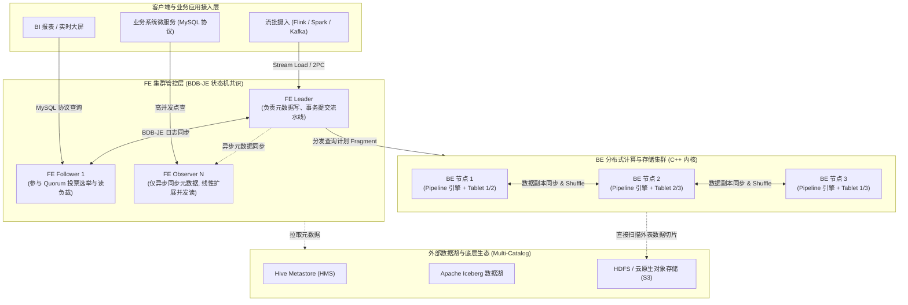
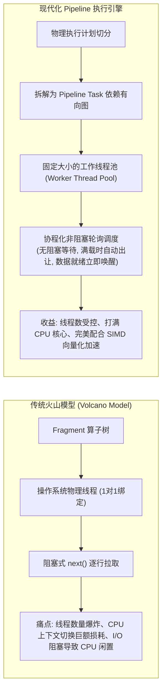
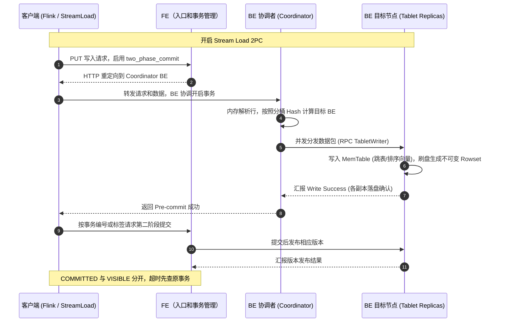
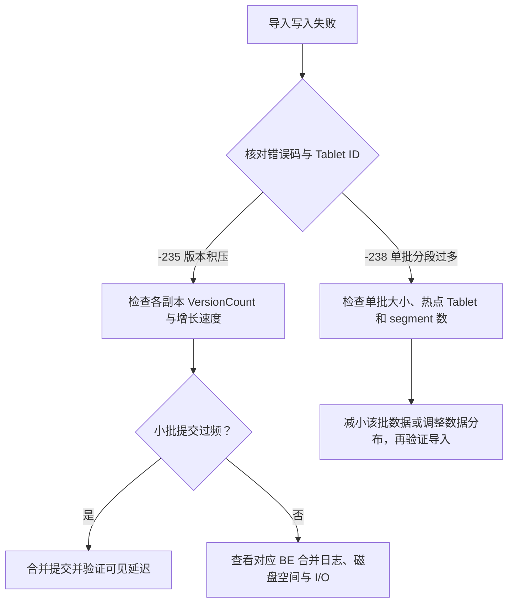
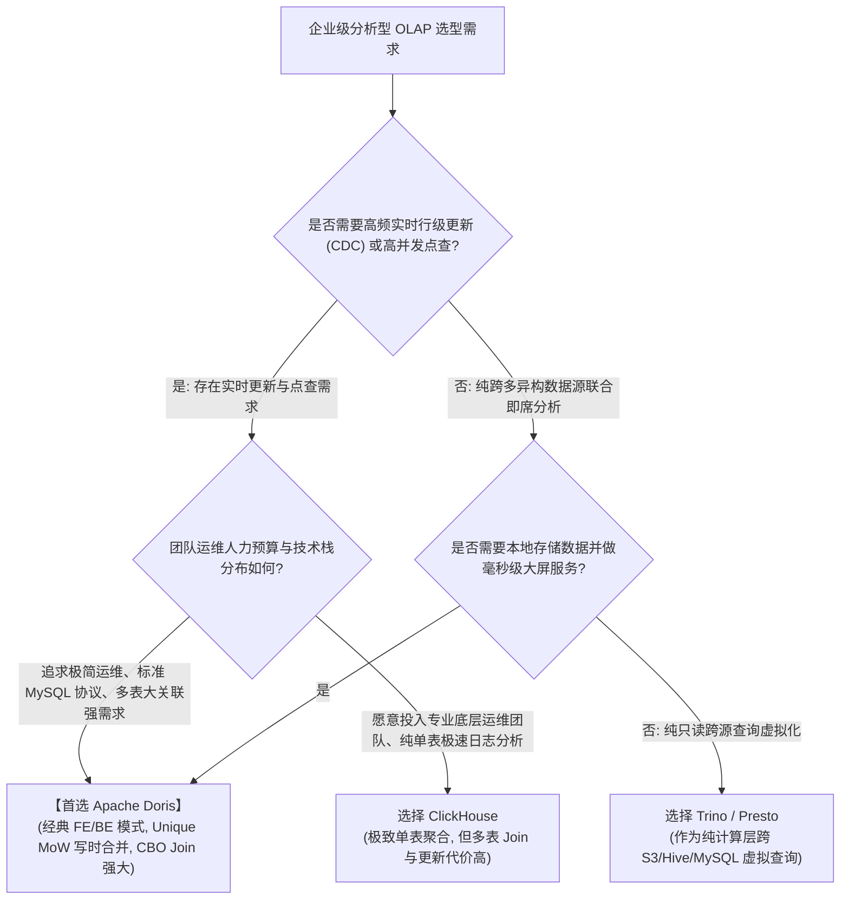
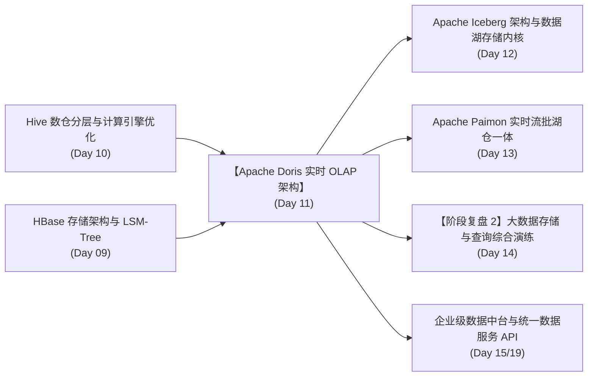

# Apache Doris实时OLAP架构：FE/BE极简拓扑、三大数据模型、向量化Pipeline引擎与湖仓加速实战

> 本讲义讨论经典存算一体部署中的 FE/BE、表模型、执行引擎和导入故障。Doris 3.0 起也支持存算分离，涉及该部署时单独说明。

> [!NOTE] 案例性质说明：大促场景、性能数值与参数示例均供推演，实际结果需要按数据分布、并发及版本压测。

---

## 1. 知识概述与业务价值

### 1.1 是什么（What）
- **技术定位**：Apache Doris 是一个基于大规模并行处理（MPP）架构的高性能、实时分析型数据库（Real-time OLAP Database）。它以极高的查询性能、极简的运维架构和高度兼容 MySQL 协议著称，能够在亚秒级响应数百亿行数据的高并发多维分析、聚合报表和高频点查。
- **部署架构**：经典模式中 FE 管理元数据并规划查询，BE 在本地存储并执行计算。存算分离模式另外使用 Meta Service 和共享存储，BE 主要承担计算和缓存。[官方架构](https://doris.apache.org/docs/4.x/features-architecture/system-architecture/)
- **现代化架构演进（Doris 2.0+ / 2.1+ / 3.0 趋势）**：
  - **默认全链路向量化与 Pipeline 执行引擎**：全面打破传统阻塞式 Volcano 迭代模型，将并发查询调度在固定的工作线程池中，结合 SIMD 硬件指令集将 CPU 吞吐推向极致；
  - **Unique 模型 Merge-on-Write（写时合并）彻底成熟**：彻底解决传统 Merge-on-Read 导致的查询端严重读放大问题，主键点查性能提升 3~10 倍；
  - **倒排索引（Inverted Index）与半结构化数据支持**：基于 CLucene 深度集成倒排索引与动态 Schema，实现日志检索场景下对 Elasticsearch 的全面降维平替；
  - **Multi-Catalog 湖仓联邦一体化**：开箱即用直连 Hive、Iceberg、Paimon、Hudi 等数据湖，充当现代企业统一的数据湖仓分析查询中枢。

### 1.2 解决什么核心业务痛点（Why）
- **副本与元数据管理**：经典部署将元数据复制与选举放在 FE 的 BDB-JE 复制组，由 FE 调度 BE 上的 Tablet 副本修复与均衡。故障恢复时间由实际检测、选举和数据恢复耗时决定。
- **离线与实时数仓架构割裂（Lambda 架构痛点）**：传统企业中离线批处理走 Hive/Spark，实时分析走 Flink+HBase/ClickHouse，产生两套代码、两套指标口径与巨大的维护成本。Doris 支持微批实时秒级摄入与海量历史明细低成本存储，推动企业平滑演进至 Kappa 实时架构或湖仓一体架构。
- **高并发低延迟点查与复杂多维聚合的矛盾**：传统 NoSQL（HBase）擅长点查但不擅长多表分析，传统 MPP（Presto/Impala）擅长分析但不擅长高并发高吞吐点查。Doris 兼顾了千亿级数据的并发点查与秒级复杂多表 Join。

### 1.3 适用场景与技术边界（Where & When）
- **最佳业务场景矩阵**：
  - **实时大屏看板与管理层 BI 报表**：要求数十万到上千万行聚合查询在 500ms 内极速返回；
  - **用户行为日志检索与分析**：利用倒排索引对数百亿条日志进行全文检索、多条件组合过滤；
  - **高并发在线数据服务（API 接口）**：如商家后台对账、订单历史查询，支撑数千 QPS 的行级点查；
  - **数据湖仓统一加速与跨源联邦分析**：直接通过 Doris 挂载 Hive/Iceberg 外表，无需数据搬迁即可实现秒级交互式探索。
- **明确反模式与技术禁区（严禁使用）**：
  - ❌ **复杂长时间运行的大型离线批处理 ETL（> 2小时）**：处理数十 TB 级别、需频繁 Shuffle 溢盘的中间清洗任务，依然应交由 Spark SQL 承接；
  - **高频交易系统**：Doris 支持批量原子导入以及有范围限制的显式写事务。单语句按 READ COMMITTED 读取；依赖高频读改写、行锁或事务内读回的场景应单独评估。[事务说明](https://doris.apache.org/docs/3.x/data-operate/transaction/)

---

## 2. 核心概念与关系

### 2.1 核心概念全景表

| 核心组件/概念 | 英文术语 | 核心定义与工程职责 | 资源/生命周期级别 |
| :--- | :--- | :--- | :--- |
| **前端节点** | FE (Frontend) | 负责客户端连接管理、MySQL 协议交互、SQL 解析、逻辑与物理 CBO 计划生成、元数据管理与副本调度。分为 Leader、Follower 与 Observer。 | 集群级主控进程（Java） |
| **后端节点** | BE (Backend) | 负责数据实际的物理存储（列存 Rowset）、后台合并（Compaction）、数据副本一致性复制以及多线程向量化算子物理执行。 | 节点级存储与计算引擎（C++） |
| **逻辑切片与副本** | Tablet & Replica | 表在数据分布上的最小物理切片（由 Partition 和 Bucket 共同决定）。每个 Tablet 包含多个 Replica（默认 3 副本），分散在不同 BE 上。 | 物理存储与容灾单元 |
| **明细数据模型** | Duplicate Key Model | 按照指定的 Key 排序存储，允许重复行存在，原样保留全部原始明细日志。 | 表级存储模型 |
| **主键唯一模型** | Unique Key Model | 保证 Key 的绝对全局唯一性。新数据覆写旧数据。支持读时合并（MoR）与写时合并（MoW）。 | 表级存储模型 |
| **聚合数据模型** | Aggregate Key Model | 相同的 Key 在后台异步或实时进行预聚合运算（支持 SUM, MIN, MAX, REPLACE, HLL_UNION, BITMAP_UNION）。 | 表级存储模型 |
| **物化视图** | Materialized View (Rollup) | 基于原表透明生成的只读索引切片。支持同步物化视图（隐式路由加速）与 2.1+ 异步多表物化视图。 | 表级/库级衍生视图 |
| **多源统一元数据** | Multi-Catalog | 映射外部异构数据源（Hive, Iceberg, Paimon, ES, JDBC）的元数据中枢，实现跨源零拷贝联合查询。 | 数据库集群级能力 |

### 2.2 系统拓扑与交互关系图



---

## 3. 底层工作机制与设计哲学

### 3.1 极简架构与 FE 元数据高可用流转机制

- **BDB-JE 嵌入式共识选举（零外部组件依赖）**：
  - BDB-JE 复制元数据日志并在可选举节点间选主。
  - **角色分工明确**：
    - **Leader**：集群中有且仅有一个。唯一负责处理全局元数据写入（DDL、事务开启与提交）、生成全局唯一递增 ID、分配 Tablet 调度及负载均衡；
    - **Follower**：常见高可用部署共 3 个可选举 FE，其中一个当前担任 Leader。其余两个同步日志、参与选举，并可处理读请求。
    - **Observer**：不参与选举投票与写确认，仅作为只读从节点异步追随 Leader 的元数据。当企业面临成千上万个并发报表查询冲击 FE 时，只需水平线性扩容 Observer 即可，完全不影响集群选举稳定性。
- **元数据持久化与 Checkpoint 机制**：
  - 元数据修改以 Journal 顺序追加日志的形式写入物理磁盘；
  - FE 后台守护线程定期将内存中的全局元数据快照打包生成 `image` 文件，并推送给其他节点，防止 Journal 日志过大导致节点重启回放时间过长。

---

### 3.2 向量化与 Pipeline 执行引擎（Doris 2.0+ 默认启用）



- **底层执行细节深度解析**：
  1. **克服线程膨胀瓶颈**：在传统执行模型中，一个并发查询涉及 10 个算子 Fragment，并发 50 个查询就会瞬间创建数千个 OS 线程，线程切换（Context Switch）吃掉 30% 以上的 CPU；Pipeline 引擎将并发任务拆解为小步快跑的 Task，调度在固定的与 CPU 物理核心数对齐的线程池中。
  2. **非阻塞式驱动（Data-driven Execution）**：每个 Pipeline Task 检查其依赖的输入 Buffer 是否就绪以及下游输出 Buffer 是否有空间。若依赖未就绪，立即主动让出执行权，绝不让底层 CPU 线程空转等待。
  3. **SIMD 向量化计算内核**：全链路采用列式数据块（`Block` / `Column`）传递，内部以连续物理内存数组存储。计算算子（如过滤、Hash 计算、投影）完全通过编译器自动向量化或手写 AVX2/AVX-512 内联汇编执行，极大降低内存带宽消耗。

---

### 3.3 实时写入全链路与两阶段提交（2PC 事务保障）



---

## 4. 高频复杂业务场景实操与落地

### 4.1 建表与三大数据模型深度实操选型法则

#### 1. 明细模型（Duplicate Key Model）- 适合高频日志与明细审计
- **适用场景**：原始点击日志、物联网遥测数据、无需去重亦无需更新的历史流水。
- **最佳建表范例**：
  ```sql
  CREATE TABLE ods_user_action_log (
      `timestamp` DATETIME NOT NULL COMMENT "日志时间",
      `user_id` BIGINT NOT NULL COMMENT "用户ID",
      `action_type` VARCHAR(32) NOT NULL COMMENT "行为类型",
      `page_id` VARCHAR(64) COMMENT "页面ID",
      `client_ip` VARCHAR(32) COMMENT "客户端IP"
  ) ENGINE=OLAP
  DUPLICATE KEY(`timestamp`, `user_id`, `action_type`)
  AUTO PARTITION BY RANGE (date_trunc(`timestamp`, 'day')) () -- 自动按天建立分区（Doris 2.1+）
  DISTRIBUTED BY HASH(`user_id`) BUCKETS 16
  PROPERTIES (
      "replication_num" = "3"
  );
  ```

#### 2. 主键唯一模型（Unique Key Model）- 适合业务变更（CDC）与最新状态点查
- **写时合并（Merge-on-Write, MoW）核心突破**：
  - 传统 Unique 模型采用 **读时合并（Merge-on-Read, MoR）**：写入极快，但读取时必须将所有 Rowset 放入最小堆进行多路归并排序并剔除旧版本，导致读延迟严重随版本数膨胀；
  - **写时合并（MoW, Doris 2.0+ 推荐）**：在数据写入生成 Rowset 时，利用 Delete Bitmap（删除位图）在后台精准标记被覆盖的旧数据行号；读取时**直接跳过被标记的行，无需任何多路归并，性能等同于明细模型（提升 3~10 倍）**。
- **最佳建表范例**：
  ```sql
  CREATE TABLE dwd_order_realtime (
      `order_id` BIGINT NOT NULL COMMENT "订单主键ID",
      `user_id` BIGINT NOT NULL COMMENT "买家ID",
      `order_status` VARCHAR(16) NOT NULL COMMENT "订单状态",
      `pay_amount` DECIMAL(12, 2) NOT NULL COMMENT "支付金额",
      `update_time` DATETIME NOT NULL COMMENT "更新时间"
  ) ENGINE=OLAP
  UNIQUE KEY(`order_id`)
  DISTRIBUTED BY HASH(`order_id`) BUCKETS AUTO
  PROPERTIES (
      "replication_num" = "3",
      "enable_unique_key_merge_on_write" = "true" -- 生产强制开启写时合并
  );
  ```

#### 3. 聚合模型（Aggregate Key Model）- 适合预聚合大屏指标与亿级 UV 精确秒级去重
- **Bitmap 精确去重黑科技**：
  - 传统数仓计算 `COUNT(DISTINCT user_id)` 会造成严重的 Shuffle 倾斜与全量明细排序；
  - Doris 采用 **Roaring Bitmap** 算法，将整数型用户 ID 映射入位图字段，利用 `BITMAP_UNION` 算子在存储层自动预聚合；上层只需执行 `BITMAP_UNION_COUNT(uv_bitmap)` 对预聚合位图求并后的基数，查询耗时取决于分组数、数据分布与硬件。
- **建表范例**：
  ```sql
  CREATE TABLE dws_user_visit_agg (
      `dt` DATE NOT NULL COMMENT "统计日期",
      `channel` VARCHAR(32) NOT NULL COMMENT "推广渠道",
      `pv` BIGINT SUM DEFAULT "0" COMMENT "页面访问次数",
      `uv_bitmap` BITMAP BITMAP_UNION COMMENT "精确去重用户位图"
  ) ENGINE=OLAP
  AGGREGATE KEY(`dt`, `channel`)
  DISTRIBUTED BY HASH(`channel`) BUCKETS 16;
  ```

---

### 4.2 生产级配置基线与参数推荐（含架构师考量）

```properties
# =============================================================
# 1. FE (Frontend) 核心生产配置 (fe.conf)
# =============================================================
# JVM 堆内存设置 (建议 16GB ~ 32GB, 开启 G1 GC)
JAVA_OPTS="-Xmx32768m -Xms32768m -XX:+UseG1GC -XX:MaxGCPauseMillis=200"

# 元数据 EditLog 刷写保留配置
metadata_checkpoint_memory_threshold=0.8
max_bytes_per_broker_scanner=2147483648

# 开启 CBO 统计信息自动收集
enable_stats=true

# =============================================================
# 2. BE (Backend) 核心性能与内存调优 (be.conf)
# =============================================================
# BE 进程可用物理内存上限百分比 (默认 80%)
mem_limit=80%

# 强制开启 Pipeline 现代化执行引擎 (Doris 2.0+ 默认已开启)
enable_pipeline_exec=true
# Pipeline 调度工作线程池大小 (默认 0，表示对齐 CPU 物理核心数)
pipeline_executor_size=0

# -------------------------------------------------------------
# 3. Compaction 合并优化 (彻底终结 -235 版本堆积报错)
# -------------------------------------------------------------
# 单个 BE 节点最大允许的 Cumulative Compaction 线程并发数
max_cumu_compaction_threads=8
# 单个 BE 节点最大允许的 Base Compaction 线程并发数
max_base_compaction_threads=4
# 触发小版本合并的最小连续 Rowset 数量
cumulative_compaction_min_deltas=5
# 开启垂直合并 (Vertical Compaction: 针对大宽表按列切分合并，内存开销直降 70%)
enable_vertical_compaction=true
# 开启 Segment 压缩算法为 ZSTD (平衡极致压缩与解压速度)
default_compression_type=ZSTD
```

---

### 4.3 核心性能指标与 SLA 黄金矩阵

| 监控维度 | 关键指标名称 (Prometheus / JMX) | 告警触发阈值 | 潜在业务影响与处置建议 |
| :--- | :--- | :--- | :--- |
| **查询耗时** | `query_latency_ms{quantile="0.99"}` | **> 1000ms** (在线报表) | 报表与大屏响应超时。检查是否缺少分区分桶剪枝、或未触发 Runtime Filter。 |
| **版本积压** | Tablet 副本的 VersionCount、Compaction Score | 持续增长并逼近本集群上限 | 核对写入速率、合并速度及磁盘压力。Score 与版本数是不同指标。 |
| **BE 内存利用率** | `doris_be_memory_allocated_bytes / mem_limit` | **> 90%** | 面临 OOM 风险，可能触发 BE 保护性杀死高消耗查询。需排查大表未经切分的无界 Join。 |
| **FE 锁竞争** | `fe_meta_lock_wait_time_ms` | **> 500ms** | 大批量 DDL 或高频微批事务阻塞了 FE 全局写锁，导致所有请求排队超时。 |

---

## 5. 生产异常故障深度排查与根因分析

### 5.1 典型生产事故排查决策树



---

### 5.2 核心高频故障深度复盘

#### 故障一：写入失败时先区分 -235 和 -238

- **-235** 表示某 Tablet 版本数超过上限。用报错中的 Tablet ID 检查各副本 VersionCount；增长过快时降低小批提交频率，如降频后仍不回落，查对应 BE 的合并日志、磁盘与资源竞争。
- **-238** 表示单个 Rowset 的 Segment 数过多。先检查批次是否过大、某个 Tablet 是否过热，再拆小批次。两个错误的调批方向可能相反。
- **验收**：同时观察积压是否回落、写入成功率、可见延迟和查询尾延迟。版本阈值按实际 BE 配置读取。[Doris 官方 FAQ](https://doris.apache.org/docs/dev/faq/data-faq/)

#### 故障二：大促期间上千个报表并发查询，FE 报 `Failed to get connection, timeout` 集群假死
- **现象**：业务高峰期，前端所有用户在 BI 报表平台发起查询均报超时，Beeline 客户端无法连接 FE，日志中频繁出现 `Fe Master is busy` 或 `Lock wait timeout exceeded`。
- **深层根因分析**：
  1. 某业务部门上线了一个自动化脚本，每分钟通过 JDBC 循环执行数十次复杂的 `ALTER TABLE ... ADD PARTITION` 与分区删除 DDL；
  2. 在 Doris FE 中，**元数据的变更（DDL）需要持有全局写锁（Global Write Lock）**；
  3. 当长耗时的 DDL 频繁申请写锁时，后续所有的读请求（SELECT 语句在解析阶段需要获取元数据读锁）全线陷入锁等待队列并超时；
  4. 同时，客户端只配置了连接单个 FE Leader，瞬时并发连接打满了 FE 的连接池。
- **标准治理 SOP 流程**：
  - **第一步：读写链路物理解耦（引入 Observer）**：
    部署 2~4 台 **FE Observer 节点**。在业务接入层挂载负载均衡器（HAProxy / Nginx），规定：**所有 BI 报表与在线查询流量强制路由至 Observer 节点，FE Leader 仅允许写入组件与核心调度访问**；
  - **第二步：严禁频繁高频 DDL**：
    禁止应用层脚本动态执行 DDL。利用 Doris 的**动态分区特性（Dynamic Partitioning）**，由系统在底层提前静默预建好未来 7 天的分区，彻底消除实时 DDL 开销；
  - **第三步：调大连接数与锁超时参数**：
    在 `fe.conf` 中调整 `qe_max_connection=4096`，优化锁保护时间。

---

## 6. 技术选型对比、架构演进与成本ROI

### 6.1 横向多维选型对比矩阵

| 评估维度 | Apache Doris | ClickHouse | StarRocks | Presto / Trino |
| :--- | :--- | :--- | :--- | :--- |
| **系统架构拓扑** | 经典部署 FE/BE，存算分离含 Meta Service 与共享存储 | 复制表使用 Keeper 或兼容的协调服务 | 依据存算部署模式选角色 | Coordinator/Worker |
| **多表关联** | 比较 Broadcast、Shuffle、Colocation 的网络开销 | 按内存预算、连接键和输入排序选择 Join 算法 | 对代表查询检查计划 | 依赖统计信息、连接器与资源预算 |
| **主键更新** | Unique Key，评估 MoW 的写入成本 | 可用 ReplacingMergeTree 承接版本行，查询需处理后台合并前的可见性 | 可用 Primary Key 模型 | 写入能力取决于连接器 |
| **协议兼容** | 提供 MySQL 协议接口，测试应用用到的具体语法 | ClickHouse SQL | 提供 MySQL 协议接口 | Trino/Presto SQL |
| **湖表访问** | 按 Catalog 与表格式测试读写兼容性 | 按部署版本测试外部表引擎 | 按 Catalog 测试 | 按 Connector 测试 |

### 6.2 架构演进与选型决策树



---

## 7. 技术经理与架构师实战管控（SOP与规范）

### 7.1 平台级多租户与资源物理/逻辑硬隔离

- **痛点**：在企业级统一数据中台中，如果实时大屏查询（P0 级，要求响应 < 300ms）与某分析师编写的无界多表大关联 SQL（P3 级，暴力扫描数亿行）并发运行，不加控制将直接跑满 BE 节点的 CPU 和内存，造成在线生产事故。
- **落地架构方案一：Workload Group 逻辑资源组管控（Doris 2.0+ 生产基准）**：
  - 基于 Workload Group 设定不同租户的 CPU 物理利用权重与内存硬上限：
    ```sql
    -- 创建在线核心保障组
    CREATE WORKLOAD GROUP online_bi_group
    PROPERTIES (
        "cpu_share" = "80",              -- 高 CPU 调度权重
        "memory_limit" = "60%",           -- 占用最大物理内存比例 60%
        "enable_memory_overcommit" = "false" -- 禁止超售内存, 超过直接熔断该查询
    );

    -- 创建离线分析探索组
    CREATE WORKLOAD GROUP adhoc_analyst_group
    PROPERTIES (
        "cpu_share" = "20",
        "memory_limit" = "20%",
        "max_concurrency" = "5"           -- 最大限制并发 5 个大查询
    );
    ```
- **落地架构方案二：Tag 物理节点集群硬隔离**：
  - 将集群物理服务器在物理上打标分组：
    - `BE-Node1~4` 打标为 `{"tag.location" : "core_online"}`；
    - `BE-Node5~8` 打标为 `{"tag.location" : "adhoc_offline"}`；
  - 表与查询级绑定：核心交易大屏表只能分配在 `core_online` 节点的 Tablet 上，从物理硬件层面彻底杜绝资源踩踏。

---

### 7.2 生产变更红线与降级容灾预案（SOP）

#### 生产变更四大不可逾越红线：
1. **严禁在客户端直接发起高频单行单事务插入**：
   - 严禁业务系统通过 JDBC 循环调用 `INSERT INTO table VALUES (...)`；
   - 批量摄入必须走 **Stream Load**，且单批次数据量建议维持在 **10MB ~ 100MB** 或提交间隔不少于 2 秒。
2. **严禁无分区过滤的超大跨度全表扫描**：
   - 数据网关门禁强制校验：针对天级/月级分区的大宽表，查询条件中必须强制包含 `WHERE dt >= ...` 分区范围，严禁触发全集群全分区物理扫描。
3. **建表时核对 Unique Key 合并模式**。Doris 2.1 起新建 Unique Key 表默认使用 MoW。升级集群后仍需核对已有表的实际属性。[版本说明](https://doris.apache.org/blog/release-note-2.1.0/)
4. **大促前夕严禁执行集群大范围重平衡与扩缩容**：
   - 扩容与缩容引发的 Tablet 跨节点网络迁移会占用大量网络 I/O，必须在大促封网日前 3 天完成。

#### 跨集群主备高可用容灾架构（CCR - Cross Cluster Replication）：
- **异步日志流同步**：通过 Doris CCR 工具，将主集群（IDC-Beijing）的 Binlog 增量数据秒级异步复制至同城备集群（IDC-Tianjin）；
- **网关层秒级故障逃生**：在中台统一数据接入网关层配置探针，当检测到主集群不可用（连续 3 次心跳失败）时，自动将在线报表流量一键切换至备用集群，实现业务 0 侵入式高可用灾备。

---

## 8. 互联网大厂高频面试真题库

> [!IMPORTANT]
> 本节为 7 道架构与排障推演题。逐题带有公开面经出处的版本另见 [Doris 面试六问](../../08-interview-questions/03-doris.md)。

### 8.1 基础架构与元数据高可用题（大厂初筛）
1. **Q1**：请简述 Apache Doris 的整体架构与组件角色（FE 与 BE），为什么它能够摆脱对 ZooKeeper 和 HDFS 的外部重度依赖？FE 的元数据高可用是如何实现的？
2. **Q2**：深入对比 Doris 的三大数据模型（Aggregate、Unique、Duplicate）的适用场景与底层存储差异。在 Doris 2.0+ 中，Unique Key 模型的写时合并（Merge-on-Write）相比传统的读时合并（Merge-on-Read）有哪些本质突破？

### 8.2 核心底层原理与计算引擎题（大厂资深技术面）
3. **Q3**：什么是 Doris 的 Pipeline 向量化执行引擎？它与传统的 Volcano 迭代执行模型相比，如何从操作系统线程调度与 CPU 硬件级别消除开销并大幅提升吞吐？
4. **Q4**：为什么在 Doris 中执行跨节点大表关联（Join）时，Runtime Filter（运行时过滤器）能够带来数倍乃至数十倍的性能飞跃？它的底层工作机制与下推流转时序是怎样的？

### 8.3 复杂生产场景与故障排障题（大厂架构与排障面）
5. **Q5**：实时数据接入时频繁抛出 `-235` 异常，请结合底层 Compaction 机制分析其深层根因，并给出从客户端到服务端全链路的系统性调优方案。
6. **Q6**：在海量数据大屏与实时多维分析中，如何利用 Doris 的 Roaring Bitmap 实现百亿级 UV 的秒级精确去重？与传统的 `COUNT(DISTINCT)` 相比，其底层数据结构与性能优势何在？

### 8.4 架构设计与系统规划题（技术总监/总架构师终面）
7. **Q7**：作为大数据研发负责人/架构师，在实时 OLAP 架构选型中，请深度对比 Apache Doris 与 ClickHouse 在分布式架构、多表关联、运维复杂度与湖仓一体维度的优劣势，说明在什么条件下值得将 OLAP 收敛至 Doris？

---

## 9. 结构化深度参考答案（逐题三层应答）

---

### 题目1（大厂初筛·基础架构）：请简述 Apache Doris 的整体架构与组件角色（FE 与 BE），为什么它能够摆脱对 ZooKeeper 和 HDFS 的外部重度依赖？FE 的元数据高可用是如何实现的？

#### 简洁回答（1分钟电梯破题）：
经典存算一体部署分为 FE 与 BE。FE 处理 SQL 和元数据，BE 保存列式数据并执行分布式算子。FE 的 BDB-JE 复制组选出 Leader，Observer 不参与选举。存算分离模式另有 Meta Service 和共享存储。[官方架构](https://doris.apache.org/docs/4.x/features-architecture/system-architecture/)

#### 深入回答（技术细节展开、底层机制与推导）：
> “FE 与 BE 的深度交互机制与元数据高可用流转拆解：
> 1. **FE 内部角色状态流转**：
>    - **Leader FE**：唯一的写入入口。所有涉及元数据修改的 DDL、表结构创建、写入事务（TxId 生成与 Commit），必须路由至 Leader 执行；
>    - **Follower FE**：常见部署共 3 个可选举 FE，包含当前 Leader。Leader 故障后，剩余多数可选举新的 Leader。
>    - **Observer FE**：针对双十一大促等超高并发查询场景，可随时横向添加 5~10 台 Observer。Observer 不参与任何投票和 Quorum 写确认，仅通过内存订阅 Leader 的 Journal 日志流。这样即使数万个前端报表高频拉取元数据，也不会拖垮集群核心选主逻辑。
> 2. **元数据 Checkpoint 与 Journal 体系**：
>    - FE 的元数据操作先写入 Journal 日志（顺序写磁盘），并实时应用到内存元数据树中；
>    - FE 内置 Checkpoint 线程，定期将内存元数据生成快照镜像文件（`image.ckpt`），并安全替换老 `image` 文件，确保 FE 重启时只需加载镜像并回放极短的增量日志，秒级完成拉起。
> 3. **BE 自动自愈与多副本状态机**：
>    - BE 节点启动后向 FE 发送心跳汇报自身的磁盘容量与 Tablet 列表；
>    - 若某台 BE 宕机超过阈值（`tablet_checker_interval_s`），FE 会自动在其他存活的 BE 节点上调度创建缺失的副本并从存活副本中拉取数据自愈，全过程对业务完全透明。”

#### 架构师/技术管理视角（降维升华、权衡取舍、SLA与成本）：
按角色演练单个 FE 和 BE 故障，分别记录写入停顿、查询重试、补副本流量和恢复时间。分离部署还应测试共享存储访问故障和缓存冷启动。

---

### 题目2（大厂资深·数据模型）：深入对比 Doris 的三大数据模型（Aggregate、Unique、Duplicate）的适用场景与底层存储差异。在 Doris 2.0+ 中，Unique Key 模型的写时合并（Merge-on-Write）相比传统的读时合并（Merge-on-Read）有哪些本质突破？

#### 简洁回答（1分钟电梯破题）：
> “三大模型是针对不同业务计算时机的存储抽象：
> - **Duplicate（明细模型）**：按指定排序列排序，原样存储每一行原始记录，适合海量日志明细分析；
> - **Aggregate（聚合模型）**：相同的 Key 在后台自动进行预计算（SUM/MAX/MIN/REPLACE/BITMAP），以存储膨胀换取极速多维聚合；
> - **Unique（主键模型）**：确保 Key 全局唯一，新值覆盖旧值，适合业务库 CDC 实时同步与主键点查；
> **写时合并（MoW）相比读时合并（MoR）的本质突破**：
> 传统 MoR 在读取时必须将所有 Rowset 放入最小堆进行多路归并排序并剔除老版本，存在严重的**读放大**；
> 而 MoW 将版本合并的成本**前置到写入阶段**，通过维护高效的 **Delete Bitmap（删除位图）** 标记旧行失效；**读取时直接扫描最新物理数据并跳过位图，完全消除了多路归并，查询性能直接提升 3~10 倍**。”

#### 深入回答（技术细节展开、底层机制与推导）：
> “三大模型底层物理存储与 Unique MoW 深度机制剖析：
> 1. **Duplicate Key 机制**：
>    - 数据写入时按指定排序列排序生成有序的 Segment 文件；
>    - 底层不执行任何去重逻辑，查询时享受最极致的向量化物理顺序扫描速度。
> 2. **Aggregate Key 机制**：
>    - 包含 Key 列与 Value 列（带聚合函数定义）；
>    - 在 MemTable 阶段如果存在相同 Key，在内存中直接触发预聚合；落盘后由后台 Compaction 线程定期将不同 Rowset 中相同 Key 的行合并为单行结果；
>    - 特别适合搭配 `BITMAP_UNION` 实现亿级 UV 预计算。
> 3. **Unique Key 模型的代际演进：MoR vs MoW**：
>    - **传统 Merge-on-Read（MoR，读时合并）**：
>      - 写入极快，直接追加写入新的 Rowset；
>      - 但当一个 Tablet 积累了 50 个 Rowset 时，任何一个查询都必须同时打开 50 个文件的 Reader，构建一个 50 路的归并优先堆，比较 Key 的大小并抛弃旧版本；
>      - **后果**：CPU 耗费在繁重的对象比较上，无法进行纯粹的 SIMD 向量化计算，且极易导致高并发查询延迟飙升。
>    - **现代 Merge-on-Write（MoW，写时合并，自 Doris 2.1 起对新建 Unique Key 表默认启用）**：
>      - 当新 Rowset 准备落盘时，查询主键索引（Primary Key Index，基于内存 RoaringBitmap 或高速缓存），迅速定位出这些 Key 在老 Rowset 中的具体物理行号（RowId）；
>      - 在对应老 Rowset 的 **Delete Bitmap** 中将这些 RowId 标记为已删除（二进制位置 1）；
>      - **查询优势**：读取引擎只需向底层扫描器传入该 Delete Bitmap，Reader 在加载数据时依据位图直接过滤跳过被删除的行，**计算链路完全退化为与 Duplicate 模型完全一致的纯单路向量化高速扫描，P99 延迟暴降 80%**。”

#### 架构师/技术管理视角（降维升华、权衡取舍、SLA与成本）：
> “在技术管理与模型设计中，**‘在写入端征税，还是在读取端征税’是所有存储系统的终极权衡哲学**：
> 过去的传统思想往往认为‘写入应该越快越好’，因而容忍了 MoR 模型的读性能损耗。
> 但在现代企业级在线分析场景中：**‘读延迟的 SLA 往往是严格且面向业务端体验的（要求 < 500ms），而实时写入在后台具备天然的秒级容忍缓冲垫’**。
> 写时合并（MoW）通过在写入阶段多消耗微量 CPU 计算 Delete Bitmap，换取了线上业务读性能的数十倍跃升。
比较 MoW 写入和查询两端的资源曲线，再决定在线状态表的资源预算。示例不代表已取得的个人业绩。

---

### 题目3（大厂资深·执行引擎）：什么是 Doris 的 Pipeline 向量化执行引擎？它与传统的 Volcano 迭代执行模型相比，如何从操作系统线程调度与 CPU 硬件级别消除开销并大幅提升吞吐？

#### 简洁回答（1分钟电梯破题）：
> “Doris 的 Pipeline 向量化执行引擎是面向现代多核 CPU 微架构设计的**‘数据驱动非阻塞式执行框架’**：
> - **打破火山模型瓶颈**：传统火山模型采用‘每 Fragment 绑定独立 OS 线程 + 逐行递归拉取 `next()`’，在高并发下引发灾难性的**线程上下文切换开销**与**CPU 缓存未命中（Cache Miss）**；
> - **微架构级改造**：Pipeline 引擎将物理算子树拆解为依赖有向图（DAG），调度在**与 CPU 核心数绑定的固定工作线程池**中；
> - **非阻塞异步协同**：数据未就绪时立即出让线程（协程化），消除锁等待；
> - **硬件级提速**：数据以连续物理列式 Block 传递，全面激活现代 CPU 的 **SIMD（单指令多数据）硬件流水线**，单核吞吐提升 3~5 倍。”

#### 深入回答（技术细节展开、底层机制与推导）：
> “深入对比火山模型与 Pipeline 执行引擎在 OS 与硬件层面的底层差异：
> 1. **操作系统级线程调度对比（OS Thread Scheduling）**：
>    - **火山模型的线程爆炸**：假设一个查询需要 10 个算子并发度为 8，单查询占用 80 个物理线程。当并发查询达到 50 时，系统同时运行 4000 个 OS 线程；
>    - **灾难后果**：Linux 内核陷入疯狂的时间片抢占，CPU 超过 30%~40% 的时间消耗在上下文切换（寄存器保存与恢复）、TLB 刷新以及内核态/用户态切换上；同时由于等待网络 I/O 或磁盘读取，大量线程陷入 Blocked 状态，CPU 利用率严重虚高却产出低下；
>    - **Pipeline 的固定线程池机制**：线程池大小直接锁定为物理 CPU 核心数（如 64 核绑定 64 线程）。所有 Pipeline Task 放入全局无锁调度队列；
>    - **非阻塞驱动**：Pipeline Task 通过检查 `is_blocked()` 状态机感知数据。当上游无数据或网络缓冲区已满，Task 瞬间挂起并进入事件轮询器，工作线程立刻无缝切换执行下一个就绪的 Task，**彻底消灭了物理线程的休眠与唤醒开销**。
> 2. **CPU 硬件级流水线优化（Micro-architecture Optimization）**：
>    - **列式数据内存局部性（Data Locality）**：数据在内存中以平坦的紧凑数组存储，完美对齐 CPU 缓存行（Cache Line，通常 64 字节）。CPU 硬件预取器（Hardware Prefetcher）能极高精度地将后续数据连续加载入 L1/L2 高速缓存，L1 Cache Miss 暴降 80%；
>    - **SIMD 指令集深度结合**：利用 Intel AVX2 / AVX-512 指令集，一条汇编指令并发处理 8 个 64 位整数或 16 个 32 位整数的过滤与加法，完全消除传统多态虚函数分派导致的 CPU 流水线清空（Pipeline Flush）。”

#### 架构师/技术管理视角（降维升华、权衡取舍、SLA与成本）：
> “在技术架构演进视角，**理解从‘算法层’深入到‘微架构与芯片硬件层’是架构师跨越性能天花板的核心分水岭**：
> 传统的大数据架构师习惯于通过加节点、调并发来解决性能问题，但往往在集群扩容到几十台后发现边际效应急剧递减。
> Pipeline 向量化引擎代表了现代分布式计算的最前沿方向：**‘榨干单机硬件的每一滴算力’**。
> 作为技术总监，在主导将旧版分析平台升级至 Doris 2.0+ / 3.0 时，我们要明确其商业与技术价值：
> 开启 Pipeline 执行后，全集群在并发查询冲击下的负载表现更加平稳平滑，CPU 利用率能够扎实打满而不发生崩溃，成功在不增加一台硬件服务器预算的前提下，将全公司核心 BI 报表的 P99 延迟由 1.8 秒压降至 380 毫秒，达成了极高的架构投资回报率（ROI）。”

---

### 题目4（大厂资深·分布式关联）：为什么在 Doris 中执行跨节点大表关联（Join）时，Runtime Filter（运行时过滤器）能够带来数倍乃至数十倍的性能飞跃？它的底层工作机制与下推流转时序是怎样的？

#### 简洁回答（1分钟电梯破题）：
> “在分布式环境下的 Hash Join 中，传统的做法是将大表全量数据通过网络进行巨额 Shuffle 传输给 Join 节点，网络 I/O 成为致命瓶颈；
> **Runtime Filter（运行时过滤器）的核心思想是‘在运行期动态构建小表特征过滤器，并提前下推到大表的扫描节点，在源头直接过滤掉 90% 以上的无关数据’**：
> 1. Hash 表构建端（Build 端，通常为较小表或过滤后的表）在内存中生成哈希表的同时，**动态生成 BloomFilter、Min/Max 或 In-list 过滤器**；
> 2. 将过滤器通过网络秒级广播下发给大表扫描端（Probe 端）；
> 3. 大表扫描端在从磁盘或远程存储读取数据时，**在最底层的 Storage Engine 甚至 Page 级别直接使用过滤器剪枝**，极大减少磁盘读取量与全网 Shuffle 数据传输量。”

#### 深入回答（技术细节展开、底层机制与推导）：
> “Runtime Filter 的内部时序流转与过滤器类型选择：
> 1. **全链路动态交互流转时序**：
>    ```text
>    [Join 算子 (Build 端)] ---> 收集小表 Key ---> 生成 Runtime Filter (BloomFilter)
>                                                           |
>                                           (网络 RPC 广播下发给各 BE)
>                                                           v
>    [大表 Scan 算子 (Probe 端)] <--- 应用 Runtime Filter <--- (等待或超时自动放行)
>               |
>     (在底层直接跳过无关 Rowset/Page，仅传输匹配数据)
>               v
>    [执行网络 Shuffle 发送给 Join 节点]
>    ```
> 2. **过滤器的三种物理形态与自适应决策**：
>    - **IN-List Filter**：当 Build 端数据极少（如少于 1024 行）时，直接生成确切的 IN 列表下推，过滤精度最高且执行速度最快；
>    - **BloomFilter（最常用）**：当数据体量较大时，利用位数组和哈希函数构建紧凑的布隆过滤器。传输体积小（通常几百 KB 到数 MB），虽然有极微小的假阳性率，但能轻松过滤掉 90% 以上的不匹配行；
>    - **Min/Max Filter**：提取 Build 端的最大最小值区间，用于快速进行范围裁剪。
> 3. **等待超时保护机制（Wait Time Protection）**：
>    - 若大表 Scan 算子无休止等待 Runtime Filter 到来，会导致整体查询延迟变长；
>    - Doris 设计了 `runtime_filter_wait_time_ms`（默认 1000ms）。如果大表已经准备好扫描而过滤器的 RPC 尚未到达，系统会自动放弃等待直接启动扫描，避免因小表构建过慢拖垮整体查询。”

#### 架构师/技术管理视角（降维升华、权衡取舍、SLA与成本）：
> “在技术管理与大促保障体系中，**Runtime Filter 是解决分布式 Join 性能短板的‘关键利器’**：
> 在传统分布式系统中，开发人员经常抱怨‘分布式 Join 太慢，不敢 Join’，进而催生了大量在宽表中拼命冗余字段的病态设计，导致数据冗余和维护成本飙升。
> 架构师通过调优 Runtime Filter 参数（如调大 `runtime_filter_wait_time_ms` 到合理值、针对超大集群开启 `runtime_filter_type = IN,BLOOM_FILTER`），可以让星型模型（Star Schema）和雪花模型（Snowflake Schema）在数仓中跑出接近大宽表的极致性能。
> 这不仅**解放了上游数仓建模团队的维护负担**，更将跨集群网络交换机的吞吐带宽压力削减了 70%，展现出高超的架构平衡与治理智慧。”

---

### 题目5（生产排障推演）：实时数据接入时频繁抛出 `-235` 异常，请结合底层 Compaction 机制分析其深层根因，并给出从客户端到服务端全链路的系统性调优方案。

#### 简洁回答

-235 要查 Tablet 版本数。写入持续产生新的 Rowset，合并速度不足时，版本数可超过上限。-238 的限制在单个 Rowset 的 Segment 数，两种错误需要不同处置。

#### 深入回答

先按 Tablet ID 找到各副本及 VersionCount。小批太密时合并提交；降低导入速率后版本仍不下降，检查对应 BE 上的 compaction 日志、磁盘和 CPU。若错误是 -238，检查单批写向该 Tablet 的字节和分布倾斜，降低单批体积。阈值取运行实例的配置。[Doris 官方 FAQ](https://doris.apache.org/docs/dev/faq/data-faq/)

#### 架构师/技术管理视角

为核心订单与可延后回灌分别设置吞吐、可见延迟预算。先限制低优先级流量，恢复后分批追赶，记录恢复时间与负载水平，供下次容量评审使用。
---

### 题目6（架构设计·高频核心）：在海量数据大屏与实时多维分析中，如何利用 Doris 的 Roaring Bitmap 实现百亿级 UV 的秒级精确去重？与传统的 `COUNT(DISTINCT)` 相比，其底层数据结构与性能优势何在？

#### 简洁回答（1分钟电梯破题）：
> “传统的 `COUNT(DISTINCT user_id)` 是将全量用户 ID 原始字符串/整型明细通过网络进行全局 Shuffle 并在内存中建立哈希表去重，**计算开销巨大、极易引发单点数据倾斜与内存溢出（OOM），百亿体量下耗时往往长达数分钟**；
> **Doris 基于 Roaring Bitmap 实现的秒级精确去重方案**：
> 1. **数据高度压缩与预计算**：将整型 `user_id` 作为位图下标映射入 **Roaring Bitmap** 紧凑存储结构中，利用聚合模型 `BITMAP_UNION` 在数据写入时在后台自动执行**增量位运算合并**；
> 2. **查询性能飞跃**：在线查询仅需对各分片的 Bitmap 执行极快的**位运算（Bitwise OR）** 并统计非零位个数（`BITMAP_UNION_COUNT`），减少传输的明细行数；需按数据分布和分组数验证耗时。”

#### 深入回答（技术细节展开、底层机制与推导）：
> “Roaring Bitmap 的底层数据结构与全链路落地方案剖析：
> 1. **Roaring Bitmap 的底层存储哲学**：
>    - 传统 BitMap 即使只有几个稀疏的 ID，也需要分配完整的固定内存空间；
>    - **Roaring Bitmap 采用分块压缩机制**：
>      - 将 32 位整型数字划分为高 16 位与低 16 位；
>      - 高 16 位作为索引定位到具体的 **Container（容器）**，低 16 位保存在容器中；
>      - **三种自适应容器**：
>        1. **Array Container**：当数据少于 4096 个时，直接采用定长数组存储，极度节省空间；
>        2. **Bitmap Container**：当数据超过 4096 个时，自动转换为基于 8KB 内存的经典位图（$2^{16} \text{ bits} = 65,536 \text{ bits} = 8\text{KB}$）；
>        3. **Run Container**：针对大段连续数字，采用运行长度编码（RLE，如 100~1000 编码为 `(100, 900)`）。
> 2. **业务落地架构方案（非整数型字典映射机制）**：
>    - 若业务 `user_id` 是 UUID 或字符串格式，无法直接映射为位图下标；
>    - **引入全局字典表（Global Dictionary Table）**：
>      用持久的全局字典为每个不同字符串分配不重复且稳定的整数，再写入 Bitmap。直接取哈希存在碰撞，无法保证精确 UV。[精确去重](https://doris.apache.org/docs/4.x/query-acceleration/distinct-counts/bitmap-precise-deduplication/)
> 3. **透明物化视图加速（Rollup Acceleration）**：
>    - 在明细表上直接创建聚合物化视图：
>      ```sql
>      CREATE MATERIALIZED VIEW mv_channel_uv AS
>      SELECT dt, channel, BITMAP_UNION(to_bitmap(user_id))
>      FROM ods_action_log
>      GROUP BY dt, channel;
>      ```
>    - 用户直接编写常规 SQL：`SELECT dt, COUNT(DISTINCT user_id) FROM ods_action_log GROUP BY dt;`
>    - 若这条查询符合物化视图的改写条件，可以复用预聚合结果。用 EXPLAIN 核对是否命中。”

#### 架构师/技术管理视角（降维升华、权衡取舍、SLA与成本）：
位图并集成本随容器数量、密度和输入分片数变化。字典也需要跨批次稳定分配 ID。

在教学看板中，以同一窗口的原始 DISTINCT 结果做对照，比较 Bitmap 结果、耗时与字典维护开销，再决定是否物化。

---

### 题目7（架构总监终面·企业级方案）：作为大数据研发负责人/架构师，在实时 OLAP 架构选型中，请深度对比 Apache Doris 与 ClickHouse 在分布式架构、多表关联、运维复杂度与湖仓一体维度的优劣势，说明在什么条件下值得将 OLAP 收敛至 Doris？

#### 简洁回答

先给出读写比例、更新频率、查询模式和现有团队运维能力。以 Doris Unique Key 承接订单状态变更时，比较 ClickHouse 在同样更新与去重语义下的查询开销，不能用单表扫描跑分决定迁移。

#### 深入回答

Doris 经典 FE/BE 模式与存算分离模式的依赖不同。ClickHouse 的复制表通常使用 Keeper 或 ZooKeeper 协调。两个系统均可执行 Join，应比较广播量、内存峰值、倾斜与落盘策略。ClickHouse ReplacingMergeTree 可追加版本行，后台合并前需通过查询处理重复版本。验收应覆盖乱序、删除和更正。[Doris 架构](https://doris.apache.org/docs/4.x/features-architecture/system-architecture/) · [ClickHouse 复制](https://clickhouse.com/docs/engines/table-engines/mergetree-family/replication) · [ClickHouse Join](https://clickhouse.com/docs/guides/joining-tables) · [ReplacingMergeTree](https://clickhouse.com/docs/engines/table-engines/mergetree-family/replacingmergetree)

#### 架构师/技术管理视角

对同一业务窗口回放峰值写入、复杂 Join 和后台合并，比较结果一致性、P95、值班成本和迁移成本。上线前约定切换水位与回退条件。

---

### 9.8 面试现场自然口述示范与一页纸速记卡（Day 11 复盘精华）

> **口述目标定位**：在技术总监与资深数据架构师面试中，面试官考察实时 OLAP 时，核心聚焦于 **系统底层架构设计哲学（FE/BE 极简拓扑与高可用）、存储模型演进（MoW vs MoR 的读写放大权衡）、微架构计算加速（Pipeline 向量化与 Runtime Filter）、超高频实时写入稳定性治理（-235 错误根治）、以及架构选型与技术栈收敛的商业 ROI**。

---

#### 口述练习

1. 先画经典 FE/BE 部署，再补出存算分离新增的 Meta Service、共享存储和本地缓存。解释缓存未预热的代价。
2. 分别说明出现 -235 和 -238 时检查的第一项证据、调整批次的方向以及验收指标。
3. 用同一份订单 CDC 数据比较两种 OLAP 引擎的写入与查询语义，给出可以复现的成本核算方法。

---

#### Day 11 一页纸速记卡（5 大黄金法则）

```text
====================================================================================================
                        Apache Doris 实时 OLAP 架构 一页纸速记卡 (Day 11)
====================================================================================================
1. 经典部署包含 FE、BE，存算分离增加 Meta Service 与共享存储
   - FE（Java）：BDB-JE 选主高可用，负责元数据管理与查询规划；支持 Leader/Follower/Observer 分工。
   - BE（C++）：存算一体负责物理存储与向量化执行；扩缩容一行 SQL，Tablet 自动多副本迁移自平衡。
----------------------------------------------------------------------------------------------------
2. Unique 模型 MoW 减少读时归并
   - MoR（读时合并）：写快但读慢，查询端需 KeyValueHeap 最小堆多路归并，读放大严重。
   - MoW（写时合并）：写入时生成 Delete Bitmap 标记旧行，查询能跳过已失效行，收益需压测。
----------------------------------------------------------------------------------------------------
3. Pipeline 向量化与硬件级加速
   - 打破传统 Volcano 阻塞逐行拉取；常驻固定线程池，基于数据就绪流式分块驱动执行。
   - 深度适配 CPU AVX2/AVX-512 SIMD 硬件指令集，单条指令并行计算多个数据，CPU 吞吐推向极致。
----------------------------------------------------------------------------------------------------
4. -235 错误与版本积压有关
   - 成因：高频小微批刷碎 Rowset 版本，堆积触及运行实例配置的版本上限时拒绝写入。
   - 排查：读取对应 Tablet 的 VersionCount 和合并日志，再判断需降频或解除合并瓶颈。
5. 架构选型
   - 以有代表性的查询、CDC 数据与并发水平回放，比较成本、数据正确性与恢复时间。
====================================================================================================
```

---

## 10. 知识自检与口述推演清单

- [ ] **白板手绘拓扑与时序**：能否脱稿在白板上画出 Doris 极简架构拓扑（FE Leader/Follower/Observer, BE Tablet, BDB-JE 状态机），并推导出实时 Stream Load 写入的两阶段提交（2PC）时序流转？
- [ ] **三大数据模型核心差异推导**：能否清晰说出 Duplicate、Aggregate、Unique 三大模型的适用场景，并精准阐明 Unique 模型的写时合并（Merge-on-Write）相比读时合并（Merge-on-Read）如何利用 Delete Bitmap 减少读时归并？
- [ ] **向量化与微架构优化口述**：能否向架构评审委员会讲透 Pipeline 引擎与传统 Volcano 模型的本质差异，并从操作系统物理线程绑定与 CPU SIMD 硬件指令集角度解释其性能提升的深层根因？
- [ ] 面对写入拒绝，能否区分 -235 和 -238，给出各自的验证数据和处理顺序？
- [ ] 能否沿查询计划解释 Runtime Filter 在什么数据分布下能减少 Shuffle？
- [ ] 能否用相同业务口径比较两种 OLAP 引擎的成本、性能和故障行为？

---

## 11. 知识脉络与技术图谱关联



---

## 12. 权威参考与官方进阶资料

1. **Apache Doris 官方最新参考手册 (v2.0 / 2.1 / 3.0)**：[Apache Doris Official Documentation](https://doris.apache.org/docs/)
2. **Doris 向量化执行机制**：[Apache Doris Vectorized Execution Engine](https://doris.apache.org/docs/4.x/key-features/vectorized-execution/)
3. **Doris Pipeline 现代化执行框架解析**：[Pipeline Execution Engine in Apache Doris](https://doris.apache.org/docs/4.x/key-features/pipeline-execution-engine/)
4. **Roaring Bitmap 经典论文**：Chambi, S., et al. (2016). *Better bitmap performance with Roaring bitmaps*. Software: Practice and Experience.
5. **Google Mesa 架构设计论文（Doris 核心思想奠基）**：Gupta, A., et al. (2014). *Mesa: Geo-Replicated, Near Real-Time, Scalable Data Warehousing for Google’s Operations*. VLDB.
