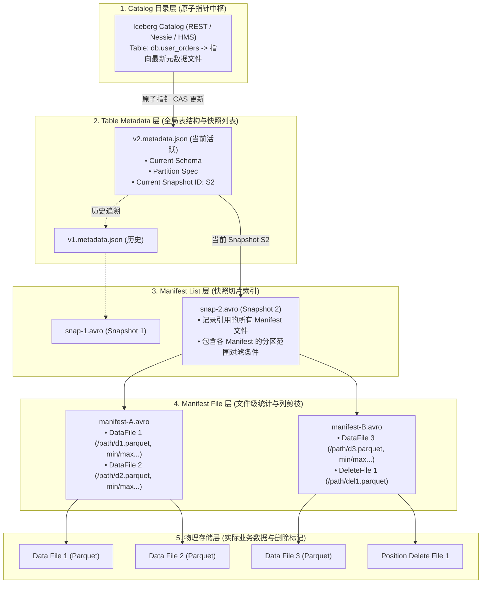
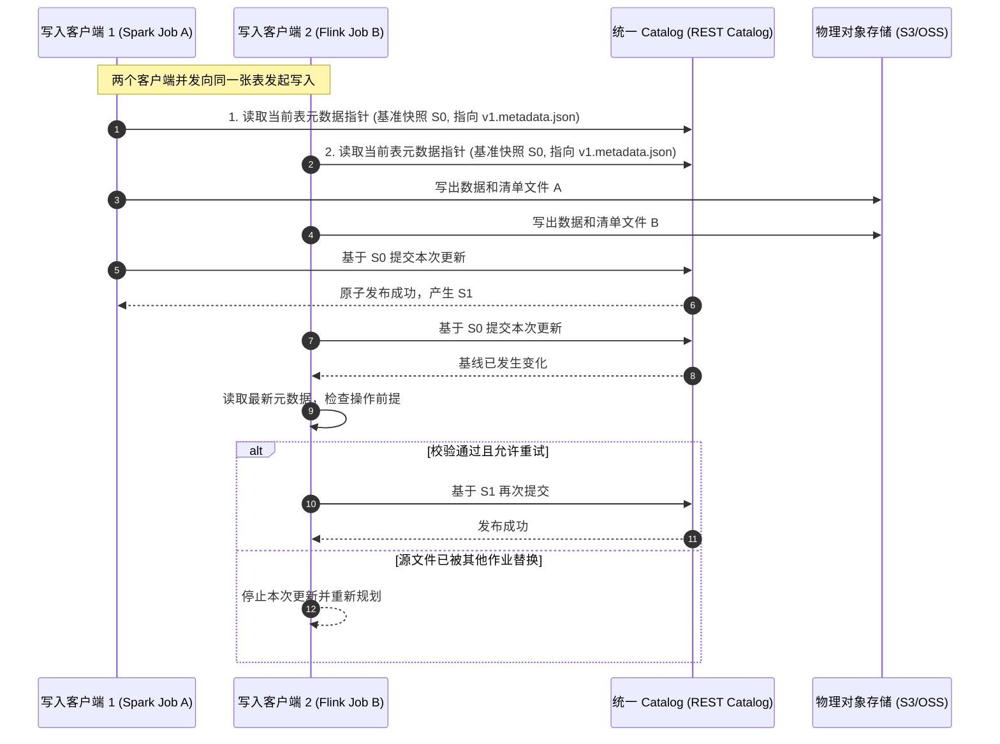
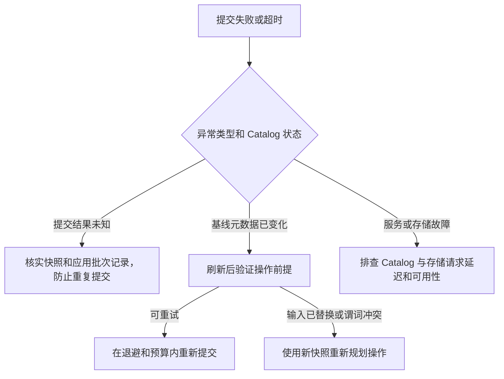
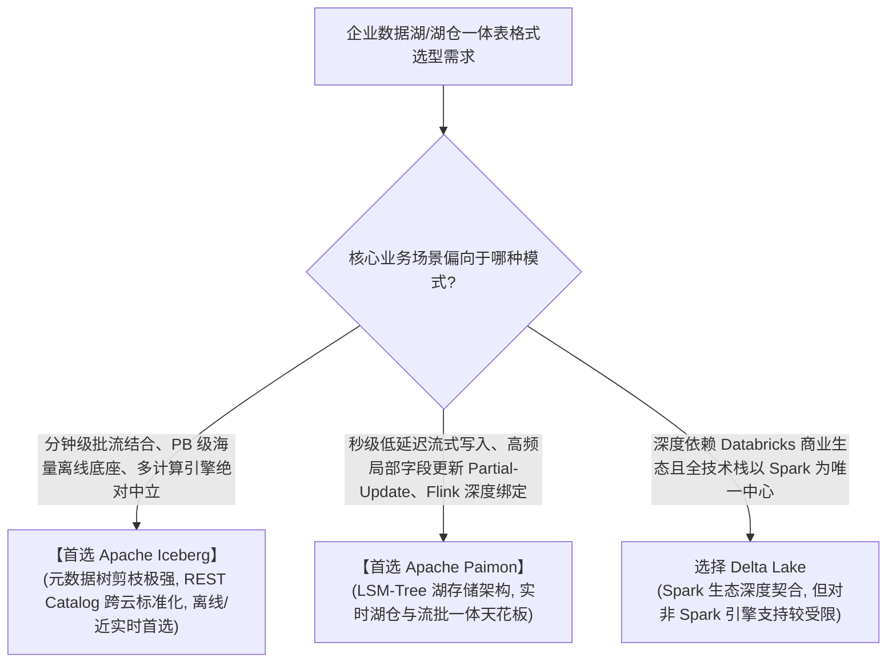
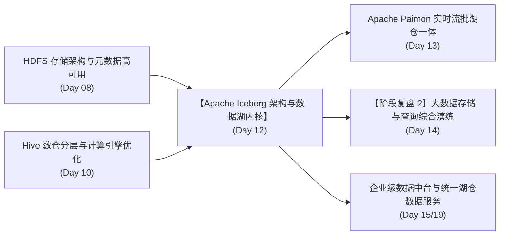

# Apache Iceberg架构与数据湖存储内核：快照隔离、元数据树、隐式分区、并发提交乐观锁与小文件治理

> 本讲义用 Iceberg 表格式 V2 说明文件组织、快照、行级更正与运维。

> [!NOTE] 案例性质说明：大促规模、延迟、资源参数与部署方案均为教学推演。

---

## 1. 知识概述与业务价值

### 1.1 是什么（What）
- **技术定位**：Apache Iceberg 是一种用于超大规模分析型数据集的高性能开源开放表格式（Open Table Format）。由 Netflix 原创设计并贡献给 Apache 基金会，旨在彻底解决传统大数据数仓在云原生对象存储与分布式文件系统上的性能与一致性缺陷。
- **现代化架构抽象**：Iceberg 不依赖计算引擎亦不绑定底层物理存储，它将“表（Table）”抽象为**不可变文件的集合（A collection of files）**，把表级快照、分区和文件索引记录在分层元数据中。
- **最新演进标准（Iceberg 1.5+ / 1.6+ 与 Format V2/V3）**：
  - **Format V2 行级更新标准**：原生支持通过 Delete Files（Position Delete 与 Equality Delete）实现行级 UPDATE 与 DELETE，提供写时复制（CoW）与读时合并（MoR）双模支持；
  - **REST Catalog 成为事实工业标准**：彻底解耦传统重型 Hive Metastore，以轻量级标准 HTTP RESTful 协议作为跨云、跨引擎统一元数据目录；
  - **多引擎互操作**：兼容性取决于读写引擎与连接器版本。尤其要验证 format version、delete file 类型、写入方式与 Catalog。

### 1.2 解决什么核心业务痛点（Why）
- **传统 Hive 目录扫描（Directory Listing）在对象存储上的灾难**：
  - 普通非事务 Hive 分区表在分区裁剪后，常需枚举相关分区目录中的文件。目录项多时，分页请求和限流会拖慢规划。
  - Iceberg 通过已提交快照定位 manifest list 和候选 manifests，避免为发现数据文件递归列目录。筛选清单与文件仍需工作量，受候选条目数和统计质量影响。[可靠性说明](https://iceberg.apache.org/docs/latest/reliability/)
- **并发一致性**：非事务 Hive 表缺乏表级快照发布约定。Iceberg 通过原子发布元数据使读者看到一个完整版本；Hive ACID 表有自己的事务机制。
- **分区规则与物理路径强绑定的僵化痛点**：传统数仓一旦建表指定了分区字段，若业务发展需要修改分区规则（如从按天改为按小时），只能全量重新洗数新建一张表并重构所有下游流水线。Iceberg 的**隐式分区与分区演进（Partition Evolution）** 允许随时动态调整分区策略，无需重写历史数据。

### 1.3 适用场景与技术边界（Where & When）
- **最佳业务场景矩阵**：
  - **百 PB 级统一企业湖仓底座（Lakehouse Base）**：承接海量全量明细与近实时（分钟级）增量摄入，作为离线分析与近实时分析的一体化底座；
  - **云原生存算分离架构**：基于对象存储（S3/OSS/GCS/MinIO/Ceph）构建高可靠、低成本存储层；
  - **历史审计**：对仍保留的快照可按提交时间或 ID 重算报表。清理隐私数据还需考虑历史快照、备份与保留义务。
  - **CDC 入湖**：可通过合适的连接器消费上游变更日志。更新和删除还需配置对应的写入模式，并验证下游兼容性。
- **明确反模式与技术禁区（严禁使用）**：
  - ❌ **毫秒级极速高并发在线点查（< 10ms）**：Iceberg 是表格式，虽然支持剪枝，但点查仍然需要解析元数据树并拉取 Parquet 文件，毫秒级高 QPS API 必须外沉至 Doris 或 HBase；
  - ❌ **超高频单条小微流式写入（每秒数次提交）**：高频提交会导致元数据快照迅速膨胀数万个，导致元数据管理雪崩，流式写入必须设置分钟级（如 1~3 分钟）提交窗口。

---

## 2. 核心概念与关系

### 2.1 核心概念全景表

| 核心组件/概念 | 英文术语 | 核心定义与工程职责 | 资源/生命周期级别 |
| :--- | :--- | :--- | :--- |
| **元数据目录** | Catalog | 记录表名到当前最新“元数据指针（Metadata Pointer）”的映射关系。支持 REST Catalog、Hive Catalog、Nessie、JDBC 等。 | 集群/企业级统一中枢 |
| **表元数据文件** | Metadata File (`.metadata.json`) | 存储表的全局核心元数据：Schema 定义、分区规格（Partition Spec）、排序规则、仍保留的快照历史及当前活跃快照 ID。 | 表级状态版本（不可变对象） |
| **清单列表文件** | Manifest List (`snap-xxx.avro`) | 代表某一个特定快照（Snapshot）。内部记录该快照所引用的所有 Manifest Files 路径及其分区边界统计信息。 | 快照级元数据文件 |
| **清单文件** | Manifest File (`xxx.avro`) | 记录具体的数据文件（Data File）或删除文件（Delete File）的实际物理路径、文件状态（ADDED/EXISTING/DELETED）及列级统计。 | 文件切片级元数据 |
| **实际物理数据文件** | Data File (`.parquet` / `.orc`) | 存储实际业务数据的列式文件。包含完整的列索引与编码数据。 | 底层物理存储文件 |
| **删除索引文件** | Delete File | Format V2 引入。记录被删除行的物理位置（Position Delete）或等值匹配条件（Equality Delete）。 | 行级更新/删除索引文件 |
| **快照与时间旅行** | Snapshot & Time Travel | 快照代表表在某一特定物理时刻的完整、一致状态。用户可基于快照 ID 或时间戳查询历史历史状态。 | 时间点逻辑视图 |
| **隐式分区** | Hidden Partitioning | 分区逻辑由引擎根据定义的 Transform 表达式（如 `days(ts)`）自动推导，业务 SQL 无需感知分区字段。 | 逻辑与物理映射机制 |

### 2.2 系统拓扑与元数据树四层交互图



---

## 3. 底层工作机制与设计哲学

### 3.1 树状元数据拓扑与极速剪枝寻址机制

- **逐级剪枝（Pruning Hierarchy）执行推导**：
  假设查询 SQL：`SELECT * FROM db.user_orders WHERE event_time >= '2026-11-17 00:00:00' AND order_id = 10029384;`
  1. **第一层：Catalog 寻址**：查询引擎向 Catalog 请求获取当前表的最新元数据指针，载入 `v2.metadata.json`；
  2. **第二层：Manifest List 分区粗剪（毫秒级）**：
     - 打开 `snap-2.avro`，遍历所有记录的 Manifest File；
     - 每个 Manifest 条目均附带其包含的数据文件的**分区键上下界（Partition Field Summary: Min/Max）**；
     - 引擎比对 `event_time` 分区范围，若某个 Manifest 的分区范围为 `[2026-11-01, 2026-11-10]`，则在内存中直接完全剔除该 Manifest File，**连该 Manifest 文件的物理加载都直接跳过**；
  3. **第三层：Manifest File 文件级细粒度剪枝**：
     - 打开幸存的 Manifest 文件（如 `manifest-B.avro`）；
     - 读取其中每个 Data File 记录的**列级统计信息（Column Statistics: Min, Max, NullCount, NaNCount）**；
     - 针对非分区列 `order_id = 10029384` 进行判定：若某文件的 `order_id` 取值范围是 `[1, 5000000]`，直接跳过该物理数据文件；
  4. **第四层：物理 Parquet 加载与 Delete File 过滤**：
     - 引擎读取仍可能命中的 Parquet 文件，应用原始谓词和适用的删除记录。缺少统计或取值范围重叠时，可能仍需读取许多文件。

---

### 3.2 乐观并发控制（OCC）与 CAS 原子提交时序



---

### 3.3 隐式分区（Hidden Partitioning）与分区演进（Partition Evolution）

- **隐式分区核心哲学**：
  - 传统数仓痛点：业务必须显式定义一个分区列（如 `dt VARCHAR`），查询时用户如果写 `WHERE create_time >= '2026-11-17'`，由于没有写 `AND dt = '2026-11-17'`，传统 Hive 优化器将直接退化为全表扫描！
  - **Iceberg 隐式分区机制**：
    - 表定义时不创建额外的物理冗余列，直接在真实字段上定义 **Transform 表达式**：
      ```sql
      PARTITIONED BY (days(event_time), bucket(16, user_id))
      ```
    - 用户查询只需自然书写：`WHERE event_time >= '2026-11-17 00:00:00'`；
    - Iceberg 优化器底层自动推导计算该时间对应的 `days(event_time)` 分区标识，在元数据树中直接完成精准剪枝，消除人为失误。
- **零成本分区演进（Partition Evolution）**：
  - 若系统运行一年后数据量暴增，需要将分区策略改为 `hours(event_time)`；
  - Iceberg 仅需执行一条 DDL 修改元数据规范，**新写入的数据按新规则建立分区，而历史数据完好保留并继续按老规则剪枝**。一个快照能够同时无缝调度多套不同时期的分区规范，无需全量重洗历史数据！

---

## 4. 高频复杂业务场景实操与落地

### 4.1 生产级表设计规范与 Format V2 选型

```sql
-- Spark SQL 示例，已配置 Iceberg Catalog 与相应扩展
CREATE TABLE lakehouse_prod.trade.dwd_order_fact (
    `order_id` BIGINT COMMENT "订单唯一主键",
    `buyer_id` BIGINT COMMENT "买家用户ID",
    `seller_id` BIGINT COMMENT "卖家店铺ID",
    `order_status` VARCHAR(32) COMMENT "订单流转状态",
    `pay_amount` DECIMAL(18, 4) COMMENT "支付金额",
    `created_at` TIMESTAMP COMMENT "下单时间",
    `updated_at` TIMESTAMP COMMENT "更新时间"
) 
USING iceberg
PARTITIONED BY (days(created_at), bucket(32, buyer_id))
TBLPROPERTIES (
    -- 强制使用 Format V2 以支持行级更新与删除
    'format-version' = '2',
    -- 行级删除采用读时合并 (Merge-on-Read, 规避写入端高昂重写成本)
    'write.delete.mode' = 'merge-on-read',
    'write.update.mode' = 'merge-on-read',
    'write.merge.mode' = 'merge-on-read',
    -- 默认数据存储列存格式为 Parquet
    'write.format.default' = 'parquet',
    -- 开启 ZSTD 高效压缩算法
    'write.parquet.compression-codec' = 'zstd',
    -- 单个数据文件目标大小 (512MB，与对象存储最佳吞吐对齐)
    'write.target-file-size-bytes' = '536870912',
    -- 开启写入自适应分发，减少小文件碎片
    'write.distribution-mode' = 'hash'
);
```

---

### 4.2 生产级运维三板斧：小文件合并、快照过期与孤儿文件清理

> [!CRITICAL]
> **“生于入湖，死于维护”**是所有数据湖架构落地的真实写照。如果不配置自动化后台治理任务，几周之内成千上万的快照和 Position Delete 文件将彻底拖垮整个湖仓的查询性能。

#### 1. 小文件合并重写（Compaction / Data File Rewriting）
- **现象**：Flink 实时写入每分钟产生数个几十 KB 的小数据文件和 Delete 文件；
- **治理 SOP**：在离线夜间调度 Spark 任务执行物理重写，将零散数据文件与删除文件合并为 512MB 的标准化大文件：
  ```sql
  CALL lakehouse_prod.system.rewrite_data_files(
      table => 'trade.dwd_order_fact',
      strategy => 'binpack',
      options => map(
          'target-file-size-bytes', '536870912', -- 目标文件大小 512MB
          'min-file-size-bytes', '134217728',    -- 小于 128MB 的文件触发合并
          'max-file-group-size-bytes', '10737418240' -- 单次合并批次上限 10GB
      )
  );
  ```

#### 2. 快照生命周期过期（Expire Snapshots）
- **根因**：每个快照都保留其关联的 Manifest 列表，长期不清理导致元数据树爆炸（数万快照）；
- **治理 SOP**：以下日期和保留个数为示例。执行前核对审计保留期、分支和标签、在运行作业的最后成功提交及恢复窗口。[维护指南](https://iceberg.apache.org/docs/latest/maintenance/) · [流写快照要求](https://iceberg.apache.org/docs/latest/flink-writes/)
  ```sql
  CALL lakehouse_prod.system.expire_snapshots(
      table => 'trade.dwd_order_fact',
      older_than => TIMESTAMP '2026-11-10 00:00:00',
      retain_last => 50 -- 无论如何至少保留最近 50 个快照
  );
  ```

#### 3. 清理孤儿文件（Delete Orphan Files）
- **根因**：当写入作业中途崩溃（如 Task 失败），遗留在对象存储上的临时未提交数据文件将不再被任何快照引用，成为占用磁盘空间的“幽灵文件”；
- **治理 SOP**：示例先预览候选文件。确认路径映射正确，且文件年龄超过最长在途写入和恢复时长，再安排清理。[孤儿文件清理](https://iceberg.apache.org/docs/latest/maintenance/)
  ```sql
  CALL lakehouse_prod.system.remove_orphan_files(
      table => 'trade.dwd_order_fact',
      older_than => TIMESTAMP '2026-11-14 00:00:00',
      dry_run => true
  );
  ```

---

### 4.3 核心性能指标与 SLA 黄金矩阵

| 监控维度 | 关键指标名称 (JMX / REST Metric) | 告警触发阈值 | 潜在业务风险与处置策略 |
| :--- | :--- | :--- | :--- |
| **提交重试** | 提交时长、重试次数、异常类型 | 连续超过业务延迟预算 | 区分 Catalog 可用性、基线版本变化和数据冲突。 |
| **元数据体积** | 快照数、manifest 数、规划时间 | 相对基线持续上升 | 先判断慢在元数据读取还是筛选，结合保留期选择维护操作。 |
| **删除文件** | 命中的删除文件数、应用删除的耗时 | 读时合并已影响 SLA | 针对受影响的文件组评估重写。 |
| **文件大小** | 数据文件总字节 / 数据文件数，及大小分布 | 小文件比例持续上升 | 核对写入分布、并行度、提交频率与文件重写成本。 |

---

## 5. 生产异常故障深度排查与根因分析

### 5.1 典型生产事故排查决策树



---

### 5.2 核心高频故障深度复盘

#### 故障一：流批并发写入大面积遭遇 `CommitFailedException` 崩溃
- **业务场景**：实时 Flink 任务持续向 Iceberg 核心订单表入湖，同时每天凌晨 02:00 启动离线批处理纠错任务（`MERGE INTO` 批量修正过去 3 天的数据）。大批任务启动后，Flink 实时流作业瞬间抛出 `CommitFailedException` 并触发不断重启。
- **深层根因推导**：
  1. 离线批处理 `MERGE INTO` 是一个大事务，执行时间长达数十分钟，在准备提交时会尝试向 Catalog 申请 CAS 状态跃迁；
  2. 实时 Flink 任务每 2 分钟提交一次 Checkpoint；
  3. 若仅是提交基线变化，刷新表元数据，在重试预算内重新验证。不同提交时间、写入同一分区，都不足以单独证明数据冲突；
  4. 若批作业依赖的输入文件已被替换，或新数据触发了当前隔离级别的冲突检查，应重新读取并规划，不能原样重试。
- **架构级处置**：根据异常栈区分 Catalog/网络失效、提交竞争、数据校验失败。为一次性回灌设定清晰的输入快照与写入边界；若冲突集中在重叠业务窗口，错峰或分区处理。调低隔离级别会改变业务语义，须先验证并发更正结果。[并发提交](https://iceberg.apache.org/docs/latest/reliability/)

#### 故障二：Format V2 表运行 3 个月后，查询 P99 延迟由 800ms 恶化至 45 秒
- **现象**：业务查询相同的单日范围，最初执行仅需 800ms，系统上线 3 个月后，查询相同数据耗时暴涨 50 倍，Trino/Spark 节点 CPU 持续打满。
- **深层根因分析**：
  1. 业务端为了实现状态更新，频繁调用 `UPDATE` 语句；
  2. 此处假设 Spark 使用 `write.update.mode = 'merge-on-read'`，更新会写出新行并记录被替换的旧行。写入引擎决定具体使用的删除表示；
  3. 3 个月内，该表积累了超过 **100 万个微型 Delete Files**；
  4. 当查询引擎读取一个 Data File 时，需要加载适用于该数据文件的删除记录，按位置或字段值应用过滤，**CPU 完全被内存行级过滤与大量的零碎 I/O 吞噬，发生极端的读放大（Read Amplification）灾难**。
- **架构级治理 SOP**：
  - **第一步：建立离线合并作业巡检基线**：
    制定调度规则，在每周日低峰期针对更新频繁的表，强制调度 `rewrite_data_files`，执行物理 Compaction 将 Delete Files 与 Data Files 彻底重写合并；
  - **第二步：针对高频点查模型改选写时复制（CoW）**：
    若该表主要是读多写少、但对读延迟极度敏感，将属性改为 `write.update.mode = 'copy-on-write'`，在写入端以多消耗写入算力为代价，减少后续更新产生的删除文件。已有删除文件仍需纳入维护。

---

## 6. 技术选型对比、架构演进与成本ROI

### 6.1 横向多维选型对比矩阵（四大现代开放表格式）

| 评估维度 | Apache Iceberg | Apache Paimon | Apache Hudi | Delta Lake |
| :--- | :--- | :--- | :--- | :--- |
| **设计核心阵地** | **通用开放分析型湖仓底座** | **流批一体与实时流式湖仓** | 实时摄入与微批更新湖仓 | 深度绑定 Databricks/Spark |
| **元数据架构** | **分层树状元数据树** (解耦目录) | LSM-Tree 湖存储结构 | 基于 Timeline 元数据日志 | 基于 JSON 事务日志 + Checkpoint |
| **计算引擎生态中立性** | **最强** (Spark/Trino/Flink/Doris原生) | 强 (Flink 第一公民, Spark/Trino支持) | 中等 (Spark/Flink, Presto集成较重) | 偏向 Spark 生态，其他引擎需适配 |
| **流读流写性能** | 良好 (分钟级批量微批入湖) | **极致** (秒级高频流读流写/LSM) | 良好 (支持增量拉取 Timeline) | 良好 |
| **Catalog 开放性** | **REST Catalog 事实行业标准** | 支持 Filesystem / HMS Catalog | 依赖 HMS 或自身元数据 | 深度依赖 Unity Catalog |
| **复杂变更与演进** | **极强 (隐式分区/Schema自由演进)** | 强 (支持 Partial Update) | 较弱 (分区变更代价高) | 强 |

### 6.2 选型决策树与架构演进路径



- **全面拥抱 Iceberg 带来的存储成本 ROI 测算**：
  1. **消灭对象存储 API 计费成本**：在传统架构下，100TB 数据由数万个分区组成，一次全量分析产生数千万次 S3 LIST 请求，每月仅 S3 API 调用费就高达数千美元；Iceberg 基于文件元数据树直接寻址，**S3 LIST API 费用立减 95%**；
  2. **隐式分区规避的数仓重构人力成本**：传统数仓变更分区策略需要 2~3 名资深工程师耗时数周停服重洗数据；Iceberg 分区演进零停服零重写，年化为企业节省数百人天的高昂运维人力开销。

---

## 7. 技术经理与架构师实战管控（SOP与规范）

### 7.1 平台级统一 REST Catalog 建设规范

- **背景与痛点**：过去企业通过 Hive Metastore (HMS) 纳管 Iceberg 表。但当集群规模达到几十万张表、数百个计算节点并发访问时，HMS 的 MySQL 后端连接池被打满，成为全集群单点故障源，且无法跨多数据中心或混合云打通。
- **落地架构方案：构建统一 REST Catalog 服务**：
  - 部署轻量级、无状态的 **Apache Iceberg REST Catalog（如 Apache Polaris 或自研 REST 服务）**；
  - 在确认各引擎和版本支持同一 REST Catalog 后，统一通过 REST API 获取表元数据；
  - **核心管理收益**：
    1. **权限统一鉴权**：在 REST API 网关层统一集成 OAuth2 / JWT 与企业 LDAP，实现表级与列级细粒度安全鉴权；
    2. **元数据多级缓存**：在 REST 服务端实施元数据内存缓存（Redis），将高频表的元数据解析延迟压缩至 5 毫秒内；
    3. **跨云与存算分离中立**：无论底层是 AWS S3、阿里云 OSS 还是私有云 Ceph，上层引擎访问体验完全标准化。

---

### 7.2 生产变更红线与降级容灾预案（SOP）

#### 生产变更四大不可逾越红线：
1. **评估行级更新的兼容性**：记录写入者生成的删除文件类型，验证各读引擎能正确应用删除。Position Delete 需要文件路径和行号，Equality Delete 用指定字段的值匹配旧行。
2. **严禁在未配置小文件合并任务的情况下直接上线 Flink 流式入湖**：
   - 凡是接入 Flink 流式写入 Iceberg 的表，在中台必须同时绑定夜间自动执行的 `rewrite_data_files` Compaction 定时任务，否则审批流直接阻断上线。
3. **快照保留周期严格约束**：
   - 以回溯、审计、流作业恢复的实际窗口配置保留时间和最少快照数，演练旧报表重算。
4. **禁止单表文件数超过 100 万而不执行清理**：
   - 建立元数据监控探针，当检测到单表 Manifest 数量超过 500 个时，自动触发 `rewrite_manifests` 整理清单索引。

---

## 8. 互联网大厂高频面试真题库

> [!IMPORTANT]
> 本节为 7 道机制与架构推演题。逐题可查公开面经的题目见 [数据湖面试六问](../../08-interview-questions/04-data-lake.md)。

### 8.1 基础概念与存储内核题（大厂初筛）
1. **Q1**：请详细阐述什么是 Apache Iceberg？它与传统 Hive 格式相比，底层元数据管理机制有何本质突破？
2. **Q2**：请在白板上画出 Iceberg 的元数据树（Metadata Tree）寻址路径（Catalog、Metadata File、Manifest List、Manifest File、Data File），并详细推导一次查询如何逐级剪枝？

### 8.2 并发事务与核心特性题（大厂资深技术面）
3. **Q3**：Iceberg 是如何基于乐观并发控制（OCC）实现 ACID 事务与快照隔离的？当多个写入作业发生冲突时，底层是如何检测并进行自动重试的？
4. **Q4**：什么是 Iceberg 的“隐式分区（Hidden Partitioning）”与“分区演进（Partition Evolution）”？它彻底解决了传统数仓的哪些痛点？

### 8.3 生产排障与性能调优题（大厂架构与排障面）
5. **Q5**：在流批一体入湖场景中，生产频繁遭遇 `CommitFailedException` 冲突报错，且查询延迟随时间推移越来越慢。请分析其深层根因，并给出全链路治理方案（快照过期、小文件合并、Delete 文件压降）。
6. **Q6**：深入对比 Iceberg Format V2 中的写时复制（Copy-on-Write）与读时合并（Merge-on-Read，Position Delete vs Equality Delete）。在什么场景下应该使用哪种模式？

### 8.4 架构设计与系统规划题（技术总监/总架构师终面）
7. **Q7**：作为大数据平台架构师，请设计一套基于 Apache Iceberg + 现代计算引擎（Spark/Trino/Doris）的百 PB 级企业统一湖仓一体基础设施架构，重点阐述存储格式统一、REST Catalog 解耦、冷热分级与跨云成本 ROI。

---

## 9. 结构化深度参考答案（逐题三层应答）

---

### 题目1（大厂初筛·基础概念）：请详细阐述什么是 Apache Iceberg？它与传统 Hive 格式相比，底层元数据管理机制有何本质突破？

#### 简洁回答（1分钟电梯破题）：
> “Apache Iceberg 是一种用于海量分析型数据集的**高性能开源开放表格式（Open Table Format）**：
> - **传统 Hive 的本质**：基于**文件系统的物理目录树（Directory-based Table）** 来管理表元数据，存在严重的性能与一致性缺陷；
> - **Iceberg 的本质突破**：将表抽象为**不可变文件的集合（File-based Table）**，将全部表结构、分区状态与物理文件映射，完整封装为自包含的**树状元数据文件（Metadata Tree）**；
> - **三大核心价值**：彻底终结了对象存储上的目录扫描（Listing）性能灾难、原生提供快照隔离的 ACID 事务能力，并支持无痛的分区演进与隐式分区。”

#### 深入回答（技术细节展开、底层机制与推导）：
> “深入对比 Hive 目录模型与 Iceberg 文件模型的底层机制差异：
> 1. **元数据管理维度的突破性优势**：
>    - **普通非事务 Hive 表**：Metastore 保存分区位置，引擎通常列出命中分区中的数据文件。
>    - **Iceberg**：通过表元数据、manifest list 和 manifests 筛选候选文件，规划工作量取决于需要读取的清单及其条目。
> 2. **事务与一致性保障机制**：
>    - **非事务 Hive 表**：缺少 Iceberg 式表级快照发布约定。Hive ACID 表应单独比较。
>    - **Iceberg**：写入过程完全基于不可变文件的增量生成。只有当所有数据落盘并生成新的元数据树后，才通过 Catalog 发起一次原子性的 CAS（Compare-And-Swap）指针更新，**对外提供严格的快照隔离（Snapshot Isolation），实现真正的读写并发无锁互不阻塞**。
> 3. **Schema 与分区演进支持**：
>    - **字段与分区演进**：Iceberg 用稳定的列 ID 追踪重命名，以 partition spec 标识每套布局。既有文件可按旧布局读，新数据按新规则写。

#### 架构师/技术管理视角（降维升华、权衡取舍、SLA与成本）：
选一组重算和即席查询，同时比较规划时长、存储请求与迁移成本。让多个计算引擎复用同一份表需要逐项验证 format version、更新模式与数据类型。

---

### 题目2（大厂资深·存储内核）：请在白板上画出 Iceberg 的元数据树（Metadata Tree）寻址路径（Catalog、Metadata File、Manifest List、Manifest File、Data File），并详细推导一次查询如何逐级剪枝？

#### 简洁回答（1分钟电梯破题）：
> “Iceberg 采用**四层树状元数据分层架构**，自顶向下分为：
> **Catalog 目录层 $\rightarrow$ Table Metadata 文件（全局元数据） $\rightarrow$ Manifest List 文件（快照元数据） $\rightarrow$ Manifest Files（数据文件清单） $\rightarrow$ 实际 Data Files**。
> 一次查询的剪枝寻址过程为：
> 1. Catalog 定位当前活跃的 Metadata 文件；
> 2. 从 Metadata 文件中获取当前快照对应的 Manifest List；
> 3. **第一级剪枝（分区级）**：Manifest List 根据各清单的分区边界过滤，直接剔除无关 Manifest File；
> 4. **第二级剪枝（列统计级）**：幸存的 Manifest File 根据各 Data File 的列级 Min/Max 与空值统计，精准跳过无关物理数据文件；最终实现极速点查。”

#### 深入回答（技术细节展开、底层机制与推导）：
> “四层结构的物理细节与逐级剪枝过程推导：
> 1. **四层拓扑结构详解**：
>    - **第一层：Catalog（原子指针）**：如 REST Catalog 或 HMS。记录 `db.table` 到最新元数据文件的物理 URI（例如 `s3://bucket/metadata/v2.metadata.json`）；
>    - **第二层：Table Metadata File (`v2.metadata.json`)**：
>      - 保存全局 Schema、分区规范（Partition Specs）、历史快照列表；
>      - 记录当前活跃的快照 ID（`current-snapshot-id: S2`）；
>    - **第三层：Manifest List File (`snap-S2.avro`)**：
>      - 对应唯一的快照版本。记录该快照包含的所有 Manifest Files；
>      - 关键元数据：记录每个 Manifest File 内部所涵盖的**分区字段范围汇总（Partition Field Summary: Min/Max）**；
>    - **第四层：Manifest File (`xxx.avro`)**：
>      - 记录具体的数据文件条目（Data File Entry）。包含物理文件路径（`s3://.../data-1.parquet`）、文件大小、行数；
>      - 关键统计：记录每一列的**下界（Lower Bound）、上界（Upper Bound）、空值计数（Null Value Count）以及 NaN 计数**。
> 2. **端到端查询执行与剪枝推导时序**：
>    - 假设查询：`SELECT * FROM order_fact WHERE created_date = '2026-11-17' AND pay_amount > 1000.0;`
>    - **第 1 步（Catalog 解析）**：读取 `v2.metadata.json`，锁定快照 `S2`；
>    - **第 2 步（Manifest List 粗剪）**：读取 `snap-S2.avro`。发现 `manifest-1.avro` 的分区范围是 `[2026-11-01, 2026-11-10]`，与查询条件完全不重叠，**直接跳过该 Manifest 文件，无需网络 I/O 拉取**；
>    - **第 3 步（Manifest File 细剪）**：仅拉取匹配的 `manifest-2.avro`。遍历其记录的 Data File，比对非分区列 `pay_amount` 的统计：某文件的 `pay_amount` 最大值仅为 `500.0`，直接剪枝跳过该数据文件；
>    - **第 4 步（读取）**：引擎扫描仍可能匹配的文件，应用适用的删除文件和原始谓词。文件范围重叠时，存活的文件里可能没有最终命中的行。

#### 架构师/技术管理视角（降维升华、权衡取舍、SLA与成本）：
> “在技术架构设计层面，**‘分层元数据设计是处理海量规模复杂度的终极武器’**：
> 很多人不理解为什么 Iceberg 要设计四层结构，觉得过于繁琐。
> 架构师必须看清其底层的优雅取舍：
> 如果把所有数据文件的元数据都写在一个单一的元数据文件里，百 PB 级别下该文件将高达数 GB，每次查询加载都会把引擎内存撑爆；
> Iceberg 将元数据分层为‘轻量级 List’与‘分块 Manifest’，**使得元数据的读取与剪枝本身也变成了分布式、可并行的微型计算**。
> 清单可以并行读取和剪枝。规划耗时要看候选清单数、每个清单的条目数和对象存储延迟。

---

### 题目3（大厂资深·并发控制）：Iceberg 是如何基于乐观并发控制（OCC）实现 ACID 事务与快照隔离的？当多个写入作业发生冲突时，底层是如何检测并进行自动重试的？

#### 简洁回答（1分钟电梯破题）：
> “Iceberg 基于**不可变数据文件（Immutable Files）+ 乐观并发控制（OCC）+ CAS 原子指针更新** 实现 ACID 快照隔离：
> - **写入过程（无锁并发）**：写入客户端在本地基于基准快照生成新数据文件并构建新的元数据树，彼此之间完全不加互斥锁；
> - **提交过程（原子判定）**：客户端向 Catalog 发起类似 CAS 的操作：若 Catalog 当前指针仍等于启动时的基准版本，则瞬间原子切换成功；
> - **冲突检测与自愈重试**：若 CAS 失败，说明有其他事务抢先提交。Iceberg 不会盲目报错，而是启动**智能冲突检测（Conflict Detection）**：若判定两者的变更不存在重叠冲突（如写不同分区或无依赖追加），则自动基于最新快照重新生成元数据并再次重试提交。”

#### 深入回答（技术细节展开、底层机制与推导）：
> “OCC 事务时序、冲突检测算法与原子提交流程深度拆解：
> 1. **全生命周期事务四阶段**：
>    - **阶段一（Begin Transaction / Snapshot Pinning）**：事务启动，从 Catalog 读取当前最新快照作为基准快照 $S_{\text{base}}$（版本 $V_1$）；
>    - **阶段二（Write Stage / Data Generation）**：计算引擎执行计算，将新数据写为独立的 Parquet 文件，并在内存中构建包含新增文件与删除文件的增量清单；
>    - **阶段三（Commit Stage / CAS Atomic Swap）**：
>      - 客户端写出新的元数据文件 $V_2$，指向新生成的快照 $S_{\text{new}}$；
>      - 向 Catalog 发起原子调用：`Catalog.commit(table, expectedVersion = V1, newVersion = V2)`；
>      - 若 Catalog 是 REST Catalog 或支持数据库原子更新的系统，通过类似 `UPDATE table_metadata SET uri = V2 WHERE uri = V1` 的单行事务完成。
> 2. **冲突检测（Conflict Detection）核心算法**：
>    - 若提交时发现当前版本已经被并发的另一事务更新为 $V_3$（对应快照 $S_{\text{other}}$）：
>    - 触发 `commit.retry` 流程，比对 $S_{\text{other}}$ 与当前事务 $S_{\text{new}}$ 的操作类型：
>      - 并发追加通常可以基于新的表元数据重试并复用已写文件，操作预算耗尽仍可能失败。
>      - 覆写与行级变更还需验证所依赖的文件、谓词及并发新增的数据。仅凭两个作业写入同一分区无法判断冲突。
>      - 若依赖的数据已变，需重新规划。提交状态不确定时先核实结果，再按安全窗口清理确认为孤儿的文件。

#### 架构师/技术管理视角（降维升华、权衡取舍、SLA与成本）：
> “在技术管理与大促保障体系中，**‘理解并发事务的边界是设计高可用数据流水线的基础门槛’**：
> 过去很多团队在上线湖仓时，把 Iceberg 当成传统关系型数据库来用，数十个 Flink 和 Spark 作业同时对一张表执行更新，结果系统频繁报错重启。
> 架构师必须向团队明确：**‘OCC 适用于读多写少、冲突概率低的分析型场景；若存在高频写入冲突，必须从数据流拓扑源头进行解耦’**：
> 按实际冲突范围限制竞争写入。给可重试的提交设退避和上限，对数据校验冲突重新规划，并记录恢复耗时。

---

### 题目4（大厂资深·关键特性）：什么是 Iceberg 的“隐式分区（Hidden Partitioning）”与“分区演进（Partition Evolution）”？它彻底解决了传统数仓的哪些痛点？

#### 简洁回答（1分钟电梯破题）：
> “这是 Iceberg 相比传统数仓最具革命性的两大核心设计：
> - **隐式分区（Hidden Partitioning）**：**解除了‘用户查询条件’与‘物理分区实现’的强耦合**。用户无需在表中定义额外的冗余分区字段（如 `dt`），直接在原生业务字段（如 `created_at`）上定义时间转换函数。业务查询只需写原始字段，系统底层自动推导分区并执行剪枝，彻底消灭全表误扫描；
> - **分区演进（Partition Evolution）**：**允许在不重写历史数据的情况下，随时动态变更表的分区策略**。新数据按新分区规则写入，历史数据继续按老分区规则读取，单表能无缝兼容多套分区规范。”

#### 深入回答（技术细节展开、底层机制与推导）：
> “底层实现机制与业务痛点终结深度推导：
> 1. **传统 Hive 显式分区的灾难与人性的对抗**：
>    - **痛点一（全表误扫描雪崩）**：
>      在 Hive 中，由于时间戳字段 `create_time` 是连续值无法直接做分区目录，开发人员必须冗余一个 `dt VARCHAR(10)` 列作为分区。当业务人员写 SQL 时：
>      ```sql
>      SELECT * FROM orders WHERE create_time >= '2026-11-17 00:00:00';
>      ```
>      由于没有显式写 `AND dt = '2026-11-17'`，Hive 优化器根本不知道 `create_time` 与 `dt` 的内在联系，直接发起全表数百 TB 数据的全量物理扫描，引发集群雪崩！
>    - **痛点二（分区值与字段值不一致的 Bug）**：
>      由于 `dt` 是外部传入的，经常发生业务传入的 `dt='2026-11-17'` 但里面存的 `create_time` 却是 `2026-11-16 23:59:59`（数据漂移），引发严重的业务指标统计失真。
> 2. **Iceberg 隐式分区的实现原理**：
>    - Iceberg 引入 **Transforms（转换表达式）** 机制，如 `years`, `months`, `days`, `hours`, `bucket(N, col)`, `truncate(L, col)`；
>    - 建表语句中直接将物理逻辑内嵌：`PARTITIONED BY (days(create_time))`；
>    - 当用户查询 `WHERE create_time >= '2026-11-17 00:00:00'` 时，Iceberg 优化器通过内置的数学单调性映射，自动推导出对应的分区值范围，并在 Manifest List 层面直接精准裁剪，业务开发根本不需要知道底层是否存在分区，消灭了人为犯错的可能。
> 3. **分区演进（Partition Evolution）的底层技术细节**：
>    - 传统数仓修改分区必须全量 `INSERT OVERWRITE` 搬迁数据；
>    - Iceberg 在 `metadata.json` 中保存了 `partition-specs` 数组，每个规范都有唯一的 `spec-id`：
>      - `spec-id: 0` -> `days(ts)`（2025年采用）；
>      - `spec-id: 1` -> `hours(ts)`（2026年数据量大增后变更为按小时）；
>    - 每个 Manifest 文件条目都附带生成该文件时使用的 `spec-id`。查询跨越两年数据时，引擎**自动依据各自所属的 spec-id 独立应用不同的剪枝算法**，平滑无感兼容。”

#### 架构师/技术管理视角（降维升华、权衡取舍、SLA与成本）：
> “在技术管理与数仓建模规范视角，**‘一个优秀的基础设施应该通过架构设计消除犯错的可能性，而不是依赖开发人员的自觉’**：
> 过去很多公司为了防止开发人员写出全表扫描的 SQL，不得不耗费大量人力去开发各种 SQL 审计拦截系统，或者在群里天天发规范通报，收效甚微；
> Iceberg 的隐式分区直接从底层**消灭了业务心智负担**。分析师无需关心底层是按天、按月还是按哈希分区的，按源列写谓词即可利用适用的分区规则；谓词与分区无关时仍可能全扫。
> 同时，分区演进彻底解脱了数据架构师的‘建表恐惧症’：过去建表前要纠结一周‘到底是按天分区还是按小时分区’，生怕一旦选错后续重洗数据代价巨大；现在可以‘先按天上线，业务量翻倍后再一条 DDL 演进为按小时’，极大提升了技术团队敏捷迭代的战斗力。”

---

### 题目5（生产排障推演）：在流批一体入湖场景中，生产频繁遭遇 `CommitFailedException` 冲突报错，且查询延迟随时间推移越来越慢。请分析其深层根因，并给出全链路治理方案（快照过期、小文件合并、Delete 文件压降）。

#### 简洁回答（1分钟电梯破题）：
> “生产遭遇冲突报错与查询急剧劣化的核心根因是：**多作业盲目并发写入触发 OCC 乐观锁碰撞，且缺乏自动化生命周期运维，导致元数据快照膨胀与大量碎片小文件/删除文件累积**。
> 全链路治理三步法：
> 1. **写入防冲突解耦**：将流式微批提交间隔由秒级拉长至 2~5 分钟，多流写入实施按分区隔离或单流聚合；
> 2. **元数据快照消肿**：定时执行 `expire_snapshots` 清理 7 天前的历史快照，并运行 `rewrite_manifests` 整理清单；
> 3. **物理数据与 Delete 文件压降**：离线定时调度 `rewrite_data_files`，执行物理 Compaction 将零碎小文件与 Position Delete 彻底合并为 512MB 大文件。”

#### 深入回答（技术细节展开、底层机制与推导）：
> “故障深度排查与生产级调优全链路拆解：
> 1. **`CommitFailedException` 根因定位与排障**：
>    - 查异常的原始原因。只有基线变化且操作前提仍成立时，有限次数的退避重试才有效；文件或谓词冲突需要重新规划，超时且结果未知时先确认提交状态。
> 2. **查询长尾慢的根因（元数据膨胀与 Delete 读放大）**：
>    - **快照膨胀**：流式写入每 1 分钟生成 1 个快照，一个月累积超过 4 万个快照。Trino/Spark 在规划查询阶段遍历元数据树需要数分钟；
>    - **Delete File 读放大**：Format V2 的 MoR 模式生成了数万个微型 Position Delete 文件，读取端需要加载并应用众多适用的删除记录，实际瓶颈可能在文件打开、I/O 或过滤计算。
> 3. **全链路标准治理落地 SOP**：
>    - **执行快照过期清理（每周执行，保留 7 天）**：
>      ```sql
>      CALL lakehouse_prod.system.expire_snapshots(
>          table => 'trade.dwd_order_fact',
>          older_than => TIMESTAMP '2026-11-10 00:00:00',
>          retain_last => 100
>      );
>      ```
>    - **物理文件与 Delete 彻底合并重写（解决读放大的核心手段）**：
>      ```sql
>      CALL lakehouse_prod.system.rewrite_data_files(
>          table => 'trade.dwd_order_fact',
>          strategy => 'binpack',
>          options => map(
>              'target-file-size-bytes', '536870912', -- 目标文件 512MB
>              'delete-file-threshold', '5'           -- 关联删除文件超过5个立即触发重写
>          )
>      );
>      ```
>    - **清单文件整合（Rewrite Manifests）**：
>      ```sql
>      CALL lakehouse_prod.system.rewrite_manifests('trade.dwd_order_fact');
>      ```

#### 架构师/技术管理视角（降维升华、权衡取舍、SLA与成本）：
> “在技术管理与大促保障体系中，**‘数据湖建设切忌只重写入接入，而忽视全生命周期的常态化运维治理’**：
> 很多团队以为把数据丢进数据湖就万事大吉了，结果 3 个月后整个湖仓由于元数据爆炸而陷入瘫痪，最终不得不花更大的代价擦屁股。
建议用维护队列隔离回灌、重写与前台查询。通过对比规划时间、候选文件数量和应用删除的开销决定维护操作；快照和孤儿清理分别安排保留窗口。

---

### 题目6（核心机制·行级更新）：深入对比 Iceberg Format V2 中的写时复制（Copy-on-Write）与读时合并（Merge-on-Read，Position Delete vs Equality Delete）。在什么场景下应该使用哪种模式？

#### 简洁回答

CoW 直接重写受影响的数据文件。MoR 保留原文件，把删除信息单独记录，由读取端应用；更新还会新增改后的行。稀疏更新越多，CoW 的写放大越值得关注；查询越频繁，MoR 的读放大越值得关注。

#### 深入回答

某个 512 MiB 文件有一行订单状态变更。CoW 要生成包含正确行的新数据文件并原子替换旧引用，旧快照仍可引用旧文件。MoR 可追加新行，用删除记录屏蔽旧行。Position Delete 用数据文件路径和从零开始的行位置表示删除；Equality Delete 包含所声明字段的值，读者按分区、序列号等适用条件过滤数据。后者允许写者只知道业务键。配置 Spark 的写模式不等于能任意为所有引擎指定删除表示。[Iceberg 表格式规范](https://iceberg.apache.org/spec/) · [Flink upsert](https://iceberg.apache.org/docs/latest/flink-writes/)

#### 架构师/技术管理视角

先列出更新密度、查询频率和允许的数据可见延迟，确认所有读引擎能读取实际生成的删除文件，再比较重写的字节、读取删除文件的耗时和维护成本。对更新密集的时间窗口单独调度重写，避免与实时写入争抢资源。

---

### 题目7（架构总监终面·企业级方案）：作为大数据平台架构师，请设计一套基于 Apache Iceberg + 现代计算引擎（Spark/Trino/Doris）的百 PB 级企业统一湖仓一体基础设施架构，重点阐述存储格式统一、REST Catalog 解耦、冷热分级与跨云成本 ROI。

#### 简洁回答（1分钟电梯破题）：
> “构建百 PB 级企业统一湖仓一体架构，我的顶层设计遵循**‘一湖存储、统一目录、多擎协同、冷热自治、全景治理’**的核心战略：
> 1. **统一存储与开放格式**：底层基于云原生对象存储，全面以 **Apache Iceberg Format V2 (Parquet+ZSTD)** 作为全企业唯一主数据格式；
> 2. **统一解耦的 REST Catalog**：以高可用 **Iceberg REST Catalog** 替代传统 HMS，向下纳管异构对象存储，向上打通 Spark（离线批量）、Trino（即席交互）与 Doris（实时报表）；
> 3. **存算分离与多租户分级**：计算资源池容器化（K8s），根据业务 SLA 划分 P0 生产池与 P1 弹性分析池；
> 4. **维护与成本**：分别记录重写字节、保留的历史数据、存储请求和计算支出，按实际负载评估收益。

#### 深入回答（技术方案、拓扑推导与权衡）：
> “企业级全景架构拆解为四大核心支柱体系：
> 1. **统一数据层与格式规范（Unified Storage & Format Layer）**：
>    - 全面告别传统 TextFile 与 Hive 表，所有层级（ODS/DWD/DWS）统一采用 **Iceberg Format V2**；
>    - 统一采用 **Parquet + ZSTD 压缩**，单个数据文件目标大小设为 512MB；
>    - 采用隐式分区，结合业务维度自动建立分区分桶，杜绝任何物理目录扫描与全表误扫描。
> 2. **统一元数据目录中枢（REST Catalog Architecture）**：
>    - 搭建高可用无状态的 **REST Catalog 集群**，后端持久化元数据挂载高可用分布式数据库；
>    - 统一多引擎标准接入：
>      - **Spark SQL**：负责大规模重型 ETL、全量历史明细计算与夜间数据重写合并；
>      - **Trino**：负责面向分析师的高并发即席查询（Ad-hoc）与跨源联合分析，享受毫秒级元数据剪枝红利；
>      - **Apache Doris**：通过 Multi-Catalog 直接挂载 Iceberg 湖仓外表，利用 Doris 的全链路向量化与本地缓存（File Cache）进行大屏即席加速。
> 3. **智能冷热分级与跨云成本优化（Storage Tiering & Cost ROI）**：
>    - **热数据层（Hot Tier, 0~30天）**：保留在标准对象存储，开启高频访问策略；
>    - 冷存储要验证在线读取和恢复时延，归档层不一定能直接用于查询。按快照引用、审计与恢复窗口再清理历史数据，另用孤儿清理回收残留文件。
> 4. **自动化运维中台与多租户 SLA 保障（Governance & SLA）**：
>    - 研发数据中台资产化看板，量化展示每张 Iceberg 表的快照数、小文件数与 Delete File 比例；
>    - 设定自动化自愈任务：一旦检测到小文件占比超过 20%，系统在夜间调度队列中自动启动 Spark 重写合并作业；
>    - 平台级权限由 Apache Ranger 统一鉴权管控，实现统一的列级脱敏与行级过滤。”

#### 架构师/技术管理视角（商业价值、领导力与落地抓手）：
在试点表上回放批量更正、实时入湖和历史重算，用相同时间窗口核对每月存储、对象请求、计算与值班成本。将保留期、跨区域访问和新引擎兼容测试写进验收标准，确认能复现业务结果后再扩大迁移范围。

---

### 9.8 面试现场自然口述示范与一页纸速记卡（Day 12 复盘精华）

> **口述目标定位**：在技术总监与资深数据架构师面试中，面试官考察现代开放数据湖表格式时，重点聚焦于 **系统底层四层元数据树组织与剪枝机制、云原生对象存储 Listing 消除原理、OCC 乐观并发控制与快照隔离、Format V2 行级更新性能与读放大治理、以及百 PB 级湖仓存算分离与 REST Catalog 统一演进** 的深度设计哲学与管理落地把控力。

---

#### 口述练习

1. 画出表名到数据文件的读取路径。分别指出分区范围、列统计和原始行谓词在哪一步生效。
2. 推演两个追加作业同时提交，再把其中一个改为重写旧文件。说明什么情况下可以重试，什么情况下必须重新规划。
3. 比较 Position Delete 和 Equality Delete 对写、读两端信息的要求，为读密集和持续变更的表分别设计维护计划。

---

#### Day 12 一页纸速记卡（5 大黄金法则）

```text
====================================================================================================
                        Apache Iceberg 架构与数据湖存储内核 一页纸速记卡 (Day 12)
====================================================================================================
1. 四层元数据树消灭 Listing 瓶颈
   - 树状拓扑：Catalog 指针 -> Metadata File 快照列表 -> Manifest List 分区范围 -> Manifest File 列统计。
   - 剪枝：跳过无关清单或文件，规划成本随候选条目数、统计质量及读取开销变化。
----------------------------------------------------------------------------------------------------
2. OCC 乐观锁与 CAS 原子提交
   - 事务模型：读写互不阻塞，本地生成新分支，最终在 Catalog 执行 CAS 指针替换更新快照。
   - 冲突检测：新版本上验证操作前提，校验通过可重试，输入文件已被替换时重新规划。
----------------------------------------------------------------------------------------------------
3. 隐式分区与分区演进彻底解脱
   - 隐式分区：SQL 无需写人工分区列，直接用原始时间字段，引擎自动做时间维度映射与下推剪枝。
   - 分区演进：调整分区无需全量重新洗数，新老分区规则并存，各自独立应用对应的剪枝逻辑。
----------------------------------------------------------------------------------------------------
4. Format V2 行级更新与读放大权衡
   - CoW 重写受影响的数据文件，降低后续读取时合并删除的成本。
   - MoR 可用删除文件表达变更，更新还要写新行；选择删除类型取决于写入者掌握的信息与读引擎支持。
----------------------------------------------------------------------------------------------------
5. 湖仓全生命周期三步自愈治理
   - expire_snapshots 移除过期快照，可回收不再被保留快照引用的文件；remove_orphan_files 处理遗留的未引用文件。
   - rewrite_manifests 整理清单；rewrite_data_files 按策略重写选定数据文件，收益通过实测验证。
====================================================================================================
```

---

## 10. 知识自检与口述推演清单

- [ ] **白板手绘架构推演能力**：能否脱稿在白板上画出 Iceberg 从 Catalog 经元数据文件、清单列表和清单找到数据文件的路径，并向架构评审委员会推导完整的查询两级剪枝时序？
- [ ] **OCC 并发提交机制推演**：能否系统讲清多个作业并发写入时，Iceberg 如何基于 CAS 原子操作实现乐观并发控制，以及在遭遇版本冲突时底层如何检测并进行自动重试？
- [ ] **关键特性本质口述**：能否向业务团队讲透“隐式分区”与“分区演进”的核心区别，并说明它为什么能彻底消灭传统 Hive 数仓因缺少分区过滤引发的全表扫描事故？
- [ ] **生产排障实战表达**：面对生产中“流批并发导致 CommitFailedException 频繁报错、查询 P99 延迟暴涨数十倍”的紧急事故，能否在 1 分钟内口述出包括快照过期、Position Delete 合并与参数调优的全链路治理招式？
- [ ] **行级更新模式权衡**：能否深入对比 Format V2 中写时复制（CoW）与读时合并（MoR）的底层性能开销，并说明为什么高频流写入应首选 MoR、而读敏感报表应首选 CoW？
- [ ] **湖仓一体战略高度表达**：能否站在架构总监高度，从存储统一、REST Catalog 解耦、多引擎协同与云原生对象存储成本优化四个维度，陈述构建百 PB 级企业统一湖仓的商业价值与技术落地路径？

---

## 11. 知识脉络与技术图谱关联



---

## 12. 权威参考与官方进阶资料

1. **Apache Iceberg 官方最新文档与物理格式规范**：[Apache Iceberg Official Documentation](https://iceberg.apache.org/docs/latest/)
2. **Iceberg Format V2 官方表格式设计规范**：[Iceberg Table Spec (Format V2)](https://iceberg.apache.org/spec/)
3. **并发写入与冲突验证**：[Apache Iceberg Reliability](https://iceberg.apache.org/docs/latest/reliability/)
4. **Apache Iceberg REST Catalog 协议规范**：[Iceberg REST OpenAPI Specification](https://iceberg.apache.org/rest-catalog-spec/)
5. **VLDB 顶会经典工业界论文**：Armbrust, M., et al. (2020). *Lakehouse: A New Generation of Open Platforms that Unify Data Warehousing and Advanced Analytics*. CIDR.
