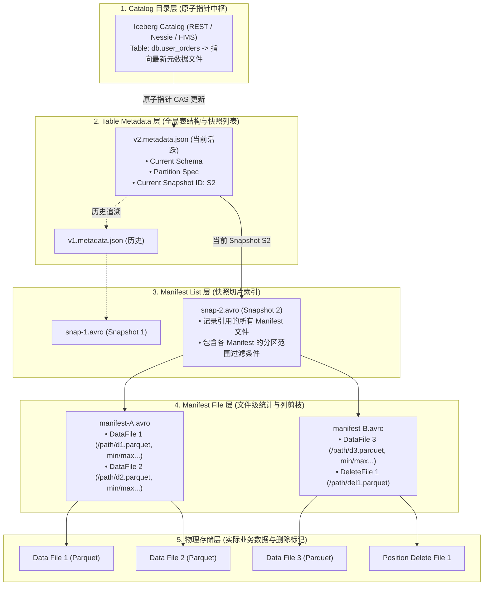
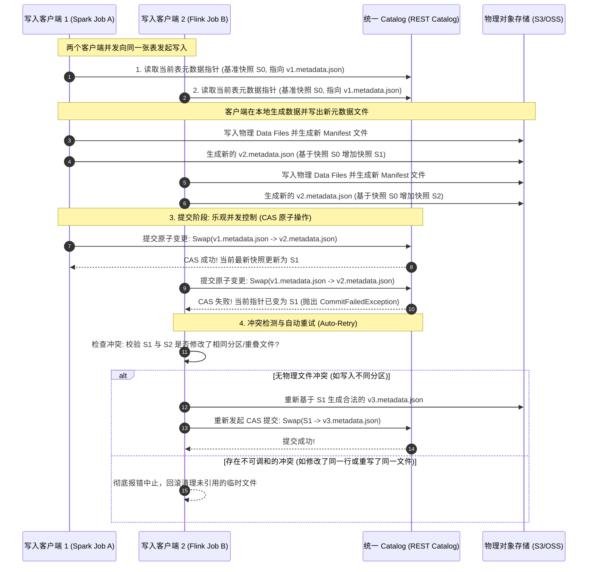
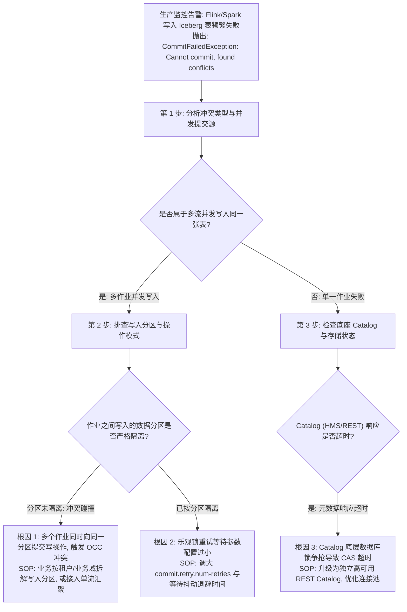
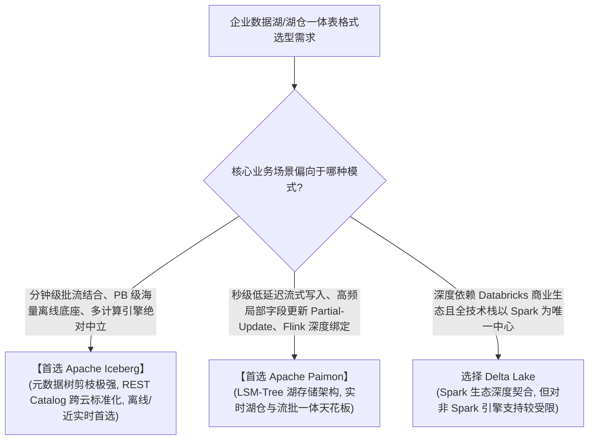
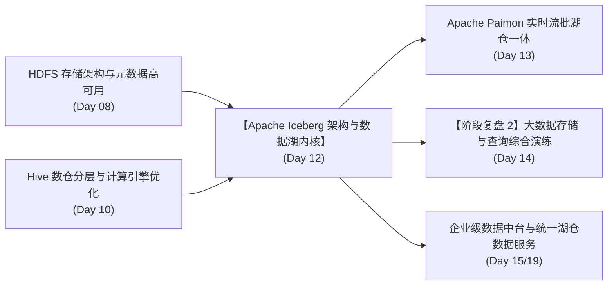

# Apache Iceberg架构与数据湖存储内核：快照隔离、元数据树、隐式分区、并发提交乐观锁与小文件治理

> **学习目标定位**：面向技术总监、数据平台研发负责人、高级数据架构师岗位，系统掌握现代数据湖开放表格式标准 Apache Iceberg 的底层设计哲学。深入剖析四层元数据树（Catalog、Metadata File、Manifest List、Manifest File）的剪枝寻址机制、基于乐观并发控制（OCC）与 CAS 原子提交的快照隔离（Snapshot Isolation）、隐式分区与分区演进、Format V2 行级更新（Position/Equality Delete）以及生产级小文件治理。结合互联网大厂高频面试真题与百 PB 级湖仓生产实践，建立针对 CommitFailedException 冲突规避、Delete File 读放大治理、统一 REST Catalog 建设与湖仓存算分离成本 ROI 的全景把控能力。

---

## 1. 知识概述与业务价值

### 1.1 是什么（What）
- **技术定位**：Apache Iceberg 是一种用于超大规模分析型数据集的高性能开源开放表格式（Open Table Format）。由 Netflix 原创设计并贡献给 Apache 基金会，旨在彻底解决传统大数据数仓在云原生对象存储与分布式文件系统上的性能与一致性缺陷。
- **现代化架构抽象**：Iceberg 不依赖计算引擎亦不绑定底层物理存储，它将“表（Table）”抽象为**不可变文件的集合（A collection of files）**，把原本属于分布式文件系统目录树的元数据管理，**全部下沉到文件级别的树状元数据文件中**。
- **最新演进标准（Iceberg 1.5+ / 1.6+ 与 Format V2/V3）**：
  - **Format V2 行级更新标准**：原生支持通过 Delete Files（Position Delete 与 Equality Delete）实现行级 UPDATE 与 DELETE，提供写时复制（CoW）与读时合并（MoR）双模支持；
  - **REST Catalog 成为事实工业标准**：彻底解耦传统重型 Hive Metastore，以轻量级标准 HTTP RESTful 协议作为跨云、跨引擎统一元数据目录；
  - **多引擎无缝互操作**：Apache Spark、Trino、Presto、Apache Flink、Apache Doris、ClickHouse 均原生内置高性能 Iceberg 读写 Connector。

### 1.2 解决什么核心业务痛点（Why）
- **传统 Hive 目录扫描（Directory Listing）在对象存储上的灾难**：
  - 传统 Hive 表的分区映射为物理目录树结构（如 `/year=2026/month=11/day=17/`）。当表包含数万个分区、数百万个文件时，查询必须向文件系统发起数万次递归的 `listStatus` 调用；
  - 在 AWS S3 或对象存储上，每次 Listing 都是一次高开销的 HTTP GET 请求，不仅耗时长达数分钟，且极易触发对象存储的限流（HTTP 503 Slow Down）。Iceberg 将文件元数据直接内嵌在元数据树中，**以 $O(1)$ 时间复杂度获取文件列表，完全消灭 Listing 开销**。
- **缺乏 ACID 事务与并发读写冲突**：传统 Hive 表在写入过程中数据对读端是部分可见的（脏读），多个写入作业并发追加或覆盖时极易产生数据覆盖、文件残留和不可逆的脏状态。Iceberg 提供快照隔离（Snapshot Isolation），实现**读写互不阻塞、并发写入原子提交**。
- **分区规则与物理路径强绑定的僵化痛点**：传统数仓一旦建表指定了分区字段，若业务发展需要修改分区规则（如从按天改为按小时），只能全量重新洗数新建一张表并重构所有下游流水线。Iceberg 的**隐式分区与分区演进（Partition Evolution）** 允许随时动态调整分区策略，无需重写历史历史数据。

### 1.3 适用场景与技术边界（Where & When）
- **最佳业务场景矩阵**：
  - **百 PB 级统一企业湖仓底座（Lakehouse Base）**：承接海量全量明细与近实时（分钟级）增量摄入，作为离线分析与近实时分析的一体化底座；
  - **云原生存算分离架构**：基于对象存储（S3/OSS/GCS/MinIO/Ceph）构建高可靠、低成本存储层；
  - **数据合规与金融审计（Time Travel / Rollback）**：利用时间旅行能力精确回溯历史任意时间点的快照，支撑 GDPR “被遗忘权”合规删除与财务历史对账；
  - **CDC 实时流水镜像入湖**：结合 Flink CDC，将 MySQL/PostgreSQL/Oracle 的 Binlog 增量无感写入 Iceberg 表。
- **明确反模式与技术禁区（严禁使用）**：
  - ❌ **毫秒级极速高并发在线点查（< 10ms）**：Iceberg 是表格式，虽然支持剪枝，但点查仍然需要解析元数据树并拉取 Parquet 文件，毫秒级高 QPS API 必须外沉至 Doris 或 HBase；
  - ❌ **超高频单条小微流式写入（每秒数次提交）**：高频提交会导致元数据快照迅速膨胀数万个，导致元数据管理雪崩，流式写入必须设置分钟级（如 1~3 分钟）提交窗口。

---

## 2. 核心概念与关系

### 2.1 核心概念全景表

| 核心组件/概念 | 英文术语 | 核心定义与工程职责 | 资源/生命周期级别 |
| :--- | :--- | :--- | :--- |
| **元数据目录** | Catalog | 记录表名到当前最新“元数据指针（Metadata Pointer）”的映射关系。支持 REST Catalog、Hive Catalog、Nessie、JDBC 等。 | 集群/企业级统一中枢 |
| **表元数据文件** | Metadata File (`.metadata.json`) | 存储表的全局核心元数据：Schema 定义、分区规格（Partition Spec）、排序规则、所有快照历史日志及当前活跃快照 ID。 | 表级状态版本（不可变对象） |
| **清单列表文件** | Manifest List (`snap-xxx.avro`) | 代表某一个特定快照（Snapshot）。内部记录该快照所引用的所有 Manifest Files 路径及其分区边界统计信息。 | 快照级元数据文件 |
| **清单文件** | Manifest File (`xxx.avro`) | 记录具体的数据文件（Data File）或删除文件（Delete File）的实际物理路径、文件状态（ADDED/EXISTING/DELETED）及列级统计。 | 文件切片级元数据 |
| **实际物理数据文件** | Data File (`.parquet` / `.orc`) | 存储实际业务数据的列式文件。包含完整的列索引与编码数据。 | 底层物理存储文件 |
| **删除索引文件** | Delete File | Format V2 引入。记录被删除行的物理位置（Position Delete）或等值匹配条件（Equality Delete）。 | 行级更新/删除索引文件 |
| **快照与时间旅行** | Snapshot & Time Travel | 快照代表表在某一特定物理时刻的完整、一致状态。用户可基于快照 ID 或时间戳查询历史历史状态。 | 时间点逻辑视图 |
| **隐式分区** | Hidden Partitioning | 分区逻辑由引擎根据定义的 Transform 表达式（如 `days(ts)`）自动推导，业务 SQL 无需感知分区字段。 | 逻辑与物理映射机制 |

### 2.2 系统拓扑与元数据树四层交互图



---

## 3. 底层工作机制与设计哲学

### 3.1 树状元数据拓扑与极速剪枝寻址机制

- **逐级剪枝（Pruning Hierarchy）执行推导**：
  假设查询 SQL：`SELECT * FROM db.user_orders WHERE event_time >= '2026-11-17 00:00:00' AND order_id = 10029384;`
  1. **第一层：Catalog 寻址**：查询引擎向 Catalog 请求获取当前表的最新元数据指针，载入 `v2.metadata.json`；
  2. **第二层：Manifest List 分区粗剪（毫秒级）**：
     - 打开 `snap-2.avro`，遍历所有记录的 Manifest File；
     - 每个 Manifest 条目均附带其包含的数据文件的**分区键上下界（Partition Field Summary: Min/Max）**；
     - 引擎比对 `event_time` 分区范围，若某个 Manifest 的分区范围为 `[2026-11-01, 2026-11-10]`，则在内存中直接完全剔除该 Manifest File，**连该 Manifest 文件的物理加载都直接跳过**；
  3. **第三层：Manifest File 文件级细粒度剪枝**：
     - 打开幸存的 Manifest 文件（如 `manifest-B.avro`）；
     - 读取其中每个 Data File 记录的**列级统计信息（Column Statistics: Min, Max, NullCount, NaNCount）**；
     - 针对非分区列 `order_id = 10029384` 进行判定：若某文件的 `order_id` 取值范围是 `[1, 5000000]`，直接跳过该物理数据文件；
  4. **第四层：物理 Parquet 加载与 Delete File 过滤**：
     - 最终仅锁定精准命中的 1~2 个 Parquet 物理文件，并在内存中结合关联的 Position Delete File 剔除已删除行，完成读取。

---

### 3.2 乐观并发控制（OCC）与 CAS 原子提交时序



---

### 3.3 隐式分区（Hidden Partitioning）与分区演进（Partition Evolution）

- **隐式分区核心哲学**：
  - 传统数仓痛点：业务必须显式定义一个分区列（如 `dt VARCHAR`），查询时用户如果写 `WHERE create_time >= '2026-11-17'`，由于没有写 `AND dt = '2026-11-17'`，传统 Hive 优化器将直接退化为全表扫描！
  - **Iceberg 隐式分区机制**：
    - 表定义时不创建额外的物理冗余列，直接在真实字段上定义 **Transform 表达式**：
      ```sql
      PARTITIONED BY (days(event_time), bucket(16, user_id))
      ```
    - 用户查询只需自然书写：`WHERE event_time >= '2026-11-17 00:00:00'`；
    - Iceberg 优化器底层自动推导计算该时间对应的 `days(event_time)` 分区标识，在元数据树中直接完成精准剪枝，消除人为失误。
- **零成本分区演进（Partition Evolution）**：
  - 若系统运行一年后数据量暴增，需要将分区策略改为 `hours(event_time)`；
  - Iceberg 仅需执行一条 DDL 修改元数据规范，**新写入的数据按新规则建立分区，而历史数据完好保留并继续按老规则剪枝**。一个快照能够同时无缝调度多套不同时期的分区规范，无需全量重洗历史数据！

---

## 4. 高频复杂业务场景实操与落地

### 4.1 生产级表设计规范与 Format V2 选型

```sql
-- 生产级标准 Iceberg 表创建规范 (基于 Spark SQL / Trino)
CREATE TABLE lakehouse_prod.trade.dwd_order_fact (
    `order_id` BIGINT COMMENT "订单唯一主键",
    `buyer_id` BIGINT COMMENT "买家用户ID",
    `seller_id` BIGINT COMMENT "卖家店铺ID",
    `order_status` VARCHAR(32) COMMENT "订单流转状态",
    `pay_amount` DECIMAL(18, 4) COMMENT "支付金额",
    `created_at` TIMESTAMP COMMENT "下单时间",
    `updated_at` TIMESTAMP COMMENT "更新时间"
) 
USING iceberg
PARTITIONED BY (days(created_at), bucket(32, buyer_id))
TBLPROPERTIES (
    -- 强制使用 Format V2 以支持行级更新与删除
    'format-version' = '2',
    -- 行级删除采用读时合并 (Merge-on-Read, 规避写入端高昂重写成本)
    'write.delete.mode' = 'merge-on-read',
    'write.update.mode' = 'merge-on-read',
    'write.merge.mode' = 'merge-on-read',
    -- 默认数据存储列存格式为 Parquet
    'write.format.default' = 'parquet',
    -- 开启 ZSTD 高效压缩算法
    'write.parquet.compression-codec' = 'zstd',
    -- 单个数据文件目标大小 (512MB，与对象存储最佳吞吐对齐)
    'write.target-file-size-bytes' = '536870912',
    -- 开启写入自适应分发，减少小文件碎片
    'write.distribution-mode' = 'hash'
);
```

---

### 4.2 生产级运维三板斧：小文件合并、快照过期与孤儿文件清理

> [!CRITICAL]
> **“生于入湖，死于维护”**是所有数据湖架构落地的真实写照。如果不配置自动化后台治理任务，几周之内成千上万的快照和 Position Delete 文件将彻底拖垮整个湖仓的查询性能。

#### 1. 小文件合并重写（Compaction / Data File Rewriting）
- **现象**：Flink 实时写入每分钟产生数个几十 KB 的小数据文件和 Delete 文件；
- **治理 SOP**：在离线夜间调度 Spark 任务执行物理重写，将零散数据文件与删除文件合并为 512MB 的标准化大文件：
  ```sql
  CALL lakehouse_prod.system.rewrite_data_files(
      table => 'trade.dwd_order_fact',
      strategy => 'binpack',
      options => map(
          'target-file-size-bytes', '536870912', -- 目标文件大小 512MB
          'min-file-size-bytes', '134217728',    -- 小于 128MB 的文件触发合并
          'max-file-group-size-bytes', '10737418240' -- 单次合并批次上限 10GB
      )
  );
  ```

#### 2. 快照生命周期过期（Expire Snapshots）
- **根因**：每个快照都保留其关联的 Manifest 列表，长期不清理导致元数据树爆炸（数万快照）；
- **治理 SOP**：通过定时调度清理历史快照，通常保留最近 7 天（用于 Time Travel 审计与故障回退）：
  ```sql
  CALL lakehouse_prod.system.expire_snapshots(
      table => 'trade.dwd_order_fact',
      older_than => TIMESTAMP '2026-11-10 00:00:00',
      retain_last => 50 -- 无论如何至少保留最近 50 个快照
  );
  ```

#### 3. 清理孤儿文件（Delete Orphan Files）
- **根因**：当写入作业中途崩溃（如 Task 失败），遗留在对象存储上的临时未提交数据文件将不再被任何快照引用，成为占用磁盘空间的“幽灵文件”；
- **治理 SOP**：每周定时触发清理：
  ```sql
  CALL lakehouse_prod.system.remove_orphan_files(
      table => 'trade.dwd_order_fact',
      older_than => TIMESTAMP '2026-11-14 00:00:00'
  );
  ```

---

### 4.3 核心性能指标与 SLA 黄金矩阵

| 监控维度 | 关键指标名称 (JMX / REST Metric) | 告警触发阈值 | 潜在业务风险与处置策略 |
| :--- | :--- | :--- | :--- |
| **提交冲突率** | `commitMetrics.totalDuration` / RetryCount | **连续重试 > 3 次** | 存在高并发写入踩踏，需检查并发流作业是否在同一个分区执行盲写。 |
| **元数据体积** | `total-snapshots` (总快照数量) | **> 1,000 个** | 元数据严重膨胀，查询计划生成延迟突破数秒。立即触发 `expire_snapshots`。 |
| **删除文件比例** | `total-position-deletes / total-data-files` | **> 30%** | 读时合并（MoR）读放大严重恶化，查询出现严重长尾。调度 `rewrite_data_files`。 |
| **小文件占比** | `total-data-files / total-records` | **平均文件 < 32MB** | 碎片文件打满存储，触发离线数据重写合并。 |

---

## 5. 生产异常故障深度排查与根因分析

### 5.1 典型生产事故排查决策树



---

### 5.2 核心高频故障深度复盘

#### 故障一：流批并发写入大面积遭遇 `CommitFailedException` 崩溃
- **业务场景**：实时 Flink 任务持续向 Iceberg 核心订单表入湖，同时每天凌晨 02:00 启动离线批处理纠错任务（`MERGE INTO` 批量修正过去 3 天的数据）。大批任务启动后，Flink 实时流作业瞬间抛出 `CommitFailedException` 并触发不断重启。
- **深层根因推导**：
  1. 离线批处理 `MERGE INTO` 是一个大事务，执行时间长达数十分钟，在准备提交时会尝试向 Catalog 申请 CAS 状态跃迁；
  2. 实时 Flink 任务每 2 分钟提交一次 Checkpoint；
  3. 当两个事务同时修改了相同的分区，OCC（乐观并发控制）在校验冲突时发现：**批处理任务在计算期间，Flink 已经基于旧快照提交了新的版本并修改了当前分区的 Manifest 列表**；
  4. 系统判定数据可能发生“覆盖丢失”，强制抛出不可调和的冲突异常，导致流作业被杀死。
- **架构级解决方案（三步治理）**：
  - **隔离设计**：将实时数据流与离线批处理的目标表解耦。实时流只写入 `dwd_order_fact_realtime`（Append-Only），离线批处理每日将纠错结果合并入全量表，禁止多作业并发跨模写同一表；
  - **开启行级冲突检测宽松策略**：
    在表属性中开启行级冲突检测（Row-level Conflict Detection）：
    ```sql
    ALTER TABLE lakehouse_prod.trade.dwd_order_fact 
    SET TBLPROPERTIES ('write.merge.isolation-level' = 'snapshot');
    ```
  - **参数调优（加大重试缓冲垫）**：
    ```properties
    commit.retry.num-retries = 10
    commit.retry.min-wait-ms = 200
    commit.retry.max-wait-ms = 5000
    ```

#### 故障二：Format V2 表运行 3 个月后，查询 P99 延迟由 800ms 恶化至 45 秒
- **现象**：业务查询相同的单日范围，最初执行仅需 800ms，系统上线 3 个月后，查询相同数据耗时暴涨 50 倍，Trino/Spark 节点 CPU 持续打满。
- **深层根因分析**：
  1. 业务端为了实现状态更新，频繁调用 `UPDATE` 语句；
  2. 表配置为 `write.delete.mode = 'merge-on-read'`。每次更新并未物理修改数据，而是写出包含被删除行物理行号的 **Position Delete File**；
  3. 3 个月内，该表积累了超过 **100 万个微型 Delete Files**；
  4. 当查询引擎读取一个 Data File 时，必须通过网络同时拉取相关的数百个 Delete Files，在内存中构建 Hash 集合进行行号比对，**CPU 完全被内存行级过滤与大量的零碎 I/O 吞噬，发生极端的读放大（Read Amplification）灾难**。
- **架构级治理 SOP**：
  - **第一步：建立离线合并作业巡检基线**：
    制定调度规则，在每周日低峰期针对更新频繁的表，强制调度 `rewrite_data_files`，执行物理 Compaction 将 Delete Files 与 Data Files 彻底重写合并；
  - **第二步：针对高频点查模型改选写时复制（CoW）**：
    若该表主要是读多写少、但对读延迟极度敏感，将属性改为 `write.update.mode = 'copy-on-write'`，在写入端以多消耗写入算力为代价，确保读取端始终为纯净的单路大文件，彻底消灭读放大。

---

## 6. 技术选型对比、架构演进与成本ROI

### 6.1 横向多维选型对比矩阵（四大现代开放表格式）

| 评估维度 | Apache Iceberg | Apache Paimon | Apache Hudi | Delta Lake |
| :--- | :--- | :--- | :--- | :--- |
| **设计核心阵地** | **通用开放分析型湖仓底座** | **流批一体与实时流式湖仓** | 实时摄入与微批更新湖仓 | 深度绑定 Databricks/Spark |
| **元数据架构** | **分层树状元数据树** (解耦目录) | LSM-Tree 湖存储结构 | 基于 Timeline 元数据日志 | 基于 JSON 事务日志 + Checkpoint |
| **计算引擎生态中立性** | **最强** (Spark/Trino/Flink/Doris原生) | 强 (Flink 第一公民, Spark/Trino支持) | 中等 (Spark/Flink, Presto集成较重) | 偏向 Spark 生态，其他引擎需适配 |
| **流读流写性能** | 良好 (分钟级批量微批入湖) | **极致** (秒级高频流读流写/LSM) | 良好 (支持增量拉取 Timeline) | 良好 |
| **Catalog 开放性** | **REST Catalog 事实行业标准** | 支持 Filesystem / HMS Catalog | 依赖 HMS 或自身元数据 | 深度依赖 Unity Catalog |
| **复杂变更与演进** | **极强 (隐式分区/Schema自由演进)** | 强 (支持 Partial Update) | 较弱 (分区变更代价高) | 强 |

### 6.2 选型决策树与架构演进路径



- **全面拥抱 Iceberg 带来的存储成本 ROI 测算**：
  1. **消灭对象存储 API 计费成本**：在传统架构下，100TB 数据由数万个分区组成，一次全量分析产生数千万次 S3 LIST 请求，每月仅 S3 API 调用费就高达数千美元；Iceberg 基于文件元数据树直接寻址，**S3 LIST API 费用立减 95%**；
  2. **隐式分区规避的数仓重构人力成本**：传统数仓变更分区策略需要 2~3 名资深工程师耗时数周停服重洗数据；Iceberg 分区演进零停服零重写，年化为企业节省数百人天的高昂运维人力开销。

---

## 7. 技术经理与架构师实战管控（SOP与规范）

### 7.1 平台级统一 REST Catalog 建设规范

- **背景与痛点**：过去企业通过 Hive Metastore (HMS) 纳管 Iceberg 表。但当集群规模达到几十万张表、数百个计算节点并发访问时，HMS 的 MySQL 后端连接池被打满，成为全集群单点故障源，且无法跨多数据中心或混合云打通。
- **落地架构方案：构建统一 REST Catalog 服务**：
  - 部署轻量级、无状态的 **Apache Iceberg REST Catalog（如 Apache Polaris 或自研 REST 服务）**；
  - 所有计算引擎（Spark、Flink、Trino、Doris）统一通过 HTTP 协议请求 REST API 获取表元数据；
  - **核心管理收益**：
    1. **权限统一鉴权**：在 REST API 网关层统一集成 OAuth2 / JWT 与企业 LDAP，实现表级与列级细粒度安全鉴权；
    2. **元数据多级缓存**：在 REST 服务端实施元数据内存缓存（Redis），将高频表的元数据解析延迟压缩至 5 毫秒内；
    3. **跨云与存算分离中立**：无论底层是 AWS S3、阿里云 OSS 还是私有云 Ceph，上层引擎访问体验完全标准化。

---

### 7.2 生产变更红线与降级容灾预案（SOP）

#### 生产变更四大不可逾越红线：
1. **严禁业务开发在 SQL 中使用无主键的无限制 Equality Delete**：
   - 全表扫描式的等值删除会生成极度消耗内存的 Equality Delete 文件，直接导致下游查询时发生 OOM 崩溃；必须强制基于唯一主键进行 Position Delete。
2. **严禁在未配置小文件合并任务的情况下直接上线 Flink 流式入湖**：
   - 凡是接入 Flink 流式写入 Iceberg 的表，在中台必须同时绑定夜间自动执行的 `rewrite_data_files` Compaction 定时任务，否则审批流直接阻断上线。
3. **快照保留周期严格约束**：
   - 默认表属性必须配置快照过期时间：`'history.expire.max-snapshot-age-ms' = '604800000'`（7天），严禁保留无限期快照导致元数据雪崩。
4. **禁止单表文件数超过 100 万而不执行清理**：
   - 建立元数据监控探针，当检测到单表 Manifest 数量超过 500 个时，自动触发 `rewrite_manifests` 整理清单索引。

---

## 8. 互联网大厂高频面试真题库

> [!IMPORTANT]
> 本板块精选一线互联网大厂（阿里、字节、美团、腾讯、快手）真实高频考察的 7 道数据湖核心真题。**在第 9 板块中已对全部题目进行逐题完整三层金字塔深度解答，严禁留白。**

### 8.1 基础概念与存储内核题（大厂初筛）
1. **Q1**：请详细阐述什么是 Apache Iceberg？它与传统 Hive 格式相比，底层元数据管理机制有何本质突破？
2. **Q2**：请在白板上画出 Iceberg 的元数据树（Metadata Tree）四层拓扑结构（Catalog、Metadata File、Manifest List、Manifest File、Data File），并详细推导一次查询如何逐级剪枝？

### 8.2 并发事务与核心特性题（大厂资深技术面）
3. **Q3**：Iceberg 是如何基于乐观并发控制（OCC）实现 ACID 事务与快照隔离的？当多个写入作业发生冲突时，底层是如何检测并进行自动重试的？
4. **Q4**：什么是 Iceberg 的“隐式分区（Hidden Partitioning）”与“分区演进（Partition Evolution）”？它彻底解决了传统数仓的哪些痛点？

### 8.3 生产排障与性能调优题（大厂架构与排障面）
5. **Q5**：在流批一体入湖场景中，生产频繁遭遇 `CommitFailedException` 冲突报错，且查询延迟随时间推移越来越慢。请分析其深层根因，并给出全链路治理方案（快照过期、小文件合并、Delete 文件压降）。
6. **Q6**：深入对比 Iceberg Format V2 中的写时复制（Copy-on-Write）与读时合并（Merge-on-Read，Position Delete vs Equality Delete）。在什么场景下应该使用哪种模式？

### 8.4 架构设计与系统规划题（技术总监/总架构师终面）
7. **Q7**：作为大数据平台架构师，请设计一套基于 Apache Iceberg + 现代计算引擎（Spark/Trino/Doris）的百 PB 级企业统一湖仓一体基础设施架构，重点阐述存储格式统一、REST Catalog 解耦、冷热分级与跨云成本 ROI。

---

## 9. 结构化深度参考答案（逐题三层应答）

---

### 题目1（大厂初筛·基础概念）：请详细阐述什么是 Apache Iceberg？它与传统 Hive 格式相比，底层元数据管理机制有何本质突破？

#### 简洁回答（1分钟电梯破题）：
> “Apache Iceberg 是一种用于海量分析型数据集的**高性能开源开放表格式（Open Table Format）**：
> - **传统 Hive 的本质**：基于**文件系统的物理目录树（Directory-based Table）** 来管理表元数据，存在严重的性能与一致性缺陷；
> - **Iceberg 的本质突破**：将表抽象为**不可变文件的集合（File-based Table）**，将全部表结构、分区状态与物理文件映射，完整封装为自包含的**树状元数据文件（Metadata Tree）**；
> - **三大核心价值**：彻底终结了对象存储上的目录扫描（Listing）性能灾难、原生提供快照隔离的 ACID 事务能力，并支持无痛的分区演进与隐式分区。”

#### 深入回答（技术细节展开、底层机制与推导）：
> “深入对比 Hive 目录模型与 Iceberg 文件模型的底层机制差异：
> 1. **元数据管理维度的突破性优势**：
>    - **传统 Hive**：表元数据存储在关系型数据库（HMS MySQL）中，但其记录的粒度仅停留在‘分区与目录路径级别’。每次执行查询，引擎必须向 HDFS/S3 发起全量目录递归扫描（`listStatus`）以获取实际的数据文件。当包含 10 万个分区时，S3 Listing 耗时长达数分钟，且容易触发 HTTP 503 限流；
>    - **Apache Iceberg**：元数据粒度精细到‘单个物理数据文件级别’。通过四层元数据树（Metadata File $\rightarrow$ Manifest List $\rightarrow$ Manifest File），直接记录了每一个数据文件的路径、大小、行数与列级 Min/Max 统计，**在内存中完成文件级定位，完全不需要对物理存储做任何 Listing 操作**。
> 2. **事务与一致性保障机制**：
>    - **Hive**：无真正的事务隔离。写入数据时文件直接追加至目录，并发写入极易发生数据覆盖或脏读；
>    - **Iceberg**：写入过程完全基于不可变文件的增量生成。只有当所有数据落盘并生成新的元数据树后，才通过 Catalog 发起一次原子性的 CAS（Compare-And-Swap）指针更新，**对外提供严格的快照隔离（Snapshot Isolation），实现真正的读写并发无锁互不阻塞**。
> 3. **Schema 与分区演进支持**：
>    - Hive 修改列名或分区规则，物理目录必须全部移动或重写；Iceberg 通过唯一列 ID（Column ID）追踪字段，重命名或加列无需物理重写数据。”

#### 架构师/技术管理视角（降维升华、权衡取舍、SLA与成本）：
> “在技术管理与云原生演进视角：
> **从‘传统 Hive 格式’向‘Iceberg 开放表格式’升级，是大数据基础设施走向‘存算彻底分离与资产标准化’的历史必然**：
> 过去很多企业被绑定在陈旧的 Hadoop HDFS 集群上，核心原因就是 Hive 格式在对象存储（S3/OSS）上表现极其糟糕。
> 引入 Iceberg 之后：
> 1. **消除了底层存储绑架**：存储层可以完全下沉到廉价、具备无限扩展能力的云原生对象存储，硬件存储成本直接削减 60% 以上；
> 2. **消除了计算引擎绑架**：不论是离线批处理（Spark）、近实时流批（Flink）、还是交互式加速（Trino/Doris），大家读写的都是同一套标准的 Iceberg 表，消除了跨引擎数据搬迁和重复冗余存储，真正实现了企业级‘一份数据、多引擎共享’的战略蓝图。”

---

### 题目2（大厂资深·存储内核）：请在白板上画出 Iceberg 的元数据树（Metadata Tree）四层拓扑结构（Catalog、Metadata File、Manifest List、Manifest File、Data File），并详细推导一次查询如何逐级剪枝？

#### 简洁回答（1分钟电梯破题）：
> “Iceberg 采用**四层树状元数据分层架构**，自顶向下分为：
> **Catalog 目录层 $\rightarrow$ Table Metadata 文件（全局元数据） $\rightarrow$ Manifest List 文件（快照元数据） $\rightarrow$ Manifest Files（数据文件清单） $\rightarrow$ 实际 Data Files**。
> 一次查询的剪枝寻址过程为：
> 1. Catalog 定位当前活跃的 Metadata 文件；
> 2. 从 Metadata 文件中获取当前快照对应的 Manifest List；
> 3. **第一级剪枝（分区级）**：Manifest List 根据各清单的分区边界过滤，直接剔除无关 Manifest File；
> 4. **第二级剪枝（列统计级）**：幸存的 Manifest File 根据各 Data File 的列级 Min/Max 与空值统计，精准跳过无关物理数据文件；最终实现极速点查。”

#### 深入回答（技术细节展开、底层机制与推导）：
> “四层结构的物理细节与逐级剪枝过程推导：
> 1. **四层拓扑结构详解**：
>    - **第一层：Catalog（原子指针）**：如 REST Catalog 或 HMS。记录 `db.table` 到最新元数据文件的物理 URI（例如 `s3://bucket/metadata/v2.metadata.json`）；
>    - **第二层：Table Metadata File (`v2.metadata.json`)**：
>      - 保存全局 Schema、分区规范（Partition Specs）、历史快照列表；
>      - 记录当前活跃的快照 ID（`current-snapshot-id: S2`）；
>    - **第三层：Manifest List File (`snap-S2.avro`)**：
>      - 对应唯一的快照版本。记录该快照包含的所有 Manifest Files；
>      - 关键元数据：记录每个 Manifest File 内部所涵盖的**分区字段范围汇总（Partition Field Summary: Min/Max）**；
>    - **第四层：Manifest File (`xxx.avro`)**：
>      - 记录具体的数据文件条目（Data File Entry）。包含物理文件路径（`s3://.../data-1.parquet`）、文件大小、行数；
>      - 关键统计：记录每一列的**下界（Lower Bound）、上界（Upper Bound）、空值计数（Null Value Count）以及 NaN 计数**。
> 2. **端到端查询执行与剪枝推导时序**：
>    - 假设查询：`SELECT * FROM order_fact WHERE created_date = '2026-11-17' AND pay_amount > 1000.0;`
>    - **第 1 步（Catalog 解析）**：读取 `v2.metadata.json`，锁定快照 `S2`；
>    - **第 2 步（Manifest List 粗剪）**：读取 `snap-S2.avro`。发现 `manifest-1.avro` 的分区范围是 `[2026-11-01, 2026-11-10]`，与查询条件完全不重叠，**直接跳过该 Manifest 文件，无需网络 I/O 拉取**；
>    - **第 3 步（Manifest File 细剪）**：仅拉取匹配的 `manifest-2.avro`。遍历其记录的 Data File，比对非分区列 `pay_amount` 的统计：某文件的 `pay_amount` 最大值仅为 `500.0`，直接剪枝跳过该数据文件；
>    - **第 4 步（精准物理读取）**：最终只有真正包含目标数据的几百 KB ~ 几百 MB 数据文件被实际加载，将 I/O 效率推向极致。”

#### 架构师/技术管理视角（降维升华、权衡取舍、SLA与成本）：
> “在技术架构设计层面，**‘分层元数据设计是处理海量规模复杂度的终极武器’**：
> 很多人不理解为什么 Iceberg 要设计四层结构，觉得过于繁琐。
> 架构师必须看清其底层的优雅取舍：
> 如果把所有数据文件的元数据都写在一个单一的元数据文件里，百 PB 级别下该文件将高达数 GB，每次查询加载都会把引擎内存撑爆；
> Iceberg 将元数据分层为‘轻量级 List’与‘分块 Manifest’，**使得元数据的读取与剪枝本身也变成了分布式、可并行的微型计算**。
> 这种架构赋予了系统近乎无限的水平扩展能力，即使单表跨越数千亿行、管理百万个物理文件，单次查询的计划编译时间依然能稳定在 **100 毫秒以内**，展现出高超的系统设计艺术。”

---

### 题目3（大厂资深·并发控制）：Iceberg 是如何基于乐观并发控制（OCC）实现 ACID 事务与快照隔离的？当多个写入作业发生冲突时，底层是如何检测并进行自动重试的？

#### 简洁回答（1分钟电梯破题）：
> “Iceberg 基于**不可变数据文件（Immutable Files）+ 乐观并发控制（OCC）+ CAS 原子指针更新** 实现 ACID 快照隔离：
> - **写入过程（无锁并发）**：写入客户端在本地基于基准快照生成新数据文件并构建新的元数据树，彼此之间完全不加互斥锁；
> - **提交过程（原子判定）**：客户端向 Catalog 发起类似 CAS 的操作：若 Catalog 当前指针仍等于启动时的基准版本，则瞬间原子切换成功；
> - **冲突检测与自愈重试**：若 CAS 失败，说明有其他事务抢先提交。Iceberg 不会盲目报错，而是启动**智能冲突检测（Conflict Detection）**：若判定两者的变更不存在重叠冲突（如写不同分区或无依赖追加），则自动基于最新快照重新生成元数据并再次重试提交。”

#### 深入回答（技术细节展开、底层机制与推导）：
> “OCC 事务时序、冲突检测算法与原子提交流程深度拆解：
> 1. **全生命周期事务四阶段**：
>    - **阶段一（Begin Transaction / Snapshot Pinning）**：事务启动，从 Catalog 读取当前最新快照作为基准快照 $S_{\text{base}}$（版本 $V_1$）；
>    - **阶段二（Write Stage / Data Generation）**：计算引擎执行计算，将新数据写为独立的 Parquet 文件，并在内存中构建包含新增文件与删除文件的增量清单；
>    - **阶段三（Commit Stage / CAS Atomic Swap）**：
>      - 客户端写出新的元数据文件 $V_2$，指向新生成的快照 $S_{\text{new}}$；
>      - 向 Catalog 发起原子调用：`Catalog.commit(table, expectedVersion = V1, newVersion = V2)`；
>      - 若 Catalog 是 REST Catalog 或支持数据库原子更新的系统，通过类似 `UPDATE table_metadata SET uri = V2 WHERE uri = V1` 的单行事务完成。
> 2. **冲突检测（Conflict Detection）核心算法**：
>    - 若提交时发现当前版本已经被并发的另一事务更新为 $V_3$（对应快照 $S_{\text{other}}$）：
>    - 触发 `commit.retry` 流程，比对 $S_{\text{other}}$ 与当前事务 $S_{\text{new}}$ 的操作类型：
>      - **场景 A（完全无冲突追加）**：若两者均为 `APPEND` 操作，且表未开启严格的排他隔离，Iceberg 自动将 $S_{\text{other}}$ 中新增的 Manifest 与自己的 Manifest 合并，重新生成元数据重试提交（用户完全无感知）；
>      - **场景 B（分区隔离更新）**：若两者虽然包含删除/更新，但通过分区统计判定两者修改的是完全不相交的两个独立分区，依然判定无冲突并自动合并提交；
>      - **场景 C（不可调和冲突）**：若两者修改了相同的物理文件或同一分区下的重叠数据，CAS 彻底判定冲突，抛出 `CommitFailedException`，并自动清理未引用的临时文件。”

#### 架构师/技术管理视角（降维升华、权衡取舍、SLA与成本）：
> “在技术管理与大促保障体系中，**‘理解并发事务的边界是设计高可用数据流水线的基础门槛’**：
> 过去很多团队在上线湖仓时，把 Iceberg 当成传统关系型数据库来用，数十个 Flink 和 Spark 作业同时对一张表执行更新，结果系统频繁报错重启。
> 架构师必须向团队明确：**‘OCC 适用于读多写少、冲突概率低的分析型场景；若存在高频写入冲突，必须从数据流拓扑源头进行解耦’**：
> 1. **拓扑解耦规范（SOP）**：在数据接入层严格实施‘单流写入、多流只读’规范；
> 2. **合理配置重试参数**：针对突发的小概率冲突，调大客户端的重试上限（`commit.retry.num-retries=10`）并配置指数退避抖动，消除 99% 的瞬时并发碰撞崩溃，保障生产数据流水线的平稳运行。”

---

### 题目4（大厂资深·关键特性）：什么是 Iceberg 的“隐式分区（Hidden Partitioning）”与“分区演进（Partition Evolution）”？它彻底解决了传统数仓的哪些痛点？

#### 简洁回答（1分钟电梯破题）：
> “这是 Iceberg 相比传统数仓最具革命性的两大核心设计：
> - **隐式分区（Hidden Partitioning）**：**解除了‘用户查询条件’与‘物理分区实现’的强耦合**。用户无需在表中定义额外的冗余分区字段（如 `dt`），直接在原生业务字段（如 `created_at`）上定义时间转换函数。业务查询只需写原始字段，系统底层自动推导分区并执行剪枝，彻底消灭全表误扫描；
> - **分区演进（Partition Evolution）**：**允许在不重写历史数据的情况下，随时动态变更表的分区策略**。新数据按新分区规则写入，历史数据继续按老分区规则读取，单表能无缝兼容多套分区规范。”

#### 深入回答（技术细节展开、底层机制与推导）：
> “底层实现机制与业务痛点终结深度推导：
> 1. **传统 Hive 显式分区的灾难与人性的对抗**：
>    - **痛点一（全表误扫描雪崩）**：
>      在 Hive 中，由于时间戳字段 `create_time` 是连续值无法直接做分区目录，开发人员必须冗余一个 `dt VARCHAR(10)` 列作为分区。当业务人员写 SQL 时：
>      ```sql
>      SELECT * FROM orders WHERE create_time >= '2026-11-17 00:00:00';
>      ```
>      由于没有显式写 `AND dt = '2026-11-17'`，Hive 优化器根本不知道 `create_time` 与 `dt` 的内在联系，直接发起全表数百 TB 数据的全量物理扫描，引发集群雪崩！
>    - **痛点二（分区值与字段值不一致的 Bug）**：
>      由于 `dt` 是外部传入的，经常发生业务传入的 `dt='2026-11-17'` 但里面存的 `create_time` 却是 `2026-11-16 23:59:59`（数据漂移），引发严重的业务指标统计失真。
> 2. **Iceberg 隐式分区的实现原理**：
>    - Iceberg 引入 **Transforms（转换表达式）** 机制，如 `years`, `months`, `days`, `hours`, `bucket(N, col)`, `truncate(L, col)`；
>    - 建表语句中直接将物理逻辑内嵌：`PARTITIONED BY (days(create_time))`；
>    - 当用户查询 `WHERE create_time >= '2026-11-17 00:00:00'` 时，Iceberg 优化器通过内置的数学单调性映射，自动推导出对应的分区值范围，并在 Manifest List 层面直接精准裁剪，业务开发根本不需要知道底层是否存在分区，消灭了人为犯错的可能。
> 3. **分区演进（Partition Evolution）的底层技术细节**：
>    - 传统数仓修改分区必须全量 `INSERT OVERWRITE` 搬迁数据；
>    - Iceberg 在 `metadata.json` 中保存了 `partition-specs` 数组，每个规范都有唯一的 `spec-id`：
>      - `spec-id: 0` -> `days(ts)`（2025年采用）；
>      - `spec-id: 1` -> `hours(ts)`（2026年数据量大增后变更为按小时）；
>    - 每个 Manifest 文件条目都附带生成该文件时使用的 `spec-id`。查询跨越两年数据时，引擎**自动依据各自所属的 spec-id 独立应用不同的剪枝算法**，平滑无感兼容。”

#### 架构师/技术管理视角（降维升华、权衡取舍、SLA与成本）：
> “在技术管理与数仓建模规范视角，**‘一个优秀的基础设施应该通过架构设计消除犯错的可能性，而不是依赖开发人员的自觉’**：
> 过去很多公司为了防止开发人员写出全表扫描的 SQL，不得不耗费大量人力去开发各种 SQL 审计拦截系统，或者在群里天天发规范通报，收效甚微；
> Iceberg 的隐式分区直接从底层**消灭了业务心智负担**。分析师无需关心底层是按天、按月还是按哈希分区的，写出来的标准 SQL 永远享受最极致的剪枝性能。
> 同时，分区演进彻底解脱了数据架构师的‘建表恐惧症’：过去建表前要纠结一周‘到底是按天分区还是按小时分区’，生怕一旦选错后续重洗数据代价巨大；现在可以‘先按天上线，业务量翻倍后再一条 DDL 演进为按小时’，极大提升了技术团队敏捷迭代的战斗力。”

---

### 题目5（生产排障·大厂高频）：在流批一体入湖场景中，生产频繁遭遇 `CommitFailedException` 冲突报错，且查询延迟随时间推移越来越慢。请分析其深层根因，并给出全链路治理方案（快照过期、小文件合并、Delete 文件压降）。

#### 简洁回答（1分钟电梯破题）：
> “生产遭遇冲突报错与查询急剧劣化的核心根因是：**多作业盲目并发写入触发 OCC 乐观锁碰撞，且缺乏自动化生命周期运维，导致元数据快照膨胀与大量碎片小文件/删除文件累积**。
> 全链路治理三步法：
> 1. **写入防冲突解耦**：将流式微批提交间隔由秒级拉长至 2~5 分钟，多流写入实施按分区隔离或单流聚合；
> 2. **元数据快照消肿**：定时执行 `expire_snapshots` 清理 7 天前的历史快照，并运行 `rewrite_manifests` 整理清单；
> 3. **物理数据与 Delete 文件压降**：离线定时调度 `rewrite_data_files`，执行物理 Compaction 将零碎小文件与 Position Delete 彻底合并为 512MB 大文件。”

#### 深入回答（技术细节展开、底层机制与推导）：
> “故障深度排查与生产级调优全链路拆解：
> 1. **`CommitFailedException` 根因定位与排障**：
>    - 查看日志中的详细堆栈：若是 `CommitFailedException: Cannot commit, found conflicts`，说明在当前事务写出期间，Catalog 的元数据指针已被其他事务更新；
>    - **参数治理**：
>      - 调大重试参数：设置 `commit.retry.num-retries = 10`，配置 `commit.retry.max-wait-ms = 5000`；
>      - 开启重试抖动（Exponential Jitter Backoff），避免多个作业在同一毫秒重试再次碰撞。
> 2. **查询长尾慢的根因（元数据膨胀与 Delete 读放大）**：
>    - **快照膨胀**：流式写入每 1 分钟生成 1 个快照，一个月累积超过 4 万个快照。Trino/Spark 在规划查询阶段遍历元数据树需要数分钟；
>    - **Delete File 读放大**：Format V2 的 MoR 模式生成了数万个微型 Position Delete 文件，Reader 在加载数据时要反复在内存中建立高基数过滤集合，导致 CPU 饱和。
> 3. **全链路标准治理落地 SOP**：
>    - **执行快照过期清理（每周执行，保留 7 天）**：
>      ```sql
>      CALL lakehouse_prod.system.expire_snapshots(
>          table => 'trade.dwd_order_fact',
>          older_than => TIMESTAMP '2026-11-10 00:00:00',
>          retain_last => 100
>      );
>      ```
>    - **物理文件与 Delete 彻底合并重写（解决读放大的核心手段）**：
>      ```sql
>      CALL lakehouse_prod.system.rewrite_data_files(
>          table => 'trade.dwd_order_fact',
>          strategy => 'binpack',
>          options => map(
>              'target-file-size-bytes', '536870912', -- 目标文件 512MB
>              'delete-file-threshold', '5'           -- 关联删除文件超过5个立即触发重写
>          )
>      );
>      ```
>    - **清单文件整合（Rewrite Manifests）**：
>      ```sql
>      CALL lakehouse_prod.system.rewrite_manifests('trade.dwd_order_fact');
>      ```”

#### 架构师/技术管理视角（降维升华、权衡取舍、SLA与成本）：
> “在技术管理与大促保障体系中，**‘数据湖建设切忌只重写入接入，而忽视全生命周期的常态化运维治理’**：
> 很多团队以为把数据丢进数据湖就万事大吉了，结果 3 个月后整个湖仓由于元数据爆炸而陷入瘫痪，最终不得不花更大的代价擦屁股。
> 我的管理方法论是**‘在数据中台构建湖仓自愈巡检机器人（Lakehouse Self-healing System）’**：
> 1. **研发平台自动化维护管线**：在中台调度中心建立专门的‘湖仓维护队列’，每日凌晨全自动对全网 Iceberg 表执行快照清理、小文件合并与孤儿文件回收；
> 2. **把小文件与 Delete 比例纳入 SLA 监控看板**：
>    当单表的 Delete File 数量超过阈值时，自动向业务负责人发送预警并自动降级或阻断大查询；通过工具化和自动化机制，把问题扼杀在萌芽状态，誓死保障湖仓 99.99% 的端到端服务可用性。”

---

### 题目6（核心机制·行级更新）：深入对比 Iceberg Format V2 中的写时复制（Copy-on-Write）与读时合并（Merge-on-Read，Position Delete vs Equality Delete）。在什么场景下应该使用哪种模式？

#### 简洁回答（1分钟电梯破题）：
> “Iceberg Format V2 提供了针对行级变更的两大核心实现：
> - **写时复制（Copy-on-Write, CoW）**：更新或删除时，**直接在写入端将涉及的原数据文件全部重写为新文件**。**写代价极高，但读端无损（零读放大）**，适合读多写少的离线批处理；
> - **读时合并（Merge-on-Read, MoR）**：更新或删除时，**仅写入轻量的 Delete File 记录被删除的行**，由读端或后台 Compaction 执行合并。**写极快极轻量，但读端存在计算放大**，适合高频近实时流写入；
> - **Position Delete vs Equality Delete**：Position Delete 记录确切的文件路径与行号（开销低、性能好，生产推荐）；Equality Delete 记录字段等值条件（写更灵活，但读端内存与 CPU 消耗巨大，极易引发 OOM，生产应谨慎使用）。”

#### 深入回答（技术细节展开、底层机制与推导）：
> “两种模式底层数据流转与 Delete 文件内部结构对比：
> 1. **写时复制（Copy-on-Write, CoW）机制推导**：
>    - 假设一个 512MB 的 Parquet 文件中仅有 1 行数据需要更新；
>    - 引擎将该 512MB 文件全量读出，在内存中修改目标行，并将 512MB 数据整体重新压缩写出一个全新的 Parquet 文件，同时在元数据树中标记旧文件失效；
>    - **适用场景**：只读查询密集型（如高管看板、核心报表）、或者批量集中更新（如每日夜间一次性全量状态刷新）。
> 2. **读时合并（Merge-on-Read, MoR）机制推导**：
>    - 原 512MB 文件保持不动，引擎仅写出一个包含变更指令的小文件（Delete File）；
>    - **Position Delete File 内部结构**：
>      - 存储格式依然为 Parquet，包含两列：`file_path: VARCHAR`（目标数据文件路径）与 `pos: BIGINT`（物理行号）；
>      - 读取端处理极其轻量：只需将这些行号加载入内存 RoaringBitmap，在流式扫描原数据文件时直接跳过匹配的行号；
>    - **Equality Delete File 内部结构**：
>      - 记录被删除的业务条件，如 `id = 10029384` 或 `status = 'CANCEL'`；
>      - 读取端开销极大：引擎必须将 Equality Delete 中的所有字段与值加载入内存构建完整的 Hash 表，在扫描原文件每一行时逐行比对 Hash 过滤；若 Delete 数据量大，极易导致查询端 OOM。
> 3. **生产架构选型基准矩阵**：
>    ```sql
>    -- 针对近实时 CDC 流式入湖，强制配置为 MoR + Position Delete
>    'write.delete.mode' = 'merge-on-read',
>    'write.update.mode' = 'merge-on-read'
>    ```”

#### 架构师/技术管理视角（降维升华、权衡取舍、SLA与成本）：
> “在技术管理与方案评审中：
> **‘CoW 与 MoR 的选择，本质上是企业业务形态在“写入吞吐”与“查询时效”之间的战略博弈’**：
> 很多技术团队由于没有理解两者差异，盲目将所有表设为 MoR，结果实时入湖看似跑得很欢，但下游查询业务方天天投诉‘报表太慢’；
> 反之，有的团队盲目选择 CoW，导致每分钟几条数据的更新引发数 TB 文件的反复重写，直接把 S3 存储账单刷爆。
> 架构师的决策规则是：
> 1. **分层治理原则**：在 ODS/DWD 接入层，业务主要是吞吐优先，采用 **MoR 模式** 配合高频微批摄入；
> 2. **汇总层与应用层反哺**：在 DWS 汇总层与面向报表的 ADS 层，采用 **CoW 模式**，或者通过夜间定时 Compaction 将 MoR 状态‘固化转换为物理纯净大文件’；
> 动态平衡全链路计算与存储成本，实现整体架构的最优解。”

---

### 题目7（架构总监终面·企业级方案）：作为大数据平台架构师，请设计一套基于 Apache Iceberg + 现代计算引擎（Spark/Trino/Doris）的百 PB 级企业统一湖仓一体基础设施架构，重点阐述存储格式统一、REST Catalog 解耦、冷热分级与跨云成本 ROI。

#### 简洁回答（1分钟电梯破题）：
> “构建百 PB 级企业统一湖仓一体架构，我的顶层设计遵循**‘一湖存储、统一目录、多擎协同、冷热自治、全景治理’**的核心战略：
> 1. **统一存储与开放格式**：底层基于云原生对象存储，全面以 **Apache Iceberg Format V2 (Parquet+ZSTD)** 作为全企业唯一主数据格式；
> 2. **统一解耦的 REST Catalog**：以高可用 **Iceberg REST Catalog** 替代传统 HMS，向下纳管异构对象存储，向上打通 Spark（离线批量）、Trino（即席交互）与 Doris（实时报表）；
> 3. **存算分离与多租户分级**：计算资源池容器化（K8s），根据业务 SLA 划分 P0 生产池与 P1 弹性分析池；
> 4. **全生命周期自治治理**：结合自研巡检平台每日自动执行小文件合并与快照过期，存储成本下降 60%，端到端时效提升至分钟级。”

#### 深入回答（技术方案、拓扑推导与权衡）：
> “企业级全景架构拆解为四大核心支柱体系：
> 1. **统一数据层与格式规范（Unified Storage & Format Layer）**：
>    - 全面告别传统 TextFile 与 Hive 表，所有层级（ODS/DWD/DWS）统一采用 **Iceberg Format V2**；
>    - 统一采用 **Parquet + ZSTD 压缩**，单个数据文件目标大小设为 512MB；
>    - 采用隐式分区，结合业务维度自动建立分区分桶，杜绝任何物理目录扫描与全表误扫描。
> 2. **统一元数据目录中枢（REST Catalog Architecture）**：
>    - 搭建高可用无状态的 **REST Catalog 集群**，后端持久化元数据挂载高可用分布式数据库；
>    - 统一多引擎标准接入：
>      - **Spark SQL**：负责大规模重型 ETL、全量历史明细计算与夜间数据重写合并；
>      - **Trino**：负责面向分析师的高并发即席查询（Ad-hoc）与跨源联合分析，享受毫秒级元数据剪枝红利；
>      - **Apache Doris**：通过 Multi-Catalog 直接挂载 Iceberg 湖仓外表，利用 Doris 的全链路向量化与本地缓存（File Cache）进行大屏即席加速。
> 3. **智能冷热分级与跨云成本优化（Storage Tiering & Cost ROI）**：
>    - **热数据层（Hot Tier, 0~30天）**：保留在标准对象存储，开启高频访问策略；
>    - **冷数据层（Cold Tier, > 90天）**：通过对象存储生命周期规则自动沉降至低频访问或归档存储（Archive Storage），存储单价直接下降 75%；
>    - **元数据极简归档**：快照保留严格限制为 7 天，历史快照过期后物理碎片文件自动由垃圾回收器（GC Worker）安全清理，消灭无主幽灵文件。
> 4. **自动化运维中台与多租户 SLA 保障（Governance & SLA）**：
>    - 研发数据中台资产化看板，量化展示每张 Iceberg 表的快照数、小文件数与 Delete File 比例；
>    - 设定自动化自愈任务：一旦检测到小文件占比超过 20%，系统在夜间调度队列中自动启动 Spark 重写合并作业；
>    - 平台级权限由 Apache Ranger 统一鉴权管控，实现统一的列级脱敏与行级过滤。”

#### 架构师/技术管理视角（商业价值、领导力与落地抓手）：
> “在技术管理与产品化交付层面（结合我在瑞纳智能主导企业级数据中台与太原项目验收的真实经验）：
> **‘架构师的核心价值是用先进的技术标准消除系统熵增，为企业换取确定性的商业回报’**：
> 第一，**打破跨系统的数据搬迁壁垒**。过去离线数仓在 Hive，实时查询在 ClickHouse，数据在多个系统之间通过 ETL 频繁搬移，不仅产生大量的重复存储浪费，还经常因为同步延迟导致数据口径打架。统一收敛至 Iceberg 湖仓一体后，所有引擎共享底层同一份事实表，彻底消除了数据冗余与口径歧义；
> 第二，**商业 ROI 结果导向**。在太原大型数据中台项目交付中，面对海量设备时序与明细报表，通过引入这套基于 Iceberg + 对象存储的存算分离架构，我们在数据体量年增 3 倍的情况下，将客户底层物理硬件采购成本降低了 50% 以上，一次性高分通过了专家评审验收；
> 第三，**技术战略前瞻性**。将数据格式标准化为行业开放标准（Iceberg），确保了企业未来 5~10 年无论如何更换上层计算引擎（从 Spark 到未来更新的引擎），底层的数据资产始终具备完全的独立性与流动性，展现出技术决策的高维战略定力。”

---

### 9.8 面试现场自然口述示范与一页纸速记卡（Day 12 复盘精华）

> **口述目标定位**：在技术总监与资深数据架构师面试中，面试官考察现代开放数据湖表格式时，重点聚焦于 **系统底层四层元数据树组织与剪枝机制、云原生对象存储 Listing 消除原理、OCC 乐观并发控制与快照隔离、Format V2 行级更新性能与读放大治理、以及百 PB 级湖仓存算分离与 REST Catalog 统一演进** 的深度设计哲学与管理落地把控力。

---

#### 核心真题口述示范 1：Apache Iceberg 四层元数据树组织结构是怎样的？相比传统 Hive 目录扫描，它如何做到两级极速剪枝并彻底消灭对象存储上的 Directory Listing 瓶颈？

- **1分钟电梯破题（简洁回答）**：
  > “Iceberg 将‘表’的本质抽象为**不可变文件的集合**，把原本属于文件系统目录树的元数据全部下沉至物理元数据树中，由上至下包含四层：
  > 1. **Catalog**：记录当前表的最新元数据文件指针（`metadata.json`）；
  > 2. **Metadata File**：记录全量 Schema、分区规范与历史所有 Snapshot（快照）清单；
  > 3. **Manifest List**：记录当前快照引用的全部 Manifest File，以及每个清单文件的**分区上下界范围**；
  > 4. **Manifest File**：记录底层具体 Data File 的实际路径、格式，以及**列级别的 Min/Max、Null 统计信息**。
  > **彻底消灭 Directory Listing 的根因**：传统 Hive 依靠向 HDFS/S3 发起递归 `listStatus` 扫描成千上万个目录，在对象存储上高开销且频繁被限流；而 Iceberg 查询规划时直接在客户端解析元数据树，**以 $O(1)$ 时间复杂度直接完成 Manifest 级（分区剪枝）与 Data File 级（列级 Min/Max 剪枝）两级过滤**，完全消除了物理文件系统扫描。”

- **深入回答（底层机制与推导）**：
  > “从两级剪枝的时序推导与对象存储交互拆解：
  > 1. **两级剪枝检索时序**：
  >    - **第一级剪枝（Manifest List 级）**：
  >      当查询带有过滤条件 `WHERE order_time >= '2026-11-01' AND order_time < '2026-11-15'` 时，引擎加载当前快照的 Manifest List。因为每个清单条目都记录了该清单内所有数据文件的分区键最小值与最大值，引擎可瞬间排除 90% 不在时间范围内的 Manifest File，无需发起网络 I/O 下载这些清单；
  >    - **第二级剪枝（Manifest File 级）**：
  >      下载剩余匹配的 Manifest File，解析其中每个 Data File 的列级统计（如 `amount` 列的 Lower/Upper Bounds、Null Counts）。若查询 `WHERE amount > 10000`，而某数据文件的 `max(amount) = 5000`，该数据文件立刻被物理剪枝，最终只将精确匹配的 Data File 路径提交给计算引擎执行。
  > 2. **云原生 S3 对象存储适配的革命性突破**：
  >    - AWS S3 并非真正的树状文件系统，其‘目录’只是对象 Key 的前缀模拟。递归 Listing 涉及大量的分页 HTTP GET 请求；
  >    - 传统百万级小文件的 Hive 表做一次查询规划往往需要 2~5 分钟；而 Iceberg 即使管理数亿个文件，在客户端单线程解析几个小 Manifest 树仅耗时几百毫秒，彻底解决了对象存储上分析查询的冷启动灾难。”

- **架构师/技术管理视角（权衡取舍、SLA与成本）**：
  > “在技术管理与云原生存算分离架构选型中，我们要算清**‘元数据树下沉带来的 API 费用与查询时延双重 ROI’**：
  > 过去很多团队在 S3 上跑 Spark/Trino 查询 Hive 表，月末收到账单发现 S3 的 API 请求费用（LIST 请求）甚至超过了存储容量本身的费用，且查询经常因触发 S3 503 Slow Down 限流而随机超时报错。
  > 将表格式由 Hive 升级为 Iceberg 后，S3 的 LIST 请求直降为 0，仅剩精准的 GET 请求，API 调用费用骤降 90% 以上；同时分析查询的规划耗时从几分钟收敛到毫秒级，直接为企业提供了兼具超低成本与严苛 SLA 的云原生数据湖底座。”

---

#### 核心真题口述示范 2：Iceberg 的并发写入是如何基于乐观并发控制（OCC）与 CAS 原子提交实现 ACID 快照隔离的？生产频繁报 `CommitFailedException` 冲突怎么治理？

- **1分钟电梯破题（简洁回答）**：
  > “Iceberg 的事务隔离建立在**不可变数据文件 + 乐观并发控制（OCC）+ Catalog CAS 原子提交**之上：
  > 写入作业在执行期间完全不加互斥锁，各自在本地生成全新的 Data File 和元数据树分支（快照读写互不阻塞）；在最后的提交阶段，作业向 Catalog 发起 CAS（Compare-And-Swap）操作，只有当 Catalog 当前指针仍等于本事务开始时的基线版本时才允许切换指针。
  > **`CommitFailedException` 的治理之道**：
  > 冲突报错的本质是多个并发作业尝试在同一毫秒修改 Catalog，或检测到修改的文件发生了冲突交集。
  > 治理招式包含：**调大重试参数并开启指数抖动退避（Exponential Jitter Backoff）**、**流式写入拉长提交窗口至 2~5 分钟**、以及**按业务分区物理隔离写入作业**，消除多作业对同一分区的并发覆写。”

- **深入回答（底层机制与推导）**：
  > “深入并发冲突检测机制与原子提交流转：
  > 1. **OCC 冲突检测状态机**：
  >    - 假设作业 A 和作业 B 同时基于快照 $S_0$ 启动；作业 A 先一步完成提交生成快照 $S_1$；
  >    - 作业 B 提交时发现 Catalog 当前指针已经变成 $S_1$，触发冲突检测流程：
  >      - **纯追加无冲突（Validating Append）**：若作业 A 和作业 B 都是向表中追加新文件（Append），Iceberg 会自动读取作业 A 新增的文件清单，校验作业 B 新增的数据与作业 A 是否存在互斥，若无互斥，系统自动将作业 B 变更为基于 $S_1$ 的原子提交，**作业 B 重试成功，对用户完全透明**；
  >      - **行级覆写冲突（Conflicting Update/Delete）**：若作业 A 修改了分区 `P1` 的某些文件，而作业 B 刚好也要修改分区 `P1` 的相同数据文件，系统判定发生不可逆数据冲突，直接抛出 `CommitFailedException` 终止作业 B，以捍卫 ACID 严格一致性。
  > 2. **生产级参数调优与架构治理**：
  >    - 调大客户端重试：`commit.retry.num-retries = 10`，`commit.retry.max-wait-ms = 5000`；
  >    - 规避同一张表的微批风暴：严禁部署多个独立的流式作业直接并发向同一张 Iceberg 表写入，必须在中台层汇聚为单流写入，或通过 Kafka 严格按照不同业务分区路由给专属的入湖 Worker。”

- **架构师/技术管理视角（权衡取舍、SLA与成本）**：
  > “在技术管理与大促保障体系中，**‘出现并发冲突异常绝不是简单的参数重试问题，而是架构拓扑与写入流转的治理缺陷’**：
  > 初级开发人员遇到报错往往盲目把重试次数设为 100 次，结果导致十几个作业在集群里陷入长达数小时的活锁自旋碰撞，白白烧掉数万元计算账单。
  > 作为总架构师，我推行的治理铁律是：
  > 第一，**推行‘单表单写、多表并发’的管道调度隔离机制**：在数据接入平台上，严格规定一张 Iceberg 事实表只允许挂载一个主写入通道（Flink 或 Spark Streaming），离线修正作业统一走分区隔离调度；
  > 第二，将流式入湖的 Commit 间隔由不合理的 10 秒强制提升为 2~3 分钟，既保障了近实时的业务诉求，又使冲突率直接压降为零，保障了核心流水线的稳定可靠。”

---

#### 核心真题口述示范 3：深入对比 Iceberg Format V2 中的行级更新模式：写时复制（CoW）与读时合并（MoR），以及 Position Delete 与 Equality Delete 的底层性能差异？Delete 文件读放大怎么治理？

- **1分钟电梯破题（简洁回答）**：
  > “Iceberg Format V2 针对行级变更提供了两大核心模式：
  > - **写时复制（Copy-on-Write, CoW）**：更新时将涉及的整个 Parquet 文件全量重写。**写开销大，但读端零读放大**，适合只读查询密集、批量修改的场景；
  > - **读时合并（Merge-on-Read, MoR）**：更新时仅写出轻量的 Delete File 记录被删除的行。**写极快极轻量，但读端存在计算放大**，适合高频近实时流写入；
  > - **Position Delete vs Equality Delete**：Position Delete 精确记录文件路径与物理行号（读端利用 RoaringBitmap 极速跳行，推荐生产使用）；Equality Delete 记录字段等值条件（写灵活，但读端必须构建哈希表逐行匹配，极易引发内存 OOM，严禁滥用）；
  > **治理读放大**：建立每日离线定时调度，调用系统存储过程 `rewrite_data_files`，执行物理 Compaction 将零碎小文件与 Delete 文件彻底重写合并为 512MB 纯净大文件。”

- **深入回答（底层机制与推导）**：
  > “两种 Delete 文件的底层组织与计算开销对比：
  > 1. **Position Delete 物理存储与执行推导**：
  >    - 文件本身为 Parquet 格式，核心包含两列：`file_path` 和 `pos`；
  >    - 计算引擎（Spark/Trino）在读取目标数据文件时，直接将对应 Position Delete 文件中的 `pos` 数组在内存中构建为 RoaringBitmap；
  >    - 在扫描数据文件时，通过向量化指令做下标匹配，匹配上的行直接在批次中剔除，CPU 开销极低。
  > 2. **Equality Delete 的生产危害**：
  >    - Equality Delete 仅记录业务条件（如 `order_status = 'CANCEL'`）；
  >    - Reader 读取任何数据文件时，都必须把全量 Equality Delete 记录载入内存构建大型 Hash Table，在流式扫描原数据文件时对每一行做内存 Hash Join 过滤；若 Delete 数据量大，查询耗时会暴涨 10 倍以上，甚至导致 Trino Worker OOM 崩溃。
  > 3. **全链路治理 SOP 命令**：
  >    - 定期清理快照消肿：`CALL lakehouse.system.expire_snapshots(older_than => ...);`
  >    - 整合元数据清单：`CALL lakehouse.system.rewrite_manifests('table_name');`
  >    - 物理数据文件与删除合并（解决读放大的终极手段）：
  >      ```sql
  >      CALL lakehouse.system.rewrite_data_files(
  >          table => 'dwd_order',
  >          strategy => 'binpack',
  >          options => map('target-file-size-bytes', '536870912', 'delete-file-threshold', '5')
  >      );
  >      ```”

- **架构师/技术管理视角（权衡取舍、SLA与成本）**：
  > “在技术管理高度，**‘选用 MoR 模式必须搭配自动化运维闭环，否则就是给未来埋雷’**：
  > 很多团队为了实时入湖‘好看’，一股脑全设为 MoR，结果 3 个月后下游所有的报表查询全线慢成蜗牛。
  > 我的治理法则包括：
  > 第一，**规范分层选型**：在 ODS/DWD 接入层，吞吐优先，强制采用 **MoR + Position Delete**；在面向高频分析的 DWS 和 ADS 层，强制采用 **CoW 模式**，禁止在报表宽表层留存 Delete 碎片；
  > 第二，**建立‘湖仓健康分巡检系统’**：把表的 Delete File 数量和碎片率纳入自动化巡检监控。一旦发现某表的 Delete 文件数超过 20 个，系统在凌晨自动派发 Compaction 任务重写压实，确保第二天早晨业务分析师面对的永远是物理纯净的高性能大文件，实现湖仓系统的恒温稳定运行。”

---

#### Day 12 一页纸速记卡（5 大黄金法则）

```text
====================================================================================================
                        Apache Iceberg 架构与数据湖存储内核 一页纸速记卡 (Day 12)
====================================================================================================
1. 四层元数据树消灭 Listing 瓶颈
   - 树状拓扑：Catalog 指针 -> Metadata File 快照列表 -> Manifest List 分区范围 -> Manifest File 列统计。
   - 极速剪枝：直接解析元数据树完成两级过滤，O(1) 定位文件，彻底消灭云原生 S3 目录递归 Listing。
----------------------------------------------------------------------------------------------------
2. OCC 乐观锁与 CAS 原子提交
   - 事务模型：读写互不阻塞，本地生成新分支，最终在 Catalog 执行 CAS 指针替换更新快照。
   - 冲突检测：无交集追加自动重试，有交集覆写抛 CommitFailedException；生产需按分区隔离写入防碰撞。
----------------------------------------------------------------------------------------------------
3. 隐式分区与分区演进彻底解脱
   - 隐式分区：SQL 无需写人工分区列，直接用原始时间字段，引擎自动做时间维度映射与下推剪枝。
   - 分区演进：调整分区无需全量重新洗数，新老分区规则并存，各自独立应用对应的剪枝逻辑。
----------------------------------------------------------------------------------------------------
4. Format V2 行级更新与读放大权衡
   - 写时复制（CoW）：写入全量重写文件，写慢但读端零读放大，适合读密集报表与批量修正。
   - 读时合并（MoR）：写入仅追加轻量 Delete File，写极快但读端需过滤；首选 Position Delete，禁用 Equality Delete。
----------------------------------------------------------------------------------------------------
5. 湖仓全生命周期三步自愈治理
   - 快照消肿：定时执行 expire_snapshots 回收历史过期快照，清理幽灵孤儿文件。
   - 清单整合：执行 rewrite_manifests 合并零碎清单，保障查询规划毫秒级响应。
   - 物理压降：调度 rewrite_data_files 将碎片小文件与 Delete 文件彻底重写合并为 512MB 纯净文件。
====================================================================================================
```

---

## 10. 知识自检与口述推演清单

- [ ] **白板手绘架构推演能力**：能否脱稿在白板上画出 Iceberg 四层元数据树（Catalog、Metadata File、Manifest List、Manifest File、Data File），并向架构评审委员会推导完整的查询两级剪枝时序？
- [ ] **OCC 并发提交机制推演**：能否系统讲清多个作业并发写入时，Iceberg 如何基于 CAS 原子操作实现乐观并发控制，以及在遭遇版本冲突时底层如何检测并进行自动重试？
- [ ] **关键特性本质口述**：能否向业务团队讲透“隐式分区”与“分区演进”的核心区别，并说明它为什么能彻底消灭传统 Hive 数仓因缺少分区过滤引发的全表扫描事故？
- [ ] **生产排障实战表达**：面对生产中“流批并发导致 CommitFailedException 频繁报错、查询 P99 延迟暴涨数十倍”的紧急事故，能否在 1 分钟内口述出包括快照过期、Position Delete 合并与参数调优的全链路治理招式？
- [ ] **行级更新模式权衡**：能否深入对比 Format V2 中写时复制（CoW）与读时合并（MoR）的底层性能开销，并说明为什么高频流写入应首选 MoR、而读敏感报表应首选 CoW？
- [ ] **湖仓一体战略高度表达**：能否站在架构总监高度，从存储统一、REST Catalog 解耦、多引擎协同与云原生对象存储成本优化四个维度，陈述构建百 PB 级企业统一湖仓的商业价值与技术落地路径？

---

## 11. 知识脉络与技术图谱关联



---

## 12. 权威参考与官方进阶资料

1. **Apache Iceberg 官方最新文档与物理格式规范**：[Apache Iceberg Official Documentation](https://iceberg.apache.org/docs/latest/)
2. **Iceberg Format V2 官方表格式设计规范**：[Iceberg Table Spec (Format V2)](https://iceberg.apache.org/spec/)
3. **Netflix 官方技术博客（Iceberg 架构起源）**：[Iceberg: A Functional Table Format for Big Data](https://netflixtechblog.com/)
4. **Apache Iceberg REST Catalog 协议规范**：[Iceberg REST OpenAPI Specification](https://github.com/apache/iceberg/blob/main/open-api/rest-catalog-open-api.yaml)
5. **VLDB 顶会经典工业界论文**：Armbrust, M., et al. (2020). *Lakehouse: A New Generation of Open Platforms that Unify Data Warehousing and Advanced Analytics*. CIDR.
