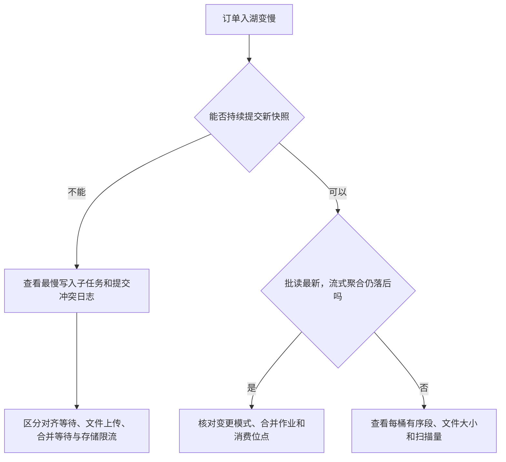

# Apache Paimon 与 Apache Hudi：实时更新、增量消费与合并治理

## 1. 知识概述与业务价值

订单会退款、收货地址会更改。一张只会追加的明细表足以记录每个动作，但查“订单现状”需要解释版本和删除。Paimon 主键表提供多种合并规则和流式变更输出；Hudi 支持文件级更新定位、增量查询和不同读写代价的表类型。选择时先问“读者要看到什么”和“可接受的延迟是多少”。Paimon 前身是 Flink Table Store，于 2024-03-21 从 Apache 孵化器毕业。[Apache 项目记录](https://incubator.apache.org/projects/paimon.html) [Paimon 1.2](https://paimon.apache.org/docs/1.2/) [Hudi 表类型](https://hudi.apache.org/docs/1.0.2/table_types/)

## 2. 核心概念与关系

| 概念 | 工程职责 |
| --- | --- |
| Paimon 主键表与追加表 | 主键表按键和 merge engine 合并更新；追加表适合保留一次次业务动作 |
| Bucket、Sorted Run | 桶是读写单元，桶内有序段之间可以出现同一主键；固定桶由哈希定位，动态桶需要索引 |
| Merge Engine、Changelog Producer | 前者决定当前行，后者决定流式读者能看到哪些变更 |
| Snapshot、Manifest | 读者通过快照和文件清单访问一次提交的表视图 |
| Hudi File Group、File Slice | 文件组具有稳定的文件标识，一个版本的文件切片包含基础文件及其相关日志 |
| Hudi Timeline | 记录带时间标识的表操作及其请求、执行中、完成等状态 |

## 3. 底层工作机制与设计哲学

### 3.1 Paimon 主键表里的 LSM

写入先进入相应分区和桶，缓冲区刷出按键排序的文件。一个桶里可能有多个键范围重叠的有序段，读取时按表规则归并。后台合并通过重写多个段降低读放大，需要 CPU、内存、临时盘和对象存储吞吐。L0 可以包含多个范围重叠的段；把“同一个有序段内有序”推广到所有文件，会错误地忽略归并成本。[Paimon 数据分布](https://paimon.apache.org/docs/1.2/primary-key-table/data-distribution/) [主键表合并](https://paimon.apache.org/docs/1.2/primary-key-table/compaction/)

### 3.2 变更日志由谁产生

| changelog-producer | 旧值从哪里来 | 适用条件与代价 |
| --- | --- | --- |
| `none` | 不额外生成完整前镜像，必要时消费者按键记住旧值 | 目标库直接 upsert，或消费端可承担 normalize 的状态成本 |
| `input` | 存储上游输入的变更 | 上游必须提供与下游契约匹配的完整变更，保存日志仍要写文件 |
| `lookup` | 合并时查询同键历史行 | 源缺少前镜像且期望更及时地产出完整变化，需预算查旧值、合并与提交的开销 |
| `full-compaction` | 比较前后全合并结果 | 可接受等待全合并的消费者，中间版本可能被折叠 |

金额从 100 更新为 80 时，按主键覆盖可以直接写入 80，而按门店维护总额需要将旧贡献撤回，或从消费端状态找出 100 并计算差额。[Paimon 变更模式与约束](https://paimon.apache.org/docs/1.2/primary-key-table/changelog-producer/)

### 3.3 Hudi Timeline 与 MoR

在 MoR 表中，更新可以先写日志，快照查询可合并基础文件和增量日志来读取最新记录，读优化查询读取基础文件，能看到的新鲜度取决于压实进展。CoW 将更新反映到新写的基础文件中，牺牲部分写成本以简化读路径。索引将键路由到文件组，各索引的内存与查询成本不同。[Hudi 时间线](https://hudi.apache.org/docs/1.0.2/timeline/) [Hudi 查询类型](https://hudi.apache.org/docs/1.0.2/table_types/) [Hudi 索引](https://hudi.apache.org/docs/1.0.2/indexes/)

## 4. 高频复杂业务场景实操与落地

> [!NOTE] 案例性质说明：下列订单、支付和物流数据均为教学推演。

在已切换至 Paimon Catalog 的 Flink SQL 会话中用三个来源构建同一行。支付与物流各有自己的单调版本，重放旧支付不能覆盖新支付，晚到物流仍应补齐。本例假定输入为按列归属写入的 upsert，整单删除和取消支付应另行约定。

```sql
CREATE TABLE dws_order_wide (
    order_id BIGINT,
    user_id BIGINT,
    amount DECIMAL(12, 2),
    pay_status STRING,
    express_no STRING,
    order_version BIGINT,
    pay_version BIGINT,
    ship_version BIGINT,
    PRIMARY KEY (order_id) NOT ENFORCED
) WITH (
    'merge-engine' = 'partial-update',
    'bucket' = '8',
    'fields.order_version.sequence-group' = 'user_id,amount',
    'fields.pay_version.sequence-group' = 'pay_status',
    'fields.ship_version.sequence-group' = 'express_no',
    'changelog-producer' = 'lookup'
);
```

依次写入一张订单的下单记录、支付版本 2 的“成功”、版本 1 的“待支付”、物流版本 1 的运单号。验收结果应同时保留“成功”和运单号。普通 partial-update 跳过空输入列；序列组有有效新版本时，可以将该组字段显式清空，发送端要区分“缺字段”和“清空”。一个选项 `partial-update.ignore-delete` 只影响删除处理，不能用于防乱序。多作业写入还需按桶模式核对并发限制。[Paimon 局部更新](https://paimon.apache.org/docs/1.2/primary-key-table/merge-engine/partial-update/) [并发控制](https://paimon.apache.org/docs/1.2/concepts/concurrency-control/)

## 5. 生产异常故障深度排查与根因分析



推演大促峰值：先记录最近成功的 Flink 检查点、Paimon 快照及积压增长率。只有一个桶增长时抽样检查键分布，多数桶同时变慢时检查共享 I/O。确认写入和合并抢资源后，可在支持的桶模式下设置写作业 `write-only=true`，把维护交给独立作业；切换时验证分区只有一个合并作业在执行。流读正常但汇总错误时，用变更前后值核对，而非增加吞吐。[独立合并部署与限制](https://paimon.apache.org/docs/1.2/maintenance/dedicated-compaction/)

Hudi 的索引状态膨胀时核对每键映射数、检查点增量和恢复耗时。遇到容器退出码 137，查看终止原因、内存峰值和磁盘错误，区分系统杀进程、外部终止、磁盘满等原因。评估 Bucket Index 时同时考虑热桶和已有表迁移成本。

## 6. 技术选型对比、架构演进与成本ROI

| 业务约束 | 候选路径 | 必须实测 |
| --- | --- | --- |
| Flink 持续写主键更新，下游需要更新前后值 | Paimon 主键表及相应变更模式 | 可见延迟、compaction 积压、过期后重建 |
| 已有 Hudi 大表，无迁移窗口 | 在现有 CoW/MoR、索引和压实策略内优化 | 读最新的扫描代价、写放大、故障重启 |
| 多引擎历史分析，频繁演进分区和表结构 | 评估 Iceberg 及引擎支持的格式版本 | 引擎互读、行级变更支持、快照维护 |
| 逐事件触发通知，延迟预算小于快照间隔 | 保留消息通道，湖表承接分析与历史 | 事件完整性、两条链路成本、对账时间 |

成本按每日新增 TB 计算，纳入存储、请求、网络、重写与维护算力，按更新率和读写峰谷复测。千万级与千亿级同样要看峰值、热键比例和每行大小，单独的行数无法推导哪种格式更便宜。[Iceberg 规范](https://iceberg.apache.org/spec/)

## 7. 技术经理与架构师实战管控

1. **资源隔离**。在线入湖、合并和回填分别设置算力配额，给共享对象存储保留在线带宽。热门租户决定分桶时应考虑租户内部的订单基数；仅以租户号分桶，可能把最大客户的全部写入压在一桶。
2. **数据契约门禁**。上线评审核对主键、分区键是否会变化、每个字段的归属和版本、删除以及迟到策略。动态分桶的并发写入限制不同于固定分桶，变更前验证恢复和回滚路径。
3. **故障降级**。合并逐渐落后时可先降低回填速度。读优化模式显示旧基础文件时向读者标示数据时间。恢复后以追平位点、写入成功和抽样对账同时作为解除降级的条件。

## 8. 互联网大厂高频面试真题库

本节保留原专题的七个架构练习方向。可追溯到候选人原帖的京东、高德等题目见 [Paimon 面经专项](../../08-interview-questions/02-paimon.md)。

1. **Q1** 面向频繁更新订单，如何比较 Paimon 与 Hudi？
2. **Q2** 桶内 LSM 与 Hudi 文件组各如何定位、更新和合并记录？
3. **Q3** Paimon 的四种变更日志模式分别适合谁？
4. **Q4** 局部更新拼宽表怎样处理迟到、清空字段和多源乱序？
5. **Q5** 入湖作业检查点频繁超时，何时值得拆出独立合并？
6. **Q6** Hudi 的 Timeline 与索引承担什么职责，如何判断索引是否成为瓶颈？
7. **Q7** 怎样设计 Flink、Paimon、Doris 的流批分析链路，评估是否能下线中间 Kafka？

## 9. 结构化深度参考答案

### 题目1　Paimon 与 Hudi 的选型

#### 简洁回答

先问当前行的更新频率、消费者需要快照还是逐步变化、现有团队用什么引擎。Flink 数据需要分列合并和流读时可从 Paimon 试起，Hudi 已有稳定增量消费与治理工具时更要计入迁移成本。

#### 深入回答

Paimon 主键表按规则合并同键行，并单独定义向下游提供的变更语义。Hudi 的 CoW 和 MoR 可以分别把更多成本放到写入或读取一侧。两者都支持持续更新，性能取决于具体引擎、键分布和维护节奏。

#### 架构师/技术管理视角

给两种方案喂同样的更新、删除、故障重放，核对逐单结果和小时总额，再比 P99、新鲜度与每日维护工时。有明确业务收益才值得搬迁存量表。

### 题目2　LSM 与文件组

#### 简洁回答

Paimon 固定桶可由主键或分桶键确定桶，桶内追加新段再归并。Hudi 使用记录键、分区和索引将记录路由到文件组。物理位置组织不同，更新后均需处理过期版本。

#### 深入回答

Paimon 动态桶还维护键与桶的映射。Hudi MoR 把变更落入日志，读最新视图需要将基础文件和日志合起来，压实可降低后续合并成本。不同索引有不同代价，固定桶哈希无法消除单热键。

#### 架构师/技术管理视角

同一热门商户可含许多订单，选订单号参与分桶有机会打散流量；同一笔超热订单的更新仍面临单键有序约束。可先按业务语义合并重复通知，再评估后台压实预算。

### 题目3　Changelog Producer

#### 简洁回答

`none` 提供缺少前镜像的变更，`input` 传递输入已有的变化，`lookup` 查询历史值产生变化，`full-compaction` 根据全合并之间的差异产出变化。

#### 深入回答

下游聚合需要知道旧贡献。输入变更完整时可用 input，输入缺旧值时在表侧 lookup 或下游 normalize 之间分配代价。周期性全合并可能把同一个键在两次合并之间的多个状态折叠为一个差异。

#### 架构师/技术管理视角

把一笔订单从甲店移到乙店，验证旧店扣回、新店增加。有逐笔审计义务的场景另存完整源日志，给需要最新状态的查询和需要逐笔动作的读者定义各自契约。

### 题目4　多流拼宽表

#### 简洁回答

同一订单的支付流和物流流分别写各自的字段，Paimon 按列合并逻辑行。这能移走 Flink 中仅为拼宽表而保存的关联历史，但仍需保存湖表数据、写入缓冲和恢复进度。

#### 深入回答

如果两条流都可能写同一列，要先定义所有权或冲突优先级。若每条流的版本各自推进，按列组记录业务版本，迟到的低版本应被忽略。业务若要一对多明细或两事件时间间隔匹配，则应保留对应粒度的表或使用时间 Join。

#### 架构师/技术管理视角

按第 4 节演练支付乱序、物流晚到、清空地址和逻辑删除。宽表允许短时缺字段时，向消费方说明“待补齐”与“业务上为空”如何区分。

### 题目5　检查点超时

#### 简洁回答

先判断时间消耗在上游等待、写盘、合并还是提交。只有合并抢占资源或多写作业争同一维护范围时，拆出独立合并才能直接解决对应问题。

#### 深入回答

用检查点耗时、系统表的快照提交间隔和每桶文件数对齐时间线。确认瓶颈后，将支持该模式的写入作业设为 write-only，并确保维护作业已经接管。如果对象存储本身限流，将合并搬到另一个进程仍会争同一带宽。

#### 架构师/技术管理视角

切换先灰度单分区，分别验证写入时延、读者新鲜度和维护速度。合并无法追平时先限回填，为关键表恢复留出 I/O，不把短时检查点变快当成最终验收。

### 题目6　Hudi Timeline 和索引

#### 简洁回答

Timeline 告诉读者哪些提交完成、哪些维护动作仍在进行，索引回答某条记录应写入哪个文件组。读写状态一致和主键定位分别要检查。

#### 深入回答

Bloom Index 用过滤器缩小候选文件集合，可能存在假阳性。Simple Index 可借助已有记录与输入连接定位；Flink State Index 把键到位置的映射保存在状态中。规模扩大时分别观察候选文件扫描、Shuffle、状态量与恢复耗时。[Hudi Indexes](https://hudi.apache.org/docs/1.0.2/indexes/)

#### 架构师/技术管理视角

先用有代表性的键样本量化索引查找在一次写入中的占比。若拟换索引，先核对当前引擎支持范围，验证旧记录更新仍命中同一逻辑键，并准备回滚。

### 题目7　Flink、Paimon 与 Doris 的分工

#### 简洁回答

Flink 将 CDC 转为业务事件或主键更新，Paimon 保存明细、当前值和可回溯版本，Doris 面向交互分析。对同一个指标指定一个业务口径和截止位点，分别验证批读与增量消费。

#### 深入回答

湖表的变更可见时间取决于快照提交、生成变更所需的合并和消费轮询。只有能接受该延迟、消费进度可恢复、保留期覆盖最长中断的中间层，才适合评估由湖表承接。逐笔低延时通知仍可从 Kafka 消费。

#### 架构师/技术管理视角

迁移一条链路并行对账，比较高峰端到端延迟、追平积压时间、对象请求费、计算和保留成本。验收两种路径在删除、乱序及回放后给出一致结果，再逐步退役冗余资源。

## 10. 知识自检与口述推演清单

- [ ] 画一笔订单两次更新的桶、文件与快照，指出何时能看到新值。
- [ ] 用“先加 100 后退 20”说明不同 changelog 契约怎样维持总额。
- [ ] 给出合并跑得慢、提交冲突和外部存储限流三种故障的不同证据。
- [ ] 不凭产品名称，解释在已有 Hudi 或 Iceberg 的项目中是否值得迁移。

## 11. 知识脉络与技术图谱关联

上游复习 [Flink 检查点](../01-flink/02-flink-state-checkpoint.md)，横向参考 [Iceberg](./02-iceberg-lakehouse-architecture.md)，在线查询参考 [Doris](./01-doris-realtime-olap.md)。配套仓库示例固定为 Paimon 0.9.0 与 Flink 1.20.1，语法以目标版本为准。[Paimon 示例](../../code-demos/paimon-flink-demo/README.md)

## 12. 权威参考与官方进阶资料

- 查 Paimon 的流读适用边界、局部更新、合并和部署限制。[变更模式](https://paimon.apache.org/docs/1.2/primary-key-table/changelog-producer/) [局部更新](https://paimon.apache.org/docs/1.2/primary-key-table/merge-engine/partial-update/) [独立合并](https://paimon.apache.org/docs/1.2/maintenance/dedicated-compaction/)
- 查 Hudi 文件切片、提交可见性和键定位。[表与查询类型](https://hudi.apache.org/docs/1.0.2/table_types/) [Timeline](https://hudi.apache.org/docs/1.0.2/timeline/) [索引](https://hudi.apache.org/docs/1.0.2/indexes/)
