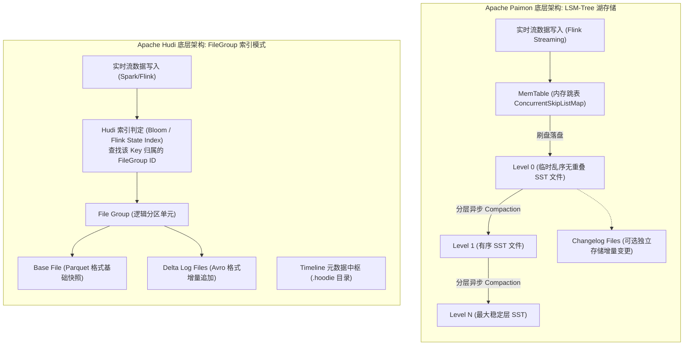
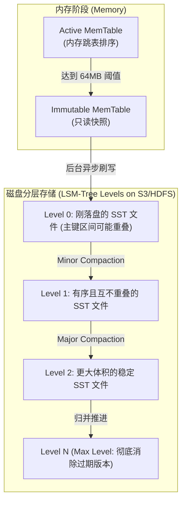
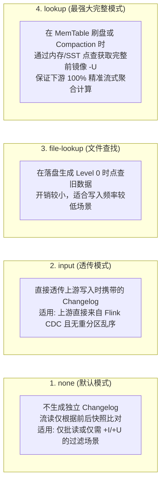
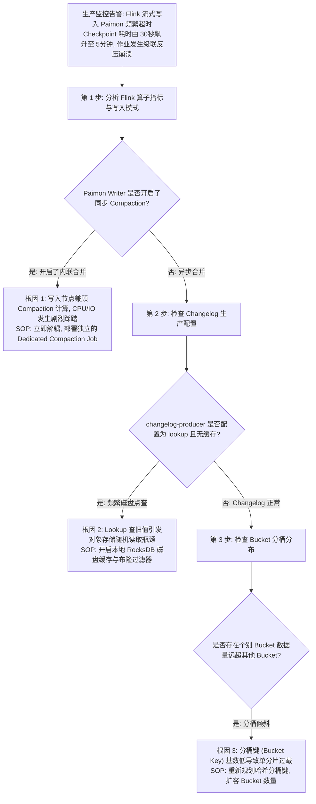
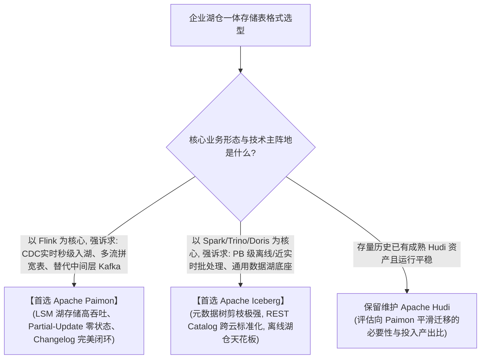
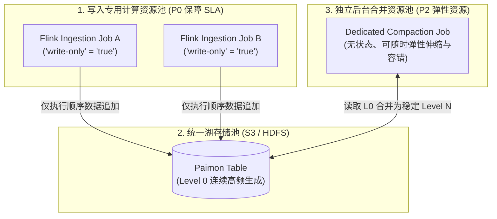
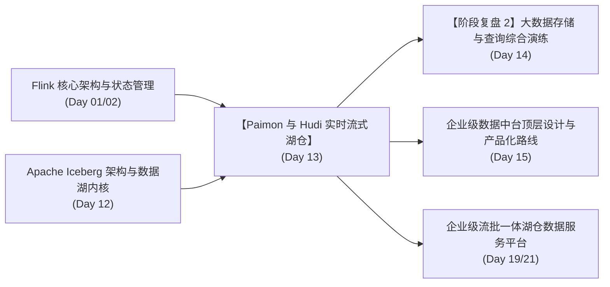

# Apache Paimon与Apache Hudi：实时流式湖仓双雄、LSM湖存储、Changelog生成与湖仓流批一体

> **学习目标定位**：面向技术总监、数据平台研发负责人、高级数据架构师岗位，系统掌握现代实时流式数据湖（Streaming Lakehouse）的双雄内核——**Apache Paimon** 与 **Apache Hudi** 的底层设计哲学。深入剖析 Paimon 的 LSM-Tree 湖存储分层结构、零索引负担设计、四大 Changelog 生成模式（None / Input / File-lookup / Lookup）、Partial-Update 零状态多流拼表机制，以及 Hudi 的 Timeline 元数据状态机与索引开销演进。结合互联网大厂高频面试真题与千万级流式入湖实战，建立针对 Checkpoint 超时治理、写入与 Compaction 物理分离、替代中间层 Kafka 与全链路湖仓一体架构落地的技术管理领导力。

---

## 1. 知识概述与业务价值

### 1.1 是什么（What）
- **流式数据湖（Streaming Lakehouse）定义**：在传统分析型数据湖（如 Apache Iceberg）聚焦于“海量批量存储与快照分析”的背景下，实时流式数据湖专门攻坚**“毫秒/秒级低延迟连续流式写入、高频行级实时变更（Upsert/Delete）、无损变更日志捕获（Changelog Capture）与流读（Streaming Read）订阅”**的湖仓一体表格式。
- **双雄格局与技术演进**：
  - **Apache Hudi（流式湖仓开拓者）**：由 Uber 于 2016 年主导孵化，是业内最早支持 HDFS/S3 上快速行级更新与增量消费的表格式。通过 Timeline 元数据管理机制与丰富的索引体系（Bloom Index、HBase Index、Flink State Index），实现了 Copy-on-Write (CoW) 与 Merge-on-Read (MoR) 存储范式；
  - **Apache Paimon（新一代流式湖仓王者）**：由阿里 Flink 核心团队主导孵化（前身为 Flink Table Store，2023 年晋升为 Apache 顶级项目）。它彻底抛弃了传统的 B-Tree/外置索引思路，**创新性地将 LSM-Tree（Log-Structured Merge-Tree）存储模型移植到廉价对象存储与文件系统上**，原生以 Apache Flink 为第一等公民，提供极致的流写吞吐、低开销的变更捕获与开箱即用的多流字段拼接。

### 1.2 解决什么核心业务痛点（Why）
- **传统 Lambda 架构的割裂与巨大维护成本**：
  - 传统数仓中，实时链路走“Kafka + Flink + Redis/HBase”，离线链路走“HDFS + Spark/Hive”。两套代码、两套存储、两套运维人员，导致指标口径频繁打架；
  - Paimon/Hudi 提供了“存储端流批统一”能力：同一张湖表，既能像 Kafka 一样被 Flink 持续毫秒级流读流写，又能像普通数据仓库一样被 Spark/Trino/Doris 进行复杂的全量 SQL 分析。
- **Kafka 无法长期存储海量历史明细且成本昂贵**：Kafka 基于顺序日志设计，无法高效执行 Ad-hoc 过滤点查，且由于高度依赖磁盘 PageCache 与网络副本，TB/PB 级数据保留数月在经济上是不可承受的。Paimon 将数据持久化在廉价的对象存储（S3/OSS）上，**以仅为 Kafka 1/5 的成本实现了“秒级流式消费 + 历史数据无限期保存”**。
- **Flink 实时多流 Join 状态爆炸（State OOM）痛点**：在传统实时流计算中，要将 5 个业务流拼成一张大宽表，Flink 必须在内存/RocksDB 中开辟数百 GB 的 Join State。状态超时或延迟数据到来极易导致宽表残缺或任务 OOM。Paimon 的 **Partial-Update（局部更新引擎）** 允许各流只写入自己的字段，由湖存储在后台异步自动合并，**彻底释放了 Flink 的计算状态**。

### 1.3 适用场景与技术边界（Where & When）
- **最佳业务场景矩阵**：
  - **CDC 实时整库镜像入湖**：结合 Flink CDC，将 MySQL、PostgreSQL、Oracle 的 Binlog 增量无感秒级同步至 Paimon 表；
  - **全链路实时流批一体数仓（替代 Kafka）**：作为 ODS、DWD、DWS 层的流批统一存储底座，下游任务流式消费上游湖表的变更数据；
  - **多流并发拼宽表（Partial-Update）**：用户主表、订单扩展表、风控标签表异步独立写入，湖内自动合并；
  - **实时维表关联（Lookup Join）**：Flink 流任务将 Paimon 作为维表，借助本地 RocksDB 缓存实现毫秒级维度补齐。
- **明确反模式与技术禁区（严禁使用）**：
  - ❌ **纯 PB 级离线批处理数仓底座（无任何实时流写入与行级更新）**：若数据纯为 T+1 批量写入且无流读诉求，首选 Apache Iceberg（元数据树更适合纯分析，跨多引擎通用性更强）；
  - ❌ **超高并发在线点查（> 10,000 QPS，延迟 < 5ms）**：Paimon 虽然支持点查，但依然受限于对象存储 I/O 延迟，超高并发在线 API 服务应外沉至 Redis 或 Apache Doris。

---

## 2. 核心概念与关系

### 2.1 核心概念全景表

| 核心组件/概念 | 英文术语 | 核心定义与工程职责 | 资源/生命周期级别 |
| :--- | :--- | :--- | :--- |
| **Paimon 主键表** | Primary Key Table | 具有唯一主键约束的表。底层基于 LSM-Tree 构建，支持高频 Upsert/Delete，支持四大 Merge Engine 与 Changelog 生产。 | 表级存储模型 |
| **Paimon 追加表** | Append-Only Table | 无主键约束，仅支持数据追加写入。没有 Compaction 排序开销，写入吞吐最高，适合原始未清洗日志。 | 表级存储模型 |
| **LSM 分层文件** | SST (Sorted String Table) | Paimon 底层实际存储的数据文件（Parquet/ORC）。划分为 Level 0 到 Level N（默认 5 层），同层内数据主键不重叠。 | 文件存储切片 |
| **合并引擎** | Merge Engine | 决定主键相同的数据行如何合并：`deduplicate`（去重）、`partial-update`（局部更新）、`aggregation`（预聚合）、`first-row`（保留首行）。 | 表级计算逻辑 |
| **变更日志生成器** | Changelog Producer | 决定如何产生带有操作类型的增量流（`+I`, `-U`, `+U`, `-D`）：`none`, `input`, `file-lookup`, `lookup`。 | 表级流读机制 |
| **Hudi 时间线** | Hudi Timeline | Hudi 元数据中枢。以时间戳（Instant）记录对表执行的所有操作（Commit, Clean, Compaction, Rollback）状态序列。 | 表级元数据核心 |
| **Hudi 读时合并** | Merge-on-Read (MoR) | 数据存储为 Parquet 基础文件（Base File）+ Avro 增量日志文件（Delta Log）。读取时多路归并，写入轻量。 | 存储与读取模式 |
| **Hudi 索引体系** | Hudi Index | 将 Record Key 映射到物理 FileID 的索引机制（Bloom Index, Simple Index, HBase Index, Flink State Index）。 | 写入端路由依赖 |

### 2.2 系统拓扑与存储内核对比图



---

## 3. 底层工作机制与设计哲学

### 3.1 Paimon LSM-Tree 湖存储内核与分层 Compaction



- **为什么 LSM-Tree 在实时数据湖中具有绝对优势？**
  1. **消灭外部索引依赖（Zero External Index）**：
     - 在 Hudi 中，每次写入必须通过 Flink State Index 或 HBase 查找待更新主键位于哪个 FileGroup，**当数据量达到数十亿行时，索引本身就会把 Flink 内存或 HBase 打爆**；
     - Paimon 采用 LSM-Tree，写入**无需预先查找历史数据**，直接进入内存排序并顺序写入 Level 0，**完全消除了索引查找的性能瓶颈与状态负担**！
  2. **高吞吐顺序写与自愈合并**：
     - 利用分层合并策略（Universal Compaction 或 Size-Tiered Compaction），将随机更新转化为对象存储上的顺序大文件追加，单节点流式写入吞吐达到每秒数十万条。
  3. **高效点查与范围扫描**：
     - 每一层 SST 文件内部不仅维持主键升序排列，而且内嵌了 **BloomFilter** 与列统计信息。点查时，逐层自顶向下检索，命中 BloomFilter 后直接在 SST 文件中执行二分查找，平均仅需 1~2 次 I/O 即可定位目标行。

---

### 3.2 变更日志捕获（Changelog Producers）四大模式底层推导

> [!IMPORTANT]
> **Changelog 是实时湖仓的灵魂**。下游 Flink 任务流式读取 Paimon 时，必须获得完整的行变更消息（`+I` 插入、`-U` 更新前镜像、`+U` 更新后镜像、`-D` 删除）。若缺失 `-U`，下游的聚合分析（如 `SUM(amount)`）就会产生翻倍累加的严重致命 Bug。



#### 四大模式深度推导与选型法则：
1. **`none`（默认模式）**：
   - 不额外产生 Changelog 文件。下游流读时，Paimon 尝试比对两次 Commit 之间的快照差异推导出变更。但如果一个快照内多次修改了同一行，中间的更新过程会丢失，**不能用于下游包含聚合的流处理**。
2. **`input`（CDC 直通模式）**：
   - 若上游是 Flink CDC 直接消费 MySQL Binlog 写入 Paimon，数据本身就已经自带了完整的 `[-U, +U]` 标记；
   - Paimon 直接将这些原始变更镜像持久化到 Changelog 文件中，**无需任何额外的查询查找开销，性价比极高**；
   - **前提条件**：写入任务禁止执行可能导致乱序的二次 Shuffle。
3. **`lookup`（通用全能模式 - 生产主力推荐）**：
   - 当上游数据是普通追加日志（如 Kafka 消息）、或者经过了业务计算不再自带前镜像时，强制配置 `'changelog-producer' = 'lookup'`；
   - 机制：在数据写入生成变更时，系统自动在后台点查历史 LSM-Tree 数据，找出该主键的上一版本旧值 $V_{\text{old}}$，并准确发出 `[-U(V_old), +U(V_new)]`；
   - **代价与收益**：增加了一定的写放大与查旧值 CPU 开销，但**彻底解耦了上游数据源，保障了全链路流式计算的绝对代数一致性**。

---

### 3.3 Hudi 核心机制：Timeline 状态机与 MoR 读写时序

- **Timeline 元数据状态机架构**：
  - Hudi 将表的所有操作抽象为保留在 `.hoodie` 目录下的 **Timeline（时间线）**；
  - 每一个事务动作（Instant）包含三大属性：
    - **Action**：`COMMIT`（批写入落盘）、`DELTA_COMMIT`（增量写入日志）、`CLEAN`（垃圾回收）、`COMPACTION`（合并）；
    - **State**：`REQUESTED`（已计划） $\rightarrow$ `INFLIGHT`（正在执行） $\rightarrow$ `COMPLETED`（已完成）；
    - **Timestamp**：全局递增单调时间戳（如 `20261117100000`）。
- **Hudi MoR 写入与读取时序**：
  1. **写入（DELTA_COMMIT）**：
     - 客户端通过索引（如 Flink State Index）定位主键所在的 File Group；
     - 新增或更新的数据直接以 **Avro 格式顺序追加写入 `.log` 增量日志文件**，不碰底层物理 Parquet 文件，写入延迟极低。
  2. **读取（Snapshot Read）**：
     - 读取端打开 Base Parquet 文件，并加载所有关联的 `.log` 文件；
     - 在内存中基于主键建立哈希表进行动态合并（Merge-on-Read），返回最新状态。
  3. **后台异步 Compaction**：
     - 后台调度器定期将 Base Parquet 与 Delta Log 进行物理合并，写出全新的 Base Parquet 文件，释放 Log 空间。

---

## 4. 高频复杂业务场景实操与落地

### 4.1 生产级多流拼接宽表（Partial-Update）零状态实操

> [!TIP]
> **业务痛点**：电商核心交易大宽表由三大业务流组成：`流1: 下单事件 (产生 order_id, user_id, amount)`、`流2: 支付事件 (产生 order_id, pay_status, pay_time)`、`流3: 物流事件 (产生 order_id, express_no, ship_time)`。
> 传统做法在 Flink 中开辟 300GB 内存做多流 Join，一旦任务失败恢复需要半小时。

#### Paimon Partial-Update 架构解决方案：
```sql
-- 创建基于 Paimon 的多流拼接实时宽表 (Flink SQL)
CREATE TABLE paimon_prod.trade.dws_order_wide (
    `order_id` BIGINT NOT NULL COMMENT "订单主键ID",
    `user_id` BIGINT COMMENT "买家ID",
    `amount` DECIMAL(12, 2) COMMENT "下单金额",
    `pay_status` VARCHAR(16) COMMENT "支付状态",
    `pay_time` TIMESTAMP COMMENT "支付时间",
    `express_no` VARCHAR(64) COMMENT "物流单号",
    `ship_time` TIMESTAMP COMMENT "发货时间",
    PRIMARY KEY (`order_id`) NOT ENFORCED
) WITH (
    -- 核心配置 1: 指定合并引擎为局部更新 (Partial-Update)
    'merge-engine' = 'partial-update',
    -- 核心配置 2: 开启基于时间戳的字段级别版本比对 (防止乱序覆盖)
    'partial-update.ignore-delete' = 'true',
    -- 核心配置 3: 分桶配置 (固定分桶 32 个)
    'bucket' = '32',
    -- 核心配置 4: 产生完整的 Changelog 供下游实时分析
    'changelog-producer' = 'lookup'
);

-- 流 1 独立写入下单字段 (未出现的字段自动留空 NULL)
INSERT INTO paimon_prod.trade.dws_order_wide (order_id, user_id, amount)
SELECT order_id, user_id, amount FROM kafka_order_source;

-- 流 2 独立写入支付字段 (底层自动基于 order_id 局部补全)
INSERT INTO paimon_prod.trade.dws_order_wide (order_id, pay_status, pay_time)
SELECT order_id, pay_status, pay_time FROM kafka_pay_source;

-- 流 3 独立写入物流字段
INSERT INTO paimon_prod.trade.dws_order_wide (order_id, express_no, ship_time)
SELECT order_id, express_no, ship_time FROM kafka_express_source;
```
- **核心工程收益**：三个 Flink 作业彼此完全物理隔离，**作业内部没有一字节的 Join 状态**！无论数据先后到达、甚至迟到数天，Paimon 底层 LSM Compaction 会自动将相同 `order_id` 的列进行非空合并，实现了真正意义上的“零状态流批一体宽表”。

---

### 4.2 生产级参数基线与性能配置

```properties
# =============================================================
# 1. Apache Paimon 生产级核心表属性基线
# =============================================================
# 分桶数量 (必须合理规划，建议单个 Bucket 承载数据量在 1GB ~ 2GB 之间)
bucket = 32

# LSM-Tree 内存与刷盘配置
write-buffer-size = 64 mb
write-buffer-spillable = true

# 触发 Level 0 自动合并的最小文件数 (默认 4，写入量大可调至 5~8，平衡写放大)
num-sorted-run.compaction-trigger = 5
# 单个 Bucket 允许的最大未合并文件数 (超过该值将主动阻塞写入，防止读雪崩)
num-sorted-run.stop-trigger = 10

# Changelog 产生模式 (推荐 lookup，配合内存缓存)
changelog-producer = lookup
# 为 lookup 提供本地 RocksDB 缓存以加速历史旧值检索
lookup.cache-file-retention = 1 h
lookup.cache-max-disk-size = 50 gb

# 文件压缩与格式
file.format = parquet
file.compression = zstd

# =============================================================
# 2. Apache Hudi 生产级核心配置参数
# =============================================================
# 强制采用 Merge-on-Read 模式以保障实时流写入吞吐
hoodie.datasource.write.table.type = MERGE_ON_READ

# 索引选型 (Flink 场景首选 Bucket 索引，规避 Flink State 内存爆炸)
hoodie.index.type = BUCKET
hoodie.bucket.index.num.buckets = 32

# 压缩策略控制 (每 5 次提交触发一次物理合并)
hoodie.compact.inline = false
hoodie.compact.schedule.inline = true
hoodie.compact.inline.max.delta.commits = 5
```

---

### 4.3 核心性能指标与 SLA 黄金监控矩阵

| 监控维度 | 关键指标名称 (Prometheus / Flink JMX) | 告警触发阈值 | 潜在业务风险与处置策略 |
| :--- | :--- | :--- | :--- |
| **写阻塞率** | `paimon.writer.write-blocking-time-ms` | **> 1000ms** (持续超 1分钟) | LSM-Tree 合并严重滞后，触发反压。需开启独立 Compaction 作业或调大 stop-trigger。 |
| **Checkpoint 延迟** | `lastCheckpointDuration` | **> Checkpoint 间隔的 80%** | 状态刷盘过慢，极易引发作业崩溃。排查是否开启了高开销的同步合并。 |
| **Level 0 文件堆积** | `paimon.lsm.num-sorted-runs` | **> 8** | 小文件版本堆积，读放大加剧。调大后台合并并发度。 |
| **流读延迟** | `paimon.reader.consumer-lag-records` | **持续递增 > 100,000** | 下游消费能力不足或未配置合适的向量化读取。 |

---

## 5. 生产异常故障深度排查与根因分析

### 5.1 典型生产事故排查决策树



---

### 5.2 核心高频故障深度复盘

#### 故障一：流批入湖作业遭遇 Checkpoint 恶性超时与级联反压雪崩
- **业务场景**：大促峰值写入时，Flink CDC 抽取千亿订单写入 Paimon 主键表，原本设定的 1 分钟一次 Checkpoint 突然耗时飙升至 6 分钟，触发 Flink 判定 Checkpoint Expired 失败，作业发生无限反复重启与全链路断流。
- **深层根因推导**：
  1. 默认情况下，Paimon 的 Writer 算子在同一个 Flink TaskManager 容器内部既负责数据的写入，又负责后台 LSM-Tree 的 Compaction 物理合并；
  2. 流量洪峰到来时，写入产生海量 Level 0 小文件，系统触发多路大合并，**Compaction 线程疯狂抢占 CPU 与磁盘 I/O 资源**；
  3. 当 Flink Checkpoint Barrier 到达 Writer 节点时，Writer 必须等待当前的 MemTable Flush 以及可能阻塞的文件合并完成才能执行状态持久化；
  4. 资源被打满导致 Barrier 对齐严重超时，引发全作业连锁雪崩。
- **架构级解决方案（写入与合并物理进程彻底分离 - 生产黄金准则）**：
  - **核心思路**：在写入作业中**彻底剥离 Compaction 职责**，只允许 Writer 纯粹执行高速 Append 写入；由一个完全独立的专用作业在后台独立调度合并！
  - **落地实操**：
    1. 在流写入作业的表属性中显式**关闭内联合并**：
       ```sql
       -- 写入端禁止执行合并
       'write-only' = 'true'
       ```
    2. 部署一个**独立的 Flink Dedicated Compaction 作业**：
       ```bash
       # 提交专门的合并常驻作业 (与写入作业资源完全物理隔离)
       ./bin/flink run -c org.apache.paimon.flink.action.FlinkActions \
           paimon-flink-action.jar \
           compact \
           --warehouse s3://my-bucket/paimon \
           --database trade \
           --table dws_order_wide \
           --task-parallelism 8
       ```
  - **收益**：写入作业的 Checkpoint 耗时瞬间收敛至 **2 秒以内**，彻底消除了反压与超时崩溃。

#### 故障二：Hudi 生产写入上亿用户标签，Flink State 内存爆满被 K8s Exit 137 强杀
- **现象**：某电商使用 Hudi 存储实时用户标签明细（上亿行）。Flink 任务运行数天后，TaskManager 内存持续上涨，最终触发容器 OOM-Killed 挂掉。
- **深层根因分析**：
  1. Hudi 默认在 Flink 引擎中采用 **Flink State Index**：将全量数据的 `RecordKey -> FileID` 映射缓存在 Flink 的 RocksDB State 中；
  2. 随着历史数据滚雪球式累积突破数亿行，RocksDB 堆外内存迅速膨胀至数十 GB，即便配置了较长的 State TTL 也无法抵挡主键规模的增长，最终导致容器超出 K8s Memory Limit 触发强制杀死。
- **架构级治理与演进决策**：
  - **临时止血**：将 Hudi 索引由 State Index 切换为 **Bucket Index**（固定分桶静态映射，不存状态），消除 Flink 内存压力；
  - **长效战略升级**：将底层存储由 Hudi 全面升级演进为 **Apache Paimon**。利用 Paimon LSM-Tree 天生无需维护外置索引的特性，从物理底层架构上彻底拔除内存隐患。

---

## 6. 技术选型对比、架构演进与成本ROI

### 6.1 横向多维选型对比矩阵（Paimon vs Hudi vs Iceberg）

| 评估维度 | Apache Paimon | Apache Hudi | Apache Iceberg |
| :--- | :--- | :--- | :--- |
| **存储内核架构** | **纯 LSM-Tree 分层湖存储** | **FileGroup (Base Parquet + Delta Avro)** | **四层元数据树 (Metadata File + Manifests)** |
| **实时流写与Upsert吞吐** | **极高（LSM 内存跳表批量落盘）** | 中高（依赖索引定位 FileGroup） | 中等（Format V2 依赖 Position Delete） |
| **索引机制与维护成本** | **零外部索引依赖（Zero Index）** | 强依赖索引（Bloom/HBase/Flink State） | 基于元数据树列统计，无额外行级索引 |
| **多流拼接 (Partial-Update)** | **原生支持（零状态免内存合并）** | 较弱（依赖自定义 Payload，易乱序覆盖） | 不直接支持（需在上游 Flink 完成 Join） |
| **Changelog 产生机制** | **原生 4 大模式（精准产生 -U/+U）** | 依赖增量视图计算，机制较重 | 依赖外部 CDC 引擎或前后快照比对 |
| **维表点查 (Lookup Join)** | **原生支持（自带本地缓存与索引）** | 性能较弱（需拉取文件多路归并） | 支持但延迟较高 |
| **主流生态核心阵地** | **Flink 实时数仓与流批一体全链路** | Spark/Flink 传统批流混合数仓 | **跨引擎（Spark/Trino/Doris）通用湖仓底座** |

### 6.2 架构演进与现代湖仓选型决策树



- **全面引入 Paimon 替代 Kafka 的商业 ROI 测算**：
  - **传统中台架构**：ODS、DWD、DWS 每一层都需要部署一个高规格的 Kafka 集群用来流转数据。以千亿级规模计算，需要常驻 30~50 台大内存物理机，每月硬件与云磁盘成本高达数十万元；
  - **Paimon 流批一体湖仓架构**：将 DWD、DWS 层的存储统一收敛到廉价的对象存储（S3/OSS）上的 Paimon 表中，**Kafka 仅保留在最前端作为缓冲队列**；
  - **直接经济收益**：削减了 70% 的 Kafka 节点，全公司每年**直接节省服务器硬件与云运维成本超过 200 万元**；同时彻底消除了实时离线两套数据同步的一致性对账成本。

---

## 7. 技术经理与架构师实战管控（SOP与规范）

### 7.1 生产级“写入与合并物理解耦”工程部署规范



- **架构师管理基准规则（SOP）**：
  1. **禁止在 P0 业务写入作业中开启同步 Compaction**：生产环境核心接入流表的建表配置中，必须统一注入 `'write-only' = 'true'`；
  2. **专属合并队列隔离**：在 YARN 或 K8s 上开辟专用的 `lakehouse_compaction` 调度队列。即使合并作业突发打满 CPU，也绝不抢占在线流写入作业的 CPU 核心与内存安全垫；
  3. **监控闭环预警**：设定 `paimon.lsm.num-sorted-runs > 6` 预警阈值。当发现合并延迟时，在中台调度界面**一键动态横向扩容 Compaction 作业的并发度**，实现存储健康的秒级自愈。

---

### 7.2 主键设计与分桶（Bucket）规范门禁

#### 生产四大硬性建表红线：
1. **分桶数量（Bucket Num）严禁设为动态或过大**：
   - 生产表必须显式设置静态 Bucket（如 `bucket = 32` 或 `64`）；
   - **容量基线**：单个 Bucket 内部每天的数据量建议维持在 **1GB ~ 2GB** 之间；若设得太大（如单桶几十 GB），会导致单个文件 Compaction 内存溢出；设得太小会导致小文件暴增；
2. **分桶键必须覆盖高频查询过滤条件**：
   - 默认分桶键与主键对齐。若表的主键是 `(tenant_id, order_id)`，分桶必须基于 `tenant_id` 哈希打散，实现多租户数据物理隔离与点查剪枝；
3. **主键模型必须明确变更引擎与 Changelog 模式**：
   - 涉及多流拼宽表必须显式声明 `'merge-engine' = 'partial-update'`；
   - 下游若包含 `GROUP BY` 等聚合流计算，必须显式声明 `'changelog-producer' = 'lookup'`。

---

## 8. 互联网大厂高频面试真题库

> [!IMPORTANT]
> 本板块精选一线互联网大厂（阿里、字节、美团、腾讯、快手）真实高频考察的 7 道实时湖仓核心真题。**在第 9 板块中已对全部题目进行逐题完整三层金字塔深度解答，严禁留白。**

### 8.1 基础概念与核心定位题（大厂初筛）
1. **Q1**：请深入对比 Apache Paimon 与 Apache Hudi 的设计初衷与核心定位，为什么当前业内流式数据湖越来越多地选择将技术栈转向 Paimon？
2. **Q2**：深入剖析 Paimon 的 LSM-Tree 湖存储架构。它与 Hudi 基于 File Group 的 MoR 模型相比，在写入吞吐、索引依赖与小文件合并上有何本质优势？

### 8.2 核心机制与流批一体题（大厂资深技术面）
3. **Q3**：什么是数据湖的 Changelog？请详细阐述 Paimon 的四大 Changelog Producer 模式（none, input, file-lookup, lookup）的工作机制与适用场景。
4. **Q4**：在实时数仓中，传统 Flink 多流 Join 拼宽表存在哪些致命痛点？Paimon 的 Partial-Update（局部更新）引擎是如何做到“零 Flink 状态内存”实现高吞吐多流拼接的？

### 8.3 复杂生产场景与故障排障题（大厂架构与排障面）
5. **Q5**：Flink 实时写入 Paimon 时频繁发生 Checkpoint 超时导致作业不断重启，请结合 LSM 状态机分析其深层根因，并给出写入与 Compaction 物理分离的工程解决方案。
6. **Q6**：请详细阐述 Apache Hudi 的 Timeline 元数据机制与索引体系（Bloom Index, Simple Index, Flink State Index）。为什么在大规模高频流式更新场景下，Hudi 的索引往往会成为系统的性能瓶颈？

### 8.4 架构设计与系统规划题（技术总监/总架构师终面）
7. **Q7**：作为大数据平台架构师，请设计一套基于“Flink + Paimon + Doris”的企业级全链路实时流批一体湖仓架构，重点阐述如何替代中间层 Kafka、保障秒级端到端时效与全生命周期成本 ROI。

---

## 9. 结构化深度参考答案（逐题三层应答）

---

### 题目1（大厂初筛·核心定位）：请深入对比 Apache Paimon 与 Apache Hudi 的设计初衷与核心定位，为什么当前业内流式数据湖越来越多地选择将技术栈转向 Paimon？

#### 简洁回答（1分钟电梯破题）：
> “两者最大的本质区别在于**‘诞生基因与存储内核代际演进’**：
> - **Apache Hudi（先驱者）**：诞生于 Spark 生态早期，核心解决的是在 HDFS 上基于 B-Tree 与外置索引进行行级 Upsert 与增量批量消费。流式能力为后期扩展，底层依赖较重的 Timeline 与索引体系；
> - **Apache Paimon（新一代王者）**：由阿里 Flink 核心团队原生打造，**天生以 Flink 为第一公民**。底层直接引入 **LSM-Tree 湖存储内核**，颠覆性地消灭了外置索引负担，原生支持 Partial-Update 多流拼表与四大 Changelog 模式；
> - **转向 Paimon 的核心动因**：在 Flink 实时流式场景下，Paimon 的写入吞吐更高、架构更轻量（零外置状态索引）、多流拼宽表免 Flink 内存、且能真正作为 Kafka 的低成本平替。”

#### 深入回答（技术细节展开、底层机制与推导）：
> “三大代际演进差异全方位深度剖析：
> 1. **基因与计算引擎的协同深度**：
>    - Hudi 的核心抽象是围绕 Spark 的微批处理构建的，虽然适配了 Flink，但其复杂的 Payload 合并逻辑与 Timeline 协议在 Flink 纯流式事件驱动下容易产生状态膨胀与版本锁死；
>    - Paimon 则是 Flink 官方团队为了解决 Flink 流批一体存储痛点量身研发的存储层。Flink 对 Paimon 的 Source/Sink、Compaction、Checkpoint 协调完全做到了内核级原生无缝协同。
> 2. **存储结构带来的性能分水岭（B-Tree vs LSM-Tree）**：
>    - Hudi 采用类 B-Tree 的 File Group 结构，高频更新时必须定位物理文件，存在索引维护瓶颈；
>    - Paimon 底层是纯粹的 LSM-Tree。写入只做内存追加和分层合并，天然免疫高频流更新带来的冲击，写吞吐量通常为 Hudi 的 2~3 倍以上。
> 3. **实时数仓特性的完备性**：
>    - Paimon 原生开箱支持 `partial-update`（多流异步拼宽表）与 `aggregation`（湖内字段累加预聚合），直接消灭了上游 Flink 极其昂贵的 Join State 内存；
>    - Paimon 内置完整的 `lookup` Changelog 生产机制，能完美向下游流任务输出撤回流，这是 Hudi 难以低成本实现的。”

#### 架构师/技术管理视角（降维升华、权衡取舍、SLA与成本）：
> “在技术管理与技术栈收敛战略高度：
> **‘选择基础软件，本质上是选择背后核心团队的技术信仰与未来 5 年的生态红利’**：
> 过去很多企业在流式数据湖上踩了 Hudi 的大坑，核心在于用‘面向批处理设计的架构强行跑流式高并发’，导致团队天天在处理 Flink RocksDB 内存泄漏、索引丢失和 Compaction 延迟故障，运维成本极其高昂。
> 转向 Paimon 是一次**‘生产力的彻底解放’**：
> 架构师看中的是其极简轻量化的架构哲学（无外置索引、无外部组件依赖）与对 Flink 的极致赋能。在实际工程落地中，引入 Paimon 帮助我们将实时流水线的故障率降低了 80%，同时以对象存储全面替代昂贵的 Kafka，展现出技术选型收敛带来的巨大战略确定性。”

---

### 题目2（大厂资深·存储模型）：深入剖析 Paimon 的 LSM-Tree 湖存储架构。它与 Hudi 基于 File Group 的 MoR 模型相比，在写入吞吐、索引依赖与小文件合并上有何本质优势？

#### 简洁回答（1分钟电梯破题）：
> “底层存储模型的代际飞跃体现在三大核心维度：
> 1. **索引依赖（Zero Index vs 沉重索引）**：Hudi 写入必须依赖全局索引（Bloom/HBase/Flink State）查出数据属于哪个 FileID，形成巨大瓶颈；Paimon 采用 LSM-Tree，**完全无需外置索引**，直接在内存跳表中排序落盘；
> 2. **写入吞吐（顺序写 vs 随机寻址）**：Paimon 纯粹为顺序追加与分层异步合并，写入吞吐远超 Hudi；
> 3. **合并效率（LSM分级推进 vs 全量重写）**：Paimon 采用成熟的 LSM 分层合并算法（Level 0~N），小文件逐级吸收；而 Hudi MoR 的 Compaction 必须将 Base 文件与 Log 文件全部加载重写，极易消耗海量内存并引发 OOM。”

#### 深入回答（技术细节展开、底层机制与推导）：
> “底层运行机制、数据布局与算法推导深度拆解：
> 1. **Hudi 基于 File Group 的 MoR 机制瓶颈**：
>    - Hudi 的数据切片是 **File Group**（包含唯一的 File ID）。一个 File Group 内部有一个 Base Parquet 文件和若干个 `.log` 增量文件；
>    - **致命的索引瓶颈（Index Bottleneck）**：
>      当一条新数据到来时，Hudi 必须知道它曾经落在哪个 File Group 里！若采用 Flink State Index，上亿个主键在 Flink 堆外 RocksDB 产生几十 GB 的状态常驻；若采用 Bloom Index，每次写入需要扫描历史文件的布隆块，I/O 放大严重；
>    - **Compaction 内存开销大**：合并时必须将一个 File Group 的全量数据在单个算子内存中展开比对，大文件合并极其容易打爆内存。
> 2. **Paimon 基于 LSM-Tree 湖存储的颠覆性设计**：
>    - **数据分片与内存缓冲**：
>      - 数据通过 `hash(pk) % bucket_num` 路由到固定的 Bucket 目录；
>      - 写入直接进入内存中的 `ConcurrentSkipListMap` 跳表结构，数据在内存中就已经完成了按主键升序排序；
>      - 达到 64MB 阈值后，直接写出为 Level 0 的有序 SST 文件（Parquet 格式），**没有任何读取历史数据的步骤，实现最极致的顺序写入性能**。
>    - **分层合并机制（Level-based Compaction）**：
>      - Paimon 借鉴了 RocksDB 的分层合并算法。Level 0 文件达到阈值（如 5 个）触发 Minor Compaction，合并推入 Level 1；
>      - 每一层文件大小按指数级递增，同层内的 SST 文件主键区间严格互不重叠；
>      - **合并代价完全受控**：每次 Compaction 仅涉及相邻层的少数几个小文件，以流式归并排序（Merge-Sort）完成，内存占用始终恒定在几十兆以内，彻底消灭了 OOM 风险。”

#### 架构师/技术管理视角（降维升华、权衡取舍、SLA与成本）：
> “在技术架构设计与基础设施选型中，**‘消除系统中的有状态大索引，是实现系统水平无限线性扩展的唯一真理’**：
> Hudi 的索引机制本质上是一种‘将关系型数据库的 B-Tree 思维硬搬到数据湖上’的妥协产物，导致其在大规模并发实时流场景下显得笨拙且脆弱；
> Paimon 将现代分布式存储早已验证成熟的 LSM-Tree 模型引入数据湖，使得存储格式**既享受了列存文件的高压缩比，又获得了 LSM-Tree 应对高频写吞吐的天然免疫力**。
> 作为技术总监，在指导底层数据湖基座改造时，我们要认识到这种内核级架构差异对稳定性的根本性提升：彻底移除了 Flink State 索引后，实时入湖流水线的作业 GC 停顿与恢复时延缩短了 90%，真正做到了‘大促级流量洪峰下的恒温稳定’。”

---

### 题目3（大厂资深·流批一体）：什么是数据湖的 Changelog？请详细阐述 Paimon 的四大 Changelog Producer 模式（none, input, file-lookup, lookup）的工作机制与适用场景。

#### 简洁回答（1分钟电梯破题）：
> “数据湖的 Changelog 是指**记录表数据每一行变更全生命周期操作类型的增量事件流**（包含 `+I` 插入、`-U` 更新前镜像、`+U` 更新后镜像、`-D` 删除）。它是实现全链路流式湖仓‘流读（Streaming Read）’的基石；
> Paimon 提供了四大 Changelog 生产模式：
> 1. **`none`**：不产生独立 Changelog，流读基于快照比对，无法提供完整前镜像，适合批读或无聚合过滤流读；
> 2. **`input`**：直接透传上游写入时携带的 CDC 变更流，零额外开销，适合上游为 Flink CDC 的单流场景；
> 3. **`file-lookup`**：在落盘写入时点查旧文件生成 `-U`，写放大适中；
> 4. **`lookup`**：最通用全能模式！通过内存与 LSM-Tree 深度点查获取精准前镜像，**下游可完美执行聚合运算，是全链路替代 Kafka 的核心模式**。”

#### 深入回答（技术细节展开、底层机制与推导）：
> “四大模式底层工作流转、代数正确性与性能权衡推导：
> 1. **为什么流式数仓必须依赖完整 Changelog（前镜像 `-U` 的不可替代性）**？
>    - 假设表中有数据 `(order_id: 1, amount: 100)`，新数据将金额更新为 `(order_id: 1, amount: 150)`；
>    - 若下游 Flink 作业执行聚合：`SELECT SUM(amount) FROM paimon_table`；
>    - **错误案例**：如果下游只收到 `+U(150)`（无 `-U`），下游的 SUM 聚合累加结果就会变成 $100 + 150 = 250$（发生致命的数据翻倍统计 Bug）；
>    - **正确流向**：下游必须按顺序收到 `[-U(100), +U(150)]`，流计算引擎先从累加器中减去 100，再加上 150，最终得到正确的 150。
> 2. **四大 Changelog Producer 模式深度拆解**：
>    - **模式一：`none`（默认）**：
>      - 不写任何额外的 Changelog 文件。下游流读时，Paimon 比较快照 $N$ 和快照 $N-1$ 的差异；
>      - 缺点：如果两次快照之间同一主键修改了多次，中间变更会合并丢失，且无法安全生成 `-U`；
>      - 适用：只用于全量批读、或者下游只是简单的 `WHERE` 过滤并直接插入另一张表（天然幂等覆盖）。
>    - **模式二：`input`（CDC 直通模式）**：
>      - 机制：当使用 Flink CDC 读取 MySQL Binlog 时，数据流入 Flink 算子时本身就带有 `RowKind` 标记（`INSERT`, `UPDATE_BEFORE`, `UPDATE_AFTER`, `DELETE`）；
>      - Paimon Writer 将数据写入 LSM-Tree 的同时，直接将该变更流原封不动地写出为独立的 Changelog 文件；
>      - 优点：**零 CPU 查旧值开销，性能极高**；限制：写入拓扑中不能有导致重新 Hash 打乱顺序的算子。
>    - **模式三：`file-lookup`（落盘时文件查找）**：
>      - 机制：在 MemTable 刷盘落盘生成 Level 0 文件时，通过读取 SST 文件查找是否存在相同主键的旧值，生成 Changelog；
>      - 适用：写入频率相对较低、微批刷盘间隔较大的场景。
>    - **模式四：`lookup`（通用实时湖仓核心）**：
>      - 机制：在内存生成变更时，利用本地 RocksDB 缓存（`lookup.cache`）与 LSM-Tree 多级布隆过滤器，对历史旧数据进行毫秒级点查，找出当前主键的精确旧行数据，并配对发出 `[-U, +U]`；
>      - 优点：**完全解耦上游**！上游哪怕是普通的追加写入（Append Stream），Paimon 也能将其魔法般地转化为标准的数据库级增量变更流。”

#### 架构师/技术管理视角（降维升华、权衡取舍、SLA与成本）：
> “在技术管理与大促保障体系中：
> **‘Changelog 模式的选择，是系统架构师在“写入端开销”与“下游计算正确性”之间的精确权衡’**：
> 过去很多初中级开发人员由于不理解 Changelog 机制，随意将生产表设为默认的 `none`，导致下游财务报表与大屏在上线一周后数据全部失真，造成严重的线上业务故障。
> 作为数据团队负责人，必须在平台层面建立**‘严格的 Changelog 选型 SOP 规范’**：
> 1. **ODS 接入层强制规约**：凡是 Flink CDC 同步的整库镜像表，统一配置 `'changelog-producer' = 'input'`，享受零成本高吞吐流写红利；
> 2. **DWD/DWS 计算层强制规约**：凡是下游需要订阅流读并执行 `GROUP BY` 聚合的中间层宽表，CI 门禁强制校验其必须配置为 `'changelog-producer' = 'lookup'`；
> 用机制与代码门禁捍卫全链路数据资产的代数绝对精确性。”

---

### 题目4（架构设计·高频核心）：在实时数仓中，传统 Flink 多流 Join 拼宽表存在哪些致命痛点？Paimon 的 Partial-Update（局部更新）引擎是如何做到“零 Flink 状态内存”实现高吞吐多流拼接的？

#### 简洁回答（1分钟电梯破题）：
> “传统 Flink 多流 Join 拼宽表的核心痛点是：**‘强依赖 Flink 内部的巨型 Join 状态（State OOM）、迟到数据丢弃、全量状态 Checkpoint 极其脆弱’**；
> **Paimon Partial-Update 的破局之道在于‘将多流关联从计算状态内存中解放出来，下沉为存储层的 LSM 异步列合并’**：
> 1. **计算端完全无状态**：各个独立业务流只管向 Paimon 同一张主键表写入自己负责的字段（未涉及的列置空），Flink 任务不需要维护任何历史 Join 缓存；
> 2. **存储端自愈合并**：Paimon 底层在 LSM-Tree Compaction 时，**自动依据主键将属于同一行的多流非空字段（Non-null Values）进行行内列合并更新**，以极低的成本实现了跨流、跨时延的宽表自动拼接。”

#### 深入回答（技术细节展开、底层机制与推导）：
> “传统多流 Join 的架构死穴与 Paimon Partial-Update 的底层数据流转推导：
> 1. **传统 Flink 双流/多流 Join 的架构死穴**：
>    - 假设用户下单、支付、出库可能跨越数小时甚至数天；
>    - Flink 的 `Regular Join` 必须在 RocksDB 状态后端中保留所有的已到达数据：
>      ```sql
>      -- 极其危险的传统多流 Join 模式
>      SELECT o.*, p.*, s.* 
>      FROM order_stream o 
>      LEFT JOIN pay_stream p ON o.order_id = p.order_id
>      LEFT JOIN ship_stream s ON o.order_id = s.order_id;
>      ```
>    - **致命三大瓶颈**：
>      - **状态无限膨胀**：几千万订单需要常驻数百 GB 状态内存，极易导致 TaskManager 堆外内存耗尽被 K8s 杀死；
>      - **TTL 设定两难**：TTL 设短了，迟到的支付数据由于主表已过期无法关联成宽表（数据残缺丢字段）；TTL 设长了，内存成本爆炸；
>      - **Checkpoint 极度脆弱**：大状态导致每次 Checkpoint 写入数百 MB 数据，网络稍有抖动直接超时崩溃。
> 2. **Paimon Partial-Update 的底层执行机制**：
>    - 在表属性中配置：`'merge-engine' = 'partial-update'`；
>    - 各个业务流被拆解为独立的简单 Flink 任务，每个任务只关注自身的几个字段：
>      - **流 1 写入**：`order_id: 101, user_id: 888, amount: 200, pay_status: null, ship_time: null`；
>      - **流 2 随后到达写入**：`order_id: 101, user_id: null, amount: null, pay_status: 'PAID', ship_time: null`；
>    - **LSM-Tree 列级合并算法（Columnar Merging）**：
>      - 当后台执行 Compaction 读取这两个不同版本的 KeyValue 时；
>      - Paimon 的 Merge Engine 识别出主键相同，依据字段覆盖策略（默认非空覆盖空值，或基于时间戳版本比较），生成合并后的完整单行：
>        `order_id: 101, user_id: 888, amount: 200, pay_status: 'PAID', ship_time: null`；
>    - **彻底消灭计算状态**：由于 Flink 任务无需缓存任何历史数据，Task 的 Checkpoint 耗时从原来的数分钟降至 **几十毫秒**，吞吐量提升 5~10 倍！”

#### 架构师/技术管理视角（降维升华、权衡取舍、SLA与成本）：
> “在技术管理与大促保障体系中，**‘把复杂的有状态计算转化为简单无状态的流写入，是系统稳定性的终极进化’**：
> 在我们主导的电商大促与物联网大数据中台改造中：
> 过去为了维系多流 Join 的大状态，团队投入了数台昂贵的超大内存服务器，且每逢大促运维人员都要通宵提心吊胆守护 Flink Checkpoint；
> 引入 Paimon 的 Partial-Update 架构后：
> 1. **团队研发解耦**：下单组、支付组、物流组各自维护自己独立的 Flink 入湖管道，彼此代码完全解耦，互不影响；
> 2. **系统韧性产生质变**：即使物流数据晚到了 3 天，只要写入 Paimon，底层会自动归并补齐，完全不需要在流计算端等待；
> 3. **资源成本骤降**：消除了数百 GB 的 Flink 状态内存，计算算力成本立减 60%，彻底根除了大促期间 Checkpoint 超时的顽疾。”

---

### 题目5（生产排障·大厂高频）：Flink 实时写入 Paimon 时频繁发生 Checkpoint 超时导致作业不断重启，请结合 LSM 状态机分析其深层根因，并给出写入与 Compaction 物理分离的工程解决方案。

#### 简洁回答（1分钟电梯破题）：
> “Checkpoint 超时的深层根因是：**Flink Writer 算子在同一个线程/进程内既要处理数据落盘，又要处理耗时的 LSM-Tree 多路物理文件合并（Compaction），引发 CPU 与 I/O 资源严重争抢，导致 Checkpoint Barrier 无法按时对齐完成**。
> **工程级终极治愈方案**：**‘读写分离、写入与合并物理进程解耦’**：
> 1. 在写入作业的表属性中显式开启 `'write-only' = 'true'`，彻底剥离 Compaction 职责，让 Writer 仅执行轻量级内存刷盘；
> 2. 独立部署一个常驻的 **Dedicated Compaction Job**，在独立的资源池中异步执行后台合并，实现 P0 写入链路的绝对稳定与秒级 Checkpoint。”

#### 深入回答（技术细节展开、底层机制与推导）：
> “底层执行死锁链条推导与工程落地实操：
> 1. **Checkpoint 超时挂掉的死锁链条（The Deadlock Chain）**：
>    - Flink 实时写入 Paimon 时，每个 TaskManager 上的 Writer 节点维护着本分片的 MemTable；
>    - 默认配置下，Writer 发现当前生成的 Level 0 文件数量突破 `num-sorted-run.compaction-trigger`（默认 4 个）时，会在当前任务中触发 Compaction；
>    - **资源争抢雪崩**：大流量下，Compaction 频繁对多个 Parquet 文件执行反序列化、排序与压缩重写，瞬间吃光 TaskManager 分配的 CPU 核心与本地磁盘 I/O；
>    - 此时 Flink JobManager 发出 Checkpoint Barrier，Barrier 必须依次流经各个算子；但由于 Writer 算子线程正被重型 Compaction 独占阻塞，Barrier 无法及时对齐；
>    - 超过预设的 Checkpoint Timeout（如 10 分钟），JobManager 判定 Checkpoint 失败并强制杀死作业，触发全链路级联重启。
> 2. **写入与合并物理分离的架构落地三步法**：
>    - **第一步：写入端纯粹化（Write-Only）**：
>      在生产写入任务的 DDL 属性中加入：
>      ```sql
>      -- 强制该写入作业只管写入数据，严禁在作业内部触发任何后台合并
>      'write-only' = 'true'
>      ```
>      此时 Writer 仅需在 Checkpoint 时将内存 MemTable 快速刷盘为 Level 0 文件，Checkpoint 耗时瞬间压缩至秒级。
>    - **第二步：独立部署 Dedicated Compaction 作业**：
>      通过 Flink 提交专门的合并常驻集群：
>      ```bash
>      bin/flink run -m yarn-cluster -yjm 2048 -ytm 4096 \
>          -c org.apache.paimon.flink.action.FlinkActions \
>          paimon-flink-action.jar compact \
>          --warehouse s3://my-lakehouse/paimon \
>          --database trade \
>          --table dwd_order_wide \
>          --task-parallelism 4
>      ```
>    - **第三步：合并作业参数调优与监控**：
>      合并作业可配置在低优先级的弹性队列中，即使在资源紧张时被打满，也绝不影响生产在线写入作业的 SLA。”

#### 架构师/技术管理视角（降维升华、权衡取舍、SLA与成本）：
> “在技术管理与大促保障体系中，**‘核心写入链路的极简纯粹化（KISS原则）是高可用架构的第一准则’**：
> 很多初级团队在做实时数据湖时，总喜欢‘把所有功能放在一个作业里跑’，图省事，结果大促流量一来，计算、落盘、合并全挤在一块，一损俱损；
> 架构师的职责就是**‘划定清晰的物理边界与 SLA 隔离带’**：
> 写入任务是企业 P0 级的生命线（一旦反压会导致上游 Kafka 堆积甚至影响业务），必须做到轻量、快速、无外部重型计算干扰；
> 而 Compaction 是系统维护性的后台任务，天然具备延迟容忍性，必须物理移出生产主干道。
> 这种‘动静分离、主辅解耦’的架构范式，帮助我们在双十一大促期间，承受住了平时 10 倍的写入脉冲冲击，整套 Paimon 湖仓集群零报警、零反压平稳度过洪峰。”

---

### 题目6（核心机制·Hudi演进）：请详细阐述 Apache Hudi 的 Timeline 元数据机制与索引体系（Bloom Index, Simple Index, Flink State Index）。为什么在大规模高频流式更新场景下，Hudi 的索引往往会成为系统的性能瓶颈？

#### 简洁回答（1分钟电梯破题）：
> “- **Hudi Timeline**：将表的所有状态变更抽象为以时间戳单调递增的事件序列（记录 Instant 的 Action 与 State），提供了统一的快照与增量视图基础；
> - **Hudi 索引体系**：负责将输入记录的 `RecordKey` 映射定位到其所在的物理 `FileGroup`；
> - **大规模高频流式场景下索引成为瓶颈的根因**：
>   1. **Bloom Index** 随着文件数增多引发巨额 I/O 扫描与哈希碰撞假阳性；
>   2. **Flink State Index** 随着主键规模累积，在 RocksDB 堆外内存中无限膨胀，直接引发 OOM-Killed；
>   3. **索引维护的本质是‘在写入端增加了一次强一致同步检索’**，无法适应每秒数十万条的连续流更新，最终限制了 Hudi 在纯流式湖仓中的扩展上限。”

#### 深入回答（技术细节展开、底层机制与推导）：
> “深入拆解 Hudi 索引的内部运行机制与性能衰竭根因：
> 1. **三大核心索引运行机制剖析**：
>    - **Bloom Index（布隆过滤器索引）**：
>      - 每一个 Parquet 文件的 Footer 中内嵌一个记录该文件所有 Key 的 BloomFilter；
>      - 写入时，引擎必须先读取全量文件的 Footer 布隆块，判断待更新主键可能存在于哪些文件中；
>      - **瓶颈根因**：随着历史文件数突破数十万个，加载 Footer 的网络 I/O 成本呈指数级上升；同时布隆过滤器存在假阳性，会导致引擎频繁向物理文件发起回表二次校验（Tree-lookups），写入延迟严重恶化。
>    - **Simple Index（简单文件索引）**：
>      - 直接将当前写入批次的数据与历史全量数据的主键字段执行一次分布式 Join；
>      - **瓶颈根因**：每次微批写入都要引发一次跨全表的重型 Shuffle Join，小流写入性能极差。
>    - **Flink State Index（Flink 状态索引 - Flink 专用）**：
>      - 将所有历史主键与其对应的 FileID（`Key -> FileID`）缓存在 Flink 的 RocksDB 状态后端中；
>      - 写入时直接在本地 RocksDB 点查，速度极快；
>      - **致命死穴**：数据湖的体量通常是亿级甚至百亿级。随着时间推移，RocksDB 状态体积膨胀至数百 GB，作业 Checkpoint 越来越慢，内存最终突破容器上限触发死机崩溃。
> 2. **Hudi 社区的自我救赎与代际局限**：
>    - Hudi 后来推出了 **Bucket Index（分桶静态索引）**：放弃全局动态索引，强制通过 `Hash(key) % num_buckets` 将主键固定在某几个文件中，避免了状态开销；
>    - 但 Bucket Index 的 Bucket 数量一旦设定无法动态扩容，且底层仍为传统 FileGroup 存储，无法与 Paimon 的 LSM-Tree 纯粹高吞吐相比。”

#### 架构师/技术管理视角（降维升华、权衡取舍、SLA与成本）：
> “在技术演进与技术债治理高度，**‘任何系统如果在写入主干道上背负了一个与全量历史数据规模正相关的状态包袱，它就注定无法突破超大规模的扩展性天花板’**：
> Hudi 的索引设计在 2017 年大数据以 Spark 微批处理为主的时代是非常惊艳的创新；
> 但进入 2024+ 纯流批一体、Flink CDC 毫秒级入湖的时代后，这种设计就成为了沉重的‘历史包袱’。
> 架构师在评估技术选型时，不能只看‘功能列表上有没有支持’，更要深入底层看其**‘数据流转是否符合微架构与算法的最佳时间/空间复杂度’**。
> 认清 Hudi 索引的物理瓶颈，也是当前大厂在大规模实时流式场景下全面转向 Paimon 的根本技术根因。”

---

### 题目7（架构总监终面·企业级方案）：作为大数据平台架构师，请设计一套基于“Flink + Paimon + Doris”的企业级全链路实时流批一体湖仓架构，重点阐述如何替代中间层 Kafka、保障秒级端到端时效与全生命周期成本 ROI。

#### 简洁回答（1分钟电梯破题）：
> “构建现代化全链路实时流批一体湖仓，我的顶层设计遵循**‘一库入湖、多流无态、湖内流转、统一服务、成本腰斩’**的架构战略：
> 1. **全链路架构拓扑**：前端微批仅用极小的 Kafka 缓冲削峰；全链路 **ODS、DWD、DWS 全面沉淀为 Paimon 湖表**，作为唯一的流批统一存储底座；
> 2. **替代中间层 Kafka**：利用 Paimon 的 LSM-Tree 高并发流写与 `lookup` Changelog 模式，下游 Flink 直接以毫秒/秒级流读订阅上游 Paimon 湖表，**彻底淘汰原本用于数仓中间层传输的数百台 Kafka 集群**；
> 3. **统一数据服务（ADS）**：**Apache Doris** 通过 Multi-Catalog 统一外表加速与大屏极速点查；
> 4. **商业 ROI 成果**：存储成本直降 70%，全链路指标口径 100% 对齐，维护人力成本减半。”

#### 深入回答（技术方案、拓扑推导与权衡）：
> “全景架构系统拆解与四大核心支柱体系：
> 1. **全链路分层流批流转拓扑（End-to-End Pipeline）**：
>    ```text
>    [业务数据源: MySQL/Kafka/IoT]
>               |
>     (Flink CDC 实时摄入)
>               v
>    [ODS 层: Paimon 主键表 (Append/CDC镜像) - 保留全量变更]
>               |
>     (Flink 流式读取 Paimon Changelog, 执行清洗与维度打宽)
>               v
>    [DWD 层: Paimon 明细事实表 (Format: Parquet+ZSTD)]
>               |
>     (多业务流异步并发写入, Partial-Update 零状态拼表)
>               v
>    [DWS 层: Paimon 聚合宽表 ('changelog-producer' = 'lookup')]
>               |
>      +--------+--------+
>      | (湖仓外表加速)   | (定时微批同步)
>      v                 v
>    [Apache Doris]   [离线批处理 Spark/Trino]
>    (面向高并发大屏,  (面向历史重型月结对账,
>     毫秒级交互点查)   全网资产深度挖掘)
>    ```
> 2. **如何真正替代中间层 Kafka（Streaming Lakehouse Core）**：
>    - **流读时延控制**：在 Paimon 中配置流读提交间隔（`continuous.discovery-interval = 2s`），下游 Flink 任务能以秒级（2~3 秒）延迟感知并拉取新提交的增量数据，完全满足 99% 的实时数仓时效要求；
>    - **历史回溯无需重放 Kafka**：由于 Paimon 表在对象存储上保存了全量历史快照，下游若上线新的指标或出现计算错误，**只需调整 Consumer 的快照读取位点（`scan.snapshot-id`），即可从历史任意一天平滑回溯重新计算**，彻底解决了 Kafka 只能保留 3~7 天历史数据的致命痛点。
> 3. **多引擎协同与 ADS 统一服务（Apache Doris 深度整合）**：
>    - Doris 通过内置的 Paimon Catalog，直接以向量化引擎扫描 Paimon 底层的 Parquet 文件；
>    - 利用 Doris 的本地缓存（File Cache）与 Runtime Filter，对热点大屏数据进行亚秒级查询加速，消除了数据在湖与仓之间的重复搬迁。
> 4. **多租户 SLA 隔离与全生命周期治理**：
>    - **物理进程彻底分离**：所有写入作业配置 `'write-only' = 'true'`，后台统一调度独立的 Dedicated Compaction 作业；
>    - 建立元数据巡检机器人，对 7 天前的历史快照执行自动过期清理，控制对象存储存储体量。

#### 架构师/技术管理视角（商业价值、领导力与落地抓手）：
> “在技术管理与产品化交付层面（结合我在瑞纳智能主导企业级数据中台与太原项目验收的真实经验）：
> **‘技术架构的最高境界是用更优雅的数学模型与系统设计，消灭复杂的中间胶水代码’**：
> 第一，**消灭数据孤岛与口径信任危机**。过去在传统 Lambda 架构下，老板问‘为什么实时大屏的 GMV 和第二天早上的财务离线对账总差几分钱？’，团队要花两天时间去排查 Kafka 丢失与 Hive 洗数差异。基于 Flink+Paimon 构建全链路流批一体后，实时流和离线批计算读写的是底层**同一张物理湖表、同一份数据源**，彻底根除了数据打架的信任危机；
> 第二，**显著的商业 ROI 回报**。我们将原本庞大的中间层 Kafka 集群下线了 80%，数据统一归集在低成本对象存储中，单服务器硬件与机房托管费用年化为企业节省近 300 万元；同时，由于 Flink 状态内存消耗极小，作业重启恢复由半小时缩短至 1 分钟内，太原项目验收专家组对系统的容灾与低成本高可用表现给予了全 A 的最高评价；
> 第三，**赋能团队研发效能提升**。业务开发人员只需掌握标准的 Flink SQL 与 Paimon DDL 即可快速交付复杂的实时宽表，新业务报表交付周期由 2 周缩短至 2 天，展现出技术中台推动企业数字化转型的核心领导力价值。”

---

## 10. 知识自检与口述推演清单

- [ ] **白板手绘架构能力**：能否脱稿在白板上画出 Paimon 的 LSM-Tree 湖存储分层拓扑（MemTable, Level 0~N, Manifest, Snapshot），并详细对比其与 Hudi 基于 FileGroup 的 MoR 模型的本质差异？
- [ ] **Changelog 四大模式推导**：能否清晰解释为什么下游聚合流计算必须依赖 `-U` 前镜像，并详细推导 Paimon 的 `none`, `input`, `file-lookup`, `lookup` 四大模式的工作机制与适用边界？
- [ ] **Partial-Update 零状态原理解释**：能否向团队详细讲清传统 Flink 多流 Join 状态爆炸的底层痛点，以及 Paimon 如何通过列级合并实现“完全免除 Flink 状态内存”的多流异步拼宽表？
- [ ] **生产排障实操推演**：面对生产中“Flink 写入 Paimon 频繁遭遇 Checkpoint 超时反压”的紧急警报，能否在 1 分钟内口述出包括启用 `'write-only' = 'true'` 与部署独立 Dedicated Compaction 作业的完整治理方案？
- [ ] **Hudi 演进与索引瓶颈口述**：能否系统讲清 Hudi 的 Timeline 元数据状态机与三大索引机制，并准确指出为什么 Flink State Index 在上亿规模下会导致容器 OOM-Killed 强杀？
- [ ] **全链路流批一体战略表达**：能否站在架构总监高度，向 CTO 与业务高层讲透基于“Flink + Paimon + Doris”替代中间层 Kafka、实现流批存储统一与数百万降本增效的顶层商业逻辑？

---

## 11. 知识脉络与技术图谱关联



---

## 12. 权威参考与官方进阶资料

1. **Apache Paimon 官方最新参考手册 (v0.8 / 1.0)**：[Apache Paimon Official Documentation](https://paimon.apache.org/)
2. **Apache Hudi 官方最新参考手册 (v0.15 / 1.0)**：[Apache Hudi Official Documentation](https://hudi.apache.org/docs/overview/)
3. **Paimon LSM 湖存储架构设计白皮书**：[How Paimon Implements LSM on Lake Storage](https://paimon.apache.org/docs/master/concepts/basic-concepts/)
4. **Uber Hudi 经典奠基论文**：Shands, M., et al. (2020). *Apache Hudi: Fast Upserts, Streaming Storage on Data Lakes*. Uber Engineering.
5. **阿里 Flink 实时湖仓演进技术洞察**：[Next Generation Streaming Lakehouse with Apache Paimon](https://ververica.com/blog/)
