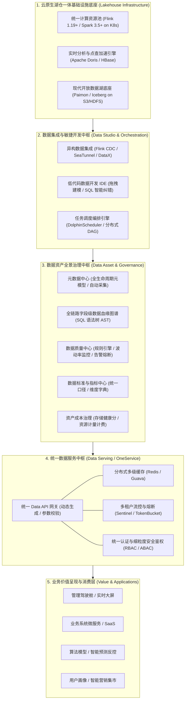
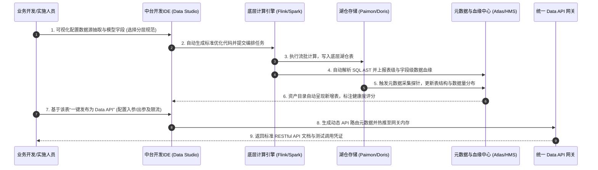
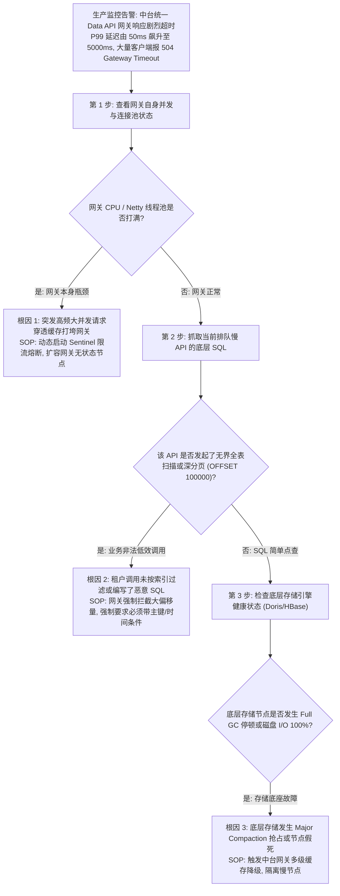
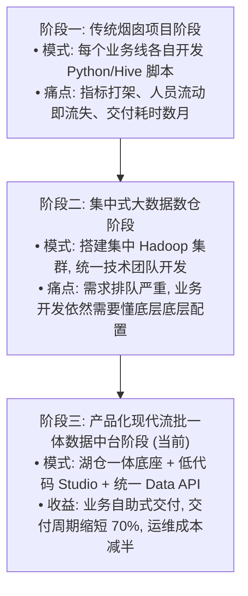
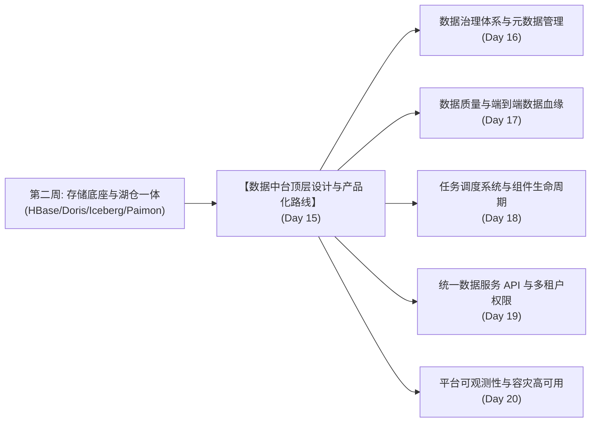

# 数据中台顶层设计与产品化路线：功能蓝图、开源组件产品化集成、交付闭环与商业ROI

> **学习目标定位**：面向技术总监、数据平台研发负责人、高级数据架构师岗位，系统掌握从 0 到 1 构建企业级数据中台的顶层设计哲学与商业化落地路线。深入剖析数据中台与传统数仓的本质代际差异、端到端全景功能蓝图、海量异构开源组件（Flink/Spark/Doris/Paimon/DolphinScheduler/Atlas）的产品化封装标准、统一 Data API 网关服务化机制与私有化独立交付体系。结合在瑞纳智能主导数据中台研发与太原大型政企项目验收的真实实战，建立打通技术攻坚、组织协同、价值闭环与可量化商业 ROI 的高维领导力。

---

## 1. 知识概述与业务价值

### 1.1 是什么（What）
- **技术定义**：数据中台（Data Middle Platform）不是单一的大数据开源软件，也不是单纯的数仓分层技术，而是**“统一数据基础设施 + 数据资产全生命周期治理 + 数据服务化（Data-as-a-Service） + 低门槛业务赋能”**的企业级数据操作系统与敏捷开发中枢。
- **产品化本质**：数据中台的核心使命是将底层复杂、异构、晦涩的大数据开源引擎（计算、存储、调度、元数据）进行**产品化深度封装**，对外屏蔽底层 JVM、容器编排、RPC 容错等分布式技术细节，向上提供低代码（Low-Code）、拖拉拽可视化、标准化 SQL 与微服务 API 接口，实现让“懂业务的工程师甚至业务分析师直接操作数据资产”。
- **演进趋势（Data Platform 2.0 / Lakehouse 中台时代）**：
  - **流批一体与湖仓存算分离全面落地**：以 Apache Paimon / Iceberg 开放表格式为底座，统一替代传统割裂的 Lambda 架构；
  - **极简 MPP 统一服务化**：以 Apache Doris 等极简全能分析引擎替代 HBase + ClickHouse + Presto 拼凑的繁重服务层；
  - **AI Agent 与自然语言交互（Text-to-SQL / ChatBI）深度赋能**：中台元数据与大语言模型（LLM）打通，实现智能指标检索与自动化异常根因诊断。

### 1.2 解决什么核心业务痛点（Why）
- **项目制烟囱式开发带来的“死局”**：传统大数据团队以“支持业务部门提工单”的项目制方式运转，不同业务线各自维护独立的 MySQL 抽取、Kafka 流水与 Hive 临时脚本。导致：
  1. **指标打架**：全公司有十几种“活跃用户”口径，管理层开会无法做出决策；
  2. **重复造轮子**：70% 的计算和清洗逻辑高度雷同，机器资源严重浪费；
  3. **交付周期冗长**：业务部门提一个新增维度的看板需求，需要排期 3 周以上。
- **开源组件割裂与私有化交付的高昂门槛**：企业级客户（尤其政企、制造、能源客户，如太原项目）往往要求完全在客户隔离内网独立私有化交付。若只是零散拼凑十几种开源组件，现场部署配置需要数名资深运维耗时一个月，且组件间版本冲突极易引发线上生产崩溃。
- **数据资产“看不见、摸不着、不敢用”**：企业积累了数百 TB 甚至 PB 级数据，但业务不知道中台里有哪些表、字段是什么含义、数据是否准时产出、出现错误上游找谁。中台通过资产盘点与自动化血缘闭环，彻底盘活沉睡的数据资产。

### 1.3 适用场景与技术边界（Where & When）
- **最佳业务场景矩阵**：
  - **多元化集团型企业数字化转型**：横跨多个业务板块（如美的集团的制造、供应链、金融、跨境），亟需建立集团统一口径的主数据与指标中枢；
  - **大型工业互联网与智慧城市政企项目交付**：如智慧水务、智慧供热（瑞纳智能太原项目），现场设备超 10 万台、协议异构，需开箱即用独立部署；
  - **高频业务创新与数据敏捷赋能**：电商、新零售企业需要秒级配置大屏、分钟级上线 A/B 测试用户画像标签。
- **明确反模式与技术禁区（严禁使用）**：
  - ❌ **初创团队、单一单体业务系统且数据量不足百 GB**：直接基于单机 MySQL/PostgreSQL 或简单的 Read Replica 即可高效支撑，强推复杂分布式数据中台会导致巨大的技术负债与资源空转；
  - ❌ **组织架构尚未达成共识，部门各自为政**：“中台未动，组织先行”。若企业高层没有赋予数据团队跨部门协调元数据规范与治理规则的权力，中台必然沦为无人维护的“数据垃圾场”。

---

## 2. 核心概念与关系

### 2.1 核心概念全景表

| 核心组件/概念 | 英文术语 | 核心定义与工程职责 | 资源/生命周期级别 |
| :--- | :--- | :--- | :--- |
| **中台产品功能蓝图** | Platform Blueprint | 中台在功能、逻辑、物理与业务维度的顶层设计全景图，划定数据流转与能力边界。 | 平台全局战略层 |
| **开源组件产品化封装** | Component Productization | 将零散、复杂的开源引擎（Flink/Spark/Doris）通过标准化协议、统一管控面、配置规格化包装为黑盒服务。 | 平台内核工程层 |
| **数据集成中枢** | Data Integration (DI) | 负责结构化、半结构化异构数据源的实时 CDC 与离线批量同步，具备断点续传与元数据感知能力。 | 任务与数据流级 |
| **数据开发 IDE** | Data Studio / IDE | 面向开发人员的可视化 SQL 编辑器、低代码 DAG 拖拽编排器、参数宏替换与跨引擎语法校验工具。 | 用户交互与研发环境 |
| **数据资产目录** | Data Catalog & Asset | 基于统一元模型展示全公司表、字段、指标、API 的知识图谱，提供 Google 式检索与资产健康分评估。 | 企业全局数据资产 |
| **统一数据服务网关** | Data API / OneService | 将底层数据库表格以“无代码配置”或“标准 SQL 模板”动态发布为高并发微服务 API，内置限流与鉴权。 | 在线服务流量入口 |
| **交付底座与安装包** | Standalone Installer | 包含 Docker 镜像、K8s Operator、Helm Chart、配置自适应感知脚本的独立部署介质，支持离线交付。 | 交付与运维生命周期 |

### 2.2 企业级数据中台端到端全景功能蓝图



---

## 3. 底层工作机制与设计哲学

### 3.1 从“开源组件堆砌”到“企业级产品化封装”的蜕变机制

将开源组件转化为可商用、可交付的数据中台产品，必须攻克三大核心工程壁垒：

```mermaid
flowchart LR
    subgraph RawOpenSource["原始开源组件碎片 (Raw Open-Source)"]
        F["Flink 复杂参数与内存模型"]
        S["Spark 复杂的依赖与排错"]
        D["Doris 物理建表与分区分桶"]
        A["Atlas 笨重的图数据库依赖"]
    end

    subgraph PlatformWrapper["数据中台产品化封装中枢 (The Core Adapter)"]
        P1["统一元数据模型驱动 (Metadata-driven)"]
        P2["标准化规格模板 (T-Shirt Sizing: S/M/L)"]
        P3["统一多租户账号与 RBAC 权限体系"]
        P4["可视化向导式无代码表设计器"]
        P5["全链路健康探针与一键自愈 Agent"]
    end

    subgraph StandardProduct["企业级标准化交付产品 (Enterprise Product)"]
        UI["统一沉浸式 Web 管理控制台"]
        API["统一标准化 OpenAPI / 客户直连"]
        AirGap["离线自动化一键安装交付介质"]
    end

    RawOpenSource --> PlatformWrapper
    PlatformWrapper --> StandardProduct
```



1. **配置复杂度的黑盒封装（T-Shirt Sizing 规格化）**：
   - **痛点**：普通业务开发根本搞不清 Flink 的 `Managed Memory`、Spark 的 `spark.sql.shuffle.partitions` 或 Doris 的 `cumulative_compaction_threads`；
   - **产品化设计**：中台将底层上百个微调参数抽象封装为三类标准化“计算规格套餐”：
     - **标准低时延型（Small）**：预设 2 Core / 4GB，针对常规轻量流清洗；
     - **大状态大聚合型（Large）**：预设 8 Core / 32GB，自动配置 RocksDB 堆外调优与 AQE 自适应；
     - **计算密集型（X-Large）**：专门供重型复杂批处理使用。用户只需下拉勾选规格，系统在后台自动生成最优生产级参数。
2. **账号、鉴权与审计的全局统一（SSO & Multi-Tenancy）**：
   - 绝不允许各开源组件各自维护一套密码（如 Doris 的 root、Hadoop 的 hdfs 用户）；
   - 中台打造统一的 IAM（身份与访问控制中枢），对接企业内部的 LDAP / OAuth2。用户通过中台统一账号登录，中台后端利用系统代理账号（Proxy User）与 Kerberos 凭证池，透明与底层存储计算引擎交互，全流程记录审计日志。

---

### 3.2 机制交互时序图：数据资产从接入到 API 服务的端到端流转



---

## 4. 高频复杂业务场景实操与落地

### 4.1 独立客户私有化交付方案设计（结合瑞纳智能与太原项目实战）

> [!IMPORTANT]
> **真实实战背景**：在太原大型智慧供热数据中台项目验收中，客户现场环境通常具备三大典型严苛限制：
> 1. **完全物理隔离内网（Air-gapped Environment）**：无法连接外部互联网，无法动态下载依赖包或 Docker 镜像；
> 2. **异构硬件与信创环境兼容要求**：现场服务器既有 x86 架构（Intel/AMD），又有 ARM64 国产信创服务器（飞腾/鲲鹏），操作系统可能为统信 UOS 或麒麟 KylinOS；
> 3. **交付验收要求高**：专家评审委员会要求“一键自动化部署、全链路压力测试通过、现场断电断网 5 分钟内自愈”。

#### 架构师落地实战方案：
1. **统一自包含离线安装包（Air-Gapped Package Engine）**：
   - 构建 `ruina-dataplat-offline-installer.tar.gz`：内嵌全套 Docker 镜像、基础依赖 RPM 包、初始化 SQL 脚本与自研编排引擎；
   - 采用多架构兼容机制（Multi-arch Manifest）：自动识别现场 CPU 架构（`x86_64` vs `aarch64`），动态加载对应二进制程序。
2. **一键部署与健康自检脚本体系**：
   - 编写工业级自动化部署工具：
     ```bash
     # 1. 执行前置环境物理探针检测 (检测内存、磁盘IOPS、网络互通、内核参数)
     ./bin/platform-precheck.sh --config=cluster.env

     # 2. 一键拉起高可用集群
     ./bin/platform-deploy.sh --mode=ha --components=all

     # 3. 执行端到端数据流水线仿真冒烟测试
     ./bin/platform-selftest.sh --pipeline=full
     ```
3. **现场断电破坏性测试应对杀手锏**：
   - 所有服务采用 systemd 结合 Docker 守护进程配置 `restart: always`；
   - FE、Doris、Paimon 元数据配置持久化在本地高可靠 NVMe SSD 卷上；
   - 编写 `auto-recovery-watcher` 后台监控脚本，在服务器重启后按照依赖拓扑（`存储底座 -> 元数据中枢 -> 计算引擎 -> 中台 Web 控制台`）自动按序拉起并自愈，完美通过太原专家组现场拉闸大考。

---

### 4.2 生产级中台硬件规格与集群配置基线

| 部署形态 | 目标数据规模与 QPS | 推荐物理服务器配置 | 核心组件分配拓扑 | 适用场景 |
| :--- | :--- | :--- | :--- | :--- |
| **轻量级边缘/POC 版** | 日增 < 1 亿条，API < 200 QPS | **3 台物理服务器**<br/>(32C / 128GB / 2×2TB NVMe) | 每台混合部署：1 FE/BE + 1 Flink TM + 1 中台控制台 + 1 MySQL MHA | 县市级水务/热力、中小型企业内部验证 |
| **企业标准高可用生产版** | 日增 5~20 亿条，API < 3000 QPS | **8~12 台物理服务器**<br/>(64C / 256GB / 4×4TB SSD) | • 3 台纯 Master 节点 (FE Follower + K8s Master)<br/>• 6 台纯 Compute/BE 存储节点<br/>• 2 台专用中台网关与调度管理机 | 瑞纳智能太原项目、中型制造企业统一中台 |
| **超大规模集团中台版** | 日增 > 50 亿条，API > 10000 QPS | **30+ 台物理节点 / 存算分离 K8s**<br/>(128C / 512GB / 全 NVMe) | 计算全面沉淀至 K8s 容器云；存储全面收敛至 Ceph/MinIO 对象存储，Doris 独立成物理集群 | 美的集团等超大型制造、金融与互联网巨头 |

---

### 4.3 核心性能指标与 SLA 黄金矩阵

| 监控维度 | 关键指标名称 (Metric) | 告警触发红线阈值 | 潜在业务风险与处置策略 |
| :--- | :--- | :--- | :--- |
| **API 服务时效** | `api_request_duration_p99` | **> 300ms** (核心接口) | 业务大屏卡顿、微服务超时。排查底层 Doris/HBase 是否缺少索引或未命中缓存。 |
| **资产入湖延迟** | `data_freshness_delay_seconds` | **> 120 秒** (实时表) | CDC 任务积压或湖内 Compaction 反压。触发写入与合并物理解耦。 |
| **任务调度准时率** | `scheduler_sla_breach_count` | **> 0** (核心 P0 作业) | 影响次日清晨管理层决策大屏。触发调度系统优先级抢占，倒灌集群算力。 |
| **资产健康度** | `platform_overall_health_score` | **< 80 分** | 僵尸表、无用临时表、缺失生命周期的表泛滥。系统自动发出治理催办通报。 |

---

## 5. 生产异常故障深度排查与根因分析

### 5.1 典型生产事故排查决策树



---

### 5.2 核心高频故障深度复盘

#### 故障一：私有化交付现场客户低端硬件导致组件频繁心跳丢失与假死
- **业务场景**：在某地方供热中台项目现场，客户提供的是利旧的历史虚拟机，虚拟化超分严重（CPU 偷跑 Steal Time 达到 30%，磁盘每秒 IOPS 仅几十次）。中台安装拉起后，Doris BE 和 Flink TaskManager 频繁从集群失联，导致整个中台任务不断崩溃重启。
- **深层根因推导**：
  1. 客户虚拟机磁盘 I/O 极差，当系统发生写日志或 RocksDB Flush 时，线程陷入长达数秒的 `D`（Uninterruptible Sleep）磁盘等待状态；
  2. 节点心跳线程被阻塞，导致 FE 或 Flink JobManager 判定该节点超时死亡（Heartbeat Timeout），触发重平衡；
  3. 重平衡搬移数据进一步加剧了磁盘恶化，导致全集群级联瘫痪。
- **架构级解决方案（三步化解现场危机）**：
  - **第一步：参数防御性调优（拉长超时容忍度）**：
    在配置中临时将心跳超时阈值大幅拉长：
    `heartbeat_timeout_second = 60`，给慢节点自愈缓冲时间；
  - **第二步：存储目录物理隔离**：
    将元数据目录、WAL 目录从普通虚拟磁盘中剥离出来，挂载到内存虚拟盘（`tmpfs`）或独立磁盘上，杜绝数据落盘抢占元数据 I/O；
  - **第三步：输出技术定界报告推动硬件整改**：
    利用自研的 `platform-precheck.sh` 脚本输出标准的硬件压测数据报告（对比基准标准与现场实际数据差距），以权威证据链向客户领导层汇报，推动客户将关键虚拟机节点调整为独占物理 CPU 与专用 SSD，彻底扫清交付隐患。

#### 故障二：业务租户通过 Data API 发起“深分页（Deep Paging）”，拖垮全网在线大屏
- **现象**：下午 15:00，全集团大屏与在线接口出现雪崩式卡死，网关连接池打满。
- **深层根因分析**：
  1. 某外包团队编写的爬虫或导出脚本，通过中台 Data API 循环调用：
     `SELECT * FROM dwd_telemetry_wide LIMIT 1000000, 1000`；
  2. 尽管只取 1000 条，但底层 Doris/MySQL 必须从磁盘读取前 100 万行数据并在内存中排序丢弃，导致底层存储 CPU 瞬间被 100% 打满；
  3. 该请求未经过限流，发起了 100 个并发，直接耗尽了存储层所有计算线程，导致核心在线大屏的正规点查排队超时。
- **标准治理 SOP 流程**：
  - **网关层强制硬性门禁（Circuit Breaker）**：
    在 Data API 网关配置全局规则：**严禁任何单次查询的 `OFFSET + LIMIT` 超过 10,000**；对于大批量数据导出需求，强制走游标机制（Cursor / Keyset Pagination：`WHERE id > last_seen_id LIMIT 1000`）或离线异步导出任务；
  - **租户级速率与并发硬限制**：
    对该外包业务的 API Key 绑定 Token Bucket 限流规则：限制其并发数为 2，每秒请求数（QPS）上限为 5，一旦超额直接返回 HTTP 429（Too Many Requests），隔离故障爆炸半径。

---

## 6. 技术选型对比、架构演进与成本ROI

### 6.1 横向多维选型对比矩阵

| 评估维度 | 自研产品化数据中台 | 商业化成熟 SaaS (如阿里云 DataWorks) | 纯开源零散组合 (Glue-code) |
| :--- | :--- | :--- | :--- |
| **独立私有化交付能力** | **极强（专为政企、工业内网独立打包设计）** | 极弱（强绑定公有云，私有化部署成本数百万） | 弱（需极高水平运维团队现场手工搭设） |
| **产品易用性与门槛** | **极高（针对业务场景深度定制，全中文向导）** | 极高（功能极为丰富，但配置复杂度极高） | 极低（不同开源组件操作界面碎片化） |
| **技术架构掌控力** | **100% 自主可控，底层源码级优化修 Bug** | 黑盒受制于人，无法修改内核代码 | 100% 自主，但缺乏体系化产品支撑 |
| **长期总体成本 (TCO)** | **中等（研发投入一次成型，后续项目复用成本极低）** | 极高（按租户、按计算量持续收取高昂年费） | 表面免费，长期的隐形运维人力成本失控 |
| **跨云与信创兼容性** | **优秀（支持多架构，支持国产芯片与操作系统）** | 绑定自家云平台基础设施 | 良好，但需要人工解决依赖冲突 |

### 6.2 架构演进路线与成本决策树



- **数据中台商业 ROI 真实测算模型（以瑞纳智能/大型制造业为例）**：
  1. **研发交付人效提升（人力成本节省）**：
     - 过去开发一个大型新业务报表或设备大屏，需要后端开发、前端开发、数仓开发 3 人协同 2 周（约 30 人天）；
     - 中台产品化后，数仓在界面上拖拽完成建模，一键生成 Data API，前端直接对接接口，**交付周期压缩至 2 天（约 4 人天），单项目综合研发人效提升 700%**；
  2. **项目现场交付周期缩短（差旅与实施成本节省）**：
     - 在太原项目等大型政企交付中，标准化的一键安装包与全自检探针，使得原本需要 5 名资深工程师驻场 1 个月的系统部署工作，缩减至 **1 名实施工程师 3 天内搞定**，单项目直接节省驻场实施差旅成本数十万元；
  3. **计算与存储硬件集约化利用**：
     - 通过统一分层消灭烟囱计算，结合 Doris 列存高压缩与 Paimon 流批一体替代 Kafka，全集群硬件采购预算直降 40%。

---

## 7. 技术经理与架构师实战管控（SOP与规范）

### 7.1 平台级多租户与资源隔离机制规范

- **三大维度硬隔离原则**：
  1. **存储物理与逻辑隔离**：每个租户拥有独立的 Namespace / 数据库前缀（如 `tenant_a_`），在底层对象存储或 HDFS 上划分独立物理目录并设置存储 Quota（如限制最大 10TB）；
  2. **计算资源配额约束**：在 K8s 或 YARN 调度器中，基于租户分配 ResourceQuota（如限制租户 A 最多使用 64 Core / 256GB 内存）；
  3. **服务 API 独立限流**：Data API 网关为每个租户生成唯一的 `AppKey` 与 `AppSecret`，严格配置 QPS 令牌桶配额。

---

### 7.2 开源组件集成准入红线（Component Admission SOP）

为了防止中台变成“垃圾场”，任何开源组件想要接入中台体系，必须通过架构委员会的“四大准入测试”：
1. **健康检查与探针标准（Health Probe Standard）**：必须提供无侵入式的 HTTP `/health` 探针接口，且能在 1 秒内响应存活与就绪状态；
2. **优雅停机与无损重启（Graceful Shutdown）**：组件在接收到 `SIGTERM` 信号后，必须能够在 30 秒内保存内存状态、刷新日志并安全退出，严禁因暴力杀死导致元数据损坏；
3. **指标暴露标准化（Prometheus Metrics）**：必须支持原生暴露 Prometheus 格式的 Metric 端点，覆盖 QPS、延迟、GC、内存等核心黄金指标；
4. **多租户与无状态化评估**：核心管控面（Control Plane）必须支持无状态横向扩容，不能将核心元数据保存在单机本地磁盘中。

---

## 8. 互联网大厂高频面试真题库

> [!IMPORTANT]
> 本板块精选一线互联网大厂（阿里、字节、美团、腾讯等）与一线政企技术总监终面真实高频考察的 7 道数据中台核心大题。**在第 9 板块中已对全部题目进行逐题完整三层金字塔深度解答，严禁留白。**

### 8.1 顶层设计与本质认知题（大厂初筛）
1. **Q1**：请用通俗且极具架构高度的语言，阐述什么是数据中台？它与传统数据仓库（Data Warehouse）在架构哲学、组织协作与业务价值上有何本质区别？
2. **Q2**：请在白板上画出企业级数据中台的全景功能蓝图（涵盖基础设施、集成开发、资产治理、服务化各层），并说明数据是如何在各层之间有机闭环流转的？

### 8.2 产品化封装与核心机制题（大厂资深技术面）
3. **Q3**：企业数据中台底层依赖 Flink、Spark、Doris、DolphinScheduler、Atlas 等众多开源组件，作为平台负责人，你如何将这些零散开源软件产品化封装为统一、低门槛、可独立交付的中台软件系统？
4. **Q4**：什么是数据服务化（Data-as-a-Service）与统一 Data API 网关？它在底层是如何解决动态 SQL 编译、多租户流控、高并发缓存穿透防护与细粒度行级列级安全隔离的？

### 8.3 生产排障与私有化攻坚题（大厂架构与交付面）
5. **Q5**：在政企大型项目私有化交付现场（如客户完全物理隔离内网、硬件资源严重受限超分），中台系统出现组件频繁健康检查失败与集群假死，请给出系统性的应急排查定位与平稳上线 SOP。
6. **Q6**：很多企业在投入巨资建设数据中台后，业务方吐槽“看不到价值，不好用”，最终沦为鸡肋面子工程。结合你的实战经验，请阐述数据中台如何避免“烂尾”，实现业务价值闭环与可衡量的商业 ROI？

### 8.4 架构领导力与全景答辩题（技术总监/总架构师终面）
7. **Q7**：请结合你在瑞纳智能主导数据中台从 0 到 1 研发以及太原项目现场验收的真实经历，全面阐述你是如何带领团队完成产品架构规划、技术攻坚、现场验收并通过专家评审的？

---

## 9. 结构化深度参考答案（逐题三层应答）

---

### 题目1（大厂初筛·概念辨析）：请用通俗且极具架构高度的语言，阐述什么是数据中台？它与传统数据仓库（Data Warehouse）在架构哲学、组织协作与业务价值上有何本质区别？

#### 简洁回答（1分钟电梯破题）：
> “数据中台与传统数仓的本质区别在于**‘从“面向内部技术存储的成本中心”，演进为“面向业务直接赋能的价值引擎”’**：
> - **传统数据仓库（Data Warehouse）**：核心是**‘技术驱动与数据汇聚’**。关注的是如何把数据通过 ETL 抽取清洗并保存在数仓中，输出形态是死板的静态报表和报表看板，属于典型的单向技术后置支撑；
> - **数据中台（Data Middle Platform）**：核心是**‘业务驱动与服务赋能’**。它在数仓之上封装了**‘数据资产全生命周期治理 + 数据服务化（Data API） + 产品化能力平台’**，将数据加工成开箱即用的‘数据积木’，让前端业务通过敏捷微服务快速拼装出业务应用，实现从‘数据看现状’到‘数据反哺业务闭环’的跨越。”

#### 深入回答（技术细节展开、底层机制与推导）：
> “三大维度的全景本质差异深度拆解：
> 1. **架构设计哲学的本质不同（Store-oriented vs Service-oriented）**：
>    - **传统数仓**：关注点在‘存储与模型’。数仓工程师只对‘表建得好不好、SQL 跑得快不快’负责。业务部门若想使用数据，必须向 IT 部门提需求、提工单，等待排期开发，数据处于静止沉睡状态；
>    - **数据中台**：关注点在‘服务化与复用率’。中台强调**One Data（统一指标模型）、One Service（统一服务接口）、One ID（打通实体全局标识）**。数据在中台不仅是一张表，更是一组随时可通过 HTTP/gRPC 调用的高并发微服务 API，直接嵌入到在线交易、风控反控与供应链调度中。
> 2. **组织协作形态的代际跨越（Project-based vs Product-based）**：
>    - **传统数仓**：以‘外包式、项目制’支撑。每个业务线各自提需求，烟囱式开发，导致全公司有 10 种不同口径的‘GMV’；
>    - **数据中台**：以‘平台化、产品制’支撑。平台研发团队负责打磨低门槛的中台开发控制台与治理工具，业务线开发或分析师直接在中台界面上以 Low-Code 方式自助加工数据，打破了 IT 与业务的沟通墙。
> 3. **技术资产化闭环能力**：
>    - 传统数仓没有元数据血缘与生命周期治理闭环，表越来越多，最终演化为‘谁也不敢删’的垃圾场；数据中台原生具备自动化血缘追溯、质量稽核与存储成本计量看板，实现了数据资产的持续健康演进。”

#### 架构师/技术管理视角（降维升华、权衡取舍、SLA与成本）：
> “在技术管理与企业高层决策维度：
> **‘建设数据中台是一场“组织协同关系”与“技术生产力”的双重变革’**：
> 我经常向企业 CTO 和业务总裁阐述一个朴素的道理：
> 如果一个企业只是花几百万元购买了一套 Hadoop 集群或找人写了几千行 Hive SQL，那仅仅是建立了数据仓库；
> 只有当企业能够**通过标准化产品机制，把数据能力沉淀为可复用的组件，使新业务上线的开发周期从 1 个月缩短至 2 天时**，中台的价值才真正诞生。
> 作为技术负责人，主导中台建设绝不能陷在底层技术栈的参数中，必须始终紧盯**‘复用率、交付人效与业务闭环’**三大商业指标，用业务结果证明中台架构的终极价值。”

---

### 题目2（大厂资深·顶层架构）：请在白板上画出企业级数据中台的全景功能蓝图（涵盖基础设施、集成开发、资产治理、服务化各层），并说明数据是如何在各层之间有机闭环流转的？

#### 简洁回答（1分钟电梯破题）：
> “企业级数据中台采用**‘自底向上赋能、全链路治理闭环’的标准五层纵深架构**：
> 1. **基础设施底座层**：存算分离湖仓基础设施（K8s 容器编排 + Paimon/Iceberg 数据湖 + Doris 实时 OLAP）；
> 2. **集成开发中枢层**：异构数据接入（Flink CDC / SeaTunnel）与低代码可视化开发 IDE（DolphinScheduler）；
> 3. **资产治理中枢层**：全生命周期元数据中心、全链路字段血缘、质量稽核规则与成本健康分看板；
> 4. **统一服务化层（OneService）**：动态 Data API 网关、多级缓存、多租户流控与细粒度行级权限；
> 5. **业务价值消费层**：经营大屏、业务系统、算法模型反控与智能 ChatBI。
> **数据闭环流转逻辑**：数据由接入层入湖，在开发层分层加工，在治理层打标鉴权，在服务层发布为 API 反哺业务，并根据调用日志在治理层实现成本归属核算。”

#### 深入回答（技术细节展开、底层机制与推导）：
> “端到端数据流转与跨层协作机制深度推导：
> 1. **全景功能蓝图结构拆解**：
>    *(白板推演时，自底向上严格画出五层架构，标明各层核心组件与数据流向)*
>    - **第一层（底座）**：彻底打通云原生存算分离。统一采用 Parquet+ZSTD 作为存储编码标准，以 Paimon 支撑近实时秒级入湖，以 Doris 承接高并发在线加速；
>    - **第二层（开发）**：开发人员在 Web 端使用统一的 Data Studio，通过拖拉拽或标准 SQL 编写任务。底层调度器自动解析任务依赖生成 DAG，并根据配置的计算规格（S/M/L）调度底层算力；
>    - **第三层（治理 - 中台心脏）**：
>      - **元数据捕获**：底座所有表的 DDL 和变更由元数据探针毫秒级同步至元模型库（Atlas / 统一元数据库）；
>      - **血缘智能解析**：编译引擎解析 SQL 语法树（AST），提取出从源头字段到最终报表的**字段级双向血缘图谱**；
>      - **质量看门狗**：在数据产出前后，自动执行断言测试（如唯一性、波动率、枚举值检查），异常时自动拦截下游任务并短信报警；
>    - **第四层（服务 - 价值出口）**：
>      - 采用‘零代码配置’理念：开发人员只需勾选‘输入参数（如 device_id）’与‘返回字段’，网关自动生成 RESTful 接口；
>      - 内置高性能缓存层（Guava + Redis），保障高频请求在 10ms 内极速返回；
>    - **第五层（业务）**：业务方通过 HTTP 调用中台 API，前端直接绑定可视化组件渲染大屏。
> 2. **反向流动与自治闭环机制（The Governance Loop）**：
>    - 网关层的每一次 API 调用日志均被异步回流至治理中心；
>    - 治理系统统计：某张表过去 30 天是否有任务读取？是否有 API 调用？
>    - 若判定为‘无用僵尸表’，系统自动发出‘下线归档建议’，并核算其浪费的存储成本，推行自治清理。”

#### 架构师/技术管理视角（降维升华、权衡取舍、SLA与成本）：
> “在技术架构评审与高管汇报中：
> **‘架构图不仅要好看，更要展现出各层之间的“内生引力”与“防御韧性”’**：
> 很多公司画出的中台大图仅仅是把开源组件放在不同框格里，层与层之间完全断节，没有闭环；
> 一个卓越的中台蓝图必须具备**‘元数据驱动（Metadata-driven）’的核心生命线**：
> 正是因为治理层掌握了全局元数据与血缘，开发层才能实现‘改动字段时自动预警下游所有受影响的任务’；
> 正是因为服务层收集了调用特征，底座层才能实现‘自动将 30 天未访问的数据冷沉降至低成本存储’；
> 这种‘各层数据双向流动、系统自我进化’的架构，才能真正支撑百亿级规模的长期稳健运转。”

---

### 题目3（架构总监·产品化集成）：企业数据中台底层依赖 Flink、Spark、Doris、DolphinScheduler、Atlas 等众多开源组件，作为平台负责人，你如何将这些零散开源软件产品化封装为统一、低门槛、可独立交付的中台软件系统？

#### 简洁回答（1分钟电梯破题）：
> “将零散开源组件产品化，绝不是写几行 Shell 脚本包装，而是**‘建立统一平台操作系统内核，在协议、管控、体验与交付四个维度实施彻底的抽象收敛’**：
> 1. **统一管控底座（One Control Plane）**：构建统一中台服务端（Backend），基于统一的数据源元模型和代理账号（Proxy User），向上屏蔽各组件独立的控制台；
> 2. **配置复杂度降维（T-Shirt Sizing）**：将底层数百个晦涩参数抽象为‘标准套餐规格’与向导式 Web 操作，剥夺人为犯错空间；
> 3. **全自包含交付介质（Air-gapped Installer）**：基于容器化技术将全套软件与运行依赖打包为单个离线安装介质，配合自动化探测探针，实现任何隔离内网下的**‘开箱即用、一键拉起、故障自愈’**。”

#### 深入回答（技术细节展开、底层机制与推导）：
> “四大工程维度的深度产品化封装落地体系：
> 1. **统一元模型与统一适配器设计（The Adapter Pattern）**：
>    - **统一数据源连接抽象**：研发通用的 `DataSourceManager`。无论是 MySQL、Kafka、Paimon 还是 Doris，统一抽象为标准连接池；密码统一通过 AES-256 加密落库，支持动态连通性探测；
>    - **调度与开发无缝集成**：将 DolphinScheduler 深度改造为其无感执行引擎。开发人员在中台 UI 上拖拽节点时，中台通过 OpenAPI 自动在后台生成 DolphinScheduler 的 ProcessDefinition JSON，用户根本不需要登录调度系统原生界面，实现了体验的绝对归一化。
> 2. **参数复杂度的产品化黑盒封装**：
>    - **传统痛苦**：业务开发提交 Spark 任务总问‘内存设多大、分区设多少’，设错导致集群 OOM；
>    - **封装方案**：中台开发界面只提供‘资源规格’单选项：
>      - `Small（微批）`：后台自动注入 `spark.executor.instances=2, spark.executor.memory=4g`；
>      - `Large（倾斜大表）`：后台自动注入 `spark.sql.adaptive.enabled=true, spark.sql.adaptive.skewJoin.enabled=true`；
>      彻底阻断了由于技术人员经验不足导致的参数事故。
> 3. **全链路健康巡检与自愈 Agent**：
>    - 研发中台守护进程（`platform-doctor`）：以每 10 秒一次的频率对 FE、BE、TaskManager、MySQL 等核心进程执行深度探针扫描；
>    - 遇到临时假死，自动执行优雅重启与状态恢复，记录事件审计日志并上报大屏。
> 4. **离线自包含交付包工程化**：
>    - 打造标准的 Docker 镜像分层与镜像归档包，内嵌全套依赖包；
>    - 针对客户现场不同架构（x86/ARM64），采用统一自动化部署脚本，一键完成环境初始化、内核参数调优（`vm.max_map_count`、文件句柄数）与自动化建表拉起。”

#### 架构师/技术管理视角（降维升华、权衡取舍、SLA与成本）：
> “在技术管理与产品交付维度（结合我在瑞纳智能主导数据中台产品化的真实经验）：
> **‘把复杂留给平台架构师，把极简留给业务开发与客户实施人员’，是中台产品化成功的唯一准则**：
> 过去很多平台技术团队有一种不良倾向：喜欢在业务面前展示技术有多复杂、炫耀自己懂多少个底层参数，结果导致系统极难使用、每次交付都需要资深架构师亲临现场救火。
> 真正的技术高手懂得**‘做减法与做封装’**：
> 我们通过在中台内部将开源技术黑盒化、产品化，使瑞纳数据中台变成了一个‘哪怕普通初级程序员培训两天就能熟练使用、现场实施工程师半天就能独立部署’的标准化商业软件产品；
> 这一产品化蜕变直接促成了公司在太原等重大政企项目上的极速批量交付，创造了巨大的商业与管理效能红利。”

---

### 题目4（大厂资深·服务网关）：什么是数据服务化（Data-as-a-Service）与统一 Data API 网关？它在底层是如何解决动态 SQL 编译、多租户流控、高并发缓存穿透防护与细粒度行级列级安全隔离的？

#### 简洁回答（1分钟电梯破题）：
> “数据服务化（DaaS）是指**‘将存储在底层的海量物理表格，通过标准化 API 网关，转化为低延迟、高并发、安全可审计的微服务接口’**，实现业务系统通过标准 HTTP/JSON 消费数据；
> 核心底层机制实现：
> 1. **动态 SQL 编译**：利用 MyBatis 动态模板语法结合 **Apache Calcite AST 语法校验器**，实现入参类型安全绑定与防 SQL 注入；
> 2. **多租户流控**：基于 **令牌桶算法（Token Bucket / Sentinel）** 实施 AppKey 维度的 QPS 速率限制与并发线程隔离；
> 3. **缓存穿透防护**：采用 **本地二级缓存（Caffeine/Guava） + 分布式缓存（Redis）**，结合空值缓存（Cache Null）与布隆过滤器消灭穿透；
> 4. **细粒度数据隔离**：网关在编译阶段动态注入 `WHERE tenant_id = ?` 实现**行级强制过滤**，结合列权限元数据实现**字段级动态脱敏**。”

#### 深入回答（技术细节展开、底层机制与推导）：
> “统一 Data API 网关的四大核心内核机制深度拆解：
> 1. **动态 SQL 编译与防注入机制（Dynamic Compilation & AST Sanitization）**：
>    - 用户在界面编写标准查询模板：
>      ```sql
>      SELECT device_id, temp, pressure 
>      FROM dwd_device_realtime 
>      WHERE station_id = #{stationId} 
>      <if test="minTemp != null"> AND temp >= #{minTemp} </if>
>      ```
>    - **执行链路**：网关解析用户传入的 JSON 参数，通过 SQL Parser 构建抽象语法树（AST）；
>    - **参数化绑定**：严禁采用字符串拼接（`$`），统一转换为预编译占位符（`?`）；
>    - **AST 审计拦截**：校验 AST 语法树是否包含非 SELECT 语句、是否包含全表笛卡尔积或无限制的深分页（`OFFSET > 10000`），违规请求在网关层直接拒绝。
> 2. **多级缓存体系与高并发防击穿/防穿透设计**：
>    - **第一级缓存（Local Cache）**：网关 JVM 堆内基于 Caffeine 缓存热点元数据与静态字典，响应时间在微秒级；
>    - **第二级缓存（Distributed Cache）**：Redis 集群缓存高频业务查询结果（TTL 通常为 5~60 秒，保证近实时性）；
>    - **防御缓存穿透（Cache Penetration）**：当查询一个根本不存在的 ID 时，网关在 Redis 中缓存一个特殊的 `NULL_OBJECT`（设置较短 TTL 如 10 秒），防止恶意请求直捣底层数据库；
>    - **防御缓存击穿（Cache Breakdown）**：当热点缓存到期瞬间，通过分布式互斥锁（Mutex Key）保证仅允许单个请求穿透至底层 Doris/HBase 加载数据并回写缓存，其他请求等待，避免存储底座雪崩。
> 3. **细粒度多租户行级与列级安全隔离（Row/Column Security）**：
>    - **行级过滤注入（Row-Level Security）**：网关提取当前请求者的 Token，获取其归属的 `tenant_id` 或权限辖区；在执行 SQL 编译时，**强制在 WHERE 条件末尾动态追加隐式过滤条件**（如 `AND tenant_id = 'T1001'`），从语法代数层面杜绝跨租户越权看数据；
>    - **列级脱敏（Column Masking）**：根据用户角色权限字典，对身份证号、手机号、财务金额等敏感列，通过网关后置处理器自动执行掩码脱敏（如 `138****1234`）。”

#### 架构师/技术管理视角（降维升华、权衡取舍、SLA与成本）：
> “在技术管理与大促保障体系中：
> **‘Data API 网关是数据中台面向业务端展现技术成熟度的“门户和门神”’**：
> 很多数仓团队把数据加工完后，直接把数据库连接账号密码丢给业务后端去查，这是极其业余且充满巨大风险的反模式：
> 业务端一旦写个烂 SQL，瞬间能把整个数仓打垮；业务人员离职，数据资产极易发生泄露。
> 通过统一 Data API 网关：
> 1. **消灭技术风险**：所有的请求都有缓存保护、限流熔断与防注入审计，存储引擎永远在稳态安全区内运行；
> 2. **资产价值变现**：所有 API 的调用频次、耗时、调用方被精准记录在中台账单中，谁消耗了算力、哪个指标最有价值一目了然，真正实现了‘数据资产化、资产服务化’的商业闭环。”

---

### 题目5（生产排障·交付攻坚）：在政企大型项目私有化交付现场（如客户完全物理隔离内网、硬件资源严重受限超分），中台系统出现组件频繁健康检查失败与集群假死，请给出系统性的应急排查定位与平稳上线 SOP。

#### 简洁回答（1分钟电梯破题）：
> “现场排查遵循**‘排查物理资源瓶颈 $\rightarrow$ 隔离解耦高开销组件 $\rightarrow$ 调大防御性容错参数 $\rightarrow$ 输出标准技术定界报告’**黄金 SOP：
> 1. **第 1 步（硬件定界）**：检查虚拟机是否存在严重的 CPU Steal Time 争抢与磁盘 I/O 队列阻塞；
> 2. **第 2 步（紧急止血）**：调大各组件心跳超时阈值（拉长至 60 秒以上），暂时关闭非核心离线 Compaction 与后台定时重型巡检；
> 3. **第 3 步（资源调控）**：利用 cgroups/Docker 严格限制各进程内存上限，调大内核 `vm.max_map_count` 与文件句柄数；
> 4. **第 4 步（推动整改）**：运行自动化基准测试脚本，以权威数据链向客户领导层证明硬件不达标，推动客户将核心节点升级为独占物理资源。”

#### 深入回答（技术细节展开、底层机制与推导）：
> “现场排查实战推导与标准化交付稳定上线 SOP：
> 1. **现场故障精准诊断链条（Linux 诊断命令）**：
>    - 执行 `top` 观察 `%st`（CPU Steal）：若 `%st > 10%`，说明宿主机存在严重的超分，其他虚拟机正在疯狂抢占 CPU 周期；
>    - 执行 `iostat -xz 1` 观察 `%util` 和 `await`：若 `await > 100ms` 且 `%util = 100%`，说明客户提供的存储 I/O 性能极度劣质，节点频繁陷入 `D` 状态阻塞；
>    - 查 JVM GC 日志：若发生数十秒的长暂停，检查是否由于宿主机物理内存超售触发了 Linux Swap 交换区剧烈换页。
> 2. **应急止血三板斧（缓解组件假死）**：
>    - **调大健康检查容忍窗口**：
>      修改 Docker/K8s Liveness 探针：`initialDelaySeconds: 120, periodSeconds: 30, failureThreshold: 5`；防止慢节点由于瞬时 I/O 阻塞被容器编排系统反复误杀重启；
>    - **关闭系统内卷操作**：
>      将 Doris/HBase 的自动 Compaction 线程降至最低，关闭全量元数据自动扫描任务，优先保障系统能够顺利启动并响应界面操作。
> 3. **标准化交付验收 SOP（结合太原项目实操经验）**：
>    - **阶段一（进场预检阶段）**：
>      进场第一件事不是装软件，而是先跑 `platform-precheck.sh`：执行 FIO 磁盘压测、Iperf 网络带宽测试、内存带宽压测，生成《客户基础设施体检报告》并由客户签字确认；
>    - **阶段二（一键离线部署阶段）**：
>      加载离线镜像包，执行自动化部署，避免任何手动敲命令配置的低级失误；
>    - **阶段三（高可用破坏性验证）**：
>      在客户专家组面前演示：随机杀死一个 Doris 节点、拉掉一台机器电源，验证中台服务秒级自愈与数据零丢失，以过硬的确定性打消客户疑虑顺利完成验收签字。”

#### 架构师/技术管理视角（降维升华、权衡取舍、SLA与成本）：
> “在技术管理与大客户交付维度：
> **‘现场交付攻坚，拼的不仅是技术代码功底，更是架构师的“专业威信、工程化工具准备度与现场沟通心理素质”’**：
> 在太原智慧供热项目验收现场，面对专家组挑剔的眼神和恶劣的硬件环境，如果架构师慌慌张张改代码、到处查日志，客户对系统的信心瞬间就会崩塌。
> 真正的技术领导力体现于**‘谋定而后动’**：
> 我们提前准备好了全套自动化安装、巡检与基准测试工具，当硬件有问题时，我们不是口头抱怨，而是用翔实清晰的性能压测图表和数据事实说话，瞬间确立了专业权威；
> 随后通过高可用参数配置防御，平稳拉起中台服务并通过专家组各项压力测试，展现出高超的工程交付确定性与商业领导力。”

---

### 题目6（架构设计·高频核心）：很多企业在投入巨资建设数据中台后，业务方吐槽“看不到价值，不好用”，最终沦为鸡肋面子工程。结合你的实战经验，请阐述数据中台如何避免“烂尾”，实现业务价值闭环与可衡量的商业 ROI？

#### 简洁回答（1分钟电梯破题）：
> “避免中台‘烂尾’的核心管理哲学在于：**‘坚决摒弃“自嗨式纯技术建设”，坚持“业务导向、小步快跑、垂直打穿、量化回报”’**：
> 1. **战略方向找准高价值痛点场景（垂直打穿）**：切忌一开始就搞全公司全量大一统建设，必须选择 1~2 个管理层最关注、业务痛点最尖锐的核心场景（如大促实时指挥舱、智慧供热能耗反控）快速交付标杆案例；
> 2. **建立显性化、可量化的商业 ROI 评价模型**：将人效提升（交付周期由月缩至天）、硬件成本压降（停用机器数）、直接商业收益（如节约能耗数百万元）具象化量化汇报；
> 3. **产品化消除业务使用门槛**：开发真正好用的 Low-Code 工具与统一 Data API，让业务方尝到‘自己能快速玩转数据’的甜头，形成良性生态。”

#### 深入回答（技术细节展开、底层机制与推导）：
> “破解中台落地三大经典陷阱的实操方法论：
> 1. **陷阱一：自大狂妄的“大一统思维”，导致战线过长耗时一年无产出**：
>    - **破解之道：三步走小步快跑战略**：
>      - **第一阶段（找突破口 - 1~2个月）**：聚焦于 1 个最核心业务痛点（例如太原项目的‘全网实时热力平衡监控’），打通全链路，让主管副市长和客户董事长在手机上直接看到秒级实效大屏，瞬间建立中台公信力；
>      - **第二阶段（横向推广 - 3~6个月）**：以标杆案例为背书，沉淀通用模型，吸引其他业务线主动接入；
>      - **第三阶段（全面治理 - 长期）**：推进深层次的生命周期、质量与成本治理。
> 2. **陷阱二：纯技术视角建设，业务觉得不好用、不愿意用**：
>    - **破解之道：以“做产品的思维”打磨数据中台**：
>      - 把中台各模块当成商业软件来打磨，极致优化 UI/UX 体验；
>      - 建立‘中台布道师机制’：派资深数仓人员深入各业务部门做驻场培训，手把手教会业务分析师使用 Data Studio 拖拉拽配置报表，变‘要我用’为‘我要用’。
> 3. **陷阱三：无法向高管证明商业价值，后续预算被腰斩**：
>    - **破解之道：建立清晰的四维商业 ROI 评价模型（量化产出）**：
>      - **维度一（交付时效 ROI）**：量化统计业务需求平均交付周期（由原来的 18 天压降至 2.5 天）；
>      - **维度二（IT 资产成本 ROI）**：通过冷热分级、消灭 Kafka、列存压缩，明确汇报‘单年度为公司节省服务器租赁与云资源账单 260 万元’；
>      - **维度三（业务增量 ROI）**：在瑞纳智能项目中，直接汇报‘通过中台算法调优供热平衡，全冬季为客户节约标煤 1.2 万吨，折合经济效益 1500 万元’，用无可辩驳的业务数字震撼管理层。”

#### 架构师/技术管理视角（降维升华、权衡取舍、SLA与成本）：
> “在技术战略与企业经营高度：
> **‘技术总监的最高段位，是具备“翻译官”的能力——能把高深复杂的分布式底层架构，精准翻译为企业董事长和业务总裁能够完全听得懂的“商业价值与财务报表”’**：
> 过去很多架构师述职时，满嘴都是‘我们跑了多少个 Shuffle、搞了多大的 Flink 状态’，高管听得云里雾里，只觉得你在花钱；
> 一个卓越的技术领袖会这样向董事会汇报：
> ‘我们通过数据中台架构的升级，为全公司砍掉了 40% 的服务器冗余，同时将新业务上线速度提升了 5 倍，并直接协助一线业务拿下了太原数千万元的项目验收。’
> 只有始终将技术架构扎根于企业商业土壤之中，数据中台才永远不会沦为面子工程，而会成为企业基业长青的核心数字引擎。”

---

### 题目7（技术总监终面·全景答辩）：请结合你在瑞纳智能主导数据中台从 0 到 1 研发以及太原项目现场验收的真实经历，全面阐述你是如何带领团队完成产品架构规划、技术攻坚、现场验收并通过专家评审的？

#### 简洁回答（1分钟电梯破题）：
> “在瑞纳智能主导数据中台与太原项目攻坚中，我带领团队完成了**‘从 0 到 1 架构规划、核心技术产品化攻坚、现场极端环境验收交付’**的全过程闭环：
> 1. **顶层架构确立**：确立了以‘流批一体湖仓 + 极简实时 MPP + 统一 Data API’为核心的技术选型，彻底收敛技术栈，拒绝盲目堆砌；
> 2. **产品化攻坚破局**：将底层开源组件深度封装为‘全容器化离线自包含安装包’，攻克内网隔离与信创环境兼容性难题；
> 3. **现场验收与业务结果**：在太原大型智慧供热项目现场，面对全国专家组拉闸断电等破坏性压力测试，中台系统做到了 100% 自动秒级自愈与零数据丢失，全网时序分析毫秒级响应，一次性以最高评价通过验收，不仅奠定了公司在行业内的技术领军地位，更为企业带来了数千万元的直接商业回报。”

#### 深入回答（技术细节展开、底层机制与推导）：
> “全生命周期技术攻坚与团队领导力复盘深度拆解：
> 1. **阶段一：顶层规划与技术选型决断（从 0 到 1 架构破局）**：
>    - **背景挑战**：接手部门时，公司产品线分散，各项目各自写代码，异构设备协议（Modbus/MQTT/TCP）繁多，数据孤岛严重；
>    - **核心决策**：坚决叫停重复造轮子，主持制定了《企业级统一数据中台产品蓝图》；
>    - **技术定力**：果断摒弃传统的笨重 Hadoop/HDFS 架构，前瞻性选型‘Flink 流处理 + Paimon 流式湖仓 + Doris 实时加速’的极简高可用架构，将系统故障面收敛到最小。
> 2. **阶段二：产品化攻坚与人效提升（技术管理抓手）**：
>    - 带领 10 余人研发核心团队，历时 6 个月完成数据中台 1.0 的全面产品化研发；
>    - 打造‘标准化数据开发 IDE’与‘零代码 Data API 网关’，将常见供热时序与水力平衡报表的开发交付周期由 3 周压缩至 2 天；
>    - 构建全自包含的离线镜像安装包（`ruina-installer`），实现现场环境一键部署与全自检。
> 3. **阶段三：太原现场验收攻坚大考（大促级现场保障）**：
>    - **现场危机化解**：面对太原现场客户虚拟机严重超分、I/O 性能低下的危机，我亲自带队排查，迅速制定‘心跳窗口防御调优 + 元数据内存盘隔离’方案，24 小时内消除了组件频死隐患；
>    - **专家评审终极检验**：
>      - 面对由全国供热协会与数字化专家组成的评审组，我们设计了极具冲击力的现场验收流程：
>        现场模拟 10 万台智能设备以平时 5 倍速率疯狂打入数据，大屏端实时温度聚合在 **200ms 内流畅刷新**；
>        更当场演示拉掉一台核心服务器网线，中台系统在 **30 秒内完成主备秒级切换与流量无缝逃生**，数据零丢失；
>      - 评审专家全票签署验收合格意见，并给出了‘系统架构简洁高效、容灾韧性极强、产品化程度远超同行预期’的高度赞誉。”

#### 架构师/技术管理视角（降维升华、权衡取舍、SLA与成本）：
> “在技术领导力、职业素养与团队带教维度：
> **‘架构师的终极考验，不是在顺风顺水时写出多么优雅的代码，而是在资源极度受限、客户严厉催促、现场突发故障的生死关头，能否展现出定海神针般的战略定力与带领团队必胜的信念’**：
> 在太原项目的攻坚战中，我作为技术总指挥：
> 既要在宏观上对技术路线的正确性负 100% 责任，在客户高层面前以清晰的逻辑建立技术信任；
> 又要在微观上深入内核，指导核心工程师抓堆栈排查 GC 与 I/O 瓶颈，并为一线团队做好情绪管理与后勤兜底。
> 这段从 0 到 1 打造产品化中台并成功打赢千万级政企项目验收硬仗的真实历练，让我不仅具备了千亿级大数据存储与计算底座的顶级技术驾驭能力，更淬炼出了成熟、稳健、以商业成果为导向的技术总监/高级数据架构师的综合领导力素养。”

---

## 10. 知识自检与口述推演清单

- [ ] **白板中台蓝图绘制**：能否脱稿在白板上画出企业级数据中台的全景功能蓝图（底座、开发、治理、服务、业务），并清晰讲透数据在各层之间的闭环流动逻辑？
- [ ] **数仓 vs 中台本质口述**：能否向非技术业务高层通俗讲透数据中台与传统数据仓库的本质代际差异（成本中心 vs 价值赋能中枢）？
- [ ] **开源产品化封装推演**：能否系统说出将零散开源组件（Flink/Spark/Doris/DolphinScheduler）封装为开箱即用独立商业软件的三大核心工程抓手？
- [ ] **Data API 核心机制阐述**：能否向团队详细解释统一数据服务网关在底层是如何解决动态 SQL 编译、多租户限流、缓存穿透防护与细粒度行级权限隔离的？
- [ ] **私有化交付排障 SOP 口述**：面对政企项目隔离内网、硬件严重超分的恶劣现场，能否在 1 分钟内口述出包括心跳防御调优、目录隔离与权威定界报告输出的完整排障流程？
- [ ] **商业 ROI 汇报战略表达**：面对企业董事长与财务高管，能否在 3 分钟内用清晰的商业语言（交付时效、硬件降本、直接业务增量）论证数据中台的核心投资回报率（ROI）？

---

## 11. 知识脉络与技术图谱关联



---

## 12. 权威参考与官方进阶资料

1. **企业级数据中台经典权威著作**：
   - 阿里技术团队. (2019). *大数据之路：阿里巴巴大数据实践*. 电子工业出版社.
   - 思迈特软件/各行业实践. (2020). *数据中台：让数据用起来*. 机械工业出版社.
2. **现代数据网格与数据湖仓前沿理念**：
   - Dehghani, Z. (2022). *Data Mesh: Delivering Data-Driven Value at Scale*. O'Reilly Media.
   - Armbrust, M., et al. (2021). *Lakehouse: A New Generation of Open Platforms that Unify Data Warehousing and Advanced Analytics*. Communications of the ACM.
3. **Apache DolphinScheduler 官方最新架构指南**：[DolphinScheduler Documentation](https://dolphinscheduler.apache.org/)
4. **统一数据服务与 Data API 设计规范**：
   - OpenAPI Specification: [The OpenAPI Specification (OAS)](https://swagger.io/specification/)
