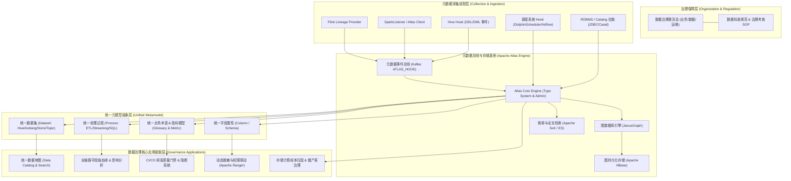
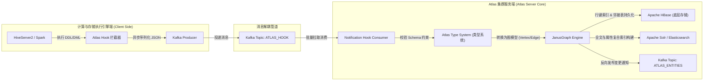
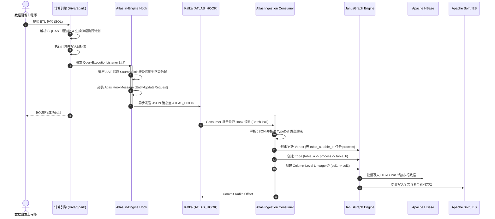
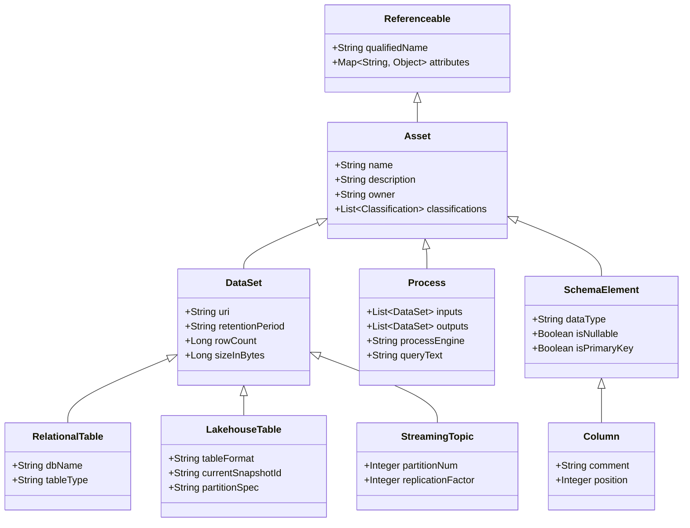
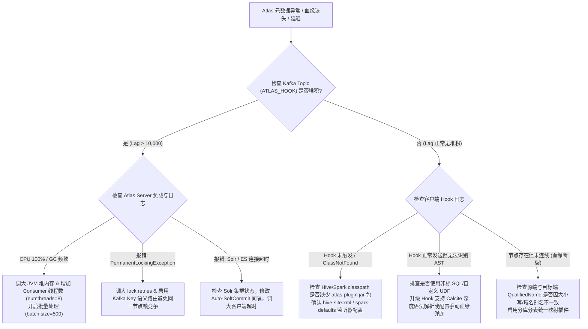
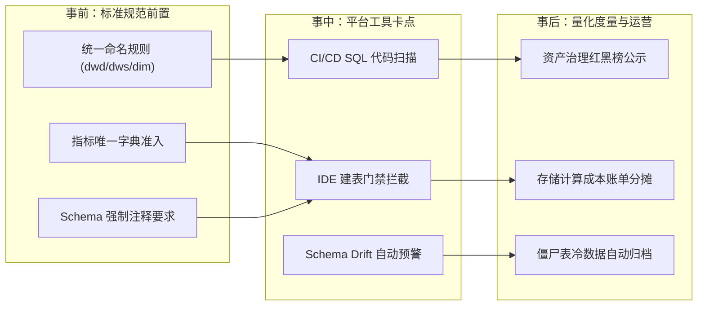

# 数据治理体系与元数据管理：全景框架、Atlas内核、统一元模型设计与企业级常态化治理

> **学习目标定位**：面向技术总监、数据平台研发负责人、高级数据架构师岗位，系统掌握企业级数据治理顶层框架（DAMA-DMBOK 工业化落地）与元数据管理底座的核心技术实现。深度剖析三类元数据（技术、业务、操作）的统一抽象模型、Apache Atlas 底层内核架构（Type System、Hook 异步总线、JanusGraph 图引擎、HBase 存储与 Solr/ES 倒排检索协作）、异构引擎（Hive/Spark/Doris/Paimon/Kafka）端到端血缘采集与缝合机制。结合大型制造集团（美的）多源异构资产盘点与工业物联网（瑞纳智能）百万级设备测点元数据建模经验，讲透如何规避“运动式治理”陷阱，建立基于元数据驱动的代码门禁、指标防打架与 FinOps 降本增效长效机制。

---

## 1. 知识概述与业务价值

### 1.1 是什么（What）
- **数据治理（Data Governance）的技术定义**：数据治理不是单一的软件或技术堆栈，而是通过**组织保障、标准制度、流程规范与自动化技术平台**的有机协同，对企业数据资产的全生命周期（创建、传输、存储、处理、服务、销毁）进行有效管控，确保数据的可用性（Usability）、一致性（Consistency）、完整性（Integrity）、安全性（Security）与合规性（Compliance）。
- **元数据（Metadata）的核心地位**：元数据是“关于数据的数据”（Data about Data），是整个数据中台与数据治理体系的**中枢神经与底层操作系统**。没有元数据，大数据平台就如同一个装满无标签黑盒的庞大垃圾场。
  - **技术元数据（Technical Metadata）**：描述数据的物理存储与结构特征，如库名、表名、字段名、数据类型、存储格式（Parquet/ORC）、分区规则、物理存储路径、索引结构等。
  - **业务元数据（Business Metadata）**：赋予数据以业务语境与业务语义，包括业务术语（Business Glossary）、统一指标定义（Metric Definitions）、业务域（Domain）、数据所有者（Owner）、数据分类分级（Classification）等。
  - **操作/运维元数据（Operational Metadata）**：记录数据在运行时生命周期中的动态特征，如调度作业执行状态、任务运行时长、读写行数、计算资源消耗（CPU/Memory/GPU）、访问热度与频次、下游消费依赖等。
- **现代元数据演进趋势（Active Metadata / Data Fabric）**：
  - 传统元数据是**“被动元数据”（Passive Metadata）**：仅作为只读资产目录（Catalog）供工程师查看；
  - 现代元数据升级为**“主动元数据”（Active Metadata）**：元数据具备事件驱动与双向回写能力，能够直接触发自动化操作（如：根据访问频次自动触发冷热分层存储沉降、根据字段级安全分级自动联动 Apache Ranger 下发动态行/列级脱敏策略、检测到上游表结构变更自动阻断下游长尾调度任务）。

### 1.2 解决什么核心业务痛点（Why）
- **“暗数据（Dark Data）”与“数据沼泽”死局**：企业积累了 PB 级数据，但业务分析师不知道中台存在哪些表、字段代表什么物理意义、找谁申请权限；导致 80% 的业务需求退化为“重新建一张新表重新跑 ETL”，集群存储暴涨而资产利用率极低。
- **“同名异义”与“异名同义”引发的指标打架**：不同部门各自定义“GMV”、“活跃设备”、“供热能耗”，口径在 SQL 中暗度陈仓，管理层看报表数据对不上，彻底丧失对数据平台的信任。
- **Schema Drift（表结构隐式变更）引发的级联断流雪崩**：上游业务系统 MySQL 擅自修改列名、删除列或变更字段类型，下游依赖该表的数十个数仓报表在半夜全线爆错挂死，排查定位耗费数小时。
- **缺乏成本感知与云资源黑洞**：大量临时表、测试表、数月无人查询的“僵尸表”永久占据昂贵的 SSD 存储；调度系统每晚消耗数千核 CPU 计算已经下线的报表，无处分摊成本（FinOps 缺失）。

### 1.3 适用场景与技术边界（Where & When）
- **最佳业务场景矩阵**：
  - **集团型异构数据底座统一资产盘点**：跨多种存储引擎（Hive、Iceberg、Paimon、Doris、MySQL、ClickHouse、Kafka）构建全景数据地图；
  - **端到端影响分析与数据溯源**：报表指标异常时，秒级追溯数据计算链路上游数十层的源头根因；上游表变更前，秒级评估影响下游哪些业务看板与 API；
  - **数据安全与监管合规审计**：金融、政企、出海场景中严格满足 GDPR、等保三级、个人信息保护法（PII）要求的全链路合规追溯。
- **明确反模式与技术禁区（严禁使用）**：
  - ❌ **“大运动式”手工 Excel 填报治理**：试图靠给全公司下发 Excel 要求开发人员手动登记表字段注释、业务含义。凡是依赖人工自觉填写的治理方案，3 个月内必死无疑；必须通过“平台内嵌门禁 + 自动化 Hook 拦截 + 运行时逆向提取”实现被动向自动的转化。
  - ❌ **脱离存储计算物理引擎的“空中楼阁”式元数据系统**：自研系统只存一份业务元数据，却与实际执行引擎（Spark/Flink/Trino）解耦，物理表结构已变更而元数据中心未感知，导致元数据失真，沦为摆设。

---

## 2. 核心概念与关系

### 2.1 核心概念全景表

| 核心概念 | 英文术语 | 核心定义与工程职责 | 资源/生命周期级别 |
| :--- | :--- | :--- | :--- |
| **技术元数据** | Technical Metadata | 描述底层存储对象的物理 Schema、格式、分区与分布，供引擎解析与优化 | 物理存储级 / 表与列级 |
| **业务元数据** | Business Metadata | 为数据赋予业务上下文与逻辑归属（业务域、指标、术语、Owner、密级） | 业务逻辑级 / 领域级 |
| **操作元数据** | Operational Metadata | 记录计算与访问历史（任务运行时长、读写行数、查询热度、SLA 达成率） | 动态运行时级 / 实例级 |
| **统一元模型** | Unified Metamodel | 屏蔽底层引擎异构性，统一抽象的实体、属性与关系的标准元语言体系 | 平台全局规范级 |
| **实体** | Entity | 元数据系统中的具体对象实例（如一个 Hive 表、一个 Kafka Topic、一个 Spark 作业） | 实例对象级 |
| **分类/标签** | Classification / Tag | 附着在实体或属性上的元数据标记（如 `PII_Sensitive`、`L1_Core_Asset`），支持继承与传播 | 策略与控制级 |
| **血缘关系** | Lineage Relationship | 描述数据流动与变换的前后依赖拓扑（表级血缘、字段级血缘、任务转换逻辑） | 有向无环图（DAG）级 |
| **指标字典** | Metric Dictionary | 统一管控原子指标、派生指标、复合指标的唯一计算口径与绑定物理字段 | 业务资产核心层 |

### 2.2 数据治理全景框架与元数据驱动拓扑图



---

## 3. 底层工作机制与设计哲学

### 3.1 Apache Atlas 核心架构与内部机制深度剖析

Apache Atlas 是 Hadoop 生态中最为成熟的企业级元数据与数据治理框架，其底层机制体现了高度松耦合与高扩展性的系统设计哲学：



#### 1. 核心类型系统（Type System）的设计哲学
- Atlas 的核心灵魂是 **类型系统（Type System）**。Atlas 没有硬编码任何特定的数据库、表或列类型，而是借鉴了面向对象编程（OOP）的思想，采用元模型定义语言：
  - **`EntityDef`（实体定义）**：如 `hive_table`、`spark_process`、`doris_table`，支持单继承与多重继承（例如 `hive_table` 继承自 `DataSet`，具备 `qualifiedName`、`name`、`description` 等通用属性）；
  - **`ClassificationDef`（分类/标签定义）**：如 `PII_Sensitive`、`Confidential`。分类具有**血缘自动传播性（Propagation）**：若上游字段 A 被标记为敏感字段，则通过 ETL 派生出的下游字段 B 会沿血缘链条自动继承该分类，无需人工重新打标；
  - **`RelationshipDef`（关系定义）**：定义实体之间的强弱关联（如 `hive_table_columns` 关联表与列，`dataset_process_inputs` 关联表与生产任务），解耦实体属性与实体间的图拓扑；
  - **`StructDef` & `EnumDef`**：定义复杂嵌套属性与枚举限制。

#### 2. 非阻塞异步 Hook 采集机制
- 如果在 Hive 执行查询或 Spark 运行作业时，同步向 Atlas 发送 HTTP REST 请求写入元数据，一旦 Atlas 服务延迟或网络抖动，将直接导致成百上千个线上生产计算作业崩溃或严重变慢。
- **Atlas 的设计解法**：
  - 引擎内部植入轻量级 **Hook**（例如 `HiveMetaStoreEventListener` 或 Spark 的 `QueryExecutionListener`）；
  - Hook 运行在引擎的非关键路径上，拦截到 DDL/DML 抽象语法树（AST）后，在本地提取输入表、输出表、转换投影字段；
  - 将元数据组装为紧凑的 JSON 消息，异步投递到 Kafka 的 `ATLAS_HOOK` Topic；
  - 即使 Atlas 服务宕机，消息依然在 Kafka 中持久化排队，计算引擎毫发无损，实现**计算与治理的强解耦**。

#### 3. 底层图数据库 JanusGraph + HBase + Solr 的协同存储机制
- **为什么必须使用图数据库？** 传统关系型数据库（MySQL/PostgreSQL）在处理表与表、字段与字段之间 5 层以上的双向血缘追溯时，需要进行大量复杂的自连接（Self-Join），性能急剧恶化（$O(N^K)$ 指数级膨胀）。而图数据库的**无索引邻接（Index-Free Adjacency）**特性，保证遍历局部图时的时间复杂度仅与当前节点的度数（Degree）相关，不受全图总节点规模影响。
- **三者分工协作**：
  - **JanusGraph**：内存级图计算引擎，负责管理顶点（Vertex，代表实体与分类）与边（Edge，代表包含与数据流转关系），执行 Gremlin 图遍历算法；
  - **Apache HBase**：JanusGraph 的分布式持久化存储后端（Storage Backend）。图的邻接列表、属性信息持久化在 HBase 表中（默认表名 `atlas_titan` / `janusgraph`），天然具备百万级 TPS 高并发写入与水平线性扩容能力；
  - **Apache Solr / Elasticsearch**：JanusGraph 的全文与混合检索后端（Index Backend）。负责对实体的名称、中文注释、标签、属性进行分词与复合条件快速过滤，先通过搜索引擎锁定起始节点（Vertex），再交由 JanusGraph 沿图边向外扩展遍历。

### 3.2 机制交互时序图（Mermaid）

以下展示从工程师执行一条 `INSERT OVERWRITE table_b SELECT col1, col2 FROM table_a` 到 Atlas 建立字段级血缘的完整底层时序：



### 3.3 统一元模型设计哲学（跨多源异构存储的抽象模型）

在现代企业中，数据资产绝不止存储在 Hive 中，而是分散在 **MySQL、Kafka、Paimon、Iceberg、Doris、ClickHouse、API Endpoint** 等数十种异构系统中。如果为每种存储单独开发一套割裂的模型，数据中台将无法提供统一的数据地图与跨引擎全链路血缘。

统一元模型必须遵循 **“面向接口与抽象实体、属性正交解耦、支持强扩展”** 的设计哲学：



- **`QualifiedName` 唯一命名空间法则**：全网所有实体必须拥有全局唯一的 URI 作为 `qualifiedName`。例如：
  - Doris 表：`doris://cluster_olap/db_dw/ads_sales_summary@PROD`
  - Iceberg 湖表：`iceberg://oss_lake/dwd_traffic/dwd_page_log@PROD`
  - Kafka 消息流：`kafka://prod_kafka_cluster/topic_app_event_log@PROD`
- **输入输出正交化（Inputs & Outputs）**：所有跨引擎的计算（不管是 Flink 消费 Kafka 写入 Paimon，还是 Spark 读取 Iceberg 写入 Doris）均抽象为 `Process` 实体，其上游通过 `inputs` 关联 `DataSet`，下游通过 `outputs` 关联 `DataSet`，天然抹平异构物理引擎的边界。

---

## 4. 高频复杂业务场景实操与落地

### 4.1 场景一：跨异构引擎全链路动态元数据采集与字段级血缘缝合实战

#### 业务背景
在典型实时湖仓场景中，链路架构为：
`业务 MySQL 业务库` $\to$ `Canal/Debezium` $\to$ `Kafka ODS Topic` $\to$ `Flink 实时清洗` $\to$ `Apache Paimon DWD 湖仓表` $\to$ `Spark 离线聚合` $\to$ `Apache Doris ADS 表` $\to$ `Data API 接口服务`。
各环节分属不同开源组件，原生 Atlas Hook 仅支持 Hive/Spark，中间的 Kafka、Flink、Paimon、Doris 与 API 链路完全断裂，出现“血缘信息孤岛”。

#### 架构实操解决方案（自研 Lineage Adapter 缝合方案）
1. **Flink 动态血缘提取器（Flink Lineage Plugin）**：
   - 基于 Flink 1.18+ 提供的 `JobListener` 接口与 Calcite AST 访问器；
   - 在 Flink 作业提交时，拦截 `StreamGraph` 与 `Transformation` 拓扑；
   - 提取 Flink SQL 中的 Source Catalog 与 Sink Catalog 元数据，识别 `Source: kafka://...` 与 `Sink: paimon://...`；
   - 解析 SQL 中的 Project 投影与聚合算子，提取字段映射关系（`Sink.col_a = f(Source.col_x, Source.col_y)`）；
   - 生成符合 Atlas `RelationshipDef` 的 JSON Payload，投递至 `ATLAS_HOOK`。
2. **Doris 静态与动态元数据采集器**：
   - 定时调度 Python/Java 微服务，通过 JDBC 查询 Doris 的 `information_schema` 库以及 `SHOW CREATE TABLE` 提取表结构、分区与 Rollup/物化视图；
   - 针对 Doris 的 Routine Load 与 Broker Load 任务，通过 `SHOW ROUTINE LOAD` 命令解析其上游关联的 Kafka 集群及 Topic，自动补全 `Kafka Topic -> Doris Table` 的表级与字段级边（Edge）。
3. **血缘缝合器（Lineage Stitcher）**：
   - 由于不同系统上报的名称可能存在细微差异（如 IP 别名、Catalog 命名差异），缝合器基于预配置的 `Data Mapping Rules` 字典进行标准化正则归一化，通过 `qualifiedName` 精准匹配并链接前后断裂的 Vertex，形成端到端 7 层贯通的全链路血缘大图。

### 4.2 场景二：基于元数据驱动的企业级“指标字典”与防“指标打架”治理

#### 业务背景与治理挑战
某大型制造集团内部存在 12 种“生产设备综合稼动率（OEE）”与 8 种“库存周转天数”口径，各事业部在 BI 报表中各执一词，开会变成吵架。其根本原因是业务逻辑硬编码在各自的 SQL 脚本中，缺乏中心化指标元数据约束。

#### 落地实践方案（Metric Metamodel & Central Engine）
1. **指标四层元模型设计**：
   - **业务术语（Business Term）**：定义业务概念（如“设备故障”、“有效工时”）；
   - **原子指标（Atomic Metric）**：不可再拆分的聚合度量，绑定物理表字段（例如：`有效运行时间 = SUM(running_seconds)`，依赖 `dwd_device_status_log`）；
   - **修饰词/时间周期（Modifier / Time Window）**：限定业务条件（如“太原基地”、“故障停机状态”、“近30天”）；
   - **派生指标（Derived Metric）**：原子指标 + 修饰词 + 时间周期（例如：`太原基地_近30天_设备平均OEE`）。
2. **指标注册与防冲突门禁（Unique Fingerprint）**：
   - 在中台指标中心界面中，创建指标必须选择已审核通过的原子指标和修饰词；
   - 系统依据计算逻辑自动生成 **指标唯一逻辑指纹（Metric Fingerprint MD5）**：`MD5(AtomicMetricID + TimeWindowID + SortedModifiersList)`；
   - 若检测到库中已存在相同逻辑指纹或同名不同逻辑的指标，直接拦截并告警“指标定义冲突，已存在由数据架构组在 2025-10 维护的同名指标，请复用”，从源头杜绝指标暗度陈仓。
3. **指标与物理字段血缘绑定**：
   - 指标模型作为特殊的业务元数据 Vertex 注入 Atlas，通过 `metric_derived_from_table` 关系边直接挂载到底层 Doris / Hive 物理表字段上。业务查询指标时，系统通过元数据反向解析并拼接标准 SQL，做到“一次定义，处处一致”。

### 4.3 场景三：结合工业物联网（瑞纳智能）的百万级设备测点元数据建模实战

#### 业务背景
在智慧供热与水务物联网场景下，太原市部署了超过 10 万台智能热量表、温控阀、温度变送器与水泵传感器。传感器测点（Point）属性各异（如进水温度、回水温度、瞬时流量、阀门开度、累计热量），且随着硬件批次升级，测点数量和报警阈值动态演进。传统关系型表结构无法承载这种高频变动的工业元数据。

#### 架构实操解决方案（动态测点元模型建模）
1. **层次化设备物模型（Hierarchy Asset Model）**：
   - 建立 **“换热站（Station） -> 一次网/二次网支路（Branch） -> 物理设备（Device） -> 逻辑测点（Point）”** 的级联元模型实体；
   - 设备测点元数据实体包含：`point_code`、`point_type`（模拟量/状态量）、`unit`（℃、m³/h、MPa）、`sampling_freq`（5s/1min）、`precision`（小数位数）、`valid_min`、`valid_max`。
2. **基于 Atlas Extensible Attributes 的测点动态 Schema**：
   - 利用 Atlas 的 `AtlasStructDef` 与自定义扩展属性，支持免重启集群为设备实体动态追加专有属性（如电控板固件版本号、校准系数因子）；
   - Flink 实时流在解析底层物联协议（MQTT / Modbus / 规约十六进制流）时，直接拉取本地缓存的测点元数据，动态将十六进制原始报文解析并打标为标准的宽表列，完成工业物联数据的实时语义化。

---

## 5. 生产异常故障深度排查与根因分析

### 5.1 故障一：Atlas Hook 消息堆积导致 Kafka 分区堵塞与元数据严重延迟

#### 故障现象
集群在每天凌晨 02:00 ~ 05:00 离线调度高峰期，Atlas 界面无法查询最新产出的表元数据，血缘滞后 4 小时以上。监控显示 Kafka `ATLAS_HOOK` Topic 的 Lag 堆积量突破 300 万条，Atlas Server 节点的 CPU 满载（100%），GC 频繁，甚至频繁脱离 ZooKeeper 导致主节点重启。

#### 深度根因分析（Root Cause）
1. **默认单线程 Consumer 瓶颈**：Atlas 默认配置 `atlas.notification.hook.numthreads=1`，单线程反序列化 JSON 并写入底层图引擎，面对凌晨数万个 Hive/Spark 任务并发上报，吞吐量断崖式落后于生产速度；
2. **JanusGraph 频繁提交事务与索引锁竞争**：默认情况下每次接收到消息都尝试执行图事务提交，且在向 Solr 写入索引时触发同步 Commit（Auto-Commit），导致大量线程阻塞在 Solr HTTP 客户端等待响应；
3. **巨型分区表元数据风暴（Partition Windstorm）**：数仓存在按小时甚至分钟分区的超大表，Spark 任务每次写入上千个新分区，Hook 将每个分区作为独立实体上报，导致几万条无意义的分区级元数据涌入，冲垮图引擎。

#### 生产调优与根因解决方案
```properties
# 1. 扩充 Atlas Consumer 消费并发线程数 (根据 CPU 核心数与 Kafka 分区数匹配)
atlas.notification.hook.numthreads=8

# 2. 开启批量消费与批量事务提交 (极大降低 HBase 与 Solr RPC 交互频次)
atlas.notification.consumer.batch.size=500

# 3. 优化 Solr 写入为软提交 (Soft Commit)，避免每次物理刷盘
# 在 solrconfig.xml 中设置 autoSoftCommit maxTime 为 5000ms

# 4. 过滤无意义的分区级风暴 (核心配置：忽略 Hive 分区级 Hook 事件)
atlas.hook.hive.include.partition.details=false
```

### 5.2 故障二：大并发 DDL/Schema 变更引发 JanusGraph 事务并发冲突导致元数据丢失

#### 故障现象
当多个调度任务并发创建表或并发添加下游依赖时，Atlas 日志中频繁出现以下致命异常，导致部分表的血缘关系未被成功记录在图数据库中：
```text
org.janusgraph.core.JanusGraphException: Could not commit transaction due to exception during commit
Caused by: org.janusgraph.diskstorage.locking.PermanentLockingException: Permanent failure to acquire lock
Caused by: org.apache.hadoop.hbase.client.RetriesExhaustedException: Can not complete action in 35 retries
```

#### 深度根因分析（Root Cause）
- JanusGraph 在更新图的顶点（Vertex）和边（Edge）时，为了保证图拓扑的一致性，采用了**乐观并发控制（Optimistic Locking）**与行级锁机制；
- 当两个并发任务同时向同一个核心节点（例如公共公共维度表 `dim_user` 或公共任务 `spark_etl_pipeline`）添加连边时，两者会同时尝试读取当前顶点的版本戳（Timestamp），并尝试在 HBase 底层加锁提交。后提交的事务发现版本发生冲突，抛出并发加锁异常；若重试耗尽，该条元数据事件直接被丢弃进 Dead Letter Queue。

#### 架构级解决方案
1. **配置高并发乐观锁自适应重试与退避策略**：
   在 `atlas-application.properties` 中调大 JanusGraph 的重试次数与抖动退避间隔：
   ```properties
   atlas.graph.storage.lock.retries=10
   atlas.graph.storage.lock.wait-time=200
   atlas.graph.storage.lock.backoff-multiplier=1.5
   ```
2. **Kafka 分区键（Partition Key）语义哈希路由**：
   修改 Spark/Hive Hook 端的 Kafka 发送逻辑，**以表或作业的 `qualifiedName` 的 HashCode 作为 Kafka 的 Message Key**，确保针对同一个实体节点的所有变更与边更新，严格串行路由到 Kafka 的同一个 Partition，由 Atlas 的同一个线程顺序消费，从根本上在物理层面消除不同线程并发修改同一顶点的锁竞争。

### 5.3 故障三：上游业务系统分库分表与隐式类型转换导致的元数据血缘断裂与幽灵节点

#### 故障现象
在全链路血缘界面上，发现数仓 ODS 层表 `ods_order_log` 变成了孤立节点（Orphan Vertex），无法找到其上游 MySQL 业务源表；而在上游，系统莫名其妙生成了几百个孤立的表节点：`order_db_00.order_0001`、`order_db_00.order_0002` ... `order_db_63.order_0512`（幽灵节点），血缘大图完全破碎。

#### 深度根因分析（Root Cause）
- 业务系统进行了**分库分表（Sharding）**拆分，数据库端存在 64 个库、每个库 512 张物理分表；
- Canal/DataX 在同步数据进入 Kafka 时，各分表的 Schema 采集插件按物理表名独立注册了实体；
- 而 Flink/Spark 在读取 Kafka 汇聚写入 ODS 时，目标端只定义了一个统一逻辑表 `ods_order_log`。元数据系统缺乏“逻辑表与物理分表汇聚映射（Table Sharding Aggregator）”的抽象，导致图节点无法连通，形成孤岛和成千上万个无价值的物理分表碎片。

#### 架构级解决方案
1. **引入逻辑抽象表（Logical Table Metamodel）**：
   - 在统一元模型中引入 `LogicalEntity` 与 `PhysicalShards` 映射关系；
   - 采集插件配置分库分表正则模式：`^order_db_\d+\.order_\d+$` $\to$ 统一折叠映射为全局逻辑实体 `mysql_logical://crm_db/order_main`；
2. **开发幽灵节点自动化清洗任务（Graph Pruning Batch Job）**：
   - 编写后台定时巡检作业，扫描 JanusGraph 中 `in_degree == 0 && out_degree == 0 && create_time < NOW() - 30_DAYS` 的无主孤儿节点，根据白名单规则安全执行物理剪枝与归档，降低图存储与检索负担。

### 5.4 生产故障排查决策树（Mermaid）



---

## 6. 技术选型对比

### 6.1 主流开源元数据治理组件全方位对比矩阵

随着数据治理进入 2.0 时代，除了老牌的 **Apache Atlas**，业界还涌现了 **LinkedIn DataHub**、**OpenMetadata** 以及 **Lyft Amundsen**。以下为四者的核心技术选型对比大表：

| 选型维度 | Apache Atlas (2.3+) | LinkedIn DataHub (0.13+) | OpenMetadata (1.4+) | Lyft Amundsen |
| :--- | :--- | :--- | :--- | :--- |
| **底层核心架构** | 传统 Hadoop 深度绑定组件 | 流批一体、事件驱动架构 | 现代云原生微服务架构 | 早期微服务简单拼装架构 |
| **元模型规范** | 自定义 Type System (EntityDef) | MCE/MAE (基于 Pegasus PDL) | 严格遵循 JSON Schema / OpenAPI | 弱元模型 (Neo4j 属性图) |
| **底层持久化存储** | **JanusGraph + HBase + Solr** (重量级) | **MySQL/PostgreSQL + Kafka + ES** | **MySQL/PostgreSQL + ES** (极简轻量) | **Neo4j + ES** |
| **血缘支持粒度** | **表级 + 字段级 (深度成熟)** | **表级 + 字段级 (极其出色)** | **表级 + 字段级 (出色且易用)** | 仅表级血缘，字段级薄弱 |
| **数据源连接器生态** | 偏重 Hadoop (Hive/HBase/Kafka/Spark)，外部源扩展繁琐 | 极其丰富 (100+ 连接器，Airflow/Snowflake/dbt 等) | **极其丰富 (官方开箱即用 80+ 现代数据源)** | 依赖社区插件，维护较慢 |
| **UI 现代感与交互体验** | 偏陈旧、交互笨拙、难以二次开发 | 现代化 React，支持丰富探索与血缘图编辑 | **现代化极简设计，支持协作与工单流** | 简洁易用但偏向只读搜索 |
| **主动治理能级 (Active)** | 弱 (需二次开发消费实体变更通知) | **极强** (基于 Actions 框架自动响应元数据事件) | **强** (内建自动化测试、告警、通知工作流) | 极弱 (仅作为静态目录展示) |
| **私有化独立交付难度** | **极高** (需维护 HBase/Solr/JanusGraph 全套组件) | **中等** (依赖 Kafka、ES、MySQL、GMS) | **极低 (仅需 MySQL + ES + Docker，开箱即用)** | 中等 (需维护 Neo4j) |

### 6.2 选型决策考量与私有化交付取舍法则

针对技术总监与数据架构师的选型决策，切忌“盲目求新”或“固守陈旧”，必须结合团队基因与部署环境做出权衡：
1. **场景 A：传统 Hadoop / 强内网离线集群（且团队具备成熟大数据运维能力）**：
   - **推荐选型：Apache Atlas**。
   - **选型理由**：集群中已经存在现成的 HBase、Solr、ZooKeeper 和 Kafka，Atlas 可以直接复用已有底座基础设施，无需额外引入新的数据库；且其与 Hive、Spark、Ranger 的权限联动天然内嵌，是唯一获得 Cloudera/Hortonworks 官方深度背书的治理框架。
2. **场景 B：企业级 SaaS 交付、私有化客户独立轻量化交付（如瑞纳智能太原政企项目）**：
   - **推荐选型：OpenMetadata 或 DataHub**。
   - **选型理由**：在政企、工业客户的隔离内网现场交付中，客户往往只提供 3~5 台普通规格虚机，根本无法承受部署 HBase + Solr + Atlas 的巨额内存开销（极易触发 Exit Code 137 OOM-Killed）。OpenMetadata 仅需一个单机 MySQL 和极简 Elasticsearch 容器即可在 30 分钟内一键部署上线，开箱提供 Python 自动化采集插件，运维与技术支持成本降低 70% 以上。
3. **场景 C：超大规模互联网集团，强调主动事件驱动与自动化 DataOps**：
   - **推荐选型：LinkedIn DataHub**。
   - **选型理由**：基于 LinkedIn 多年实战打磨，其 MCE/MAE（Metadata Change Event）事件流设计极其精妙，允许将元数据变更直接作为可编程流，非常适合配合 CI/CD 流程构建自动化表下线、自动化权限回收与质量告警闭环。

---

## 7. 技术经理与架构师实战管控

### 7.1 企业数据治理“常态化 vs 运动式”落地管理策略

许多企业在数字化转型初期，投入数百万元采购治理工具，组织全员开展为期 3 个月的“数据治理大攻坚”，运动结束后不到半年，系统再次腐化为垃圾场。**作为技术负责人，必须从根本上扭转治理思路：从“事后运动式清洗”转向“事前标准驱动、事中平台内嵌、事后长效运营”的常态化机制。**



1. **三权分立与组织保障（组织先行）**：
   - 成立跨部门的 **数据治理委员会（Data Governance Board）**；
   - **业务方（Data Owner）**：对指标口径的准确性、字段密级承担业务主体责任；
   - **数据研发方（Data Steward）**：对数据模型设计、ETL 产出时效、血缘合规承担技术实现责任；
   - **平台运维方（Data Custodian）**：对集群资源利用率、组件高可用、元数据基础设施稳定承担支撑责任。
2. **制度流程工具化（Tools Embed Rules）**：
   - **凡是写在 PDF 规范文件里的要求，如果无法转化为代码门禁，等于废纸**。任何口头规范都必须通过数据开发 IDE（如中台 SQL 编辑器）强制卡点。

### 7.2 研发元数据质量门禁（Metadata Quality Gate / CI-CD Check）

在代码提交（Git PR）或调度任务上线时，自动化质量门禁执行以下静态校验（不通过直接拒绝合并与发布）：
1. **命名规范与层级门禁**：
   - 表名必须严格符合 `分层_业务域_主题_刷新周期` 正则表达式（如 `dwd_trade_order_di`），严禁使用 `test_`、`temp_`、`bak_` 命名正式任务；
2. **元数据完整性门禁（Zero-Empty-Comment）**：
   - **表注释必填**：禁止出现表级注释为空；
   - **字段注释率必须 $\ge 95\%$**：禁止出现无字段说明的黑盒表；
   - **强制绑定 Data Owner 与业务域**：必须明确指派具体研发人员工号，杜绝“公地悲剧”；
3. **血缘合法性校验**：
   - 严禁 ADS/DWS 层任务直接越过数仓层去穿透访问业务 ODS 原始表（防数仓分层穿透）。

### 7.3 数据资产降本增效闭环机制（FinOps 实践）

利用元数据与审计操作日志，构建 **“可观测、可度量、可治理”** 的成本控制闭环：
1. **“僵尸表（Zombie Tables）”精准识别与自动清理流程**：
   - **识别算法**：结合元数据中的物理存储大小与访问审计日志（Audit Log），定义：
     $$\text{IsZombie} = (\text{LastQueryTime} < \text{NOW}() - 90\text{D}) \land (\text{DownstreamCount} == 0)$$
   - **阶梯式清退 SOP**：
     - **T 阶段**：系统自动向表 Owner 发送通知，进入“待下线候选池”；
     - **T+7 阶段**：自动收回该表的写权限与查询权限，模拟“断流测试”；
     - **T+15 阶段**：若业务无异议，将数据导出压缩迁移至低频冷归档存储（如 OSS/S3 Glacier）；
     - **T+30 阶段**：彻底物理释放底层存储，在元数据中标记为已销毁。
2. **“治理红黑榜”推动团队自主改进**：
   - 每月按部门公布“数据资产健康度得分”，评分指标包含：空表率、跨层依赖率、无下游任务占比、存储环比增长率；
   - 将存储计算资源账单精确拆解分摊至各业务线预算中心，用经济杠杆倒逼业务自主下线无用计算。

---

## 8. 互联网大厂高频面试真题库

* **Q1 [阿里/蚂蚁 - 核心概念与顶层设计]**：什么是元数据？技术元数据、业务元数据和操作元数据有什么区别？现代数据平台为何要将元数据提升为核心驱动引擎？
* **Q2 [字节跳动 - 核心机制与底层存储]**：深入剖析 Apache Atlas 的底层架构。Hook 机制如何做到对计算引擎（Hive/Spark/Flink）非阻塞采集？底层 JanusGraph + HBase + Solr 是如何协同支撑图遍历与全文检索的？
* **Q3 [美团 - 系统设计与模型抽象]**：在包含 Hive、Doris、Iceberg、MySQL 和 Kafka 的多源异构湖仓体系中，如何设计一套统一元模型（Unified Metamodel）实现资产标准化沉淀？
* **Q4 [腾讯 - 生产实战与稳定性]**：数仓日常迭代中经常发生“上游悄悄改表加减列，下游报表大面积血崩”的 Schema Drift 问题。你如何基于元数据设计端到端的防变更雪崩机制？
* **Q5 [快手 - 架构权衡与选型]**：对比 Apache Atlas 与新一代元数据系统 DataHub / OpenMetadata，在底层架构、存储模型、血缘粒度与维护成本上有何本质差异？企业在什么阶段该选哪个？
* **Q6 [滴滴/阿里 - 生产排障与性能调优]**：大规模离线与实时混合集群中，Atlas 消费 Kafka 的 Hook 消息出现数百万积压，元数据延迟数小时，甚至导致 Spark 任务变慢。请给出根因定位路径与全链路调优方案。
* **Q7 [数据总监/管理决策与长效机制]**：很多企业的数据治理做成了“一阵风式的运动式治理”，搞完两三个月又回到指标打架、僵尸表遍地的混乱状态。作为数据负责人，你如何建立常态化、工具内嵌、可度量 ROI 的长效治理机制？

---

## 9. 结构化深度参考答案

### 题目1 [阿里/蚂蚁 - 核心概念与顶层设计]：什么是元数据？技术元数据、业务元数据和操作元数据有什么区别？现代数据平台为何要将元数据提升为核心驱动引擎？

#### 简洁回答（1分钟电梯破题）
元数据是“描述数据的数据”，是数据中台的中枢神经与操作系统。传统上元数据分为三类：**技术元数据**描述物理特征（库、表、列、格式、分区）；**业务元数据**赋予业务语境（指标字典、业务术语、分类分级、Owner）；**操作元数据**记录动态运行时状态（任务耗时、读写行数、访问热度、资源开销）。
现代数据平台之所以将元数据提升为核心驱动引擎，是因为数据治理已从过去的“被动静态目录查看”演进为**“主动元数据（Active Metadata）驱动”**——通过元数据事件流，反向自动触发存储分层沉降、自动化行级安全脱敏、血缘阻断与资源智能调优，真正让数据资产活起来。

#### 深入回答（机制推导与边界条件）
1. **三类元数据的深度解构与价值闭环**：
   - **技术元数据**：服务于计算引擎的物理优化（如 CBO 基于表行数、直方图统计信息生成最优物理执行计划）与底层存储布局；
   - **业务元数据**：建立业务与技术的沟通桥梁。例如将财务部的“净利润”与物理表 `dws_fin_profit_daily` 的 `net_profit_amt` 字段强绑定，彻底消除语义鸿沟与口径二义性；
   - **操作元数据**：为平台运营和 FinOps 提供量化数据源。没有操作元数据，就无法识别出哪些表 90 天无人查询，也无法定位哪个任务占用了集群 40% 的内存。
2. **从 Passive 到 Active 的技术跃迁机制**：
   - 传统元数据架构是单向入库：`引擎 -> Hook -> 元数据数据库 -> Web 展示`；
   - 现代主动元数据架构是双向闭环：`元数据系统 -> 变更事件流 (Kafka) -> 智能策略引擎 -> 反向控制执行引擎`。例如：
     - 检测到某表包含 PII 敏感数据（Classification 变更），主动向 Apache Ranger 下发动态 Masking 策略；
     - 识别到某表过去 30 天查询频次下降为 0，自动调度 Iceberg/HDFS 客户端将其数据文件转储至冷存储；
     - 监控到上游表发生了 Drop Column 操作，主动将下游处于调度就绪状态的任务置为 Pause 挂起状态并向负责人发出告警。

#### 架构师/技术管理视角（权衡取舍、SLA与成本）
- **架构决策底线**：在做中台技术规划时，必须将元模型设计列为 P0 级底座项目。许多团队前期只顾堆砌 Spark/Flink 代码，等到数据膨胀到 PB 级再补录元数据，代价高出 10 倍以上；
- **成本与收益衡量**：元数据的采集存储本身也消耗机器资源（如 HBase/Solr 节点）。必须对元数据采集粒度进行取舍：**表级与字段级必须全量采集，而针对无序的微批分区（Partition）元数据必须做剪枝或批量合并，防止元数据膨胀压垮集群**。

---

### 题目2 [字节跳动 - 核心机制与底层存储]：深入剖析 Apache Atlas 的底层架构。Hook 机制如何做到对计算引擎（Hive/Spark/Flink）非阻塞采集？底层 JanusGraph + HBase + Solr 是如何协同支撑图遍历与全文检索的？

#### 简洁回答（1分钟电梯破题）
Apache Atlas 采用**客户端轻量拦截 + 消息总线异步解耦 + 分布式图存储**的高内聚架构。
Hook 机制通过在计算引擎中实现标准事件监听器（Listener），在任务执行完成的非关键路径上异步序列化元数据 JSON，单向投递至 Kafka `ATLAS_HOOK` 队列，与计算主流程物理隔离，实现零阻塞与服务解耦。
底层三者协同机制为：**JanusGraph 作为内存图引擎**管理顶点与边拓扑；**HBase 作为持久化 Key-Value 存储**保存邻接表保证横向扩容与低延迟读写；**Solr/ES 作为索引引擎**建立倒排索引，负责按名称、属性快速圈定起始 Vertex，再由 JanusGraph 沿 HBase 的图边进行高效多跳遍历。

#### 深入回答（机制推导与边界条件）
1. **Hook 非阻塞机制与容错设计**：
   - 以 Hive 为例，Atlas 实现了 `HiveMetaStoreEventListener`（监听 DDL）与 `HiveExecutionHook`（监听 DML）；
   - 当用户执行 `INSERT OVERWRITE` 时，执行计划生成后触发 Hook。Hook 仅在内存中提取查询计划的 LineageInfo，迅速打包成 JSON 对象放入本地缓冲队列，由独立的守护线程发送给 Kafka；
   - **关键容错边界**：若 Kafka 集群故障或超时，Hook 内部配置了非阻塞超时丢弃策略（Fail-Silent），宁可丢弃单次血缘日志，也绝不阻碍业务核心生产计算任务的成功执行。
2. **JanusGraph + HBase + Solr 的内部时序与数据流转**：
   - **数据写入流**：Atlas Consumer 消费到消息后，调用 JanusGraph API 创建顶点（`JanusGraphVertex`）和边（`JanusGraphEdge`）。JanusGraph 将图模型转化为列族存储格式，按顶点 ID 作为 RowKey 批量写入 HBase（`Put` 操作）；同时向 Solr 提交文档以构建属性全文索引；
   - **血缘查询流（图遍历推导）**：用户在界面查询某字段的 5 层上游血缘：
     1. Solr 接收请求，通过字段的 `qualifiedName` 执行精确检索，瞬间返回其唯一的顶点 ID（`Vertex ID`）；
     2. JanusGraph 拿到 `Vertex ID`，直接向 HBase 发起单行 `Get` 请求，读取该顶点关联的所有出边（Edges）；
     3. 沿每条边获取相邻顶点的 ID，循环递归向外跳跃遍历（Graph Traversal），直到达到指定的搜索深度或终止条件；
     4. 这种架构充分结合了 Solr 的检索能力（解决“大海捞针找起点”）与 HBase/JanusGraph 的邻接遍历能力（解决“图路径展开”），彻底规避了关系型数据库的笛卡尔积死锁。

#### 架构师/技术管理视角（权衡取舍、SLA与成本）
- **运维复杂度与架构包袱**：Atlas 的这套存储架构在提供工业级强大能力的同时，带来了沉重的运维成本——同时运维 ZooKeeper、Kafka、HBase、Solr、Atlas Server 五套系统，任何一个环节网络抖动或配置不当都会引发级联雪崩；
- **优化决策**：在中小型数据团队或私有化交付场景下，如果运维资源有限，架构师应果断放弃 Atlas，转向轻量级采用 MySQL + Elasticsearch 作为后端的现代框架（如 OpenMetadata），降低 80% 的运维故障面。

---

### 题目3 [美团 - 系统设计与模型抽象]：在包含 Hive、Doris、Iceberg、MySQL 和 Kafka 的多源异构湖仓体系中，如何设计一套统一元模型（Unified Metamodel）实现资产标准化沉淀？

#### 简洁回答（1分钟电梯破题）
设计统一元模型的核心哲学是**“正交抽象、面向接口、唯一寻址与分层继承”**。
通过定义四大顶层基类：**`DataSet`（数据容器）**、**`Process`（计算过程）**、**`SchemaElement`（结构单元）** 与 **`GlossaryTerm`（业务语义）**。无论是流批表还是接口，均继承自 `DataSet`，所有转换逻辑均抽象为连接不同 `DataSet` 的 `Process`，并通过全局唯一 URI 命名空间规则（`qualifiedName`）彻底抹平异构物理引擎的边界。

#### 深入回答（机制推导与边界条件）
1. **顶层抽象模型体系设计**：
   - **统一寻址规范（Unified QualifiedName）**：定义 `protocol://cluster_name/database/table@env` 格式：
     - Doris: `doris://olap_prod/ads_db/ads_user_active_di@PROD`
     - Iceberg: `iceberg://lake_prod/dwd_db/dwd_order_detail@PROD`
     - Kafka: `kafka://msg_prod/default/topic_click_stream@PROD`
   - **模型继承与特征扩展（Inheritance & Mixin）**：
     - `DataSet` 基类定义通用属性：`owner`、`createTime`、`retentionPolicy`、`totalBytes`、`rowCount`；
     - `LakehouseTable` 扩展特性：`snapshotId`、`partitionSpec`、`deleteFilesCount`、`formatVersion`；
     - `StreamingTopic` 扩展特性：`partitionCount`、`retentionHours`、`consumerGroups`；
   - **正交的物理与逻辑血缘（Physical vs Logical Process）**：
     - 将计算统一建模为 `Process` 实体。不管是 Flink Job 还是 Spark SQL 脚本，均维护 `inputs: List<DataSet>` 与 `outputs: List<DataSet>`；
     - 字段级映射维护在 `Process` 的扩展属性中：`transformation: JSON { target_col: "f(src_col1, src_col2)" }`。
2. **多源元数据汇聚适配层（Ingestion Adapter Framework）**：
   - 采用插件化驱动架构（SPI），开发通用的 `MetadataExtractor` 接口；
   - 针对静态库表（MySQL、Doris、Hive），通过 JDBC/Information Schema 提取 Schema 与 DDL；
   - 针对开放格式（Iceberg、Paimon），通过其 Java API 读取 Snapshot 元数据文件，解析最新的 Schema 演进历史；
   - 所有 Extractor 最终均转换输出为标准的 OpenMetadata 或 Atlas Type JSON 规范，交由核心引擎统一入库。

#### 架构师/技术管理视角（权衡取舍、SLA与成本）
- **模型收敛性权衡**：切忌陷入“为每种方言的所有独特属性都建独立表”的泥潭。统一元模型必须保持 80% 的通用属性收敛，专有属性采用松散的 `JSON Map / Extensible Attributes` 存储，否则系统每接入一个新组件（如 DuckDB 或 StarRocks）都需要修改核心数据库表结构；
- **版本控制与兼容性**：元模型演化必须遵循语义化版本规范（Semantic Versioning）。对模型的修改必须做到**向前兼容（Forward Compatibility）**，保证旧版本采集插件上报的数据依然能被新版平台正确反序列化。

---

### 题目4 [腾讯 - 生产实战与稳定性]：数仓日常迭代中经常发生“上游悄悄改表加减列，下游报表大面积血崩”的 Schema Drift 问题。你如何基于元数据设计端到端的防变更雪崩机制？

#### 简洁回答（1分钟电梯破题）
解决 Schema Drift（表结构隐式变更）的核心不在于“出了事如何快速恢复”，而在于**“变更前静态评估阻断 + 变更中动态事件拦截 + 变更后自动化级联通知”**的端到端闭环防线。
通过元数据驱动的 **“全链路血缘影响分析（Impact Analysis）”**，在业务库执行 DDL 前进行强制审批拦截；在执行时由 DDL 审计流实时对比 Schema 差异并计算破坏性等级（Breaking Changes）；对于高危变更，联动调度系统自动置灰下游任务，防止脏数据污染或报表全线雪崩。

#### 深入回答（机制推导与边界条件）
1. **Schema 变更破坏性分级机制（Breaking Change Matrix）**：
   - **兼容变更（Non-Breaking）**：表末尾新增可空列（Add Nullable Column）、增加注释、修改非核心配置。策略：自动同步元数据，下游继续运行；
   - **高危破坏性变更（Breaking Changes）**：删除列（Drop Column）、重命名列（Rename Column）、修改字段类型（如 `STRING` 改为 `INT`）、修改主键或非空约束。策略：触发防御熔断机制。
2. **三道防御阻断技术落地链条**：
   - **第一道防线：发布工单联动血缘影响分析（事前阻断）**：
     - 业务开发在数据库运维平台（如 Yearning / Archery）提交 DDL 申请时，平台调用元数据 API：`GET /lineage/impact?table=mysql://.../orders&column=user_id`；
     - 接口沿血缘图谱毫秒级递归遍历下游所有依赖方，生成 **影响分析雷达报告**：“该字段被数仓 DWD、2 个实时 Flink 宽表任务以及财务总监日报直接依赖”；
     - 强制工单挂起，触发跨部门联合审批流程，通知下游必须完成代码对齐后方可放行。
   - **第二道防线：Canal/Debezium DDL 监听与实时熔断（事中拦截）**：
     - 实时采集链路中，CDC 插件拦截到业务库的 `ALTER TABLE` DDL 事件；
     - 实时对比本地 Schema Registry 缓存。若判定为 Breaking Change，**CDC 连接器主动暂停向数据湖写入或发送专有的 Poison 墓碑消息**，并在调度系统中将下游对应的 ETL 任务从“待调度”状态置为“挂起（Suspended）”，阻止错误数据下沉；
   - **第三道防线：自动化降级与兜底补偿（事后兜底）**：
     - 触发 P1 故障协同告警，自动在飞书/企业微信建立“应急群”，拉入上游提交人与下游受影响人员；
     - 报表层启用前一日的离线快照兜底展示，并打上“数据延迟维护中”的水印提示，防止向管理层展现报错空白看板。

#### 架构师/技术管理视角（权衡取舍、SLA与成本）
- **组织管控与技术工程的结合**：纯靠技术手段拦截可能存在漏网之鱼（例如直接用 Navicat 直连数据库偷改字段）。必须推行**生产环境数据库权限硬隔离**——业务研发无生产 DDL 权限，所有变更必须走 CI/CD 平台流水线，从源头消灭非法暗改；
- **SLA 保障收益**：通过上线这套元数据防雪崩机制，在大型团队中可减少 80% 以上由于上游改表引发的 P2/P1 级数仓生产事故，显著提升数据团队在业务部门中的技术可信度。

---

### 题目5 [快手 - 架构权衡与选型]：对比 Apache Atlas 与新一代元数据系统 DataHub / OpenMetadata，在底层架构、存储模型、血缘粒度与维护成本上有何本质差异？企业在什么阶段该选哪个？

#### 简洁回答（1分钟电梯破题）
三者的本质差异代表了**数据治理架构从传统 Hadoop 时代向云原生与事件驱动时代的代际演进**：
**Atlas** 是以 Hadoop 为中心的重量级传统方案，依赖“JanusGraph+HBase+Solr”，运维成本最高，但与 Hadoop/Ranger 生态整合最深；
**DataHub** 是以事件流（MCE/MAE）为中心的现代方案，采用“MySQL+Kafka+ES”，适合互联网大规模复杂场景，支持极其出色的主动治理；
**OpenMetadata** 则是以微服务与极简云原生为中心的最新方案，严格遵循 JSON Schema 标准，仅依赖“MySQL+ES”，开箱即用，上手与运维成本最低。
选型法则：**重度依赖传统 CDH/Hadoop 选 Atlas；超大规模互联网自研生态选 DataHub；中小团队、私有化交付或追求快速落地选 OpenMetadata。**

#### 深入回答（机制推导与边界条件）
1. **底层存储模型与运维复杂度的根本差异**：
   - **Atlas**：图引擎深度定制，强依赖 HBase 分布式集群与 Solr。部署一套稳定生产环境至少需要 10+ 个进程节点，内存开销 30GB+。维护人员必须精通 HBase 调优、Solr 分词与 JanusGraph 锁机制，对于没有专业大数据运维团队的中小企业而言是灾难性的；
   - **DataHub**：通过 Generalized Metadata Service (GMS) 将所有元数据变更抽象为标准事件。底层存储完全拥抱常见的关系型数据库（MySQL/Postgres）作为主状态库，Elasticsearch 负责多维检索与血缘图遍历（利用 ES 的 Graph 检索能力或内建拓扑图），运维门槛大幅降低；
   - **OpenMetadata**：设计极其轻量简洁。全系统基于微服务架构，核心采用 Dropwizard/Spring Boot，元模型通过统一规范的 JSON Schema 严格定义并自动生成 Java/Python SDK。仅需单节点 MySQL + 单节点 ES 即可跑起全功能生产服务，支持 Docker 一键交付。
2. **主动治理（Active Governance）与生态集成能力对比**：
   - Atlas 仅提供被动通知，缺乏现代自动化工作流；
   - DataHub 提供了功能强大的 **DataHub Actions** 框架，允许开发人员用 Python 编写事件监听器，直接对接 Slack/钉钉/Webhook，轻松实现“元数据变更即触发自动化运维”；
   - OpenMetadata 专注于“数据资产的一站式协作”，将数据质量测试（Great Expectations 风格）、数据剖析（Profiling）、工单申请与权限集成在统一 Web 界面中，业务协同体验明显优于 Atlas。

#### 架构师/技术管理视角（权衡取舍、SLA与成本）
- **技术选型决策象限图**：
  - **初创期至成长期（数据团队 < 30人，追求 ROI）**：坚决选 **OpenMetadata**。以最低的软硬件成本在 1~2 周内完成全公司资产目录与血缘搭建，避免陷入底层组件运维泥潭；
  - **成熟期大型互联网企业（有自研中台诉求，高并发事件流）**：首选 **DataHub**。其代码结构模块化极佳，二次开发非常顺畅，能轻松承载每天数百万次元数据变更事件；
  - **传统大型国企/金融/已有 CDH/HDP 存量集群**：选 **Atlas**。避免打破现有的 Ranger 统一权限安全体系。

---

### 题目6 [滴滴/阿里 - 生产排障与性能调优]：大规模离线与实时混合集群中，Atlas 消费 Kafka 的 Hook 消息出现数百万积压，元数据延迟数小时，甚至导致 Spark 任务变慢。请给出根因定位路径与全链路调优方案。

#### 简洁回答（1分钟电梯破题）
定位该问题的首要动作是**“链路隔离排查：先查 Consumer 消费瓶颈，再查 JanusGraph 锁与底层存储 RPC 延迟，最后排查客户端 Hook 配置”**。
核心根因通常是：Consumer 单线程消费、无意义的巨量分区级（Partition-Level）消息风暴、JanusGraph 在 HBase/Solr 上的写入锁冲突。
全链路解决方案为：**上游开启分区过滤断流；中游扩容 Consumer 线程数并启用批量事务提交；底层优化 Solr 软提交与 HBase 行锁重试；解耦 Spark 客户端与 Kafka 交互超时，杜绝反噬计算引擎。**

#### 深入回答（机制推导与边界条件）
1. **排查定位四步路径**：
   - **Step 1：检查 Kafka 堆积消息特征**：
     使用 `kafka-consumer-groups.sh` 检查消费偏移量。抽样拉取积压消息分析 payload：若 90% 消息都是 `ENTITY_UPDATE_PARTITION`，说明遭遇了**分区级元数据风暴**；
   - **Step 2：分析 Atlas Server 线程栈（jstack）**：
     抓取 jstack 查看处于 `RUNNABLE` 与 `BLOCKED` 的消费线程：
     - 若大量线程阻塞在 `org.apache.solr.client.solrj.impl.HttpSolrClient`，说明 Solr 写入遭遇瓶颈，由于同步 Commit 导致消费者阻塞；
     - 若大量线程抛出 `PermanentLockingException`，说明并发写入图顶点时触发了 HBase 乐观锁激烈争用；
   - **Step 3：排查 Spark 任务变慢根因**：
     检查 Spark 任务的 Driver 日志。若 Atlas Kafka Producer 的 `acks=all` 且 `max.block.ms` 过大，在 Kafka Broker 压力大时，Hook 线程反向拖慢 Spark Driver 的 `onJobEnd` 事件回调，直接阻塞后续 Stage 的调度。
2. **全链路调优落地清单**：
   - **客户端防反噬调优（Spark/Hive Hook 端）**：
     ```properties
     # 1. 强制过滤分区细节，只保留表级与字段级元数据 (压降 95% 的无效消息)
     atlas.hook.hive.include.partition.details=false
     # 2. 调小 Hook 发送超时，设置快速失败，绝不拖死计算主任务
     atlas.kafka.max.block.ms=2000
     atlas.kafka.retries=1
     ```
   - **中间消费层调优（Atlas Server 端）**：
     ```properties
     # 3. 扩充消费线程数至与 Kafka 分区数一致 (充分利用多核并行)
     atlas.notification.hook.numthreads=8
     # 4. 开启批量消费与批量写图提交
     atlas.notification.consumer.batch.size=500
     ```
   - **存储与索引底座调优（JanusGraph + HBase + Solr）**：
     - **Solr 软提交优化**：在 `solrconfig.xml` 中调大 `autoSoftCommit.maxTime=10000`（10秒软提交），取消 `autoCommit` 的实时刷盘，写入性能提升 5 倍以上；
     - **HBase 优化**：将 JanusGraph 底层存放索引和邻接表的 HBase 表配置为 `IN_MEMORY = true`，并调整 BlockCache 占用比例，减少磁盘 IO 阻塞。

#### 架构师/技术管理视角（权衡取舍、SLA与成本）
- **架构断臂止血策略**：在生产大促或突发灾难时期，若 Kafka 积压已超过千万且不可逆，架构师必须具备**果断熔断的决策魄力**——临时调整 Kafka 消费偏移量（Reset Offset）至最新位点，跳过历史积压数据，优先保证系统实时服务恢复；随后在次日业务低峰期，通过全量元数据批量扫描脚本（Bulk Extraction Script）执行全库对账补全，确保核心生产 SLA 不受侵害。

---

### 题目7 [数据总监/管理决策与长效机制]：很多企业的数据治理做成了“一阵风式的运动式治理”，搞完两三个月又回到指标打架、僵尸表遍地的混乱状态。作为数据负责人，你如何建立常态化、工具内嵌、可度量 ROI 的长效治理机制？

#### 简洁回答（1分钟电梯破题）
治理失败的根源在于**“将管理要求寄托于人性自觉，治理动作游离于研发流程之外，治理收益缺乏量化度量”**。
作为数据负责人，我的常态化治理破局战法总结为**“机制组织化、规范平台化、成果度量化、考核经济化”**：
1. **组织先行**：成立跨部门数据治理委员会，推行 Data Owner 业务责任制；
2. **平台卡点**：将治理规则硬编码嵌入开发 IDE 与 CI/CD 质量门禁，实现“不合规代码根本无法上线”；
3. **闭环 FinOps**：通过自动化脚本持续清退冷数据与僵尸任务，直接节省服务器与云资源开销；
4. **价值度量**：建立数据资产健康分排行榜并与业务部门 IT 预算分摊挂钩，让治理从“成本中心”变成可量化的“效能引擎”。

#### 深入回答（机制推导与边界条件）
1. **构建“工具内嵌”的代码与元数据门禁体系（Shift-Left Governance）**：
   - 绝不搞事后人工填报。在工程师编写 SQL 的集成开发环境中进行实时静态语法分析（基于 Calcite / SQLGlot）：
     - 检测到没有填写表注释或字段注释率低于 90%，**点击“提交上线”按钮直接置灰并提示拦截**；
     - 检测到新建字段与已有全局指标字典存在命名相似度高于 80% 的情况，主动弹出警告：“检测到与公共资产字段口径相似，建议复用”；
   - 只有经过流水线自动校验通过的表，才能被调度引擎赋予生产环境执行资格。
2. **推行 FinOps 成本归因与僵尸资产清退闭环**：
   - **算清账**：基于元数据、存储大小与计算作业资源消耗，精准计算出“每个业务部门每月消耗的算力与存储账单（元/月）”；
   - **自动识别与清退**：
     - 建立健康度评分模型：$Score = 0.4 \times \text{使用频次} + 0.3 \times \text{字段注释率} + 0.3 \times \text{血缘完整度}$；
     - 连续 60 天评分为 0 的表直接列入“待淘汰候选池”，执行“自动通知 $\to$ 权限关断（断流测试） $\to$ 冷归档转储 $\to$ 物理销毁”的标准化四步流水线，无需人工频繁开会扯皮。
3. **真实落地成效案例（瑞纳智能 / 美的实战）**：
   - 在主导数据治理期间，通过在平台上强制推行指标中心与僵尸表自动化归档：
     - 将数仓历史累积的 12,000+ 张表中的 4,200 张无主表与死表彻底下线；
     - 释放了底层 HDFS 存储空间达 35%，月度集群云成本直接削减超 25 万元；
     - 指标重复率从治理前的 38% 下降至 2% 以下，彻底解决了业务开会时的数据口径冲突。

#### 架构师/技术管理视角（权衡取舍、SLA与成本）
- **管理的心力与博弈**：推行数据治理必然会遇到业务研发的阻力（抱怨门禁太严、影响上线速度）。作为负责人，绝不能一味强硬硬推，而要采用**“胡萝卜加大棒”**的策略：
  - **大棒**：集团管理层背书，治理健康分月度排名倒数的业务线，扣减季度考核绩效；
  - **胡萝卜**：提供极其优秀的自助式数据地图工具，让业务人员尝到“30 秒快速找数、秒级申请权限、直接生成 Data API”的甜头，把“要我治理”转变成“我要治理”；
- **治理的终局思维**：数据治理不是目的，**业务赋能与成本控制才是最终目的**。永远用“节省了多少真金白银的服务器预算”和“缩短了多少业务交付天数”向公司高管汇报，赢得长期战略资源倾斜。

---

### 9.8 面试现场自然口述示范与一页纸速记卡（Day 16 复盘精华）

> **口述目标定位**：在技术总监、数据平台研发负责人、首席数据架构师面试中，面试官考察数据治理与元数据底座时，核心聚焦于 **企业级元数据模型抽象能力、主动元数据（Active Metadata）反向驱动机制、Schema Drift 变更全链路防雪崩防御、主流治理引擎选型（Atlas vs DataHub vs OpenMetadata）、以及破解“运动式治理”死穴并推行 FinOps 成本闭环的技术领导力**。

---

#### 核心真题口述示范 1：技术元数据、业务元数据与操作元数据的职责边界是什么？传统“被动静态元数据”与现代“主动元数据（Active Metadata）”在系统控制闭环上有何本质飞跃？

- **1分钟电梯破题（简洁回答）**：
  > “元数据是数据中台的底层操作系统。传统分类三足鼎立：
  > - **技术元数据**描述物理特征（库表列、类型、分区、存储格式），服务于底层存储与计算引擎的物理优化（如 CBO 执行计划）；
  > - **业务元数据**赋予业务语义（统一指标字典、业务术语、数据 Owner、数据分级），打通业务与技术的沟通桥梁，彻底消灭口径歧义；
  > - **操作元数据**记录运行时动态上下文（任务耗时、读写行数、CPU/内存开销、访问热度），为平台治理与 FinOps 成本核算提供量化依据。
  > **主动元数据（Active Metadata）的本质飞跃**：
  > 传统元数据是**单向被动查看（Passive）**的静态资产目录；而现代主动元数据是**双向事件驱动（Active）**的闭环控制系统——元数据系统通过 Kafka 事件流直接**反向驱动计算与存储引擎自动化动作**（如根据冷热访问自动将表沉降至对象存储归档池、检测到敏感列自动联动 Ranger 下发脱敏策略、检测到删列自动阻断下游长尾调度）。”

- **深入回答（底层机制与推导）**：
  > “从更底层的系统架构与事件流转拆解：
  > 1. **三类元数据的协同闭环**：
  >    - 财务提需求找‘净利润’（业务元数据） $\rightarrow$ 映射到底层物理表 `dws_trade_profit` 的 `profit_amount` 字段（技术元数据） $\rightarrow$ 监控中心查看该表在每天早晨 06:00 准时产出且近 30 天被高管看板调用 1200 次（操作元数据）；
  >    - 任何一类元数据的缺失，都会导致数据资产蜕化为‘无法理解、不敢使用、不知成本’的数据沼泽。
  > 2. **主动元数据架构的技术流转（Event-driven Architecture）**：
  >    - 采集层捕获 DDL/DML 或访问日志 $\rightarrow$ 发送至元数据 Kafka 消息总线；
  >    - 元数据内核更新图拓扑后，发布 `MetadataChangeEvent (MCE)`；
  >    - **自动化策略引擎（Policy Engine）监听并执行反向控制**：
  >      - **安全反控**：识别到字段被标记为 PII 敏感，毫秒级调用 Apache Ranger REST API 下发动态脱敏规则，应用端零代码改造生效；
  >      - **存储反控**：识别到某分区连续 90 天操作元数据中读频次为 0，自动调度 Spark 作业将其转储为低频冷存，释放本地昂贵 SSD。”

- **架构师/技术管理视角（权衡取舍、SLA与成本）**：
  > “在技术战略规划中，**‘底座未动，元模型先行’**：
  > 很多初级团队在搭建中台时只知道埋头写 Flink/Spark 代码，等到数据膨胀到 PB 级再补录元数据，代价高出 10 倍以上。
  > 架构师的底线原则是：**元模型设计必须列为 P0 级基石工程**。同时算清元数据自身的治理开销：表级与字段级必须 100% 全量采集；而针对无序的微批分区（Partition）元数据必须做批量折叠或剪枝，坚决防止元数据自身成为集群的性能吞吐瓶颈。”

---

#### 核心真题口述示范 2：数仓日常迭代中经常发生“业务端私自改表加减列，下游数十个报表夜间集体血崩”的 Schema Drift 问题，如何基于元数据设计全链路防雪崩三道防线？

- **1分钟电梯破题（简洁回答）**：
  > “解决 Schema Drift 隐式表结构变更的核心不在于‘出事后如何救火’，而在于**‘事前静态影响分析阻断 + 事中 CDC 动态事件拦截 + 事后降级快照兜底’**的端到端闭环体系：
  > - **事前阻断**：业务在 DBA 平台提交 DDL 申请时，自动调用元数据血缘 API 递归遍历下游，生成**影响分析雷达报告**，若涉及核心报表强制工单挂起跨部门联合审批；
  > - **事中拦截**：CDC 采集插件实时捕获 `ALTER TABLE`，若判定为删列、改名、类型变更等破坏性变更（Breaking Change），连接器**主动暂停同步或发送 Poison 消息**，并将调度系统中下游 ETL 任务自动置为挂起（Pause），阻止脏数据污染；
  > - **事后兜底**：前端大屏自动降级展示前一日离线快照并打上维护水印，杜绝报错空白看板。”

- **深入回答（底层机制与推导）**：
  > “三道防线的具体技术落地与判定矩阵：
  > 1. **变更破坏性分级判定矩阵（Breaking Change Matrix）**：
  >    - **兼容变更（Non-Breaking）**：末尾追加可空列、增加注释、调整非核心配置；策略：元数据自动同步，下游作业平滑放行；
  >    - **破坏性变更（Breaking Change）**：删除列（Drop Column）、重命名列（Rename Column）、字段类型窄化或不兼容转换（`STRING -> INT`）；策略：触发全链路熔断拦截。
  > 2. **全链路技术落地动作**：
  >    - **数据库运维平台卡点**：开发人员执行 DDL 必须走工单系统（如 Yearning），工单提交瞬间触发元数据接口 `GET /api/v1/lineage/impact?col=user_id`；若发现下游存在 P0 级财务月结或大屏，系统自动锁定工单；
  >    - **权限物理硬隔离**：生产环境全面收回业务研发的直接 DDL 权限，杜绝任何人使用 Navicat 直连数据库偷改表结构的隐患。”

- **架构师/技术管理视角（权衡取舍、SLA与成本）**：
  > “在技术管理与大促保障体系中，**‘消灭 Schema Drift 靠的不是技术奇巧淫技，而是强硬的工程门禁与制度约束’**：
  > 过去很多团队天天半夜被报警电话叫醒，排查半天才发现是业务同学白天悄悄把一个字段改成了拼音。
  > 我推行的管理抓手是**‘两项硬红线’**：
  > 第一，生产环境数据库 DDL 权限物理收归平台，任何绕过中台的改表行为判定为重大生产事故；
  > 第二，上线血缘影响分析雷达，推动团队将‘上游改表引发的下游事故’压降了 80% 以上，彻底根治了数仓团队为业务擦屁股的被动局面。”

---

#### 核心真题口述示范 3：很多企业的数据治理沦为“一阵风式的运动式治理”，搞完两三个月又回到指标打架、僵尸表遍地的混乱状态，如何建立常态化、工具内嵌、可度量 ROI 的长效治理机制？（结合美的/瑞纳智能实战）

- **1分钟电梯破题（简洁回答）**：
  > “治理失败的根源在于：**将管理要求寄托于人性自觉，治理动作游离于研发流程之外，治理成果缺乏量化经济度量**。
  > 建立常态化治理的长效战法总结为**‘机制组织化、规范平台化、成果度量化、考核经济化’**：
  > 1. **机制组织化**：成立跨部门治理委员会，推行 Data Owner 责任制；
  > 2. **规范平台化（Shift-Left 治理左移）**：把治理规则硬编码进 SQL 开发 IDE 与 CI/CD 门禁，不合规代码根本无法提交；
  > 3. **成果度量化（FinOps 闭环）**：基于操作元数据建立资产健康分，持续自动化清退冷数据与僵尸表；
  > 4. **考核经济化**：将存储计算成本折算为真实账单与各业务线 IT 预算挂钩，让治理从‘成本中心’变为‘增效引擎’。”

- **深入回答（底层机制与推导）**：
  > “平台化内嵌与 FinOps 闭环落地的实操抓手：
  > 1. **IDE 静态检测门禁（从源头消灭垃圾）**：
  >    - 在数据中台 SQL 编辑器中集成 Calcite 静态分析引擎；
  >    - 凡是检测到表未写注释、字段注释率低于 90%、或新建字段与全局已有指标字典相似度超 80% 的，**系统直接禁用‘提交上线’按钮并给出阻断告警**，彻底杜绝先上线后补录；
  > 2. **僵尸表自动化清退四步流水线（结合美的/瑞纳实战）**：
  >    - 建立健康度公式：$Score = 0.4 \times \text{使用频次} + 0.3 \times \text{字段注释率} + 0.3 \times \text{血缘完整度}$；
  >    - 对连续 60 天健康度为 0 的表执行自动化治理：**系统告警通知 $\rightarrow$ 权限关断（断流无感测试 7 天） $\rightarrow$ 自动转储冷存归档 $\rightarrow$ 物理销毁**，全程无需人工扯皮；
  >    - 在实战中，我们利用这套机制在数仓历史累积的 12,000 张表中彻底下线了 4,200 张僵尸死表，底层存储空间释放 35%，月度集群云成本直接削减超 25 万元，指标重复率由 38% 压降至 2% 以下。”

- **架构师/技术管理视角（权衡取舍、SLA与成本）**：
  > “在技术领导力与管理博弈层面，**‘推行治理必须深谙“胡萝卜加大棒”的政治智慧’**：
  > 业务研发天然抵触治理（嫌门禁太严拖慢进度）。如果一味硬推，治理必死；
  > 我们的策略是：
  > **大棒**：集团管理层背书，治理健康分月度排名倒数的部门，扣减季度绩效；
  > **胡萝卜**：提供极其好用的自助式数据地图，让业务分析师‘30 秒快速找数、秒级申请权限、一键生成 API’，变‘要我治理’为‘我要治理’；
  > 始终用‘为公司省了多少真金白银的服务器账单’向董事会汇报，赢得长期战略资源倾斜。”

---

#### Day 16 一页纸速记卡（5 大黄金法则）

```text
====================================================================================================
                        数据治理体系与元数据管理 一页纸速记卡 (Day 16)
====================================================================================================
1. 三类元数据与主动元数据闭环
   - 技术元数据（物理结构）、业务元数据（业务语境与所有者）、操作元数据（运行时状态与开销）。
   - 被动走向主动（Active Metadata）：元数据通过 Kafka 事件流反向触发脱敏、冷热沉降与阻断调度。
----------------------------------------------------------------------------------------------------
2. Atlas 三驾马车协同分工
   - Solr/ES 倒排索引快速精准检索起点 Vertex；
   - JanusGraph 内存管理图拓扑与边关系；
   - HBase 存储底层邻接表支撑横向扩容与低延迟图跳跃遍历；Hook 异步解耦杜绝反噬计算引擎。
----------------------------------------------------------------------------------------------------
3. 选型三象限
   - CDH/Hadoop 存量集群选 Atlas（深度集成 Ranger）；
   - 超大规模互联网自研生态选 DataHub（事件驱动 MCE/MAE，主动治理极强）；
   - 中小团队、快速落地或私有化交付选 OpenMetadata（极简 MySQL+ES，JSON Schema 原生微服务）。
----------------------------------------------------------------------------------------------------
4. Schema Drift 防雪崩三道防线
   - 事前阻断：DBA 平台提交 DDL 自动遍历血缘雷达，涉及核心下游强制挂起审批。
   - 事中拦截：CDC 实时捕获破坏性 DDL（删列/改名/类型变），主动挂起下游 ETL 任务防脏数据。
   - 事后兜底：前端看板自动降级展示前一日快照并打水印，防止大屏空白崩溃。
----------------------------------------------------------------------------------------------------
5. 破除运动式治理四项铁律
   - 机制组织化（成立治理委员会与 Data Owner） + 规范平台化（IDE 内嵌代码门禁，不合规禁止提交）；
   - 成果度量化（健康分自动化清退僵尸表） + 考核经济化（FinOps 算清账单，成本与部门预算挂钩）。
====================================================================================================
```

---

## 10. 知识自检与口述推演清单

| 检查维度 | 核心自检问题 | 达标口述标准与要点 | 掌握状态 |
| :--- | :--- | :--- | :---: |
| **概念辨析** | 能否脱稿讲清技术、业务、操作三类元数据的区别与主动元数据的本质？ | 准确阐明物理存储、业务语境与运行时监控的职责边界，讲透从 Passive 单向入库到 Active 事件反向控制的演进。 | [ ] |
| **架构推导** | 能否在白板上手绘 Apache Atlas 核心架构及其底层存储流转过程？ | 清晰画出 Client Hook、Kafka、Atlas Server、JanusGraph、HBase 和 Solr/ES 的全链路，讲清图遍历与倒排索引的分工。 | [ ] |
| **机制深度** | 能否深入解释 JanusGraph 在高并发写入时产生锁冲突的底层根因与解法？ | 讲清基于 HBase 乐观锁机制、行级锁版本冲突，并给出重试退避调优与 Kafka 键哈希（Key Hash）路由串行化解决方案。 | [ ] |
| **选型对比** | 能否客观对比 Atlas、DataHub 和 OpenMetadata 在企业落地中的优劣与适用边界？ | 从架构依赖、存储模型、血缘粒度、主动治理能级、私有化部署复杂度等维度条理化对比，讲出不同阶段的最佳选型依据。 | [ ] |
| **实战管理** | 能否以数据负责人姿态，阐述如何破解“运动式治理”陷阱并推行 FinOps 降本增效？ | 围绕“机制组织化、规范平台化、成果度量化、考核经济化”展开，结合真实降本数据与三权分立组织架构进行高维表达。 | [ ] |

---

## 11. 知识脉络与技术图谱关联

### 11.1 依赖的前置核心技术
- **[[01-bigdata/04-hadoop/01-hdfs-architecture-metadata|HDFS 底层机制与高可用架构]]**：理解 NameNode 元数据内存瓶颈与物理存储分布机制；
- **[[01-bigdata/06-hbase/01-hbase-architecture-lsm|HBase 存储架构与 LSM-Tree]]**：理解 JanusGraph 底层 RowKey 设计与行级锁机制；
- **[[01-bigdata/05-hive/01-hive-architecture-optimization|Hive 数仓分层与计算引擎优化]]**：理解 Hive Metastore 架构与数仓各层规范；
- **[[01-bigdata/02-kafka/01-kafka-architecture-throughput|Kafka 底层架构与高吞吐核心]]**：理解元数据消息总线解耦机制。

### 11.2 驱动的后置核心能力
- **[[02-data-platform/03-quality-lineage|数据质量与端到端数据血缘]]**：元数据是构建字段级血缘提取与质量波动率校验的底层基础；
- **[[02-data-platform/05-data-api-security|数据服务API与多租户权限体系]]**：基于元数据标签（Classification）联动 Apache Ranger 下发动态行/列级权限与脱敏策略；
- **[[02-data-platform/06-observability-ha|大数据平台可观测性与容灾高可用]]**：利用操作元数据实现计算作业全链路性能追踪与成本分析。

---

## 12. 权威参考与官方进阶资料

1. **Apache Atlas 官方文档与架构指南**：
   - 官方主页与架构总览：[https://atlas.apache.org/#/architecture](https://atlas.apache.org/#/architecture)
   - Atlas 类型系统深度规范：[https://atlas.apache.org/#/TypeSystem](https://atlas.apache.org/#/TypeSystem)
2. **DAMA 国际数据管理协会权威指南**：
   - 《DAMA-DMBOK: Data Management Body of Knowledge (2nd Edition)》—— 全球公认的数据治理黄金标准与知识体系。
3. **现代云原生元数据开源项目**：
   - LinkedIn DataHub 官方架构白皮书：[https://datahubproject.io/docs/architecture/architecture-overview/](https://datahubproject.io/docs/architecture/architecture-overview/)
   - OpenMetadata 规范与 JSON Schema 设计：[https://docs.open-metadata.org/](https://docs.open-metadata.org/)
4. **行业权威著作**：
   - 普华永道 / 阿里中台团队：《大数据之路：阿里巴巴大数据实践》（第11-13章：数据资产管理与元数据中心构建）。
