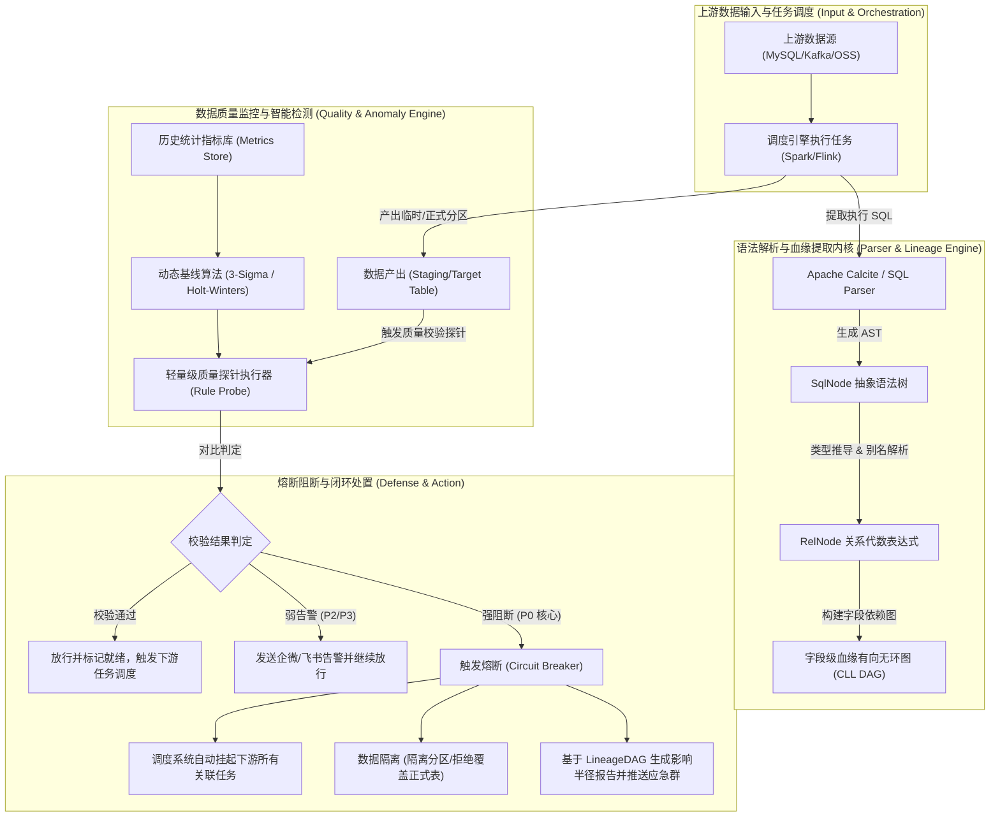
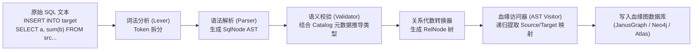
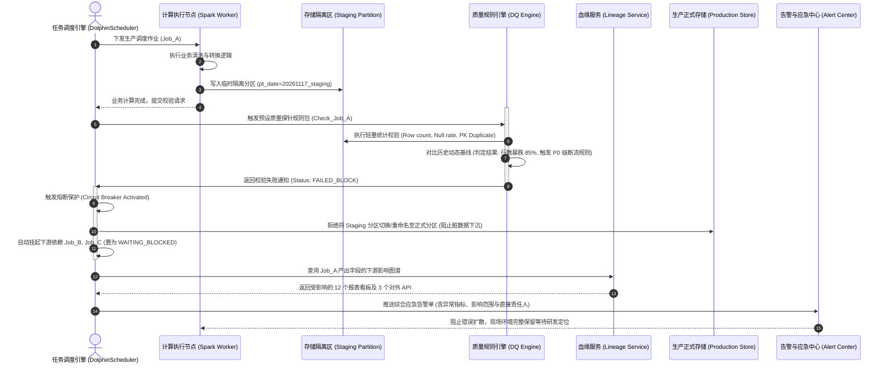
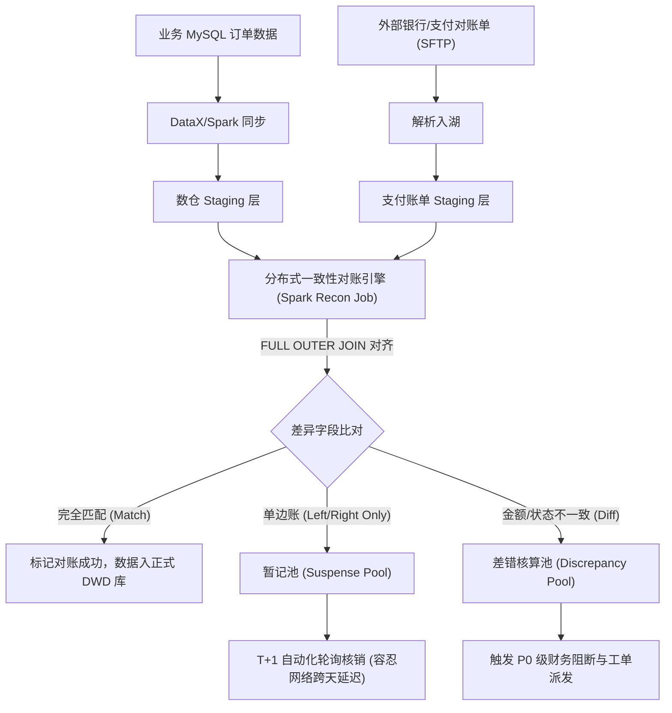
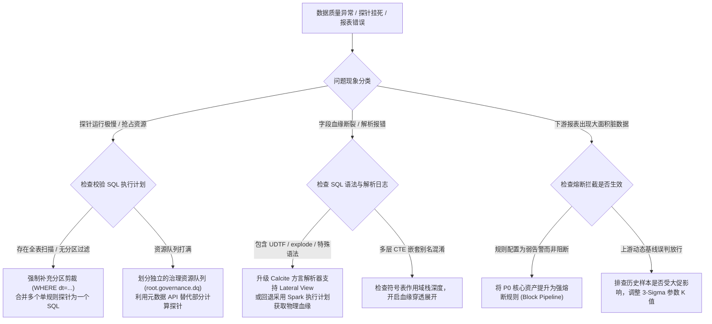
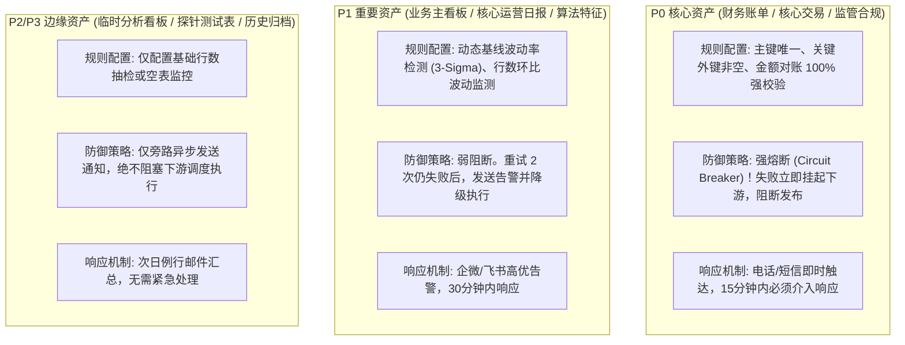

# 数据质量体系与端到端数据血缘：Apache Calcite解析内核、波动率监控、熔断阻断闭环与字段级血缘提取

> **学习目标定位**：面向技术总监、数据平台研发负责人、高级数据架构师岗位，系统掌握构建企业级高可靠“数据质量与血缘联动防御网”的底层机制与系统工程方案。深度剖析数据质量六大维度（完整性、唯一性、准确性、一致性、时效性、有效性）在工业级生产中的量化落地标准、基于 Apache Calcite 抽象语法树（AST）实现字段级血缘（Column-Level Lineage）逆向解析算法推导、动态基线波动率检测机制（3-$\sigma$ 与双重指数平滑）。结合核心电商交易对账与工业物联网（太原智慧供热 10 万台设备测点跳变清洗）实战经验，讲透如何设计“强阻断与熔断闭环（Circuit Breaker）”，从根本上消灭数据脏乱差与上游变更雪崩。

---

## 1. 知识概述与业务价值

### 1.1 是什么（What）
- **数据质量体系（Data Quality Framework）**：是对大数据平台全链路流动的数据资产进行**事前规范定义、事中规则校验与熔断拦截、事后度量溯源与根因纠偏**的完整工程与管理闭环。它不是偶发性的单次数据抽检，而是一套与调度编排、元数据紧密集成的自动化防御体系。
  - **工业级质量六大维度**：
    1. **完整性（Completeness）**：数据是否存在缺失（如关键主键、必填字段的空值率 NULL Rate）；
    2. **唯一性（Uniqueness）**：是否存在重复数据（如主键冲突、重复上报）；
    3. **准确性（Accuracy）**：数据是否真实反映物理世界（如温度测点出现 9999℃、年龄出现负数）；
    4. **一致性（Consistency）**：多源跨系统或跨层级的数据是否吻合（如订单明细金额汇总与财务实收总账对账）；
    5. **时效性（Timeliness）**：数据是否在承诺的 SLA 窗口前就绪（如每天 08:00 前完成 ADS 层计算）；
    6. **有效性（Validity）**：数据格式是否符合预定枚举或编码协议（如手机号正则、UUID 标准格式）。
- **端到端数据血缘（End-to-End Data Lineage）**：是记录数据从底层物理源头、经过各层变换计算（ETL/流批清洗）、流向最终数据资产看板与 API 接口的**有向无环图（DAG）拓扑链路**。
  - **表级血缘（Table-Level Lineage）**：粗粒度描述表与表之间的上下游生产依赖关系；
  - **字段级血缘（Column-Level Lineage - CLL）**：细粒度精确到列级与表达式级，能够精确定位目标表中的 `col_c` 究竟是由源表的 `col_a` 与 `col_b` 经过何种函数运算派生而来。
- **质量与血缘的共生关系（Symbiosis）**：
  - **血缘是质量的“高精雷达”**：质量探针发现异常时，必须借助字段级血缘，向上秒级定位数据异常引入的源头环节（Root Cause Tracing），向下秒级圈定脏数据扩散的受灾边界（Impact Radius）；
  - **质量是血缘的“实战防线”**：血缘拓扑为质量系统提供了实施**熔断阻断（Circuit Breaker）**的物理依托，在数据污染扩散至报表看板前，直接在依赖链上切断下游长尾调度。

### 1.2 解决什么核心业务痛点（Why）
- **“垃圾进，垃圾出（Garbage In, Garbage Out - GIGO）”**：数仓下游报表即使计算逻辑 100% 完美，一旦上游业务系统传进带脏数据或负数金额，直接导致财务报表暴雷，管理层基于错误数据做出重大错误投资决策。
- **“脏数据扩散雪崩”与高昂的回滚修复代价**：在缺乏阻断机制的数仓中，DWD 层脏数据会在清晨自动级联下沉扩散至 30+ 张 DWS 和 ADS 汇总表，甚至同步至线上 HBase/Doris 供生产业务调用。一旦发现，需要跨部门沟通停机、手动补数重跑数十个 Stage，耗费数人天甚至引发重大生产 P1 事故。
- **“告警疲劳（Alert Fatigue）与狼来了”**：由于阈值设置不合理或全量发送报警邮件，平台每天狂发几千封无痛无痒的报警，导致研发人员习惯性麻木忽略，直到致命错误爆发无人问津。

### 1.3 适用场景与技术边界（Where & When）
- **最佳业务场景矩阵**：
  - **核心财务与交易结算对账（Financial Reconciliation）**：跨支付网关、银行清算流水与内部交易库进行 100% 强一致性校验；
  - **大型工业物联网与能源数字化监控（IoT Anomaly Detection）**：百万级传感器高频采样流中，对死机冻结、毛刺跳变、通信中断进行毫秒级实时质量清洗与打标；
  - **关键报表与管理层大屏 SLA 保障**：在将数据正式推向生产看板前，执行严格的资产红线规则校验。
- **明确反模式与技术禁区（严禁使用）**：
  - ❌ **把质量校验逻辑全部硬编码在业务 ETL SQL 脚本中**：例如在 Spark SQL 中编写巨长的 `CASE WHEN col IS NOT NULL ...`，导致清洗规则与业务逻辑严重耦合，无法沉淀全局质量资产与多维评分看板；
  - ❌ **无差别对百亿大表执行全量无索引探针校验**：在每天凌晨调度高峰期，频繁对几百亿行的大宽表执行 `SELECT COUNT(DISTINCT user_id) FROM dwd_log`，直接耗尽 YARN/K8s 内存算力，拖垮整个数仓产出时效。

---

## 2. 核心概念与关系

### 2.1 核心概念全景表

| 核心概念 | 英文术语 | 核心定义与工程职责 | 资源/生命周期级别 |
| :--- | :--- | :--- | :--- |
| **质量探针** | Quality Probe / Check | 在数据处理关键节点动态注入的检测单元（轻量级 SQL 统计或规则算子） | 任务级 / 节点级 |
| **动态基线** | Dynamic Baseline | 基于历史周期数据计算出的自适应波动上下限（克服节假日与周效应） | 算法模型级 / 时间窗口级 |
| **强阻断（熔断）** | Circuit Breaker (Block) | 校验未通过时，强制终止当前任务并挂起下游所有依赖任务的防御策略 | 流程调度级 / P0 资产级 |
| **弱告警** | Soft Warning | 校验未通过时，仅发送通知提醒 Owner，但允许下游任务继续执行的策略 | 流程调度级 / P2-P3 资产级 |
| **抽象语法树** | Abstract Syntax Tree (AST) | 将 SQL 文本源代码转化为由层次化节点组成的树状抽象语法结构 | 编译原理级 / 内存对象级 |
| **字段级血缘** | Column-Level Lineage (CLL) | 精确描述列与列之间的数据流动、投影、过滤与聚合转换关系 | 字段物理拓扑级 |
| **影响半径** | Impact Radius / Analysis | 沿着血缘图向下游递归遍历，分析受特定表或列故障影响的所有资产范围 | 有向图遍历级 |

### 2.2 数据质量与血缘协同运转全景拓扑图



---

## 3. 底层工作机制与设计哲学

### 3.1 基于 Apache Calcite 的 SQL 抽象语法树（AST）字段级血缘提取底层机制

要在企业级数据中台实现精准的字段级血缘，必须深入编译器与解析内核。**Apache Calcite** 是当今工业界（Hive、Flink、Drill、Kylin 等）最为推崇的通用 SQL 解析与查询优化框架。



#### 1. SQL 解析的核心四阶段
1. **词法分析（Lexical Analysis）**：将字符流拆解为独立的语法标记（Token），如关键字 `SELECT`、标识符 `order_id`、操作符 `+` 等；
2. **语法解析（Syntax Parsing - `SqlParser`）**：
   - 将 Token 流转换为树状结构的 **`SqlNode` 抽象语法树（AST）**；
   - 常见的节点类型包括：`SqlSelect`（查询体）、`SqlIdentifier`（表名/列名）、`SqlBasicCall`（函数调用与表达式计算，如 `SUM(amount)`）、`SqlJoin`（关联关系）；
3. **语义验证（Semantic Validation - `SqlValidator`）**：
   - 此时的 AST 只是纯文本语法树，无法确认 `SELECT id FROM a` 中的 `id` 到底属于哪张表（尤其在多表 JOIN 且未加表别名缩写时）；
   - `SqlValidator` 结合底层的 **元数据 Catalog（如 Hive Metastore / Doris Information Schema）**，确认表名是否存在、字段是否存在、解析隐式列归属，并将通配符 `SELECT *` 展开为具体的物理列列表；
4. **关系代数转换（Logical Plan - `RelNode`）**：
   - 将验证后的 `SqlNode` 转化为关系代数表达式（`LogicalProject`、`LogicalFilter`、`LogicalAggregate`、`LogicalJoin`）。

#### 2. 字段级血缘遍历与提取算法推导
假设待解析的 SQL 为复杂的跨表聚合插入：
```sql
INSERT INTO dws_user_trade_summary
SELECT 
    o.user_id,
    p.province_name,
    COUNT(DISTINCT o.order_id) AS total_orders,
    SUM(o.pay_amount) + COALESCE(MAX(d.discount_amt), 0) AS final_settle_amt
FROM dwd_order_detail o
LEFT JOIN dim_province p ON o.province_id = p.id
LEFT JOIN dwd_discount_detail d ON o.order_id = d.order_id
GROUP BY o.user_id, p.province_name;
```

**提取字段级血缘的核心递归算法逻辑**：
1. **定位根写入节点**：
   识别顶层 `SqlInsert` 节点，提取目标表（Target Table）为 `dws_user_trade_summary`，并通过目标表元数据或 SQL 指定列表确定目标写入字段顺序：`[user_id, province_name, total_orders, final_settle_amt]`；
2. **解析查询投影列表（SelectItemList）**：
   递归遍历内部 `SqlSelect` 节点的 `getSelectList()` 集合，将目标列与查询表达式建立位置一一对应映射；
3. **深度递归展开表达式（Expression Decomposition）**：
   - **对于简单直连列（Direct Passthrough）**：如 `o.user_id`，识别为 `SqlIdentifier`，结合上下文解析为 `dwd_order_detail.user_id`，建立直连血缘边：
     $$\text{dwd\_order\_detail.user\_id} \xrightarrow{\text{DIRECT}} \text{dws\_user\_trade\_summary.user\_id}$$
   - **对于复杂计算与聚合列（Transform Derivative）**：如 `SUM(o.pay_amount) + COALESCE(MAX(d.discount_amt), 0)`，节点类型为 `SqlBasicCall`（操作符为 `+`）：
     - 递归遍历其左操作数 `SUM(o.pay_amount)` $\to$ 提取底层源列 `dwd_order_detail.pay_amount`；
     - 递归遍历其右操作数 `COALESCE(MAX(d.discount_amt), 0)` $\to$ 提取底层源列 `dwd_discount_detail.discount_amt`；
     - 提取聚合计算类型，建立双源向单目标的依赖血缘边，并打上 `TRANSFORM` 标签：
       $$\{\text{dwd\_order\_detail.pay\_amount}, \text{dwd\_discount\_detail.discount\_amt}\} \xrightarrow{\text{CALCULATE}} \text{dws\_user\_trade\_summary.final\_settle\_amt}$$
4. **处理子查询与 CTE 作用域（Scope & Alias Resolution）**：
   维护一个作用域符号表栈（Scope Symbol Table）。当遇到嵌套子查询或 `WITH cte AS (...)` 时，将 CTE 注册为局部虚拟表；当外层查询引用 CTE 的别名时，自动在内存中穿透并溯源至物理实体源表，消除中间别名干扰。

### 3.2 机制交互时序图（Mermaid）

以下展示调度系统执行作业、质量探针校验、触发强阻断并联动下游的端到端机制时序：



### 3.3 动态波动率与智能异常检测算法机制

在传统数据质量系统中，多数团队采用**静态硬编码阈值**（如：表行数变动 $\pm 20\%$ 告警）。但在真实大促、周末效应或法定节假日（如春节、国庆）期间，交易数据本身就会出现周期性暴跌或翻倍，静态阈值必然引发大面积误报（False Positive）或严重的漏报（False Negative）。

#### 工业级双重指数平滑与 3-$\sigma$ 动态基线算法模型
1. **周周期性趋势分解（Seasonal Trend Decomposition）**：
   令历史第 $t$ 天的数据观测值为 $y_t$，由于电商与工业生产具有极强的 7 天周效应（周一至周日规律波动），将数据序列分解为趋势项 $T_t$、季节项 $S_t$ 和随机残差项 $R_t$：
   $$y_t = T_t \times S_t + R_t$$
2. **基于历史同周期移动加权与 3-$\sigma$ 动态区间推导**：
   计算过去 $N$ 周同一周几（例如过去 4 个周二）的加权平均值 $\mu$ 与加权标准差 $\sigma$：
   $$\mu = \sum_{k=1}^{N} w_k \cdot y_{t - 7k}, \quad \sigma = \sqrt{\sum_{k=1}^{N} w_k \cdot (y_{t - 7k} - \mu)^2}$$
   其中 $w_k$ 为时间衰减权重（越接近当前日期的周期权重越大，$\sum w_k = 1$）。
   系统自动生成今日动态容忍上下界：
   $$\text{Upper Limit} = \mu + K \cdot \sigma, \quad \text{Lower Limit} = \mu - K \cdot \sigma$$
   - 针对核心 P0 级资产，设定严谨置信区间 $K = 2.5$（约 98.7% 容忍度）；
   - 针对常规普通表，设定常规置信区间 $K = 3.0$（符合正态分布 99.7% 容忍度）。
3. **假日效应动态修正系数（Holiday Offset Factor）**：
   引入日历元数据服务（Calendar Service）。当检测到法定节假日或电商大促日（如 618、双11）时，算法自动拉取上一年度对应假期的基线系数进行比例缩放修正，从数学原理层根除节假日误报。

---

## 4. 高频复杂业务场景实操与落地

### 4.1 场景一：百亿级电商交易账单 T+1 跨系统强一致性对账与差错双向补偿实战

#### 业务背景与对账难题
在大型电商与制造集团（如美的电商/跨境业务）中，支付与订单链路极其复杂。每日产生数千万笔支付交易，分散在：
1. **前端业务库**：MySQL 订单表（`order_info`）；
2. **外部支付网关**：支付宝/微信/银联第三方结算账单文件（CSV/SFTP）；
3. **中台数仓湖仓**：DWD 交易宽表（`dwd_trade_pay_detail_di`）。
由于网络抖动、分布式事务超时、退款跨天等原因，极易出现“业务库已支付但数仓缺失”、“数仓有记录但外部支付通道未扣款”的重大财务差错。

#### 架构实操解决方案（两阶段一致性对账引擎）


1. **高效分布式 Full Outer Join 对账算法**：
   - Spark 作业以 `(merchant_id, channel_trade_no)` 作为复合 Join Key，对内部表与外部银行账单执行 `FULL OUTER JOIN`；
   - 投影出四类状态标记：
     - `BOTH_MATCH`：内部有且外部有，金额与状态 100% 吻合（通过）；
     - `INTERNAL_ONLY`：内部已支付，外部账单无记录（高危单边账）；
     - `EXTERNAL_ONLY`：外部已扣款，内部未成单（高危单边账，极易引发客户投诉）；
     - `AMOUNT_DIFF`：双边均有记录，但扣款金额或货币类型不一致；
2. **暂记池（Suspense Pool）与自动补偿闭环**：
   - 针对 `INTERNAL_ONLY` 与 `EXTERNAL_ONLY`，系统不立即报警，而是先存入**“T+1 暂记池”**，自动调用外部通道 API 发起状态反查与重试对账，容忍跨天时间差；
   - 若超过 48 小时仍未对平，自动在财务看板生成差错追缴工单，同时通过血缘阻断财务报表发布，坚守“账实不符绝不发布”的技术底线。

### 4.2 场景二：智慧供热与工业物联网（太原项目）10 万台设备测点跳变与冻结清洗实战

#### 业务背景
在太原智慧供热项目中，现场部署了 10 万台物联网测点（温控阀、热量表、温度变送器），数据通过 4G/NB-IoT 网络以 10 秒为周期上报。由于现场电磁干扰、传感器探头老化断线、基站信号盲区，高频出现三类典型物联脏数据：
1. **毛刺跳变（Spike Anomaly）**：正常供水温度 50℃，突发跳变为 120℃ 或 -50℃，随后又恢复正常；
2. **死机冻结（Frozen Value）**：传感器内部死机，持续上报完全相同的固定浮点数（如精确到小数点后四位 45.1234℃ 保持连续 3 天不变）；
3. **数据倒灌（Reverse Accumulation）**：机械底表回零或信号干扰导致累计热量读数反向变小。

#### 架构实操解决方案（Flink 实时流式质量清洗算子）
1. **滑动窗口状态检测算子（Sliding Window State Filter）**：
   - 基于 Flink `KeyedProcessFunction`，以 `device_id + metric_code` 维护每个测点的最近 5 次上报历史状态（`ValueState<List<PointEvent>>`）；
2. **三阶动态过滤算法实现**：
   - **物理极值硬剪枝**：基于元数据中心配置的测点物理阈值，直接过滤超出 $[0℃, 100℃]$ 的异常非法数据；
   - **一阶差分与导数限制（Rate of Change Limit）**：计算温度变化斜率 $\Delta T / \Delta t$。若 10 秒内温度突变超过 5℃，判定为瞬时物理不可能事件，触发毛刺清洗，将该数据标记为 `QUALITY_FLAG = BAD_SPIKE`，并采用前序历史均值进行三次方样条插值补偿；
   - **冻结方差检测（Zero-Variance Detector）**：计算过去 2 小时内数据方差 $Var(X)$。若方差连续等于 0 且该设备处于供暖运行状态，判定为传感器冻结故障，向智慧供热大屏派发设备硬件检修工单。

### 4.3 场景三：复杂嵌套 CTE 与动态 SQL 的字段级血缘精准逆向解析实战

#### 业务背景
数仓工程师为了处理复杂报表，经常编写包含 10 多个 `WITH cte AS (...)`、结合窗口函数 `ROW_NUMBER() OVER (...)` 与 `CASE WHEN` 嵌套调用的千行 SQL 脚本。开源简单的正则匹配或基于单层 AST 的解析工具直接崩溃或丢失 80% 的字段对应关系。

#### 架构实操解决方案（Calcite 作用域穿透与血缘栈设计）
1. **构建层次化符号表（Hierarchical Symbol Table）**：
   - 维护一个与 AST 嵌套深度严格绑定的栈式环境（`Stack<SqlScope>`）；
   - 当遇到 CTE 语法：
     ```sql
     WITH t1 AS (SELECT id, amount * 0.9 AS real_amt FROM src_table)
     SELECT id, real_amt FROM t1;
     ```
   - 第一阶段：解析 `t1` 的查询体，建立局部符号映射：`t1.id -> src_table.id`，`t1.real_amt -> src_table.amount`；
   - 第二阶段：解析主查询时，遇到 `FROM t1`，直接在符号表中将 `t1` 替换为其代表的子查询展开表达式，实现**血缘穿透展开（Lineage Inlining）**；
2. **窗口函数与虚拟投影的处理**：
   - 针对 `ROW_NUMBER() OVER (PARTITION BY dep_id ORDER BY salary DESC) as rank_no`：
     - 解析出 `rank_no` 虽然是一个新生成的序号列，但其生成逻辑强依赖于 `dep_id` 和 `salary`；
     - 在字段血缘图中，建立从 `dep_id` 和 `salary` 到目标列 `rank_no` 的 **控制依赖边（Control Dependency Edge）**，确保在进行下游影响分析时，修改了 `salary` 列能准确预警到 `rank_no` 也会受到影响。

---

## 5. 生产异常故障深度排查与根因分析

### 5.1 故障一：质量校验 SQL 探针与凌晨离线调度发生“资源踩踏与锁死”

#### 故障现象
每天清晨 05:00 ~ 07:00，数仓核心报表大面积产出延迟（迟到 1~2 小时）。查看 YARN / Spark 资源监控，发现集群 Core 与 Memory 持续 100% 满载，大量生产 ETL 作业处于 `ACCEPTED` 状态无法获得算力。排查发现数十个并发运行的不是业务抽取任务，而是数据质量系统的校验探针作业（`DQ_Probe_Job_*`）。

#### 深度根因分析（Root Cause）
1. **低效的全表扫描探针（Full Scan Antipattern）**：
   质量开发人员为每张表配置了 10 条独立的规则（主键唯一性、空值率、最大值、最小值、格式正则）。质量引擎简单粗暴地将每条规则翻译成一个独立的 SQL 提交：
   `SELECT COUNT(*) FROM table WHERE col_a IS NULL`；
   `SELECT col_b, COUNT(*) FROM table GROUP BY col_b HAVING COUNT(*) > 1`...
   导致一张百亿级的大表在一分钟内被反复从 HDFS 全量扫描了 10 次！
2. **缺乏分区剪裁与元数据下推**：
   校验 SQL 未带当天分区条件 `WHERE dt = '2026-11-17'`，触发全表数年历史分区的全量冷数据扫描；
3. **未实施资源池物理隔离**：
   质量探测作业直接提交到了核心生产调度队列（`root.prod.etl`），与核心 P0 产出任务抢夺相同的计算队列资源。

#### 生产调优与架构级解决方案
```sql
-- 1. 探针合并优化：将单表的 N 条规则合并为一个单一的 SQL 单次扫描聚合查询
-- 优化前：执行 5 次全表扫描
-- 优化后：单次读取数据，利用 Conditional Aggregation 一次性计算所有维度的指标
SELECT 
    COUNT(1) AS total_count,
    SUM(CASE WHEN order_id IS NULL THEN 1 ELSE 0 END) AS null_order_id_count,
    COUNT(order_id) - COUNT(DISTINCT order_id) AS dup_order_id_count,
    SUM(CASE WHEN pay_amount < 0 THEN 1 ELSE 0 END) AS invalid_amount_count,
    MAX(pay_amount) AS max_amount,
    MIN(pay_amount) AS min_amount
FROM dwd_order_detail
WHERE dt = '${biz_date}'; -- 强制开启分区剪裁
```
- **架构调度解耦**：
  - 在 YARN/K8s 层面划分专有的 **`root.governance.dq` 独立资源队列**，设置资源使用上限（Cap at 15% 总资源），且优先级低于核心生产任务；
  - 针对只包含行数变动的简单探针，直接调用 Hive/Iceberg/Doris 的元数据 API 读取快照文件的 `rowCount`，耗时 0 毫秒，彻底规避启动 Spark 引擎的开销。

### 5.2 故障二：SQL 复杂嵌套 `LATERAL VIEW explode()` 导致 Calcite 字段血缘解析失真丢边

#### 故障现象
在解析包含 `LATERAL VIEW explode(item_list) t AS item_id` 的 Hive/Spark SQL 时，血缘提取引擎抛出空指针异常（`NullPointerException`）或解析出的血缘图中 `item_id` 变成了无源字段（虚拟孤立列），导致下游基于 `item_id` 的所有报表字段血缘全部断裂。

#### 深度根因分析（Root Cause）
- `LATERAL VIEW explode()` 属于 Hive 专有的表生成函数（UDTF - User Defined Table-Generating Function），其在 AST 语法结构上并非标准的 SQL 关系投影，而是将一行展开为多行，并生成了一个虚拟的表别名（Virtual Table Alias `t`）与虚拟列名（`item_id`）；
- Calcite 默认的 ANSI SQL 语法解析器无法识别特定方言的 `SqlLateralOperator` 内部别名绑定逻辑，导致解析器在符号栈中找不到虚拟列 `item_id` 的上游源头，从而丢失了 `item_list -> item_id` 的映射边。

#### 架构级解决方案
1. **扩展 Calcite 方言操作符（Custom UDTF Operator）**：
   - 继承重写 `SqlUserDefinedTableFunction`，显式注册 `EXPLODE` 操作符的行为；
   - 在 Visitor 遍历到 `SqlLateralView` 节点时，强制将 UDTF 的入参表达式（`item_list`）与炸裂生成的虚拟列（`item_id`）建立显式的 `DERIVED_EXPLODE` 依赖关联；
2. **集成底层执行引擎优化器执行计划（Execution Plan Fallback）**：
   - 对于极少数高度非标的黑盒 SQL，若 AST 静态解析失败，系统自动回退（Fallback）到**引擎物理执行计划解析**：直接捕获 Spark 的 `Optimized Logical Plan`，从物理算子 `Generate(explode(item_list), ...)` 中直接提取字段依赖，保证 100% 解析成功率。

### 5.3 故障三：质量告警风暴（Alert Fatigue）导致运维麻木，致命财务错误漏阻断

#### 故障现象
某业务线数据团队每天平均收到超过 1,500 封数据质量钉钉告警与邮件。由于误报极多且充斥着低优先级边缘表的微小波动，团队成员直接设置了邮件免打扰和消息自动归档。某天核心财务宽表因上游计算逻辑错误导致支付金额全部乘以了 100 倍，真正的致命 P0 报警被淹没在海量告警风暴中，最终导致管理层看到虚假翻倍的错误报表。

#### 深度根因分析（Root Cause）
1. **告警缺乏资产分级与优先级路由（No Asset Tiering）**：对核心财务表（P0）与实习生测试表（P3）采用一视同仁的告警通道，全量群发；
2. **缺乏告警收敛与合并抑制机制（Alert Throttling & Deduplication）**：单个上游表的异常引发下游 20 个任务同时报错，系统连续发出 20 次独立告警，造成雪崩；
3. **只告警不阻断（No Blocking Enforcement）**：系统只具备事后通知能力，缺乏直接把关停下生产任务的控制权。

#### 架构级解决方案
1. **推行“P0 核心资产强熔断，P2/P3 边缘资产弱告警”分级管理体系**；
2. **基于血缘图谱的告警归并抑制算法（Lineage-Based Alert Suppression）**：
   - 当多个表的质量探针同时报错时，告警服务首先查询血缘拓扑；
   - 若发现表 B、表 C 的报错完全是由其共同的上游表 A 异常导致的，**告警中心自动将 B 和 C 的告警抑制折叠，只向上游表 A 的负责人群发“根因告警”**，并附带注明“已自动抑制下游 19 个级联报警”，告警量瞬间下降 90% 以上。

### 5.4 生产故障排查决策树（Mermaid）



---

## 6. 技术选型对比

### 6.1 主流开源数据质量与血缘工具全方位对比矩阵

| 选型维度 | Great Expectations (GX) | Apache Griffin | 自研质量规则引擎 (基于 Calcite/Spark) | SQLLineage (Python) | OpenLineage / Marquez |
| :--- | :--- | :--- | :--- | :--- | :--- |
| **主要定位** | 数据质量断言与测试框架 | 大数据分布式质量分析平台 | 深度内嵌中台的一体化质量底座 | 轻量级 SQL 血缘提取库 | 统一数据血缘标准与元数据采集 |
| **规则表达方式** | Python Expectation DSL | JSON 配置化规则定义 | 可视化拖拉拽 + SQL 模板化注入 | 不适用 (仅血缘) | 不适用 (开放标准) |
| **计算引擎支持** | Pandas, Spark, SQL 关系库 | Spark 批流计算引擎 | **Spark, Flink, Doris, Presto** | 仅纯文本 AST 解析 | Spark, Airflow, Flink, dbt |
| **熔断阻断能力** | 强 (在 Pipeline 步骤中直接断言) | 弱 (偏离线事后分析报告) | **极强 (直接联动调度内核强熔断)** | 无 | 强 (通过 RunEvent 状态联动) |
| **血缘解析粒度** | 不支持血缘 | 不支持血缘 | **表级 + 字段级 (深度成熟)** | **表级 + 字段级 (支持常见SQL)** | **表级 + 字段级 (标准体系完整)** |
| **流批一体支持** | 仅支持微批与离线 | 支持 Spark Streaming 伪实时 | **支持 Flink 实时流式无状态清洗** | 仅静态 SQL | 支持流批任务运行态元数据 |
| **中台私有化交付** | 中等 (需 Python 环境与依赖) | 极差 (依赖老旧 Hadoop 体系已停更) | **极佳 (Java 原生微服务打包，无外部依赖)** | 极佳 (轻量 Python 库) | 中等 (需独立部署 Marquez 服务) |

### 6.2 选型决策考量与轻量化自研权衡

面对质量与血缘选型，技术总监与数据架构师必须明确：**“不要指望引入一个开源工具就能搞定企业数据治理，质量与血缘的核心壁垒在于与自身中台调度系统（DolphinScheduler）、元数据中心（Atlas/DataHub）的深度缝合度。”**
1. **为什么一线大厂与成熟中台多选择基于 Calcite 自研？**
   - **开源工具的割裂性**：Great Expectations 偏数据科学与单机 Python 生态，无法深度感知大型分布式 YARN/K8s 队列；Apache Griffin 架构陈旧基本停止维护；
   - **自研的核心优势**：利用 Apache Calcite 实现 AST 解析仅需几千行核心代码，且能与自研数据开发 Web IDE、调度系统的 Pre-Hook/Post-Hook 完美无缝集成，实现**“写完 SQL 自动生成字段血缘，跑完任务自动触发探针，探针失败瞬间在调度内核阻断”**，研发体验与闭环效率远超拼凑外部系统。
2. **轻量化落地建议（中小团队最优解）**：
   - 调度系统选用 **Apache DolphinScheduler**；
   - 血缘解析在任务上线时调用封装好的 **Calcite / SQLLineage 微服务**，生成拓扑存入 PostgreSQL / Neo4j；
   - 质量探针采用 **SQL Template 模板化引擎**：在任务节点后挂载一个“数据质量节点”，自动注入 `SELECT COUNT(1) WHERE ...`，失败则返回 Exit Code 1，天然利用调度系统的失败重试与阻断机制，极低成本实现工业级防御。

---

## 7. 技术经理与架构师实战管控

### 7.1 数据质量 SLA 分级管控体系（Tiering Governance）

在大型研发团队中，资源永远是有限的。如果对所有表都施加最严苛的监控和强阻断，会导致研发效率严重受阻。必须实施清晰的 **数据资产分级矩阵（Tiering Matrix）**：



### 7.2 质量规则沉淀与“资产红线”团队 SOP

1. **“谁生产，谁负责”的单一责任人原则（Data Stewardship）**：
   - 在数据开发平台上，新建任何一张 DWD/DWS 表，必须强制绑定且只能绑定**唯一的技术负责人（Owner）与业务负责人（Business Steward）**；
   - 严禁出现公共公共账号创建的表。责任人对该表的产出质量、SLA 达成率与报警处置承担唯一考核指标。
2. **资产准入红线（Release Quality Gate）**：
   - 新表上线到生产调度队列前，系统强制要求必须配置至少 **3 条基础质量探针（主键唯一性、行数非零校验、更新时间时效性）**；
   - 凡是没有配置质量探针的任务，调度系统拒绝将其赋予生产调度权限（直接拦截发布）。
3. **“破窗效应”治理与考核闭环**：
   - 严禁团队出现“报警了但无人处理，直接点击手动放行”的敷衍现象；
   - 每次手动放行（Manual Bypass）必须强制在系统填写 **“放行原因与风险确认函”**，记录工号并同步抄送部门技术负责人；每月统计“恶意放行率”计入团队季度绩效考核。

### 7.3 端到端质量事故复盘与“五为什么法（5 Whys）”根因溯源模板

当线上发生数据质量事故（如管理层大屏指标错误）时，技术负责人必须带领团队使用 **“5 Whys” 根因推导法** 进行无指责（Blameless）的架构级深度复盘：

| 溯源层级 | 提问方向 | 典型真实案例回答 | 暴露出的系统/机制隐患 | 架构级落地防范对策 |
| :--- | :--- | :--- | :--- | :--- |
| **Why 1** | 为什么董事长看到的昨日 GMV 翻了一倍？ | 报表层的订单支付金额被重复加和计算了。 | 聚合查询前未对重复数据进行幂等去重。 | 在报表计算层强制推行主键粒度 Deduplication。 |
| **Why 2** | 为什么数仓 DWD 表中会出现大量重复订单记录？ | 上游 MySQL 业务库分库分表同步进入 Kafka 时，发生了网络超时重发。 | 实时接入链路缺乏幂等写入保障（非 Exactly-Once）。 | Flink 入湖链路改用 Paimon 主键表，基于主键实现 Upsert。 |
| **Why 3** | 为什么重复数据进入 DWD 后没有被质量系统拦截？ | DWD 表只配置了“行数是否大于0”的弱规则，未配置主键唯一性探针。 | 核心资产质量规则覆盖度不足，准入门禁存在漏洞。 | 升级 CI/CD 质量门禁，P0 表强制拦截“主键唯一性”未配置项。 |
| **Why 4** | 为什么研发人员没有给这张核心表配置主键探针？ | 业务着急赶大促上线，研发人员为了快速交付绕过了审批流程。 | 平台允许“特权通道”绕过质量卡点，制度存在后门。 | 彻底下线所有绕过逻辑，代码上线必须满足 100% 规则合规。 |
| **Why 5** | 为什么系统没有及时在下游报表调度前触发熔断？ | 质量探针与调度引擎是异步解耦运行的，探针还在跑，报表已经发布了。 | 质量系统与调度编排系统未形成同步阻塞闭环。 | **重构调度与质量集成架构：引入 Pre-Publish 阻断节点，探针通过前绝不放行。** |

---

## 8. 互联网大厂高频面试真题库

* **Q1 [字节跳动 - 底层机制与原理推导]**：如何实现字段级数据血缘（Column-Level Lineage）？深入讲清从 SQL 文本到抽象语法树（AST），再到提取字段转换关系的完整底层遍历过程。
* **Q2 [阿里/蚂蚁 - 核心架构与生产实战]**：数据质量的六大维度是什么？在金融级或核心电商场景中，如何设计一套“动态波动率检测 + 强阻断熔断”系统，防止下游报表大面积污染？
* **Q3 [美团 - 复杂算法与场景]**：传统的固定阈值（如“行数波动超过30%则告警”）在节假日和大促期间极易误报或漏报。你如何基于统计学或机器学习设计自适应动态质量基线？
* **Q4 [腾讯 - 生产排障与性能调优]**：每天凌晨有数万个调度任务产出，如果对每张表都执行 `COUNT(DISTINCT)`、空值率与极值等质量校验，会导致集群计算资源直接翻倍甚至引发资源雪崩。架构师该如何做性能与资源的极致权衡？
* **Q5 [快手 - 系统设计与容错]**：当上游 SQL 包含复杂语法（如复杂的 UDF、`CASE WHEN` 嵌套条件聚合、`LATERAL VIEW` 炸裂、多层嵌套 CTE）时，Calcite AST 解析器容易失真甚至抛出异常。你如何保证血缘提取的高解析率与高鲁棒性？
* **Q6 [滴滴/百度 - 生产事故与容灾闭环]**：当数仓中某核心 DWD 表被脏数据污染，且下游已经级联消费跑完了 20+ 张报表，如何基于血缘系统实现“影响范围最小化锁定 + 毫秒级依赖级联重刷（Backfill）”？
* **Q7 [数据总监/管理决策与团队SOP]**：作为数据负责人，当业务高管投诉“财务大屏数据对不上、业务部门整天抱怨数据质量差”时，你如何带领团队在 3 个月内打一场翻身仗，建立可量化信任的质量管理体系？

---

## 9. 结构化深度参考答案

### 题目1 [字节跳动 - 底层机制与原理推导]：如何实现字段级数据血缘（Column-Level Lineage）？深入讲清从 SQL 文本到抽象语法树（AST），再到提取字段转换关系的完整底层遍历过程。

#### 简洁回答（1分钟电梯破题）
实现字段级血缘的核心技术是**基于 SQL 编译器（如 Apache Calcite / ANTLR）对 SQL 文本进行词法、语法解析与语义分析，生成 AST 抽象语法树与逻辑执行计划，并通过递归遍历提取投影列与源表列的对应关系**。
完整流程分为四步：**分词与语法解析生成 AST $\to$ 绑定 Catalog 元数据进行符号解析与类型推导 $\to$ 递归遍历 `SelectItemList` 展开多层嵌套表达式 $\to$ 解析符号表作用域穿透别名与 CTE，最终将列之间的依赖抽象为有向边写入图数据库**。

#### 深入回答（机制推导与边界条件）
1. **语法树生成与符号解析（Binding & Resolving）**：
   - 使用 Calcite 的 `SqlParser` 将 SQL 转化为 `SqlNode` 语法树，包含顶层的 `SqlInsert`、内部的 `SqlSelect`；
   - 纯语法树存在二义性（例如 `SELECT id, name FROM a JOIN b ON a.id = b.id`，若没有显式表别名，系统无法直接确定 `name` 是属于表 `a` 还是 `b`）；
   - 必须引入 `SqlValidator`，传入底层 Hive/Doris 的元数据 Catalog。Validator 会读取表元数据 Schema，进行语义推导，将模糊列名绑定为唯一限定名（Fully Qualified Name）：`cluster.db.a.name`，并将 `SELECT *` 自动展开为全字段列表。
2. **深度优先遍历提取依赖表达式（Visitor Traversal）**：
   - 遍历 `SqlSelect.getSelectList()`，每个投影项对应目标表的一个输出列；
   - 编写自定义 `LineageVisitor`（继承 `SqlBasicVisitor`）深度优先遍历表达式树：
     - 若当前节点为 `SqlIdentifier`（纯字段），提取其所属表与列名，建立 **直连映射（Direct Mapping）**；
     - 若当前节点为 `SqlBasicCall`（如 `CONCAT(first_name, ' ', last_name)` 或 `SUM(amount)`），递归遍历其所有操作数（Operands），收集涉及的所有物理源字段，建立 **转换映射（Transform Mapping）**，记录依赖关系为 `{first_name, last_name} -> full_name`；
3. **处理 CTE、子查询与血缘图落地**：
   - **符号表栈（Scope Stack）**：维护当前解析的局部作用域。遇到 `WITH cte AS (...)` 时，先解析 CTE 内部血缘存入内存虚拟映射表，当主查询引用 `cte.col` 时，通过符号栈穿透替换为物理原始表列，消除中间临时别名；
   - 最终输出标准三元组：`[SourceColumnNode, DependencyType, TargetColumnNode]`，批量写入 Atlas/JanusGraph 图数据库。

#### 架构师/技术管理视角（权衡取舍、SLA与成本）
- **静态解析 vs 运行态捕获权衡**：纯静态 SQL 文本解析的优势是轻量、前置（开发提交代码时秒级完成）；但其短板是无法处理动态 SQL（如 Python/Shell 动态拼接生成的查询）或存储过程。因此架构上应采用**“静态 Calcite 解析为主（覆盖 90% 场景）+ 引擎运行态执行计划监听（Spark QueryExecutionListener / Hive Hook）为兜底”**的双轨制，确保字段血缘覆盖率达到 99% 以上。

---

### 题目2 [阿里/蚂蚁 - 核心架构与生产实战]：数据质量的六大维度是什么？在金融级或核心电商场景中，如何设计一套“动态波动率检测 + 强阻断熔断”系统，防止下游报表大面积污染？

#### 简洁回答（1分钟电梯破题）
数据质量六大维度是：**完整性（无缺失）、唯一性（无重复）、准确性（符合真实世界）、一致性（跨系统能对齐）、时效性（准时产出）与有效性（格式编码合法）**。
设计金融级防御系统的核心是**“隔离写入 + 动态探测 + 强阻断熔断 + 影响面广播”**：
数据产出时先写入**临时隔离区（Staging Partition）**；调度引擎自动触发质量探针，结合历史数据与算法生成动态波动基线；若触发 P0 级严重异常，系统触发**熔断器（Circuit Breaker）**，拒绝将临时数据并入正式生产环境，自动挂起下游所有依赖任务，并基于字段血缘秒级生成影响报告推送应急中心。

#### 深入回答（机制推导与边界条件）
1. **分级防御架构全链路设计**：
   - **阶段一：Staging 分区写入与数据隔离（Sandbox Writing）**：
     - ETL 任务执行 `INSERT OVERWRITE` 时，不直接写入正式分区 `pt=20261117`，而是写入临时隐藏分区 `pt=20261117_tmp_staging`；
   - **阶段二：智能探针校验与动态基线判定（Smart Probing）**：
     - 任务执行结束，触发预先绑定的质量探针规则包；
     - 规则引擎不仅校验静态约束（如主键唯一 `DuplicateCount == 0`，金额大于 0），还调用**动态波动率服务**：拉取历史 4 周同一周几的均值与方差，计算动态阈值 $[\mu - 2.5\sigma, \mu + 2.5\sigma]$。若今日行数或汇总金额偏离基线超过置信区间，判定为异常；
   - **阶段三：熔断切断与原子提交（Atomic Cut-off）**：
     - **校验通过**：通过底层的原子操作（如 HDFS 的 `rename` 或 Iceberg 的快照提交），将 Staging 分区毫秒级重命名为正式对外分区，触发调度系统唤醒下游任务；
     - **校验失败（强熔断触发）**：熔断器生效，**直接抛出严重异常终止作业，正式分区保持上一周期快照不变（保证报表不报错、不出现脏数据）**；同时调度内核利用 API 将下游处于 Ready 状态的所有作业批量置为 `BLOCKED` 状态，阻止错误扩散。
2. **影响面分析与应急协同（Automated War-Room）**：
   - 熔断触发后，系统自动调用元数据血缘接口，向下遍历 10 层拓扑，自动生成本次阻断的受灾影响评估报告（受影响的业务大屏、API 接口、负责人名单）；
   - 自动在企业微信/钉钉拉群，将上游开发、下游业务分析师拉入群中同步应急进展。

#### 架构师/技术管理视角（权衡取舍、SLA与成本）
- **高可用与一致性的商业取舍**：强熔断会导致下游报表“数据延迟（迟到）”，但不熔断会导致“数据错误（脏数据发布）”。在金融、财报与核心大屏场景下，**“宁可数据迟到半小时，绝不发布错误数据”**是必须坚守的铁律；而在实时推荐或普通画像场景下，则应采用“弱告警 + 降级降速”，保障服务可用性。

---

### 题目3 [美团 - 复杂算法与场景]：传统的固定阈值（如“行数波动超过30%则告警”）在节假日和大促期间极易误报或漏报。你如何基于统计学或机器学习设计自适应动态质量基线？

#### 简洁回答（1分钟电梯破题）
固定阈值的失效本质是因为忽略了时间序列中的**“趋势性（Trend）”、“周期性（Seasonality，如 7 天周效应）”与“突发事件脉冲（Holiday & Promotion）”**。
解决该问题的核心是构建**“时间序列分解（STL）+ 双重指数平滑（Holt-Winters）+ 3-$\sigma$ 动态置信区间 + 日历大促先验修正”**的自适应动态基线模型。通过算法自动消除周末跌落与大促暴涨的周期影响，动态生成符合业务客观规律的浮动上下界，实现零误报与高灵敏度检测。

#### 深入回答（机制推导与边界条件）
1. **时间序列模型构建与参数自适应**：
   - **消除周效应（7-Day Periodicity）**：现实业务中，外卖和电商周末订单量通常高于周内，而工业制造周末则显著低于周内。因此历史样本必须**按“星期几（Day of Week）”进行对齐**；
   - **加权移动平均与时间衰减（Decayed Weighting）**：
     抽取过去 8 周同一周几的数据点 $x_1, x_2, \dots, x_8$，引入指数衰减权重 $w_k = \alpha(1-\alpha)^k$（近期样本赋予更高权重）；
     计算加权平均值 $\hat{\mu}$ 与加权标准差 $\hat{\sigma}$：
     $$\hat{\mu} = \sum_{k=1}^{N} w_k x_k, \quad \hat{\sigma} = \sqrt{\sum_{k=1}^{N} w_k (x_k - \hat{\mu})^2}$$
   - **动态上下界生成**：
     $$\text{Upper Limit} = \hat{\mu} + K \cdot \hat{\sigma}, \quad \text{Lower Limit} = \max\left(0, \hat{\mu} - K \cdot \hat{\sigma}\right)$$
     其中系数 $K$ 根据业务资产等级动态调整（P0 资产设为 2.5，普通表设为 3.0）。
2. **日历与大促先验修正机制（Event-Driven Correction）**：
   - 建立企业级 **日历与营销活动元数据服务（Event Calendar Service）**；
   - **法定节假日处理**：当遇到“调休周日上工作日班”或“国庆长假”时，算法自动停用普通周日基线，映射至历史同期节假日的基线特征；
   - **大促脉冲缩放（Promotion Scaling Factor）**：针对 618、双11 等大促，结合运营部门提前录入的预期增长倍率 $\lambda$（例如流量预估增长 2.5 倍），基线模型自动放大阈值上限：
     $$\text{Upper Limit} = (\hat{\mu} + K \cdot \hat{\sigma}) \times \lambda$$
     防止大促零点由于订单暴涨触发虚假阻断。

#### 架构师/技术管理视角（权衡取舍、SLA与成本）
- **算法复杂度与计算成本权衡**：切忌盲目上马复杂的深度学习时序模型（如 LSTM / Transformer），这类模型训练推理开销巨大、黑盒不可解释且依赖 GPU 资源。在生产实践中，**统计学上的加权 3-$\sigma$ 与 Holt-Winters 算法消耗极低（单次计算耗时 < 5ms），可解释性极高**，是支撑每天数十万张表动态校验的最佳工业级方案。

---

### 题目4 [腾讯 - 生产排障与性能调优]：每天凌晨有数万个调度任务产出，如果对每张表都执行 `COUNT(DISTINCT)`、空值率与极值等质量校验，会导致集群计算资源直接翻倍甚至引发资源雪崩。架构师该如何做性能与资源的极致权衡？

#### 简洁回答（1分钟电梯破题）
解决质量校验资源开销过大的核心哲学是**“探针合并化、计算轻量化、元数据替代化与资源物理隔离化”**。
通过将多条规则合并为一个单一 SQL 单次扫描全表、利用 HyperLogLog 替代精确去重、直接利用存储引擎底层元数据 API 获取行数免除计算、并将所有质量作业调度至独立的低优先级治理资源池，从而在不增加集群硬件预算的前提下实现全量质量监控。

#### 深入回答（机制推导与边界条件）
1. **单表多规则聚合合并（Rule Consolidation & Single Scan）**：
   - **反模式**：对同一张表配置了 5 条规则，分别提交 5 个独立 SQL，导致数据被 HDFS 读取 5 次，产生 5 倍的 IO 开销；
   - **架构解法**：系统在生成探针前，利用编译器将针对同一张表的所有统计规则**动态编译成一个单一的复合 SQL 查询**：
     ```sql
     SELECT 
         COUNT(1) AS total_rows,
         COUNT(id) - COUNT(DISTINCT id) AS pk_dup_cnt, -- 或利用 HLL 近似
         SUM(CASE WHEN user_id IS NULL THEN 1 ELSE 0 END) AS null_uid_cnt,
         MAX(pay_amt) AS max_amt,
         MIN(pay_amt) AS min_amt
     FROM target_table WHERE pt = '${biz_date}';
     ```
     仅对底层物理存储进行**单次线性扫描（Single Pass Scan）**，计算耗时和 IO 压降 70% 以上。
2. **元数据下推与近似算法优化（Metadata Pushdown & Approximation）**：
   - **零计算获取行数**：针对行数波动检测，直接调用 Iceberg 快照元数据或 Doris 表统计元数据：`snapshot.summary().get("total-records")`，耗时 10 毫秒，根本无需启动 Spark/Presto 任务；
   - **高基数去重近似**：针对用户数等千万级字段的去重校验，使用 `APPROX_COUNT_DISTINCT()`（基于 HyperLogLog 算法），以 1% 的误差率换取 10 倍的计算加速与 90% 的内存压降。
3. **分级抽样与资源物理隔离（Sampling & Resource Isolation）**：
   - **分层抽样**：对于百亿级日志事实表，采用 `TABLESAMPLE (BUCKET 1 OUT OF 10 ON rand())` 抽样 10% 评估空值率与格式规范，统计学上依然保持 99% 以上的置信度；
   - **独立资源队列**：在 YARN/Kubernetes 层面划分独立的 `queue_governance` 资源池，限制最大资源占比（如不超过集群总核数的 10%），且配置为抢占式低优先级队列，即使探针积压也绝不影响核心生产报表的算力供应。

#### 架构师/技术管理视角（权衡取舍、SLA与成本）
- **ROI 成本底线**：质量系统是“保险”，买保险的成本不能超过资产本身的价值。如果每天为了做数据质量监控消耗了 30% 以上的机器资源，在技术管理上就是重大失职。架构师必须将“数据质量探测算力开销占总集群算力比重 $\le 5\%$”作为刚性考核指标。

---

### 题目5 [快手 - 系统设计与容错]：当上游 SQL 包含复杂语法（如复杂的 UDF、`CASE WHEN` 嵌套条件聚合、`LATERAL VIEW` 炸裂、多层嵌套 CTE）时，Calcite AST 解析器容易失真甚至抛出异常。你如何保证血缘提取的高解析率与高鲁棒性？

#### 简洁回答（1分钟电梯破题）
保障超复杂 SQL 血缘解析鲁棒性的核心是**“前置方言定制扩展 + 静态 AST 穿透展开 + 运行态执行计划兜底（Fallback）+ 失败异步告警降级”**的多层防御架构。
针对自定义 UDF 与非标语法，扩展 Calcite SqlOperatorTable；针对 CTE 与窗口函数，设计作用域穿透展开算法；若静态解析器抛出语法不支持异常，自动降级切换至**捕获 Spark/Hive 物理执行计划（QueryExecution / LogicalPlan）直接提取真实流动的血缘关系**，确保生产环境血缘解析率达到 99.9% 以上。

#### 深入回答（机制推导与边界条件）
1. **Calcite 方言解析器的工程增强**：
   - **自定义方言包（Custom SqlDialect & Operators）**：重写 `SqlConformance` 协议，将 Hive 的 `LATERAL VIEW explode`、Presto 的 `UNNEST`、Spark 的 `ARRAY_JOIN` 等非标函数注册进全局操作符字典，使其被正确识别为表生成算子或标量算子，避免抛出 `ParseException`；
   - **递归穿透别名与作用域栈**：针对多层嵌套 CTE，维护一个上下文作用域映射栈，将临时表名和列名在编译期逐层递归内联替换，消除中间层黑盒。
2. **运行态物理执行计划兜底机制（Execution Plan Fallback）**：
   - 当静态解析模块捕获到未知的语法报错（如某些用复杂的 Python UDF 或动态反射生成的 SQL）：
     - 系统不中断生产，而是打上 `FALLBACK_TO_RUNTIME` 标记；
     - 当该任务在 Spark 集群执行时，植入的 **SparkListener** 拦截 `QueryExecution` 对象，调用 `logicalPlan.output()` 与 `logicalPlan.inputFiles()`；
     - 物理执行计划是经过引擎类型推导和优化的最终结构，天然抹平了所有语法糖，引擎直接遍历 `ProjectExec` 与 `AggregateExec` 物理节点，提取真实的输入输出列并回填血缘中心，实现 100% 确定性的容错兜底。
3. **模糊推断与无损丢弃策略（Graceful Degradation）**：
   - 若某单个复杂表达式实在无法精确定位到字段，系统采用**“退化为表级血缘（Degrade to Table-Level）”**的容错策略：保留表与表之间的血缘连线，仅对该未知字段标记 `DEPENDENCY_UNKNOWN`，绝不因单列解析失败导致整张表乃至整个 DAG 图谱挂死。

#### 架构师/技术管理视角（权衡取舍、SLA与成本）
- **技术债务与 SQL 规范反向治理**：很多解析失败的根本原因，是业务团队写了极度不规范的“面条代码”（一千行没有缩进的嵌套 SQL）。架构师不能无底线地让解析器兼容所有怪异语法，而应借助 CI/CD 门禁反向推行 **SQL 编写工程规范**，限制单个任务的圈复杂度（Cyclomatic Complexity），推动业务重构为标准的分层数仓模型。

---

### 题目6 [滴滴/百度 - 生产事故与容灾闭环]：当数仓中某核心 DWD 表被脏数据污染，且下游已经级联消费跑完了 20+ 张报表，如何基于血缘系统实现“影响范围最小化锁定 + 毫秒级依赖级联重刷（Backfill）”？

#### 简洁回答（1分钟电梯破题）
应对脏数据级联污染的闭环处置分为**“毫秒级血缘定界 $\to$ 临时挂起止损 $\to$ 源头清洗修复 $\to$ 拓扑级联重刷（Cascade Backfill）”**四步标准战法。
借助字段级血缘图谱，从污染字段向下执行广度优先遍历（BFS），**毫秒级圈定直接与间接受害的 20 张报表最小受灾集合**；调度系统立即向相关报表打上维护中不可用标记；在源头修复数据后，利用调度系统的**“拓扑重刷（Rerun with Downstream）”**机制，按照 DAG 拓扑排序自动并发级联重跑所有受害任务，彻底恢复数据一致性。

#### 深入回答（机制推导与边界条件）
1. **基于图遍历的最小受灾集合算法（Impact Radius Minimization）**：
   - 传统粗暴的做法是把整天的任务全量重刷，耗时 5 小时以上；
   - **高精重刷算法**：
     1. 从发生污染的源字段（如 `dwd_order.user_id`）出发，在血缘图谱中执行 **有向图广度优先遍历（BFS）**；
     2. 仅标记存在数据流向依赖的目标节点；若下游某张报表虽然依赖 `dwd_order` 表，但其只使用了 `order_time` 与 `pay_channel` 字段，且与受污染的 `user_id` 无关，**该表被判定为不受影响，无需重刷**；
     3. 最终提取出必须重刷的“受灾子图（Affected Subgraph）”，通常仅占全量任务的 20%~30%，极大缩短修复窗口。
2. **安全止损与自动化级联重刷流水线（Automated Backfill Pipeline）**：
   - **第一步：报表打标与权限熔断**：通过 Data API 网关与 BI 系统，将受灾报表临时切换为“数据维护中，展示前一日数据”状态，防止业务端继续消费错误数据；
   - **第二步：源头数据覆写修复**：在 DWD 层执行修复脚本，利用分区原子覆写（Atomic Overwrite）纠正污染分区；
   - **第三步：调度引擎级联回填（Cascade Rerun）**：
     - 调用 DolphinScheduler 的 `batchRerun(taskIds, rerunDependence=true)` API，传入受灾子图任务清单；
     - 调度引擎依据拓扑排序（Topological Sort），自动在满足依赖时依次并发重跑任务，并跳过未受污染的旁路分支；
   - **第四步：质量校验二次核验与发布**：每个任务重跑完成后，自动执行严格的质量探针对账，校验通过后自动解除报表维护水印。

#### 架构师/技术管理视角（权衡取舍、SLA与成本）
- **故障复盘与长效机制建设**：一次级联污染是一面镜子，暴露出的是“熔断拦截机制的缺失”。事故复盘必须追问：**为什么脏数据能直接逃逸过 DWD 进入下游？** 必须将本次故障点沉淀为一条永久生效的质量阻断规则，并纳入团队《质量事故红线红黑榜》，严禁同一类脏数据逃逸事故发生第二次。

---

### 题目7 [数据总监/管理决策与团队SOP]：作为数据负责人，当业务高管投诉“财务大屏数据对不上、业务部门整天抱怨数据质量差”时，你如何带领团队在 3 个月内打一场翻身仗，建立可量化信任的质量管理体系？

#### 简洁回答（1分钟电梯破题）
面对信任危机，切忌“两手一摊找客观理由”或“关起门来自嗨做技术优化”。我将采取**“以战止损、透明公示、制度扎口、平台闭环”**的四步破局路线：
1. **第一个月（对齐与止损）**：联合业务与财务梳理出 20 张核心 P0 报表建立“最高保障名单”，配置对账探针与强熔断，死保核心大屏零差错；
2. **第二个月（透明度建设与平台门禁）**：上线统一数据质量大屏（发布数据资产健康度评分），推行上线质量卡点，不配置探针禁止发布；
3. **第三个月（长效机制与考核挂钩）**：建立责任人认领制度与 5 Whys 质量复盘 SOP，通过量化指标（SLA 达成率提升至 99.9%、故障率压降 80%）向高管汇报，彻底重建数据可信度。

#### 深入回答（机制推导与边界条件）
1. **第一个月：聚焦核心，抓主要矛盾（Focus on P0 Assets）**：
   - **梳理核心资产清单**：业务痛感最强的是财务大屏和核心运营大屏。组织技术骨干与财务总监闭门对齐，明确“全公司最不可容忍出错的 Top 20 核心看板与 Top 50 关键指标”；
   - **强推对账与兜底熔断**：在这 20 条核心链路上，快速上线跨系统对账探针，宁可延时绝不出错；同时配置前序快照兜底逻辑，确保管理层看到的数据永远是准确的。
2. **第二个月：推行平台化硬管控与透明度（Transparency & Tooling）**：
   - **数据质量大屏透明化公示**：在数据中台首页上线“数据资产质量健康度罗盘”，每日公开公示：数据产出准时率、校验规则通过率、当前未处理报警数；将暗箱操作转变为全员可监督的阳光工程；
   - **开发流程强门禁（Shift-Left Quality）**：在数据开发 IDE 中嵌入规则卡点——新建表无主键、无注释、无校验规则的，系统禁止上线部署，从源头切断增量脏数据。
3. **第三个月：机制常态化与考核闭环（Accountability & Culture）**：
   - **推行 Data Owner 责任制**：每张表必须由具体人员背指标，质量故障直接与研发绩效考核扣分挂钩；
   - **建立“故障复盘不甩锅”文化**：每周召开 30 分钟质量例会，深入剖析本周产生的每一个报警，追溯到代码和机制根因，沉淀进防御规则库；
   - **数据量化成果汇报（3 个月汇报交付物）**：
     - P0 核心报表数据准确率从 92% 提升至 **99.99%**；
     - 业务主动投诉率下降 **85%**；
     - 报表平均产出准时率提前 40 分钟；
     - 用扎实的数据和业务反馈向公司管理层打赢翻身仗。

#### 架构师/技术管理视角（权衡取舍、SLA与成本）
- **技术管理的领导力（Leadership Under Pressure）**：在遭遇高管质疑时，最体现负责人的定力。**“数据质量不是技术部门一个人的独角戏，而是业务、技术与运营的共治体系”**。作为负责人，必须敢于承担初始责任，善于借势推动跨部门数据标准统一，将一次信任危机转化为在全集团推行数据规范化治理的重大战略契机。

---

### 9.8 面试现场自然口述示范与一页纸速记卡（Day 17 复盘精华）

> **口述目标定位**：在技术总监、数据平台研发负责人、高级数据架构师面试中，面试官考察数据质量与端到端数据血缘时，重点考核候选人对 **编译原理与 AST 字段级血缘推导深度、统计学动态波动率算法工程落地、超大规模质检资源雪崩防御架构、级联污染毫秒级定界与拓扑回填、以及面对质量危机时带领团队逆风翻盘的管理领导力**。

---

#### 核心真题口述示范 1：基于 Apache Calcite 实现跨引擎复杂 SQL 的字段级血缘（Column-Level Lineage）逆向解析底层算法推导是怎样的？遇到超复杂 UDF 或多层嵌套 CTE 时如何保障解析鲁棒性？

- **1分钟电梯破题（简洁回答）**：
  > “基于 Calcite 的字段级血缘解析遵循**‘SQL 文本 $\rightarrow$ SqlNode 抽象语法树（AST） $\rightarrow$ SqlValidator 作用域校验与类型绑定 $\rightarrow$ 投影表达式递归展开逆向追踪’**的编译期推导流程。
  > 算法遍历目标表的每个输出列，若为简单标识符（`SqlIdentifier`）直接映射源表列；若为复杂函数（`SqlBasicCall`）则递归遍历其操作数，提取所有底层物理源列与变换算子。
  > **保障超复杂语法的解析鲁棒性**：
  > 采用**‘静态方言扩展 + 作用域栈内联展开 + 运行态物理执行计划（Execution Plan）兜底’**双层防御架构。若静态解析遇到无法识别的黑盒动态语法，自动降级至在 Spark 执行期捕获 `SparkListener` 中的 `QueryExecution` 物理计划提取确定性血缘，保证全集群血缘解析率稳定在 99.9% 以上。”

- **深入回答（底层机制与推导）**：
  > “从更深层的编译原理与容错机制展开：
  > 1. **Calcite 逆向推导核心算法时序**：
  >    - **第一步：语法解析与方言适配**：通过自定义 `SqlParser.Config` 扩展支持 Hive/Spark/Presto 方言，生成抽象语法树；
  >    - **第二步：作用域与元数据验证（Validation）**：传入元数据 Catalog，调用 `SqlValidator` 校验表与字段合法性，补充补齐缺省的表别名与 Schema 命名空间；
  >    - **第三步：遍历 Select 投影列表**：
  >      针对 `SqlSelect` 中的每一个 `selectItem`，构建递归解析函数 `extractSourceColumns(SqlNode node)`：
  >      - 若节点为 `SqlIdentifier`，直接解析为 `Table.Column`；
  >      - 若节点为 `SqlBasicCall`（如 `CONCAT(a.col1, UPPER(b.col2))`），深度优先遍历其操作数（Operands），收集底层物理源列列表，并记录变换表达式 JSON；
  >    - **第四步：嵌套 CTE 穿透展开**：维护作用域符号表栈（Scope Stack），遇到 `WITH tmp AS (...)` 时，将临时别名逐层递归替换为实际物理表，消除中间伪表遮蔽。
  > 2. **运行态物理计划兜底（Execution Plan Fallback）**：
  >    - 复杂的 Python UDF 或动态反射 SQL，静态解析容易失真或报错；
  >    - 系统打上 `FALLBACK_TO_RUNTIME` 标记，Spark 运行时通过植入的 Listener 拦截最终优化的 `LogicalPlan`；
  >    - 物理计划抹平了所有上层语法糖，直接遍历 `ProjectExec` 的 `output` 属性，实现 100% 确定性的兜底补全。”

- **架构师/技术管理视角（权衡取舍、SLA与成本）**：
  > “在技术管理高度，**‘不能无底线地让血缘解析器去包容所有极其病态怪异的业务 SQL’**：
  > 很多解析失败的根源在于业务开发写了上千行无缩进、多层嵌套自关联的‘面条代码’。
  > 架构师的治理抓手是**‘借助 CI/CD 门禁反向推行 SQL 工程规范’**：
  > 限制单个任务 SQL 的圈复杂度与嵌套层数，引导开发人员拆分为规范的数仓分层；
  > 既保障了血缘图谱的高精度解析，又提升了数仓整体的可维护性与计算性能，达成技术与工程规范的共赢。”

---

#### 核心真题口述示范 2：数据质量动态基线波动率检测算法（加权 3-$\sigma$）如何剔除“周末效应”与“大促脉冲”干扰？每天凌晨数万任务集中质检如何防止集群算力雪崩？

- **1分钟电梯破题（简洁回答）**：
  > “动态波动率检测的核心在于**‘时间序列同周期对齐 + 指数衰减加权 + 节假日与大促先验修正’**：
  > 1. **剔除周末效应**：不拿周一和周日比，而是严格按**‘星期几（Day of Week）’**对齐过去 8 周同一周几的数据点，引入指数衰减赋予近期样本更高权重，计算动态均值 $\hat{\mu}$ 与标准差 $\hat{\sigma}$；
  > 2. **剔除大促脉冲**：建立企业级日历服务，大促前由运营录入预期放大倍率 $\lambda$，基线阈值上限自动动态缩放为 $(\hat{\mu} + K\hat{\sigma}) \times \lambda$，杜绝虚假阻断。
  > **防止质检算力雪崩的四招**：
  > 单表多规则动态编译为**单一复合 SQL 单次扫描全表**、利用 **HyperLogLog 近似去重**、直接利用 **Iceberg/Doris 元数据 API 零计算获取行数**、以及划分**独立的低优先级抢占式治理资源池**，将质量算力压降在总集群 5% 以内。”

- **深入回答（底层机制与推导）**：
  > “数学模型推导与防雪崩工程架构细节：
  > 1. **加权移动平均与动态上下界推导**：
  >    - 样本点 $x_1, \dots, x_8$（历史 8 周同一周几），权重 $w_k = \alpha(1-\alpha)^k$；
  >    - 动态基线：$\hat{\mu} = \sum w_k x_k, \quad \hat{\sigma} = \sqrt{\sum w_k (x_k - \hat{\mu})^2}$；
  >    - 动态置信区间：$[\max(0, \hat{\mu} - K\hat{\sigma}), \hat{\mu} + K\hat{\sigma}]$；P0 核心资产 $K=2.5$，普通表 $K=3.0$。
  > 2. **单表多规则动态合并编译（Single-Pass Scan）**：
  >    - 反模式：单表配置 5 条规则发起 5 个 Spark 任务，引发 5 倍物理 I/O；
  >    - 优化工程：中台在提交前将 5 条探针规则合并为一个复合 SQL：
  >      `SELECT COUNT(1) AS rows, SUM(CASE WHEN id IS NULL THEN 1 ELSE 0 END) AS null_cnt, MAX(amt) AS max_amt ...`；
  >      仅发起一次线性扫描，磁盘 I/O 剧减 75%。
  > 3. **元数据下推优化**：
  >    - 行数波动检测直接调用底层表格式快照元数据（`snapshot.summary().get("total-records")`），毫秒级返回，消耗 0 额外算力。”

- **架构师/技术管理视角（权衡取舍、SLA与成本）**：
  > “在技术管理与成本 ROI 控制维度：
  > **‘数据质量是中台的“防盗保险”，买保险的成本绝不能超过资产本身的价值’**。
  > 如果每天为了做数据校验占用了 30% 以上的生产计算算力，在技术管理上就是重大失职。
  > 架构师必须在团队推行**‘质检算力占比考核红线（$\le 5\%$）’**：
  > 严格限制精确去重在探针中的滥用，推行抽样与近似算法；将质检作业放在弹性抢占队列中，即便凌晨质检积压排队，也绝不抢占核心报表跑批算力，确保核心在线生产的平稳运行。”

---

#### 核心真题口述示范 3：当核心 DWD 事实表被脏数据污染且下游已经级联消费跑完了数十张报表，如何基于血缘系统实现“影响范围最小化锁定 + 毫秒级级联重刷（Cascade Backfill）”？作为数据总监如何打赢质量翻身仗？

- **1分钟电梯破题（简洁回答）**：
  > “应对脏数据级联污染遵循**‘毫秒级血缘定界 $\rightarrow$ 权限挂起止损 $\rightarrow$ 源头覆写修复 $\rightarrow$ 拓扑级联重刷（Backfill）’**四步标准化战法：
  > 1. 从污染字段出发在血缘图谱中执行**有向图广度优先遍历（BFS）**，精准锁定受灾子图，排除与污染字段无关的旁路报表（通常只需重刷 20%~30% 任务）；
  > 2. Data API 网关对受灾报表打上维护标记并启用前一日快照兜底展示；
  > 3. 源头分区覆写修复后，调度系统依据 DAG 拓扑排序自动并发级联重刷；
  > **打赢翻身仗三步走**：第一个月对齐业务死保 Top 20 核心看板；第二个月上线透明化质量健康罗盘与 IDE 发布门禁；第三个月推行 Data Owner 责任制与事故红黑榜，将数据准确率提升至 99.99%。”

- **深入回答（底层机制与推导）**：
  > “最小受灾子图算法与管理破局细节：
  > 1. **字段级血缘驱动的最小受灾集合算法（BFS Pruning）**：
  >    - 假设 `dwd_order.user_id` 污染；下游报表 `ads_order_hourly` 虽然引用了 `dwd_order`，但其只按 `order_time` 汇总订单笔数，完全不依赖 `user_id`；
  >    - 传统表级血缘会盲目重刷该表，而**字段级血缘精准判定该表不在受灾链路中，将其剔除出重刷清单**，将整个故障恢复时间从 5 小时压缩至 40 分钟。
  > 2. **自动化级联回填流水线（Cascade Backfill Pipeline）**：
  >    - 调用 DolphinScheduler 接口：`batchRerun(taskIds, rerunDependence=true)`；
  >    - 调度引擎依据拓扑排序自动并发调度重跑，每个任务重跑完成后自动运行质量对账探针，校验通过后自动清除报表维护水印。
  > 3. **三个月逆风翻盘的管理实绩**：
  >    - 面对高管对大屏数据对不上的严厉投诉，绝不甩锅推诿，敢于承担责任；
  >    - 设立‘质量晴雨表’阳光透明化公示；推行‘上线必配探针’强门禁；
  >    - 三个月内将核心报表准确率拉升至 **99.99%**，投诉率下降 **85%**，用扎实的数字赢回管理层对中台的绝对信任。”

- **架构师/技术管理视角（权衡取舍、SLA与成本）**：
  > “在技术领导力层面：
  > **‘每一次严重的质量故障，都是推动企业数据标准化建设的最好战略抓手’**。
  > 事故复盘不能搞成个人批斗会，而要采用‘5 Whys 根因分析法’追问机制漏洞：为什么脏数据能逃逸过 DWD？为什么没有配置字段级熔断？
  > 把每次故障点沉淀为系统中一条永久生效的强熔断阻断规则，把个人的惨痛教训转化为组织的免疫防御资产，这正是资深技术负责人带领团队从平庸走向卓越的标志。”

---

#### Day 17 一页纸速记卡（5 大黄金法则）

```text
====================================================================================================
                        数据质量体系与端到端数据血缘 一页纸速记卡 (Day 17)
====================================================================================================
1. 六大维度与强熔断闭环
   - 工业级六大维度：完整性（空值）、唯一性（主键）、准确性（极值）、一致性（对账）、时效性（SLA）、有效性（格式）。
   - 强熔断机制：临时沙箱分区写入 -> 质检验收通过才原子重命名覆盖 -> 校验失败强行挂起下游依赖并报警。
----------------------------------------------------------------------------------------------------
2. Calcite 字段级血缘推导与双层兜底
   - 编译期推导：SqlNode AST 树 -> SqlValidator 作用域绑定 -> 遍历 SelectItemList 递归展开 BasicCall 追溯源表列。
   - 双层容错兜底：遇到非标语法或超复杂 UDF，自动降级至执行期拦截 Spark 物理执行计划（QueryExecution）提取确定性血缘。
----------------------------------------------------------------------------------------------------
3. 动态基线剔除周期与大促脉冲
   - 周末效应剔除：按“星期几（Day of Week）”对齐过去 8 周历史数据，指数衰减加权移动平均计算 3-sigma。
   - 大促脉冲修正：日历服务联动大促预期增长倍率 lambda，动态等比例放大阈值上限，杜绝大促零点虚假阻断。
----------------------------------------------------------------------------------------------------
4. 质检资源防雪崩四大组合拳
   - 单表多规则动态编译单次扫描全表（IO 压降 70%） + HLL 近似算法替代精确去重（内存省 90%）；
   - 元数据 API 零计算提取行数 + 划分独立低优先级抢占式治理资源池（质检算力消耗必须 <= 5%）。
----------------------------------------------------------------------------------------------------
5. 脏数据级联污染 BFS 最小受灾子图
   - 沿字段级血缘图谱执行 BFS 遍历，精准排除未受污染字段的分支，重刷范围由 100% 压缩至 30%。
   - 质量翻身三部曲：首月死保 Top 20 核心大屏对账 -> 次月透明大屏与 IDE 发布门禁 -> 三月责任人认领与复盘长效机制。
====================================================================================================
```

---

## 10. 知识自检与口述推演清单

| 检查维度 | 核心自检问题 | 达标口述标准与要点 | 掌握状态 |
| :--- | :--- | :--- | :---: |
| **概念辨析** | 能否脱稿阐明数据质量六大维度及其工业级校验手段？ | 准确列举完整性、唯一性、准确性、一致性、时效性、有效性，并能针对每个维度给出具体的 SQL 校验探针逻辑。 | [ ] |
| **编译机制** | 能否深入推导基于 Calcite 的字段级血缘提取底层算法？ | 讲清从 SQL 文本到 SqlNode AST、SqlValidator 类型推导、遍历 SelectItemList 与递归展开 BasicCall 的全流程。 | [ ] |
| **算法原理** | 能否详细解释 3-$\sigma$ 与动态波动率算法如何剔除周末与大促影响？ | 讲清时间序列分解、7天同周期加权平均、标准差计算及日历先验修正系数的数学逻辑与工程落地。 | [ ] |
| **生产防御** | 能否设计一套高可用的“Staging 分区写入 + 强熔断阻断”防护网？ | 阐明临时沙箱写入、校验通过后原子重命名、校验失败挂起下游依赖并广播受灾报告的完整时序。 | [ ] |
| **领导力表达** | 能否以负责人视角系统阐述面对质量危机时的 3 个月破局翻身路线？ | 结构化围绕“对齐止损（死保P0）、透明公示（平台门禁）、制度长效（责任到人）”三阶段进行高维管理表达。 | [ ] |

---

## 11. 知识脉络与技术图谱关联

### 11.1 依赖的前置核心技术
- **[[02-data-platform/02-metadata-governance|数据治理体系与元数据管理]]**：字段级血缘依赖统一元模型抽象与图数据库底层存储支持；
- **[[01-bigdata/05-hive/01-hive-architecture-optimization|Hive 数仓分层与计算引擎优化]]**：数仓规范分层是设计质量探针与校验策略的前提；
- **[[01-bigdata/01-flink/01-flink-runtime-architecture|Flink 运行架构与资源管理]]**：物联网实时流式质量清洗算子的运行底座。

### 11.2 驱动的后置核心能力
- **[[02-data-platform/04-orchestration-scheduler|任务调度系统与大数据组件管理]]**：质量探针校验必须深度内嵌到调度系统的 Pre-Hook 与 Post-Hook 任务编排中；
- **[[02-data-platform/05-data-api-security|数据服务API与多租户权限体系]]**：只有通过质量校验的合格资产，才允许被 Data API 网关发布对外提供微服务查询；
- **[[02-data-platform/06-observability-ha|大数据平台可观测性与容灾高可用]]**：质量监控指标是大数据平台整体可观测性大屏的核心度量组成部分。

---

## 12. 权威参考与官方进阶资料

1. **Apache Calcite 官方架构与解析器指南**：
   - 官方主页与 SQL 解析器架构：[https://calcite.apache.org/docs/](https://calcite.apache.org/docs/)
   - Calcite 关系代数与优化器原理：[https://calcite.apache.org/docs/algebra.html](https://calcite.apache.org/docs/algebra.html)
2. **数据质量工业级开源框架与规范**：
   - Great Expectations 官方文档与标准断言库：[https://docs.greatexpectations.io/](https://docs.greatexpectations.io/)
   - OpenLineage 开放数据血缘规范：[https://openlineage.io/](https://openlineage.io/)
3. **行业权威著作与实战论文**：
   - 阿里技术团队：《大数据之路：阿里巴巴大数据实践》（第12章：数据质量与资产治理体系）；
   - DAMA 国际数据管理协会：《DAMA-DMBOK: Data Management Body of Knowledge (2nd Edition)》（第13章：数据质量管理）。
