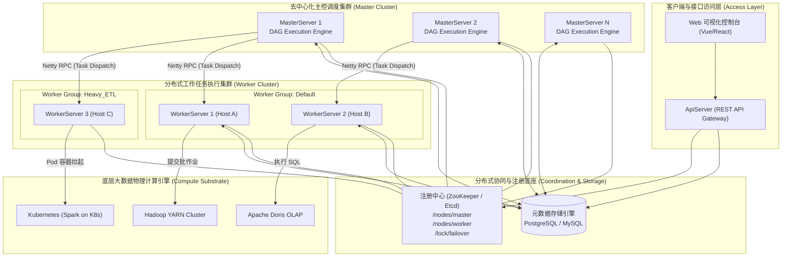
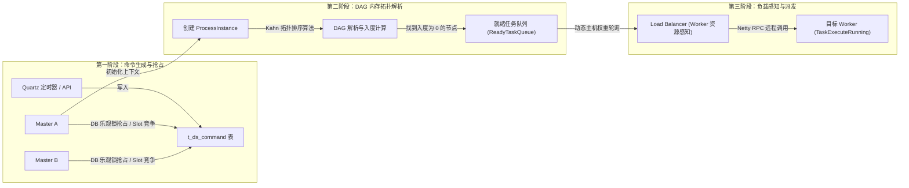
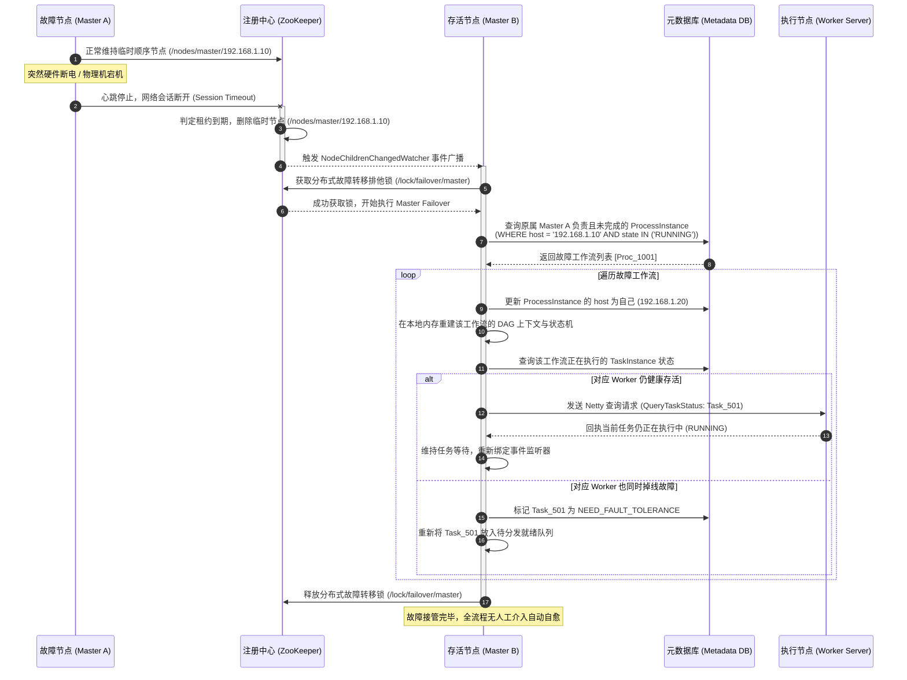
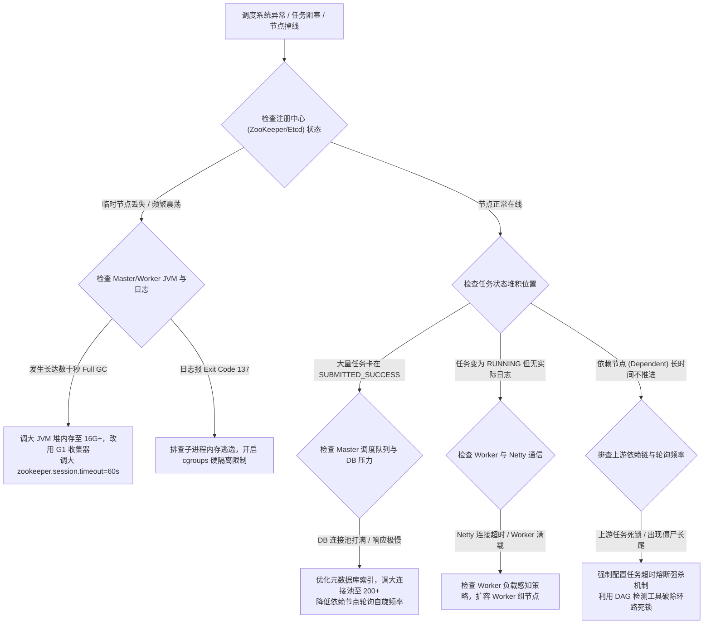
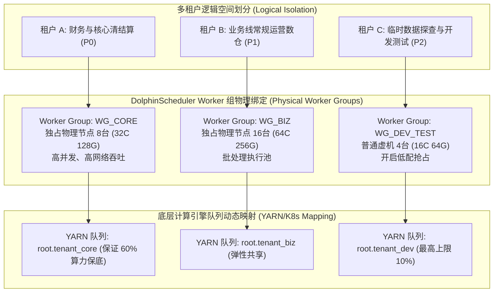

# 任务调度系统与大数据组件管理：Apache DolphinScheduler去中心化架构、DAG拓扑执行流、容错机制与高并发调度

> **学习目标定位**：面向技术总监、数据平台研发负责人、高级数据架构师岗位，系统掌握企业级分布式工作流调度系统（Distributed Workflow Orchestrator）的底层内核架构、分布式协同机制与超大规模高并发调度治理方案。深度剖析 Apache DolphinScheduler 3.x 去中心化设计哲学（Multi-Master / Multi-Worker 无主协同）、基于 Kahn 拓扑排序算法的 DAG 依赖解析与环路死锁检测、基于 ZooKeeper/Etcd 临时租约的 Master/Worker 双向故障转移（Failover）容错时序。结合大型制造（美的）万级批处理 DAG 依赖治理与工业物联网（瑞纳智能太原项目）10 万设备小时级重算补数实战，讲透多租户资源防踩踏隔离、动态智能基线预警与任务生命周期 SOP 门禁。

---

## 1. 知识概述与业务价值

### 1.1 是什么（What）
- **分布式工作流调度系统（Distributed Workflow Orchestrator）**：大数据平台的中枢调度指挥官，负责将企业内部成千上万个离线批处理作业（Spark、Flink Batch、Hive、SQL、Shell、Python、SeaTunnel 等）按照业务依赖关系编排为**有向无环图（Directed Acyclic Graph - DAG）**，并在分布式集群中按时序、资源配额与优先级精确触发执行。
- **代际技术演进**：
  - **第一代：单机静态调度器（Linux Crontab / Quartz）**：无法管理复杂的跨任务上下游依赖，单点故障，缺乏全局拓扑感知；
  - **第二代：早期中心化调度器（Azkaban / Oozie）**：引入基础 DAG，但架构为强 Master-Slave 中心化模式，Master 存在单点吞吐上限与内存泄漏风险；
  - **第三代：代码即配置架构（Apache Airflow）**：Python Code-as-Config 模式，在数据科学与算法领域极为灵活，但对于企业级多租户、可视化拖拽、大规模十万级任务并发调度存在性能抖动与高门槛；
  - **第四代：去中心化云原生微服务调度器（Apache DolphinScheduler 3.x）**：采用**多 Master / 多 Worker 无中心化对等协同架构**，支持高可用自愈、可视化拖拉拽低代码交互、丰富的任务类型扩展与秒级万级任务并发吞吐。

### 1.2 解决什么核心业务痛点（Why）
- **“蜘蛛网式”任务依赖混乱与调度死锁**：企业数仓拥有几万个任务，上游延迟 10 分钟，下游数百个任务被动空转等待或引发依赖死锁，缺乏跨工作流与跨项目依赖管控能力。
- **调度系统单点崩溃（Single Point of Failure - SPOF）**：传统调度 Master 挂掉后，全局任务停止分发，正在运行的任务状态丢失，导致凌晨数仓生产全面瘫痪。
- **长尾任务与资源争抢踩踏**：低优先级临时取数任务耗尽 Worker 线程池，导致财务核心 P0 报表排队饿死；缺少租户物理隔离与配额硬限制。
- **大规模失败重跑与补数（Backfill）灾难**：历史数据需要修正时，人工逐个重跑几十个级联任务耗费数人天，重跑中缺乏幂等控制导致数据重复翻倍。

### 1.3 适用场景与技术边界（Where & When）
- **最佳业务场景矩阵**：
  - **十万级离线数仓批处理流水线编排**：管理 ODS $\to$ DWD $\to$ DWS $\to$ ADS 的复杂分层依赖；
  - **流批一体混合调度与机器学习流水线**：编排 Spark 模型训练、Flink 批处理清洗与 API 回调；
  - **跨部门多租户私有化项目独立交付**：如太原供热物联网项目，需现场开箱即用、可视化配置、低运维门槛。
- **明确反模式与技术禁区（严禁使用）**：
  - ❌ **把工作流调度器当作“秒级实时消息队列”**：严禁用来替代 Kafka/RocketMQ 调度每秒数十次的微任务，调度系统的元数据落库与心跳开销会导致元数据库连接池瞬间爆炸；
  - ❌ **在 Worker 进程内直接运行超大内存计算逻辑**：严禁在调度 Worker 内部执行大单机 Pandas 计算或在本地堆内存缓存百兆数据，Worker 的核心职责是**代理与分发（Agent & Proxy）**，真实计算必须委托推送到外部引擎（YARN、K8s、Doris、Flink）。

---

## 2. 核心概念与关系

### 2.1 核心概念全景表

| 核心概念 | 英文术语 | 核心定义与工程职责 | 资源/生命周期级别 |
| :--- | :--- | :--- | :--- |
| **主控服务** | MasterServer | 负责 DAG 拓扑解析、任务拆解、逻辑依赖判断、向 Worker 派发任务与分布式容错 | 集群控制面 / 无状态对等多实例 |
| **工作执行服务** | WorkerServer | 负责接收 Task 并拉起具体进程（调用 Yarn/K8s/Shell）、心跳上报与日志收集 | 资源执行面 / 分布式 Worker 组 |
| **注册中心** | Registry (ZooKeeper/Etcd) | 负责 Master/Worker 节点注册发现、临时租约管理、分布式锁与宕机事件监听 | 协调通信底座 |
| **元数据存储** | Metadata Store (MySQL/PG) | 持久化工作流定义、实例快照、任务执行历史、告警规则与系统元数据 | 持久化状态底座 |
| **工作流定义** | ProcessDefinition | 静态的 DAG 流程蓝图，描述一组任务节点及其前后依赖关系 | 逻辑设计级 |
| **工作流实例** | ProcessInstance | 工作流定义的某一次具体运行上下文（包含调度时间、状态、重试计数） | 运行时实例级 |
| **任务实例** | TaskInstance | 工作流中某一个具体节点的执行实例，对应底层的实际作业状态 | 节点运行级 |
| **调度指令** | Command | 驱动 Master 实例生成 ProcessInstance 的动作命令（如定时触发、手动补数、失败重跑） | 事件驱动级 |

### 2.2 DolphinScheduler 系统拓扑与分布式交互关系图



---

## 3. 底层工作机制与设计哲学

### 3.1 DolphinScheduler 3.x 去中心化设计哲学与 DAG 解析引擎

#### 1. 为什么必须抛弃传统的单 Master 架构？
- 在传统单 Master 系统（如早期的 Azkaban）中，Master 既要负责成千上万个任务的 DAG 拓扑解析，又要维持与数百台 Worker 的心跳连接，同时还要在内存中维护全量调度状态机。当任务规模突破 10,000+ 时，Master 发生 Full GC 就会导致与 Worker 心跳中断，引发全集群震荡；且 Master 单点宕机时，服务不可用时间长达数分钟。
- **DolphinScheduler 的去中心化设计哲学**：
  - **无主对等（Leaderless Peer Architecture）**：所有 MasterServer 实例地位完全平等，没有“Active/Standby”之分；
  - **工作流维度的分布式拆分（Partitioning by ProcessInstance）**：每个 MasterServer 独立竞争消费数据库中的 `Command` 队列。一旦某个 Master 抢到并生成了一个 `ProcessInstance`，该工作流实例从头到尾的 DAG 拓扑遍历、节点状态推导完全由该 Master **闭环负责**，各个 Master 之间互不干扰，线性扩展计算能力。



#### 2. DAG 拓扑解析与依赖判定底层算法（Kahn 拓扑算法推导）
DolphinScheduler 内部将工作流表示为 `DAG<Long, TaskNode, TaskNodeRelation>` 数据结构：
1. **入度（In-Degree）与出度（Out-Degree）计算**：
   - 遍历工作流定义中所有节点的依赖边。若节点 A 依赖节点 B（$B \to A$），则节点 A 的入度记为 $\text{inDegree}(A) = 1$；
2. **就绪节点扫描与触发**：
   - 初始化时，系统扫描所有 $\text{inDegree}(X) == 0$ 的根节点，直接将其封装为 `TaskInstance` 并放入就绪队列提交执行；
3. **级联递减与动态推进**：
   - 当节点 B 执行成功并向 Master 回调 `SUCCESS` 状态时，Master 提取节点 B 的所有后继子节点集合 $\text{Children}(B)$；
   - 对每一个子节点 $A \in \text{Children}(B)$，执行原子递减：$\text{inDegree}(A) = \text{inDegree}(A) - 1$；
   - 若发现 $\text{inDegree}(A)$ 归零，说明节点 A 的所有前置依赖均已执行完毕，节点 A 瞬间转为就绪状态，进入调度派发队列。

#### 3. 内存环路检测机制（Cycle Detection）
在工作流保存或提交运行时，调度系统必须进行严格的**环形死锁检测（DAG Verification）**，防止用户配置出 $A \to B \to C \to A$ 的致命死循环：
- 采用 **拓扑遍历计数验证法**：
  1. 复制一份内存中所有节点的入度副本；
  2. 采用队列进行广度优先搜索（BFS），每次移除一个入度为 0 的节点，并将其关联边的后继节点入度减 1；
  3. 统计被成功访问移除的节点总数 $Count$；
  4. 若 $Count == \text{TotalNodes}$，则证明图为合法的有向无环图；**若 $Count < \text{TotalNodes}$，则断定图中存在环路（Cycle）**，系统直接拦截保存并抛出 `ScheduleCycleException`。

### 3.2 机制交互时序图（Mermaid）：Master/Worker 分布式容错与故障转移

以下展示生产环境中 Master 突发断电宕机时，存活 Master 如何通过 ZooKeeper 租约机制自动接管未完成工作流的完整底层时序：



### 3.3 大规模长尾任务与优先级抢占机制

当清晨业务高峰到来时，数千个任务同时进入队列。如果缺乏细粒度优先级控制，轻量级的业务看板任务会被巨型 Spark 长尾任务严重阻塞。

#### 1. 优先级队列（Task Priority Queue）双层映射模型
- **工作流级优先级（Process Priority）**：`HIGHEST(0)`、`HIGH(1)`、`MEDIUM(2)`、`LOW(3)`、`LOWEST(4)`；
- **任务节点级优先级（Task Priority）**：同样支持 5 级离散权重；
- **最终优先级权重打分公式**：
  $$\text{Score} = (\text{ProcessPriority} \times 1000) + (\text{TaskPriority} \times 100) + \text{WaitTimeWeight}$$
  队列调度器（PriorityBlockingQueue）严格按照打分降序出队，确保核心高优任务始终最优先获得下发权。

#### 2. Worker 资源动态感知与负载均衡算法（Host Weighting）
Master 在分发任务时，绝不采用粗暴的随机或死板的轮询，而是实时结合 Worker 上报的心跳指标计算综合负载：
$$\text{LoadFactor} = \alpha \cdot \text{CPU\_Usage} + \beta \cdot \text{Mem\_Usage} + \gamma \cdot \left(\frac{\text{RunningTaskCount}}{\text{MaxCapacity}}\right)$$
其中权重通常设定为 $\alpha=0.4, \beta=0.4, \gamma=0.2$。Master 优先将任务派发至 `LoadFactor` 最低的 Worker；当 Worker 节点的 CPU 或内存使用率突破预警阈值（如 $85\%$）时，自动将其标记为 `BUSY` 状态并暂停下发新任务，从物理源头根除 Worker 节点被压垮雪崩。

---

## 4. 高频复杂业务场景实操与落地

### 4.1 场景一：万级复杂依赖 DAG 中跨工作流与跨项目依赖调度实战

#### 业务背景
在大型多元化集团（如美的集团跨制造、供应链、电商）中，各个业务部门拥有独立的 DolphinScheduler 项目空间（Project Space）：
- 供应链项目产出底表：`supply_chain_project.dws_inventory_di`；
- 电商销售项目依赖该库存表：`ecommerce_project.ads_sales_delivery_di` 必须等待供应链表计算完成才能启动。
不同项目由不同开发团队维护，严禁将所有几千个任务画在同一张巨型 DAG 画布中（否则无法维护且权限失控），亟需建立优雅的跨项目解耦依赖。

#### 架构实操解决方案（依赖节点 Dependent Task 模式）
1. **依赖节点（Dependent Node）的语义抽象**：
   - 在电商工作流的起点，配置一个特殊的 **`Dependent` 虚拟节点**；
   - 依赖节点不拉起任何底层计算容器，而是配置声明式逻辑：
     - **项目**：`supply_chain_project`；
     - **工作流定义**：`dws_inventory_process`；
     - **目标节点**：`dws_inventory_finish_flag`；
     - **周期依赖（Cycle Dependence）**：依赖上游**同业务日（Today）**或**前一业务日（Yesterday）**的执行状态；
2. **异步轮询与长轮询监听（Long-Polling Listener）**：
   - Master 将 Dependent 任务下发后，专门的依赖监听守护线程在内存中定期向元数据库拉取目标 `ProcessInstance` 的最新执行状态；
   - 支持配置 **最长等待超时时间（Execution Timeout）**：若上游任务超过 2 小时仍未完成，Dependent 节点根据策略选择触发告警或强制失败，防止下游任务无限期挂起占用连接。

### 4.2 场景二：太原智慧供热物联网 10 万设备小时级重算与高并发补数实战

#### 业务背景
在太原智慧供热项目中，现场 10 万台智能热表与温控阀数据每小时汇聚一次生成小时级能耗聚合表。某天由于上游运营商基站光纤施工挖断，导致太原某片区连续 12 小时的物联数据在傍晚才全量补发。数仓团队必须对过去 12 个小时的 120 个批处理工作流实例进行**高并发补数（Backfill）**。若一次性全部拉起，瞬时涌入的数万个计算容器会瞬间冲垮底层的计算集群。

#### 架构实操解决方案（动态分段并行补数限流）
1. **补数时间窗口切片（Time-Range Slicing）**：
   - 在 DolphinScheduler 补数界面配置时间范围：`2026-11-17 00:00:00` 至 `2026-11-17 12:00:00`，粒度设为 `1 Hour`，系统自动切分为 12 个并行的串行或并行执行实例；
2. **设置补数最大并发度（Backfill Concurrency Throttle）**：
   - 严禁并发度无上限。依据集群空闲算力设定 `parallelism = 3`；
   - 调度系统内核维护一个滑动窗口：始终保持最多 3 个小时实例同时在执行，完成一个自动滑动触发下一个；
3. **补数任务的动态资源降级**：
   - 补数任务自动被路由到专有的低优先级 Worker 组（`WorkerGroup: Backfill`），并且在提交 Spark 任务时强制注入动态参数 `--conf spark.dynamicAllocation.maxExecutors=10`，严格压制补数任务对实时准点调度任务的资源挤压。

### 4.3 场景三：海量 Spark/Flink 容器化作业在 K8s/YARN 混合调度下的优雅停机实战

#### 业务背景
在调度系统中，当用户在 Web 页面点击“停止工作流”或任务由于执行超时被系统强制杀死时，传统调度器往往仅仅杀死了 Worker 本地的 Shell 客户端进程（PID），而提交到远程 Hadoop YARN 或 Kubernetes 集群中的巨型 Spark/Flink 作业依然在后台静默运行（孤儿作业 Orphan Application），持续占用数千核 CPU 达数小时，造成严重的算力黑洞。

#### 架构实操解决方案（两阶段追踪与优雅注销）
1. **应用唯一标识双向注册（ApplicationId Tracking）**：
   - Worker 在拉起 `spark-submit` 或 `flink run` 进程时，实时解析其标准输出（Stdout/Stderr）日志流；
   - 利用正则模式精准捕获远程集群生成的全局唯一 ID：
     - YARN 模式：`application_\d+_\d+`；
     - K8s 模式：`spark-app-selector=...` 或 Driver Pod 名称；
   - Worker 毫秒级将该 `app_id` 异步回写至元数据库的 `t_ds_task_instance.app_link` 字段；
2. **两阶段优雅终止机制（Two-Phase Kill Protocol）**：
   - **Phase 1（远程注销）**：当 Worker 收到 Master 发来的 `KILL_TASK` 指令时，首先读取 `app_link`，主动调用底层的 Yarn Client API：`yarn application -kill <app_id>` 或 K8s API 执行 Pod 优雅清理；
   - **Phase 2（本地收容）**：确认远程资源释放后，Worker 再向本地操作系统发送 `SIGTERM` 信号通知子进程退出；若 10 秒后未响应，最终发送 `SIGKILL`（kill -9）物理清理本地残留进程，实现 100% 杜绝孤儿作业。

---

## 5. 生产异常故障深度排查与根因分析

### 5.1 故障一：ZooKeeper 会话超时导致 Master 脑裂与大规模任务重复提交

#### 故障现象
每天凌晨数仓调度高峰期，DolphinScheduler 集群频繁抛出报警。查看日志发现系统出现**同一个任务在两台不同的 Worker 上同时被执行了两次**，导致下游数仓分区被反复覆盖甚至数据产生重复；Master 日志中充斥着大量的 `ConnectionLossException` 和 `SessionExpiredException`。

#### 深度根因分析（Root Cause）
1. **Master 遭遇超长 Full GC 假死**：Master JVM 堆内存配置过小（默认 4GB），面对瞬时涌入的上万个 TaskInstance，触发了长达 30 秒的 Stop-The-World（STW）垃圾回收；
2. **ZooKeeper 租约被动摘除**：ZK 的客户端会话超时时间配置过短（`zookeeper.session.timeout=10000`，即 10 秒）。由于 Master A 处于 STW 假死状态无法响应心跳，ZK 判定其已死亡，将其临时节点强制删除；
3. **脑裂与竞态触发（Split-Brain & Race Condition）**：存活的 Master B 感知到 ZK 事件，判定 Master A 宕机，立刻发起 Failover 接管其工作流，并将任务重新下发给 Worker 2 执行；而数秒后 Master A 从 Full GC 中苏醒，依然认为自己持有该工作流的控制权，继续与 Worker 1 通信，最终导致**双 Master 同时调度同一个工作流的脑裂灾难**。

#### 生产调优与架构级解决方案
```properties
# 1. 调整 ZooKeeper 会话超时与心跳间隔，增加容忍网络与微 GC 的弹性空间
zookeeper.session.timeout=60000
zookeeper.connection.timeout=30000

# 2. 调大 Master JVM 堆内存，改用低延迟 G1 垃圾收集器
-Xms16g -Xmx16g -XX:+UseG1GC -XX:MaxGCPauseMillis=200 -XX:InitiatingHeapOccupancyPercent=45

# 3. 开启数据库层面的分布式排他锁校验（Fencing Token 机制）
# Master 每次在更新任务状态或派发前，必须核验当前工作流在 DB 中的 version 版本号是否匹配
# 若发现版本号已被其他 Master 递增接管，Master A 立即自我熔断退出 (Self-Fencing Kill)
```

### 5.2 故障二：DAG 环形依赖与跨项目上游任务长尾延迟引发下游数千任务堆积堵死 TaskQueue

#### 故障现象
某天早晨 08:00，管理层所有报表大面积瘫痪。查看调度队列，发现 Master 的待执行任务队列积压了超过 12,000 个任务，所有就绪任务全部卡在 `SUBMITTED_SUCCESS` 状态无法变为 `RUNNING`；Master 内存被打满，CPU 长期处于 100% 消耗状态。

#### 深度根因分析（Root Cause）
1. **极端长尾任务霸占锁资源**：上游业务系统因数据倾斜产生了一个持续运行 14 小时的僵尸 Spark 任务；
2. **依赖级联堵塞（Cascading Head-of-Line Blocking）**：下游 80 个核心项目的 Dependent 节点全部处于自旋轮询状态，不断向元数据库发起高频 `SELECT` 查询；
3. **轮询自旋拖垮 DB 与线程池**：DolphinScheduler 早期默认对依赖节点的轮询间隔较短（如 5 秒），数千个轮询任务瞬间吃光了 Master 的内部调度线程池与元数据库的连接池（MaxConnections 爆满），导致其他正常的任务连获取数据库连接的动作都被阻塞。

#### 架构级解决方案
1. **引入自适应退避轮询（Adaptive Backoff Polling）**：
   - 修改依赖节点的轮询策略：初始检查间隔为 10 秒，若超过 30 分钟未就绪，轮询间隔指数退避至 60 秒、300 秒，大幅压降 90% 的无效元数据数据库压力；
2. **强制设置任务超时强杀机制（Mandatory Task Timeout）**：
   - 架构层面推行代码门禁：所有生产任务必须显式配置超时阈值（如业务通常跑 30 分钟，强制配置超时 120 分钟），超时后调度系统自动触发远程 Application 强杀并发送告警，彻底消除长尾僵尸任务；
3. **分离调度线程池（Thread Pool Isolation）**：
   - 将 Master 内部分发常规计算任务的线程池（`TaskDispatchPool`）与执行依赖监听的线程池（`DependentListenPool`）进行物理隔离，即使依赖节点全部卡住，也绝不影响普通计算作业的正常下发。

### 5.3 故障三：Worker 节点负载失衡触发 OOM-Killed (Exit Code 137) 导致进程反复崩溃重启

#### 故障现象
生产环境中某两台 Worker 物理节点的 `dolphinscheduler-worker.log` 日志频繁中断，操作系统 `dmesg -T` 打印出大量告警：
`Out of memory: Kill process 28412 (dolphinscheduler) score 850 or sacrifice child`。
Worker 进程由于内存溢出被 Linux 内核 OOM Killer 强行终止（Exit Code 137），导致该节点上运行的数十个生产任务全线溃退。

#### 深度根因分析（Root Cause）
1. **Shell/Python 任务内存失控逃逸**：部分数据分析师编写了 Python 脚本通过 Pandas 直连读取千万级数据做内存分析，该 Python 进程属于 Worker 进程的子进程；
2. **缺少 cgroups 容器化资源隔离**：DolphinScheduler Worker 运行在宿主机上，子进程无限制地消耗系统物理内存，最终直接吃满整机内存，触发操作系统为了保全系统稳定而杀死父进程（Worker）。

#### 架构级解决方案
1. **基于 Linux cgroups 的子进程资源硬隔离机制**：
   - 在 Worker 启动配置中开启 cgroups 限制：
     ```properties
     worker.group.cgroup.enable=true
     worker.group.cgroup.memory.limit=16G
     worker.group.cgroup.cpu.quota=800000
     ```
   - 当分析师编写的 Python/Shell 任务内存超出 16GB 时，Linux cgroups **仅仅杀死该 Python 子进程，而 Worker 主守护进程毫发无损**，任务正常上报 `FAILURE` 状态，彻底杜绝宿主机级雪崩。

### 5.4 生产故障排查决策树（Mermaid）



---

## 6. 技术选型对比

### 6.1 主流任务调度系统对比矩阵

在大数据体系中，除了 **Apache DolphinScheduler**，业界广泛应用的还有 **Apache Airflow**、早期的 **Azkaban** 以及轻量级 RPC 任务调度框架 **XXL-JOB**。以下为四者的全方位技术选型对比大表：

| 选型维度 | Apache DolphinScheduler (3.2+) | Apache Airflow (2.8+) | Azkaban (3.9+) | XXL-JOB (2.4+) |
| :--- | :--- | :--- | :--- | :--- |
| **底层核心架构** | **去中心化多 Master / 多 Worker** | 分布式 (Scheduler, Web, Celery/K8s Worker) | 传统中心化 (单/双 Master + Multiple Executors) | 中心化调度中心 + 执行器架构 |
| **高可用自愈能力** | **极强 (无主对等，ZK 租约毫秒级自动接管)** | 较强 (2.0+ 支持多 Scheduler，依赖 DB 锁) | 弱 (Master 切换耗时久，状态易丢失) | 较强 (基于注册中心心跳探活) |
| **工作流编排方式** | **可视化拖拉拽低代码 + Open API + Python SDK** | **纯 Python 代码定义 (Code-as-Config)** | 专有属性文件定义 (DSL / Job 文件) | 仅支持简单线性任务，无复杂 DAG |
| **万级并发吞吐 (TPS)** | **极高 (秒级万级任务并发下发)** | 中等 (大规模 DAG 时 Scheduler 解析性能有瓶颈) | 较低 (Master 内存易打满) | 极高 (针对简单单任务调度极快) |
| **多租户与权限隔离** | **内置企业级 RBAC、项目空间与 Worker 组物理隔离** | 较为薄弱 (需二次开发定制多租户空间) | 基础权限控制，无租户资源硬隔离 | 简单的 AppName 注册分组 |
| **大数据生态集成度** | **开箱即用 (Spark/Flink/Hive/Doris/SeaTunnel/DataX)** | 极其丰富 (通过 Provider 插件连接全球工具) | 偏陈旧 (仅支持基础 Hadoop 组件) | 需自行编写业务代码嵌入调用 |
| **二次开发与维护成本** | **低 (Java/Spring Boot 原生技术栈，易扩展定制)** | 高 (需掌握 Python 源码，排查调度循环耗时) | 低 (但社区基本停更，缺乏前沿能力) | 极低 (轻量级纯 Java 框架) |

### 6.2 选型决策考量与工业界取舍法则

针对技术总监与数据架构师的选型决策，切忌“盲目跟风”，必须基于团队基因与业务属性做出严谨权衡：
1. **数仓与企业级数据中台首选：Apache DolphinScheduler**：
   - **选型逻辑**：数仓团队通常包含大量 SQL 开发人员与初中级 ETL 工程师。如果推行 Airflow，要求每位分析师编写严格符合 Python 语法的 DAG 文件，不仅门槛高，而且极易因某个人写了阻塞性代码拖死全局 Scheduler。DolphinScheduler 提供极佳的可视化低代码界面，结合 Java 原生架构与深度的国产化/大数据生态集成，是构建企业级数据中台的最佳实践底座。
2. **复杂算法流水线与数据科学团队首选：Apache Airflow**：
   - **选型逻辑**：在纯算法、机器学习工程（MLOps）与动态 DAG 场景下（例如根据模型训练结果动态生成不同分支的下游任务），Airflow 的 Python 原生表达力无可替代，配合 Astronomer 商业生态与强大的云厂商托管服务（如 AWS MWAA / GCP Cloud Composer），是算法工程团队的首选。
3. **微服务与业务系统后台定时任务：XXL-JOB**：
   - **选型逻辑**：若场景仅仅是业务系统每天凌晨定时清空缓存、发送账单短信或执行简单的分片广播跑批，架构轻量的 XXL-JOB 最为合适，坚决不需要引入繁重的大数据 DAG 调度引擎。

---

## 7. 技术经理与架构师实战管控

### 7.1 调度资源分级与多租户防踩踏隔离机制

在大型集团或私有化交付项目中，不同租户的任务混跑在同一套调度集群中，极易发生“劣币驱逐良币”的资源抢占。作为架构师，必须推行 **“底座物理硬隔离 + 引擎内部软协同”** 的资源治理架构：



1. **Worker 物理节点硬隔离（Dedicated Worker Groups）**：
   - 在平台中严禁使用默认的 `default` Worker 组；
   - 财务核心任务只能提交至 `WG_CORE` 专有物理节点组；开发测试任务只能在 `WG_DEV_TEST` 组运行，从操作系统进程层面彻底切断资源踩踏可能。
2. **调度环境参数强制覆写（Environment Injection）**：
   - 平台通过拦截器，在向底层计算引擎提交任务时强制注入隔离参数：
     - 测试任务强制追加：`--queue root.tenant_dev --conf spark.executor.instances=2`；
     - 杜绝个别工程师在脚本中私自将参数修改为最大核心数。

### 7.2 生产级 SLA 承诺与智能基线预警机制

在数仓运维中，“早上 08:00 报表还没出，业务打电话来催”是技术团队被动挨打的典型表现。必须建立 **“智能基线预警（Smart Baseline & Dynamic Early Warning）”** 机制：
1. **基线破线预警（Deadline Alert）**：
   - 为核心看板绑定完成时限（如 `SLA = 07:30`）；
   - 系统利用历史 30 天运行数据，计算该工作流上每一段关键路径（Critical Path）的平均执行耗时；
2. **动态提前唤醒（Dynamic Advance Notification）**：
   - 假设关键路径累计需要运行 120 分钟，则该任务的最晚启动时间为 `05:30`；
   - 若系统检测到在 `05:40` 时上游前置任务仍未就绪，**系统在没有发生任何任务报错的情况下，立即提前向责任人发出“破线预警通知”**：“预计无法在 07:30 达成 SLA，当前延误瓶颈在上游节点 X”，将运维介入时间提前数小时，彻底变被动为主动。

### 7.3 团队调度任务上线规范与工程门禁（Task Lifecycle SOP）

在团队管理层面，制定严谨的调度任务准入规范，并在发布流程中强制执行自动化校验：

| 管控维度 | 生产强制要求（SOP） | 违规处罚与卡点机制 |
| :--- | :--- | :--- |
| **超时时间强制性** | 所有正式调度的计算任务，必须配置 `Execution Timeout`（通常设置为历史平均耗时的 2.5~3 倍）。 | 凡是未设置超时的任务，CI/CD 门禁直接置灰禁止上线。 |
| **失败重试策略** | 生产任务必须配置重试次数（1~2 次），且重试间隔（Retry Interval）必须 $\ge 3$ 分钟，避免瞬时重试打垮故障源。 | 严禁配置重试次数 $> 3$ 或重试间隔为 0 的任务。 |
| **执行用户与权限隔离** | 严禁以 `root` 或操作系统底层服务账号运行任务，必须指定专有的受限业务代理账号（如 `hdfs_biz`）。 | 平台拦截所有包含 `sudo` 或以超级管理员身份运行的命令。 |
| **报警责任人绑定** | 每个工作流必须配置报警组，且必须包含至少一位技术值班员与一位业务负责人电话。 | 缺少报警配置的流程，系统禁止开启定时调度开关。 |

---

## 8. 互联网大厂高频面试真题库

* **Q1 [美团 - 核心架构与去中心化]**：深入剖析 Apache DolphinScheduler 的去中心化（Decentralized）架构。它是如何解决传统调度系统单点瓶颈与脑裂问题的？
* **Q2 [字节跳动 - 底层机制与算法]**：调度系统如何实现 DAG 拓扑排序与依赖解析？如果任务之间出现循环依赖（Cycle），系统如何在内存中高效检测并防止调度死锁？
* **Q3 [阿里 - 分布式容错与高可用]**：当集群中某个正在运行大量任务的 Worker 节点突发宕机，或者某个 Master 节点掉线时，DolphinScheduler 是如何通过 ZooKeeper 和元数据库实现分布式容错与任务接管的？
* **Q4 [腾讯 - 生产实战与高并发]**：凌晨数万个批处理任务在同一时刻就绪并触发调度，极易引发“调度风暴（Thundering Herd）”与任务队列堵死。架构师该如何进行流量削峰与动态负载均衡？
* **Q5 [快手 - 架构权衡与选型]**：对比 Apache DolphinScheduler 与 Apache Airflow，两者在架构理念、代码即配置（Code-as-Config）vs 可视化编排、多租户隔离与维护成本上有何本质差异？企业该如何选型？
* **Q6 [滴滴 - 生产排障与幂等性]**：调度系统中某核心报表任务在凌晨突然执行失败，但自动重试后把下游已经完成的任务又重新触发了一遍，造成数仓数据翻倍。请分析根因并给出幂等防护方案。
* **Q7 [数据总监/管理决策与团队SOP]**：大数据调度系统往往涉及跨部门上百名工程师的日常作业，如何建立一套防踩踏、有 SLA 保障、可追溯责任的高可用调度治理规范？

---

## 9. 结构化深度参考答案

### 题目1 [美团 - 核心架构与去中心化]：深入剖析 Apache DolphinScheduler 的去中心化（Decentralized）架构。它是如何解决传统调度系统单点瓶颈与脑裂问题的？

#### 简洁回答（1分钟电梯破题）
DolphinScheduler 3.x 采用**多 Master / 多 Worker 无中心对等微服务架构**。
它抛弃了传统的“主从（Active/Standby）单点 Master”设计，所有 Master 节点完全平等，基于元数据库的**命令队列（Command Queue）与状态槽（Slot）进行工作流粒度的负载分片（Partitioning）**；通过分布式协同中心（ZooKeeper/Etcd）维持心跳与临时租约；配合底层的**数据库乐观锁与 Fencing Token 版本号机制**，在彻底消除单点性能瓶颈的同时，从根本上防止了脑裂（Split-Brain）现象的发生。

#### 深入回答（机制推导与边界条件）
1. **工作流维度的去中心化分片机制（Partitioning by Instance）**：
   - 所有的触发事件（定时器触发、手工触发、补数命令）首先统一持久化写入数据库的 `t_ds_command` 表；
   - 多个对等的 MasterServer 启动守护线程消费命令表。为了防止多个 Master 抢夺同一条命令引发冲突，DolphinScheduler 采用了 **数据库行级锁或乐观锁状态扭转机制**（`UPDATE t_ds_command SET status = 'IN_PROGRESS' WHERE id = ? AND status = 'INIT'`）；
   - 一旦 Master A 抢占成功，该工作流实例（`ProcessInstance`）就打上 `host = Master_A_IP` 标签。从这一刻起，**该工作流内部所有任务节点的 DAG 依赖推导、状态机流转与 Worker 派发，完全由 Master A 闭环掌控**，其他 Master 无需介入，实现了完美的水平伸缩与算力解耦。
2. **脑裂的根本性防御机制（ZooKeeper 租约 + Fencing Token）**：
   - **ZK 租约探活**：所有 Master 在 `/nodes/master` 目录下维护各自的临时顺序节点。当 Master A 发生网络分区或超长 Full GC（假死）时，ZK 租约超时删除节点；
   - **分布式排他锁接管**：存活的 Master B 监听到节点删除事件，竞争获取全局 Failover 排他锁，开始接管原属于 Master A 的工作流；
   - **Fencing Token 防护**：Master B 接管后，会强制将数据库中该 `ProcessInstance` 的 `host` 字段更新为 Master B，并将其版本号 `version = version + 1`；当 Master A 从假死中恢复过来继续尝试提交状态时，SQL 语句中的版本号校验必然失败（`WHERE version = old_version` 返回 0 行），Master A 感知到自己已被剥夺控制权，立刻主动退出（Self-Kill），彻底避免双主并发写入的脑裂灾难。

#### 架构师/技术管理视角（权衡取舍、SLA与成本）
- **架构演进的权衡代价**：去中心化架构极大地提升了系统的水平扩展上限（集群可轻松容纳数十台 Master 并发调度），但其代价是**对元数据库的并发读写要求显著提升**。架构师必须将元数据库（MySQL/PostgreSQL）的高可用与连接池调优（如配置 HikariCP、合理调大 `max_connections`、开启数据库读写分离）作为关键技术保障点，防止元数据库成为新的瓶颈。

---

### 题目2 [字节跳动 - 底层机制与算法]：调度系统如何实现 DAG 拓扑排序与依赖解析？如果任务之间出现循环依赖（Cycle），系统如何在内存中高效检测并防止调度死锁？

#### 简洁回答（1分钟电梯破题）
DolphinScheduler 采用经典图论中的 **Kahn 拓扑排序算法（基于入度递减的有向图遍历）** 来驱动 DAG 任务的生命周期推进。
系统启动时计算所有节点的入度（In-Degree），优先调度入度为 0 的根任务；每当一个任务执行成功，触发后继子节点入度原子减 1，当子节点入度归零时自动激活调度。在任务保存与发布前，系统采用 **Kahn 拓扑计数验证法或深度优先搜索（DFS）三色标记法** 在内存中进行全图死锁检测，一旦发现无法完全遍历所有节点，判定存在闭环（Cycle），直接拦截发布。

#### 深入回答（机制推导与边界条件）
1. **DAG 依赖推进的底层算法实现**：
   - 在内存中，工作流被抽象为节点集合 $V$ 与边集合 $E$；
   - **拓扑初始化**：遍历所有边 $(u, v) \in E$，计算每个节点 $v$ 的初始入度：
     $$\text{inDegree}[v] = \sum_{(u, v) \in E} 1$$
   - 将所有 $\text{inDegree}[u] == 0$ 的节点存入 `ReadyQueue` 并下发执行；
   - **动态依赖解算**：当节点 $u$ 完成并回调时：
     ```java
     for (TaskNode child : dag.getChildren(u)) {
         if (inDegreeMap.decrementAndGet(child.getId()) == 0) {
             // 所有前置依赖节点均已成功执行，激活下游节点
             readyQueue.offer(child);
         }
     }
     ```
2. **高效环路死锁检测机制（Cycle Detection Algorithm）**：
   - 在用户点击“保存工作流”或调度系统加载工作流定义时，必须防止死循环（如 $A \to B \to C \to A$）：
   - **Kahn 算法检测法**：
     1. 克隆全图的入度字典副本 `tempInDegree`；
     2. 将所有入度为 0 的节点放入队列 `Queue`，并初始化计数器 `visitedCount = 0`；
     3. 当队列非空时，出队节点 $u$，`visitedCount++`；
     4. 遍历 $u$ 的后继节点 $v$，将 `tempInDegree[v]--`；若减到 0，则将 $v$ 入队；
     5. 循环结束时，比对 `visitedCount` 与图中总节点数 $|V|$：
        - 若 `visitedCount == |V|`，说明全图无环，拓扑完全合法；
        - 若 `visitedCount < |V|`，说明**剩余未被访问的节点之间必定存在互相等待的闭环（Cycle）**，系统瞬间阻断操作并高亮标出存在环路的节点集合。

#### 架构师/技术管理视角（权衡取舍、SLA与成本）
- **性能与复杂度控制**：Kahn 算法的时间复杂度为 $O(|V| + |E|)$，空间复杂度为 $O(|V|)$，对于企业级包含几百个节点的复杂工作流，该算法在内存中执行仅需 1~2 毫秒。架构师必须将该检测作为 **平台端硬性门禁（Save Gate）**，严格禁止在运行时才去发现环路死锁，消除线上生产死锁风险。

---

### 题目3 [阿里 - 分布式容错与高可用]：当集群中某个正在运行大量任务的 Worker 节点突发宕机，或者某个 Master 节点掉线时，DolphinScheduler 是如何通过 ZooKeeper 和元数据库实现分布式容错与任务接管的？

#### 简洁回答（1分钟电梯破题）
DolphinScheduler 实现了 **Master 级与 Worker 级双层自动化故障转移（Failover）自愈机制**。
核心机制是：**ZooKeeper 维护临时节点感知宕机心跳超时 $\to$ 存活节点竞争分布式锁 $\to$ 从元数据库捞取故障节点未完成的任务与工作流 $\to$ 执行宿主重新绑定与任务状态重查/重试**。整个过程对业务无感知，杜绝了任务变成无主孤儿。

#### 深入回答（机制推导与边界条件）
1. **Master 宕机容错接管全链路（Master Failover）**：
   - **Step 1（事件感知）**：Master A 宕机，其在 ZK 维持的 `/nodes/master/IP_A` 临时节点消失，ZK 向集群存活的所有 Master 广播 `NodeChildrenChangedWatcher`；
   - **Step 2（锁竞争）**：存活的 Master 节点竞争获取 ZK 分布式锁 `/lock/failover/master`，确保同一时刻全集群只有一个 Master 负责处理容错，防止并发接管混乱；
   - **Step 3（状态捞取与接管）**：抢到锁的 Master B 扫描数据库：
     `SELECT * FROM t_ds_process_instance WHERE host = 'IP_A' AND state = 'RUNNING'`；
   - **Step 4（内存重建与心跳恢复）**：Master B 将接管的工作流 `host` 更新为自己，在本地内存反序列化重建 DAG 拓扑执行树；
   - **Step 5（下游 Worker 探活）**：针对该工作流下正在运行的 `TaskInstance`，Master B 主动向对应的 Worker 节点发送 Netty 查询请求：
     - 若 Worker 反馈该任务仍在正常运行，Master B 重新建立事件监听通道，静待其完成；
     - 若对应 Worker 也已失联，则将该 Task 标记为 `NEED_FAULT_TOLERANCE`，重新投入调度队列派发重试。
2. **Worker 宕机容错接管全链路（Worker Failover）**：
   - Worker 节点掉线，其 ZK 节点 `/nodes/worker/group_name/IP_W` 消失；
   - Master 节点感知到后，扫描元数据库中所有分配在该 Worker 上且处于 `RUNNING` 状态的 `TaskInstance`；
   - Master 将这些任务的状态更新为 `FAILURE` 或根据配置的重试策略自动递增重试计数（Retry Times），从 Worker 资源池中重新选择一个健康的 Worker 节点重新下发运行。

#### 架构师/技术管理视角（权衡取舍、SLA与成本）
- **高可用机制的边界条件（幂等性要求）**：容错接管的前提是**下游任务必须具备幂等写入能力**。如果一个 Hive/Spark 任务已经写入了部分数据但尚未提交，Worker 宕机后新 Worker 重新拉起该任务，若任务采用的是 `INSERT INTO` 而非 `INSERT OVERWRITE`，就会导致数据重复。因此，架构师必须推行强制规范：所有在调度系统中编排的批处理任务，底层必须采用覆盖写入或基于分区/唯一键的幂等操作。

---

### 题目4 [腾讯 - 生产实战与高并发]：凌晨数万个批处理任务在同一时刻就绪并触发调度，极易引发“调度风暴（Thundering Herd）”与任务队列堵死。架构师该如何进行流量削峰与动态负载均衡？

#### 简洁回答（1分钟电梯破题）
应对凌晨“调度风暴”的核心架构法则是**“时间打散削峰、队列缓冲限流、动态负载感知派发与多租户分级熔断”**。
通过在定时调度配置中引入时间抖动（Jitter）避免整点踩踏；Master 采用滑动窗口与令牌桶对派发速率进行平滑限流；分发时基于 Worker 的 CPU、内存与连接数进行动态加权打分轮询；并在资源紧张时根据任务优先级（P0~P4）实施高优抢占与边缘降级。

#### 深入回答（机制推导与边界条件）
1. **调度入口流量削峰（Time Jittering & Sliding Window）**：
   - **反模式**：全公司 80% 的任务 Cron 表达式都配成了 `0 0 2 * * ?`（凌晨 02:00 整点），数万条 Command 瞬间涌入；
   - **工程解法**：在调度配置层引入 **随机时间抖动算法（Random Jitter）**，系统自动根据任务 ID 的 Hash 在预设窗口内（如 02:00 ~ 02:15）平滑打散初始触发时间；
   - **Master 内部令牌桶限流**：Master 内部消费 `Command` 时配置最大并行消费速率，采用令牌桶（RateLimiter）严格限制每秒生成 `ProcessInstance` 的上限，防止瞬间冲垮内存。
2. **Worker 动态资源感知与平滑加权轮询（Dynamic Load Balancing）**：
   - Worker 节点每隔 2 秒向注册中心与 Master 上报实时负载向量：`[CPU_Usage, Memory_Usage, Active_Threads, Disk_IO]`；
   - Master 维护动态打分公式：
     $$\text{Score} = 100 - (0.4 \times \text{CPU} + 0.4 \times \text{Mem} + 0.2 \times \frac{\text{CurrentTasks}}{\text{MaxTasks}} \times 100)$$
   - Master 采用 **平滑加权轮询（Smooth Weighted Round-Robin）** 将任务路由到得分最高的 Worker 节点；若某 Worker 节点的 CPU 或内存使用率超过 $85\%$，系统将其状态置为 `OVERLOAD`，自动暂停向其派发新任务。
3. **基于双层优先级的抢占与队列降级（Priority Preemption）**：
   - 当任务积压超过阈值时，Master 的 `ReadyQueue` 开启抢占模式：
     优先保障财务账单、核心大屏等 P0 级任务优先出队获得 Worker Slot；
     对低优先级（P3/P4）的临时报表与数据探查任务，自动推迟其唤醒时间或放入二级等待队列，确保核心生产链路的绝对稳定性。

#### 架构师/技术管理视角（权衡取舍、SLA与成本）
- **成本与弹性的平衡（Cloud-Native Elastic Scaling）**：夜间调度高峰的算力需求通常是白天的 5~10 倍。为了应对夜间高峰而常年维持昂贵的物理 Worker 节点会造成巨大的成本浪费。架构师应推动 **Worker 节点的云原生弹性伸缩（K8s KEDA / HPA）**——在每天凌晨 01:30 自动通过云端拉起 50 台 Spot 抢占式容器 Worker，在早晨 08:00 任务结束后自动销毁，节省 60% 以上的硬件基础设施预算。

---

### 题目5 [快手 - 架构权衡与选型]：对比 Apache DolphinScheduler 与 Apache Airflow，两者在架构理念、代码即配置（Code-as-Config）vs 可视化编排、多租户隔离与维护成本上有何本质差异？企业该如何选型？

#### 简洁回答（1分钟电梯破题）
DolphinScheduler 与 Airflow 代表了两种完全不同的调度设计哲学：
**Airflow 秉承“代码即一切（Code-as-Config）”**，基于 Python 纯脚本定义 DAG，灵活性和动态性达到极致，是算法科学家与数据分析极客的利器；
**DolphinScheduler 秉承“去中心化与企业级生产可用”**，采用微服务对等架构、开箱即用的可视化低代码拖拉拽、内建完善的多租户与权限体系，针对十万级大数据任务具有更高的吞吐量与极低的二次开发/运维门槛。
选型法则：**纯算法研究、MLOps 流水线选 Airflow；企业级中台、传统数仓分层与大规模混合批处理选 DolphinScheduler。**

#### 深入回答（机制推导与边界条件）
1. **架构模式与性能瓶颈的本质差异**：
   - **Airflow**：核心依赖 `Airflow Scheduler` 进程反复扫描（Loop Parsing）存放 Python 文件的磁盘目录。当企业 DAG 文件数量膨胀到上万个时，磁盘 IO 与 Python 解释器的 CPU 消耗极高，解析延迟甚至长达数分钟；且多租户之间容易因为某个人写了死循环的 Python 代码导致全局 Scheduler 进程挂起；
   - **DolphinScheduler**：元模型结构化持久化存储在数据库中，Master 仅在任务触发时针对单个工作流进行精准拓扑解析，内存开销低，无静态扫描损耗；多 Master 无主架构使其水平扩展能力远优于 Airflow。
2. **多租户隔离与权限管控制度**：
   - **Airflow**：早期设计未深度考量多租户场景。所有 DAG 共享同一个全局命名空间，虽然支持 RBAC，但隔离粒度粗，难以在同一个集群中优雅实现不同业务部门之间的数据、配置与计算资源物理硬隔离；
   - **DolphinScheduler**：原生具备工业级多租户设计。自顶向下拥有**租户（Tenant） $\to$ 项目空间（Project Space） $\to$ 工作流 $\to$ 专有 Worker 组（Worker Group）**的四层强隔离模型，天然支持多部门在同一平台安全混跑。

#### 架构师/技术管理视角（权衡取舍、SLA与成本）
- **组织人员结构的决定性影响（People-Driven Architecture）**：选型往往取决于使用者的技能树。在大型互联网与传统制造企业中，80% 的数据开发人员核心技能是 SQL，而不是精通 Python 异步编程与面向对象的资深工程师。强推 Airflow 会带来巨大的团队培训阻力与线上代码质量隐患；而 DolphinScheduler 的可视化拖拉拽与标准参数配置，能大幅缩短新员工的上手周期，从组织效能层面来看 ROI 最高。

---

### 题目6 [滴滴 - 生产排障与幂等性]：调度系统中某核心报表任务在凌晨突然执行失败，但自动重试后把下游已经完成的任务又重新触发了一遍，造成数仓数据翻倍。请分析根因并给出幂等防护方案。

#### 简洁回答（1分钟电梯破题）
该故障暴露了两个核心设计缺陷：**工作流层面的“重跑级联策略”配置错误（重跑时未切断下游触发）**，以及**下游计算任务缺乏“幂等写入（Idempotent Write）”机制**。
根本解法是：在调度系统侧推行**单节点独立重试与断流阻断机制**，下游依赖增加成功状态锁定；在数据计算侧强制执行**分区覆写（`INSERT OVERWRITE`）或主键 Upsert 语义**，确保无论上游被重复执行多少次，下游数据结果唯一且恒定。

#### 深入回答（机制推导与边界条件）
1. **调度系统级根因与级联控制（Cascade Control Failure）**：
   - 调度配置中误启用了“失败后从当前节点重跑并恢复下游依赖（Rerun Post-Nodes）”；
   - 当任务 A 重试成功后，系统再次向上游发送了完成信号，导致原先已经正常跑完的下游任务 B 重新接收到了就绪信号并被二次唤醒；
   - **防护策略**：调度系统应支持 **“单节点就地重试（Local Retry）”** 模式：在任务达到最大重试次数前，任务状态维持为 `RETRYING`，对下游严格保密，绝不向后继节点传递推进信号。
2. **数据计算层幂等写入加固（Idempotency Enforcement）**：
   - **SQL 层面硬约束**：严禁在生产批处理任务中使用 `INSERT INTO` 模式写入分区表，必须强制采用原子覆写：
     ```sql
     -- 严格保证幂等性：即使重复跑 10 次，分区数据依然唯一
     INSERT OVERWRITE TABLE ads_sales_summary PARTITION (dt = '${biz_date}')
     SELECT ... FROM dws_sales_detail WHERE dt = '${biz_date}';
     ```
   - **外部存储层面（HBase / Doris / Paimon）**：
     - 若写入 Doris，必须采用 `Unique Key` 模型或基于事务/标签的 Stream Load（设置唯一 `label = job_id + biz_date`），Doris 会自动识别重复 Label 并拦截二次写入；
     - 若写入数据湖（Iceberg/Paimon），利用 Snapshot 提交的乐观并发锁（OCC），相同的 Commit 签名会被判定为重复而拒绝合入。

#### 架构师/技术管理视角（权衡取舍、SLA与成本）
- **技术管理的“墨菲定律”**：在分布式系统中，“网络超时、进程宕机、节点重试”是不可避免的客观事实。架构师绝不能寄希望于“调度系统永远不发生重复调度”，而必须在系统架构设计的第一天就树立 **“面向失败设计（Design for Failure）与端到端幂等”** 的防御理念，将幂等校验纳入代码评审（CR）的一票否决项。

---

### 题目7 [数据总监/管理决策与团队SOP]：大数据调度系统往往涉及跨部门上百名工程师的日常作业，如何建立一套防踩踏、有 SLA 保障、可追溯责任的高可用调度治理规范？

#### 简洁回答（1分钟电梯破题）
治理跨部门大规模调度的核心抓手是**“组织定界、资源物理隔离、门禁平台卡点与成本量化考核”**：
1. **组织定界**：建立严格的项目空间与 Data Owner 唯一责任制，杜绝公共账号；
2. **资源隔离**：基于业务优先级划分 Worker 组与计算队列，实现底座防踩踏；
3. **平台门禁**：通过 CI/CD 强制卡点超时时间、重试策略与命名规范，无配置不发布；
4. **长效机制**：推行智能基线预警并建立跨部门 SLA 达成率考核看板，用制度保障系统高可用。

#### 深入回答（机制推导与边界条件）
1. **平台化架构管控四步落地法**：
   - **第一步：建立项目空间与租户分层（Namespace Governance）**：
     按部门划分独立的 Project Space，项目内部按数仓分层划分工作流（如 `PROJ_FIN_DWD`、`PROJ_MKT_ADS`），跨项目访问必须通过声明式的 `Dependent` 依赖节点，禁止跨部门私自直连底层内部表。
   - **第二步：推行发布流水线质量门禁（Shift-Left SOP）**：
     在任务点击“上线发布”时，系统强制执行自动化巡检（自动化合规评分 $\ge 90$ 分方可放行）：
     - 是否配置了超时告警与超时强制杀死阈值？（防止长尾死锁）
     - 是否配置了有效告警人（禁止使用未激活账号）？
     - 是否采用了专有的业务代理租户运行（禁止 root）？
     - 依赖上游是否合法（禁止跨层级反向依赖）？
   - **第三步：智能基线破线预警（Proactive SLA Monitoring）**：
     为核心看板（如管理层大屏、财务总账）建立 SLA 承诺保障池，动态计算最晚启动时间，上游延迟提前告警介入，彻底告别早晨 8 点被动接业务投诉电话的窘境。
2. **考核与经济杠杆（FinOps 结合）**：
   - 每月按部门公布 **“调度健康度红黑榜”**：
     统计各部门的失败率、平均重试次数、僵尸任务占用时长、SLA 准时达成率；
     将调度消耗的算力折算为实际服务器成本（元/月）分摊至各业务线预算中心，推动业务主动清理下线无价值的报表任务。

#### 架构师/技术管理视角（权衡取舍、SLA与成本）
- **技术负责人的管理格局**：调度系统是大数据平台的心脏，心脏停跳，全局瘫痪。作为技术负责人，必须具备**“守门人”的原则底线**。在业务部门以“大促紧急上线”为由试图突破规范门禁时，要敢于坚持技术红线；同时通过提供丝滑的低代码工具与自助式补数平台，让规范成为提升全员交付效能的助力而非阻力。

---

## 10. 知识自检与口述推演清单

| 检查维度 | 核心自检问题 | 达标口述标准与要点 | 掌握状态 |
| :--- | :--- | :--- | :---: |
| **架构演进** | 能否脱稿讲清 DolphinScheduler 去中心化架构与传统主从架构的本质差异？ | 讲透多 Master 无主对等、基于 Command 分片闭环负责，以及消除单点瓶颈的核心机制。 | [ ] |
| **算法原理** | 能否在白板上手推基于 Kahn 算法的 DAG 依赖推进与环路死锁检测流程？ | 准确画出入度递减逻辑，讲清如何通过遍历计数比对（`visitedCount == |V|`）判定是否存在闭环。 | [ ] |
| **容错自愈** | 能否推导 Master/Worker 突发宕机时的全链路故障转移（Failover）时序？ | 阐明 ZK 临时节点消失、竞争分布式锁、元数据库捞取未完成任务、版本号递增防脑裂的全流程。 | [ ] |
| **高并发治理** | 面对凌晨数万任务并发涌入，能否设计一套多层防雪崩方案？ | 结合时间抖动削峰、动态负载感知打分轮询、优先级抢占与云原生弹性伸缩展开系统阐述。 | [ ] |
| **管理领导力** | 能否以负责人视角阐明如何建立多租户防踩踏隔离机制与调度上线规范？ | 从物理 Worker 组隔离、强制配置超时门禁、智能基线破线预警与 FinOps 成本考核进行高维管理表达。 | [ ] |

---

## 11. 知识脉络与技术图谱关联

### 11.1 依赖的前置核心技术
- **[[01-bigdata/06-hbase/01-hbase-architecture-lsm|HBase 存储架构与 LSM-Tree]] / ZooKeeper 协调**：理解分布式一致性租约与临时节点探活机制；
- **[[02-data-platform/01-platform-blueprint|数据中台顶层设计与产品化路线]]**：调度系统是中台产品化打包集成的核心运行中枢；
- **[[02-data-platform/03-quality-lineage|数据质量体系与端到端数据血缘]]**：调度任务必须与质量探针强熔断机制深度联动。

### 11.2 驱动的后置核心能力
- **[[02-data-platform/05-data-api-security|数据服务API与多租户权限体系]]**：调度系统产出的 ADS 汇总表直接为 Data API 网关提供高并发低延迟查询支撑；
- **[[02-data-platform/06-observability-ha|大数据平台可观测性与容灾高可用]]**：调度作业的执行日志、运行时长与资源水位是构建全局可观测性大屏的核心数据源。

---

## 12. 权威参考与官方进阶资料

1. **Apache DolphinScheduler 官方文档与架构设计**：
   - 官方主页与最新 3.x 架构总览：[https://dolphinscheduler.apache.org/](https://dolphinscheduler.apache.org/)
   - DolphinScheduler 系统架构设计文档：[https://dolphinscheduler.apache.org/en-us/docs/3.2.0/user_doc/architecture/design.html](https://dolphinscheduler.apache.org/en-us/docs/3.2.0/user_doc/architecture/design.html)
2. **Apache Airflow 架构与调度内核**：
   - Airflow 官方架构指南：[https://airflow.apache.org/docs/apache-airflow/stable/core-concepts/overview.html](https://airflow.apache.org/docs/apache-airflow/stable/core-concepts/overview.html)
3. **行业经典著作与论文**：
   - 《Distributed Systems: Concepts and Design》（第14-16章：分布式协同、容错与分布式锁设计）；
   - Kahn, A. B. (1962). "Topological sorting of large networks". Communications of the ACM. (拓扑排序奠基性经典论文)。
