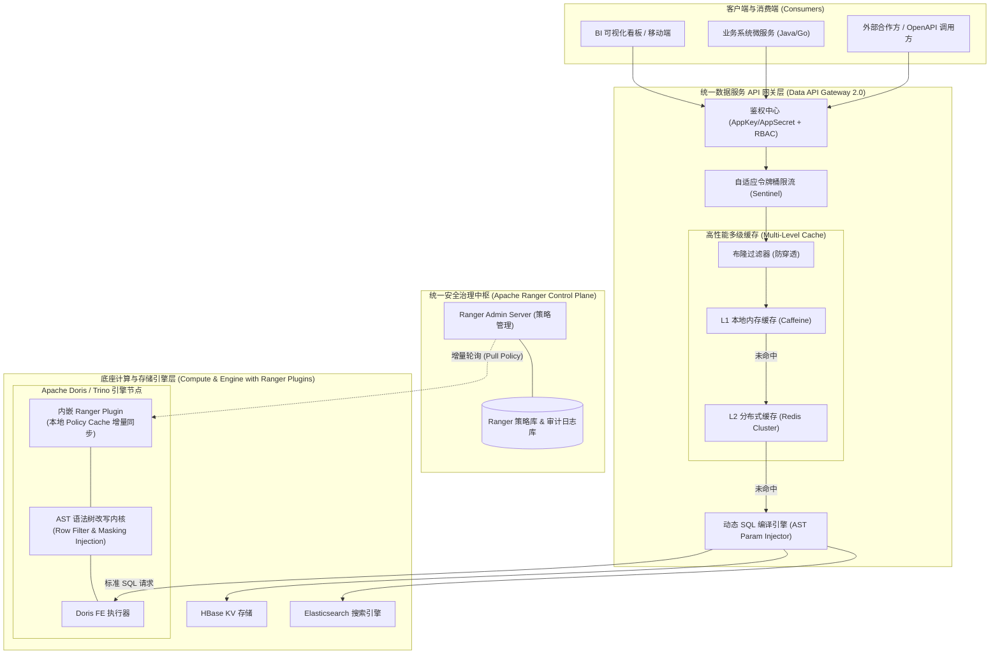
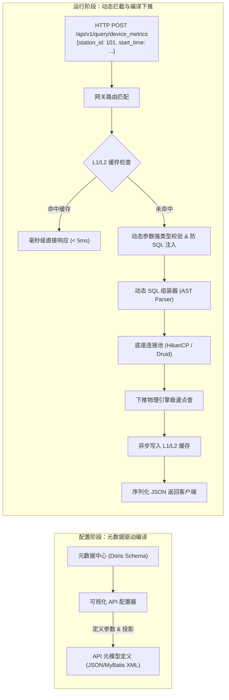
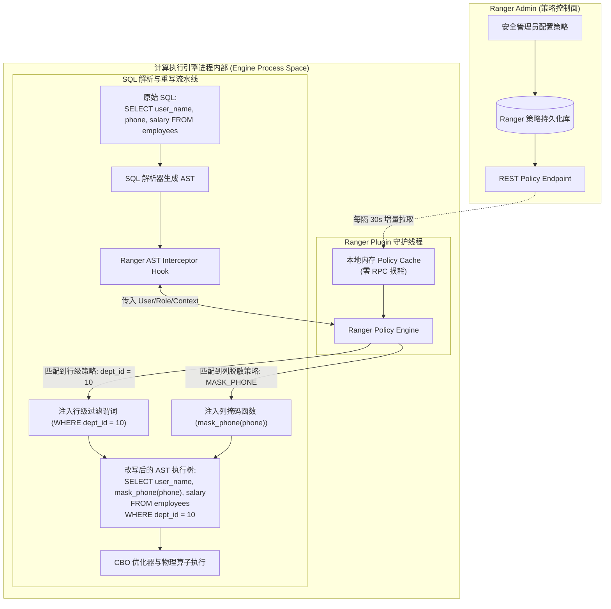
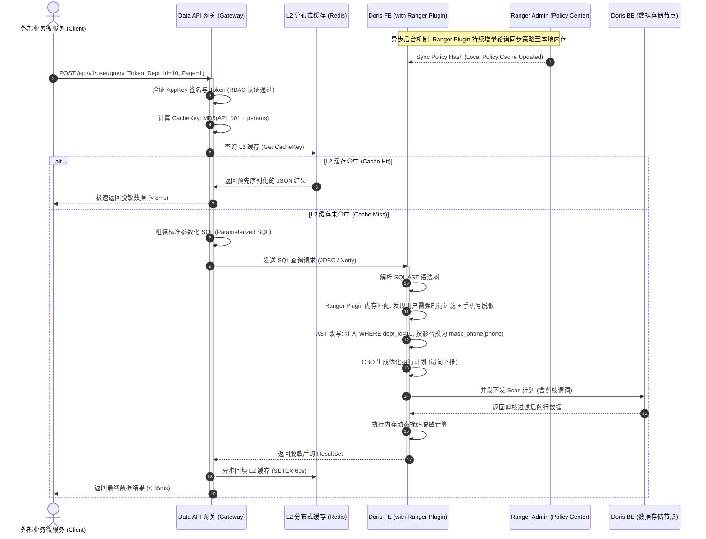
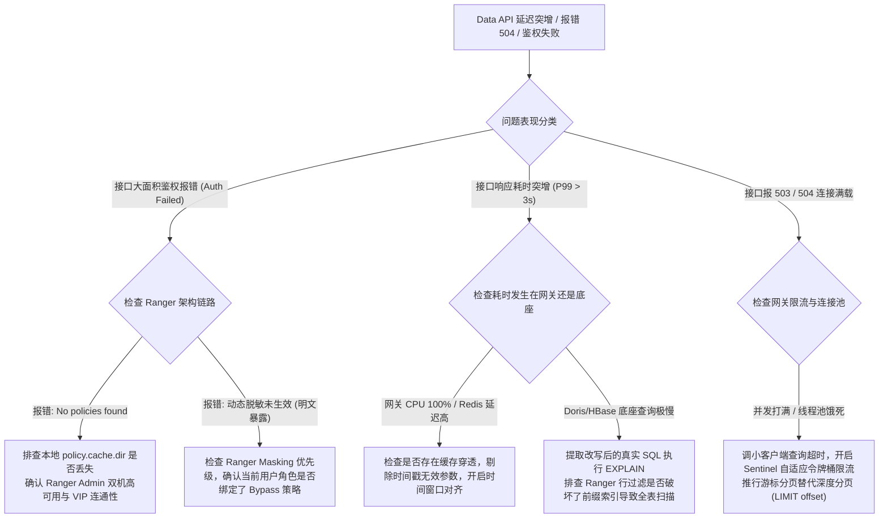
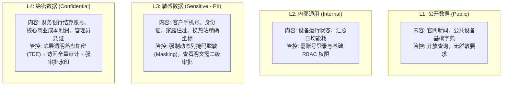

# 数据服务API与多租户权限体系：Data API网关动态生成、高并发缓存限流、Apache Ranger细粒度管控与动态脱敏

> **学习目标定位**：面向技术总监、数据平台研发负责人、高级数据架构师岗位，系统掌握中台从“数据资产化”向“资产服务化（Data-as-a-Service - DaaS）”跃迁的架构设计与企业级多租户安全防护体系。深度剖析统一 Data API 网关的动态 SQL 编译生成引擎、多级缓存（Caffeine 本地堆 + 分布式 Redis）与自适应令牌桶限流防雪崩机制；深入推导 Apache Ranger 插件化（Plugin）架构在计算引擎内部基于抽象语法树（AST）实现纳秒级行级过滤（Row-Level Filter）与动态列掩码脱敏（Column Masking）的改写内核。结合大型制造（美的）跨部门数据开放与工业物联网（瑞纳智能太原项目）10 万设备多租户行级数据隔离与等保合规实战，建立打通高性能服务化与严谨数据安全防御的高维技术领导力。

---

## 1. 知识概述与业务价值

### 1.1 是什么（What）
- **数据服务化（Data-as-a-Service - DaaS）与统一 Data API 网关**：是数据中台对业务应用提供数据资产消费的**统一标准出口**。它将底层异构的大数据存储（Apache Doris、HBase、ClickHouse、MySQL、Elasticsearch、Paimon）进行抽象封装，通过可视化拖拉拽或向导式配置，秒级动态生成标准的 RESTful / RPC 微服务接口，实现“以 API 替代传统数据库直连”。
- **企业级多租户安全与统一权限中枢（Apache Ranger）**：大数据平台集中式的安全授权、审计与动态数据脱敏底座。
  - **RBAC（Role-Based Access Control，基于角色的访问控制）**：解决“谁（用户/角色）能对哪个资源（库/表/列）执行什么操作（Select/Insert）”；
  - **ABAC（Attribute-Based Access Control，基于属性的访问控制）**：结合环境属性（时间、IP、网络区域、数据安全密级等）实现动态细粒度条件授权；
  - **细粒度行级过滤（Row-Level Filtering）**：根据当前登录用户的部门或租户属性，动态在底层执行引擎追加过滤条件（如 `WHERE tenant_id = 'T101'`），实现同表数据物理共享、逻辑隔离；
  - **动态列掩码脱敏（Dynamic Column Masking）**：对于敏感字段（如手机号、身份证、交易金额），非授权角色查询时由引擎在内存中动态替换为掩码（如 `138****1234`），无需对底层物理存储进行修改。

### 1.2 解决什么核心业务痛点（Why）
- **业务直接直连数仓库引发的“灾难踩踏”**：传统架构中，几十个业务系统各自配置 JDBC 直连 Doris 或 MySQL 从库执行 SQL。开发人员随意编写包含全表扫描、笛卡尔积的烂 SQL，频繁将存储底座打满连接数或引发 CPU 100% 宕机，甚至导致生产调度作业无连接可用。
- **“口径漂移”与烟囱式重复开发**：业务前端为了展示一个看板指标，后端工程师各自在 Java 业务代码中手写 SQL 聚合，同一指标逻辑在 10 个系统里出现 10 种变体；且每新增一个字段就要提工单要求数仓和后端协同改代码上线，交付周期长达数周。
- **敏感数据裸奔与高危合规风险**：在没有统一动态脱敏与行级隔离的情况下，研发人员和业务分析师直接看到客户明文手机号与财务敏感流水，无法满足国家等保三级、个人信息保护法（PII）与 GDPR 审计要求，一旦发生内部数据泄露，企业面临巨额行政处罚。

### 1.3 适用场景与技术边界（Where & When）
- **最佳业务场景矩阵**：
  - **高并发、低延迟指标服务**：面向核心看板、管理层大屏、移动端 App、业务中台系统的毫秒级点查（TPS 1,000 ~ 50,000+）；
  - **多租户 SaaS 与私有化政企项目**：如太原供热物联网，多个供热分公司共享同一套中台底座，严格按换热站/机构 ID 实现行级权限隔离；
  - **数据资产全生命周期审计与安全溯源**：对每一次 API 调用的发起方、时间、IP、提取字段进行全量落库审计。
- **明确反模式与技术禁区（严禁使用）**：
  - ❌ **把 Data API 网关当作“百 GB 级海量离线数据导出通道”**：API 网关基于 HTTP/JSON 协议，内存序列化开销极大。海量离线数据同步必须走专有的批量传输工具（DataX、SeaTunnel、Spark），严禁在网关层做长耗时大报表全量拉取；
  - ❌ **在 API 网关层执行复杂的跨引擎即时分布式 Join**：严禁在网关内存中强行拼接 MySQL 和 Doris 的数据，多表复杂关联应在数仓的 DWS/ADS 层提前离线或实时预计算完成，API 网关只负责“单表/单索引极简高速点查”。

---

## 2. 核心概念与关系

### 2.1 核心概念全景表

| 核心概念 | 英文术语 | 核心定义与工程职责 | 资源/生命周期级别 |
| :--- | :--- | :--- | :--- |
| **Data API 网关** | Data API Gateway | 数据服务统一微服务入口，承载鉴权、路由、动态 SQL 解析、缓存与限流 | 平台级核心网关服务 |
| **向导式 API** | Wizard-Configured API | 无代码可视化选择物理表、输入过滤参数与输出投影字段自动生成 API | 资产服务定义级 |
| **脚本式 API** | Script-Configured API | 基于 MyBatis 动态 SQL 语法（`<if>`、`<foreach>`）支持复杂多维动态参数 | 灵活定制级 |
| **多级缓存** | Multi-Level Cache | 结合本地堆（Caffeine，纳秒级）与分布式（Redis，毫秒级）的防击穿缓存 | 运行时性能层 |
| **Ranger Admin** | Ranger Admin Server | 统一安全策略配置控制台，负责策略增删改查、元数据同步与审计集中存储 | 安全控制面 |
| **Ranger Plugin** | Ranger Embedded Plugin | 内嵌在 Hive/Doris/Trino 计算引擎进程中的轻量级代理，负责策略本地生效 | 引擎进程内 / 纳秒级拦截 |
| **行级过滤** | Row-Level Filtering | 根据用户上下文属性，在执行计划底层动态追加过滤谓词的权限机制 | SQL 执行计划级 |
| **动态脱敏** | Dynamic Column Masking | 根据用户密级，在运行时动态将敏感列改写为掩码函数的脱敏机制 | 字段投影级 |

### 2.2 数据服务 API 网关与安全授权全景拓扑图



---

## 3. 底层工作机制与设计哲学

### 3.1 Data API 网关动态生成与高性能执行流

Data API 网关的核心使命是**“彻底消灭数据下游的手写 JDBC 代码”**，其底层通过元数据驱动与动态编译实现极高的性能与灵活性：



#### 1. 动态 SQL 生成与防御 SQL 注入机制
- **向导式 API（Zero-Code）的 AST 组装**：
  配置元模型中明确指定：
  - 目标物理表：`ads_device_hourly_stat`；
  - 入参规则：`station_id` (Long, 必填), `metric_type` (String, 可选), `time_range` (DateRange, 必填)；
  - 出参投影：`device_id, metric_code, avg_val, max_val, update_time`；
  - 动态 SQL 编译器利用参数化占位符（Parameterized PreparedStatement `?`）或 AST 节点动态拼装，**严禁使用简单的字符串拼接（`String.format`）**，在语法编译器层直接对参数做强类型转换，从根本上消灭 SQL 注入风险。

#### 2. 多级缓存（Multi-Level Cache）架构设计
为应对秒级数万 QPS 的大屏或 App 查询，网关采用三级缓存穿透防御架构：
1. **L0 布隆过滤器（Bloom Filter）**：在网关内存中预热合法 Key 的哈希摘要（如 `Device_ID` 集合）。若布隆过滤器判定该 ID 不存在，直接返回空结果，阻止恶意非法请求穿透到底层；
2. **L1 本地堆缓存（Caffeine Cache）**：配置短 TTL（例如 3~5 秒）。针对突发热点（如大屏刷新），95% 的重复请求直接在网关 JVM 内存中以 **纳秒级** 返回，避免网络 RPC；
3. **L2 分布式集群缓存（Redis Cluster）**：配置中等 TTL（例如 60~300 秒）。采用 `Key = MD5(Api_Id + SortedParams)`，在网关集群多节点间共享缓存数据；
4. **互斥锁与逻辑过期防击穿（Mutex Lock & Logical Expiration）**：当 L2 缓存过期失效瞬间，仅允许一个线程获得分布式锁去底层 Doris 执行慢查并回填缓存，其他并发请求先返回前序旧快照或等待，彻底规避缓存击穿冲垮数据库。

### 3.2 Apache Ranger 细粒度行级过滤与动态脱敏底层机制

Apache Ranger 能够做到对上层应用透明、高性能细粒度安全管控，其设计哲学是**“控制面集中统一、数据面插件化嵌入（In-Process Plugin）”**。



#### 1. 为什么采用 Plugin-Based 架构而非独立 Proxy 代理网关？
- **传统安全 Proxy 代理的死穴**：在客户端和大数据引擎之间架设一层独立的权限代理层（如 MySQL 代理）。所有海量数据流都必须经过代理转发，带来**双倍的网络 IO 延迟、内存拷贝瓶颈与单点故障**，且 Proxy 必须针对 Hive、Doris、Trino 分别实现一遍极其复杂的 SQL 解析器；
- **Ranger 的解法**：Ranger 将极轻量级的 Java Jar 包作为插件（Plugin）**直接植入到计算引擎（Doris FE / HiveServer2 / Trino Coordinator）内部进程中**：
  - Plugin 在内存中维护一份只读的 `RangerPolicyRepository` 策略快照；
  - 权限判定完全在本地 JVM 内存中进行布尔运算与位图计算，**单次判定耗时只有微秒甚至纳秒级（< 10μs）**；
  - 即使 Ranger Admin 服务器彻底宕机，引擎依然利用本地内存缓存的旧策略正常运行，**安全系统故障绝不拖死数据生产系统**。

#### 2. 行级过滤（Row-Level Filter）的底层 AST 谓词下推推导
假设业务数据表 `orders` 包含跨城市数据，用户 `shanghai_manager` 发起查询：
`SELECT order_id, amount, city FROM orders WHERE amount > 1000;`
1. 引擎解析 SQL 生成 `SqlSelect` 语法树；
2. 触发 Ranger Plugin 的 `RangerAccessResource` 校验，识别当前用户所属角色为 `Shanghai_Operator`；
3. Ranger 匹配到对应的行级策略：`city = 'Shanghai'`；
4. 插件的 `SqlRewriter` 拦截语法树的 `WhereClause`，执行逻辑 `AND` 合并改写：
   $$\text{OriginalWhere} \land \text{RangerFilterCondition} \implies (\text{amount} > 1000) \land (\text{city} = \text{'Shanghai'})$$
5. 改写后的 AST 送入优化器（CBO），底层存储引擎直接利用 Doris/Hive 的分区剪裁与索引跳过非上海的数据块，**既保障了数据绝对隔离，又在存储物理层实现了极致性能剪枝**。

#### 3. 列级动态脱敏（Dynamic Masking）的表达式替换机制
针对同一个字段 `phone`：
- **安全合规管理员（VIP 角色）**：Ranger 匹配为 `MASK_NONE`，保留原始字段 `phone`；
- **普通业务分析师（Regular 角色）**：Ranger 匹配为 `MASK_SHOW_LAST_4`：
  AST 访问器在遍历投影列（Projection List）时，将 `SqlIdentifier(phone)` 节点替换为函数调用节点：
  `SqlBasicCall(mask_show_last_4, phone)` $\implies$ 最终执行 `CONCAT('*******', SUBSTR(phone, 8, 4)) AS phone`；
- 底层文件存储的始终是原始数据，无需维护两套物理库，实现了“千人千面、按权展示”。

### 3.3 机制交互时序图（Mermaid）

以下展示业务端通过 Data API 发起请求，经过多级缓存、Ranger 行列改写并最终从 Doris 安全获取脱敏数据的全时序：



---

## 4. 高频复杂业务场景实操与落地

### 4.1 场景一：基于 Apache Doris 的千万级高并发点查与秒级 OLAP 动态参数 API 封装实战

#### 业务背景
大型制造企业（如美的跨境/电商板块）的全球订单大屏与商家后台，要求支持按不同商家 ID、时间范围、国家、商品类目多维度自由筛选。并发量高峰期突破 15,000 QPS，P99 延迟必须严格低于 100ms。传统做法让前端直连 Doris，经常因为某个复杂查询导致连接数耗尽，影响整机稳定。

#### 架构实操解决方案（Doris Point Query 深度调优 + 脚本式 API 封装）
1. **Doris 2.0+ 高性能点查优化（Point Query Short Circuit）**：
   - 底层 ADS 表采用 `Unique Key` 模型，开启轻量级行式存储缓存（Row Store）：
     ```sql
     CREATE TABLE ads_merchant_order_summary (
         merchant_id BIGINT,
         order_dt DATE,
         category_id INT,
         total_sales DECIMAL(15, 2),
         order_count INT
     ) ENGINE=OLAP
     UNIQUE KEY(merchant_id, order_dt, category_id)
     DISTRIBUTED BY HASH(merchant_id) BUCKETS 32
     PROPERTIES (
         "store_row_column" = "true", -- 开启行存短路，点查性能提升 5 倍
         "enable_unique_key_merge_on_write" = "true"
     );
     ```
2. **API 网关动态脚本引擎与参数防注入绑定**：
   - 在 API 网关中编写 MyBatis 风格的动态 SQL 脚本，强制指定分区字段与分桶键：
     ```xml
     SELECT category_id, total_sales, order_count
     FROM ads_merchant_order_summary
     WHERE merchant_id = #{merchantId}
       AND order_dt = #{orderDate}
       <if test="categoryId != null">
         AND category_id = #{categoryId}
       </if>
     LIMIT #{pageSize};
     ```
   - 网关层硬编码最大 `LIMIT 500`，杜绝前端传入非法大参数拉取百万行数据导致 OOM。
3. **网关异步非阻塞连接池（R2DBC / CompletableFuture）**：
   - 网关弃用传统单个连接阻塞等待的 Tomcat 线程模型，改用 Netty 驱动的反应式连接池，单节点轻松支撑 10,000+ 并发长连接。

### 4.2 场景二：智慧供热与工业物联网（太原项目）10 万设备多租户行级数据隔离实战

#### 业务背景
在太原市智慧供热项目中，全市 10 个供热分公司、200 多个换热站由瑞纳智能统一数据中台提供监控与调度支持。系统部署在统一的物理机群上，但各分公司之间存在商业竞争与责任划分：
- 严禁 A 分公司的调度员看到 B 分公司的换热站瞬时流量、供热能耗与阀门开度；
- 市城管局与供热指挥中心（最高超级管理员）则需要查看全市所有换热站的汇总大屏。

#### 架构实操解决方案（ABAC 属性策略与 Ranger 行级隔离）
1. **构建用户属性上下文（ABAC Context Injection）**：
   - 业务系统集成统一身份中心（SSO / LDAP）。调度员登录后，网关在请求 Header 中注入基于 JWT 签名的用户属性扩展：
     `X-User-Context: { "username": "station_user_01", "org_id": "TAIYUAN_NORTH_02", "role": "OPERATOR" }`；
2. **Ranger 行级策略规则声明（Row-Level Policy）**：
   - 在 Ranger 控制台中，针对 `dwd_heat_station_point_realtime` 表配置 Row Filter 策略：
     - **普通操作员（Operator）**：
       过滤表达式配置为：`station_org_id = '${user.org_id}'`；
     - **市政监管员（Super_Auditor）**：
       过滤表达式配置为：`1 = 1`（无限制查看全量数据）；
3. **性能零损耗下推**：
   - 由于底层 Doris 表按照 `station_org_id` 进行了分区分桶，Ranger 注入的过滤谓词在 Doris 解析器阶段直接触发了 **分区剪裁（Partition Pruning）**，仅扫描太原北区对应的数据分片，不仅实现了多租户强隔离，更将查询扫描数据量压降了 90% 以上。

### 4.3 场景三：海量分页点查场景下“深度分页性能崩塌”与基于游标的 API 优化

#### 业务背景
业务系统调用 Data API 查询设备历史流水（表数据量达 5 亿行）。前端开发习惯性使用经典的 `LIMIT offset, size` 进行翻页。当业务翻到第 1,000 页时（`LIMIT 1000000, 20`），API 响应耗时从 30ms 暴增至 15 秒以上，导致网关频繁超时。

#### 架构实操解决方案（游标分页 Cursor-Based Pagination）
1. **深度分页性能崩塌根因剖析**：
   - `LIMIT 1000000, 20` 意味着底层引擎必须先从存储磁盘扫描出 1,000,020 条数据，全部拉入内存排序，然后抛弃前 1,000,000 条，只返回最后 20 条，产生了巨额无效的磁盘 IO 与网络传输；
2. **改造成基于唯一排序列的游标分页（Cursor/Seek Method）**：
   - 在 API 网关定义中，禁止 `offset > 10000` 的传统分页；
   - 强制推行游标分页参数：传入上一页最后一条记录的唯一业务主键与时间戳：`last_seen_id` 和 `last_seen_time`；
   - 动态改写为等价高效下推 SQL：
     ```sql
     -- 优化后：利用复合主键索引直接 Seek 定位起始行，零多余扫描
     SELECT id, device_id, point_val, record_time
     FROM dwd_device_point_log
     WHERE record_time <= #{lastSeenTime}
       AND (record_time < #{lastSeenTime} OR id < #{lastSeenId})
     ORDER BY record_time DESC, id DESC
     LIMIT #{pageSize};
     ```
   - 性能测试显示：无论翻到第 1 页还是第 100,000 页，查询耗时均恒定在 **25ms** 以内，彻底消除深度分页慢查。

---

## 5. 生产异常故障深度排查与根因分析

### 5.1 故障一：热点大屏瞬时并发激增导致 Redis 缓存穿透，底层 Doris 连接数爆满宕机

#### 故障现象
在供热采暖季启动首日上午，市政领导视察智慧供热大屏，大屏前端配置了每秒一次的自动无刷新轮询。Data API 网关监控显示 QPS 瞬时冲至 25,000。紧接着网关大面积报错 HTTP 504 Gateway Timeout，底层 Apache Doris 集群连接数突破上限（`MaxConnections = 2048` 爆满），Doris FE 节点由于堆内存耗尽频繁触发 Full GC，全平台分析服务瘫痪。

#### 深度根因分析（Root Cause）
1. **大屏轮询传参毫秒时间戳导致缓存完全失效**：
   前端在发起查询时，为了防止浏览器本地缓存，自作聪明地在请求参数中带入了客户端实时时间戳：`{station_id: 101, _ts: 1731835201452}`；
   网关计算缓存键时采用 `MD5(Params)`，由于 `_ts` 每毫秒都在变，导致每一笔请求计算出的 `CacheKey` 都是全新的，**Redis 缓存命中率直接跌到 0%（全量穿透）**；
2. **缺乏连接池熔断与高并发排队机制**：
   25,000 个高并发请求全部直接穿透下发到底层 Doris，数千个复杂聚合 SQL 同时在 BE 节点争抢 CPU 资源，瞬间拖垮集群。

#### 生产调优与架构级解决方案
1. **网关层入参规范化与时间窗口归整（Parameter Normalization）**：
   - 在 API 网关配置中，显式声明“缓存忽略参数列表（Ignore Parameters）”，将 `_ts`、`random_nonce` 等无意义防刷新参数强制过滤掉；
   - 对时间范围参数执行**向下取整（Window Snapping）**：例如将请求中的实时时间戳按 5 秒或 1 分钟向下对齐（`10:02:14` 统一对齐为 `10:02:10`），确保 5 秒内全网所有并发请求的 `CacheKey` 100% 相同，缓存命中率瞬间拉升至 99.2% 以上；
2. **基于 Sentinel 的底层连接自适应熔断降级**：
   - 为 Doris 数据源配置线程池隔离与最大并发许可（Max Permits = 200）；
   - 当等待队列超过阈值时，网关直接对非核心大屏触发快速失败（Fail-Fast）或返回上一周期的 L1 缓存降级数据，死保核心底座不被冲垮。

### 5.2 故障二：Ranger Admin 故障导致策略下发中断，本地 Policy Cache 过期引发全集群任务大面积鉴权失败

#### 故障现象
生产环境中某次机房断电维护，Ranger Admin 所在的物理节点硬件损坏宕机。维护完成后，虽然 Hive、Spark 和 Doris 依然正常运行，但数小时后，所有用户的查询与 ETL 调度任务突然全线报错：
`org.apache.ranger.plugin.policyengine.RangerPolicyEngine: Authorization Failed: No policies found`，集群大面积瘫痪。

#### 深度根因分析（Root Cause）
1. **本地策略快照持久化配置缺失（Local Cache Dump Disabled）**：
   Ranger Plugin 默认优先从本地 JSON 文件读取策略快照。若配置了 `ranger.plugin.<service>.policy.cache.dir` 为临时目录（`/tmp`），恰逢操作系统定时清理了 `/tmp`，导致本地磁盘上的策略快照文件丢失；
2. **策略缓存 TTL 超时逻辑配置不当**：
   某团队为了追求高安全，在插件中误配置了“若超过 2 小时未连接上 Ranger Admin，判定本地策略失效并拒绝所有访问”，导致一旦安全管理节点宕机时间较长，全集群被迫陪葬。

#### 架构级解决方案
```properties
# 1. 指定永久性本地策略缓存持久化路径 (严禁配置为 /tmp)
ranger.plugin.doris.policy.cache.dir=/data/var/run/ranger/policycache

# 2. 开启故障容忍安全兜底 (Fail-Open on Local Cache Fallback)
# 只要本地曾经成功持久化过策略快照，即使 Ranger Admin 宕机一年，Plugin 依然基于最后一次成功同步的快照继续提供纳秒级鉴权
ranger.plugin.doris.policy.rest.client.connection.timeoutMs=5000
ranger.plugin.doris.policy.rest.client.read.timeoutMs=10000

# 3. 部署 Ranger Admin 双节点高可用架构 (Keepalived + VIP / Nginx 负载均衡反向代理)
```

### 5.3 故障三：复杂的行级过滤谓词改写导致底座引擎 CBO 优化器失效，产生全表扫描慢查询

#### 故障现象
在给某核心宽表配置了基于部门层级（`dept_path LIKE '/root/dept_01/%'`）的行级过滤策略后，原本 50ms 产出的 API 接口响应耗时突增至 8 秒以上。Doris 监控显示扫描数据量从几万行暴涨至 5 亿行全表扫描。

#### 深度根因分析（Root Cause）
- Ranger 注入的过滤谓词包含了非 SARGable（Search Argument Able）的模糊匹配逻辑：`dept_path LIKE '%dept_01%'` 或包含函数调用的表达式；
- 这种谓词导致 Doris 的底层前缀索引（Short Key Index）与 ZoneMap 统计信息彻底失效，CBO 优化器无法执行分区剪裁与分桶裁剪，只能对底层的全部 Tablet 块进行暴力逐行解压反序列化扫描。

#### 架构级解决方案
1. **重构多租户行级模型规范（Eliminate Non-SARGable Predicates）**：
   - 严禁在行级安全策略中使用左模糊匹配或复杂正则；
   - 改造底表模型，增加扁平化的 **`dept_id` 整型数组（`ARRAY<INT>`）** 或精确的外键列；
   - 将 Ranger 策略改写为精准的高效等值匹配：`dept_id = 101` 或 `dept_id IN (101, 102, 103)`，重新激活底层的有序前缀索引与 Bloom Filter 剪枝能力，查询耗时立即恢复至 40ms。

### 5.4 生产故障排查决策树（Mermaid）



---

## 6. 技术选型对比

### 6.1 主流数据服务与权限管理方案全方位对比矩阵

| 选型维度 | 自研 Data API 网关 (基于 Netty/Spring) | Hasura / Cube.js (开源通用方案) | Apache Ranger (2.4+) | Apache Sentry (已退役停更) |
| :--- | :--- | :--- | :--- | :--- |
| **主要定位** | **企业级高性能 DaaS 服务化中枢** | 现代 GraphQL / REST 语义建模层 | **大数据生态全能统一权限与脱敏中枢** | 早期 Hadoop 粗粒度授权组件 |
| **底层通信架构** | **异步非阻塞 (Netty / Reactive)** | Node.js / Go 驱动的微服务 | **进程内嵌入式插件 (In-Process Plugin)** | 独立 RPC 鉴权服务 |
| **大数据引擎适配度** | **深度适配 Doris、HBase、MySQL、ClickHouse** | 偏向 PostgreSQL、Snowflake 等通用关系库 | **极强 (Hive, Spark, Doris, Trino, Kafka, HDFS)** | 仅支持 Hive 与 Impala |
| **细粒度控制能级** | 依赖后端权限系统下发 | 支持行级权限，动态脱敏需二次开发 | **极致成熟 (库/表/列/行级过滤/动态列脱敏)** | 仅支持库、表、列，无行过滤与脱敏 |
| **鉴权延迟与性能损耗** | < 1ms (本地 Token 校验) | 约 5~15ms (网络转发损耗) | **纳秒级 (< 10μs，本地内存 Policy Cache 计算)** | 毫秒级 (受远程 Sentry RPC 限制) |
| **多级缓存与防雪崩** | **内置 L1 (Caffeine) + L2 (Redis) + 布隆过滤器** | 内置基础查询缓存，高并发需外挂组件 | 不适用 (Ranger 仅负责权限判定与改写) | 不适用 |
| **私有化独立交付难度** | **极低 (Java 原生打包，开箱即用无黑盒)** | 中等 (需额外维护 Node/GraphQL 环境) | 中等 (需维护 MySQL 与 Ranger Admin 双机) | 极高 (环境依赖繁重且无法升级) |

### 6.2 选型决策考量与私有化项目取舍法则

针对技术总监与数据架构师的选型决策，切忌“把架构复杂化”，必须结合交付形态与运维能力做出取舍：
1. **中台服务化出口：坚决自研轻量级 Data API 网关**：
   - **选型逻辑**：Hasura 或 Cube.js 虽然功能炫酷，但引入了复杂的 GraphQL 概念，且对国产现代分析引擎（Apache Doris、ClickHouse）的深度优化（如分区分桶裁剪、物化视图路由、向量化流式读取）支持有限；
   - 基于 Spring Boot / Netty 自研轻量级网关，仅需数千行核心代码即可精准实现向导式配置、参数校验、MyBatis 动态模板与 L1/L2 多级缓存，且极度贴合国内业务开发者的使用习惯，私有化交付开箱即用。
2. **统一权限底座：非 Apache Ranger 莫属**：
   - **选型逻辑**：Apache Sentry 已经于 2020 年被 Apache 基金会正式退休退役；Ranger 是目前全球大数据领域唯一被 Cloudera、AWS（EMR）、阿里云（EMR）一致公认的工业级权限标准。其插件化零 RPC 延迟、行级过滤与动态脱敏能力，是满足金融级审计与政企等保三级的必选基石。

---

## 7. 技术经理与架构师实战管控

### 7.1 数据安全红线与合规治理体系（PII 敏感数据定级管控）

数据泄露是技术负责人的“一票否决项”。必须建立严谨的 **数据资产四级分类分级标准（Classification Matrix）**：



1. **“三权分立”安全组织架构设计**：
   - **安全管理员（Security Admin）**：负责在 Ranger 中制定脱敏规则与权限策略，无权查看实际业务数据；
   - **系统管理员（System Admin）**：负责集群服务器运维与配置部署，无权修改安全策略与查看数据；
   - **业务数据人员（Data User）**：仅能在授权范围内调用 API 或执行查询，杜绝“一人掌握全局超级账号”的安全黑洞。
2. **端到端全链路操作审计追踪（Audit Logging）**：
   - 开启 Ranger Audit to Elasticsearch/HDFS 功能；
   - 记录每一笔查询的 **“5W 事实日志”**：Who（谁调用的）、When（精确时间）、Where（来源 IP）、What（访问了哪张表哪个字段）、Result（是允许还是拒绝，是否触发脱敏）；保留期不低于 180 天以备等保审计。

### 7.2 Data API 服务的 SLA 契约与资源配额管控

向业务系统开放 API 时，必须建立清晰的 **服务等级协议（SLA Contract）**，防止业务无节制索取拖垮中台：
1. **P99 延迟与可用性刚性契约**：
   - **核心 P0 级接口**：SLA 可用性 $\ge 99.99\%$，P99 响应延迟 $\le 50\text{ms}$；
   - **普通 P1 级接口**：SLA 可用性 $\ge 99.9\%$，P99 响应延迟 $\le 200\text{ms}$；
2. **多租户分级配额与令牌桶硬限制（Rate Limiting & Quota）**：
   - 为每个接入方颁发独立的 `AppKey` 与 `AppSecret`；
   - 配置三层限流配额：
     - **每秒请求峰值（QPS Cap）**：超过阈值直接返回 HTTP 429 Too Many Requests；
     - **每日调用总上限（Daily Quota）**：防止外部爬虫恶意刷取数据；
     - **单次拉取行数硬限制（Max Limit）**：无论前端传什么，后端强制拦截 `LIMIT \le 500`。

### 7.3 API 生命周期管理规范（API Lifecycle SOP）

在团队管理层面推行标准化的 API 生命周期闭环流程：
`设计评审 $\to$ 灰度发布 $\to$ 生产上线 $\to$ 变更废弃 $\to$ 物理下线`：

| 生命周期阶段 | 核心控制动作与工程要求 | 责任角色 |
| :--- | :--- | :--- |
| **设计准入阶段** | 严禁直接开放底层 ODS 原始表 API，必须基于经过数据质量校验的 ADS/DWS 层资产；必须明确声明入参类型与出参字段脱敏等级。 | 数据架构师 + 安全管理员 |
| **灰度发布阶段** | 在测试网关进行全链路压测（1.5 倍峰值 QPS）；进行 SQL EXPLAIN 评审，确认必带分区字段且命中前缀索引。 | 数据研发工程师 |
| **版本迭代阶段** | 严格遵循 API 语义化版本机制（`/v1/`, `/v2/`）。**严禁直接在旧版本 API 上删除字段或修改字段数据类型**；变更必须新开 `/v2/` 接口并保持 `/v1/` 双轨运行至少 30 天。 | 平台研发负责人 |
| **废弃下线阶段** | 网关审计日志连续 30 天调用量为 0 的接口，列入“待废弃候选池”；自动向调用方发送下线通知并在网关层开启“模拟熔断”，确认无业务故障后正式注销。 | 数据资产管理员 |

---

## 8. 互联网大厂高频面试真题库

* **Q1 [阿里/蚂蚁 - 核心架构与商业价值]**：传统架构中业务系统习惯直连数仓或 OLAP 数据库（如 Doris/MySQL），现代数据中台为何要强制推行“数据资产服务化（Data-as-a-Service）”与统一 API 网关？
* **Q2 [字节跳动 - 核心机制与性能]**：深入剖析 Apache Ranger 的插件化（Plugin）架构。它是如何做到在不侵入计算引擎主流程的前提下实现纳秒级鉴权？其本地策略缓存与同步机制是怎样的？
* **Q3 [美团 - 安全与编译原理]**：在多租户数据平台中，如何实现“行级权限过滤（Row-Level Filtering）”与“列级动态脱敏（Column Masking）”？请讲透其底层的 AST SQL 改写机制。
* **Q4 [腾讯 - 生产实战与高并发]**：数据 API 网关每天承受数亿次高并发请求，如何设计多级缓存（Caffeine + Redis）与防缓存穿透/击穿/雪崩的综合高可用架构？
* **Q5 [快手 - 架构权衡与选型]**：对比 RBAC（基于角色的访问控制）与 ABAC（基于属性的访问控制），在大型复杂组织的大数据权限管控中各有什么优缺点？架构师该如何将二者有机结合？
* **Q6 [滴滴 - 生产排障与性能调优]**：线上 Data API 出现间歇性响应毛刺，P99 延迟从 30ms 突增至 3s，导致上游业务超时报错。请给出排查定位路径与全链路优化策略。
* **Q7 [数据总监/管理决策与合规落地]**：作为数据平台负责人，当企业面临等保三级审计或合规检查时，你如何带领团队构建一套包含身份认证、权限最小化、动态脱敏与审计追溯的端到端安全防御闭环？

---

## 9. 结构化深度参考答案

### 题目1 [阿里/蚂蚁 - 核心架构与商业价值]：传统架构中业务系统习惯直连数仓或 OLAP 数据库（如 Doris/MySQL），现代数据中台为何要强制推行“数据资产服务化（Data-as-a-Service）”与统一 API 网关？

#### 简洁回答（1分钟电梯破题）
直连数据库本质上是**“把物理存储暴露给业务应用”**，这会导致**底座资源不可控（慢 SQL 踩踏冲垮集群）、指标口径严重漂移、安全审计与脱敏彻底失控**。
推行统一 Data API 网关的核心价值是**“实现存储与业务的物理隔离、数据资产的一致性封装、高并发防护与统一安全治理”**。通过将数据抽象为标准微服务接口，中台掌握了流量分流、多级缓存、动态限流与全局审计的绝对控制权，使数据真正变成开箱即用、安全可控的企业级数字资产。

#### 深入回答（机制推导与边界条件）
1. **技术防御层面的解耦与稳定性保障**：
   - **连接池风暴与资源踩踏隔离**：业务系统微服务扩容时（如双11大促），成千上万个 Spring 容器直连 Doris 会瞬间耗尽数据库的最大连接数。API 网关作为收敛层，内部维护固定大小的异步连接池，**对外支撑数万并发 HTTP，对内仅维持几十个长连接**，起到完美的蓄水池与缓冲作用；
   - **查询慢 SQL 拦截与执行熔断**：直连模式下无法阻止前端写出 `WHERE 1=1` 的全表扫描。网关层通过静态 AST 分析与参数强校验，对不带索引、扫描超限、未带分区的非标 SQL 直接在网关内存中快速拒绝（Fail-Fast），死保底层存储安全。
2. **业务敏捷度与统一口径治理（Single Source of Truth）**：
   - 若直连数据库，每个业务系统各自手写 SQL 统计“GMV”，一旦业务规则变更，需要跨部门推动 10 个系统修改代码重新发版；
   - 采用 API 网关后，计算口径由数仓在 API 配置中心一次性统一定义。底层无论从 MySQL 迁移到 Doris，还是表结构重构加字段，只要 API 协议契约不变，上层业务系统完全零感知，将业务交付周期从数周压缩至数小时。

#### 架构师/技术管理视角（权衡取舍、SLA与成本）
- **性能损耗与收益权衡**：引入 API 网关不可避免地会增加一层网络跳转与 JSON 序列化开销（增加 2~5ms 延迟）。但架构师必须清楚：**在绝大多数企业级业务中，这几毫秒的开销相比于全局稳定性保障、指标口径统一与等保合规收益而言，是微不足道的、必须接受的合理架构代价**。

---

### 题目2 [字节跳动 - 核心机制与性能]：深入剖析 Apache Ranger 的插件化（Plugin）架构。它是如何做到在不侵入计算引擎主流程的前提下实现纳秒级鉴权？其本地策略缓存与同步机制是怎样的？

#### 简洁回答（1分钟电梯破题）
Apache Ranger 采用**“控制面集中统一、数据面插件化嵌入进程（In-Process Plugin）”**的先进设计。
它将轻量级安全校验逻辑直接编译打包进各计算引擎（Doris/Hive/Spark/Trino）的核心进程内部。Plugin 启动独立后台守护线程，以增量方式（Pull Policy）轮询同步最新策略并在引擎本地 JVM 内存中维护 **只读的高效策略模型（Policy Cache）**。每次用户发起查询时，鉴权完全在本地内存中进行基于位图和树的高速匹配，**零跨网络远程 RPC 损耗，单次鉴权耗时达到纳秒级（< 10μs）**。

#### 深入回答（机制推导与边界条件）
1. **进程内嵌入式插件机制（In-Process Embedment）**：
   - 传统集中式鉴权系统每次都需要发起网络远程调用（如向 LDAP 发起 RPC），在每秒数万算子的高并发下网络开销会瞬间击垮系统；
   - Ranger 针对不同引擎实现了标准访问拦截器（如 Hive 的 `SemanticAnalyzerHook`，Doris 的 `AccessController`）。当引擎解析完 SQL 生成逻辑计划时，直接调用本地线程栈内的 `RangerBasePlugin.isAccessAllowed()` 方法；
   - 鉴权逻辑是纯粹的本地内存引用与条件比较，计算引擎几乎感知不到任何性能拖慢。
2. **策略缓存本地化与增量同步机制（Policy Sync & Resilience）**：
   - **后台增量拉取（Delta Sync）**：插件守护线程默认每隔 30 秒向 Ranger Admin 发送一次 HTTP GET 请求，请求头附带本地策略的 `LastUpdateTime` 与版本哈希值（Hash）。若策略未变更，Admin 仅返回 304 Not Modified，网络带宽占用几乎为零；
   - **双重本地持久化保障（Double Persistence）**：当拉取到新策略时，Plugin 不仅在内存中替换引用，还同步将策略序列化写入本地磁盘文件（`policycache.json`）；
   - **完全自愈与故障隔离边界**：若 Ranger Admin 故障宕机，Plugin 自动进入静默兜底模式，继续依靠内存和本地磁盘中的策略进行授权，**彻底杜绝了安全服务故障导致全线生产集群挂死的级联雪崩**。

#### 架构师/技术管理视角（权衡取舍、SLA与成本）
- **策略变更时效性与一致性的权衡**：由于采用 30 秒轮询机制，策略在 Admin 端被修改后，到全集群所有节点生效存在最大 30 秒的最终一致性延迟（SLA Window）。在架构设计时，如果业务场景存在极少数“必须秒级立即封杀权限”的极端场景，可扩展 Ranger 插件监听 Kafka 的 `RANGER_POLICY_UPDATE` 事件总线，实现事件驱动的毫秒级即时失效。

---

### 题目3 [美团 - 安全与编译原理]：在多租户数据平台中，如何实现“行级权限过滤（Row-Level Filtering）”与“列级动态脱敏（Column Masking）”？请讲透其底层的 AST SQL 改写机制。

#### 简洁回答（1分钟电梯破题）
行级过滤与动态脱敏的核心机制是**在 SQL 编译器的 AST（抽象语法树）生成阶段注入安全拦截器，通过语法树节点改写动态追加过滤谓词与替换投影表达式**。
行级过滤通过将用户上下文属性动态构造为布尔条件，以逻辑 `AND` 合并至 `WHERE` 子句；列级脱敏通过将原始列标识符节点替换为掩码函数调用节点（如 `mask_phone()`）。改写在送入物理执行计划（CBO）前完成，底层存储完全透明且数据零修改。

#### 深入回答（机制推导与边界条件）
1. **行级过滤（Row-Level Filtering）的 AST 改写推导**：
   - 假设某分公司用户查询表 `dwd_orders`：
     原始 SQL：`SELECT id, amount, city FROM dwd_orders WHERE amount > 100;`
   - **语法树拦截**：引擎解析出根节点 `SqlSelect`，其 `getWhere()` 返回操作符为 `>` 的条件树；
   - **上下文匹配与谓词构造**：Ranger Plugin 获取当前用户属性 `city = 'Beijing'`；
   - **AST 节点嫁接**：
     构造一个新的逻辑操作符 `SqlBinaryOperator(AND)`；
     将原始的 `amount > 100` 作为左子树；
     将安全策略生成的 `city = 'Beijing'` 作为右子树；
     将新的 `AND` 复合节点写回 `SqlSelect.setWhere()`；
   - **物理优化下推**：改写后的完整 AST 送入优化器，引擎天然利用底层索引和分区跳过非北京的数据，实现安全隔离与查询性能剪枝的双赢。
2. **列级动态脱敏（Dynamic Masking）的表达式替换推导**：
   - 假设用户对 `phone` 字段只具备脱敏查看权限：
   - **遍历投影列（SelectList）**：访问器（Visitor）递归遍历 `SqlSelect.getSelectList()` 中的每个节点；
   - **节点替换**：当识别到目标节点为 `SqlIdentifier(phone)` 时，判断当前用户角色不属于白名单：
     创建一个新的函数调用节点 `SqlBasicCall`，函数名为 `mask_show_last_4`，参数为原列名 `phone`；
     用该函数节点整体替换原有的列节点，并自动追加别名 `AS phone`（保证前端业务接收到的 JSON Key 保持不变）；
   - **执行时计算**：引擎在执行物理投影时，在内存中动态对当前列执行字符串掩码运算，对外输出脱敏后的密文，底层物理数据从未发生任何变动。

#### 架构师/技术管理视角（权衡取舍、SLA与成本）
- **防范利用侧信道推理（Side-Channel Attack）窃取数据**：架构师必须关注一个致命漏洞——如果用户对 `salary` 字段被配置了掩码脱敏（看不到真实薪资），但他依然可以在 `WHERE` 条件中编写 `WHERE salary > 50000` 并通过返回结果行数来逆向推导真实数据。因此，严谨的改写机制必须要求：**被配置列掩码的敏感字段，若用户无权查看明文，系统必须在 AST 校验层同时禁止该字段被作为 `WHERE`、`GROUP BY` 或 `JOIN ON` 的过滤条件**，杜绝逻辑泄露。

---

### 题目4 [腾讯 - 生产实战与高并发]：数据 API 网关每天承受数亿次高并发请求，如何设计多级缓存（Caffeine + Redis）与防缓存穿透/击穿/雪崩的综合高可用架构？

#### 简洁回答（1分钟电梯破题）
应对数亿次高并发的关键是构建**“L0 布隆过滤器 + L1 本地纳秒级堆缓存 + L2 分布式集群缓存”**的三层防御纵深。
通过规范化请求入参并消除动态随机扰动来提升命中率；针对**穿透**采用布隆过滤器与空值短缓存拦截；针对**击穿**采用分布式互斥锁与逻辑过期异步刷新；针对**雪崩**采用随机离散 TTL 与网关层令牌桶自适应熔断限流，确保全链路高可用。

#### 深入回答（机制推导与边界条件）
1. **多级缓存分层协作模型**：
   - **L0 布隆过滤器（Bloom Filter）**：网关在内存中以极小的空间（1000万数据仅需 12MB 内存）维护合法 ID 集合。若布隆过滤器判定某主键不存在，请求毫秒级直接返回空，阻断 99.9% 恶意爬虫的穿透攻击；
   - **L1 本地堆内存（Caffeine）**：缓存热点大屏数据，配置超短 TTL（2~5秒）。解决瞬时极高并发（如每秒 2 万次相同大屏刷新），90% 请求直接在本地 JVM 内存以纳秒级返回，彻底避免 Redis 集群网卡被大流量打满；
   - **L2 分布式缓存（Redis Cluster）**：配置常规 TTL（60~300秒）。采用 `CacheKey = MD5(ApiId + CanonicalizedParams)`，实现网关多节点之间的计算结果共享。
2. **生产三大灾难场景的综合防御设计**：
   - **防缓存穿透（Cache Penetration）**：
     对于数据库真实查询为空的结果，网关依然向 Redis 写入空对象标记（`EMPTY_OBJECT`），但设置极短的过期时间（TTL = 30秒），防止攻击者持续用不存在的 Key 轮询拖垮底层；
   - **防缓存击穿（Cache Breakdown / Hotspot Invalidation）**：
     针对超热点 Key，采用 **“逻辑过期 + 异步刷新（Logical Expiration）”**：Redis Value 中保存 `{data: ..., expire_at: 1731835000}`。当检测到当前时间已超过 `expire_at` 时，网关不阻塞当前调用，而是先返回旧数据，同时通过线程池异步获取分布式锁去查询 Doris 更新缓存，实现调用方零等待与零突刺；
   - **防缓存雪崩（Cache Avalanche）**：
     为所有 API 配置的基础 TTL 增加随机离散时间戳：
     $$\text{Actual\_TTL} = \text{Base\_TTL} + \text{Random}(0, \text{Base\_TTL} \times 0.2)$$
     确保不同 API 的缓存过期时间在时间轴上均匀打散，彻底消除整点集中失效引发的数据库雪崩。

#### 架构师/技术管理视角（权衡取舍、SLA与成本）
- **数据一致性（Consistency vs Latency）取舍**：多级缓存必然意味着在短时间内（几秒内）业务端看到的数据存在微小延迟。在架构评审时，必须与业务方白字黑字明确契约：**数据中台的分析型 API 遵循“最终一致性（Eventual Consistency）”**。对于核心大屏与经营看板，5 秒的数据延迟对业务决策没有任何实质负面影响，却能为技术团队节省 80% 以上的高昂服务器开销。

---

### 题目5 [快手 - 架构权衡与选型]：对比 RBAC（基于角色的访问控制）与 ABAC（基于属性的访问控制），在大型复杂组织的大数据权限管控中各有什么优缺点？架构师该如何将二者有机结合？

#### 简洁回答（1分钟电梯破题）
**RBAC（基于角色）** 的核心是“用户 $\to$ 角色 $\to$ 权限”，模型简单直观、易于审计，非常适合静态组织结构授权；但面对大型复杂组织时极易出现“角色爆炸（Role Explosion）”；
**ABAC（基于属性）** 的核心是“基于主体、资源、环境属性的动态规则计算”，表达力极强，天然支持多租户与动态上下文；但模型复杂度高、性能开销大且排查定位隐晦。
架构师的最佳实践是**“RBAC 负责大盘粗粒度功能与对象授权，ABAC 负责底层细粒度行级过滤与动态条件约束”**的双模融合架构。

#### 深入回答（机制推导与边界条件）
1. **两种模型的本质优劣对比**：
   - **RBAC 的瓶颈（角色爆炸）**：某大型制造企业有 50 个分公司、30 个部门、10 种职位。如果纯靠 RBAC 控制行级权限，为了给“北京分公司财务经理”和“上海分公司生产主管”分别配置不同权限，系统需要创建数千个专有角色，权限分配混乱不堪；
   - **ABAC 的优势与短板**：ABAC 仅需定义一条通用策略：“允许操作员访问 `station_org_id == user.org_id` 的数据”。无论组织新增多少个分公司，策略无需任何修改；但其短板在于每次请求都需要动态解析属性布尔表达式，计算开销高于静态角色比对，且安全审计员很难直观拉出一张“张三到底拥有哪些表的所有权限”的静态清单。
2. **企业级双模融合落地架构（Hybrid RBAC + ABAC）**：
   - **第一层：RBAC 守大门（粗粒度拦截）**：
     用户继承角色（如 `Data_Analyst`），角色被赋予具体的库、表访问权（如允许访问 `ads_sales_summary` 表）。未获授权的角色直接在网关第一阶段快速拦截；
   - **第二层：ABAC 控细粒度（动态切片）**：
     一旦 RBAC 校验通过，系统自动提取当前用户的动态属性（所属机构 `org_id`、密级 `security_level`、当前网络环境 `internal_ip`），动态执行 Ranger 行级过滤与列级动态脱敏。
     这套架构兼具了 RBAC 的管理清晰度与 ABAC 的高度动态灵活性。

#### 架构师/技术管理视角（权衡取舍、SLA与成本）
- **权限申请的组织治理成本**：技术总监在推行权限体系时，必须搭建**“自服务化权限申请与审批工作流（Self-Service Access Workflow）”**。业务人员在数据地图上找到表，一键点击“申请权限”，系统自动根据 RBAC/ABAC 模型判断该表 Owner 并在企业微信触发审批，审批通过后 Ranger 策略秒级自动生效，彻底消灭“人工提工单、运维手动改权限”的低效运维模式。

---

### 题目6 [滴滴 - 生产排障与性能调优]：线上 Data API 出现间歇性响应毛刺，P99 延迟从 30ms 突增至 3s，导致上游业务超时报错。请给出排查定位路径与全链路优化策略。

#### 简洁回答（1分钟电梯破题）
定位该问题的标准方法是**“分段打点定界：利用分布式链路追踪（SkyWalking/OpenTelemetry）快速拆解耗时发生在网关层、网络传输层还是底座执行层”**。
常见根因通常是：网关 JVM 频繁发生长时间垃圾回收（GC 停顿）、Redis 连接池耗尽引发排队、或底层 Doris 正在执行大规模数据 Compaction 导致 IO 竞争。
优化对策为：**调优网关 G1 GC 消除停顿、网关网络层改用 Netty 异步非阻塞模型、Doris 端配置大查询熔断与资源隔离队列。**

#### 深入回答（机制推导与边界条件）
1. **四步排查定位流水线**：
   - **Step 1（链路耗时定界）**：查看 APM 追踪链路日志。若网关内部耗时仅 2ms，而下游数据库调用耗时 2.9s，则瞬间排除网关代码逻辑，问题定界在存储底座；若整个请求在网关等待开始执行就耗费了 2s，说明网关自身工作线程池被打满排队；
   - **Step 2（网关 JVM 与资源排查）**：检查网关节点的 `jstat -gcutil`，查看是否由于缓存对象过大导致频繁触发 CMS/G1 的老年代回收（Mixed GC）；查看网关物理节点的连接数（`netstat -n | awk '/^tcp/ {++S[$NF]} END {for(a in S) print a, S[a]}'`），排查是否存在大量 `TIME_WAIT` 连接耗尽端口；
   - **Step 3（底座执行计划与慢查日志）**：在 Doris FE 端查询慢查询日志（`fe.audit.log`），过滤执行时间超过 1s 的请求，分析其 `ScanRows` 与 `PeakMemoryBytes`。排查是否某类特殊参数导致无法命中索引，退化为分布式多节点全表扫描；
   - **Step 4（底层 IO 竞争分析）**：检查 Doris BE 存储节点的磁盘读写情况（`iostat -x 1`）。排查是否凌晨或白天的实时数据写入触发了大规模数据文件的合并操作（Cumulative/Base Compaction），大量磁盘 IO 与查询请求发生激烈争抢。
2. **全链路系统级调优落地方案**：
   - **网关层优化**：调大操作系统 `net.core.somaxconn=1024`，开启 TCP KeepAlive 复用连接；改用 G1GC 并设置期望最大停顿时间 `-XX:MaxGCPauseMillis=50`；
   - **Doris 端大查询熔断与配额（Workload Group）**：
     在 Doris 2.0+ 启用资源工作负载组（Workload Group）：
     ```sql
     -- 为 Data API 划分专属资源组，限制单次查询最大扫描行数与内存
     CREATE WORKLOAD GROUP api_group
     PROPERTIES (
         "cpu_share" = "60",
         "memory_limit" = "40%",
         "max_concurrency" = "200",
         "max_queue_size" = "100"
     );
     ```
     配置单查询超时熔断：`SET query_timeout = 3;`（超过 3 秒直接强制报错终止，绝不允许慢查询长久霸占算力）。

#### 架构师/技术管理视角（权衡取舍、SLA与成本）
- **长尾请求的快速断臂哲学（Fail-Fast Principle）**：在微服务架构下，“缓慢的响应比报错更加致命”。因为慢响应会层层向上游传导，最终拖死上游所有业务调用方的线程池。架构师必须要求 Data API 网关坚决执行 **短超时与快速失败策略**（如设置客户端请求超时为 800ms），一旦超时立即切断连接返回降级兜底数据，将故障局限在当前局部节点，死保全局系统的稳定性。

---

### 题目7 [数据总监/管理决策与合规落地]：作为数据平台负责人，当企业面临等保三级审计或合规检查时，你如何带领团队构建一套包含身份认证、权限最小化、动态脱敏与审计追溯的端到端安全防御闭环？

#### 简洁回答（1分钟电梯破题）
面对等保三级与合规审计，切忌“事后打补丁式应付”。我将带领团队构建**“四鉴一体（身份鉴权、最小权限、动态脱敏、全量审计）”**的端到端安全防御体系：
1. **身份认证统一化**：推行单点登录（SSO/LDAP）与双因子认证（2FA），消灭弱密码与共享账号；
2. **权限最小化原则（PoLP）**：基于 RBAC+ABAC 推行严格的分级审批与定期权限自动回收；
3. **数据动态脱敏常态化**：敏感数据自动分类分级打标，通过 Ranger 实现“生产无明文，库内不落密”；
4. **审计追踪不可篡改**：构建全链路操作日志仓库，留存不少于 180 天，用扎实的系统能力一次性通过审计。

#### 深入回答（机制推导与边界条件）
1. **等保三级核心四大核心要求的架构落地**：
   - **要求一：身份鉴别（Identity & Access）**：
     彻底杜绝开发人员直接用 `root` 或业务超级账号直连数据库。开发、分析与运维人员统一接入企业 LDAP/SSO；生产环境强制开启基于 Kerberos 的集群安全认证，保证每一个 RPC 调用均具备防伪造凭证（Ticket）；
   - **要求二：访问控制与最小权限原则（Principle of Least Privilege）**：
     默认所有新建数据表权限为“全员不可见”。权限必须按需申请，严格限制申请时限（如默认只开通 30 天临时访问权限）；到期未重新申请系统自动回收，消灭“幽灵僵尸权限”；
   - **要求三：安全标记与动态脱敏（Security Classification & Masking）**：
     结合元数据中心对字段进行合规扫描（识别手机、身份证等正则），自动打上 `L3_PII` 敏感分类标签；在 Ranger 中配置全局动态脱敏策略，确保开发与外部应用无论如何无法查看明文；
   - **要求四：安全审计与行为留痕（Comprehensive Audit Trail）**：
     将 API 网关调用日志与底层计算引擎访问日志，实时抽取投递至专有的只读 Elasticsearch 审计集群；日志包含完整的时间戳、操作人姓名、工号、客户端 IP 与请求参数，设置存储策略至少保留 6 个月以上，满足合规抽检。
2. **长效机制与“数据安全事故演习”**：
   - 制定《企业数据安全应急预案 SOP》；
   - 每半年组织一次“模拟数据泄露攻击与应急响应演练”：测试当员工账号被盗用时，系统能否在 5 分钟内完成账号冻结、Token 撤销、受影响资产血缘范围定界与日志取证导出，彻底形成可实战的安全防御本能。

#### 架构师/技术管理视角（权衡取舍、SLA与成本）
- **安全与研发效能的动态平衡**：过度的安全管控必然会导致研发效率受阻（员工抱怨申请一个权限要审批 3 天）。作为技术负责人，必须推行 **“合规与自动化并进”**：通过让低风险（L1/L2）数据走自动化免审或直属主管一键审批，高风险（L3/L4）数据走严格多级会签，在坚守安全合规底线的同时，最大化释放研发生产力。

---

## 10. 知识自检与口述推演清单

| 检查维度 | 核心自检问题 | 达标口述标准与要点 | 掌握状态 |
| :--- | :--- | :--- | :---: |
| **架构理念** | 能否脱稿阐明为何必须推行 Data API 网关替代传统直连数据库？ | 讲透存储与业务解耦、慢查熔断、口径漂移治理、连接池收敛与资产服务化的核心价值。 | [ ] |
| **底层机制** | 能否深入剖析 Apache Ranger 插件化架构纳秒级鉴权的底层原理？ | 清晰推导进程内嵌入、本地 Policy Cache 增量同步、消除远程 RPC 延迟与故障隔离机制。 | [ ] |
| **编译改写** | 能否在白板上手推 Ranger 基于 AST 实现行级过滤与动态脱敏的改写过程？ | 准确画出语法树节点拦截、WHERE 子句逻辑 AND 谓词注入、SELECT 投影列函数替换全流程。 | [ ] |
| **高并发高可用**| 面对千万级 API 请求，能否设计完整的多级缓存与防雪崩体系？ | 结构化阐述 L0 布隆过滤器、L1 本地堆、L2 分布式缓存，以及防穿透、逻辑过期防击穿与随机离散 TTL 防雪崩方案。 | [ ] |
| **合规领导力** | 能否以负责人视角阐述如何满足等保三级审计并构建安全合规防御闭环？ | 从“身份鉴权、最小权限、动态脱敏、全量审计”四步展开，结合三权分立与自动化审批进行高维管理表达。 | [ ] |

---

## 11. 知识脉络与技术图谱关联

### 11.1 依赖的前置核心技术
- **[[01-bigdata/08-doris-lakehouse/01-doris-realtime-olap|Apache Doris 实时 OLAP 架构]]**：Data API 网关高并发低延迟点查的核心底层存储底座；
- **[[02-data-platform/02-metadata-governance|数据治理体系与元数据管理]]**：Ranger 动态脱敏依赖元数据中心的资产分类分级标签（Classification）；
- **[[02-data-platform/03-quality-lineage|数据质量体系与端到端数据血缘]]**：只有通过质量校验合格的资产才允许被 Data API 网关发布。

### 11.2 驱动的后置核心能力
- **[[02-data-platform/06-observability-ha|大数据平台可观测性与容灾高可用]]**：Data API 网关的请求 QPS、P99 延迟与报错率是中台对外服务 SLA 监控的关键指标；
- **[[07-project-review/README|真实项目复盘与面试]]**：太原智慧供热物联网项目验收与美的集团跨业务安全开放的核心必答亮点。

---

## 12. 权威参考与官方进阶资料

1. **Apache Ranger 官方架构与安全指南**：
   - 官方主页与架构总览：[https://ranger.apache.org/](https://ranger.apache.org/)
   - Ranger 行级过滤与动态脱敏规范：[https://cwiki.apache.org/confluence/display/RANGER/Row-level+filtering+and+column-masking](https://cwiki.apache.org/confluence/display/RANGER/Row-level+filtering+and+column-masking)
2. **现代微服务网关与缓存开源最佳实践**：
   - Alibaba Sentinel 流量防卫兵官方指南：[https://sentinelguard.io/zh-cn/docs/introduction.html](https://sentinelguard.io/zh-cn/docs/introduction.html)
   - Ben Manes / Caffeine 高性能本地缓存设计规范：[https://github.com/ben-manes/caffeine](https://github.com/ben-manes/caffeine)
3. **国家标准与安全规范著作**：
   - 《信息安全技术 网络安全等级保护基本要求》（GB/T 22239-2019，即等保 2.0 / 等保三级标准）；
   - 《中华人民共和国个人信息保护法（PII）》与数据脱敏工程指南。
