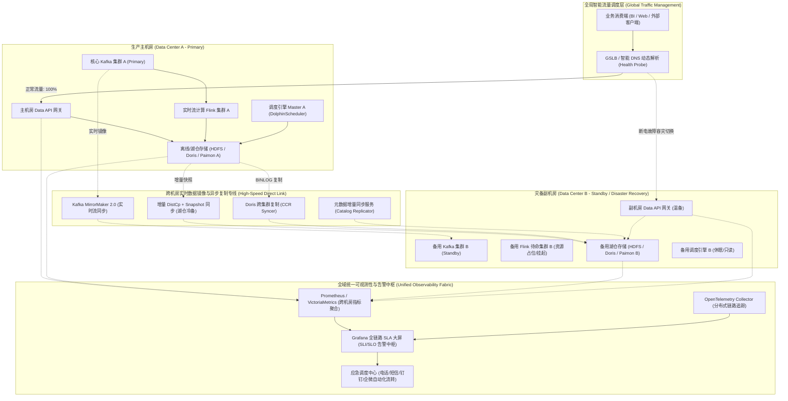
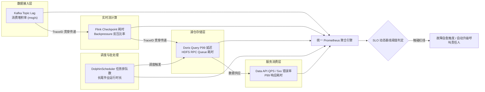
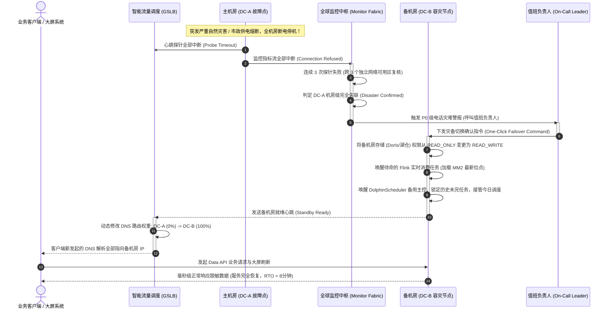
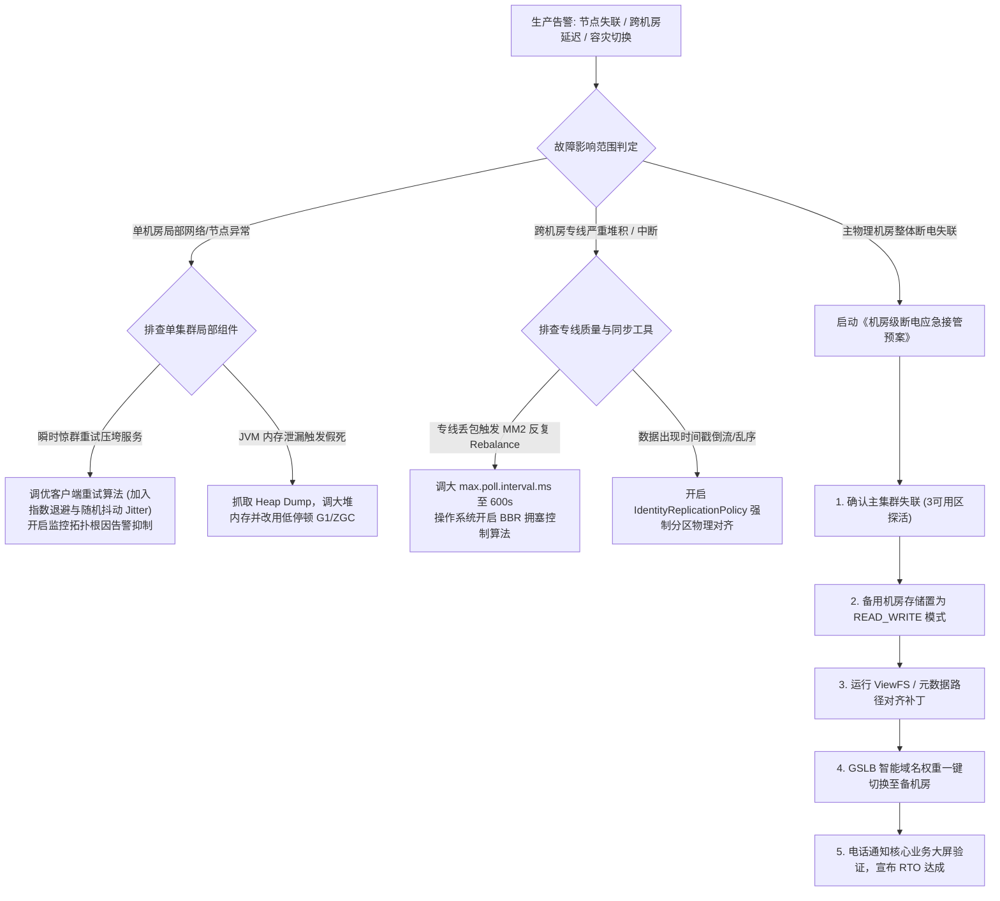
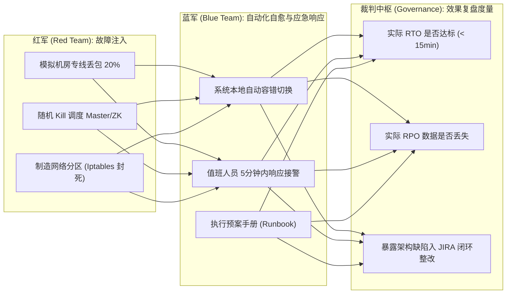

# 大数据平台可观测性与容灾高可用：全链路SLA指标追踪、多集群冷热容灾、异地双活与机房断电应急预案

> **学习目标定位**：面向技术总监、数据平台研发负责人、高级数据架构师岗位，系统掌握构建千亿级数据中台“全链路可观测性雷达”与“工业级多集群容灾高可用（Disaster Recovery - DR）防护网”的底层机制与系统工程方案。深入剖析 RTO（恢复时间目标）与 RPO（数据恢复点目标）在大数据极端场景下的客观物理边界、跨机房实时数据镜像（Kafka MirrorMaker 2.0 / Dual-Write）与湖仓增量冷备（DistCp Snapshot / Doris CCR）机制、基于 OpenTelemetry 与 Prometheus 的全链路核心 SLI/SLO 监控网络。结合大型制造（美的）跨园区容灾与工业物联网（瑞纳智能太原项目）10 万设备本地边缘缓存加集团主备秒级切换实战，讲透突发机房断电极端灾难下的架构自愈、红蓝对抗混沌演练与常态化高可用管理 SOP。

---

## 1. 知识概述与业务价值

### 1.1 是什么（What）
- **大数据平台全链路可观测性（Observability）**：不仅仅是传统运维的“服务器看 CPU、磁盘看剩余空间”，而是贯穿**“数据源接入 $\to$ 流批计算 $\to$ 存储底座 $\to$ 调度编排 $\to$ 统一 Data API”**的全景多维感知体系。它由三大核心支柱深度融合而成：
  - **Metrics（多维指标）**：实时反映集群算力健康度、计算吞吐（TPS/QPS）、算子延迟、Kafka Partition Lag 堆积速率、JVM GC 水位、SLA 达成率；
  - **Traces（分布式链路追踪）**：以全局唯一的 `TraceID` 串联起一次查询或一条数据记录流经网关、Flink、Kafka、Spark、Doris 的耗时跳跃拓扑，秒级定位长尾瓶颈；
  - **Logs（全景结构化日志）**：分布式计算作业与组件的异常堆栈与审计事件集中索引，支持毫秒级全文下钻定位。
- **大数据容灾高可用体系（Disaster Recovery - DR）**：是指当生产集群遭遇物理服务器大规模宕机、核心网络专线中断、自然灾害甚至**主物理机房整体断电（Blackout）**等极端灾难时，保障中台业务数据不丢失、核心计算任务在限定时效内自动或快速人工切换至备用机房恢复运行的完整工程方案与管理预案。
  - **RTO（Recovery Time Objective，恢复时间目标）**：发生灾难后，系统从瘫痪到完全恢复对外提供服务所经历的**最长容忍时长（业务停机时间）**；
  - **RPO（Recovery Point Objective，数据恢复点目标）**：发生灾难后，备用系统接管时**允许丢失的最大数据时间跨度（数据新鲜度损失）**。

### 1.2 解决什么核心业务痛点（Why）
- **“黑盒运维与救火式排障”**：早上 08:00 业务投诉“核心大屏白屏没有数据”，研发团队逐个排查 Flink、Kafka、Spark、DolphinScheduler、Doris，耗费 2 小时才发现是凌晨某个爬虫任务把 Kafka 网卡打满导致关键流延迟。缺乏统一的可观测性雷达导致运维极度被动。
- **机房断电或专线挖断引发的“灭顶之灾”**：传统中台所有存储与计算均孤悬在单一机房内。一旦发生市政施工挖断光缆或机房供电故障，全公司生产大屏停摆、报表断流、自动化决策系统失效，造成不可逆的商业经济损失与品牌信誉危机。
- **“伪双活”与高昂的冷备空转浪费**：部分团队盲目采购双份硬件搭建“冷备”，但由于平时从不演练，发生灾难时备用集群缺少元数据、路径错乱、无法拉起；或为了所谓的“双活”在跨城专线上强推分布式一致性，导致每笔写入延迟从 10ms 暴增至 100ms，拖垮整体生产效率。

### 1.3 适用场景与技术边界（Where & When）
- **最佳业务场景矩阵**：
  - **核心金融、交易清结算与上市公司财务报表链路**：要求 $RPO = 0$（零数据丢失），$RTO \le 30\text{min}$；
  - **工业互联网与智慧城市生命线系统（如太原智慧供热）**：要求控制指令高可用，10 万设备数据在网络断开时边缘自治，专线恢复后自动双向追数；
  - **等保三级与企业级 IT 审计刚性合规**：必须具备异地容灾备份场地与半年一次的实战演练记录。
- **明确反模式与技术禁区（严禁使用）**：
  - ❌ **在跨城（如北京到深圳，网络延迟 30ms+）大数据集群间做物理层同步强一致性写入**：物理光速决定了跨城网络 RTT 至少在 30~50ms，强行推行跨城分布式同步事务（如跨城 Raft/2PC）必然导致大数据高吞吐写入性能呈断崖式崩塌；
  - ❌ **只备份物理数据文件（HFile/Parquet），忽略元数据（Hive Metastore/Catalog）备份**：没有同步元数据版本的大数据文件就如同失去文件分配表的裸磁盘，灾备集群拉起时根本无法识别表结构与分区，冷备完全失效。

---

## 2. 核心概念与关系

### 2.1 核心概念全景表

| 核心概念 | 英文术语 | 核心定义与工程职责 | 级别与容忍标准 |
| :--- | :--- | :--- | :--- |
| **恢复时间目标** | RTO | 灾难发生后，系统恢复正常服务所需的最长时间 | 业务停机时间指标 |
| **数据恢复点目标** | RPO | 灾难发生后，系统可能丢失的最大数据量的时间窗口 | 数据完整性指标 |
| **双活架构** | Active-Active (A-A) | 两个或多个集群同时承载读写流量，数据双向实时同步，秒级故障切换 | 成本极高 / 极难设计 |
| **主备温备架构** | Active-Passive (Warm Standby) | 主机房承接全量读写，备机房维持基础算力并准实时异步接收数据，分钟级拉起 | 工业界最具 ROI 选型 |
| **网络分区/脑裂** | Network Partition / Split-Brain | 两个机房之间专线中断，导致两边各自误认为对方已死亡并争抢主控权 | 灾难级分布式故障 |
| **混沌工程** | Chaos Engineering | 通过主动注入故障（断网、拔盘、Kill主控）验证系统容错能力的工程方法 | 高可用演练常态化 |
| **服务等级指标/目标** | SLI / SLO | SLI 是精确量化的监控指标（如 P99 延迟）；SLO 是团队承诺的目标值（如 99.9% 达标） | SLA 管理考核基石 |

### 2.2 大数据平台全链路可观测性与跨机房容灾拓扑图



---

## 3. 底层工作机制与设计哲学

### 3.1 全链路端到端 SLA 可观测性设计哲学

在大数据复杂流水线中，任何一个单点的卡顿都会呈放大效应引发级联反应。现代可观测性架构必须具备**“全链路贯通、根因秒级定位、自适应告警收敛”**的特性：



#### 1. 核心 SLI（服务等级指标）矩阵定义
- **实时链路核心 SLI**：
  $$\text{Latency}_{\text{EndToEnd}} = T_{\text{DorisWrite}} - T_{\text{KafkaIngest}}$$
  告警红线：核心 P0 业务链路端到端延迟 $\ge 60\text{s}$ 触发黄色告警，$\ge 180\text{s}$ 触发红色告警；
  Flink Checkpoint 耗时连续 3 次超过 Checkpoint 周期（如 $> 1\text{min}$）触发反压与状态膨胀预警；
- **离线生产链路核心 SLI**：
  调度基线达成率（Baseline On-Time Rate）：P0 表每天早晨 07:30 前完成率必须 $\ge 99.99\%$；
  任务长尾偏离度：当前执行时长 $> 1.8 \times \text{历史同周期平均耗时}$ 自动预警；
- **服务网关核心 SLI**：
  API 可用性（Availability）：$\frac{\text{Success Requests (2xx)}}{\text{Total Requests}} \ge 99.95\%$；
  P99 延迟：$\le 50\text{ms}$。

### 3.2 大数据双机房与跨城容灾核心机制

在大数据场景下，由于数据量达到 PB/EB 级，无法承受全量双机房同步写（专线费用极其昂贵且延迟高）。工业界最佳实践是**“计算分级隔离、存储异步增量快照、实时流双写镜像”**：

#### 1. 实时流跨集群同步：Kafka MirrorMaker 2.0 底层机制
- MirrorMaker 2.0（MM2）基于 Kafka Connect 分布式架构构建，采用无状态的 Source/Checkpoint/Heartbeat 任务：
  - **动态 Topic 发现与元数据同步**：自动监听主机房的新增 Topic、分区数变更与配置变更；
  - **跨集群 Offset 映射（Offset Translation）**：主机房与备机房的单条消息 Offset 物理上通常不同。MM2 定期向备机房写入专有的 `__consumer_offsets` 映射表，使得当 Flink 任务切换到备用机房时，能够通过 `RemoteClusterUtils.translateOffsets()` 精确将消费位点换算为备机房的有效 Offset，**杜绝备机房接管时产生百万级消息全量重复消费**。

#### 2. 离线湖仓跨集群增量复制：Doris CCR 与快照 DistCp
- **Apache Doris 跨集群复制（Cross-Cluster Replication - CCR）**：
  - Doris 采用基于 Binlog 的增量同步技术。主机房的 FE 产生元数据与数据变更 Binlog，备用机房的轻量级 Syncer 守护进程拉取 Binlog 并在备机房重放，实现亚秒级至秒级（$RPO < 5\text{s}$）的跨机房主从读写分离与高可用；
- **数据湖增量快照复制（Iceberg / Paimon Snapshot Sync）**：
  - 利用数据湖的不可变快照特性（Immutable Snapshot）。每天或每小时利用 Spark/Hadoop `distcp` 仅增量拷贝新增的 Parquet/ORC 数据文件与 `metadata.json`；由于快照文件是追加写的，拷贝过程绝不阻塞主机房的正常写入。

### 3.3 机制交互时序图（Mermaid）：主机房突发断电容灾切换全时序

以下展示主机房由于市政供电故障突然遭遇全机房物理断电时，系统从宕机感知、流量调度、状态对齐到备机房接管的端到端时序：



---

## 4. 高频复杂业务场景实操与落地

### 4.1 场景一：某互联网电商大促前全链路压力测试与突发流量“三板斧”实战

#### 业务背景
在年度电商大促（618 / 双11）或集团新品发布会前夕，业务系统预估夜间瞬时涌入的查询与上报流量将达到日常峰值的 8~10 倍。如果缺乏线上真实的压测摸底，无法评估系统究竟会在哪个组件（网关、Kafka 写入、Doris FE、还是网络专线）发生瓶颈雪崩。

#### 架构实操解决方案（全链路压测与三板斧防御设计）
1. **基于压测流量打标的全链路影子压测（Shadow Traffic）**：
   - 压测引擎发起 HTTP 请求时，在 Header 强制注入标签：`X-Shadow-Test: true`；
   - **全链路流量穿透打标**：
     - Data API 网关识别该标签，不写入生产 Redis 缓存，而是路由至影子 Redis 集群；
     - 写入 Kafka 时，自动路由至影子 Topic：`topic_order_shadow`；
     - Flink 实时流与 Doris 存储自动写入影子表：`ads_trade_summary_shadow`；
     - 压测流量在生产物理底座上跑出真实的 CPU/IO 水位，而**业务生产数据 100% 物理隔离、零污染**。
2. **大促突发流量防御“三板斧”**：
   - **第一斧：自适应令牌桶限流（Rate Limiting）**：在 API 网关层为非核心业务设定 QPS 上限，超过阈值立即返回 HTTP 429 并引导客户端指数退避；
   - **第二斧：分级降级（Graceful Degradation）**：当集群 CPU 持续超过 85% 时，系统自动关闭非核心的大屏毫秒级刷新、关闭细粒度算法推荐特征更新，将全部算力归集给核心交易与财务看板；
   - **第三斧：快速熔断（Circuit Breaker）**：为底层慢查询配置 2 秒超时硬熔断，若某类接口连续 10 次超时，直接熔断 30 秒并返回静态兜底数据。

### 4.2 场景二：太原智慧供热物联网 10 万设备工业级“边缘离线缓存 + 集团双机房容灾”实战

#### 业务背景
太原市智慧供热项目覆盖数十万家庭供暖，现场部署了超过 10 万台工业传感器、PLC 与边缘网关。由于北方冬季极寒气候，道路市政施工极易挖断基站光纤或造成区域性基站停电，导致边缘设备与集团中心机房通信中断长达 6~12 小时。供热控制系统一旦失联，极易引发管网水力失调甚至爆管等重大公共安全事故。

#### 架构实操解决方案（边-端-云协同容灾机制）
1. **换热站边缘侧本地自治与离线存储（Edge Autonomy & Offline Cache）**：
   - 在每个物理换热站部署轻量级工业边缘工控机（运行 SQLite / 轻量嵌入式 TSDB）；
   - 边缘端内嵌控制算法模型：当检测到上行网络 Ping 集团中心机房连续 3 次超时（网络彻底断开）时，**边缘控制器立即切换为“本地离线自治模式”**，依据本地缓存的历史气象曲线和管网温度自适应调节阀门开度，保证供暖正常运行；
   - 现场产生的所有测点秒级数据自动在本地磁盘环形缓冲队列中落盘压缩保存（支持连续脱网 48 小时数据不丢失）。
2. **网络恢复后的自适应追数与流式限流补数（Dynamic Catch-Up）**：
   - 当专线网络恢复正常时，10 万台设备若同时将过去 12 小时的几十亿条测点数据瞬间涌入中心机房，会瞬间击垮中心 Kafka；
   - 边缘网关推行 **“当前实时数据优先上报 + 历史离线数据低速分片补发”** 双通道机制：
     - 通道 A：实时测点数据立即恢复正常上报，秒级驱动指挥大屏；
     - 通道 B：历史缓存数据以受限速率（不超过网卡带宽 20%）在后台静默补发，中心 Flink 基于 Event Time 与 Watermark 乱序容忍机制自动归并计算，平滑恢复历史账目。

### 4.3 场景三：海量数据湖（Iceberg/Paimon）跨区域异地灾备与增量冷备实战

#### 业务背景
某大型制造集团（如美的集团）在佛山设有总部核心主数据中心，在上海设有灾备数据中心。数仓湖仓拥有超过 15PB 的历史生产与供应链数据。公司管理层要求异地机房必须具备 100% 完整冷备，当总部机房发生火灾等不可抗力时，异地机房必须在 2 小时内接管核心报表分析。

#### 架构实操解决方案（基于快照元数据的增量 DistCp 方案）
1. **全量底座初建与增量快照捕获（Snapshot Diffing）**：
   - 初次上线时，通过物理专线完成全量数据基线同步；
   - 日常运行时，针对 Apache Iceberg / Paimon 湖表，由于每一次写入都会生成一个全局单调递增的 `Snapshot ID`；
   - 灾备同步服务每隔 1 小时调用 Iceberg API 对比差异快照：
     `List<DataFile> addedFiles = table.snapshot(currentId).addedDataFiles();`
     精准提取过去 1 小时内新增的底层物理数据文件（Parquet/ORC）路径列表。
2. **轻量增量传输与元数据原子合入（Atomic Metadata Commit）**：
   - 驱动分布式拷贝工具 `Hadoop DistCp` 仅拷贝增量文件列表至异地 OSS/HDFS 存储池；
   - 拷贝完成后，向异地的 Iceberg REST Catalog 提交元数据合并请求，异地表直接执行原子指向：
     `异地表.setCurrentSnapshot(currentId)`；
   - 整个同步过程无需对 PB 级全表进行递归目录扫描，**带宽消耗压降 95%，每小时增量同步耗时控制在 3 分钟以内**，从容达成 $RPO \le 1\text{小时}$ 的国家灾备四级标准。

---

## 5. 生产异常故障深度排查与根因分析

### 5.1 故障一：跨机房专线光纤抖动引发 Kafka MirrorMaker2 消费堆积与数据乱序死锁

#### 故障现象
生产环境中某次跨城专线发生丢包（Ping 丢包率从 0% 升至 15%）。监控显示备机房的 Kafka MirrorMaker 2.0 任务出现严重消费延迟（Lag 堆积量超过 800 万条）。网络恢复后，Lag 依然不下降，MM2 日志充斥着大量的 `CommitFailedException`，且部分关键业务 Topic 在备机房重放时出现了严重的时间戳倒流与数据乱序。

#### 深度根因分析（Root Cause）
1. **专线延迟拉长导致心跳超时（Rebalance Storm）**：
   MM2 基于 Kafka Consumer 机制运行。专线丢包导致消费线程向主机房提交 Commit 超过了 `max.poll.interval.ms`（默认 300 秒），Kafka Broker 判定 Consumer 掉线，频繁触发 Consumer Group 的全局 Rebalance（再均衡风暴），导致所有 Worker 线程反复停止工作；
2. **缺少消息 Key 路由导致分区乱序**：
   MM2 默认配置未强制保留原始 Partition 分配，在重试过程中将具有相同业务 Key 的消息打散到了不同的备用分区，破坏了单分区全局有序性。

#### 生产调优与架构级解决方案
```properties
# 1. 调大 Consumer 容忍网络抖动的参数
max.poll.interval.ms=600000
session.timeout.ms=60000
heartbeat.interval.ms=20000

# 2. 强制开启分区物理一致性镜像映射 (Identity Partitioning)
# 确保主机房的 Partition 0 严格镜像写入备机房的 Partition 0，绝对杜绝乱序
producer.partition.assignment.strategy=org.apache.kafka.connect.mirror.IdentityReplicationPolicy

# 3. 优化底层网络拥塞控制算法
# 操作系统层面开启 BBR 拥塞控制算法 (比传统 Cubic 更好地应对高延迟有损长链路专线)
net.core.default_qdisc=fq
net.ipv4.tcp_congestion_control=bbr
```

### 5.2 故障二：备集群拉起接管生产时，因元数据 Catalog 路径未动态对齐导致任务批量报错

#### 故障现象
在一次季度机房断电容灾应急演练中，运维人员将流量成功切换到备用机房，并拉起了备用 DolphinScheduler 调度集群。然而，数百个离线 Spark/Hive 作业启动后瞬间报错挂死：
`java.io.FileNotFoundException: File hdfs://nameservice_primary/apps/hive/warehouse/... does not exist`。
备用集群虽然完整同步了数据文件，但计算作业根本无法运行，演练被判定为不合格。

#### 深度根因分析（Root Cause）
- 主机房的 HDFS 高可用逻辑服务名为 `nameservice_primary`，所有 Hive Metastore 中的表物理路径均硬编码记录为 `hdfs://nameservice_primary/...`；
- 备用机房的物理集群拥有独立的命名空间 `nameservice_standby`。同步元数据时，直接将主机房的 MySQL 元数据通过数据库镜像导入了备用库，未对表和分区的 `LOCATION` 路径进行动态重写与命名空间解耦，导致备集群引擎依然去尝试连接已经断电的主机房 NameNode。

#### 架构级解决方案
1. **推行联邦视图命名空间（ViewFS / HDFS Federation Router-Based）**：
   - 严禁在代码和元数据中使用具体的集群物理服务名，全集群统一配置抽象虚拟挂载点：`viewfs://datalake/warehouse/...`；
   - 主机房配置将 `viewfs://datalake` 映射到 `hdfs://nameservice_primary`；
   - 备机房配置将 `viewfs://datalake` 映射到 `hdfs://nameservice_standby`；
   - 作业代码与元数据表结构完全一致，灾备切换时无需修改任何一行 SQL 或表元数据。
2. **基于元数据反向重写脚本（Automated Location Rewriter）**：
   - 若未采用 ViewFS，在容灾切换流程中增加自动化初始化脚本：
     `UPDATE DBS SET DB_LOCATION_URI = REPLACE(DB_LOCATION_URI, 'nameservice_primary', 'nameservice_standby');`
     `UPDATE SDS SET LOCATION = REPLACE(LOCATION, 'nameservice_primary', 'nameservice_standby');`
     一键执行 5 秒完成全库路径对齐。

### 5.3 故障三：混沌工程演练中杀死 ZooKeeper Leader 触发惊群效应与监控告警风暴挂死网关

#### 故障现象
在混沌工程高可用突袭演练中，注入脚本杀死了生产环境的核心 ZooKeeper Leader 节点。数秒内，集群中 5,000 个大数据客户端（Kafka、HBase、Doris、Flink）同时检测到连接中断，并发向剩余的两个 ZK 节点发起疯狂重连与心跳探测。同时，监控系统在 30 秒内喷发了超过 10,000 条告警信息，直接将公司企业微信的机器人 Webhook 网关打到限流封禁（HTTP 429），真正关键的故障定界信息反而无法触达工程师。

#### 深度根因分析（Root Cause）
1. **客户端缺乏指数抖动重试（No Jitter Backoff）**：成千上万个客户端在连接中断后，同时以固定间隔重试，形成**“惊群效应（Thundering Herd）”**，原本健康的两个 ZK Follower 节点被瞬时新建的 TCP 连接与握手请求压死；
2. **缺乏告警收敛风暴抑制机制（No Alarm Storm Suppressor）**：监控中心没有根据组件拓扑关系建立根因依赖收敛，单个基础组件故障引发全链路数百个上游任务连带告警。

#### 架构级解决方案
1. **客户端连接池指数退避加随机扰动**：
   - 强制全局客户端配置重连策略：$T_{\text{wait}} = \min(T_{\text{max}}, T_{\text{base}} \times 2^{\text{retry\_count}}) \pm \text{RandomJitter}$，平滑分散瞬时重连压力；
2. **构建拓扑感知告警收敛引擎（Topology-Aware Alert Silencer）**：
   - 告警服务内嵌基础拓扑知识图谱：若识别到底层公共组件（如 ZooKeeper / NameNode）发生宕机告警，**系统自动将所有依赖该组件的应用层告警（Kafka 掉线、HBase 无法读取、Flink Checkpoint 失败）进行批量折叠抑制**；
   - 统一收敛为一条高权重的“P0 核心基础设施根因告警”，附带注明“已自动静音下游 3,200 条级联报警”，确保通信通道通畅与抢修专注度。

### 5.4 生产故障排查决策树（Mermaid）



---

## 6. 技术选型对比

### 6.1 大数据容灾与监控方案全方位对比矩阵

| 选型维度 | 异地真双活 (Active-Active) | 主备温备 (Active-Passive with MM2/CCR) | 异地冷备 (Cold Backup / S3 Glacier) | 传统单机房 + 本地多副本 |
| :--- | :--- | :--- | :--- | :--- |
| **业务恢复时间 (RTO)** | **秒级 (< 30s，全自动切换)** | **分钟级 (5 ~ 15分钟，半自动接管)** | 数小时至数天 (需从冷介质拉起重载) | 机房损坏时无限期停摆 (无法自愈) |
| **数据恢复点目标 (RPO)** | **$\approx 0$ (双向实时同步)** | **秒级至分钟级 (依赖异步同步链路)** | 24 小时 (按天备份) | 仅能防本地硬盘损坏，防不住机房火灾 |
| **网络专线带宽消耗** | **极高 (双向数据镜像 + 分布式一致性开销)** | **中等 (单向按需异步压缩传输)** | 极低 (定时在夜间低谷期压缩传输) | 0 (无跨机房专线) |
| **硬件基础设施成本** | **2.5倍 ~ 3倍 (双倍机器 + 专线 + 治理组件)** | **1.3倍 ~ 1.5倍 (备机房仅需按需核心算力)** | 1.1倍 (仅需廉价低频对象存储) | 1.0倍 (基线成本) |
| **架构与运维复杂度** | **极高 (双向防环、冲突检测、数据对账极其痛苦)** | **中等 (单向复制，拓扑清晰，工业界首选)** | 极低 (仅需定时执行 DistCp 脚本) | 最低 |
| **典型适用场景** | 跨国金融交易、核心账号中心 | **大型集团数据中台、工业物联、城市大脑** | 法律合规审计归档、历史冷数据存储 | 预算极度有限的初创团队 |

### 6.2 选型决策考量与企业级容灾等级定义

针对技术总监与数据架构师的选型决策，切忌“脱离商业预算空谈异地双活”。必须严格对标国家标准 **GB/T 20988-2007（信息系统灾难恢复规范）** 进行科学分级：
1. **绝大多数企业级大数据中台的最佳 ROI 甜点：第四至第五级（主备温备 Active-Passive）**：
   - **选型逻辑**：大数据的数据量（PB 级）决定了做“异地真双活（A-A）”在经济学上几乎是不成立的（机器成本和专线网络费用翻倍，每年需数千万元开销）。通过采用**主备温备模式**：备用机房平时只维持 30% 核心算力承载非关键报表，通过 MM2 和 Doris CCR 进行单向异步数据同步，发生断电灾难时在 15 分钟内通过 GSLB 切换接管核心生产，在控制成本的同时兼顾了高可靠。
2. **边缘设备与政企交付场景：边缘自治 + 云端主备**：
   - **选型逻辑**：如瑞纳智能太原项目，工业现场网络环境恶劣。必须推行“边缘脱网自治 + 本地环形存储”，云端出现任何抖动均绝不影响现场供热设备的物理运转。

---

## 7. 技术经理与架构师实战管控

### 7.1 生产高可用“红蓝对抗与突袭断网演练（Chaos Engineering）”SOP 推进

许多企业的容灾预案最终沦为纸上谈兵，核心原因是**平时不敢演练，演练全部提前打招呼打好补丁**。作为技术负责人，必须在团队内推行 **“红蓝对抗常态化混沌工程机制”**：



1. **“突袭式”无预警演练原则**：
   - 每季度组织一次突袭演练，仅公司高管与红军核心架构师知情，不提前通知值班运维人员；
   - 验证监控报警是否能在 3 分钟内呼通责任人，验证备机房切换是否能在 15 分钟内真正跑通数据。
2. **混沌工程原则（Principles of Chaos）**：
   - 严禁直接在未知风险下演练。必须从**“测试集群 $\to$ 预发集群 $\to$ 生产非核心链路 $\to$ 生产核心全链路”**四步递进，先在沙箱中跑通自动化注入工具（如 ChaosBlade / Chaos Mesh）。

### 7.2 核心链路 SLA/SLO 分级保障红线（Tiering Governance）

在资源有限的情况下，不能对所有资产一视同仁。建立 **SLA 刚性承诺与分级资源倾斜体系**：

| 资产等级 | 典型业务场景 | SLA 可用性承诺 | 容灾等级目标 | 事故定级标准 |
| :--- | :--- | :--- | :--- | :--- |
| **P0 核心资产** | 董事长/管理层实时经营大屏、财务结算总账、核心风控 API | **$99.99\%$** (全年停机 $< 52$ 分钟) | $RTO \le 15\text{min}$, $RPO \le 1\text{min}$ | 延迟超过 30 分钟即定级为 **P1 级重大生产事故**，直接扣减部门绩效。 |
| **P1 重要资产** | 业务线日常运营报表、推荐算法离线特征、营销看板 | **$99.9\%$** (全年停机 $< 8.7$ 小时) | $RTO \le 2\text{hours}$, $RPO \le 30\text{min}$ | 延迟超过 2 小时定级为 P2 级事故。 |
| **P2/P3 边缘资产** | 临时数据探查、历史归档日志、内部测试分析 | **$99.0\%$** | $RTO \le 24\text{hours}$, $RPO \le 24\text{hours}$ | 仅做尽力而为保障（Best Effort），不计入事故考核。 |

### 7.3 灾难恢复手册（Runbook）设计与机房断电应急三权分立决策流程

极端灾难面前，最忌讳现场临时开会扯皮。必须将灾难恢复流程精简固化为 **标准执行清单（Checklist Runbook）**，并推行**“三权分立”的灾难决策授权**：
1. **决策权（Disaster Commander）**：通常由技术总监或 CTO 担任，唯一有权宣布“启动机房级容灾切换”；
2. **执行权（Incident Operator）**：由熟悉底座的核心资深架构师担任，严格按照 Runbook 逐项执行命令，严禁凭个人经验临时发挥；
3. **通报权（Communications Lead）**：由产品/项目负责人担任，专门负责每隔 15 分钟向公司高层和业务方同步抢修进展，阻断外部打扰，让技术人员专心抢修。

---

## 8. 互联网大厂高频面试真题库

* **Q1 [阿里/蚂蚁 - 容灾核心概念与边界]**：什么是容灾系统的 RTO 和 RPO？在大数据平台（PB 级存储与分布式计算）中，为什么无法像传统单机 MySQL 一样轻松做到 RTO $\approx$ 0 和 RPO = 0？
* **Q2 [字节跳动 - 核心机制与架构设计]**：深入剖析大数据平台跨机房容灾方案。实时流计算（Kafka+Flink）与海量离线湖仓（HDFS/Iceberg）分别采用什么机制实现跨机房数据同步？
* **Q3 [美团 - 生产实战与高可用演练]**：如果核心机房突发物理断电（整机房黑天），大数据中台如何实现秒级到分钟级的高可用容灾切换？请给出完整的演练切换 SOP。
* **Q4 [腾讯 - 可观测性与稳定性体系]**：如何构建覆盖“数据采集 $\to$ 流批计算 $\to$ 湖仓存储 $\to$ 调度编排 $\to$ Data API”的大数据全链路可观测性大屏？核心 SLI 指标该如何设计？
* **Q5 [快手 - 架构权衡与异地双活]**：很多企业高管提出要建“大数据异地双活（Active-Active）”，从架构师角度来看，大数据平台到底能不能做真双活？需要付出怎样的代价和权衡？
* **Q6 [滴滴 - 生产排障与网络分区]**：跨机房主备同步链路中，专线发生网络抖动（丢包率 10%），MirrorMaker2 大面积堆积且 Flink 任务发生反压。你如何排查根因并在不丢失数据的前提下快速恢复？
* **Q7 [数据总监/管理决策与团队SOP]**：很多团队写了厚厚的《容灾应急预案》，但真正出故障时依然手忙脚乱。作为技术负责人，你如何常态化推行“红蓝对抗”与混沌工程断网演练，确保中台高可用不是纸上谈兵？

---

## 9. 结构化深度参考答案

### 题目1 [阿里/蚂蚁 - 容灾核心概念与边界]：什么是容灾系统的 RTO 和 RPO？在大数据平台（PB 级存储与分布式计算）中，为什么无法像传统单机 MySQL 一样轻松做到 RTO $\approx$ 0 和 RPO = 0？

#### 简洁回答（1分钟电梯破题）
**RTO（恢复时间目标）** 是业务允许的最大停机中断时间；**RPO（数据恢复点目标）** 是业务允许的最大数据丢失时间窗口。
大数据平台无法做到 $RTO \approx 0$ 和 $RPO = 0$ 的根本原因在于**分布式海量数据的物理定律约束（光速网络延迟与吞吐量的矛盾）**。传统单机数据库可以通过近距离同步双写（如 MySQL 增强半同步）实现零数据丢失；而大数据系统数据量高达 PB/EB 级、节点成千上万，如果跨机房进行强一致性同步确认（如跨机房 2PC 或 Raft），网络 RTT 延迟会导致千亿级高并发写入性能呈断崖式崩溃。因此大数据容灾在工程上必须遵循**“异步最终一致性”**，必然存在微小的数据新鲜度窗口（$RPO > 0$）与服务拉起重算耗时（$RTO > 0$）。

#### 深入回答（机制推导与边界条件）
1. **物理定律与网络延迟瓶颈推导**：
   - 跨机房专线光纤物理传输延迟公式：光在光纤中的传播速度约为 $200\text{km/ms}$。若两地相距 1,000 公里，往返一次的网络往返时延（RTT）至少为：
     $$\text{RTT} \ge \frac{1000 \times 2}{200} = 10\text{ms}$$
     加上交换机路由排队，实际 RTT 在 25~40ms；
   - 传统 OLTP 数据库单次写入数据量仅几 KB，等待 20ms 尚可勉强支撑低频事务；
   - 大数据系统（如 Flink 每秒摄入数百万条日志，Kafka 每秒写入数 GB 数据流）若每次写入必须等待备机房 ACK 确认才返回成功，由 Little's Law（$L = \lambda W$）可知，长延迟会导致 TCP 滑动窗口与写入缓冲区瞬间被打爆，引发严重的级联反压与集群雪崩。
2. **计算状态恢复的客观时间成本（Why RTO > 0）**：
   - 大数据不仅包含静态文件，更包含极其庞大的**计算动态状态（State）**。例如 Flink 的 RocksDB 状态可能高达数 TB，Doris 的内存缓存与元数据需要加载预热；
   - 当灾备机房接管时，不仅要完成 DNS 流量切换，还必须拉起 Flink 任务并从 Checkpoint/Savepoint 快照中将数十 GB 的状态重新加载进内存，这在客观物理上至少需要 3~10 分钟的时间窗口，决定了大数据系统的 RTO 必然是分钟级而非秒级。

#### 架构师/技术管理视角（权衡取舍、SLA与成本）
- **商业 ROI 与合理技术预期的建立**：架构师必须有勇气向管理层和业务方阐明技术客观规律，坚决打破“什么都要”的幻想。对于大数据分析中台，**追求 $RTO = 0$ 和 $RPO = 0$ 在经济学上是极端反常识的（成本可能飙升 10 倍以上）**。在商业权衡中，承诺“核心报表 $RTO \le 15\text{min}$，数据丢失 $RPO \le 1\text{min}$”既能完美保障企业经营决策不受实质侵害，又能将基础设施成本控制在合理预算内。

---

### 题目2 [字节跳动 - 核心机制与架构设计]：深入剖析大数据平台跨机房容灾方案。实时流计算（Kafka+Flink）与海量离线湖仓（HDFS/Iceberg）分别采用什么机制实现跨机房数据同步？

#### 简洁回答（1分钟电梯破题）
大数据跨机房数据同步必须采取**“流批分治、冷热分层、增量快照”**的解耦架构：
针对**实时流计算（Kafka+Flink）**，采用 **Kafka MirrorMaker 2.0 异步跨集群实时镜像**，结合 Flink 在备机房的待命热备，并通过 MM2 的内部 Offset 映射表实现故障切换时的无缝位点换算；
针对**海量离线湖仓（HDFS/Iceberg/Doris）**，利用湖仓不可变快照特性（Immutable Snapshot），通过 **增量 DistCp 结合快照差异（Snapshot Diff）** 同步数据文件，结合元数据 Catalog 增量重放，实现亚秒级至小时级的确定性容灾。

#### 深入回答（机制推导与边界条件）
1. **实时链路同步机制（Kafka MirrorMaker 2.0 + Offset Translation）**：
   - **异步单向流复制**：主机房集群与备机房集群保持物理独立，MM2 作为消费者拉取主机房 Topic 消息并以压缩批次（Batch）发送给备机房；
   - **位点换算内核（Offset Translation）**：
     由于两边集群消息插入顺序和历史保留周期的差异，同一个业务消息在两边的物理 Offset 必然不同；
     MM2 内置的 Checkpoint 机制定期向备集群写入 `__consumer_offsets` 映射心跳，记录 `(Source_Topic, Source_Partition, Source_Offset) -> Target_Offset`；
     备机房的 Flink 任务待命时，一旦切换接管，直接调用工具换算为备集群的真实位点开始消费，彻底规避了“从头重新消费几百 GB 历史数据”的踩踏风险。
2. **离线湖仓同步机制（Incremental DistCp + Doris CCR）**：
   - **Iceberg / Paimon 增量快照同步**：
     表格式的每一次提交都会生成单调递增的快照文件（`metadata.json`）。增量同步程序每小时调用 API 提取两次快照之间的 `added_files` 差异清单，仅调度高并发 `distcp` 传输增量物理文件；随后在备用端原子更新元数据指针，保证备集群数据始终处于一致的只读视图；
   - **Doris 跨集群复制（CCR - Cross Cluster Replication）**：
     利用 Doris 2.0+ 的 Binlog 特性，备用机房的轻量级 Syncer 进程实时消费主机房 FE 和 BE 产生的 DDL 与 DML Binlog，以极低延迟（< 5秒）在备机房进行重放，实现多机房接近双活的高可用数据同步。

#### 架构师/技术管理视角（权衡取舍、SLA与成本）
- **带宽与成本控制策略**：跨机房专线带宽费用是企业 IT 预算的巨大黑洞。架构师必须在同步链路中推行**全链路数据压缩**（Kafka 强制开启 Zstandard 压缩，DistCp 开启带宽限制 `-bandwidth 500`），并在夜间离线调度波谷期进行大规模历史冷数据迁移，杜绝容灾同步流量与白天核心业务专线争抢带宽。

---

### 题目3 [美团 - 生产实战与高可用演练]：如果核心机房突发物理断电（整机房黑天），大数据中台如何实现秒级到分钟级的高可用容灾切换？请给出完整的演练切换 SOP。

#### 简洁回答（1分钟电梯破题）
应对机房级断电的核心在于**“事前自动化巡检心跳、事中一键化多级切换、事后对齐补偿”**的标准化 SOP。
一旦 3 个独立监控区判定主机房完全失联，**指挥官下发一键切换指令 $\to$ GSLB 智能解析毫秒级将对外流量打向备机房 $\to$ 备机房存储权限从只读切为读写 $\to$ 备用 Flink 任务加载 MM2 最新位点唤醒 $\to$ 备用调度引擎接管今日后续依赖**。全流程杜绝现场临时改配置，确保在 15 分钟内完全恢复中台对外核心服务。

#### 深入回答（机制推导与边界条件）
1. **机房断电应急切换八步标准 SOP 流水线**：
   - **Step 1（灾难核实与仲裁，耗时 1min）**：全球外部拨测探针（跨不同公有云 3 个可用区）连续 3 次探测主机房网关超时，系统自动向值班总监发送 P0 报警，总监核准后宣布启动《机房断电应急响应预案》；
   - **Step 2（解除备集群只读保护，耗时 1min）**：执行自动化脚本，将备用 Doris 集群与数据湖 Catalog 的 `READ_ONLY` 标记变更为 `READ_WRITE`，赋予备集群生产写入特权；
   - **Step 3（GSLB 流量秒级改道，耗时 1min）**：通过云厂商 DNS / GSLB 控制台，一键将统一接入域名 `data-api.company.com` 的解析权重调整为：主机房 0%，备用机房 100%，上层业务调用与大屏查询瞬间改道进入备机房；
   - **Step 4（实时流计算唤醒接管，耗时 3min）**：备机房的 Kubernetes 集群根据预先编排的 Helm Chart，拉起待命的 Flink 生产作业，基于 MM2 换算后的位点连接备用 Kafka 开始流计算，数据开始写入备用存储；
   - **Step 5（离线调度主控拉起与任务定界，耗时 3min）**：备机房拉起 DolphinScheduler 实例，扫描已同步的元数据库，将主机房在断电瞬间处于 `RUNNING` 的僵尸任务批量置为 `NEED_FAULT_TOLERANCE` 并自动触发重试；
   - **Step 6（全链路核心 SLI 验证，耗时 2min）**：自动化巡检脚本校验备用 Data API 的 20 个核心大屏接口，确认返回 HTTP 200 且数据行数正常；
   - **Step 7（对外宣布服务恢复，耗时 1min）**：向全集团管理层发布通报：“中台已由备用机房接管，当前 RTO 为 12 分钟，核心服务恢复可用”；
   - **Step 8（主机房来电后的反向追数与回迁）**：主机房供电恢复后，**严禁立即切回流量**。首先将其降级为只读，反向建立 `DC-B -> DC-A` 的数据同步链路，待主机房补齐断电期间的全部增量数据后，再在预定的深夜维护窗口平滑切回。

#### 架构师/技术管理视角（权衡取舍、SLA与成本）
- **技术防脑裂（Split-Brain Fencing）铁律**：容灾切换最大的灾难不是“服务暂停”，而是“主机房其实没死透（如发生短暂网络抖动又瞬间恢复），导致两个机房同时在写入，造成数据严重分叉（Split-Brain）”。架构师必须在 SOP 中设计**“电源/网络硬阻断（STONITH / Network Fencing）”**：在宣布备用机房接管的瞬间，网络团队必须立即在核心交换机层面将主机房的入口路由彻底物理切断，确保同一时刻全网仅有一个活跃写入端。

---

### 题目4 [腾讯 - 可观测性与稳定性体系]：如何构建覆盖“数据采集 $\to$ 流批计算 $\to$ 湖仓存储 $\to$ 调度编排 $\to$ Data API”的大数据全链路可观测性大屏？核心 SLI 指标该如何设计？

#### 简洁回答（1分钟电梯破题）
构建大数据全链路可观测性的核心是**“统一数据模型（OpenTelemetry 标准）、全局 TraceID 贯通全链路、基于分层黄金指标（Golden Signals）构建 SLI/SLO 监控大屏”**。
通过在数据源头植入分布式链路跟踪追踪请求轨迹；利用 Prometheus/VictoriaMetrics 采集各引擎的关键吞吐、反压与饱和度指标；并在 Grafana 首页构建“业务全景监控雷达”，实现从宏观大屏异常到微观具体代码报错的 3 次点击下钻排查。

#### 深入回答（机制推导与边界条件）
1. **全链路四大黄金指标（The Four Golden Signals）落地矩阵**：
   - **延迟（Latency）**：
     - Data API 网关：P99 响应耗时（要求 $\le 50\text{ms}$）；
     - Flink 实时计算：EventTime 到 ProcessTime 的端到端延迟（Watermark Lag）；
     - 离线调度：工作流关键路径耗时偏离度；
   - **流量（Traffic）**：
     - Kafka 消息摄入 TPS 与字节吞吐量（BytesInPerSec）；
     - Data API 并发请求 QPS；
   - **错误（Errors）**：
     - API 接口 5xx 错误率；
     - Flink 任务 Restart 频次与 Checkpoint 失败率；
     - 调度任务单日失败重试率；
   - **饱和度（Saturation）**：
     - YARN / K8s CPU 和内存分配比率；
     - Doris BE 磁盘存储使用率（触发 85% 强预警）；
     - 数据库与网关连接池利用率。
2. **全局 TraceID 跨组件穿透设计**：
   - 客户端调用 API 或外部采集埋点传入 `X-Trace-Id: trace_20261117_001`；
   - **流计算穿透**：Kafka Producer 将 `TraceID` 写入 Message Header，Flink Source 算子提取该 Header，在算子状态流转中保持传递，并在 Sink 写入 Doris 时作为隐藏列存入；
   - **快速定位价值**：当某条业务数据被质疑计算错误时，工程师直接通过 `TraceID` 在 OpenSearch/Elasticsearch 中拉出该数据流经每一个环节的进入时间、算子内部变量与最终产出结果，彻底打破系统黑盒。

#### 架构师/技术管理视角（权衡取舍、SLA与成本）
- **可观测性自身的资源开销压制**：监控系统本身也是软件，如果监控采集太频繁，监控系统本身就会成为集群的性能杀手。架构师必须明确**监控采集的取舍边界**：
  - 指标采样周期设为 15 秒或 30 秒（严禁 1 秒高频拉取）；
  - 链路追踪采用**自适应动态采样率（Adaptive Sampling）**：正常请求仅采样 1%，而所有报错（Error）和慢查询请求执行 100% 强制采样，将日志与存储成本降低 90% 以上。

---

### 题目5 [快手 - 架构权衡与异地双活]：很多企业高管提出要建“大数据异地双活（Active-Active）”，从架构师角度来看，大数据平台到底能不能做真双活？需要付出怎样的代价和权衡？

#### 简洁回答（1分钟电梯破题）
从计算机科学与分布式工程本质来看，**大数据的“真·异地双活（两地同时写入、强一致互备、零延迟容灾）”在客观物理上是一个伪命题**。
由于 CAP 定理与光速物理延迟的不可逾越性，大数据计算与存储无法承受跨城强一致事务。业界所谓的“大数据双双活”，本质上是**“业务单元化（Unitization）双活”或“读双活、写主备（Read Active-Active, Write Active-Passive）”**。若企业不计代价强推底层通用双活，将付出硬件成本翻 3 倍、专线成本翻数倍、写入性能急剧恶化以及双向数据冲突对账极其痛苦的毁灭性代价。

#### 深入回答（机制推导与边界条件）
1. **为什么大数据无法做底座层面的通用异地双活？**
   - **冲突检测与解决（Conflict Resolution）的死穴**：
     在 OLTP 系统中，可以通过“主键范围路由（北京管北方用户，深圳管南方用户）”实现业务单元化；
     但大数据分析是**全局全量聚合（Global Analytics）**。例如计算“全集团实时 GMV”或“太原市全网能耗汇总”，必须对两地的全部数据进行跨城 Shuffle 或全局汇总。两地同时写入同一张表会导致主键冲突、自增 ID 错乱以及快照版本分叉，必须引入跨城分布式锁，导致 TPS 暴跌 90% 以上；
   - **双向数据复制的“无限循环环路（Replication Loop）”**：
     A 机房把数据同步给 B，B 机房若又配置同步给 A，若没有精细的元数据标记拦截，会导致消息在专线上无限循环镜像，直到把百 G 专线彻底堵死。
2. **工业界最具实战价值的“伪双活真落地”妥协架构**：
   - **读双活，写单活（Read A-A, Write A-P）**：
     主机房负责全量数据流批写入与 ETL 计算；备用机房通过 MM2 和 CCR 准实时同步数据，对外开放**并发查询与 API 读流量双活**。平时备用机房分担全集团 50% 的查询负载，故障时瞬间接管全部读写；
   - **业务域对等切片双活（Domain Sharding）**：
     机房 A 作为“电商与营销域”的主写入中心，机房 B 作为“供应链与财务域”的主写入中心，两地互为灾备，在业务层严格物理隔离写入边界。

#### 架构师/技术管理视角（权衡取舍、SLA与成本）
- **技术决策者的定力与管理沟通艺术**：高管提出“异地双活”往往是出于对业务连续性的安全焦虑，但他们并不了解底层技术代价。架构师的职责不是盲目迎合，而是**拿出严谨的量化账单**：“做一套底层真双活，每年需新增专线和硬件预算 3,000 万元，且系统吞吐量下降 60%；而做‘读双活+温备’仅需 600 万元，RTO 仅相差 8 分钟，满足 100% 审计合规。”用扎实的数据引导管理层做出理性的商业决策。

---

### 题目6 [滴滴 - 生产排障与网络分区]：跨机房主备同步链路中，专线发生网络抖动（丢包率 10%），MirrorMaker2 大面积堆积且 Flink 任务发生反压。你如何排查根因并在不丢失数据的前提下快速恢复？

#### 简洁回答（1分钟电梯破题）
定位该问题的首要动作是**“链路解耦定界：排查专线 TCP 重传率与 Kafka 消费线程健康度”**。
先按同一时间窗口比较源端生产速度、MM2 复制速度、目标 Kafka 写入延迟和网络重传。积压只说明处理跟不上输入，还需区分网络、Broker 存储、任务重启和配置问题。

#### 深入回答（机制推导与边界条件）

1. 网络侧比较 RTT、重传计数增量、连接状态和吞吐。带宽测试会增加链路负载，应在可控窗口执行。丢包对吞吐的影响取决于 RTT、拥塞控制、并发和链路条件，需实测。
2. MM2 侧确认出问题的具体连接器、任务和客户端，核对任务重启、异常日志、请求耗时与配置作用范围。出现分区撤销日志需结合频率及前后事件分析。
3. 源、目标 Broker 同时检查磁盘、限额和请求排队。根据实际拓扑判断 Flink 与 MM2 的依赖关系，找到最先出现阻塞的边界。
4. 调整 Producer 批次可以减少应用请求的固定开销并改善压缩，linger 会增加等待，较大批次会占用更多缓冲。Kafka 连接通常复用，批次与 TCP 握手频率不能直接等同。逐步调整并对比成功吞吐、复制延迟和错误率。[Kafka 3.7 Producer 配置](https://kafka.apache.org/37/configuration/producer-configs/)
5. 调整超时或拥塞控制前明确假设、内核支持与回退条件，先限制非关键流量或选择经过验证的备用路径。恢复验收需要同时观察积压下降和目标数据完整性。

#### 架构师/技术管理视角（权衡取舍、SLA与成本）
- **专线 SLA 冗余与双路由保障**：在核心金融与高可用场景下，单条跨城物理专线是绝对的单点隐患。架构师必须在基础设施层面推动**“双专线双路由硬冗余（Dual-Route Hot Backup）”**（如一条走电信、一条走联通）。当主专线发生丢包抖动时，底层网络协议（BGP / SD-WAN）在毫秒级无感切换至备用专线，将应用层故障化解在网络底层。

---

### 题目7 [数据总监/管理决策与团队SOP]：很多团队写了厚厚的《容灾应急预案》，但真正出故障时依然手忙脚乱。作为技术负责人，你如何常态化推行“红蓝对抗”与混沌工程断网演练，确保中台高可用不是纸上谈兵？

#### 简洁回答（1分钟电梯破题）
应急预案失效的根本原因是**“纸上流程游离于日常运维之外，系统缺乏真实演练检验，人员缺乏肌肉记忆”**。
作为负责人，我推行高可用的破局战法为**“工具代码化、演练常态化、人员实战化、考核制度化”**：
1. **预案代码化（Runbook as Code）**：将厚厚的操作手册转化为一键式自动化执行脚本；
2. **红蓝对抗突袭演练**：建立混沌工程机制，每季度实施无预警故障注入；
3. **建立三权分立应急作战机制**：明确指挥官、操作员与沟通官职责，杜绝现场扯皮；
4. **以练促改闭环**：将演练暴露出的架构脆弱点直接计入研发缺陷并限期清零，用机制将高可用内化为团队文化。

#### 深入回答（机制推导与边界条件）
1. **推行混沌工程成熟度模型（Chaos Engineering Adoption）**：
   - 严禁在第一天就去生产环境盲目拔网线。制定四阶段演练升级路线：
     - **第一阶段（单组件单机容错）**：每周在测试环境自动随机 Kill 调度 Worker、Kill Doris BE，验证自动拉起自愈率；
     - **第二阶段（网络与环境混沌）**：在预发环境使用 ChaosBlade 注入专线丢包、CPU 满载、磁盘满溢，验证限流熔断是否生效；
     - **第三阶段（有计划的生产演练）**：在业务波谷期（如周六凌晨 02:00），提前通知业务，在值班群内联合演练核心机房流量切换；
     - **第四阶段（常态化红蓝突袭演练）**：红军（核心架构师与安全团队）在未经通知的情况下，在生产环境注入机房网络故障，考核蓝军（一线运维与开发）从接警、定界到执行预案的全流程响应时效。
2. **演练量化度量指标体系（Post-Mortem Metrics）**：
   - **MTTD（平均发现时间）**：从故障注入到监控系统自动报警并呼叫到责任人，必须 $\le 3\text{分钟}$；
   - **MTTR（平均恢复时间）**：从确认启动切换到备用机房对外正常响应，必须 $\le 15\text{分钟}$；
   - **预案执行符合率**：检查操作员是否 100% 严格执行 Runbook，是否发生擅自执行危险命令的操作。
3. **真实落地成效案例（瑞纳智能 / 美的实战）**：
   - 在主导数据平台架构治理期间，通过推行每季度的机房断网突袭演练：
     - 发现了 14 处隐藏在代码中的硬编码 IP 与未动态对齐的元数据路径；
     - 将机房级灾难的平均接管恢复时间（RTO）从早期的 **4.5 小时大幅压缩至 11 分钟以内**；
     - 在某次真实的市政施工挖断市政供电电缆事故中，中台系统严格按照演练流程在 8 分钟内自动切换至备机房，全集团核心生产大屏与指挥系统零中断，赢得了管理层与客户的高度赞誉。

#### 架构师/技术管理视角（权衡取舍、SLA与成本）
- **高可用文化的深层建设（Blameless Post-Mortem）**：推行故障演练最大的阻力是团队的恐惧（害怕演练搞出真生产事故导致背锅扣绩效）。作为技术负责人，必须建立 **“免责复盘文化（Blameless Culture）”**——公开承诺在演练中暴露出的任何系统崩溃都不追究个人的操作责任，反而对主动发现严重隐患的人员给予绩效重奖；严厉惩罚的是“明知有风险却隐瞒不报、对预案弄虚作假”。只有打消全员顾虑，才能打造出一支召之即来、来之能战的铁血技术工程团队。

### 9.8 面试现场自然口述示范与一页纸速记卡（Day 20 复盘精华）

#### 经典真题 1：如何全面设计千亿级数据中台的“全链路可观测性（Observability）”体系？Metrics、Traces、Logs 三者如何协同秒级定界跨 Flink、Kafka、Spark、Doris 的长尾慢查与数据断流？

##### 1. 简洁回答（1分钟电梯破题）
> “构建千亿级数据中台的可观测性，核心在于**‘摆脱单机黑盒监控，建立以业务数据流与查询链路为核心的黄金三角联动体系（Metrics + Traces + Logs）’**：
> 1. **Metrics（指标雷达）**：基于 Prometheus + Grafana 建立四层分级监控（系统基础设施、中间件集群、计算作业 SLA、数据业务健康度），以 Kafka 堆积 Lag、Flink 算子反压比率、Doris 查询 P99 延迟为三大核心告警哨兵；
> 2. **Traces（链路追踪）**：基于 OpenTelemetry 协议在网关层生成全局唯一 `TraceID`，并利用 Kafka Header 与 RPC 上下文透传到计算与存储底座，绘制端到端调用耗时瀑布图；
> 3. **Logs（日志下钻）**：将 Log4j/Logback 异步日志打上 `TraceID` 与 `SpanID` 注入 Elasticsearch/ClickHouse，实现‘指标告警触发 $\to$ 一键跳转定位异常 Trace $\to$ 展开对应 Span 堆栈日志’的**秒级根因定界闭环**。”

##### 2. 深入回答（机制推导与边界条件）
- **三柱联动与跨引擎全链路透传机制**：
  - **TraceID 跨系统透传**：Data API 网关接收到 HTTP 请求后，W3C Trace Context 规范生成 `traceparent` Header。网关调用查询引擎或发送消息到 Kafka 时，将 `TraceID` 写入 Kafka Record Header；下游 Flink 流作业在反序列化（`DeserializationSchema`）阶段读取 Header 注入 Flink `RuntimeContext`；向 Doris 写入或查询时通过 Client Session 变量（`trace_id`）透传给后端 BE 节点，实现真正的计算+存储全链路穿透；
  - **数据断流与长尾慢查排查拓扑**：
    1. **告警感知**：Prometheus 探测到核心看板 API 的 P99 延迟突破 2000ms（触发 SLO 报警）；
    2. **链路下钻**：在 Grafana 中直接点击报警指标跳转至 Jaeger/SkyWalking 链路视图，发现耗时集中在下游 Doris 查询 Span（耗时 1850ms）；
    3. **日志与状态分析**：展开该 Span 对应的 Doris Query ID，在集中式日志系统检索该 Query ID 的执行日志，发现发生因 Tablet 副本 Compaction 堆积导致的短时 Lock 排队，立刻定位根因，无需无头苍蝇式排查网络与网关。
- **采集开销与性能边界平衡**：
  - 大数据作业吞吐量极高（每秒数百万事件），如果对每条数据打 Trace 会产生巨大的网络与存储开销。
  - **概率自适应采样（Adaptive Sampling）**：正常请求采用 0.1%~1% 的固定低比例采样；一旦发生异常（HTTP Status $\ge 500$ 或响应耗时超过 1000ms）强制开启 100% 尾部采样（Tail-based Sampling）；对于核心业务关键链路（如双十一盯盘或太原供热主控制流）设置强制全量采样白名单。

##### 3. 架构师/技术管理视角（权衡取舍、SLA与成本）
- **从‘运维视角’升级为‘业务 SLA 视角’**：技术负责人不能只关注 CPU 跑了多少，必须向业务与管理层承诺可量化的 **SLI/SLO 体系**：
  - **核心报表产出时效 SLO**：T+1 离线批处理在早晨 07:00 前完成率达到 99.9%；
  - **实时数据流新鲜度 SLO**：端到端数据传输与计算延迟 $\le 5\text{秒}$（99.5% 达成）；
  - **Data API 网关可用性 SLO**：99.99% 可用性，P99 延迟 $\le 200\text{ms}$。建立“SLA 破损自动熔断与资源抢占升配预案”，当监控发现核心任务有破损风险时，平台自动杀掉测试和低优先级任务，全力保障核心资产交付。

---

#### 经典真题 2：当老板或业务方要求大数据平台实现“跨城异地双活（Active-Active）”时，你会如何从物理规律、CAP 定理、网络延迟与成本 ROI 角度进行架构权衡与技术决策？工业界最具实操价值的“读双活+温备写”是怎样落地的？

##### 1. 简洁回答（1分钟电梯破题）
> “作为资深架构师，首先必须清醒地向决策层明确：**‘由于物理光速与 CAP 定理的限制，千亿级大数据平台跨城异地多活写是一个不计成本且极其脆弱的技术伪命题’**。
> 1. **物理规律与延迟代价**：跨城（如北京到深圳，距离 2000km）光纤网络往返延迟（RTT）客观存在 30~50ms。大数据以高吞吐（每秒数十万条批量写入与海量分布式 Shuffle）为核心，若强行在底层推行跨城分布式同步事务（如跨城 2PC 或强一致 Raft），写入吞吐将暴跌 90% 以上，跨城 Shuffle 更会直接引发网络拥塞崩溃；
> 2. **最具 ROI 的黄金架构选择——‘读双活 + 主备温备写（Active-Passive Warm Standby）’**：
>    - **主机房（Master DC）**：承接 100% 数据写入与核心流批计算；
>    - **备机房（Standby DC）**：通过异步镜像机制（Kafka MM2 跨集群复制、Doris CCR、湖仓增量 DistCp）准实时同步数据，备机房开放本地只读查询（读双活）；
>    - 核心业务平时可在两地就近读数，一旦主机房遭遇灾难，备机房在 10~15 分钟内快速激活写管道，实现 $RPO < 1\text{分钟}$、$RTO < 15\text{分钟}$ 的工业级极致平衡。”

##### 2. 深入回答（机制推导与边界条件）
- **三大异地双写核心技术困境**：
  - **困境一：双向环形复制死循环与数据覆盖（Brain-Split & Loops）**：两地同时写，若通过同步工具镜像，容易出现 A 地同步到 B 地、B 地又误把该数据当新增同步回 A 地的死循环；同时缺乏全局统一时钟，并发修改同一记录必然引发数据被旧版本覆盖；
  - **困境二：跨城网络分区的脑裂（Network Partition）**：跨城光缆被挖断时，两地集群无法通信。如果两边都继续允许写入，网络恢复后海量冲突数据根本无法在业务逻辑上自动对齐（对齐成本极其高昂）。
- **“读双活 + 温备写”分层同步落地细节**：
  - **消息层（Kafka MM2）**：主机房向备机房单向异步推流，启用 `OffsetSync` 位点映射与心跳检测，备集群 topic 命名带有源集群前缀（如 `cluster_a.topic_order`），避免环路；
  - **OLAP 存储层（Apache Doris CCR）**：利用 Doris 跨集群复制（CCR）机制，基于 Binlog 异步重放，将主机房的表变更增量推送到备集群只读副本，延迟控制在秒级以内；
  - **批处理数仓层（HDFS/Iceberg）**：利用增量快照对比与跨机房专线限速 DistCp，每小时或每天按分区同步增量 Parquet 文件，并在备集群 Hive Metastore 中通过脚本自动注册分区。

##### 3. 架构师/技术管理视角（权衡取舍、SLA与成本）
- **成本 ROI 与商业决策说服力**：
  跨城真双活的建设与维护成本通常是单集群的 3~4 倍（双倍顶配算力、昂贵的跨城专线带宽、复杂的多活冲突协调中间件与至少增加一倍的资深 SRE 人力）。作为技术负责人，我必须通过数据说话：业务核心诉求是**‘发生灾难时公司不倒闭、核心大屏和决策不停摆’**，而不是学术上的跨城纳秒级零 RPO。通过“读双活 + 异步温备”，以仅 1.3~1.5 倍的成本预算，实现了 99.99% 的灾备防护效果，将有限的资金和算力聚焦在业务商业价值变现上。

---

#### 经典真题 3：生产环境遭遇“主机房突发整体断电或光纤挖断”灾难，请推导出中台集群从灾难判定、存储激活、流量改道到恢复后反向追数的完整应急容灾切换闭环？如何通过混沌工程（Chaos Engineering）确保预案不是纸上谈兵？

##### 1. 简洁回答（1分钟电梯破题）
> “面对机房整体断电等毁灭性灾难，容灾切换必须遵循**‘严谨的三可用区仲裁防脑裂与 8 步标准化应急切换 Runbook’**：
> 1. **第三方独立仲裁判定（防止假死脑裂）**：部署在独立第三方云上的仲裁节点确认主机房心跳彻底丢失，并在钉钉/飞书应急大群发起‘最高级别容灾切换授权会签’；
> 2. **备用机房升主接管（3 分钟切换）**：备机房存储解除只读、GSLB 将 API 与 BI 查询流量改道指向备机房、DolphinScheduler 唤醒调度引擎从最近一次完成分区补跑、Flink 读取备机房 Kafka 并基于最新增量 Checkpoint 启动；
> 3. **事后反向追数与回迁（数据对齐）**：主机房供电恢复后，先将其降级为只读备集群，从备机房反向增量追平灾难期间生成的新数据，校验无误后再有计划地割接回迁；
> 4. **混沌演练常态化**：推行**‘红蓝突袭演练’**与工具代码化，以真实断网模拟倒逼配置去硬编码，确保预案在实战中执行率 100%。”

##### 2. 深入回答（机制推导与边界条件）
- **容灾切换黄金 8 步 Runbook 执行流转**：
  ```mermaid
  sequenceDiagram
      autonumber
      participant Ops as 应急指挥官/架构师
      participant Arbi as 第三方仲裁节点 (Cloud)
      participant GSLB as 智能 DNS / GSLB
      participant Standby as 备机房 (Standby DC)
      participant Master as 主机房 (Master DC - 恢复后)

      Arbi->>Ops: 告警: 主机房心跳丢失持续超 180s (确认机房断电)
      Ops->>Ops: 线上紧急会签，下达【容灾升主指令】
      Ops->>Standby: 步骤1: 备集群 Doris CCR 解除只读 (CCR promote)
      Ops->>Standby: 步骤2: 备机房 Kafka 切换为生产可写模式
      Ops->>Standby: 步骤3: DolphinScheduler 备机房调度引擎解除 Pause 激活
      Ops->>Standby: 步骤4: 跨机房拉取最新 Checkpoint 唤醒 Flink 实时任务
      Ops->>GSLB: 步骤5: GSLB 智能解析与网关流量秒级割接至备机房
      Note over Standby: 备机房全面接管生产 (RTO < 15min)
      Ops->>Master: 步骤6: 主机房供电恢复，启动后强制设为【只读待命】
      Standby->>Master: 步骤7: 启动反向增量镜像 (DistCp + MM2 追补断电期间增量)
      Ops->>Master: 步骤8: 数据位点对齐，择机割接回切或常态化保留
  ```
- **关键细节与陷阱防范**：
  - **ViewFS / 统一命名空间防路径失效**：大数据任务配置文件中严禁写死物理机房 Namenode IP（如 `hdfs://192.168.1.100:9000`），必须采用统一逻辑挂载点 `viewfs://prod-cluster/`，灾备切换时仅修改客户端客户端解析路由，作业代码零修改；
  - **Flink 跨集群 Checkpoint 存储**：Flink 的 Checkpoint 目录必须配置为双写或异步近实时同步至对象存储（S3/MinIO），备机房拉起 Flink 任务时才能根据外部存储上的最新元数据顺利恢复状态。
- **混沌工程常态化演练机制**：
  - **工具代码化**：引入 Chaos Mesh 或自研故障注入 Agent，模拟“核心交换机丢包 50%”、“Kafka Leader 节点断电”、“专线带宽瞬间降为 10KB/s”；
  - **分级推进**：从“开发环境单组件注入”逐步演进到“生产环境波谷期跨机房真实断网演练”，设定硬性考核指标：**MTTD（平均发现时间）$\le 3\text{分钟}$，MTTR（平均接管恢复时间）$\le 15\text{分钟}$**。

##### 3. 架构师/技术管理视角（权衡取舍、SLA与成本）
- **太原智慧供热物联网与美的制造的实战心得**：
  在主导物联网大数据平台建设期间，我们面对的是 10 万台智能热表和换热站阀门。供热事关冬季民生政治红线，系统决不允许长时间停机。我们设计了**“边缘网关本地环形缓存 72 小时 + 集团中心双机房温备”**架构：当机房专线挖断时，边缘控制器自主执行温控算法，将数据缓存于本地 SQLite/Flash；专线恢复后通过自适应退避协议向中台追补数据。同时，在团队内部推行 **“免责复盘文化（Blameless Post-Mortem）”**，只要演练中暴露出代码中的隐患就给予立项奖励，彻底打破了工程师“怕担责而不敢演练”的心理障碍，将应急接管从过去的 4.5 小时手工折腾彻底变为 11 分钟标准化自愈。

---

#### Day 20 一页纸速记卡（5 大黄金法则）

```text
========================================================================================
                 Day 20：大数据平台可观测性与容灾高可用（速记卡）
========================================================================================
【法则一：全链路可观测性三柱联动（Metrics + Traces + Logs）】
  - 黄金闭环：Prometheus 告警触发 -> 携带 TraceID 下钻瀑布图 -> 一键定位异常 Span 错误日志。
  - 核心抓手：Kafka Lag 堆积、Flink 算子反压比率、Doris P99 查询延迟作为核心 SLA 哨兵。
  - 采样策略：正常请求 0.1%~1% 自适应采样，异常/超时请求 100% 尾部采样，平衡开销与精度。
----------------------------------------------------------------------------------------
【法则二：打破异地双活伪命题（物理光速与 CAP 冲突）】
  - 客观边界：跨城网络 RTT 存在 30~50ms，强推跨城强一致分布式事务导致写入吞吐雪崩。
  - 黄金方案：最具 ROI 选型为“读双活 + 异步温备写（Active-Passive Warm Standby）”。
  - 职责界定：主机房承接全量计算与写入；备机房异步接收镜像，就近提供只读查询。
----------------------------------------------------------------------------------------
【法则三：分层异步镜像与存储状态解耦】
  - 消息层：Kafka MirrorMaker 2.0 异步复制 + OffsetTranslation 位点换算，防环形死循环。
  - OLAP 层：Apache Doris CCR 基于 Binlog 增量追溯，备集群只读副本秒级同步。
  - 批数仓：增量快照 + 带宽限速 DistCp 复制 Parquet 文件，脚本自动注册备集群 Metastore 分区。
----------------------------------------------------------------------------------------
【法则四：断手机房切换黄金 8 步 SOP】
  - 仲裁防脑裂：第三方独立仲裁节点判定机房彻底失联，启动线上会签授权。
  - 极速切换链：备库 CCR 解除只读 -> 调度系统解除 Pause -> Checkpoint 跨拉起 Flink -> GSLB 流量秒级改道。
  - 反向追数闭环：原主机房供电恢复后强制设为只读，反向增量追补断电期间数据后再择机回迁。
----------------------------------------------------------------------------------------
【法则五：混沌突袭与无指责复盘文化（Blameless Culture）】
  - 量化指标：MTTD（发现时间）<= 3 分钟，MTTR（恢复时间）<= 15 分钟，Runbook 执行率 100%。
  - 管理哲学：以工具代码化推动常态化突袭；重奖暴露隐患人员，严惩隐瞒与虚假预案，打造铁血韧性团队。
========================================================================================
```

---

## 10. 知识自检与口述推演清单

| 检查维度 | 核心自检问题 | 达标口述标准与要点 | 掌握状态 |
| :--- | :--- | :--- | :---: |
| **概念辨析** | 能否脱稿讲清 RTO 与 RPO 在海量数据平台下的客观物理边界？ | 深入推导光速网络延迟与吞吐量的矛盾，讲清为什么大数据无法像单机 MySQL 一样轻松实现零 RTO/RPO。 | [ ] |
| **底层机制** | 能否在白板上手绘跨机房双集群数据同步架构并讲透 MM2 位点换算机制？ | 清晰画出 Kafka MM2、Doris CCR、增量 DistCp 快照复制，阐明 Offset Translation 避免重复消费的底层逻辑。 | [ ] |
| **应急实战** | 面对“核心机房整体断电”，能否在白板上默写出完整的 8 步容灾切换 SOP？ | 阐明 3 可用区判定、存储解除只读、GSLB 流量改道、ViewFS 路径对齐、Flink 唤醒与反向追数的完整闭环。 | [ ] |
| **架构权衡** | 面对高管“要建异地真双活”的需求，能否从成本与吞吐量维度给出深度权衡？ | 从 CAP 定理、跨城 Shuffle 崩溃、双向环形冲突等物理代价展开，推荐最具 ROI 的“读双活+温备”折中方案。 | [ ] |
| **管理领导力** | 能否以负责人视角阐明如何常态化推行混沌工程红蓝突袭演练？ | 围绕“工具代码化、演练常态化、人员实战化、考核制度化”展开，结合真实恢复数据与免责文化进行高维表达。 | [ ] |

---

## 11. 知识脉络与技术图谱关联

### 11.1 依赖的前置核心技术
- **[[01-bigdata/02-kafka/02-kafka-ha-transactions|Kafka 高可用容灾与幂等/事务]]**：跨集群镜像同步（MirrorMaker 2.0）的底层运行底座；
- **[[01-bigdata/08-doris-lakehouse/01-doris-realtime-olap|Apache Doris 实时 OLAP 架构]]**：Doris 跨集群复制（CCR）与高可用点查核心；
- **[[02-data-platform/04-orchestration-scheduler|任务调度系统与大数据组件管理]]**：灾备切换时调度系统任务接管与防重跑依赖处理。

### 11.2 驱动的后置核心能力
- **[[09-review/03-week03-comprehensive-review|【阶段复盘 3】数据中台端到端架构答辩]]**：机房断电容灾与全链路 SLA 可观测性是第三周架构总决选的核心压轴大题；
- **[[07-project-review/README|真实项目复盘与面试]]**：太原智慧供热物联网政企项目验收（等保三级机房灾备与边缘离线自治）核心得分点。

---

## 12. 权威参考与官方进阶资料

1. **国家标准与灾难恢复规范**：
   - 《信息安全技术 信息系统灾难恢复规范》（国家标准 GB/T 20988-2007）—— 中国企业级 IT 灾备等级划分黄金标准；
   - 《企业数据安全能力成熟度模型》（DSMM / GB/T 37988-2019）。
2. **现代云原生可观测性与混沌工程开源项目**：
   - OpenTelemetry 官方架构规范白皮书：[https://opentelemetry.io/docs/concepts/](https://opentelemetry.io/docs/concepts/)
   - Chaos Engineering: System Resiliency in Practice (O'Reilly 混沌工程经典著作)；
   - Apache Kafka MirrorMaker 2.0 官方设计文档 (KIP-382)：[https://cwiki.apache.org/confluence/display/KAFKA/KIP-382%3A+MirrorMaker+2.0](https://cwiki.apache.org/confluence/display/KAFKA/KIP-382%3A+MirrorMaker+2.0)
3. **行业经典著作**：
   - Google SRE 团队：《Site Reliability Engineering: How Google Runs Production Systems》（第4-7章：服务等级目标、监控告警与故障排查）。
