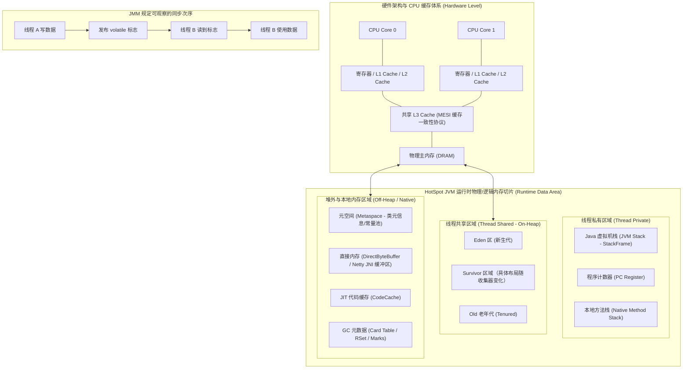
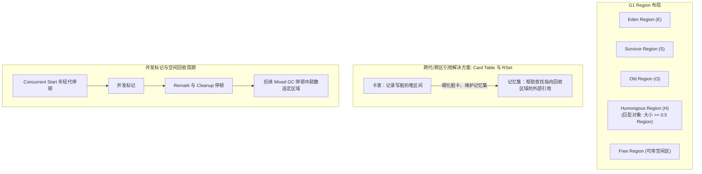
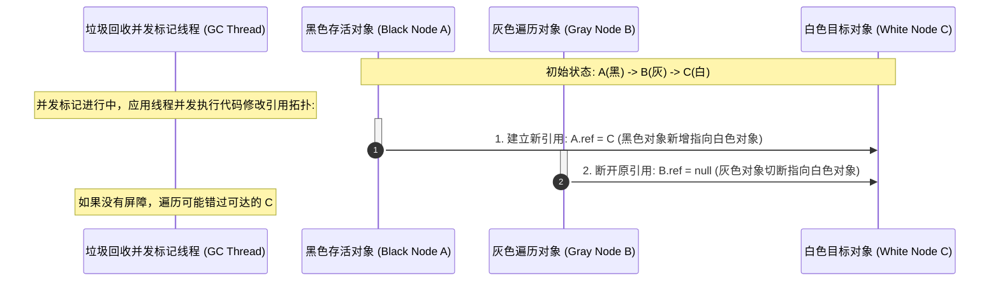
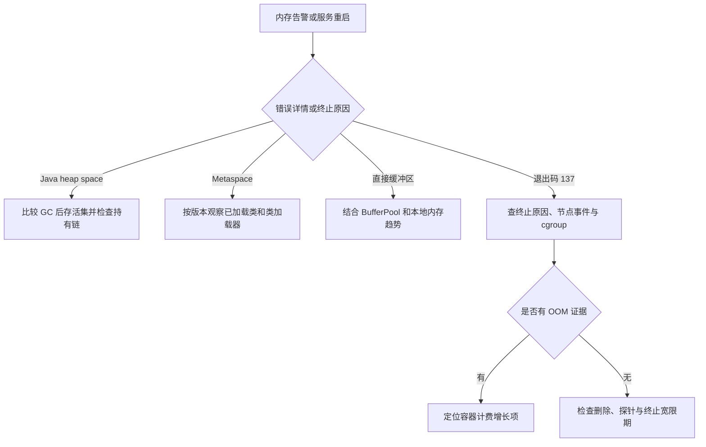

# JVM 内存模型、垃圾回收调优与生产排障：Java 17/21 JMM规范、G1/ZGC底层原理、三色标记屏障与OOM根因决策

这一章用 JDK 17/21 的 HotSpot 串起三个问题：不同线程如何看见彼此的写入，GC 怎样在应用持续修改对象时正确回收内存，容器重启后哪些证据能区分堆内、堆外和外部终止。真实面经归属见第 8 节。

> [!NOTE] 案例性质说明：Flink、网关、脚本引擎和容器场景为教学推演。文中的容量用于演算，调优结论须用目标服务的同负载对照实验验证。

---

## 1. 知识概述与业务价值

### 1.1 是什么（What）
- **Java 虚拟机内存体系与 JMM 规范**：
  - **JVM 运行时数据区**包括线程共享的堆和方法区，以及每线程的程序计数器、JVM 栈等。HotSpot 把类元数据放在本地内存的元空间，直接缓冲区和代码缓存还要另计。
  - **Java 内存模型（Java Memory Model - JMM）**：JSR-133 规范定义的抽象内存交互模型，屏蔽了底层 AMD64、ARM64 等不同硬件 CPU 缓存架构与操作系统的差异，规范了多线程并发访问共享变量时的**可见性（Visibility）、有序性（Ordering）与原子性（Atomicity）**。
- **现代化垃圾收集器（Garbage Collectors）演进趋势**：
  - GC 追踪可达对象并回收空闲空间。过期缓存或集合若还强引用对象，GC 会保留它们。
  - JDK 14 移除 CMS。JDK 17 的 ZGC 使用单代实现，JDK 21 可选分代 ZGC。并发搬迁旨在缩短 GC 停顿，端到端延迟还包含排队、线程调度和 I/O。[JDK 21 变更](https://docs.oracle.com/en/java/javase/25/migrate/significant-changes-jdk-21.html)

### 1.2 解决什么核心业务痛点（Why）
- **暂停与级联超时**。长暂停可能超过心跳或调用超时，使上游重试集中到仍健康的实例。先叠加暂停、重试与队列时间线再归因。
- **内存保留**。静态集合、线程上下文和动态类加载器都可能延长对象寿命，超出可用空间时出现分配失败。
- **容器被杀**。即使堆仍有余量，进程的本地分配及计入容器的其他开销也可能耗尽额度。退出原因要结合编排器与内核证据确认。

### 1.3 适用场景与技术边界（Where & When）
- **最佳业务场景矩阵**：
  - **低延迟 API 网关**。从请求 P99 预算反推可容忍的 GC 时间，保留 CPU、队列和下游调用各自的预算。
  - **Flink TaskManager、Spark Executor**。把网络与状态占用一起纳入预算，既看有效吞吐，也看回收后存活集。
  - **即席查询引擎**：限制每个查询能持有的内存，比较 G1 和 ZGC 在相同工作量下的延迟与吞吐。
- **适用边界**：小堆批处理可同时压测 Parallel GC 和 G1。调整收集器时需保留 CPU 和空闲堆给并发回收。看到 `System.gc()` 要先定位请求者及所选收集器的处理方式，再评估屏蔽它是否改变直接缓冲区等资源的回收行为。

---

## 2. 核心概念与关系

### 2.1 核心概念全景表

| 核心概念 | 英文术语 | 核心定义与工程职责 | 内存与生命周期级别 |
| :--- | :--- | :--- | :--- |
| **Java 内存模型** | JMM | 约束线程共享变量的读写以及同步动作可观察到的结果 | 语言规范 |
| **先行发生** | Happens-before | 同一线程程序次序、同步边和传递性共同建立的可见性与顺序关系 | 并发可见性 |
| **元空间** | Metaspace | Java 8+ 替代永久代（PermGen）的本地内存区域，存放类元数据、运行时常量池 | 进程级堆外本地内存 |
| **堆外直接内存** | Direct buffer | 缓冲内容可在堆外，用于减少 I/O 路径中的某些复制 | 进程本地内存 |
| **停顿时间** | Stop-The-World (STW) | 垃圾回收过程中，暂停所有 Java 应用线程执行全局对象图标记或移动的现象 | 毫秒至秒级系统停顿 |
| **记忆集 / 卡表** | Remembered set / card table | 记录或帮助维护可能指向目标区域的引用位置，让收集器缩小扫描范围 | G1 辅助数据结构 |
| **三色标记法** | Tri-color Marking | 将堆中对象抽象为黑（存活已查）、灰（存活未查子）、白（未访问/垃圾）三色遍历算法 | 并发标记核心图算法 |
| **染色指针** | Colored pointers | ZGC 在引用中编码 GC 状态，具体位布局依模式与实现而变 | 引用元数据 |

### 2.2 JVM 运行时数据区与硬件内存交互拓扑图



---

## 3. 底层工作机制与设计哲学

### 3.1 JMM 内存模型规范与硬件级内存屏障深度推导

#### 1. 为什么会有 JMM

编译器可以优化访存顺序，硬件也可能先把写入放入缓冲区。Java 程序需要一个跨平台的判断标准：线程 B 读到某个标志时，哪些数据必须已经可见。

#### 2. Happens-Before 原则（先行发生原则）
下面是建立 happens-before 的常用规则。它约束可观察结果，允许保留程序语义的重排。[JLS §17.4.5](https://docs.oracle.com/javase/specs/jls/se21/html/jls-17.html#jls-17.4.5)
1. **程序次序规则（Program Order Rule）**：单线程内，书写在前面的操作先行发生于后面的操作；
2. **管程锁定规则（Monitor Lock Rule）**：一个 `unlock` 操作先行发生于后面对同一个锁的 `lock` 操作；
3. **volatile 变量规则（Volatile Variable Rule）**：对一个 `volatile` 变量的写操作先行发生于后面对这个变量的读操作；
4. **传递性规则（Transitivity）**：如果 $A \text{ hb } B$，且 $B \text{ hb } C$，则 $A \text{ hb } C$；
5. **线程启动与终止规则**：`Thread.start()` 先行发生于该线程的每一个动作；线程中所有操作先行发生于对此线程的终止检测（`Thread.join()`）。

#### 3. volatile 发布的白板例子

写线程先构造不可变规则对象并把它赋给普通字段，再写 volatile 标志。读线程读到这个标志后读取规则。程序次序、volatile 写到随后读的同步边及传递性组成完整可见性链。这不能让 `count++` 的读、加、写三步变成一次原子操作。HotSpot 使用目标架构支持的指令实现这些约束，JLS 未指定必须插入某一条 x86 汇编或把数据刷回 DRAM。

---

### 3.2 现代垃圾收集器架构内核：G1 与 ZGC 深度剖析

#### 1. G1 的回收集与记忆集

G1 将堆分成等大的 Region，年轻代与老年代由这些区域组成。



- **停顿预测模型（Pause Time Prediction Model）**：
  G1 可依据近期暂停与各区域存活数据预测回收的耗时与收益。年轻代回收后，Mixed 阶段会把适合的老区加入回收集。`-XX:MaxGCPauseMillis` 提供软目标。
- **巨型对象（Humongous Objects）的特殊处理**：
  对象尺寸达到 Region 的一半就进入巨型对象路径，分配可能需要多个连续 Region。疏散可以减少碎片，但巨型对象分配仍可能受连续空间限制。[G1 官方说明](https://docs.oracle.com/en/java/javase/21/gctuning/garbage-first-g1-garbage-collector1.html)

#### 2. ZGC 怎样允许应用在对象搬迁期间读写引用

ZGC 让标记和搬迁等主要工作与应用并发执行。读引用时，屏障检查引用中编码的状态；遇到需要重定位的引用，慢路径使用转发信息返回新位置，并可修复产生该引用的字段以减少后续开销。分代 ZGC 还使用写屏障记录有关引用写入的信息，维护跨代引用、支持标记。具体位布局和指令数随 JDK 和平台而变。[OpenJDK 分代 ZGC 设计](https://openjdk.org/jeps/439)

JDK 17 选择 ZGC 使用 `-XX:+UseZGC`；在 JDK 21 要试验分代模式，可用 `-XX:+UseZGC -XX:+ZGenerational`。JDK 24 起只保留分代 ZGC。即便暂停很短，堆余量不足仍可能让应用线程等待分配。[JDK 24 ZGC 指南](https://docs.oracle.com/en/java/javase/24/gctuning/z-garbage-collector.html)

---

### 3.3 三色标记算法与读写屏障底层机制

#### 1. 三色定义与标记推进过程
三色标记法是并发标记阶段将复杂对象图抽象化的经典图遍历模型：
- **黑色**表示对象已扫描，已经处理过它的出边。
- **灰色**表示对象已被发现，其出边尚待扫描。
- **白色**表示对象尚未发现。并发算法需配合屏障，才能安全地依据最终标记结果回收。



#### 2. 推导并发更新为什么可能漏标

在上图的简化模型中，如果黑色对象新指向白色对象，并且标记器尚未访问的原有路径被切断，只扫描一次的算法就可能错过仍存活的对象。实际收集器通过屏障维护不变量。

| 机制 | 记录什么 | 权衡 |
| --- | --- | --- |
| CMS 的增量更新 | 记录标记期间被修改的区域，供后续重新扫描 | 修改集越大，需要补扫的工作可能越多 |
| G1 的 SATB | 在覆盖引用前记录旧值，以保留标记开始时的可达关系 | 本轮保守保留的浮动垃圾占用空间 |
| 分代 ZGC | 读屏障处理搬迁后的引用，写屏障参与标记及跨代引用维护 | 把更多工作移出暂停，也要计入并发开销 |

这里的 GC 屏障是虚拟机在引用读写附近插入的逻辑，与 JMM 中保证线程可见性的同步语义分别讨论。

---

## 4. 高频复杂业务场景实操与落地

### 4.1 场景一：Flink / Spark 大数据任务由于堆外直接内存（DirectMemory）泄漏导致系统崩溃排查实战

Flink TaskManager 在堆使用率平稳时也可能遇到 JVM 抛出的直接缓冲区分配错误。先查看堆外预算和直接缓冲池计数，核对是并发高峰、池化后正常保留，还是缺少释放。JDK 的直接缓冲区依赖包装对象可达性与清理机制，Netty 的引用计数缓冲区还需按库约定归还。

NMT 在启动时用 `-XX:NativeMemoryTracking=summary` 开启，先记 `jcmd <pid> VM.native_memory baseline`，过一段时间查看 `summary.diff`。它跟踪 HotSpot 内部分类，并不能覆盖所有第三方本地分配。对照 RSS、JMX BufferPool、Netty 分配器指标和容器用量，才能决定应调资源配额还是修正未归还的缓冲区。[NMT 官方边界](https://docs.oracle.com/en/java/javase/21/vm/native-memory-tracking.html)

### 4.2 场景二：Java 17/21 现代大吞吐系统 G1 与 ZGC 生产平滑迁移与调优实战

假设同一网关准备从 G1 切到 ZGC。先在当前 JDK 上采集 G1 基线，固定 CPU 配额、堆大小、流量构成和预热时间。若同时升级 JDK，要在新版先测 G1，分开识别运行时升级与收集器切换的影响。

对照记录业务 P99、超时率、成功请求吞吐、CPU、分配等待和内存峰值。若 GC 停顿下降但业务 P99 持平，需要继续查排队或下游耗时。若吞吐下跌，计算达成原 SLA 所需增配的资源再决定是否上线。

### 4.3 场景三：Metaspace 元空间动态类加载泄漏导致频繁 Full GC 实战

#### 业务背景
假设一份风控服务的 GC 日志在多次规则发布后反复出现 Metadata GC Threshold。老年代回收前后差异较大，此时应优先看元空间和类数量的趋势，也保留对堆增长的观察。

脚本引擎每次发布新版本均生成类。在同等负载下比较加载与卸载数量、`jcmd <pid> VM.classloader_stats` 和历次发布后元空间占用。若旧版本加载器通过线程上下文、回调或静态缓存保持可达，其定义的普通类通常不能卸载。

可用按版本且有容量上限的编译缓存复用有效类，在版本退休后解除注册并释放旧加载器。缓存全部历史版本会把原问题搬到缓存里。元空间高水位会影响触发回收的时机，调大阈值只能推迟错误出现。

---

## 5. 生产异常故障深度排查与根因分析

### 5.1 故障一：G1 巨型对象分配与 Full GC

设 Region 为 16 MiB，25 MiB 数组需要两个连续 Region。全堆有足够的空闲总量，也可能缺少这样的连续区间。先从 GC 日志确认巨型对象数量、疏散失败和 Full GC 原因，再用分配样本找出生成大数组的调用栈。G1 在现代 JDK 可使用并行 Full GC。Concurrent Mode Failure 是旧 CMS 的术语。

优先尝试流式解析、分块读取与限制在途批次。改变 Region 大小时重新计算阈值：即使从 16 MiB 调到 32 MiB，25 MiB 的数组仍属于巨型对象；增大 Region 还会降低按区回收的粒度。[G1 堆调优](https://docs.oracle.com/en/java/javase/21/gctuning/garbage-first-g1-garbage-collector1.html) · [OpenJDK 并行 Full GC](https://openjdk.org/jeps/307)

### 5.2 故障二：Linux 容器（Kubernetes Pod）环境下 Exit Code 137 OOM-Killed 深度排查

#### 故障现象
部署在 Kubernetes 上的数据中台 Java 微服务 Pod 经常在流量高峰期突发重启。查看 `kubectl describe pod` 发现退出状态为：
`Last State: Terminated, Reason: OOMKilled, Exit Code: 137`。
然而应用日志中没有任何 `java.lang.OutOfMemoryError` 异常堆栈，且 `-XX:+HeapDumpOnOutOfMemoryError` 参数未生成任何 `.hprof` 堆转储快照。

#### 深度根因分析（Root Cause）

1. **分类**。按常见的 shell/容器约定，137 对应 SIGKILL。结合终止原因、Pod 事件、节点内核日志或 cgroup v2 的 `memory.events` 查证 OOM。删除时超过终止宽限期也可能收到 SIGKILL。
2. **定位**。确认 OOM 后对照容器的 `memory.current`、`memory.max`、`memory.stat` 及峰值记录。容器计费包含文件缓存等项目，单个进程 RSS 和 JVM 堆曲线都不能替代这个总量。
3. **预算**。估算堆、直接缓冲、元空间、线程栈实际提交、代码缓存和其他本地内存，给业务突发留余量。`-Xmx` 是堆上限，线程数乘 `-Xss` 是平台线程栈预留量的估算。二者都不能直接当作实测 RSS。重新压测峰值后确定上限，没有适用于所有服务的固定堆占比。[Kubernetes 内存管理](https://kubernetes.io/docs/tasks/configure-pod-container/assign-memory-resource/)

### 5.3 故障三：ThreadLocal 内存泄漏导致线程池 Worker 内存持续攀升

#### 故障现象
假设报表服务在等量流量下回收后堆基线逐日升高。堆转储显示长寿命工作线程通过 ThreadLocalMap 持有导出上下文。应分别查看数组本身大小和其引用子树的保留大小。

#### 深度根因分析（Root Cause）
1. **ThreadLocalMap 内部弱引用与内存泄漏链条**：
   - `ThreadLocalMap.Entry` 继承自 `WeakReference<ThreadLocal<?>>`；
   - 键被清除后，线程仍可通过 Entry 强引用值。后续 ThreadLocal 操作可能清理陈旧项，在此之前值仍可能滞留。
2. **线程池的放大效应**。工作线程跨请求复用，未清理的值可能延长对象生命周期，也可能污染下一请求。用堆转储检查到线程的保留路径。

#### 生产治理方案
1. **代码规范门禁（Mandatory Finally Clean）**：
   对跨请求复用的平台线程，在定义请求上下文生命周期的一层成对设置与清理。如果允许嵌套，还需在退出时恢复先前上下文。
   ```java
   public void processRequest(Request req) {
       try {
           userContext.set(buildContext(req));
           doBusiness();
       } finally {
           userContext.remove(); // 强制清除 Entry，彻底斩断强引用链条
       }
   }
   ```
2. **框架集成**。只在创建上下文的边界回收自己管理的值。异步任务应在实际执行线程上成对设置和清理。

### 5.4 生产故障排查决策树（Mermaid）


---

## 6. 技术选型对比

| 业务约束 | 可比较的收集器 | 需要实测 |
| --- | --- | --- |
| 离线计算，吞吐优先 | Parallel GC、G1 | 完成同批任务的时间和 CPU 小时 |
| 在线服务，需要平衡吞吐和延迟 | G1 | Young/Mixed/Full 暂停、请求 P99、疏散余量 |
| 接口预算主要消耗在 GC 暂停 | ZGC、G1 | 相同流量下的请求长尾、分配等待、CPU 与内存成本 |

CMS 是历史对照项，使用并发标记清除会面临碎片和浮动垃圾。JDK 14 移除它的提案也指出缺少维护者。G1 的疏散能缓解碎片，连续大对象空间和软暂停目标仍有边界。[移除 CMS 的提案](https://openjdk.org/jeps/363) · [收集器选型指南](https://docs.oracle.com/en/java/javase/21/gctuning/available-collectors.html)

## 7. 技术经理与架构师实战管控

### 7.1 生产级 JVM 标准启动参数基线规范（SOP）

以下为教学命令。假设业务 Jar 位于当前目录，服务有权限写入 `logs`。堆容量要用目标容器峰值流量验证，轮转的日志与转储要分别留出磁盘配额。

```bash
mkdir -p logs/dumps
java -Xms1g -Xmx2g -XX:+UseG1GC \
  -XX:NativeMemoryTracking=summary \
  -XX:+HeapDumpOnOutOfMemoryError -XX:HeapDumpPath=logs/dumps \
  '-Xlog:gc*,safepoint:file=logs/gc.log:time,uptime,level,tags:filecount=5,filesize=20M' \
  -jar app.jar
```

在线与离线作业分别设限，租户提交批量任务时同时约束并发和批大小。出现压力先推迟非关键批次，保护核心服务。

### 7.2 堆转储（Heap Dump）自动化保护与安全敏感信息擦除机制

1. **磁盘防爆保护机制（Disk Overflow Prevention）**：
   - 转储体积取决于实际对象与格式。为多个实例同时失败预留空间，独立存储并设置容量和保留期限。
2. **数据安全与 PII 敏感脱敏准则**：
   - 堆转储可能包含用户数据。限制采集、留存与读取权限，优先分发脱敏后的统计和引用路径。
   - 由受控分析环境处理原始快照，记录访问和清理时间。

### 7.3 研发代码质量红线与内存反模式门禁（CI/CD Check）

在代码评审与 CI 中关注以下能验证的生命周期问题。
1. **线程上下文**。检查谁写入请求状态、在哪个线程清理，并用连续两个请求验证状态未串用。
2. **无界缓存和批量集合**。核对最大规模、淘汰策略和大数组分配点。提前设初始容量只在能合理估计大小时减少扩容，过大会浪费内存。
3. **流和文件**。由本模块打开的 I/O 资源可用 try-with-resources 确保异常路径也关闭。

---

## 8. 互联网大厂高频面试真题库

公司归属按候选人自述转述，具体技术追问及管理场景由本库补充。更多基础题见 [JVM 六题](../08-interview-questions/05-jvm.md)。

1. **Q1** volatile 如何提供可见性？延伸到 happens-before 与并发自增。[字节一面](https://www.nowcoder.com/discuss/353157830410706944)
2. **Q2** CMS 和 G1 如何回收？延伸到 CMS 移除背景和 G1 疏散边界。[美团到家一面](https://www.nowcoder.com/feed/main/detail/0b920842a9dc4a059497bbdc6732a4a5)
3. **Q3** 三色标记中如何理解新对象、浮动垃圾？延伸到 G1 的 SATB。[阿里场景金融二面](https://www.nowcoder.com/discuss/353158131003891712)
4. **Q4** G1 与 ZGC 分别在哪些时机暂停？延伸到染色指针和并发搬迁。[字节后端一面](https://ac.nowcoder.com/discuss/1668080?type=0)
5. **Q5** 怎样排查线上频繁 GC？延伸到回收后堆下降而 CPU 仍忙的场景。[阿里 Lazada 面经](https://www.nowcoder.com/discuss/353158242433966080)
6. **Q6** OOM 的排查路径是什么？延伸到只有退出码 137 的容器。[美团成都一面](https://www.nowcoder.com/discuss/353158294153928704)
7. **Q7** 教学延伸：作为负责人，怎么设计 JVM 参数基线、代码检查和恢复流程？

---

## 9. 结构化深度参考答案

### 题目1 volatile 的可见性和边界

#### 简洁回答

对同一 volatile 字段的写 happens-before 随后的读。先写配置内容，再用 volatile 发布配置，读线程观察到对应发布后即可安全读取之前写入的内容。

#### 深入回答

由程序次序、同步边和传递性推导。复合自增需要读取旧值、相加、写回，两个线程仍能基于同一个旧值各写一次。编译器和硬件只需满足 JMM 可观察语义，具体屏障指令因架构而异。[JLS 内存模型](https://docs.oracle.com/javase/specs/jls/se21/html/jls-17.html#jls-17.4)

#### 架构师/技术管理视角

不可变配置快照可借单次引用发布，多字段原地修改则可能暴露中间状态。选用锁或原子更新取决于业务不变量；压测需覆盖竞争时的正确性和吞吐。

### 题目2 CMS 与 G1 的回收取舍

#### 简洁回答

CMS 的老年代主要并发标记和清除。G1 将堆分区，按回收收益和预计耗时挑选区域，在暂停中疏散存活对象。两者均有停顿。

#### 深入回答

CMS 可能留下分散的空洞。G1 疏散后可整块复用已清空的区域，但巨型对象分配还可能遇到连续区不足。标记结束的 Remark 和 Cleanup 与后续 Mixed 暂停是不同阶段。`MaxGCPauseMillis` 是预测目标；回收集内存活量、引用关系和可用 CPU 都会影响实际时间。

#### 架构师/技术管理视角

遗留服务升级到现代 JDK 时先移除旧 CMS 参数、保留升级前基线，比较相同业务负载下的单位 CPU 吞吐和请求 P99。发现差异后按 GC 阶段定位。

### 题目3 三色标记、漏标与浮动垃圾

#### 简洁回答

白是尚未访问，灰是已发现待扫描，黑是已扫描。并发修改可能让标记器错过仍可达对象。若标记后某对象才变得无用，本轮仍把它视为存活，就形成浮动垃圾。

#### 深入回答

沿第 3 节的 A、B、C 推演。若已扫描的 A 新增到白色 C 的引用，而待扫描的 B 删除了原本通往 C 的边，朴素遍历就会错过 C。G1 的 SATB 写前屏障记录被覆盖的旧引用，保留标记开始时的可达关系；该周期中新分配的对象按存活处理。CMS 的增量更新则跟踪并重扫发生修改的区域。

#### 架构师/技术管理视角

看到老年代在一次回收后仍很大，先比较多个周期下相同负载的存活集，分清业务长寿命状态、浮动垃圾和真正的无界保留，再决定是否检查引用链。

### 题目4 G1 与 ZGC 的暂停

#### 简洁回答

G1 在年轻代及 Mixed 疏散时暂停，Remark 与 Cleanup 也有暂停。ZGC 把主要标记和对象搬迁工作放到并发阶段，仍有短暂的阶段切换暂停，例如单代 ZGC 的标记开始、标记结束和搬迁开始。

#### 深入回答

ZGC 可以让应用先读取尚待修复的引用，读屏障利用转发信息到达搬迁后的对象，随后可修复引用。在 JDK 21 的分代模式中，写屏障也参与标记及跨代记录。将引用元数据的位数、具体布局或固定指令数写成所有版本共同要求，会推导出错误结论。[OpenJDK 分代 ZGC](https://openjdk.org/jeps/439)

#### 架构师/技术管理视角

比较暂停分布和业务 P99，也比较 CPU 竞争、分配等待和内存余量。低 GC 暂停与低端到端延迟需要分别验收。

### 题目5 频繁 GC 与高 CPU

#### 简洁回答

先确定具体收集器、实际事件类型和触发原因，把 GC 暂停与 CPU 时间、有效吞吐放到同一时间轴。一次回收后降幅大，说明当时有大量可回收对象，尚不足以判断全部原因。

#### 深入回答

若日志显示大量年轻代疏散且分配速率陡增，用分配样本找热点路径。若出现 Full GC，继续查显式 GC 请求、疏散失败、大对象和类加载活动。对元空间可用 `jcmd <pid> VM.classloader_stats`，对直接缓冲区结合 JMX 与本地内存趋势。CPU 也可能消耗在业务自旋或重试，查看线程和 JFR 样本加以区分。

#### 架构师/技术管理视角

按租户和任务类型确定主要分配来源。若某批次吞掉在线容量，先限批量提交并回放原峰值。确认应用对象生命周期修复后，再验证是否仍有必要修改全局 GC 参数。

### 题目6 OOM 与容器被杀

#### 简洁回答

发生 OOM 时，先读 Java 异常详情或容器终止原因，判断是堆、元空间、直接内存还是外部终止。只有 137 时通常只能推知 SIGKILL，无法据此判断内存超限。

#### 深入回答

若终止原因是 OOMKilled，查节点与 cgroup 事件，区分节点内存压力和容器额度，比较容器实际计费及其组成。外部 SIGKILL 不给 JVM 写堆转储的机会。若有 Java heap space，则分析 GC 后存活集和到 GC 根的引用路径；若是 Metaspace，改查加载器及动态类的增长。

#### 架构师/技术管理视角

对突发的批量任务优先削减并发，保留健康副本取证。给每种容器规格留出按峰值实测的堆外余量，用灰度验证恢复后积压能否消化。[Kubernetes 内存限制](https://kubernetes.io/docs/tasks/configure-pod-container/assign-memory-resource/)

### 题目7 JVM 稳定性治理

#### 简洁回答

为每类工作负载维护带版本的参数基线，保留可回退的配置；把内存生命周期和未设上限的缓存纳入代码评审；生产事故以证据留存、恢复核心服务和复盘为闭环。

#### 深入回答

为 IO 密集服务和大批量计算分别测量峰值内存组成，在预发回放流量并观察高峰后的回落。发布前确认诊断日志轮转、转储目录、空间和权限。单实例失效时先摘流并保留必要证据，评估重启后的补偿与队列压力，避免整组实例同时退出。

#### 架构师/技术管理视角

给租户分配并发预算，把降级优先级和峰值前的演练负责人写入发布单。将每次修复对应到一项监控、验收实验和回滚条件，以恢复耗时和复发率评估投入。

### 9.8 Day 22 口述速记卡

- **JMM**：用发布配置的 volatile 写和读回答可见性，再用两个线程自增说明原子性边界。
- **G1**：按年轻代疏散、并发标记、Remark/Cleanup、Mixed 疏散画时间线；留意巨型对象和疏散余量。
- **ZGC**：先讲并发搬迁，再按 JDK 版本说明屏障和分代。最后比较业务延迟与成本。
- **137**：先确认信号、终止原因和事件，再看堆、RSS 与容器计费的差异。
- **治理**：按业务分别量化限额、灰度条件与回滚指标。

---

## 10. 知识自检与口述推演清单

| 检查维度 | 核心自检问题 | 达标口述标准与要点 | 掌握状态 |
| :--- | :--- | :--- | :---: |
| **规范与底层** | 能否用发布对象的例子解释 happens-before？ | 写出程序次序、volatile 写读边和传递性，说明复合操作边界。 | [ ] |
| **GC 内核演进** | 能否画出 G1 与 ZGC 的暂停和并发工作？ | 标出疏散、标记和转发，说明分代 ZGC 的写屏障。 | [ ] |
| **算法推导** | 能否推导三色标记为何需要协作屏障？ | 用 A/B/C 说明指针更新，再解释旧引用怎样进入 SATB 队列。 | [ ] |
| **生产排障实战** | 面对退出码 137 还缺哪些证据？ | 核查终止原因与 OOM 事件；根据实测计费而非固定堆占比分配预算。 | [ ] |
| **管理领导力** | 能否以负责人视角阐述如何构建企业级 JVM 稳定性标准规范与故障自愈闭环？ | 从标准镜像参数模板化、CI/CD 静态代码门禁、OOM 自动摘流保留快照与复盘文化进行高维技术管理表达。 | [ ] |

---

## 11. 知识脉络与技术图谱关联

### 11.1 依赖的前置核心技术
- **操作系统与计算机组成原理**：CPU 多级缓存体系、虚拟内存管理、汇编指令集与 Linux 信号机制；
- **[[01-bigdata/01-flink/01-flink-runtime-architecture|Flink 运行架构与资源管理]]**：Flink TaskManager 内存模型与堆外托管内存调优；
- **[[01-bigdata/06-hbase/01-hbase-architecture-lsm|HBase 存储架构与 LSM-Tree]]**：BlockCache 与堆外直接内存（BucketCache）防 GC 停顿实践。

### 11.2 驱动的后置核心能力
- **[[03-java-engineering/02-concurrency-juc|Java 并发编程与 JUC 核心机制]]**：JMM 内存模型直接驱动 AQS、CAS 与并发集合的底层实现；
- **[[02-data-platform/05-data-api-security|数据服务API与多租户权限体系]]**：Netty 反应式网关底层直接依赖 DirectMemory 与高性能垃圾回收支持；
- **[[09-review/04-week04-comprehensive-review|【阶段复盘 4】分布式底座与生产故障综合答辩]]**：第四周核心大厂技术底座面试答辩。

---

## 12. 权威参考与官方进阶资料

1. **语言规范与诊断**：[JLS 17.4](https://docs.oracle.com/javase/specs/jls/se21/html/jls-17.html#jls-17.4) · [HotSpot GC 指南](https://docs.oracle.com/en/java/javase/21/gctuning/) · [jcmd 影响说明](https://docs.oracle.com/en/java/javase/21/docs/specs/man/jcmd.html)
2. **ZGC 演进**：[JEP 376 并发处理线程栈](https://openjdk.org/jeps/376) · [JEP 439 分代 ZGC](https://openjdk.org/jeps/439)
3. **行业经典著作**：
   - 周志明：《深入理解 Java 虚拟机：JVM 高级特性与最佳实践（第3版）》（第2-4章内存管理、第12章内存模型与线程）；
   - Brian Goetz 等：《Java Concurrency in Practice》（Java 并发编程实战，第16章 Java 内存模型）。
