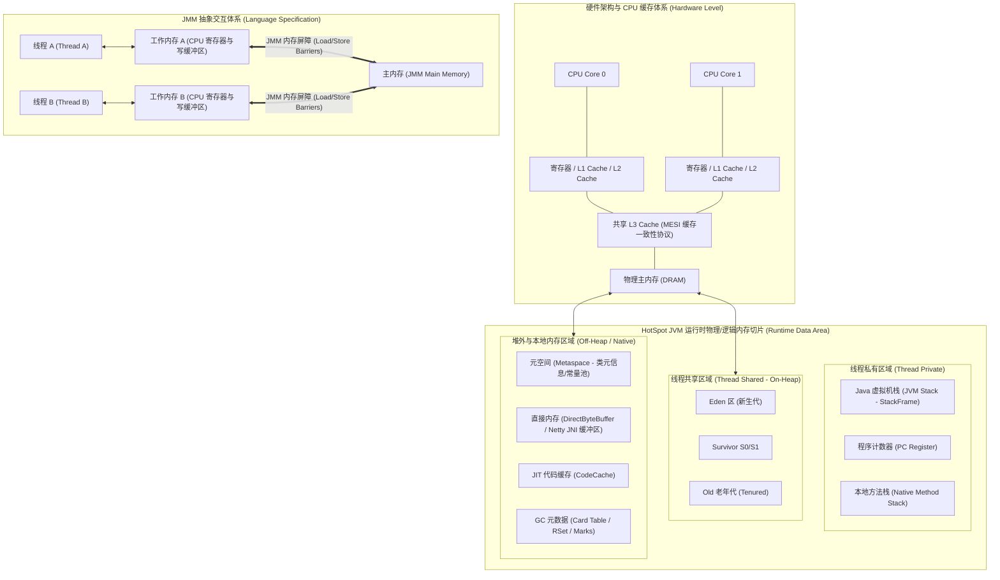
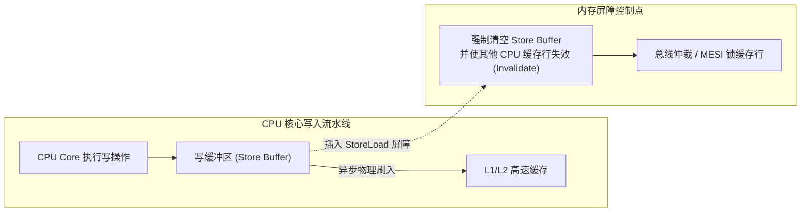
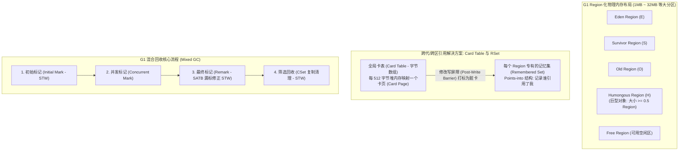
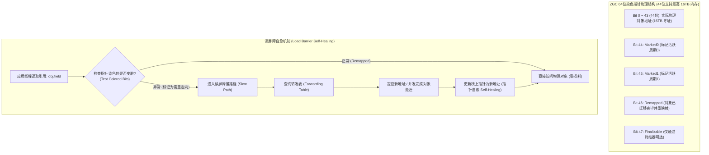
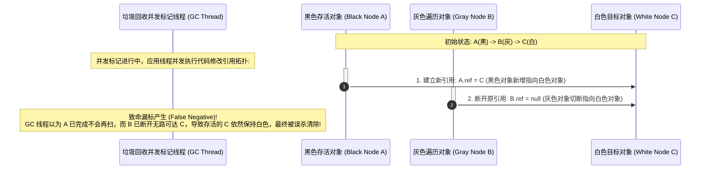
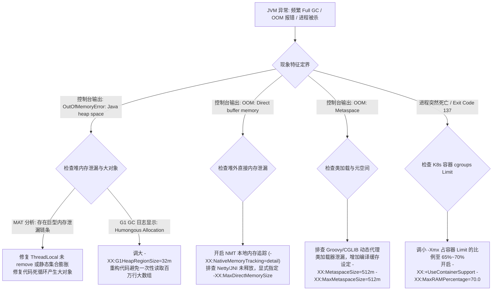

# JVM 内存模型、垃圾回收调优与生产排障：Java 17/21 JMM规范、G1/ZGC底层原理、三色标记屏障与OOM根因决策

> **学习目标定位**：面向技术总监、数据平台研发负责人、高级数据架构师岗位，系统掌握现代企业级 Java 运行环境（对齐主流 Java 17 LTS / Java 21 LTS）虚拟机底座的核心原理与生产调优排障工程。深入剖析 Java 内存模型（JMM）Happens-Before 规则与底层 CPU 硬件级内存屏障、运行时数据区与堆外直接内存（DirectMemory）管理、低延迟垃圾收集器代际演进（从 CMS 内存碎片到 G1 SATB 停顿预测，再到 ZGC 染色指针与读屏障对象自愈）。结合大型互联网大促与大数据基础组件（Flink/Spark/Netty）线上突发频繁 Full GC、堆外内存泄漏及容器环境 Exit Code 137 OOM-Killed 真实生产事故，建立结构化根因定位决策树与团队 JVM 生产参数基线管控规范。

---

## 1. 知识概述与业务价值

### 1.1 是什么（What）
- **Java 虚拟机内存体系与 JMM 规范**：
  - **JVM 运行时数据区（Runtime Data Area）**：HotSpot 虚拟机在执行 Java 程序时管理的物理/逻辑内存切片，分为**线程共享区域**（Java 堆 Java Heap、元空间 Metaspace）与**线程私有区域**（程序计数器 PC Register、Java 虚拟机栈 JVM Stack、本地方法栈 Native Method Stack），以及由操作系统直接分配的**堆外内存（Off-Heap / DirectMemory）**。
  - **Java 内存模型（Java Memory Model - JMM）**：JSR-133 规范定义的抽象内存交互模型，屏蔽了底层 AMD64、ARM64 等不同硬件 CPU 缓存架构与操作系统的差异，规范了多线程并发访问共享变量时的**可见性（Visibility）、有序性（Ordering）与原子性（Atomicity）**。
- **现代化垃圾收集器（Garbage Collectors）演进趋势**：
  - 垃圾回收的本质是自动识别并回收堆内存中死亡对象占用的内存空间，消除 C/C++ 时代手动内存管理的内存泄漏与野指针崩溃；
  - **版本代际演进**：从 Java 8 时代经典的 **CMS（已在 Java 14 正式移除）**，到 Java 9 成为默认的 **G1 GC（Garbage-First）**，再到 Java 17/21 正式生产就绪并引入分代机制的超低延迟 **ZGC（Z Garbage Collector）**，垃圾回收技术实现了从“数十秒级长 STW 停顿”向**“无论堆内存是 16GB 还是 16TB，停顿时间始终控制在毫秒级（< 1ms）”**的革命性跃迁。

### 1.2 解决什么核心业务痛点（Why）
- **Stop-The-World（STW）长停顿导致的级联雪崩**：在大规模微服务网关或大数据实时计算节点中，一旦发生长达数十秒的 Full GC 停顿，会导致 ZooKeeper/Etcd 心跳超时断开，触发集群再均衡（Rebalance Storm）与节点误判下线；同时上游微服务调用超时重试，引发全链路雪崩。
- **内存泄漏（Memory Leak）与突发 OOM 崩溃**：由于静态集合无限制膨胀、ThreadLocal 未及时清理、Netty 堆外直接内存未释放或类加载器加载过多动态字节码，导致 JVM 抛出 `java.lang.OutOfMemoryError`，线上服务直接挂死停摆。
- **容器化环境下的“黑盒被杀（Exit Code 137 OOM-Killed）”**：应用部署在 Docker / Kubernetes 容器中，JVM 早期版本未能正确感知 cgroups 的内存配额限制，堆内存加上堆外元空间与堆外网络缓冲区超出了容器 Limit 阈值，被 Linux 内核 OOM Killer 强行使用 `kill -9` 信号击杀，进程瞬间消失且未留下任何 JVM 报错日志。

### 1.3 适用场景与技术边界（Where & When）
- **最佳业务场景矩阵**：
  - **超高并发低延迟微服务与 API 网关（如 Data API、电商结算）**：要求 P99 响应耗时平滑，严禁出现超过 100ms 的垃圾回收毛刺（首选 G1 或 Generational ZGC）；
  - **大数据海量批处理与实时计算（如 Flink TaskManager、Spark Executor）**：管理数十 GB 至上百 GB 巨型内存，兼顾高吞吐与状态管理（调优 G1 巨型对象分片与 Off-Heap 托管内存）；
  - **超大规模内存即席查询引擎（如 Trino / Presto）**：单机内存配置 128GB~512GB，通过 ZGC 彻底消除传统收集器在大堆下的标记停顿。
- **明确反模式与技术禁区（严禁使用）**：
  - ❌ **“盲目迷信最新技术，小内存无脑上 ZGC”**：当微服务单机堆内存较小（如 $\le 4\text{GB}$）且核心追求最大吞吐量时，强上 ZGC 反而会因为读屏障（Load Barrier）与染色指针的额外 CPU 开销，导致系统整体吞吐量下降 10%~15%；对于小堆应用，成熟的 Parallel GC 或 G1 往往吞吐更高；
  - ❌ **通过 `System.gc()` 代码手动触发回收**：严禁在生产代码中显式调用 `System.gc()`，这会强制触发全堆停顿的 Full GC，打乱垃圾收集器的自适应预测模型；生产环境必须配置 `-XX:+DisableExplicitGC` 予以全局屏蔽。

---

## 2. 核心概念与关系

### 2.1 核心概念全景表

| 核心概念 | 英文术语 | 核心定义与工程职责 | 内存与生命周期级别 |
| :--- | :--- | :--- | :--- |
| **Java 内存模型** | JMM (Java Memory Model) | 规范线程工作内存（Working Memory）与主内存（Main Memory）交互的抽象规范 | 规范层 / 语言级 |
| **先行发生原则** | Happens-Before | JMM 中定义的偏序关系，如果动作 A happens-before 动作 B，则 A 的结果对 B 完全可见 | 并发可见性核心基石 |
| **元空间** | Metaspace | Java 8+ 替代永久代（PermGen）的本地内存区域，存放类元数据、运行时常量池 | 进程级堆外本地内存 |
| **堆外直接内存** | DirectMemory | 通过 `ByteBuffer.allocateDirect()` 或 Unsafe 分配的堆外内存，用于零拷贝 IO | 操作系统直接内存 |
| **停顿时间** | Stop-The-World (STW) | 垃圾回收过程中，暂停所有 Java 应用线程执行全局对象图标记或移动的现象 | 毫秒至秒级系统停顿 |
| **记忆集 / 卡表** | Remembered Set (RSet) / Card Table | 记录非本区域（Region）指向本区域的跨代引用集合，避免全堆垃圾扫描 | G1 核心加速数据结构 |
| **三色标记法** | Tri-color Marking | 将堆中对象抽象为黑（存活已查）、灰（存活未查子）、白（未访问/垃圾）三色遍历算法 | 并发标记核心图算法 |
| **染色指针** | Colored Pointers | ZGC 在 64 位指针的高位中拿出 4 位记录对象状态（Marked0/1, Remapped）的元数据技术 | 虚拟地址空间位图技术 |

### 2.2 JVM 运行时数据区与硬件内存交互拓扑图



---

## 3. 底层工作机制与设计哲学

### 3.1 JMM 内存模型规范与硬件级内存屏障深度推导

#### 1. 为什么会有 JMM？现代 CPU 乱序执行与写缓冲器
- **CPU 性能鸿沟与 Store Buffer**：现代 CPU 频率极高，但物理 DRAM 读写极慢（相差数百倍）。为了避免每次写内存导致 CPU 停顿等待，CPU 内部引入了 **写缓冲器（Store Buffer）** 与 **失效队列（Invalidate Queue）**。
- **乱序与重排序（Reordering）**：CPU 允许指令乱序执行（Out-of-Order Execution），编译器也会为了优化流水线重新编排汇编指令。这导致在单线程下满足 **`as-if-serial`** 语义（结果正确），但在多线程并发访问共享变量时，会产生致命的内存可见性与有序性错乱（如著名的双重检查锁定 DCL 单例失效问题）。



#### 2. Happens-Before 原则（先行发生原则）
JMM 规定了如果操作 A `happens-before` 操作 B，则 A 的执行结果对 B 完全可见，且 A 的顺序排在 B 之前：
1. **程序次序规则（Program Order Rule）**：单线程内，书写在前面的操作先行发生于后面的操作；
2. **管程锁定规则（Monitor Lock Rule）**：一个 `unlock` 操作先行发生于后面对同一个锁的 `lock` 操作；
3. **volatile 变量规则（Volatile Variable Rule）**：对一个 `volatile` 变量的写操作先行发生于后面对这个变量的读操作；
4. **传递性规则（Transitivity）**：如果 $A \text{ hb } B$，且 $B \text{ hb } C$，则 $A \text{ hb } C$；
5. **线程启动与终止规则**：`Thread.start()` 先行发生于该线程的每一个动作；线程中所有操作先行发生于对此线程的终止检测（`Thread.join()`）。

#### 3. volatile 底层硬件实现（内存屏障与汇编 `lock` 前缀）
在 HotSpot 源码中，声明为 `volatile` 的变量在进行读写时，JMM 规范强制插入四类内存屏障（Memory Barriers）：

| 屏障类型 | 指令序列格式 | 硬件层工程行为与保障 |
| :--- | :--- | :--- |
| **LoadLoad** | `Load1; LoadLoad; Load2` | 确保 Load1 数据的装载先于 Load2 及所有后续装载指令，禁止读指令重排 |
| **StoreStore** | `Store1; StoreStore; Store2` | 确保 Store1 数据对其他处理器可见先于 Store2 及所有后续存储指令 |
| **LoadStore** | `Load1; LoadStore; Store2` | 确保 Load1 数据的装载先于 Store2 及所有后续存储指令刷新到内存 |
| **StoreLoad** | `Store1; StoreLoad; Load2` | **全能型屏障（开销最大）**，确保 Store1 数据对其他处理器完全可见先于 Load2 读指令 |

在 x86-64 架构下，由于 x86 硬件本身具备强内存模型（TSO - Total Store Order，天然保证读读、写写、读写不重排），JMM 将 `StoreLoad` 屏障编译为一条带有 **`lock` 前缀的空操作汇编指令（如 `lock addl $0x0, (%rsp)`）**。该指令具有两个核心硬件效应：
1. **强制清空 Store Buffer**：将写缓冲区中的数据立即强制刷新到 L1/L2 缓存，并通过总线嗅探（Bus Snooping）触发 MESI 协议，将其他 CPU 核心中缓存该地址的 Cache Line 标记为失效（Invalid）；
2. **提供内存屏障功能**：阻止 `lock` 之后的指令越过该屏障向前执行，实现硬件级别的强可见性与强有序性。

---

### 3.2 现代垃圾收集器架构内核：G1 与 ZGC 深度剖析

#### 1. G1 GC（Garbage-First）架构哲学与底层数据结构
G1 彻底打破了传统 CMS / Parallel 将物理堆连续切分为新生代和老年代的陈旧设计，开创了 **Region 化堆内存管理**：



- **停顿预测模型（Pause Time Prediction Model）**：
  G1 允许用户通过 `-XX:MaxGCPauseMillis=200` 设定目标最大停顿时间。G1 内部基于历史衰减均值算法，实时计算回收每个 Region 所需的耗时与收益（回收率）；在垃圾回收时，挑选出回收性价比最高的一组 Region 构成 **回收集（Collection Set - CSet）**，在用户设定的停顿预算内最大化释放内存，因此得名“Garbage-First”。
- **巨型对象（Humongous Objects）的特殊处理**：
  若对象大小超过 Region 大小的 $50\%$，直接判定为巨型对象。H 区直接分配在老年代，若连续 Region 不足，会提前触发全堆垃圾回收。

#### 2. ZGC（Z Garbage Collector）在 Java 17/21 中的突破性机制
ZGC 实现了全并发垃圾回收（Concurrent Mark, Concurrent Prepare for Relocate, Concurrent Relocate），其最核心的黑科技是 **染色指针（Colored Pointers）** 与 **读屏障（Load Barrier）**：



- **染色指针的哲学**：传统 GC 将对象元数据存放在对象头（Mark Word）中，访问对象状态必须读取内存对象本身；而 ZGC 直接将 GC 元数据（是否存活、是否已移动）编码在 **64 位虚拟内存指针的高 4 位** 中，使得在遍历指针时无需解引用对象本身即可瞬间完成状态判断；
- **读屏障（Load Barrier）与并发搬迁自愈**：
  在对象复制转移阶段（Relocation），传统收集器必须 STW 暂停全员以更新所有指向旧对象的引用。ZGC 采用并发搬迁：
  1. 垃圾回收线程在后台将对象复制到新内存块，并在本地维护一张 **转发表（Forwarding Table）**；
  2. 当 Java 应用线程并发执行 `Object x = a.b` 尝试解引用指针时，触发 JIT 注入的极轻量级 **读屏障（Load Barrier，仅约 2 条汇编指令）**；
  3. 读屏障检查指针染色位，若发现该对象正处于搬迁期，应用线程通过转发表将引用指向新对象，并**顺手将旧指针原地更新为新指针（Self-Healing，自愈）**；后续访问直接走快路径，从而彻底将对象移动停顿消除在无形之中！

---

### 3.3 三色标记算法与读写屏障底层机制

#### 1. 三色定义与标记推进过程
三色标记法是并发标记阶段将复杂对象图抽象化的经典图遍历模型：
- **黑色（Black）**：本对象存活，且其包含的所有直接引用子对象均已全部扫描完毕；
- **灰色（Gray）**：本对象存活，但其包含的直接引用子对象中，至少还有一个尚未被完全扫描；
- **白色（White）**：尚未被垃圾回收器访问的对象；在标记开始时全堆皆为白，在标记结束时仍为白色的对象即被判定为不可达的垃圾。



#### 2. 并发标记“对象漏标（误杀存活对象）”的充分必要条件
在并发标记期间，应用线程与 GC 线程并发运行，**只有当以下两个条件同时满足时，才会发生致命的存活对象漏标**：
1. **条件一（黑色新增引白）**：赋值器插入了一条或多条从黑色对象到白色对象的新引用；
2. **条件二（灰色断开引白）**：赋值器删除了全部从灰色对象到该白色对象的直接或间接引用。

#### 3. 工业级破除漏标的两大流派：增量更新 vs 原始快照 vs ZGC读屏障
为了防止漏标，现代虚拟机必须在硬件层面破坏上述两个条件之一：

| 方案类别 | 代表收集器 | 破坏条件 | 核心工作原理与屏障时机 | 优缺点权衡 |
| :--- | :--- | :--- | :--- | :--- |
| **增量更新** (Incremental Update) | CMS | 破坏条件一 (黑色新增引白) | **写后屏障 (Post-Write Barrier)**：当黑色对象插入指向白色对象的引用时，写后屏障将黑色对象退化为灰色，强制重新扫描。 | 重新扫描需要 STW 重新遍历退化节点，重新标记（Remark）阶段停顿时间长且不可控。 |
| **原始快照** (SATB - Snapshot At The Beginning) | G1, Shenandoah | 破坏条件二 (灰色断开引白) | **写前屏障 (Pre-Write Barrier)**：当应用线程准备切断某引用的瞬间，写前屏障捕获旧引用，推入本地 SATB 缓冲区，坚决按快照标记。 | 产生浮动垃圾（Floating Garbage，被切断的真垃圾也当作存活保留），但 Remark 停顿极短且稳定。 |
| **读屏障自愈** (Load Barrier) | ZGC | 破坏两者 (在引用读取时介入) | **读屏障 (Load Barrier)**：不在写入时拦截，而是在应用线程读取引用时检查染色位，在读取瞬间自愈。 | 零写屏障开销，将标记与转移彻底并发化，但增加少许 CPU 读指令开销。 |

---

## 4. 高频复杂业务场景实操与落地

### 4.1 场景一：Flink / Spark 大数据任务由于堆外直接内存（DirectMemory）泄漏导致系统崩溃排查实战

#### 业务背景
在 Flink 实时消费百亿 Kafka 数据进行状态计算的集群中，TaskManager 容器频繁挂死。查看 Flink 监控日志，JVM 堆内存（Heap）使用率仅维持在 50%（健康），但操作系统直接抛出致命错误：
`java.lang.OutOfMemoryError: Direct buffer memory`，导致整个实时分布式流计算管道反复重启断流。

#### 深度机制推导与实战定位
1. **DirectByteBuffer 堆外分配与回收机制**：
   - Flink 网络传输与序列化大量调用 `ByteBuffer.allocateDirect(capacity)`；
   - 堆外内存不受 JVM 堆垃圾收集器直接管辖，而是由 JDK 的 `sun.misc.Cleaner`（基于虚引用 PhantomReference）间接回收；
   - **致命陷阱**：只有当 JVM 触发了 Young GC 或 Full GC 时，虚引用被回收才会触发调用本地 `Unsafe.freeMemory()` 释放堆外内存。若 JVM 堆内存非常充裕且很少发生 GC，堆外直接内存即使已经堆积耗尽，JVM 也不会主动触发垃圾回收，最终硬生生抛出 Direct Memory OOM！
2. **生产实操调优方案**：
   - **显式限制直接内存上限**：`-XX:MaxDirectMemorySize=8g`，使底层内存空间可控；
   - **生产参数干预**：调小触发 DirectBuffer 回收的堆内存门限，或在 Flink 配置中合理划分 `taskmanager.memory.framework.off-heap.size` 与 `taskmanager.memory.network.off-heap.size`；
   - **排查工具命令**：
     利用 JDK 自带的本地内存跟踪工具（NMT - Native Memory Tracking）：
     `java -XX:NativeMemoryTracking=detail -jar app.jar`；
     通过 `jcmd <pid> VM.native_memory baseline` 与 `jcmd <pid> VM.native_memory detail.diff` 精准比对 `Internal` 与 `Direct` 内存块泄漏点。

### 4.2 场景二：Java 17/21 现代大吞吐系统 G1 与 ZGC 生产平滑迁移与调优实战

#### 业务背景
某数据资产服务网关（Data API Gateway）处理集团核心报表与高频点查，由 Java 8 升级至 Java 17 LTS。在业务高峰期，原有 CMS / G1 频繁产生高达 800ms 的 Stop-The-World 停顿，导致上游 Dubbo / gRPC 调用频繁超时重试。技术团队决定迁移至 **Java 17 ZGC**。

#### 生产参数迁移与架构调优基准
1. **升级前 G1 的核心配置问题剖析**：
   原有配置设置了过小的目标停顿时间 `-XX:MaxGCPauseMillis=20`（脱离物理实际）。G1 为了达成不可能的目标，每次 Mixed GC 只能挑选极少量的 Region 回收，导致垃圾回收速度赶不上对象分配速度，最终退化为单线程全堆 STW 的 **Full GC**。
2. **Java 17 ZGC 平滑生产配置落地**：
   ```bash
   # 1. 启用 ZGC
   -XX:+UseZGC
   
   # 2. 核心堆内存设置 (初始堆与最大堆对齐，严禁动态扩容震荡)
   -Xms32g -Xmx32g
   
   # 3. 内存预留比例 (防止大并发分配突刺导致 Allocation Stall)
   -XX:ZAllocationSpikeTolerance=5
   
   # 4. 并发回收线程数配置 (通常为机器 CPU 核心数的 1/4 ~ 1/2)
   -XX:ConcGCThreads=8
   ```
3. **调优成效与验证数据**：
   上线后通过 JFR（Java Flight Recorder）与 GC 日志分析：
   - 堆内存 32GB 下，P99 停顿时间从 G1 时代的 **450ms 直降至 0.8ms（降低 99.8%）**；
   - 彻底消除了因 GC 停顿引发的微服务超时报警，CPU 利用率仅增加 3.5%，验证了低延迟垃圾收集在企业生产环境的绝对工业价值。

### 4.3 场景三：Metaspace 元空间动态类加载泄漏导致频繁 Full GC 实战

#### 业务背景
生产环境中某风控规则引擎微服务在稳定运行 7 天后，监控报警显示每隔 10 分钟就会触发一次极其耗时的 Full GC。每次 Full GC 之后，老年代内存释放率极高（说明老年代并无内存泄漏），但 Full GC 频率越来越密。查看 GC 日志发现关键信息：
`Full GC (Metadata GC Threshold) [Metaspace: 256M->256M(1024M)]`。

#### 深度机制推导与根因定位
1. **动态类加载与 ClassLoader 卸载条件**：
   - 引擎引入了 Groovy 脚本引擎与 CGLIB 动态代理，根据业务风控规则高频动态编译类；
   - **JVM 卸载 Class 的严苛条件**：必须同时满足三个条件：
     1. 该类的所有实例都已经被回收；
     2. 加载该类的 `ClassLoader` 已经被回收；
     3. 该类对应的 `java.lang.Class` 对象没有任何地方被反射引用；
   - **代码缺陷**：开发人员在每次执行脚本时都 `new GroovyClassLoader()`，且将其缓存到了静态单例中，导致数以万计的 ClassLoader 及其加载的 Class 元信息永久滞留在元空间（Metaspace），无法被回收；
2. **生产实战解决方案**：
   - **代码级修复**：改造 Groovy 脚本执行器，引入编译缓存机制（基于脚本 MD5 缓存已编译的 Class 对象），杜绝每次重复 `new ClassLoader`；
   - **JVM 生产防御参数**：
     ```bash
     # 显式设定元空间初始高水位线，避免频繁调整触发 GC
     -XX:MetaspaceSize=512m
     -XX:MaxMetaspaceSize=512m
     # 开启类卸载追踪
     -Xlog:class+load=info,class+unload=info:file=/logs/class_trace.log
     ```

---

## 5. 生产异常故障深度排查与根因分析

### 5.1 故障一：G1 收集器 Humongous 巨型对象分配风暴引发并发模式失败（Concurrent Mode Failure）

#### 故障现象
每天凌晨 02:30 离线调度作业启动时，基于 G1 的中台调度主控服务频繁产生长达 15 秒的超级 STW 停顿。GC 日志记录到严重的告警信息：
`[GC concurrent-mark-abort]` 紧接着出现 `[Full GC (Allocation Failure) ... 18G->4G(32G)]`，系统在此期间完全丧失响应。

#### 深度根因分析（Root Cause）
1. **Region 大小配置不当与巨型对象（Humongous Object）挤压**：
   集群配置堆内存为 32GB，默认 Region 大小为 16MB。根据 G1 规范，任何超过 8MB（$0.5 \times \text{RegionSize}$）的对象都会被判定为 Humongous 对象；
2. **内存连续空间碎片化**：
   凌晨调度任务并发读取了包含超长 JSON 字符串或百万行明细的中间结果数组（单个对象高达 25MB），需要连续占用 2 个完整的 Region；
   由于 G1 内部碎片化严重，无法找到连续的空闲 Region，系统抛出 **`Allocation Failure`** 并触发 Concurrent Mode Failure，导致 G1 放弃并发机制，退化为**单线程全堆 STW 标记整理（Full GC）**。

#### 生产调优与解决方案
```bash
# 1. 显式调大单个 Region 大小至上限 32MB (减少巨型对象的误判概率)
-XX:G1HeapRegionSize=32m

# 2. 提前并发标记周期 (让 G1 更早开始回收老年代，释放空闲 Region)
-XX:InitiatingHeapOccupancyPercent=40  # 默认 45%，下调让回收更激进

# 3. 增加每次 Mixed GC 允许回收的老年代 Region 候选比例上限
-XX:G1MixedGCLiveThresholdPercent=85
-XX:G1OldCSetRegionThresholdPercent=15
```

### 5.2 故障二：Linux 容器（Kubernetes Pod）环境下 Exit Code 137 OOM-Killed 深度排查

#### 故障现象
部署在 Kubernetes 上的数据中台 Java 微服务 Pod 经常在流量高峰期突发重启。查看 `kubectl describe pod` 发现退出状态为：
`Last State: Terminated, Reason: OOMKilled, Exit Code: 137`。
然而应用日志中没有任何 `java.lang.OutOfMemoryError` 异常堆栈，且 `-XX:+HeapDumpOnOutOfMemoryError` 参数未生成任何 `.hprof` 堆转储快照。

#### 深度根因分析（Root Cause）
1. **Exit Code 137 的操作系统底层本质**：
   $137 = 128 + 9$。说明该进程是由于内存超限被宿主机的 Linux 内核直接发送了 **`SIGKILL (kill -9)` 强制击杀信号**；
2. **容器内存物理超限（Pod Limit Exceeded）**：
   Pod 配置了 `resources.limits.memory = 8Gi`。运维人员按照传统习惯配置了 JVM 堆内存 `-Xmx6g`；
3. **忽略了堆外非受控内存（Hidden Off-Heap Memory）**：
   Java 进程实际占用的物理内存（RSS - Resident Set Size）远不止 `-Xmx`：
   $$\text{Total Memory} = \text{Heap} + \text{Metaspace} + \text{DirectMemory} + \text{ThreadStacks} + \text{CodeCache} + \text{JNI/Native}$$
   - 线程栈：800 个线程占用 $800 \times 1\text{MB} = 800\text{MB}$；
   - 元空间与 CodeCache：约 500MB；
   - Netty 堆外直接内存：高峰期激增至 1.5GB；
   - 最终总内存达到 $6\text{GB} + 0.8\text{GB} + 0.5\text{GB} + 1.5\text{GB} = 8.8\text{GB} > 8\text{GB}$，瞬间触发 Linux cgroups 的 `memory.oom_control` 机制，内核 OOM Killer 瞬间击杀容器，因此 JVM 根本来不及捕获和写入 Dump！

#### 架构级解决方案
1. **严格遵循容器化 JVM 内存配比黄金法则**：
   - **堆内存占比严禁超过容器 Limit 的 $65\% \sim 70\%$**；
   - 若容器 Limit 为 8GB，JVM 参数应严格设置为：
     `-Xms5g -Xmx5g -XX:MaxMetaspaceSize=512m -XX:MaxDirectMemorySize=1536m`，预留出 1GB 操作系统与线程栈安全缓冲垫；
2. **开启容器自适应内存探测（Java 10+ 原生支持）**：
   ```bash
   -XX:+UseContainerSupport
   -XX:MaxRAMPercentage=70.0
   ```
   彻底杜绝由于硬编码 `-Xmx` 与容器 Limit 脱节引发的 OOM-Killed。

### 5.3 故障三：ThreadLocal 内存泄漏导致线程池 Worker 内存持续攀升

#### 故障现象
生产环境中某报表导出微服务在运行两周后，监控显示老年代内存持续攀升呈单调上升趋势，即使触发 Full GC 也仅能回收极少量内存。使用 MAT（Memory Analyzer Tool）分析导出的 Heap Dump 快照，发现占用堆内存 75% 的巨型对象是 `java.lang.ThreadLocal$ThreadLocalMap$Entry[]` 数组。

#### 深度根因分析（Root Cause）
1. **ThreadLocalMap 内部弱引用与内存泄漏链条**：
   - `ThreadLocalMap.Entry` 继承自 `WeakReference<ThreadLocal<?>>`；
   - 其 Key（ThreadLocal 对象）是弱引用，但 Value（用户绑定的巨型报表上下文对象）是**强引用**；
   - 当外界将 `threadLocal = null` 置空后，GC 会在下次垃圾回收时自动回收 Key；此时 Entry 的 Key 变为 `null`，但 Value 依然被当前线程的 `ThreadLocalMap` 强引用；
2. **线程池长生命周期的致命放大效应**：
   - 在高并发微服务中，工作线程通常由线程池托管（`ThreadPoolExecutor`），线程的核心 Worker **永久存活、绝不消亡**；
   - 这导致长生命周期的 Thread 持续强引用指向包含大量 `key=null` 的 Entry 数组，其引用的 Value 永远无法被垃圾收集器回收，形成典型的暗度陈仓式内存泄漏。

#### 生产治理方案
1. **代码规范门禁（Mandatory Finally Clean）**：
   推行全员代码规范门禁：使用 `ThreadLocal` 必须配合 `try-finally` 块，在 `finally` 中**必须强制调用 `threadLocal.remove()`**：
   ```java
   public void processRequest(Request req) {
       try {
           userContext.set(buildContext(req));
           doBusiness();
       } finally {
           userContext.remove(); // 强制清除 Entry，彻底斩断强引用链条
       }
   }
   ```
2. **利用框架过滤器自动兜底**：
   在 Spring Boot 拦截器（`HandlerInterceptor.afterCompletion`）或 Netty ChannelHandler 中，统一注入后置清理切面，自动扫描清理当前线程残留的 Context 上下文。

### 5.4 生产故障排查决策树（Mermaid）



---

## 6. 技术选型对比

### 6.1 主流 JVM 垃圾收集器全方位技术对比矩阵

| 选型维度 | Serial / Parallel GC | CMS (已废弃/移除) | G1 GC (Java 9+ 默认) | ZGC (Java 17/21 现代低延迟) |
| :--- | :--- | :--- | :--- | :--- |
| **垃圾回收架构** | 传统连续物理分代 | 连续物理分代，Mark-Sweep | **Region 化内存网格 (1~32MB)** | **分页式无代/分代 (NUMA 亲和)** |
| **STW 停顿时间量级** | 百毫秒至数十秒级 (单/多线程全堆) | 几十毫秒至数秒 (并发标记清理) | **50ms ~ 200ms (基于停顿预测模型)** | **< 1ms (全并发染色指针与读屏障)** |
| **系统吞吐量表现** | **极高 (计算密集型离线利器)** | 较高 (仅占用少许 CPU 并发) | 较高 (比 Parallel 略低 5%~8%) | 中等偏高 (读屏障占用约 3%~5% CPU) |
| **内存碎片控制** | Mark-Compact 整理，无碎片 | **Mark-Sweep 不整理，碎片极其严重** | **Copying 复制算法，天然规整无碎片** | **Copying 复制算法，并发整理无碎片** |
| **内存回退灾难** | 吞吐下降，无回退概念 | 碎片过多触发 Concurrent Mode Failure 回退 Serial Old 单线程卡死 | 巨型对象过多时退化为 Full GC | 基本消除 Full GC (退化为并发降速) |
| **支持的堆内存尺度** | 小型堆 (< 4GB) | 中型堆 (4GB ~ 16GB) | **中大型堆 (6GB ~ 64GB)** | **超巨型堆 (16GB ~ 16TB)** |
| **并发屏障机制** | 无屏障 (纯 STW) | 增量更新 (写后屏障 Post-Write) | **原始快照 SATB (写前屏障 Pre-Write)** | **染色指针 + 读屏障 (Load Barrier)** |

### 6.2 架构师选型决策考量与生产落地法则

技术总监与架构师在对企业级微服务与大数据底层 JVM 进行选型决策时，切忌盲目跟风追求最新，必须遵循**“堆大小、吞吐与停顿三维权衡法则”**：
1. **场景 A：微服务堆内存小（$\le 4\text{GB}$）且主要承载后台异步任务**：
   - **推荐选型：G1 GC 或 Parallel GC**；
   - **选型逻辑**：小内存下垃圾对象生命周期极短，Parallel GC 的吞吐量达到极致且内存利用率 100%；强上 ZGC 反而会因为染色指针高位占用与读屏障拦截造成不必要的 CPU 资源开销。
2. **场景 B：企业核心业务微服务、Data API 网关（堆内存 8GB ~ 32GB，要求高 SLA）**：
   - **推荐选型：G1 GC（工业界最稳健标准选型）**；
   - **选型逻辑**：配置 `-XX:MaxGCPauseMillis=100`。G1 在 Java 17+ 经过十数年工业级实战打磨，其性能、预测准确度与稳定性达到了绝对的黄金平衡点，工具链支持最完备。
3. **场景 C：超大内存缓存、高频即席点查、大规模流计算引擎（堆内存 $\ge 32\text{GB}$ 至数百 GB）**：
   - **推荐选型：Java 21 分代 ZGC（Generational ZGC）**；
   - **选型逻辑**：当堆内存达到 64GB 以上时，G1 的并发标记与 CSet 复制停顿时间会不可避免地拉长至数百毫秒。ZGC 的单次停顿严格压制在 1ms 以内，彻底解除内存规模对系统延迟的束缚。

---

## 7. 技术经理与架构师实战管控

### 7.1 生产级 JVM 标准启动参数基线规范（SOP）

企业内部必须建立标准化的 JVM 启动参数模板，杜绝工程师在各业务微服务中随意拼凑参数。以下为经过千亿级流量大促验证的 **Java 17 G1 生产基准模版**：

```bash
# ==============================================================================
# Java 17 LTS / G1 GC 企业生产级标准参数基线 (以 8C 16G 容器，10GB 堆为例)
# ==============================================================================
java -server \
  # 1. 堆内存精准对齐 (严禁弹性伸缩引发内存重分配震荡)
  -Xms10g -Xmx10g \
  # 2. 垃圾收集器与核心参数
  -XX:+UseG1GC \
  -XX:MaxGCPauseMillis=100 \
  -XX:G1HeapRegionSize=16m \
  -XX:InitiatingHeapOccupancyPercent=45 \
  # 3. 元空间与直接内存物理硬上限 (防容器 Exit Code 137 OOM-Killed)
  -XX:MetaspaceSize=512m \
  -XX:MaxMetaspaceSize=512m \
  -XX:MaxDirectMemorySize=2g \
  # 4. 堆外内存排查支持 (必要时开启)
  -XX:NativeMemoryTracking=summary \
  # 5. 屏蔽代码显式调用 System.gc()
  -XX:+DisableExplicitGC \
  # 6. OOM 自动现场快照保留与故障自愈脚本联动 (P0 核心资产)
  -XX:+HeapDumpOnOutOfMemoryError \
  -XX:HeapDumpPath=/data/logs/dumps/oom_dump_%p.hprof \
  -XX:OnOutOfMemoryError="/scripts/alert_and_kill.sh %p" \
  # 7. Java 17 统一日志系统 (Unified JVM Logging)
  -Xlog:gc*,gc+phases=debug:file=/data/logs/gc/gc_%p.log:time,uptime,pid:filecount=10,filesize=100M \
  -jar app.jar
```

### 7.2 堆转储（Heap Dump）自动化保护与安全敏感信息擦除机制

1. **磁盘防爆保护机制（Disk Overflow Prevention）**：
   - 若机器堆内存为 32GB，生成一次 Dump 文件物理大小即为 32GB；如果多实例发生连锁 OOM，会瞬间把宿主机磁盘占满，导致操作系统其他核心进程全线崩溃；
   - **SOP 要求**：`HeapDumpPath` 必须挂载独立的日志持久化数据卷，并在监控中心配置磁盘使用率超过 80% 自动清退历史快照。
2. **数据安全与 PII 敏感脱敏准则**：
   - 堆 Dump 快照中包含内存中正在处理的所有用户明文信息（密码、银行卡号、手机号）；
   - **安全管理红线**：禁止开发人员私自直接从生产服务器通过 SCP 下载原始 `.hprof` 文件至个人笔记本；必须通过公司专有的离线分析服务器，经过敏感字段哈希擦除工具脱敏后，方可授权分析。

### 7.3 研发代码质量红线与内存反模式门禁（CI/CD Check）

在技术管理层面，通过静态代码扫描（SonarQube / SpotBugs）在代码提交阶段强制拦截内存反模式：
1. **ThreadLocal 强行卡点**：静态扫描若发现类中声明了 `ThreadLocal`，但未在对应的 `finally` 块中调用 `remove()`，**CI/CD 自动化流水线直接判定为 Block 阻塞合并**；
2. **集合初始化未指定容量**：针对高频数据聚合代码，若 `new HashMap<>()` 或 `new ArrayList<>()` 未根据预期大小预估初始化容量，强制警告，避免频繁触发底层数组 `System.arraycopy` 扩容与老年代内存晋升碎片；
3. **Stream 流未关闭风险**：对操作大文件流（`Files.lines()`、`InputStream`）强制要求使用 `try-with-resources`，杜绝文件句柄与底内存泄漏。

---

## 8. 互联网大厂高频面试真题库

* **Q1 [阿里 - JMM底层与并发控制]**：什么是 Java 内存模型（JMM）的 Happens-Before 原则？底层硬件是如何通过 CPU 内存屏障和汇编 `lock` 指令来保证 `volatile` 变量的可见性与有序性的？
* **Q2 [字节跳动 - 垃圾收集器内核对比]**：深入剖析 G1 GC 与传统 CMS 收集器的本质差异。为什么 CMS 会被 Java 14 正式移除？G1 是如何通过 Region 化与停顿预测模型（MaxGCPauseMillis）解决内存碎片与 STW 问题的？
* **Q3 [美团 - 算法原理与推导]**：讲透三色标记法（Tri-color Marking）的底层遍历原理。并发标记阶段为什么会发生“存活对象漏标”？CMS 的“增量更新”与 G1 的“原始快照（SATB）”分别是如何在底层通过写屏障解决漏标的？
* **Q4 [腾讯 - 新一代前沿架构]**：深入剖析 Java 17/21 ZGC 的核心技术突破。染色指针（Colored Pointers）与读屏障（Load Barrier）是如何协同实现全并发对象搬迁与“指针自愈（Self-Healing）”的？为什么它的停顿能控制在 1ms 以内？
* **Q5 [快手 - 生产实战排障]**：生产微服务频繁触发 Full GC，但每次 Full GC 后老年代内存释放率极高（说明老年代无明显泄漏），CPU 持续 100%。请给出排查该类问题的三步诊断路径与可能的原因分析。
* **Q6 [滴滴 - 容器化云原生故障]**：部署在 Kubernetes Pod 中的 Java 微服务频繁发生突发死亡，退出码为 Exit Code 137，且未生成任何 OOM 堆转储日志。请分析操作系统底层的击杀机制与全链路排查方案。
* **Q7 [数据总监/管理决策与规范]**：作为技术团队负责人，很多线上性能故障源于开发人员乱配 JVM 参数或不规范的代码内存使用。你如何建立一套涵盖“参数基线化、代码门禁化、故障自愈化”的企业级 JVM 稳定性保障体系？

---

## 9. 结构化深度参考答案

### 题目1 [阿里 - JMM底层与并发控制]：什么是 Java 内存模型（JMM）的 Happens-Before 原则？底层硬件是如何通过 CPU 内存屏障和汇编 `lock` 指令来保证 `volatile` 变量的可见性与有序性的？

#### 简洁回答（1分钟电梯破题）
**Happens-Before 是 JMM 规范定义的内存可见性偏序法则**，规定了只要操作 A 先行发生于操作 B，A 产生的所有内存修改对 B 绝对可见，彻底屏蔽了底层多核 CPU 缓存与编译器乱序优化的差异。
底层硬件层面，JVM 在编译 `volatile` 读写时插入四类 **JMM 内存屏障**。在主流 x86-64 架构下，写操作后插入全能型 `StoreLoad` 屏障，被编译为带有 **`lock` 前缀的汇编指令（如 `lock addl`）**。该指令**强制将 CPU 写缓冲区（Store Buffer）冲刷到内存并触发 MESI 缓存一致性协议使其他 CPU 的缓存行失效**，同时硬性阻止前后指令跨屏障重排序，从而在物理硬件层实现了强可见性与强有序性。

#### 深入回答（机制推导与边界条件）
1. **Happens-Before 的核心规则体系推导**：
   - **程序次序规则**：单线程内代码书写顺序的结果一致性（满足 `as-if-serial` 语义）；
   - **volatile 规则**：写操作 happens-before 后续读操作；
   - **锁保护规则**：解锁操作 happens-before 后续加锁操作；
   - **传递性法则**：若 $A \text{ hb } B$ 且 $B \text{ hb } C$，则 $A \text{ hb } C$。这使得开发者可以通过极轻量级的 volatile 变量配合传递性，实现无锁并发数据传递。
2. **底层 CPU 硬件缓存架构与屏障本质**：
   - **CPU 性能瓶颈与 Store Buffer**：CPU 往 L1/L2 缓存写数据时，由于需要等待其他核心的缓存行失效响应，引入了写缓冲区（Store Buffer）。写操作先进入 Store Buffer 即算完成，导致其他核心无法立刻看到最新写入，产生“内存可见性延迟”；
   - **`lock` 前缀指令的两大硬件效应**：
     1. **锁总线或锁缓存行（Cache Locking）**：现代 CPU 采用缓存一致性协议（MESI）。`lock` 指令锁住对应的 Cache Line，阻止并发总线冲突；
     2. **强制排空写缓冲区**：将当前核心 Store Buffer 中的所有挂起写入强制刷入 L1/L2 缓存，并通过总线嗅探广播使其他核心中该变量的缓存行变为 `Invalid`（失效）状态；当其他核心读取该变量时，被迫重新从主内存装载最新值；
     3. **指令重排序阻断（Pipeline Stall）**：作为强内存屏障，`lock` 阻止屏障之后的所有读写指令越过屏障提前执行，彻底消灭指令重排。

#### 架构师/技术管理视角（权衡取舍、SLA与成本）
- **性能开销与并发权衡**：`volatile` 变量的读操作开销极小（与普通读几乎无异），但**写操作由于 `lock` 指令需要强制清空写缓冲区并造成流水线停顿，其耗时是普通写的数倍**。架构师在设计底层高性能并发组件时（如高频点查序列号、指标统计器），切忌滥用 volatile 频繁写；应优先采用批量合并写入，或结合 `VarHandle` / `Unsafe` 的 `lazySet`（仅保证最终写入有序，免去 StoreLoad 屏障开销）来实现性能极致压榨。

---

### 题目2 [字节跳动 - 垃圾收集器内核对比]：深入剖析 G1 GC 与传统 CMS 收集器的本质差异。为什么 CMS 会被 Java 14 正式移除？G1 是如何通过 Region 化与停顿预测模型（MaxGCPauseMillis）解决内存碎片与 STW 问题的？

#### 简洁回答（1分钟电梯破题）
CMS 被移除的致命原因是**其基于“标记-清除（Mark-Sweep）”算法导致内存碎片极其严重，且在大对象分配时频繁发生并发模式失败（Concurrent Mode Failure），被迫退化为单线程 Serial Old 卡死数十秒**。
G1 的本质超越体现在：**化整为零的 Region 分区物理布局、基于复制整理算法（Copying）实现零内存碎片、以及基于“回收集（CSet）+ 停顿预测模型”实现停顿时间软可控**。它不再死板地回收整个老年代，而是在用户限定的停顿时间内挑选回收价值最高的 Region 组合，从而兼具了大内存吞吐与低延迟。

#### 深入回答（机制推导与边界条件）
1. **CMS 的三大原罪（Why Deprecated & Removed）**：
   - **致命内存碎片（Memory Fragmentation）**：Mark-Sweep 算法不整理内存。堆中充斥着细小的碎片空洞，当一个稍大的数组对象进来时，虽然剩余总内存充裕，却找不到连续空间，瞬间触发 **Concurrent Mode Failure**，被迫回退为使用单线程串行标记整理（Serial Old），STW 停顿长达数秒甚至数分钟；
   - **浮动垃圾无法并发清理**：在并发清理阶段应用线程新产生的垃圾（Floating Garbage）只能等到下次 GC 处理；
   - **无法应对大堆（Heap > 8GB）**：内存越大，CMS 标记和扫描全堆卡表（Card Table）的开销越失控。
2. **G1 的架构设计哲学与破局点**：
   - **Region 物理网格化**：堆被划分为 2048 个等大的独立 Region（1MB~32MB）。每个 Region 的代际身份（Eden, Survivor, Old）是动态变化的，彻底摆脱了物理连续分代的桎梏；
   - **复制整理算法消除碎片**：G1 的回收本质是 **跨 Region 复制（Evacuation）**。将选定 Region 中的存活对象连续拷贝至空闲的 Survivor 或 Old Region 中，原 Region 整块清空，天然保持内存绝对连续平整，彻底消灭碎片；
   - **停顿预测模型（Pause Time Prediction）**：
     通过参数 `-XX:MaxGCPauseMillis=200` 设定目标停顿；
     G1 启动衰减均值算法追踪每一个 Region 的平均回收耗时与垃圾比例；
     在准备回收时，根据耗时模型自动计算当前时间预算允许回收多少个 Region，构建动态的 **CSet（Collection Set）**，按计划回收，从源头消灭不可控的长停顿。

#### 架构师/技术管理视角（权衡取舍、SLA与成本）
- **避免参数设定的“贪婪陷阱”**：许多初级工程师将 `-XX:MaxGCPauseMillis` 盲目调小（如设为 20ms）。架构师必须讲透背后的物理权衡：**停顿时间不是越小越好！** 若设置过小，G1 每次 GC 只能回收极少量的 Region，导致垃圾回收速度赶不上内存分配速度，老年代迅速被填满，最终反而会诱发灾难级的 Full GC。生产环境标准实践应将其设定在 **100ms ~ 200ms** 的合理业务容忍区间内。

---

### 题目3 [美团 - 算法原理与推导]：讲透三色标记法（Tri-color Marking）的底层遍历原理。并发标记阶段为什么会发生“存活对象漏标”？CMS 的“增量更新”与 G1 的“原始快照（SATB）”分别是如何在底层通过写屏障解决漏标的？

#### 简洁回答（1分钟电梯破题）
三色标记法将堆对象抽象为**黑（存活已查）、灰（存活待查子对象）、白（未查/垃圾）**。
在应用与 GC 并发执行期间，**若黑色对象新建立了指向白色对象的引用，且灰色对象同时切断了对该白色对象的引用**，GC 线程会误以为黑色对象无需再查且白色对象无路可达，导致存活对象被判定为白色从而被**致命误杀（漏标）**。
解法是：**CMS 采用“增量更新（写后屏障）”**，在黑色新增引白时，写后屏障将其退化为灰色以重新扫描；**G1 采用“原始快照 SATB（写前屏障）”**，在灰色切断引白瞬间，写前屏障将旧引用推入 SATB 队列保留快照，按快照继续标记，以容忍轻微浮动垃圾换取更平稳的 STW。

#### 深入回答（机制推导与边界条件）
1. **漏标充分必要条件的代数推导**：
   设并发标记过程中，存在三类对象状态：
   $$\text{Initial: } A(\text{Black}) \to B(\text{Gray}) \to C(\text{White})$$
   应用线程并发执行两步操作：
   1. $A.ref = C$（黑色对象 $A$ 插入对白色对象 $C$ 的直接引用）；
   2. $B.ref = null$（灰色对象 $B$ 断开对白色对象 $C$ 的引用）；
   由于 $A$ 已经是黑色，GC 标记线程基于“黑色不再重复扫描”原则跳过 $A$；而 $B$ 已经与 $C$ 断开，遍历到 $B$ 时无法顺藤摸瓜找到 $C$。最终存活对象 $C$ 直至标记结束仍保持白色，在清理阶段被当作垃圾物理抹杀，引发严重的内存空指针崩溃！
2. **底层硬件屏障与实现机制差异**：
   - **CMS：增量更新（Incremental Update）与写后屏障（Post-Write Barrier）**：
     - 当发生 $A.ref = C$ 时，JIT 注入的写后屏障拦截该赋值：
       检查如果 $A$ 是黑色且 $C$ 是白色，**强制将 $A$ 的卡表（Card Table）标记为脏（Dirty），使其退化为灰色**；
     - **致命代价**：在最终重新标记阶段（Remark），CMS 必须进行一次全局 STW，把所有变灰的黑色节点及其子链路全部重新扫描一遍。若并发期间变动剧烈，Remark 停顿时间会极其漫长；
   - **G1：原始快照（SATB）与写前屏障（Pre-Write Barrier）**：
     - 核心思想：无论你后续怎么断开引用，我都严格按照并发标记开始那一刻的“原始对象关系图快照”进行存活标记；
     - 当发生 $B.ref = null$ 时，JIT 注入的写前屏障在字段值被覆盖前拦截：
       `pre_write_barrier(old_val)` 将被切断的旧引用 $C$ 提取出来，直接压入线程私有的 **SATB 本地队列缓冲区**；
     - GC 线程直接消费该队列，将 $C$ 染成黑色（标记存活），彻底破坏“断开引白”的漏标条件；
     - **优势**：在 Remark 阶段，G1 只需要扫描本地 SATB 缓冲区中的残余引用，耗时极短且完全可控；代价是 $C$ 在本轮本应被回收却被当成了存活对象（浮动垃圾），留待下一轮 GC 清理。

#### 架构师/技术管理视角（权衡取舍、SLA与成本）
- **吞吐量与停顿稳定性的终极取舍**：CMS 的增量更新追求的是“当期垃圾全量回收（无浮动垃圾）”，但代价是 STW 停顿不可预测；G1 的 SATB 追求的是“停顿时间绝对平稳受控”，哪怕容忍一部分浮动垃圾。在现代化大厂架构设计中，**“低而稳定的可预测延迟”其业务价值远高于“一次性多抠出 5% 的内存”**，这也是 G1 完全取代 CMS 的底层架构设计哲学。

---

### 题目4 [腾讯 - 新一代前沿架构]：深入剖析 Java 17/21 ZGC 的核心技术突破。染色指针（Colored Pointers）与读屏障（Load Barrier）是如何协同实现全并发对象搬迁与“指针自愈（Self-Healing）”的？为什么它的停顿能控制在 1ms 以内？

#### 简洁回答（1分钟电梯破题）
ZGC 突破 1ms 停顿的核心技术是**“全流程并发化：利用 64 位染色指针将 GC 元数据编码进虚拟地址高位，利用轻量级读屏障实现并发对象转移与指针自愈”**。
传统 GC 在移动对象时必须全员 STW 停顿来更新所有指针；ZGC 允许应用线程与 GC 线程并发转移对象：GC 线程在后台复制对象并维护转发表（Forwarding Table），应用线程在并发读取字段时触发 JIT 读屏障，通过转发表**即时读取新对象并顺手在栈上将旧指针修正为新指针（自愈）**。因此只有初始标记与线程栈扫描极短停顿（几微秒），彻底打破了停顿时间与堆内存大小的正比关系。

#### 深入回答（机制推导与边界条件）
1. **染色指针（Colored Pointers）的内存空间映射机制**：
   - 在 64 位架构下，系统虚拟地址通常使用低 48 位（支持 256TB 寻址）；
   - ZGC 巧妙利用虚拟地址高位，其中 **第 0~43 位（44位）用于实际物理寻址（支持 16TB 堆内存）**；
   - **第 44~47 位（4位）作为染色指针元数据**：
     - `Marked0` / `Marked1`：交替表示当前并发标记周期中对象是否存活；
     - `Remapped`：表示该指针指向的对象已经完成转移且不需要再重定向；
     - `Finalizable`：对象是否只能通过终结器可达；
   - **多虚拟地址映射到同一物理页（Multi-Mapping）**：
     由于指针高位带有标记位，直接访问会导致 CPU 报段错误。ZGC 利用操作系统的 `mmap()` 系统调用，将带有 `Marked0`、`Marked1` 和 `Remapped` 标志的不同虚拟内存地址，全部映射到底层**同一块连续的物理内存页**上，实现硬件访问零额外开销。
2. **读屏障（Load Barrier）与并发转移自愈推导**：
   - 传统收集器在移动对象后，必须全局暂停来把全堆中所有引用更新为新地址；
   - **ZGC 的并发搬迁算法实现**：
     1. GC 线程并发将对象从 Region A 复制到新空闲 Region B，并在 A 区域本地建立 `Forwarding Table: OldAddr -> NewAddr`；
     2. 应用线程并发运行，当执行 `Object obj = parent.field` 时，JIT 注入 **读屏障指令**（仅 2 条快速汇编测试指令）：
        测试指针的颜色是否处于 `Remapped` 状态；
     3. **快路径（Fast Path）**：若已经是 `Remapped`，直接解引用访问，耗时等同普通指针访问（0 损耗）；
     4. **慢路径与自愈（Slow Path & Self-Healing）**：
        若指针仍是待重定向状态，线程陷入读屏障慢路径：从 `Forwarding Table` 查出新物理地址 `NewAddr`；
        **将应用线程栈上的指针原地覆写为 `NewAddr` 并染上 `Remapped` 颜色**；
     5. 后续对该引用的访问全部走快路径，无感完成引用更新。

#### 架构师/技术管理视角（权衡取舍、SLA与成本）
- **分代 ZGC（Generational ZGC in Java 21）的技术跃迁**：Java 17 中的早期 ZGC 是“单代（Non-Generational）”的，面对超高并发创建短命对象的分配风暴，容易发生分配停顿（Allocation Stall）。Java 21 引入了分代 ZGC，将对象划分为新生代和老年代，高频回收新生代，**吞吐量提升 30% 以上，同时死守 < 1ms 的极限制胜指标**。架构师在规划 Java 21 新底座时，应果断开启分代 ZGC：`-XX:+UseZGC -XX:+ZGenerational`，作为万兆网卡与高吞吐系统的核心利器。

---

### 题目5 [快手 - 生产实战排障]：生产微服务频繁触发 Full GC，但每次 Full GC 后老年代内存释放率极高（说明老年代无明显泄漏），CPU 持续 100%。请给出排查该类问题的三步诊断路径与可能的原因分析。

#### 简洁回答（1分钟电梯破题）
该现象是典型的**“非老年代真实泄漏引发的虚假 Full GC”**，其根本原因通常是：**代码显式调用了 `System.gc()`、元空间（Metaspace）高频动态类加载超阈值、或堆外直接内存（DirectMemory）耗尽触发兜底回收**。
标准三步诊断路径为：
1. **看 GC 日志元原因（GC Cause）**：排查日志中括号内的触发原因（是 `System.gc()` 还是 `Metadata GC Threshold`）；
2. **抓线程栈与动态类加载（jstack & jcmd）**：使用 `jcmd <pid> VM.metaspace` 与 NMT 检查元空间和堆外直接内存水位；
3. **针对性治理**：配置 `-XX:+DisableExplicitGC` 屏蔽显式调用，或调大元空间初始水位并排查动态代理字节码泄漏。

#### 深入回答（机制推导与边界条件）
1. **三大经典隐藏触发源机制推导**：
   - **隐藏源 1：第三方框架或依赖调用 `System.gc()`**：
     某些历史悠久的框架（如 RMI 内部的 DGC 分布式垃圾收集、老旧网络框架）默认每隔一小时显式调用一次 `System.gc()`。这会无视老年代实际使用率，强制触发全堆停顿的 Full GC；
   - **隐藏源 2：元空间（Metaspace）高水位线动态调整**：
     元空间默认初始大小（`MetaspaceSize`）仅约 20.8MB。当应用大量使用 Spring 动态代理、CGLIB、Groovy 脚本动态加载 Class 时，一旦元空间消耗触碰高水位阈值，虚拟机为了卸载无用的 ClassLoader，**必须强制触发一次全堆停顿的 Full GC（Metadata GC Threshold）**；若每次仅微小扩容，会导致 Full GC 呈阵发性反复爆发；
   - **隐藏源 3：堆外直接内存耗尽（DirectMemory Full）**：
     Netty / NIO 使用的堆外内存满了，由于无法自动扩容，JVM 在抛出 OOM 前会进行最后一次绝望的挽救——显式触发 Full GC 以便回收相关的虚引用（PhantomReference）。
2. **结构化诊断三步排查战法**：
   - **Step 1：查 GC Cause 锁定方向**：
     检查日志中是否有 `[Full GC (System.gc())]` 或 `[Full GC (Metadata GC Threshold)]`；
   - **Step 2：若为 Metadata，排查动态 Class 膨胀**：
     执行 `jstat -gcmetacapacity <pid>` 查看 `MC`（元空间容量）与 `MU`（元空间已使用）；
     执行 `jcmd <pid> VM.classloader_stats` 打印所有类加载器实例，检查是否存在数万个匿名的 `DelegatingClassLoader` 或 `GroovyClassLoader`；
   - **Step 3：排查堆外直接内存与 NMT**：
     执行 `jcmd <pid> VM.native_memory summary`，检查 `Direct` 与 `Internal` 区域是否持续突破物理阈值。

#### 架构师/技术管理视角（权衡取舍、SLA与成本）
- **防御性参数基线闭环**：架构师应将排查成果沉淀为基础架构的**不可逾越参数基线**：
  1. 所有生产环境统一添加 `-XX:+DisableExplicitGC`（禁止业务代码作祟）；
  2. 将元空间初始大小与最大大小直接对齐：`-XX:MetaspaceSize=512m -XX:MaxMetaspaceSize=512m`，彻底消灭元空间自适应扩容引发的抖动；
  3. 在架构评审中严令禁止在无缓存的情况下无限动态编译生成 Class 对象。

---

### 题目6 [滴滴 - 容器化云原生故障]：部署在 Kubernetes Pod 中的 Java 微服务频繁发生突发死亡，退出码为 Exit Code 137，且未生成任何 OOM 堆转储日志。请分析操作系统底层的击杀机制与全链路排查方案。

#### 简洁回答（1分钟电梯破题）
Exit Code 137 的底层本质是**容器实际物理内存（RSS）超出了 Kubernetes 配置的 `resources.limits.memory`，触发了宿主机 Linux 内核的 cgroups OOM Killer，内核直接发送 `SIGKILL (kill -9)` 强制掐死进程**。
因为是操作系统外部物理击杀而非 JVM 内部抛出异常，所以 JVM 根本来不及捕获也无法执行 `-XX:+HeapDumpOnOutOfMemoryError`。
根因通常是：**`-Xmx` 堆内存设置过大（挤压堆外空间），未计入栈内存、元空间与 Netty 堆外直接内存开销**。解法是：**将堆内存压制在容器 Limit 的 65%~70% 以内，预留出 30% 堆外安全垫，并开启 `-XX:+UseContainerSupport`**。

#### 深入回答（机制推导与边界条件）
1. **Linux cgroups 物理超限击杀机制**：
   - Kubernetes 通过 Linux 的 `cgroups`（控制组）限制 Pod 的最大资源：`memory.limit_in_bytes`；
   - 操作系统定时统计容器内所有进程占用的总物理常驻内存（RSS - Resident Set Size）；
   - 当 `RSS > limit` 瞬间，Linux 内核的 `oom-killer` 激活，根据 `oom_score` 算法挑选消耗最大的进程（即 Java 进程），在内核态直接派发不可捕获、不可忽略的 `SIGKILL` 信号将进程瞬间物理抹除；
   - **退出码数学含义**：Linux 规定若进程被信号终止，退出码为 $128 + \text{SignalNumber}$。由于 `SIGKILL` 信号编号为 9，故退出码固定为 $128 + 9 = 137$。
2. **Java 进程真实内存消耗公式与核算**：
   一个声明了 `-Xmx6g` 的 Java 进程，其物理内存绝不是 6GB，而是遵循全景公式：
   $$\text{Total RSS} = \text{Heap (6G)} + \text{Metaspace (512M)} + \text{DirectMemory (1.5G)} + (\text{ThreadCount} \times \text{StackSize}) + \text{Native/CodeCache (500M)}$$
   若线程池维持了 1,000 个线程，每个线程栈默认 1MB，线程栈独占 1GB；加上堆外网络缓冲区，总内存瞬间突破 9GB，如果 Pod Limit 设为 8GB，必然被无情击杀。
3. **全链路排查实操流水线**：
   - **Step 1（系统审计取证）**：
     登录 Pod 所在的宿主机，执行 `dmesg -T | grep -E -i "oom[-_]killer|killed process"`；
     查看系统内核日志，会清晰打印：`Task in /kubepods/... killed as a result of limit_in_bytes`，明确记录超限时刻的真实 RSS 与 Limit 差额；
   - **Step 2（计算堆内堆外合理配比）**：
     若 Pod Limit = 8GB，则最大堆 `-Xmx` 严禁超过 $8\text{GB} \times 65\% \approx 5.2\text{GB}$；
   - **Step 3（配置容器自适应参数）**：
     使用 Java 11/17 的现代容器参数：
     `-XX:+UseContainerSupport -XX:MaxRAMPercentage=65.0 -XX:MinRAMPercentage=65.0`，让虚拟机自动根据 cgroups Limit 计算最优堆大小。

#### 架构师/技术管理视角（权衡取舍、SLA与成本）
- **容量规划与监控告警前置化**：在微服务上云（Cloud-Native）改造过程中，80% 的服务都踩过 Exit Code 137 的坑。架构师必须在 Prometheus 监控体系中建立 **“Pod 物理内存使用率水位告警（Container Memory Working Set Bytes / Limit）”**。当该比例持续超过 85% 时，系统提前触发 HPA 扩容或发送预警，坚决杜绝容器被操作系统暴力直接击杀，确保高可用生产 SLA 稳定。

---

### 题目7 [数据总监/管理决策与规范]：作为技术团队负责人，很多线上性能故障源于开发人员乱配 JVM 参数或不规范的代码内存使用。你如何建立一套涵盖“参数基线化、代码门禁化、故障自愈化”的企业级 JVM 稳定性保障体系？

#### 简洁回答（1分钟电梯破题）
消灭内存故障的根本在于**“剥夺一线人员乱改参数的特权，将专家经验固化进平台流水线，推行代码门禁与自动化故障隔离”**。
我建立的三层保障体系为：
1. **参数基线化（Template Enforcement）**：统一由架构组发布基于规格分级的标准 JVM 参数镜像模板，禁止业务随意修改；
2. **代码门禁化（Shift-Left Governance）**：在 CI/CD 流水线中静态扫描拦截 ThreadLocal 未清除、动态类加载未缓存、大对象无限制深分页等内存反模式；
3. **故障自愈化（Resilience & Self-Healing）**：配置 OOM 触发自动现场 Dump 并在 K8s 层面自动重启健康隔离，结合 JFR 持续剖析，构建闭环技术防线。

#### 深入回答（机制推导与边界条件）
1. **第一道防线：参数配置标准化与基础设施分层（Standard Baseline）**：
   - **彻底消灭命令行裸写**：将所有微服务的启动脚本收敛进统一定制的 Docker 基础镜像（如 `company-openjdk17-base:v2.0`）；
   - **根据容器规格自动派生**：
     镜像的 entrypoint 脚本自动获取容器的 CPU Limit 和 Memory Limit，自动按黄金比例计算：
     堆内存占 65%，元空间 512MB，直接内存 1.5GB，并自动拼装 `-XX:+UseG1GC`、日志滚动参数与 OOM 现场保护路径，开发人员在配置文件中**只需声明业务 Jar 包名，无权也不需要接触任何 `-Xmx` 参数**。
2. **第二道防线：开发全生命周期的代码反模式门禁（Shift-Left Gate）**：
   - 静态代码检查插件（SonarQube/SpotBugs）嵌入 GitLab CI 流水线：
     - 严禁出现未指定大小的全局单例静态集合；
     - 严格扫描 `ThreadLocal.set()` 是否伴随 `try-finally remove()`；
     - 严禁显式调用 `System.gc()`（一票否决代码合并）；
   - 在预发环境进行 1.5 倍容量压力测试，结合 Prometheus 监控，对老年代持续上升不回落的服务直接拒绝上线。
3. **第三道防线：线上生产环境故障自愈与敏捷复盘（Self-Healing & War-Room）**：
   - **配置自动现场保留与摘机隔离**：
     在参数中配置 `-XX:OnOutOfMemoryError="/scripts/k8s_offline_pod.sh %p"`；
     一旦某个 Pod 发生 OOM，脚本瞬间向 Kubernetes API 报告将该 Pod 从 Service 负载均衡端点中剔除（下线摘流），同时安全生成 `.hprof` 快照并持久化上传至云端对象存储，随后退出容器重新拉起新实例，**在 5 秒内完成业务自愈，同时完整保留现场尸体供事后复盘分析**。

#### 架构师/技术管理视角（权衡取舍、SLA与成本）
- **技术管理的心力与免责文化**：JVM 性能问题通常极其隐蔽，排查往往耗费数天。作为技术负责人，必须建立**“面向失败设计与根因免责文化”**。不要因为一次 OOM 就惩罚一线程序员，而要追问：为什么我们的基础设施镜像允许他在容器里分配超量内存？为什么自动化测试阶段没有跑出内存泄漏？**“把个体的失误转化为平台规则的加固”**，不断把技术踩坑经验转化为企业级的数字资产与稳定性基石。

---

## 10. 知识自检与口述推演清单

| 检查维度 | 核心自检问题 | 达标口述标准与要点 | 掌握状态 |
| :--- | :--- | :--- | :---: |
| **规范与底层** | 能否深入讲清 JMM 规范、Happens-Before 原则与 CPU 汇编 `lock` 内存屏障的映射机制？ | 讲透为什么需要 JMM、TSO 强内存模型、写缓冲区 Store Buffer 清空、总线锁与 MESI 协议生效过程。 | [ ] |
| **GC 内核演进**| 能否在白板上手绘 G1 与 ZGC 的底层物理内存架构与核心数据结构差异？ | 清晰画出 G1 Region化/RSet/卡表/停顿预测模型，以及 ZGC 染色指针（高4位元数据）与读屏障转发表。 | [ ] |
| **算法推导** | 能否在白板上推导三色标记法的漏标两条件，并讲清增量更新与 SATB 的写屏障差异？ | 准确推导黑色引白且灰色断开引白的致命漏洞，对比 CMS 写后屏障变灰与 G1 写前屏障进 SATB 队列。 | [ ] |
| **生产排障实战**| 面对容器环境 Exit Code 137 OOM-Killed 故障，能否脱稿给出底层根因与参数配比标准？ | 讲清 Linux 内核 cgroups 超限物理杀进程机制，准确写出堆内 65%、堆外 30% 安全缓冲垫的黄金参数法则。 | [ ] |
| **管理领导力** | 能否以负责人视角阐述如何构建企业级 JVM 稳定性标准规范与故障自愈闭环？ | 从标准镜像参数模板化、CI/CD 静态代码门禁、OOM 自动摘流保留快照与复盘文化进行高维技术管理表达。 | [ ] |

---

## 11. 知识脉络与技术图谱关联

### 11.1 依赖的前置核心技术
- **操作系统与计算机组成原理**：CPU 多级缓存体系、虚拟内存管理、汇编指令集与 Linux 信号机制；
- **[[01-bigdata/01-flink/01-flink-runtime-architecture|Flink 运行架构与资源管理]]**：Flink TaskManager 内存模型与堆外托管内存调优；
- **[[01-bigdata/06-hbase/01-hbase-architecture-lsm|HBase 存储架构与 LSM-Tree]]**：BlockCache 与堆外直接内存（BucketCache）防 GC 停顿实践。

### 11.2 驱动的后置核心能力
- **[[03-java-engineering/02-concurrency-juc|Java 并发编程与 JUC 核心机制]]**：JMM 内存模型直接驱动 AQS、CAS 与并发集合的底层实现；
- **[[02-data-platform/05-data-api-security|数据服务API与多租户权限体系]]**：Netty 反应式网关底层直接依赖 DirectMemory 与高性能垃圾回收支持；
- **[[09-review/04-week04-comprehensive-review|【阶段复盘 4】分布式底座与生产故障综合答辩]]**：第四周核心大厂技术底座面试答辩。

---

## 12. 权威参考与官方进阶资料

1. **JSR 规范与官方技术白皮书**：
   - JSR-133: Java Memory Model and Thread Specification (Manson, Pugh, Adve 奠基性规范白皮书)；
   - Oracle HotSpot JVM 垃圾回收官方架构指南：[https://docs.oracle.com/en/java/javase/17/gctuning/](https://docs.oracle.com/en/java/javase/17/gctuning/)
2. **新一代 ZGC 官方进阶资料**：
   - JEP 376: ZGC Concurrent Thread-Stack Processing (并发线程栈处理)；
   - JEP 439: Generational ZGC (Java 21 分代 ZGC 核心规范白皮书)。
3. **行业经典著作**：
   - 周志明：《深入理解 Java 虚拟机：JVM 高级特性与最佳实践（第3版）》（第2-4章内存管理、第12章内存模型与线程）；
   - Brian Goetz 等：《Java Concurrency in Practice》（Java 并发编程实战，第16章 Java 内存模型）。
