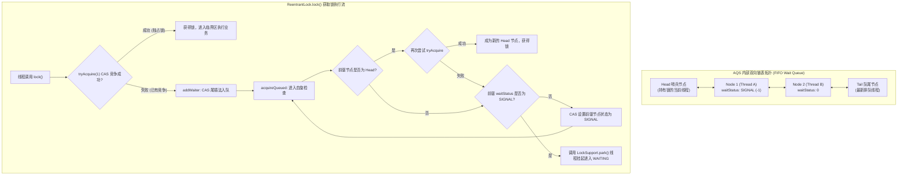
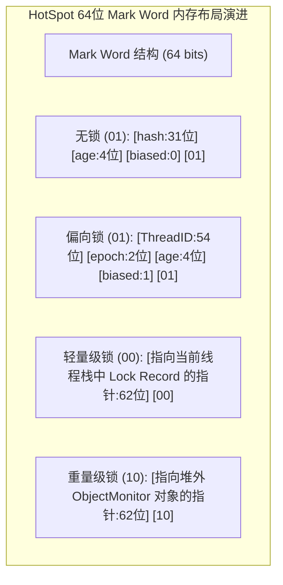
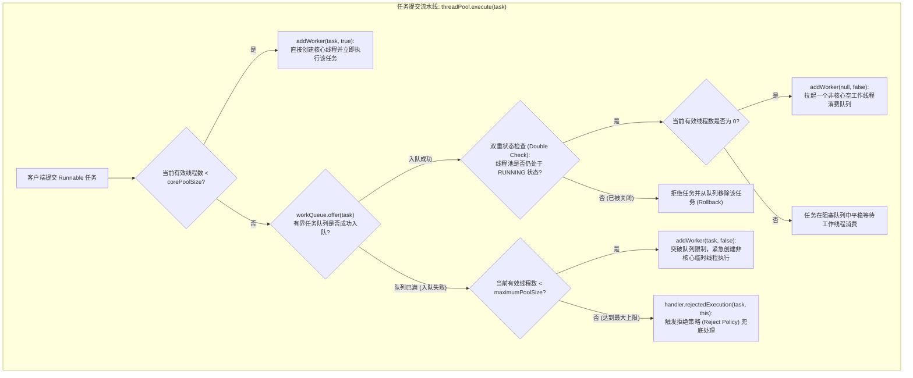
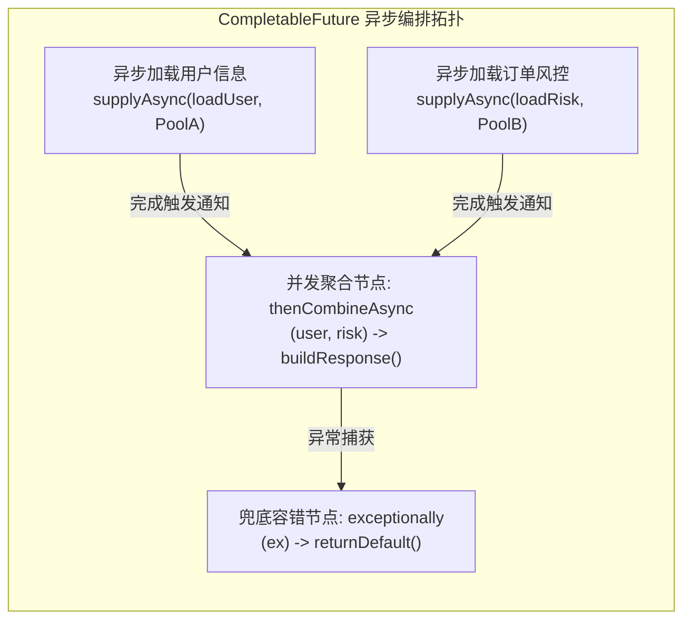
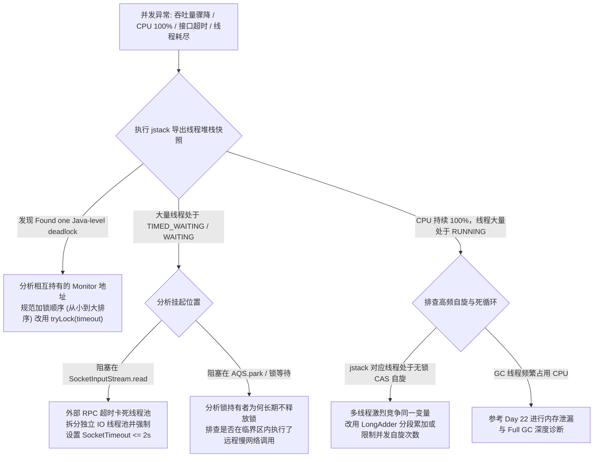
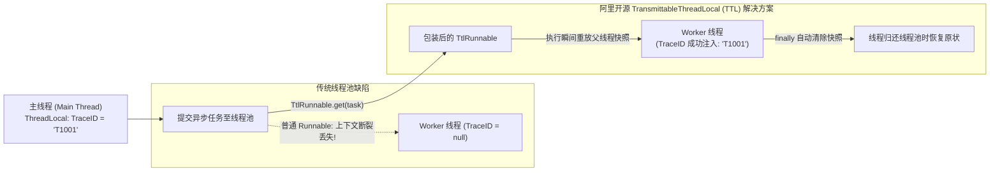

# Java并发编程与JUC核心机制：AQS同步状态机、锁升级、动态线程池与异步编排

> **学习目标定位**：面向技术总监、数据平台研发负责人、高级数据架构师岗位，系统掌握 Java 并发编程与 JUC（`java.util.concurrent`）架构体系的底层物理机制与系统工程设计。深入剖析 Doug Lea 大师设计的 AQS（AbstractQueuedSynchronizer）同步状态机流转与双向 CLH 队列拓扑、JVM `synchronized` 锁升级（从无锁、轻量级 CAS 自旋到 ObjectMonitor 重量级膨胀）及其在现代 JDK 废弃偏向锁的深层根因、ThreadPoolExecutor 状态机 `ctl` 压缩编码与任务提交流转模型、CompletableFuture 异步编排与响应式执行树、CPU 缓存伪共享（False Sharing）与 `@Contended` 填充优化。结合高并发网关动态线程池热调整与线上线程池打满雪崩真实排障，建立兼具微观指令级洞察与宏观高可用管控的技术领导力。

---

## 1. 知识概述与业务价值

### 1.1 是什么（What）
- **Java 并发编程与 JUC 架构体系**：Java 平台为了支撑现代多核处理器高并发、高吞吐运行而构建的并发编程工具箱。其核心由两大部分构成：
  - **语言与 JVM 级同步原语**：`synchronized`（内置锁）、`volatile`（内存屏障与可见性）、`final`（不可变性安全发布）；
  - **JUC 并发类库（Doug Lea 设计）**：以 **AQS（AbstractQueuedSynchronizer）** 为统一骨架，衍生出 `ReentrantLock`、`Semaphore`、`CountDownLatch`、`ReentrantReadWriteLock`；配合原子类（`Atomic*`、`LongAdder`）、并发容器（`ConcurrentHashMap`、`CopyOnWriteArrayList`）、阻塞队列（`BlockingQueue`）以及线程池执行框架（`ThreadPoolExecutor`、`ForkJoinPool`、`CompletableFuture`）。
- **现代代际演进趋势（Java 17 到 Java 21 虚拟线程）**：
  - 传统 Java 线程是与操作系统内核线程 **1:1 绑定的平台线程（Platform Thread）**，单机创建数千个线程即会耗尽内存与上下文切换开销；
  - Java 21 LTS 正式引入 **虚拟线程（Virtual Threads / Project Loom）**，采用 $M:N$ 用户态协作调度，彻底改写了高并发 IO 密集型系统的并发范式，但在 CPU 密集型任务与传统类库协同中，JUC 的锁与线程安全模型依然是不可动摇的底层基石。

### 1.2 解决什么核心业务痛点（Why）
- **传统 `synchronized` 早期粗暴阻塞带来的吞吐量暴跌**：早期版本中 `synchronized` 遇到竞争直接陷入内核态挂起，产生昂贵的用户态-内核态上下文切换（Context Switch），严重压制系统的极限并发度。
- **线程无限创建与无界队列引发的内存崩溃（OOM）**：业务开发人员滥用 `Executors.newFixedThreadPool()` 或 `newCachedThreadPool()`，导致无界队列 `LinkedBlockingQueue` 堆积数百万请求，硬生生把 JVM 堆内存撑爆。
- **线程池参数配置靠“拍脑袋”导致雪崩**：核心计算型任务与阻塞型 IO 任务混跑在一个线程池内，外部第三方接口抖动导致核心线程全部卡死在超时等待上，正常业务无法获得线程资源，引发全集群级联瘫痪。
- **异步编程中的“回调地狱（Callback Hell）”与线程穿透丢失**：多接口并发聚合时，传统 `Future.get()` 强制阻塞当前线程，而复杂的异步回调导致上下文（如分布式 TraceID、安全 Token）断裂丢失。

### 1.3 适用场景与技术边界（Where & When）
- **最佳业务场景矩阵**：
  - **超高并发 Data API 网关与服务编排**：利用 CompletableFuture 并发扇出调用多个下游存储（Doris、Redis、MySQL），毫秒级合并聚合；
  - **大数据组件内部高性能缓冲与传输**：Netty 事件循环线程池、Flink TaskManager 缓冲区分配、DolphinScheduler Master 任务分发队列；
  - **无锁化超高频计数与限流器**：基于 `LongAdder` / CAS 支撑数万 QPS 的实时指标统计与令牌桶配额扣减。
- **明确反模式与技术禁区（严禁使用）**：
  - ❌ **直接使用 `Executors` 工具类创建生产线程池**：严禁在生产代码中使用 `Executors.newFixedThreadPool` 或 `newSingleThreadExecutor`，必须显式通过 `new ThreadPoolExecutor(...)` 构造，强制声明有界队列容量与明确的拒绝策略；
  - ❌ **在无超时控制的情况下调用 `future.get()`**：严禁调用不带超时的 `get()`，必须配置 `future.get(timeout, TimeUnit)` 或利用 `CompletableFuture.orTimeout()` 实施防御性兜底，防止调用方被永久挂死。

---

## 2. 核心概念与关系

### 2.1 核心概念全景表

| 核心概念 | 英文术语 | 核心定义与工程职责 | 底层实现与并发级别 |
| :--- | :--- | :--- | :--- |
| **同步状态器** | AQS (AbstractQueuedSynchronizer) | JUC 的核心同步抽象基类，管理同步状态 `state` 与双向线程等待队列 | 框架底座 / 核心引擎 |
| **同步状态** | state | AQS 内部的 `volatile int` 变量，表示锁是否被占用或重入计数 | 内存可见 / CAS 原子更新 |
| **CLH 队列变体** | CLH Variant Queue | AQS 内部维护的基于自旋与阻塞挂起的双向链表，管理排队线程节点 | 无锁尾插 / 头节点唤醒 |
| **比较并交换** | CAS (Compare-And-Swap) | 现代 CPU 提供的硬件级原子指令（如 x86 `cmpxchg`），实现无锁乐观更新 | 硬件指令级原子性 |
| **ABA 问题** | ABA Problem | 变量值从 A 变成 B 又变回 A，CAS 判定成功但实际中间状态已发生改变的漏洞 | 需版本号/时间戳解决 |
| **对象头与 Mark Word** | Object Header / Mark Word | Java 对象在堆内存头部存储运行时数据的区域（Hash、GC分代年龄、锁状态标志） | 64位虚拟内存位布局 |
| **线程池控制状态** | ctl | `AtomicInteger` 复合变量，高 3 位保存运行状态，低 29 位保存有效线程数 | 位运算压缩设计 |
| **伪共享** | False Sharing | 多个独立变量位于同一 CPU 缓存行（Cache Line），并发修改相互导致缓存失效的现象 | 硬件缓存冲突现象 |

### 2.2 JUC 核心组件拓扑与锁升级流转图

```mermaid
graph TD
    subgraph "JUC 同步框架核心继承体系 (AQS Architecture)"
        AQS["AbstractQueuedSynchronizer (AQS)<br/>volatile int state; volatile Node head, tail;"]
        
        SyncLock["ReentrantLock (互斥重入锁)"]
        SyncSem["Semaphore (信号量)"]
        SyncCount["CountDownLatch (倒计时器)"]
        SyncRW["ReentrantReadWriteLock (读写锁)"]

        AQS --> SyncLock
        AQS --> SyncSem
        AQS --> SyncCount
        AQS --> SyncRW
    end

    subgraph "JVM synchronized 锁升级全生命周期流转 (Lock Inflation)"
        NoLock["1. 无锁状态 (No Lock)<br/>Mark Word 锁标志: 01, 偏向标记: 0"]
        BiasedLock["2. 偏向锁 (Biased Lock - JDK 15 默认废弃)<br/>Mark Word 写入偏向线程 ID"]
        LightLock["3. 轻量级锁 (Lightweight Lock)<br/>CAS 将栈帧 BasicObjectLock 指针写入 Mark Word (标志: 00)"]
        HeavyLock["4. 重量级锁 (Heavyweight Lock)<br/>膨胀创建 ObjectMonitor，竞争线程陷入 OS Mutex 挂起 (标志: 10)"]

        NoLock -->|"单个线程无竞争访问"| BiasedLock
        BiasedLock -->|"存在轻度交替竞争 / 撤销偏向"| LightLock
        NoLock -->|"存在轻度自旋竞争"| LightLock
        LightLock -->|"自旋超时或激烈并发竞争"| HeavyLock
    end

    subgraph "线程池执行与状态流转体系 (ThreadPool Architecture)"
        CTL["ctl: 32位复合原子整数 (高3位: 运行状态, 低29位: Worker 线程数)"]
        RUNNING["RUNNING: 正常接收新任务并处理队列任务"]
        SHUTDOWN["SHUTDOWN: 拒绝新任务，但继续处理排队任务"]
        STOP["STOP: 拒绝新任务，中断正在执行的任务，清空队列"]
        TERMINATED["TERMINATED: 所有任务完成，线程彻底销毁"]

        CTL --- RUNNING
        RUNNING -->|"调用 shutdown()"| SHUTDOWN
        RUNNING -->|"调用 shutdownNow()"| STOP
        SHUTDOWN --> STOP
        STOP --> TERMINATED
    end
```



---

## 3. 底层工作机制与设计哲学

### 3.1 AQS（AbstractQueuedSynchronizer）同步器底层机制深度推导

AQS 是整个 JUC 的心脏，其架构设计体现了极简而深邃的系统工程哲学：**以一个 `volatile int state` 描述同步状态，以 CAS 实现状态原子迁移，以双向 FIFO 链表管理线程排队，以 `LockSupport.park()/unpark()` 实现底层的线程挂起与精准唤醒。**



#### 1. 独占式获取与释放底层时序推导（Exclusive Mode）
以非公平锁 `ReentrantLock.lock()` 为例：
1. **抢占状态（CAS State）**：
   - 线程调用 `lock()`，首先尝试通过 CAS 将 `state` 从 0 改为 1；
   - 若成功，说明当前无锁，直接调用 `setExclusiveOwnerThread(Thread.currentThread())` 获得锁；
   - **重入机制（Reentrancy）**：若发现当前持有锁的线程就是自己，执行 `state = state + 1`，记录重入深度（退出时需对称执行相同次数的 `unlock()`）。
2. **入队与自旋挂起（`addWaiter` & `acquireQueued`）**：
   - 若 CAS 失败，线程被封装为 `Node.EXCLUSIVE` 节点；
   - **无锁尾插（enq 算法）**：通过自旋 CAS（`compareAndSetTail`）将新节点追加至队尾；若队列未初始化，先初始化一个虚拟的 Dummy 哨兵头节点；
   - **挂起前自旋重试**：节点进入队列后，并非立即阻塞。如果它的前驱节点刚好是 `head`，它会再次尝试一次 `tryAcquire(1)`；
   - **前驱责任制（`waitStatus = SIGNAL`）**：
     若再次失败，当前节点必须将前驱节点的 `waitStatus` 通过 CAS 修改为 **`Node.SIGNAL (-1)`**（表示“后继线程已挂起，前驱释放锁时请务必唤醒我”）；
     确认前驱已标记为 `SIGNAL` 后，当前线程安全调用 **`LockSupport.park(this)`** 陷入阻塞，操作系统将其置为 `WAITING` 状态，让出 CPU 调度时间片。
3. **锁释放与级联唤醒（`release` & `unparkSuccessor`）**：
   - 线程执行 `unlock()`，调用 `tryRelease(1)`：
     递减 `state`；若递减后 `state == 0`，清空持有者标记并完全释放锁；
   - **唤醒后继（Unpark Successor）**：
     检查头节点 `head` 的 `waitStatus != 0`；
     通常直接唤醒 `head.next` 节点；
     **从尾到头反向寻找容错机制**：若 `head.next == null` 或已被取消（`CANCELLED > 0`），AQS **从 `tail` 节点沿 `prev` 指针从后向前遍历**，寻找距离头节点最近的一个未取消的有效节点。
     *为什么从后向前找？* 因为在 `addWaiter` 入队时，底层是先连接 `node.prev = pred`，再 CAS 移动 `tail`，最后才建立 `pred.next = node`。从前向后找可能遇到 `next` 尚未赋值的空指针，而 `prev` 指针永远是强一致性成立的，体现了极其精妙的无锁并发鲁棒性！
   - 找到目标节点后，调用 `LockSupport.unpark(s.thread)` 唤醒线程，被唤醒的线程从 `acquireQueued` 的 `park` 处苏醒，重新争夺锁。

#### 2. 公平锁（FairSync）与非公平锁（NonfairSync）的本质区别
- **非公平锁（NonfairSync）**：新线程调用 `lock()` 时，**不管排队队列中是否有其他线程在等待，直接尝试插队执行 CAS 抢锁**；只有抢失败才老老实实进队排队。这利用了线程可能正处于运行态无需唤醒的优势，**极大减少了线程上下文切换开销，吞吐量高出数倍**；
- **公平锁（FairSync）**：在尝试获取锁前，强制先调用 **`hasQueuedPredecessors()`** 检查队列：只有当队列为空，或者当前线程刚好是队列头节点的下一个节点时，才允许抢锁；严格保证遵循先来后到（FIFO），杜绝线程饥饿，但性能损耗较大。

---

### 3.2 JVM 锁升级全生命周期与 JDK 15 废弃偏向锁根因剖析

在 HotSpot 虚拟机中，每一个 Java 对象在堆内存中都由 **对象头（Header）、实例数据（Instance Data）与对齐填充（Padding）** 组成。对象头核心包含 **Mark Word**（64位）与类型指针（Klass Word）：



#### 1. 锁升级（Lock Inflation）四阶段深度推导
1. **阶段一：无锁状态（No Lock）**：
   对象刚被创建，无线程竞争。Mark Word 存储对象的身份哈希码（Identity HashCode）、GC 分代年龄，锁标志位为 `01`，偏向标志为 `0`；
2. **阶段二：偏向锁状态（Biased Lock）**：
   HotSpot 发现绝大多数锁在整个生命周期内不仅不存在多线程竞争，而且总由同一线程多次获得；
   当线程首次访问同步块时，利用 CAS 将当前线程的操作系统线程 ID 记录在 Mark Word 的高 54 位中，偏向标志置为 `1`；后续该线程再次进入时，**只需比对线程 ID，完全零 CAS、零指令开销，几乎达到无锁性能**；
3. **阶段三：轻量级锁状态（Lightweight Lock）**：
   一旦出现另一个线程尝试获取偏向锁，偏向模式立即被打破（撤销偏向锁）；
   虚拟机在当前线程的栈帧中建立一个名为 **锁记录（Lock Record - BasicObjectLock）** 的空间；
   线程利用 CAS 尝试将对象头中的 Mark Word 替换为指向自身栈帧 Lock Record 的指针：
   - 若成功，锁标志位变为 `00`，代表该线程成功获得轻量级锁；
   - 若失败，说明有其他线程在竞争，当前线程**开启自适应自旋（Adaptive Spin）**，在用户态空转等待锁释放，避免立即陷入内核态挂起；
4. **阶段四：重量级锁状态（Heavyweight Lock - 膨胀）**：
   若自旋超过一定次数仍未获得锁，或者在轻量级锁持有期间第三个线程并发涌入；
   轻量级锁正式膨胀为 **重量级锁（标志位变为 `10`）**：
   虚拟机向操作系统申请创建一个底层的 **`ObjectMonitor` 互斥对象**；
   Mark Word 替换为指向该 `ObjectMonitor` 的直接指针；所有后续未抢到锁的线程全部被压入 `_cxq` 或 `_EntryList` 阻塞队列中，调用操作系统的 `pthread_mutex_lock` 陷入物理阻塞，由操作系统内核负责调度与唤醒。

#### 2. 为什么 JDK 15 决定默认废弃偏向锁（JEP 374）？
- **偏向锁的撤销成本极高（Revocation Overhead）**：偏向锁在撤销偏向时，必须等待 **全局安全点（SafePoint）**，需要暂停拥有偏向锁的线程，遍历线程栈帧检查锁状态。这会导致不可忽视的 STW 停顿；
- **现代硬件与应用场景的变迁**：过去单核/低并发场景多，现在几乎全都是高并发多线程场景，偏向锁几乎一碰就升级；
- **架构收益倒挂**：偏向锁为 HotSpot 内部带来了极其复杂的代码包袱（为了维护偏向锁逻辑，虚拟机代码极其臃肿）。综合评估下，撤销偏向锁带来的 STW 损失，已经完全吞噬了偏向锁带来的微小性能红利，故在 **JDK 15 中默认禁用，JDK 18+ 正式废弃**。

---

### 3.3 线程池（ThreadPoolExecutor）状态机与任务提交流程

`ThreadPoolExecutor` 是整个 JUC 中最为核心的资源调度引擎，其内部采用了精妙的位压缩技术与生产消费模型：



#### 1. `ctl` 核心状态变量的二进制位压缩设计
在 `ThreadPoolExecutor` 源码中，Doug Lea 将线程池的 **运行状态（RunState）** 与 **有效线程数（WorkerCount）** 压缩在一个 32 位的原子整数 `ctl` 中：
```java
private final AtomicInteger ctl = new AtomicInteger(ctlOf(RUNNING, 0));
private static final int COUNT_BITS = Integer.SIZE - 3; // 29 位
private static final int COUNT_MASK = (1 << COUNT_BITS) - 1; // 00011111... (29个1)
```
- **高 3 位**：表示线程池的 5 大生命周期状态：
  - `RUNNING (-1 << 29)`：`111` 开头，接收新任务，处理队列任务；
  - `SHUTDOWN (0 << 29)`：`000` 开头，拒绝新任务，但处理队列任务；
  - `STOP (1 << 29)`：`001` 开头，拒绝新任务，中断处理中任务，抛弃队列；
  - `TIDYING (2 << 29)`：`010` 开头，所有任务已终止，有效线程为 0；
  - `TERMINATED (3 << 29)`：`011` 开头，`terminated()` 钩子方法执行完毕；
- **低 29 位**：表示当前存活的工作线程数（最大支持 $2^{29}-1 \approx 5.36$ 亿个线程）；
- **设计哲学**：使得在判断“状态是否有效”与“递增/递减线程数”时，可以通过单次原子 CAS 操作（`compareAndSet`）同时完成两个属性的更新，**彻底消灭了分段加锁造成的死锁隐患与并发竞争**。

#### 2. 四大内置拒绝策略与生产级自定义拒绝策略

| 策略类别 | 核心代码实现 | 生产工程行为与后果 | 适用场景与缺陷 |
| :--- | :--- | :--- | :--- |
| **AbortPolicy (默认)** | 抛出 `RejectedExecutionException` | 直接抛异常阻断调用方执行流 | 适合重要业务快速失败（Fail-Fast），但未处理异常会导致上层业务中断 |
| **CallerRunsPolicy** | `r.run()` 在调用者主线程直接执行 | **调用方主线程亲自下场运行**，产生自然的反压降速机制（Backpressure） | 适合生产平稳降速，但若主线程被阻塞，会导致整个 HTTP/RPC 入口请求超时 |
| **DiscardPolicy** | 静默丢弃，空实现 | 任务直接从内存蒸发，不报错也不记录 | 极度危险！严禁在财务或核心业务中使用，仅适用于无关痛痒的埋点上报 |
| **DiscardOldestPolicy** | `e.getQueue().poll(); e.execute(r);` | 抛弃队列中等待时间最久的老任务，尝试为新任务腾出空间 | 适合有时效性要求的数据（如最新股价，旧数据无价值），但容易引发大量老请求超时 |

---

### 3.4 CompletableFuture 响应式异步编排内核与无锁执行树

传统的 `Future` 最大的痛点是无法实现非阻塞链式调用与多异步任务结果聚合（例如 `TaskC = TaskA + TaskB`，必须在主线程阻塞执行 `a.get()` 和 `b.get()`）。`CompletableFuture` 引入了响应式流式编排，其底层架构是一个由 **`Completion` 节点构成的单向链表/无锁栈（Treiber Stack）**：



- **无锁回调压栈（Treiber Stack Inlining）**：
  当对一个尚未完成的 `CompletableFuture` 注册后续动作（如 `.thenApply(fn)`）时，系统将该回调逻辑封装为一个 `UniApply`（继承自 `Completion`），通过 CAS 压入当前 Future 内部的 `stack` 单向链表头；
- **级联传播与事件驱动**：
  当异步任务在线程池中执行完毕并调用 `complete(result)` 时，触发 `postComplete()` 方法：
  遍历 `stack` 栈中的每一个 `Completion` 节点，取出回调函数并根据是否指定了异步线程池（`*Async`）：
  - 若指定了自定义线程池，向线程池提交新任务执行后续阶段；
  - 若未指定，**直接借用完成当前 Future 的那个前序工作线程在原地同步执行**，彻底消除无谓的线程切换。

---

## 4. 高频复杂业务场景实操与落地

### 4.1 场景一：企业级高并发网关“动态线程池（Dynamic ThreadPool）”无感热更实战

#### 业务背景
在大型电商大促（如双11）或中台 Data API 网关运行期间，不同时段的并发流量相差上百倍。过去参数配置在 `application.yml` 中，调整 `corePoolSize` 或 `maximumPoolSize` 必须修改配置并重新打包重启服务，这在大促期间必然引发业务中断，极度危险。

#### 架构实操解决方案（基于配置中心 Nacos/Apollo 的热更新架构）
1. **动态刷新核心属性机制推导**：
   `ThreadPoolExecutor` 原生提供了运行态修改核心参数的公共方法：
   - `setCorePoolSize(int)`：若调大，线程池在下次提交任务或主动调用时自动补充 Worker；若调小，空闲线程在等待 KeepAlive 超时后自动注销退出；
   - `setMaximumPoolSize(int)`：即时生效；
   - **核心痛点（队列容量不可变）**：原生的 `LinkedBlockingQueue` 的 `capacity` 字段被声明为 `final`，无法动态修改！
2. **重写可变容量阻塞队列（ResizableCapacityLinkedBlockQueue）**：
   通过继承重写 `LinkedBlockingQueue`，移除 `capacity` 的 `final` 限制，提供 `setCapacity(int newCapacity)` 方法；
3. **集成配置中心监听器代码实战**：
   ```java
   @Component
   public class DynamicThreadPoolManager {
       @Autowired
       private ThreadPoolExecutor gatewayExecutor;

       @NacosConfigListener(dataId = "gateway-threadpool.json")
       public void onConfigChange(String newConfigJson) {
           ThreadPoolProperties prop = JSON.parseObject(newConfigJson, ThreadPoolProperties.class);
           
           // 1. 动态调优核心与最大线程数 (顺序极其关键: 先调大 Max 再调大 Core，防止校验报错)
           if (prop.getMaxPoolSize() > gatewayExecutor.getMaximumPoolSize()) {
               gatewayExecutor.setMaximumPoolSize(prop.getMaxPoolSize());
               gatewayExecutor.setCorePoolSize(prop.getCorePoolSize());
           } else {
               gatewayExecutor.setCorePoolSize(prop.getCorePoolSize());
               gatewayExecutor.setMaximumPoolSize(prop.getMaxPoolSize());
           }
           
           // 2. 动态修改队列容量
           ResizableCapacityLinkedBlockingQueue<?> queue = 
               (ResizableCapacityLinkedBlockingQueue<?>) gatewayExecutor.getQueue();
           queue.setCapacity(prop.getQueueCapacity());
           
           log.info("线程池参数无感热更新成功: Core={}, Max={}, QueueCap={}", 
               prop.getCorePoolSize(), prop.getMaxPoolSize(), prop.getQueueCapacity());
       }
   }
   ```

### 4.2 场景二：太原智慧供热物联网 10 万设备测点并发计算中的 CompletableFuture 超时隔离

#### 业务背景
太原智慧供热项目中，每个小时需要对 10 万台智能热表、温控阀和变送器数据进行集中多维能耗特征提取。每个测点计算需要并发向外部三个系统提取数据：
1. 工业 SCADA 系统（实时瞬时流量）；
2. 气象局专线 API（室外预测气温）；
3. 历史基线能耗库（上采暖季同期数据）。
气象局 API 是公网跨网络访问，偶尔网络抖动延迟长达 10 秒，若缺乏严格的超时与隔离机制，整个 10 万设备重算任务会被彻底拖死。

#### 架构实操解决方案（独立线程池隔离 + `orTimeout` 快速降级）
```java
public class DeviceMetricAggregator {
    // 强制与默认公共 ForkJoinPool 隔离，定义专有的 IO 线程池
    private final ExecutorService ioExecutor = new ThreadPoolExecutor(
        16, 32, 60L, TimeUnit.SECONDS,
        new ArrayBlockingQueue<>(10000),
        new NamedThreadFactory("IoT-Metric-IO"),
        new ThreadPoolExecutor.CallerRunsPolicy()
    );

    public CompletableFuture<AggregatedResult> aggregatePointData(String deviceId) {
        // 1. 异步拉取 SCADA (超时 800ms)
        CompletableFuture<ScadaData> scadaFuture = CompletableFuture.supplyAsync(
            () -> scadaClient.fetch(deviceId), ioExecutor
        ).orTimeout(800, TimeUnit.MILLISECONDS)
         .exceptionally(ex -> ScadaData.createFallback());

        // 2. 异步拉取气象数据 (公网高抖动，配置超时 500ms 快速失败兜底)
        CompletableFuture<WeatherData> weatherFuture = CompletableFuture.supplyAsync(
            () -> weatherClient.getForecast(), ioExecutor
        ).orTimeout(500, TimeUnit.MILLISECONDS)
         .exceptionally(ex -> WeatherData.defaultComfortWeather());

        // 3. 并发双向等待并极速融合
        return scadaFuture.thenCombineAsync(weatherFuture, (scada, weather) -> {
            return calculateOEE(scada, weather);
        }, ioExecutor);
    }
}
```

### 4.3 场景三：CPU 缓存伪共享（False Sharing）与高并发计数器 `@Contended` 优化实战

#### 业务背景与微观硬件瓶颈
在设计千亿级吞吐的消息中间件网关或无锁环形队列（如 LMAX Disruptor）时，系统维护了全局的 `SequenceNumber`。在 32 核高并发服务器上进行并发递增基准测试（JMH），发现采用普通 `AtomicLong` 时，多线程并发吞吐量严重停滞，CPU 使用率高达 95% 但多核心大部分时间在自旋等待总线同步。

#### 深度硬件推导与解决方案
1. **CPU 缓存行（Cache Line）与伪共享（False Sharing）本质**：
   - 现代 CPU 缓存系统不是按单个字节读写，而是以 **64 字节（Cache Line）** 为基本传输单位；
   - 假设有两个独立的并发变量 `X` 和 `Y`，它们在内存中物理连续分配在同一个 64 字节的缓存行内；
   - CPU 核心 0 上的线程修改 `X`，CPU 核心 1 上的线程修改 `Y`；
   - 根据硬件 MESI 缓存一致性协议：核心 0 在修改 `X` 时，**会强行向总线广播，将核心 1 中包含该 Cache Line 的整个 64 字节缓存行置为 Invalid（失效）**；
   - 核心 1 虽然只想读写完全无关的变量 `Y`，却被迫从 L3 甚至物理内存重新加载，两个核心在同一行物理缓存上反复拉扯互锁，产生灾难级的“伪共享性能悬崖”！
2. **工业级解决方案（JDK 8+ `@jdk.internal.vm.annotation.Contended`）**：
   - **字节填充（Padding）**：在变量前后填充 7 个 `long`（每个 8 字节，共 56 字节），确保目标变量独占一整行 64 字节缓存行；
   - **`LongAdder` 的分段累加设计**：
     JDK 内部的 `LongAdder` 彻底打破了单变量竞争：其内部维护一个 `Cell[]` 数组，每个 `Cell` 对象内部通过 `@Contended` 注解强制将对象填充至 128 字节边界，各线程根据哈希值被离散分摊至不同的 `Cell` 上独立累加，最终读取时求和，**并发性能直接超越普通 `AtomicLong` 10 倍以上**。

---

## 5. 生产异常故障深度排查与根因分析

### 5.1 故障一：`Executors.newFixedThreadPool` 导致 LinkedBlockingQueue 无界堆积引发 OOM

#### 故障现象
生产微服务突然脱机，Kubernetes Pod 发生重启。查看崩溃前生成的 `.hprof` 堆转储快照，JVM 堆内存（8GB）被 100% 打满，堆内存直方图（Class Histogram）显示单个对象 `java.util.concurrent.LinkedBlockingQueue$Node` 占用了 **6.5GB 内存**，节点实例数高达 1,800 万个！

#### 深度根因分析（Root Cause）
- 查看业务代码，开发人员通过快捷方法创建线程池：
  `ExecutorService pool = Executors.newFixedThreadPool(10);`
- **源码致命缺陷分析**：
  ```java
  public static ExecutorService newFixedThreadPool(int nThreads) {
      return new ThreadPoolExecutor(nThreads, nThreads,
                                    0L, TimeUnit.MILLISECONDS,
                                    new LinkedBlockingQueue<Runnable>()); // 致命陷阱！
  }
  ```
  `new LinkedBlockingQueue<Runnable>()` 默认使用的是 `Integer.MAX_VALUE`（约 21.47 亿个）作为容量上限！
- 当下游消费发生哪怕微小的延迟（如数据库慢查持续 5 分钟），请求以每秒 2,000 的速率疯狂涌入；由于线程数固定为 10，新任务源源不断被封装为 `Node` 节点压入无界队列中，导致堆内存以每秒数十兆的速度被蚕食，最终不可逆地触发 **`OutOfMemoryError: Java heap space`**。

#### 生产治理方案
- **强制消灭 `Executors` 快捷工厂**：使用标准构造函数，**强制绑定有界队列**（如 `ArrayBlockingQueue(1000)`）；
- **拒绝策略兜底**：队列满时显式抛出拒绝异常或触发调用方反压（`CallerRunsPolicy`），将流量阻断在上游，死保 JVM 内存安全。

### 5.2 故障二：线程池混用（计算密集型与阻塞型混跑）导致核心线程全卡死在 RPC 超时

#### 故障现象
在某数据集成服务中，系统整体吞吐量突发暴跌至 0，所有接口响应耗时全部超时。监控显示线程池的活动线程数（ActiveCount）持续等于 `maximumPoolSize = 64`，排队队列满载，大量提交的任务被拒绝。然而 CPU 使用率极其反常地只有 **不到 2%（CPU 完全空闲）**。

#### 深度根因分析（Root Cause）
1. **反模式：通用全局大杂烩线程池**：
   团队为了图省事，将所有业务逻辑提交到了同一个全局共享的 `commonExecutor` 中；
2. **长尾阻塞任务霸占资源池**：
   其中一个报表导出功能调用了外部第三方的 HTTP 接口，该接口由于网络专线抖动陷入了长达 60 秒的连接挂起；
   64 个工作线程先后接手了这些慢查任务，全部阻塞在 `SocketInputStream.read()` 上陷入阻塞态；
3. **关键快速任务饿死（Thread Starvation）**：
   系统其他核心的本地轻量级计算任务（仅需 2ms）由于线程池被慢任务完全占满，无法分配到任何线程，只能在队列中排队，最终引发全局系统雪崩。

#### 架构级解决方案
- **推行“线程池分水岭隔离”架构**：
  - **核心计算密集型线程池（CPU-Bound Pool）**：仅处理本地内存计算，大小设为 $\text{CPU Cores} + 1$，绝不执行任何网络/磁盘 IO；
  - **长耗时阻塞型线程池（IO-Bound Pool）**：专门隔离给外部第三方调用，大小可设为 $2 \times \text{CPU Cores}$ 或更高，**配置严格的 SocketTimeout（$\le 2\text{s}$）与快速熔断（Sentinel）**，实现物理故障隔离。

### 5.3 故障三：分布式数据库并发操作死锁与线上线程 BLOCKED 诊断实战

#### 故障现象
线上微服务在处理并发扣减库存与账单流水时，接口响应耗时突增。查看 APM 监控发现大量线程处于停滞状态。执行 `jstack <pid>` 抓取线程快照，输出报告末尾赫然打印出 Java 虚拟机内置检测到的死锁分析报告：
`Found 1 deadlock.`。

#### 深度根因分析（Root Cause）
1. **相反加锁顺序引发经典循环等待（Deadly Embrace）**：
   - 线程 1（处理扣减订单 A）先获取了锁对象 `LockA`，尝试获取 `LockB`；
   - 线程 2（处理退款订单 B）先获取了锁对象 `LockB`，尝试获取 `LockA`；
   - 两者相互持有对方所需资源，且都不释放，满足死锁四大充要条件（互斥、持有并等待、不可剥夺、循环等待）；
2. **`jstack` 诊断分析报告核心证据链**：
   ```text
   Found one Java-level deadlock:
   =============================
   "Thread-1":
     waiting to lock monitor 0x00007f (object 0x000000076bf, a java.lang.Object),
     which is held by "Thread-2"
   "Thread-2":
     waiting to lock monitor 0x00007e (object 0x000000076be, a java.lang.Object),
     which is held by "Thread-1"
   ```

#### 生产治理方案
1. **打破循环等待（Global Lock Ordering）**：
   推行全局加锁顺序一致性原则：若需要同时锁定多个对象，按照对象的唯一主键（ID）先排序，从小到大依次加锁；
2. **使用具备超时控制的锁替代内置锁**：
   全面淘汰容易导致无限期死等的 `synchronized`，改用 `ReentrantLock.tryLock(timeout, TimeUnit)`；若在 3 秒内未获得下一个锁，主动释放已持有的所有锁并执行指数退避重试，从算法层面根除死锁。

### 5.4 生产故障排查决策树（Mermaid）



---

## 6. 技术选型对比

### 6.1 主流并发控制方案全方位对比矩阵

| 选型维度 | synchronized (内置锁) | ReentrantLock (AQS) | StampedLock (Java 8 乐观读) | Java 21 虚拟线程 (Virtual Threads) |
| :--- | :--- | :--- | :--- | :--- |
| **底层实现机制** | JVM 内部 Mark Word 膨胀 + ObjectMonitor | AQS 状态机 + 双向 Node 链表 + CAS | 状态戳（Stamp）+ CLH 变体 + 乐观版本验证 | JVM 调度器在载体线程上协作式挂起协程 |
| **可中断与超时** | 不可中断，不可超时（只能死等） | **完全支持 `lockInterruptibly()` 与 `tryLock(timeout)`** | 支持可中断，支持超时 | 不适用（协程阻塞时自动解绑载体线程） |
| **公平锁支持** | 仅支持非公平锁 | **完全支持公平与非公平（构造参数切换）** | 仅非公平 | 协同式调度，无锁概念 |
| **读写分离与乐观读** | 读写全互斥 | 需配合 `ReentrantReadWriteLock` | **原生支持乐观读（无锁读取，极大压榨吞吐）** | 原生高并发，适合万级轻量级任务 |
| **条件变量多路通知** | 单一等待队列（`wait()/notify()`） | **支持多个独立的 `Condition` 条件队列** | 不支持 Condition | 不适用 |
| **代码可读性与侵入** | 极佳（语言级关键字，编译器自动补全 `unlock`）| 需显式在 `try-finally` 释放锁，易遗漏 | 复杂（需手动验证版本戳并处理重试） | 极佳（用同步阻塞的代码风格写出高并发系统） |

### 6.2 架构师选型决策考量与虚拟线程（Project Loom）未来演进

针对技术总监与系统架构师的选型决策法则：
1. **绝大多数常规代码保护：优先选用 `synchronized`**：
   - 现代 JDK 对 `synchronized` 做了深度的 JIT 逃逸分析、锁消除（Lock Elimination）与锁粗化（Lock Coarsening）优化，在没有竞争时性能极佳，且由编译器保证 100% 自动释放锁，避免人为失误造成锁泄漏。
2. **需要高级控制特性的高并发基础设施：坚决选用 `ReentrantLock`**：
   - 当需要防止死锁（必须支持 `tryLock(timeout)`）、需要公平调度、或者需要多个 `Condition` 精准唤醒特定线程队列时（如生产者-消费者双队列），`ReentrantLock` 是唯一标准的工业级选择。
3. **读多写极少的超热点缓存：选用 `StampedLock`**：
   - 在每秒数十万次读、仅数次写的场景下，`StampedLock` 的乐观读模式在读取时不施加任何锁（仅比对版本号戳），完全消灭了传统读写锁在读多时反复 CAS 更新 reader 计数的总线风暴。
4. **面向 Java 21+ 现代高并发网络服务的技术跃迁：虚拟线程（Virtual Threads）**：
   - 对于 IO 密集型微服务（如数据网关调用多个后端），架构师应在技术规划中逐步采用虚拟线程替代传统重型线程池：
     单机可轻松拉起 100 万个虚拟线程，**消除线程池参数调优的心理负担，以“同步阻塞的极简代码风格”享受“异步非阻塞的极限并发性能”**。

---

## 7. 技术经理与架构师实战管控

### 7.1 生产级多业务线程池物理隔离与命名隔离规范（Thread Naming SOP）

线上最可怕的故障是 `jstack` 导出的堆栈中充斥着成百上千个名为 `pool-1-thread-1`、`pool-2-thread-3` 的匿名线程，排查人员根本无法判断该线程究竟属于哪块业务。必须强制执行 **《企业级线程池命名与隔离 SOP》**：

```java
// 生产强制规范：必须自定义 ThreadFactory，赋予明确的业务前缀与守护线程状态
public class NamedThreadFactory implements ThreadFactory {
    private final AtomicInteger threadNumber = new AtomicInteger(1);
    private final String namePrefix;
    private final boolean daemon;

    public NamedThreadFactory(String poolName, boolean daemon) {
        this.namePrefix = "App-" + poolName + "-worker-";
        this.daemon = daemon;
    }

    @Override
    public Thread newThread(Runnable r) {
        Thread t = new Thread(Thread.currentThread().getThreadGroup(), r,
                              namePrefix + threadNumber.getAndIncrement(), 0);
        t.setDaemon(daemon);
        if (t.getPriority() != Thread.NORM_PRIORITY) {
            t.setPriority(Thread.NORM_PRIORITY);
        }
        return t;
    }
}
```
- **业务物理线程池隔离清单**：
  - `Order-Async-Pool`：订单履约专用线程池；
  - `Payment-Callback-Pool`：外部支付网关回调专用线程池；
  - `Report-Export-Pool`：长耗时重型报表导出专用线程池；
  任何跨业务共用线程池的行为，在架构评审阶段直接一票否决。

### 7.2 异步任务超时与全链路 TraceID 跨线程传递穿透治理

在微服务与分布式中台中，线程池异步执行任务会导致 `ThreadLocal` 变量在主线程与子线程之间彻底断裂，导致下游链路追踪失去 `TraceID`，安全上下文丢失 `UserID`。


- **工程落地标准**：全集团统一引入阿里巴巴开源的 **`TransmittableThreadLocal (TTL)`**；
- 将业务线程池通过 `TtlExecutors.getTtlExecutorService(executor)` 统一装饰包装，确保无论是 `CompletableFuture` 还是线程池异步提交，全链路分布式追踪链路与安全上下文 100% 保持自动透明透传。

### 7.3 线程池健康度监控与告警指标基线（Observability Metrics）

每个生产线程池必须向 Prometheus / Actuator 暴露四个黄金度量指标，并配置刚性告警规则：
1. **活跃度指标（Active Rate）**：$\text{ActiveRatio} = \frac{\text{ActiveCount}}{\text{MaximumPoolSize}}$。当持续 3 分钟超过 $80\%$ 时触发预警；
2. **队列堆积率（Queue Saturation）**：$\text{QueueRatio} = \frac{\text{QueueSize}}{\text{QueueCapacity}}$。当队列使用率超过 $70\%$ 时触发黄色告警；
3. **拒绝计数激增（Reject Count Spikes）**：每分钟拒绝任务数 $\text{RejectDelta} > 0$ 立即触发红色 P1 级报警；
4. **长尾执行时长（Task Execution Duration）**：统计单任务执行耗时 P99，超过阈值自动上报长尾慢任务日志。

---

## 8. 互联网大厂高频面试真题库

* **Q1 [阿里/蚂蚁 - AQS底层推导]**：深入剖析 AQS（AbstractQueuedSynchronizer）的底层设计哲学。它是如何通过一个 volatile 的 `state` 变量和双向 Node 链表实现公平锁与非公平锁的？
* **Q2 [字节跳动 - 锁升级与底层原语]**：深入解析 Java 对象的内存布局与 Mark Word。`synchronized` 锁升级的过程（无锁 $\to$ 偏向锁 $\to$ 轻量级锁 $\to$ 重量级锁）是怎样的？为什么 JDK 15 默认废弃了偏向锁？
* **Q3 [美团 - 线程池架构与状态机]**：深入剖析 `ThreadPoolExecutor` 的核心参数与底层执行流。`ctl` 变量是如何设计的？为什么线程池核心线程数满了之后是“先放队列”而不是“直接创建最大线程”？
* **Q4 [腾讯 - 异步编排与响应式]**：`CompletableFuture` 的底层执行原理是什么？在生产微服务编排多下游接口时，如何避免因某个慢接口导致全局主线程池耗尽？
* **Q5 [快手 - 硬件与伪共享]**：什么是 CPU 伪共享（False Sharing）？JUC 并发包与高性能队列（如 Disruptor / LongAdder）是如何在底层利用字节填充或 `@Contended` 注解解决伪共享问题的？
* **Q6 [滴滴 - 生产实战排障]**：线上突发告警，微服务接口 P99 延迟暴增，CPU 飙升至 100%。使用 `jstack` 发现大量线程处于 `WAITING (parking)` 和 `BLOCKED` 状态。请给出完整的现场排查定位三步法。
* **Q7 [数据总监/管理决策与规范]**：作为技术总监，团队如果缺乏规范，线上极易出现滥用线程池导致的 OOM 或死锁事故。你如何制定并推行全团队的“线程池准入与使用强制规范（SOP）”？

---

## 9. 结构化深度参考答案

### 题目1 [阿里/蚂蚁 - AQS底层推导]：深入剖析 AQS（AbstractQueuedSynchronizer）的底层设计哲学。它是如何通过一个 volatile 的 `state` 变量和双向 Node 链表实现公平锁与非公平锁的？

#### 简洁回答（1分钟电梯破题）
AQS 秉承**“基于原子状态机管理许可，基于双向变体 CLH 队列管理等待线程，基于前驱节点状态安全挂起与唤醒”**的设计哲学。
其核心由一个 `volatile int state` 描述锁状态（0 为无锁，$\ge 1$ 为锁被占用及重入次数）；以基于 CAS 的双向链表管理排队线程，节点通过 `LockSupport.park()` 挂起并在前驱释放锁时被 `unpark()` 唤醒。
公平锁与非公平锁的本质区别仅在抢锁入口的一行代码：**非公平锁调用 `lock()` 直接无视队列通过 CAS 强行插队；公平锁则强制先调用 `hasQueuedPredecessors()` 检查排队，遵循严格 FIFO。**

#### 深入回答（机制推导与边界条件）
1. **状态机流转与双向链表协同推导**：
   - 线程调用 `ReentrantLock.lock()`：
     非公平锁直接执行 `compareAndSetState(0, 1)`，若此时恰逢持有者刚刚释放锁，插队成功，直接将持有者置为自己；
     若失败，调用 `acquire(1)` 进入 AQS 核心骨架方法：
     ```java
     public final void acquire(int arg) {
         if (!tryAcquire(arg) && acquireQueued(addWaiter(Node.EXCLUSIVE), arg))
             selfInterrupt();
     }
     ```
   - **`addWaiter` 无锁并发入队算法**：
     将线程封装为 `Node.EXCLUSIVE`；
     利用自旋 CAS `compareAndSetTail` 将节点追加至队尾；先连 `node.prev = tail`，再 CAS 移动 `tail` 指针，最后赋值 `pred.next = node`；
   - **`acquireQueued` 自旋与前驱责任制**：
     节点入队后检查前驱是否为 `head`：若是，再次尝试 `tryAcquire(1)`；
     若仍未成功，检查前驱的 `waitStatus`。前驱默认初始状态为 0，当前节点必须通过 CAS 将前驱状态置为 **`Node.SIGNAL (-1)`**；
     第二次循环时确认前驱已是 `SIGNAL`，当前节点安全执行 `LockSupport.park()` 挂起休眠。
2. **锁释放与反向遍历唤醒容错（`unparkSuccessor`）**：
   - 释放锁时执行 `tryRelease(1)`，使 `state` 递减；归零时锁完全释放；
   - 检查头节点 `head` 的 `waitStatus != 0`，准备唤醒后继；
   - **核心容错细节**：AQS 优先检查 `head.next`。如果 `head.next == null` 或其状态为 `CANCELLED (1)`（如超时或被中断）：
     **系统从 `tail` 节点沿 `prev` 指针自后向前反向遍历**，寻找最靠近头节点的未取消有效节点进行唤醒；
     *机制根因*：在入队代码中，`node.prev = pred` 发生在 CAS 移动 `tail` 之前（原子可见），而 `pred.next = node` 是在 CAS 成功之后才执行。如果正巧发生并发，从前往后找 `next` 可能是 `null`，而从后往前找 `prev` 绝对不会发生链表断裂！

#### 架构师/技术管理视角（权衡取舍、SLA与成本）
- **吞吐量与公平性的权衡法则**：默认非公平锁的吞吐量通常是公平锁的数倍乃至数十倍！非公平锁让一个已经处在 CPU 运行态的活跃线程立刻插队拿锁，省去了将它从就绪队列移出、挂起、再次由操作系统内核唤醒调度的昂贵上下文切换代价（单次耗时达微秒级）。架构师在绝大多数业务场景下应坚决使用**非公平锁**；只有在对防饥饿有严苛刚性诉求的特定金融清算顺序排队场景下，才考虑启用公平锁。

---

### 题目2 [字节跳动 - 锁升级与底层原语]：深入解析 Java 对象的内存布局与 Mark Word。`synchronized` 锁升级的过程（无锁 $\to$ 偏向锁 $\to$ 轻量级锁 $\to$ 重量级锁）是怎样的？为什么 JDK 15 默认废弃了偏向锁？

#### 简洁回答（1分钟电梯破题）
`synchronized` 锁升级是 HotSpot 针对不同竞争烈度自适应权衡的产物。
锁状态记录在 64 位对象头的 **Mark Word** 中：
**无锁（01）** $\to$ 单线程无竞争记录线程 ID 为 **偏向锁（01，偏向位1）** $\to$ 出现轻度交替竞争撤销偏向，利用栈帧 Lock Record CAS 自旋升级为 **轻量级锁（00）** $\to$ 出现激烈并发或自旋超时膨胀为 **重量级锁（10）**，生成堆外 `ObjectMonitor` 并陷入系统内核互斥量阻塞。
JDK 15 废弃偏向锁的核心原因是：**偏向锁的撤销必须在全局安全点（SafePoint）挂起所有线程，在现代高并发多核架构下，频繁撤销引发的 STW 性能损耗已经彻底吞噬了偏向锁带来的微小收益，导致得不偿失。**

#### 深入回答（机制推导与边界条件）
1. **Mark Word 状态流转与字节级演进过程**：
   - **偏向锁获取**：线程进入同步块，检查 Mark Word 偏向标志为 1 且线程 ID 为空：
     使用 CAS 将当前线程的操作系统 ID 写入 Mark Word 高 54 位；以后该线程再次进入，只需一条汇编比较指令比对线程 ID，完全零 CAS、零总线锁开销；
   - **偏向锁撤销与轻量级锁升级**：
     当线程 B 尝试进入已被线程 A 偏向的同步块时，偏向锁被打破；
     JVM 等待安全点（SafePoint），暂停线程 A；检查线程 A 是否存活：
     若 A 已死亡，重置为无锁；若 A 仍在同步块中，**暂停线程 A，撤销偏向，将其升级为轻量级锁**；
   - **轻量级锁自适应自旋（Adaptive Spinning）**：
     线程栈中开辟 `BasicObjectLock` 空间，将对象头 Mark Word 拷贝至栈中的 `Displaced Mark Word`；
     通过 CAS 将对象头的 Mark Word 替换为指向栈中锁记录的指针；
     竞争者未抢到时不立即阻塞，而是基于 **自适应自旋** 算法在用户态循环尝试（根据上次在同一把锁上自旋成功与否自适应增减自旋次数，通常几十到数百次）；
   - **重量级锁膨胀（ObjectMonitor）**：
     若自旋依然未拿到锁，轻量级锁膨胀为重量级锁；
     向 OS 申请 `ObjectMonitor`，设置 `_owner`，将未能抢到锁的线程封装放入 `_cxq` 阻塞队列；
     调用 `pthread_mutex_lock` 让线程陷入物理内核态挂起（锁标志变为 `10`）。
2. **为什么 JDK 15 默认禁用并在后续废弃偏向锁（JEP 374 深度分析）**：
   - 偏向锁产生于单核与早期低并发多线程时代；
   - 现代微服务与高并发应用往往启动即面临高频并发竞争，偏向锁几乎一触即溃；
   - **撤销偏向锁的致命代价**：每次撤销都需要全局 STW，需要让垃圾回收安全点机制介入。当海量容器微服务启动时，频繁的偏向锁撤销导致系统产生大面积偶发性毫秒级毛刺；代码实现极其复杂冗长。因此官方果断将其禁用移除。

#### 架构师/技术管理视角（权衡取舍、SLA与成本）
- **性能优化的代际认知刷新**：很多技术人员的知识体系仍停留在 Java 8 时代，甚至在面试中大谈偏向锁调优参数 `-XX:+UseBiasedLocking`。架构师必须具备**紧跟最新 LTS 标准（Java 17/21）的工程认知**：在现代 Java 版本中，轻量级锁与 JIT 编译器的**锁消除（基于逃逸分析消除没有逸出线程的锁）**与**锁粗化（合并连续锁）**已经足够极致高效，直接使用标准 `synchronized` 即可获得极高吞吐，无需也严禁在 Java 17+ 强行开启过时的偏向锁。

---

### 题目3 [美团 - 线程池架构与状态机]：深入剖析 `ThreadPoolExecutor` 的核心参数与底层执行流。`ctl` 变量是如何设计的？为什么线程池核心线程数满了之后是“先放队列”而不是“直接创建最大线程”？

#### 简洁回答（1分钟电梯破题）
`ThreadPoolExecutor` 底层采用 **`ctl` 复合原子整数（AtomicInteger）**，巧妙将高 3 位用于表示 5 大运行状态（RUNNING, SHUTDOWN, STOP, TIDYING, TERMINATED），低 29 位保存有效工作线程数，实现无锁并发状态原子扭转。
核心线程满后“先放队列，队列满了才创建最大线程”的核心哲学是**“缓冲排队优于激进创建线程（Queue-First Balancing）”**。
操作系统线程是非常昂贵的稀缺物理资源（创建销毁耗时、每个线程独占 1MB 内存、产生上下文切换）。线程池的设计初衷是**“用固定数量的骨干线程平稳消化峰值流量”**；只有当缓冲队列完全饱和、业务出现严重积压时，才作为非常规手段紧急拉起临时工（最大线程）救火，这完美平衡了系统吞吐量与系统稳定性。

#### 深入回答（机制推导与边界条件）
1. **任务提交流水线四步流转机制推导**：
   - **Step 1：核心线程检查**：`workerCount < corePoolSize`，即使当前核心线程处于空闲状态，依然通过 `addWorker(command, true)` 立即创建新的核心线程执行任务；
   - **Step 2：阻塞队列缓冲**：`workerCount >= corePoolSize`，线程池调用 `workQueue.offer(command)`：
     - 若入队成功：执行 **双重状态检查（Double-Check）**。若线程池被突发关闭（非 RUNNING），回滚移除该任务并触发拒绝策略；若线程池健康但当前有效线程数为 0（例如核心线程设置了超时注销），自动拉起一个非核心 Worker 去消费该队列；
   - **Step 3：非核心线程应急拉起**：若队列已满，尝试调用 `addWorker(command, false)`：
     - 若当前 `workerCount < maximumPoolSize`，突破队列限制，创建临时非核心工作线程立即执行当前任务；
   - **Step 4：饱和拒绝兜底**：若 `workerCount >= maximumPoolSize`，说明线程池与队列全部打满，直接调用 `RejectedExecutionHandler.rejectedExecution()` 触发拒绝策略。
2. **为什么不“先创建最大线程，再放队列”？**
   - 假设反向设计为“先创建最大线程”：一旦流量稍微波动，系统瞬间把线程数打满到 `maximumPoolSize`（如 200 个线程）。这会导致系统在 0.1 秒内消耗 200MB 堆外内存，并在多核 CPU 间产生剧烈的上下文切换，导致 CPU 使用率飙升而真实计算能力急剧萎缩；
   - **Tomcat 定制线程池的特例反转**：
     Tomcat 的 `ThreadPoolExecutor` 重写了该逻辑（先建到最大线程再入队）。因为 Web 容器处理的是外部长耗时 HTTP IO，希望尽可能并发处理请求；但对于通用 Java 批处理与中台计算，原生的**队列缓冲优先**才是最稳健的架构设计。

#### 架构师/技术管理视角（权衡取舍、SLA与成本）
- **线程池容量参数的科学公式**：严禁按固定经验值乱配。架构师应推行工程化公式：
  - **CPU 密集型任务**（加解密、排序计算）：$\text{CorePoolSize} = \text{CPU Cores} + 1$，利用少量多余线程防止偶发页缺失；
  - **IO 密集型任务**（RPC 调用、数据库查询）：$\text{CorePoolSize} = \text{CPU Cores} \times \left(1 + \frac{\text{WaitTime}}{\text{ComputeTime}}\right)$；
  - 队列长度必须根据业务 SLA 容忍的最长排队时间核算：$\text{QueueCap} = \text{MaxTolerateSeconds} \times \text{PeakQPS}$，坚决杜绝无界队列。

---

### 题目4 [腾讯 - 异步编排与响应式]：`CompletableFuture` 的底层执行原理是什么？在生产微服务编排多下游接口时，如何避免因某个慢接口导致全局主线程池耗尽？

#### 简洁回答（1分钟电梯破题）
`CompletableFuture` 底层基于 **`Completion` 链表/无锁栈（Treiber Stack）构建异步执行依赖树**。
当注册后续阶段时，将回调逻辑原子压栈；当上游前置任务执行完毕调用 `complete()` 时，级联出栈触发下游执行，支持零线程阻塞的响应式回调。
避免慢接口拖垮全局的核心法则是**“物理线程池独立隔离 + 刚性超时降级（orTimeout） + 依赖扇出受控”**。严禁在生产中让所有任务混跑在默认的 `ForkJoinPool.commonPool()` 中；必须为不同 SLA 要求的下游划分独立的自定义线程池，并对每个异步分支设置严格的超时熔断。

#### 深入回答（机制推导与边界条件）
1. **底层 Completion 栈驱动与事件流转内核**：
   - 每个 `CompletableFuture` 对象内部包含两个核心字段：`volatile Object result`（存储执行结果或封装异常 `AltResult`）与 `volatile Completion stack`（存储后继回调链）；
   - **链式组装（如 `.thenApplyAsync(fn, executor)`）**：
     构造一个 `UniApply` 节点；若当前 Future 结果未就绪，通过 CAS 将其置为 `stack` 的新栈顶；
   - **完成触发（`postComplete`）**：
     当异步工作线程完成计算并调用 `completeValue(v)` 时：
     系统进入 `postComplete()` 循环，原子弹出栈顶的 `Completion` 节点，取出其内部的回调函数；
     若是带有 `*Async` 后缀的方法，将该回调包装为新任务投递至指定的 `executor`；若未带 `*Async`，直接在当前线程栈内原地调用执行，省去线程切换开销；
   - **多路归并（`allOf` / `thenCombine`）**：
     内部通过原子倒计时计数器（类似 CountDownLatch）维护依赖分支数。每当一个上游分支完成，计数器减 1，直到所有前置节点全部就绪，触发最终聚合节点执行。
2. **生产微服务防雪崩四大防御设计**：
   - **防御一：禁止裸奔 `ForkJoinPool.commonPool()`**：
     默认无参的 `supplyAsync(fn)` 使用全局共享的 `commonPool`。该池全 JVM 共享且线程数仅为 CPU 核数减 1。一旦某个下游接口卡顿，整个 JVM 的并行流（ParallelStream）和其他微服务组件全部停摆；
   - **防御二：显式传入自定义业务隔离线程池**：
     调用 `supplyAsync(fn, customPool)`，按业务域划分独立的线程池，即使外部接口挂起，被阻塞的也仅仅是本业务的有限工作线程；
   - **防御三：强制声明 `orTimeout` 超时熔断**：
     使用 Java 9+ 提供的原生超时机制：
     `future.orTimeout(800, TimeUnit.MILLISECONDS).exceptionally(ex -> fallbackData)`；
     底层通过轻量级时间轮/调度线程池，在时间到达瞬间自动通过 `completeExceptionally(TimeoutException)` 强行中断挂起，释放资源。

#### 架构师/技术管理视角（权衡取舍、SLA与成本）
- **异步编排的异常抑制与追踪黑洞**：在 `CompletableFuture` 中，未被捕获的运行时异常（`RuntimeException`）会被封装在 `CompletionException` 内部静默吞噬，如果代码中没有显式编写 `.exceptionally()` 或 `.handle()`，系统将完全不打印任何报错日志，变成无声无息的悬挂失败。架构师必须制定规范：**所有的 `CompletableFuture` 链条末端，必须强制挂载统一的异常处理切面与全局分布式 TraceID 恢复逻辑**，确保生产故障 100% 可被 APM 告警捕获。

---

### 题目5 [快手 - 硬件与伪共享]：什么是 CPU 伪共享（False Sharing）？JUC 并发包与高性能队列（如 Disruptor / LongAdder）是如何在底层利用字节填充或 `@Contended` 注解解决伪共享问题的？

#### 简洁回答（1分钟电梯破题）
**CPU 伪共享是由于多个无关的独立并发变量被操作系统分配在同一个 64 字节的 CPU 缓存行（Cache Line）内引发的硬件性能灾难**。
当多核心多线程并发修改各自变量时，底层硬件的 **MESI 缓存一致性协议** 会将整个缓存行反复标记为失效（Invalid），导致各 CPU 核心频繁在硬件总线同步拉扯、穿透访问 L3 甚至物理内存，产生极高的总线风暴与性能断崖。
解法是：**通过填充无用字段（Padding）或使用 JDK 8+ 的 `@jdk.internal.vm.annotation.Contended` 注解**，强制将关键变量按 64/128 字节物理对齐填充，使每个变量独占整行缓存行，彻底切断核心间的缓存牵连。

#### 深入回答（机制推导与边界条件）
1. **硬件多级缓存与 MESI 协议的冲突推导**：
   - 现代计算机多核 CPU 访问 L1 缓存仅需约 1ns，访问 L2 约 3~4ns，而访问主内存需要数十纳秒；
   - 缓存行（Cache Line）通常固定为 64 字节（512 位）；
   - **伪共享发生场景**：
     设 `class Counter { volatile long a; volatile long b; }`；每个 `long` 占用 8 字节；
     `a` 和 `b` 紧挨着分配在同一个 64 字节的 Cache Line 中；
     核心 1 上的线程执行 `a++`，核心 2 上的线程执行 `b++`；
     当核心 1 修改 `a` 时，MESI 协议强制把核心 2 对应地址的 Cache Line 状态置为 `I (Invalid)`；
     核心 2 下一时刻尝试写 `b`，发现缓存行失效，被迫清空流水线，通过总线重新从内存同步加载该行；紧接着核心 2 修改 `b`，又反手把核心 1 的缓存行置为失效；
     两个核心虽然在操作完全无关的字段，却在硬件层面打成了“死循环互锁”，吞吐量暴跌 90% 以上。
2. **JUC 与高性能组件的工程破局之道**：
   - **Disruptor 环形队列的显式填充（Manual Padding）**：
     在 RingBuffer 的序列号对象中，定义 7 个无用的 `long p1, p2, p3, p4, p5, p6, p7`（共 56 字节），加上核心的 `volatile long value`（8 字节），刚好凑满 64 字节，彻底占据整行；
   - **Java 8 `LongAdder` 与 `@Contended` 注解**：
     `LongAdder` 在发生写竞争时，将单点累加分散到 `Cell[]` 数组中；
     其内部的 `Cell` 类声明了 `@Contended`：
     ```java
     @jdk.internal.vm.annotation.Contended
     static final class Cell {
         volatile long value;
         Cell(long x) { value = x; }
         // ...
     }
     ```
     JVM 运行时会自动在 `Cell` 对象前后插入 128 字节的无用对齐填充（应对某些具备 128 字节预取特性的高端 CPU 架构），确保数组中每个槽位的 `Cell` 物理分布在不同的 Cache Line 上，实现各核心互不干扰的真并发。

#### 架构师/技术管理视角（权衡取舍、SLA与成本）
- **空间换时间的极致边界**：解决伪共享的本质是**“用极其廉价的内存空间，去换取昂贵不可替代的 CPU 硬件吞吐量”**。在普通业务 CRUD 开发中，绝无必要对每个类都搞字节填充（会浪费内存且导致 GC 扫描对象头膨胀）；但作为技术架构师，在设计企业级核心底层网关、自研高性能内存缓存或撮合交易引擎时，**必须对每秒数十万次并发争抢的核心计数器与指针进行伪共享审查**，这是拉开系统吞吐量代际差距的关键技术深度。

---

### 题目6 [滴滴 - 生产实战排障]：线上突发告警，微服务接口 P99 延迟暴增，CPU 飙升至 100%。使用 `jstack` 发现大量线程处于 `WAITING (parking)` 和 `BLOCKED` 状态。请给出完整的现场排查定位三步法。

#### 简洁回答（1分钟电梯破题）
定位该问题的标准工业级战法是**“定界 CPU 消耗大户（top -Hp 转十六进制） $\to$ 关联线程堆栈找锁瓶颈（jstack 定位 BLOCKED 监视器） $\to$ 检查等待链与资源争用（结合内存 Dump 与网络状态）”**。
核心排查三步法：
1. **抓出吃 CPU 的真凶线程**：通过 `top -Hp <pid>` 找到占用 CPU 最高的轻量级线程 ID，转换为十六进制并在 `jstack` 中检索该 `nid`（通常是 GC 线程或自旋 CAS 死循环）；
2. **分析全局阻塞拓扑（Lock Contention）**：检索 `BLOCKED (on object monitor)` 线程等待的对象地址，定位到底是谁持有该锁却长期不释放；
3. **查明持有者卡滞根因**：顺藤摸瓜分析锁持有者线程当前正在执行的代码（通常是持有本地同步锁的同时在进行外部超长网络调用或慢 SQL）。

#### 深入回答（机制推导与边界条件）
1. **结构化排查定位三步实操流水线**：
   - **Step 1：定位消耗 CPU 极值的高危线程**：
     1. 执行 `top -Hp <java_pid>`：按 CPU 使用率排序，找到占用 99% 的系统线程号（例如 `TID = 28145`）；
     2. 将十进制线程 ID 转换为十六进制：`printf "%x\n" 28145` $\implies$ 得到 `0x6df1`；
     3. 抓取快照并定向检索：
        `jstack -l <java_pid> > jstack.dump`
        `grep -A 30 "nid=0x6df1" jstack.dump`；
     4. **结果判定**：
        若该线程名为 `VM Thread` 或 `G1 Concurrent Mark`，说明是由于内存泄漏导致频繁 GC（参考 Day 22 进行内存排查）；
        若该线程是业务线程且卡在 `for(;;)` 自旋或死循环，直接定位到具体代码行数；
   - **Step 2：定位阻塞在锁上的业务线程（Lock Blocked Analysis）**：
     在 `jstack.dump` 中检索关键词 `waiting to lock <0x000000076a12b3c4>`：
     统计有多少个线程正卡在等待同一个锁对象上；
     利用该十六进制地址 `0x000000076a12b3c4`，反向向上检索 `locked <0x000000076a12b3c4>`，瞬间抓出当前持有该锁的 **“罪魁祸首线程（Lock Owner）”**；
   - **Step 3：剖析持有者为什么不放锁（Root Cause Revelation）**：
     查看持有者线程当前的调用栈：
     - **常见致命反模式**：开发人员在 `synchronized` 同步块中，调用了外部未设置超时的 HTTP/RPC 接口，或者执行了复杂的分布式数据库查询；
     - 由于网络抖动，持有者在临界区内苦等 30 秒，导致后方成百上千个业务请求全部被挡在门外堆积，进而导致线程池被打满、容器内存暴增并引发全局瘫痪。

#### 架构师/技术管理视角（权衡取舍、SLA与成本）
- **“临界区轻量化”铁律规范**：架构师必须在团队内部树立不可违背的编程红线：**“临界区内绝不允许发生网络 IO 或磁盘操作（No IO in Critical Section）”**！锁保护的必须纯粹是本地堆内存中几个变量的原子赋值与状态变更（耗时微秒级）。如果必须调用外部接口，必须将其移出同步块，在获取必要参数后释放锁，再去执行远程调用；从源头消灭慢网络拖死全局并发锁的系统隐患。

---

### 题目7 [数据总监/管理决策与规范]：作为技术总监，团队如果缺乏规范，线上极易出现滥用线程池导致的 OOM 或死锁事故。你如何制定并推行全团队的“线程池准入与使用强制规范（SOP）”？

#### 简洁回答（1分钟电梯破题）
消灭并发与线程池故障的根本在于**“剥夺一线随意创建线程的自由度，推行‘框架模板化、准入审批化、代码门禁化、运行透明化’的四维管控闭环”**：
1. **封装企业级 Starter 模板**：提供开箱即用的线程池组件，强制要求指定业务前缀、有界队列与动态参数配置；
2. **静态扫描与代码门禁**：通过 CI/CD 强行拦截 `Executors`、无界队列与未命名线程；
3. **推行多业务线程池物理隔离**：核心业务、非核心任务与长耗时 IO 严禁混跑；
4. **统一可观测看板与告警**：将全公司所有线程池的活跃度、排队深度与拒绝计数暴露给 Prometheus 监控，形成长效健康运营体系。

#### 深入回答（机制推导与边界条件）
1. **《企业级并发与线程池工程规范标准》核心条款**：
   - **条款一（禁止快捷工厂）**：严禁在代码中出现 `Executors.new*`；任何线程池的创建必须通过中台封装的 `DynamicThreadPoolExecutor` 构造，必须在配置文件中显式声明：核心数、最大数、队列类型、队列容量（上限通常不超过 5,000）及明确的拒绝策略；
   - **条款二（强制命名与类型区分）**：线程工厂必须使用 `NamedThreadFactory`，线程名称格式必须为：`AppName-BusinessDomain-Pool-Thread-%d`；严禁在生产出现匿名线程；
   - **条款三（业务域物理硬隔离）**：按业务 SLA 划分线程池：
     - 黄金池（Core Tier-0）：核心交易、支付流水，独占资源，拒绝策略必须配置报警或补偿；
     - 白银池（General Tier-1）：常规数据查询与看板计算；
     - 青铜池（Batch Tier-2）：离线重型报表导出，配置低优先级，允许超时降级；
   - **条款四（生命周期优雅停机）**：在 Spring Bean 销毁钩子中，必须实现标准的两阶段优雅停机（`shutdown()` $\to$ 等待 30 秒 $\to$ `shutdownNow()`），确保内存中正在执行的任务安全落盘，防止发布时丢失数据。
2. **平台化工具卡点与自动化门禁推行（Tooling & CI/CD Gate）**：
   - 依赖人工自觉是靠不住的。在 SonarQube / SpotBugs 静态代码扫描中配置定制规约：
     - 检测到 `new LinkedBlockingQueue()` 未传参 $\implies$ 阻断编译；
     - 检测到 `new Thread(...)` 裸写 $\implies$ 阻断合并；
     - 检测到 `CompletableFuture.supplyAsync()` 未传第二个 `Executor` 参数 $\implies$ 发送飞书/钉钉提醒并拦截 PR。
3. **线程池可视化监控与健康大屏运营**：
   - 中台统一引入线程池监控 Agent，每隔 5 秒将各微服务的线程池指标推送到 Grafana 大屏；
   - 每月发布 **“线程池健康度报告”**：
     统计哪些业务线程池从来没有排过队（说明资源分配过剩，勒令缩容）；
     统计哪些线程池频繁触碰拒绝策略（说明容量不足或下游存在慢查，督促优化）；
     用量化数据倒逼各业务团队持续进行架构重构与性能调优。

#### 架构师/技术管理视角（权衡取舍、SLA与成本）
- **技术管理的领导力（Process vs Velocity）**：推行规范时，业务开发往往会抱怨“写个简单功能还要去申请配置线程池，影响业务上线速度”。作为技术负责人，必须具备管理战略智慧：**“把严苛的规则做在基础设施组件内部，把丝滑的体验留给业务开发”**。通过提供开箱即用、只需一个注解 `@QuickAsync(pool = "payment")` 就能自动享有隔离、命名、监控与 Trace 穿透的自研组件，把规范变成全员自发拥抱的“效能加速器”。

### 9.8 面试现场自然口述示范与一页纸速记卡（Day 23 复盘精华）

#### 经典真题 1：请深度剖析 AQS（AbstractQueuedSynchronizer）的同步状态机与双向排队机制。ReentrantLock 的公平锁与非公平锁在获取锁时底层有什么细微区别？释放锁时为什么要从 tail 向头反向遍历寻找可用后继节点？

##### 1. 简洁回答（1分钟电梯破题）
> “AQS 是整个 JUC 并发体系的底座骨架，其本质是**‘一个受控于 volatile int state 的同步状态机 + 一个先进先出的双向 CLH 变体等待队列’**：
> 1. **核心运作机制**：线程通过 CAS 争夺 `state`。争夺成功则标记持有锁；失败则被封装为一个包含等待状态（`waitStatus`）的 `Node` 节点，通过 CAS 尾插进入等待队列，随后通过 `LockSupport.park()` 进入休眠挂起；
> 2. **公平锁与非公平锁的微观差异**：
>    - **非公平锁（NonfairSync）**：线程调用 `lock()` 的瞬间**先执行一次插队 CAS 抢锁**（若恰逢锁刚被释放则直接秒抢成功，完全不看队列）；即使未成功进入 `tryAcquire()`，也不会检查队列中是否有排队者；
>    - **公平锁（FairSync）**：绝不插队，进入 `tryAcquire()` 时强制先调用 `hasQueuedPredecessors()`，只要队列中有前驱排队线程，自己立刻老老实实进队排队；
> 3. **释放锁时反向（tail $\to$ head）遍历的物理根因**：入队在执行 CAS 尾插时，是**先建立 `node.prev = t`，CAS 成功后再执行 `t.next = node`**。在极高并发的瞬间，`next` 指针存在纳秒级的未赋值（null）间隙；同时排队线程如果发生中断或超时取消，会先断开自己的 `next`。因此正向通过 `next` 遍历极易断链漏检，而 `prev` 双向指针绝对完整可靠，所以必须由 `tail` 向前反向遍历寻址，确保 100% 唤醒有效后继者。”

##### 2. 深入回答（机制推导与边界条件）
- **AQS 尾插入队（`enq`）汇编时序与内存可见性分析**：
  ```java
  private Node enq(final Node node) {
      for (;;) {
          Node t = tail;
          if (t == null) { // 必须惰性初始化 Dummy 哨兵头节点
              if (compareAndSetHead(new Node()))
                  tail = head;
          } else {
              node.prev = t; // ① 先把当前节点的 prev 指向老 tail
              if (compareAndSetTail(t, node)) { // ② CAS 将全局 tail 指向当前 node
                  t.next = node; // ③ 最后把老 tail 的 next 指向当前 node
                  return t;
              }
          }
      }
  }
  ```
  - **纳秒级瞬态分析**：步骤 ② 已经 CAS 成功（此时外部线程看到 `tail` 已经更新），但步骤 ③ 尚未执行（`t.next` 依然为 `null`）。此时若持锁线程调用 `unparkSuccessor()` 唤醒后继，若仅依赖 `h.next` 判断，会误以为后继为空而放弃唤醒，导致排队线程被永久假死挂起！
  - **反向遍历容错（`unparkSuccessor` 机制）**：
    ```java
    Node s = node.next;
    if (s == null || s.waitStatus > 0) { // next 为空或已被取消 (CANCELLED)
        s = null;
        for (Node t = tail; t != null && t != node; t = t.prev) // 从 tail 倒序向前扫
            if (t.waitStatus <= 0)
                s = t; // 找到最靠近头部的合法唤醒节点
    }
    ```
- **吞吐量与公平性的工业级权衡**：
  - 非公平锁的吞吐量通常比公平锁高出数倍甚至一个数量级。原因在于：挂起一个线程并触发操作系统内核上下文切换（Context Switch）需要 1~5 微秒；而刚释放锁的瞬间，一个新来的活跃线程正在 CPU 上高速运行，如果直接让活跃线程抢到锁，直接省去了两次线程挂起与唤醒的内核开销。因此 JUC 绝大多数并发组件（包括 `ReentrantLock` 默认构造）全量采用非公平模式。

##### 3. 架构师/技术管理视角（权衡取舍、SLA与成本）
- **避免线程饥饿（Starvation）的管理机制**：虽然非公平锁吞吐高，但在超高并发读写争用场景下，队列中靠后的长尾线程可能持续遭遇插队而陷入“饥饿死锁”。在架构设计中，必须通过 APM 工具（如 SkyWalking/Arthas）持续监控锁等待时长。对于涉及金融账本扣减、资金划转等严格保证因果序的场景，必须评估业务容忍度，必要时引入公平锁或基于分布式消息队列（RocketMQ 顺序消费）进行宏观排队调度，以架构解耦单机锁的极端争用。

---

#### 经典真题 2：请讲透 JVM `synchronized` 锁升级（从无锁、偏向锁、轻量级锁到重量级锁）全流程。为什么 Java 15+ 决定废弃（Deprecate）偏向锁？

##### 1. 简洁回答（1分钟电梯破题）
> “JVM 内置锁 `synchronized` 的演进历程，是**‘根据竞争激烈程度，逐步利用硬件特性提升并发性能的自适应锁膨胀模型’**：
> 1. **锁升级四阶段流转（记录于 64 位对象头 Mark Word）**：
>    - **无锁态（001）**：无任何线程争用；
>    - **偏向锁（101）**：单线程独占场景，CAS 将线程 Thread ID 写入 Mark Word，后续该线程重入零开销；
>    - **轻量级锁（000）**：多线程交替执行（无实际冲突），线程在栈帧建立锁记录（Lock Record），CAS 竞争更新 Mark Word 指针，失败则自适应自旋（Adaptive Spin）；
>    - **重量级锁（010）**：高冲突自旋失败，膨胀为操作系统级别的 `ObjectMonitor`，未抢到锁的线程陷入内核态挂起（Futex / Mutex）；
> 2. **Java 15+ 废弃偏向锁的核心根因（JEP 374）**：
>    偏向锁的设计初衷是优化单线程无竞争调用（如早期的 `Vector`、`Hashtable`）。然而在现代企业级多核并发架构中，对象基本都在多线程间传递；偏向锁一旦遇到其他线程访问，必须在**全局安全点（SafePoint）挂起所有应用线程（STW）**来撤销偏向。这种撤销带来的全堆 STW 代价，远远超过了偏向锁所节省的微小 CAS 开销，得不偿失，因此现代 HotSpot 默认禁用并废弃。”

##### 2. 深入回答（机制推导与边界条件）
- **64 位 Mark Word 锁状态二进制布局对照**：
  | 锁状态 | 25 bit | 31 bit | 1 bit (CMS) | 4 bit | 1 bit (偏向标记) | 2 bit (锁标志位) |
  | :--- | :---: | :---: | :---: | :---: | :---: | :---: |
  | **无锁** | 未使用 | hashCode | 0 | 分代年龄 | 0 | **01** |
  | **偏向锁** | Java Thread ID (54bit) | Epoch (2bit) | 0 | 分代年龄 | 1 | **01** |
  | **轻量级锁** | 指向线程栈帧中 Lock Record 的 62 位指针 | | | | | **00** |
  | **重量级锁** | 指向堆外操作系统级 `ObjectMonitor` 对象的 62 位指针 | | | | | **10** |
  | **GC 标记** | 空 (CMS/Parallel 收集器标记位) | | | | | **11** |
- **锁膨胀过程中的关键细节与不可逆性**：
  - **哈希码与偏向锁的冲突**：一个对象一旦计算过 `identityHashCode()`，Mark Word 中已经存储了 31 位的哈希值，由于空间挤占，该对象**永远无法再进入偏向锁状态**，只能直接膨胀为轻量级锁；
  - **自适应自旋（Adaptive Spinning）**：在膨胀为重量级锁之前，轻量级锁会尝试自旋。JVM 会根据该锁上一次自旋是否成功、以及持有锁的线程是否正在 CPU 上运行来动态调整自旋次数；若经常成功则允许自旋更长时间，若很少成功则直接放弃自旋膨胀为重量级锁，避免 CPU 空转燃烧；
  - **锁状态通常不可逆**：锁只能由低级别向高级别升级，即便竞争消退，重量级锁也不会在运行时退化回轻量级锁（仅在垃圾回收 STW 期间存在极小概率的 ObjectMonitor 释放与重置）。

##### 3. 架构师/技术管理视角（权衡取舍、SLA与成本）
- **JDK 17/21 现代环境下的并发编程认知升级**：在技术选型与团队代码审查中，必须破除“`synchronized` 一定很慢、生产必须全用 `ReentrantLock`”的过时刻板印象。在现代 JDK 17+ 中，由于偏向锁被剔除、轻量级锁与自适应自旋极其成熟，且 `synchronized` 由 JVM 直接管理（没有忘记 `unlock()` 的内存泄漏风险），在没有复杂的超时等待（`tryLock`）、中断响应或多条件变量（Condition）时，首选原生的 `synchronized`，代码更简洁且能享受到 JIT 编译器的锁消除（Lock Elimination）与锁粗化（Lock Coarsening）底层优化。

---

#### 经典真题 3：生产高并发微服务中，为什么严禁使用 `Executors`？ThreadPoolExecutor 的 `ctl` 二进制压缩设计、状态机流转与“先塞队列再扩容最大线程”的底层设计哲学是什么？当线上出现线程池拒绝策略触发甚至级联雪崩时，如何实现动态无感调优与自愈？

##### 1. 简洁回答（1分钟电梯破题）
> “阿里巴巴规约与各大厂生产规范严禁使用 `Executors`，根因在于其封装隐藏了**致命的无界资源隐患**：
> 1. `newFixedThreadPool` 默认使用长度为 $2^{31}-1$ 的无界队列 `LinkedBlockingQueue`，并发突增时任务无限堆积直接引发 JVM **OOM 崩盘**；`newCachedThreadPool` 最大线程数是 `Integer.MAX_VALUE`，瞬间创建数万线程导致**操作系统线程耗尽与频繁上下文切换卡死**；
> 2. **ThreadPoolExecutor 架构精髓**：
>    - **`ctl` 压缩设计**：使用一个 `AtomicInteger`，高 3 位编码线程池 5 种生命周期状态，低 29 位编码有效工作线程数，利用一次原子 CAS 即可同时更新状态与计数，消除多变量锁竞争；
>    - **先入队再扩容的最大哲学**：**‘物理线程创建与上下文切换成本极其昂贵，内存队列缓冲成本极其廉价’**。线程池优先用有界队列吸收突发流量，只有队列饱满才证明系统负载逼近阈值，才启动扩展最大线程；
> 3. **生产级动态自愈体系**：通过自研或引入开源动态线程池（如 Hippo4j / Dynamic-TP），将核心参数与 Nacos/Apollo 配置中心打通，支持运行时动态调用 `setCorePoolSize` 与自研平滑修改队列容量，结合拒绝策略自动告警与降级，实现线上故障秒级平息。”

##### 2. 深入回答（机制推导与边界条件）
- **`ctl` 二进制位运算与状态机流转拓扑**：
  ```text
  RUNNING (111) -> SHUTDOWN (000) -> STOP (001) -> TIDYING (010) -> TERMINATED (011)
  ```
  - **CAPACITY**：`0001 1111 1111 ... 1111`（低 29 位全 1，约 5 亿）；
  - 提取状态：`ctl & ~CAPACITY`；提取线程数：`ctl & CAPACITY`；
  - 线程池流转时，只有进入 `SHUTDOWN`（不再接新任务但执行完队列任务）或 `STOP`（中断正在执行任务并不再执行队列任务），当工作线程数与队列清空后，自动进入 `TIDYING` 并触发 `terminated()` 钩子，最终达到终态 `TERMINATED`。
- **任务提交流水线（`execute`）执行内核推导**：
  1. `workerCount < corePoolSize`：即使已有核心线程处于空闲状态，也强制 CAS 创建新的 Worker 线程执行该任务；
  2. `workerCount >= corePoolSize`：尝试将任务放入阻塞队列 `workQueue.offer(command)`；
  3. 若队列放入成功：二次复核 `isRunning()`（防并发停机），若线程池已死则移出并拒绝，若无有效工作线程则补偿启动一个空任务的 Worker；
  4. 若队列已满（`offer` 失败）：尝试创建非核心线程（`workerCount < maximumPoolSize`）；
  5. 若线程数已达最大值：触发拒绝策略（`RejectedExecutionHandler`）。
- **拒绝策略防雪崩组合拳**：
  - **默认 `AbortPolicy`**：直接抛异常，易导致上游报错级联扩散；
  - **`CallerRunsPolicy`（调用者运行）**：由提交任务的业务线程（如 Tomcat/Netty 线程）自己执行任务。**这是一把天然的双刃剑**：它降低了任务提交速率，给线程池争取了消化时间；但如果是 IO 密集型网关，网关线程被占用会导致外部新请求无法接入，产生网络超时；
  - **生产推荐最佳实践**：采用自定义扩展拒绝策略，将溢出任务打上 `TraceID` 异步降级写入本地磁盘或 Kafka 缓冲，同时发送 P1 告警通知，绝不直接丢弃也不拖垮上游。

##### 3. 架构师/技术管理视角（权衡取舍、SLA与成本）
- **企业级动态线程池架构（太原物联网与高并发实战）**：
  在实际生产中，任何离线计算出的最佳线程数（如公式 $N_{\text{threads}} = N_{\text{cpu}} \times U_{\text{cpu}} \times (1 + W/C)$）在面对双十一大促或太原 10 万设备突发回传时都是苍白的。我们搭建了**统一动态线程池组件**：
  1. **配置热更新**：在配置中心修改 `corePoolSize=64, maximumPoolSize=128`，网关自动调用 `threadPool.setCorePoolSize()` 并在运行期通过“可变容量队列”平滑扩容；
  2. **多租户业务隔离**：将支付结算、大屏报表和设备遥测物理划分在独立线程池，建立“黄金/白银/青铜”三级资源保护机制；
  3. **监控健康度度量**：利用 Prometheus 实时采集 `QueueSize`、`ActiveCount` 与 `RejectCount`。当队列使用率超过 70% 自动触发扩容与限流，将并发事故彻底消灭在萌芽状态。

---

#### Day 23 一页纸速记卡（5 大黄金法则）

```text
========================================================================================
                 Day 23：Java 并发编程与 JUC 核心机制（速记卡）
========================================================================================
【法则一：AQS 骨架与双向 CLH 状态流转】
  - 核心底座：volatile int state 状态机 + CAS 原子更新 + 双向链表等待队列。
  - 公平与非公平：非公平锁先 CAS 插队抢锁（吞吐高数倍）；公平锁先判断 hasQueuedPredecessors()。
  - 反向遍历寻址：入队先连 prev 后 CAS tail，极高并发下 next 存在瞬态空指针；释放锁必须由 tail 向前扫。
----------------------------------------------------------------------------------------
【法则二：synchronized 锁膨胀与偏向锁废弃真因】
  - 膨胀路径：无锁 (001) -> 偏向锁 (101) -> 轻量级锁 (000 CAS自适应自旋) -> 重量级锁 (010 ObjectMonitor)。
  - 废弃根因：偏向锁在多线程竞争时，必须在全局安全点（SafePoint STW）挂起所有应用线程进行撤销。
  - 架构决策：JDK 15+ 废弃偏向锁；JDK 17+ 原生 synchronized 性能极佳，能享受 JIT 锁消除与粗化。
----------------------------------------------------------------------------------------
【法则三：ThreadPoolExecutor 状态机 ctl 与排队哲学】
  - ctl 压缩：高 3 位存运行状态（RUNNING/SHUTDOWN/STOP），低 29 位存线程数，原子 CAS 防双重锁。
  - 缓冲哲学：先入队再扩容最大线程，因为物理线程上下文切换极其昂贵，队列内存缓冲成本极低。
  - 严禁工具类：严禁使用 Executors，杜绝无界队列引发 OOM 与无限制建线程拖垮 OS。
----------------------------------------------------------------------------------------
【法则四：动态线程池与拒绝策略闭环】
  - 动态调优：打通配置中心，调用 setCorePoolSize 与可变容量队列，实现无感热调整。
  - 拒绝策略防雪崩：AbortPolicy 抛异常扩散风险；CallerRunsPolicy 降低提交速率但可能堵死网关。
  - 工业解法：溢出任务异步落盘或投递 Kafka 补偿，触发告警并保留上下文，绝不暴力丢弃。
----------------------------------------------------------------------------------------
【法则五：线程池四大隔离与 CI/CD 静态门禁】
  - 业务物理隔离：核心黄金池（交易独占）+ 白银池（通用查询）+ 青铜池（批量降级），严禁混跑。
  - 静态门禁：CI 扫描拦截 new LinkedBlockingQueue() 无界构造、匿名线程与裸写 Thread。
  - 优雅停机：Spring 销毁钩子实现两阶段停机（shutdown -> 等待 30s -> shutdownNow），防止数据丢失。
========================================================================================
```

---

## 10. 知识自检与口述推演清单

| 检查维度 | 核心自检问题 | 达标口述标准与要点 | 掌握状态 |
| :--- | :--- | :--- | :---: |
| **底层规范** | 能否脱稿讲清 JMM 规范、Happens-Before 原则与 CPU 汇编 `lock` 内存屏障的映射机制？ | 讲透为什么需要 JMM、TSO 强内存模型、写缓冲区 Store Buffer 清空、总线锁与 MESI 协议生效过程。 | [ ] |
| **AQS 机制** | 能否深入推导 AQS 同步状态机流转与双向 Node 链表在公平与非公平锁中的差异？ | 准确推导 CAS State 抢锁、双向链表尾插、头节点责任制唤醒与反向 `prev` 遍历容错的底层逻辑。 | [ ] |
| **锁升级原理**| 能否在白板上手绘 JVM 64位 Mark Word 布局并讲清无锁到重量级锁升级全流程？ | 准确画出各状态位布局，讲透偏向锁撤销必须在 SafePoint 的性能代价，以及 JDK 15 废弃偏向锁根因。 | [ ] |
| **线程池设计**| 面对线程池执行流，能否深入讲清 `ctl` 二进制压缩设计与“先入队列再扩线程”的哲学？ | 阐述高3位状态与低29位线程数设计，从物理资源成本和流量平稳消化的角度论证缓冲优于激进建线程。 | [ ] |
| **排障与管理**| 生产遇到 CPU 100% 且大量线程 BLOCKED 时，能否给出标准的 jstack 快速定位三步法？ | 熟练推导 `top -Hp` 十六进制转换、`nid` 检索、锁定持有者及临界区严禁慢网络调用的工程红线。 | [ ] |

---

## 11. 知识脉络与技术图谱关联

### 11.1 依赖的前置核心技术
- **[[03-java-engineering/01-jvm-memory-gc|JVM 内存模型与垃圾回收调优]]**：JMM 内存模型、对象头 Mark Word 与堆外内存管理；
- **操作系统与底层硬件**：多核 CPU 缓存架构（L1/L2/L3）、MESI 协议、操作系统的线程上下文切换与信号机制。

### 11.2 驱动的后置核心能力
- **[[03-java-engineering/03-database-storage-engine|数据库底层与 PostgreSQL/MySQL 事务]]**：数据库行级锁、间隙锁与 MVCC 并发控制与 JVM 锁机制遥相呼应；
- **[[03-java-engineering/05-distributed-consensus-microservices|分布式理论与微服务架构工程]]**：单机并发锁（AQS）向分布式锁（Redis/ZooKeeper）与分布式事务（Seata）的架构延伸；
- **[[09-review/04-week04-comprehensive-review|【阶段复盘 4】分布式底座与生产故障综合答辩]]**：第四周核心大厂技术底座面试答辩。

---

## 12. 权威参考与官方进阶资料

1. **JCP 与 JSR 官方技术规范白皮书**：
   - JSR-166: Concurrency Utilities (Doug Lea 大师 JUC 奠基性规范白皮书)；
   - JEP 374: Deprecate and Disable Biased Locking (废弃偏向锁官方架构分析文档)；
   - JEP 444: Virtual Threads (Java 21 虚拟线程官方白皮书)。
2. **硬件架构与底层并发经典著作**：
   - Paul E. McKenney：《Is Parallel Programming Hard, And, If So, What Can You Do About It?》（深入理解 Linux 内存屏障与 CPU 缓存架构经典著作）；
   - Brian Goetz 等：《Java Concurrency in Practice》（Java 并发编程实战，全球并发圣经）。
3. **行业顶尖开源组件实战源码**：
   - LMAX Disruptor 高性能无锁环形队列架构论文与源码设计；
   - 阿里巴巴开源 `TransmittableThreadLocal` (TTL) 分布式线程传递框架官方规范。
