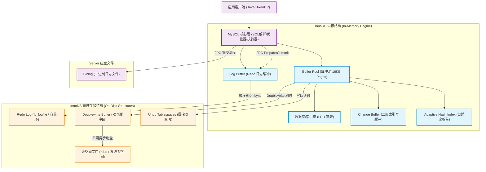
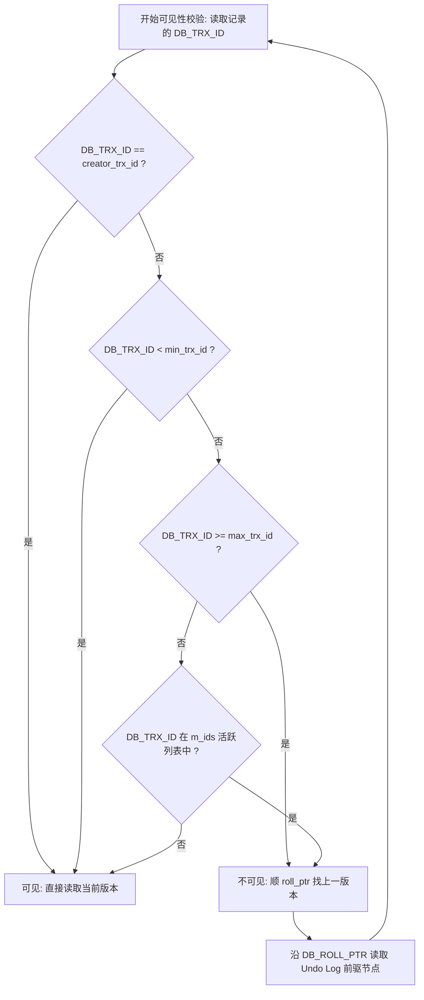
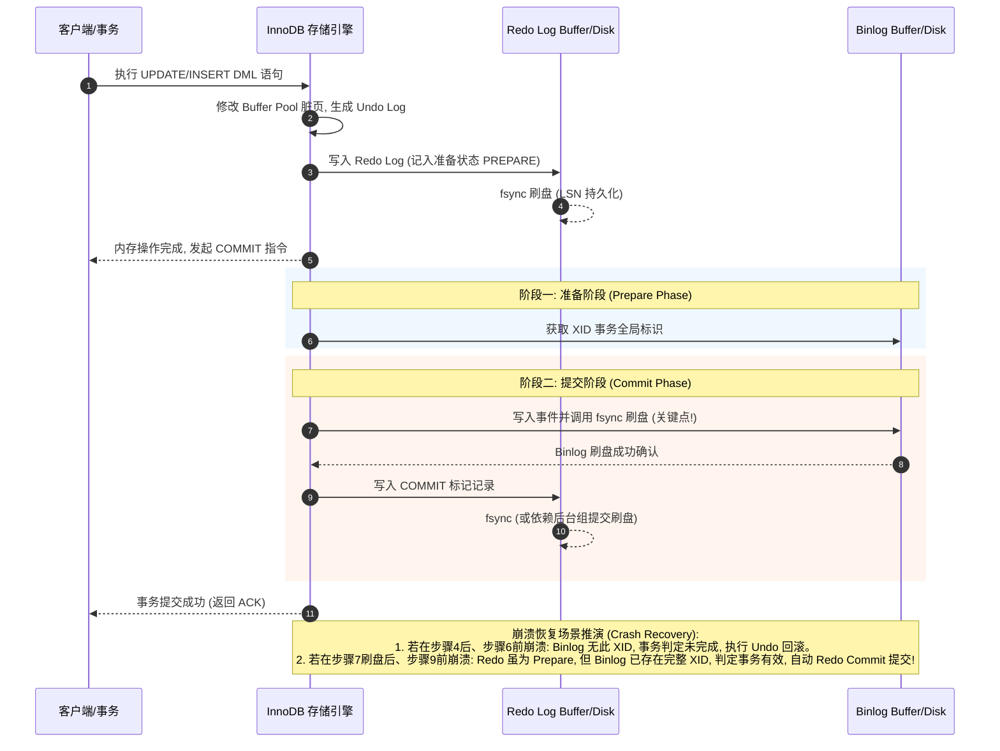
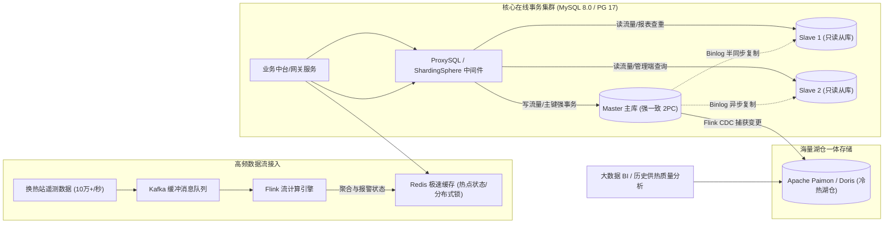
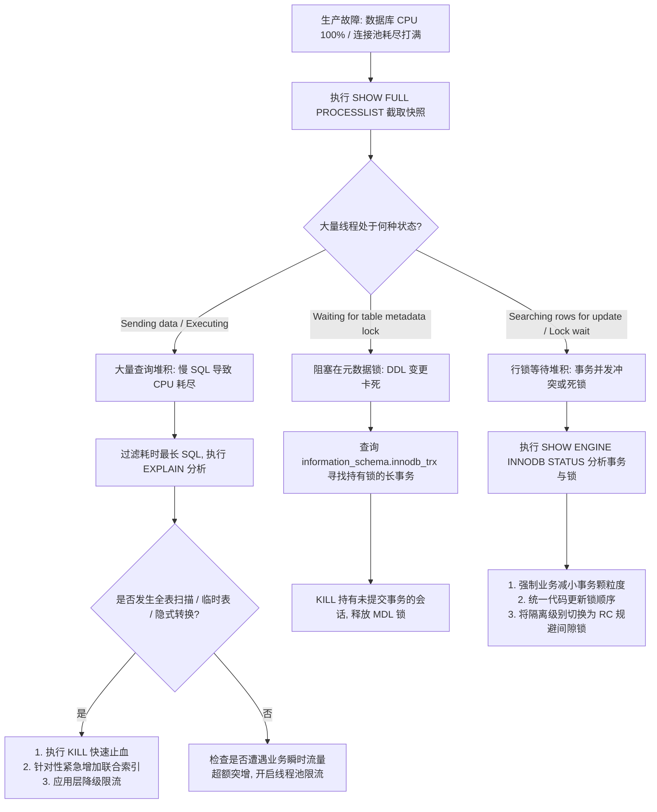
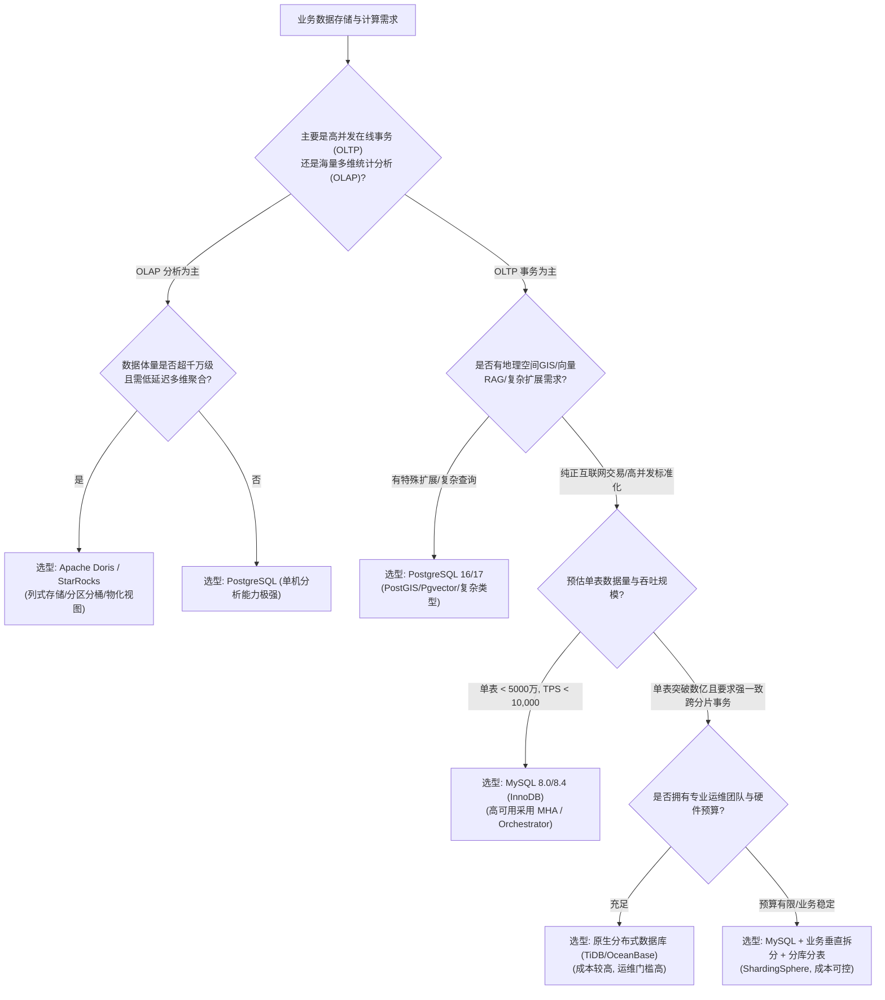
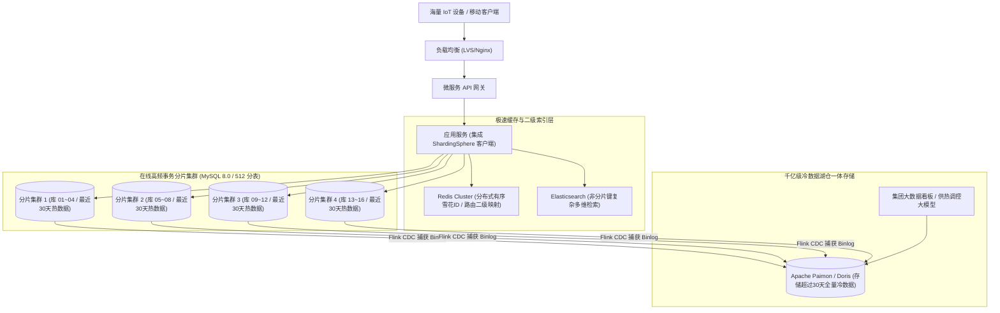
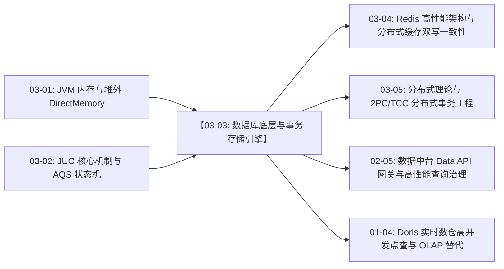

# 数据库底层与 PostgreSQL/MySQL 事务

> **学习目标定位**：面向技术总监、数据平台研发负责人、高级数据架构师岗位，深入攻克关系型数据库存储引擎的底层物理存储、内存缓冲、事务隔离与并发控制本质。彻底讲透 MySQL InnoDB 与 PostgreSQL 在 MVCC、WAL、锁体系、B+Tree 索引分裂及两阶段提交（2PC）上的运行机制与哲学差异。结合千亿级 IoT 数据入库、智慧供热实时交易与报表分析等真实生产场景，建立死锁排查、长事务治理、在线 DDL 变更及分库分表架构设计的全链路决策与管理管控能力。

---

## 1. 知识概述与业务价值

### 1.1 是什么（What）
关系型数据库（RDBMS）是企业在线事务处理（OLTP）系统的核心底座。其存储引擎负责数据在内存与磁盘之间的组织、检索、并发控制与持久化保障：
- **MySQL InnoDB 存储引擎**（业界事实标准，当前主力为 MySQL 8.0 及最新的 8.4 LTS 版本）：采用**索引组织表（Index-Organized Table, IOT）**架构，数据行直接挂载在聚簇 B+Tree 的叶子节点上；依托 Redo Log、Undo Log 和 Doublewrite Buffer 实现高性能 WAL（Write-Ahead Logging）与崩溃恢复；通过行级排他锁/共享锁、间隙锁（Gap Lock）和临键锁（Next-Key Lock）对抗并发异常；通过 ReadView 与 Undo 回滚段链条实现多版本并发控制（MVCC）。
- **PostgreSQL 存储引擎**（企业级与开源先进代表，主流版本 PG 16 / 17）：采用**堆表（Heap Storage）**架构，索引与物理数据解耦存储；MVCC 基于**行内多版本元组（Append-only Multi-Version Tuple）**实现，每次更新插入新元组并在行头打上 `xmin`/`xmax` 事务标记；依托 WAL 与后台自适应清理进程（`autovacuum`）回收死元组（Dead Tuples）；具备工业级可扩展类型系统、可插拔表访问方法（Table Access Method）以及原生 SSI（Serializable Snapshot Isolation）真可串行化快照隔离。

### 1.2 解决什么核心业务痛点（Why）
1. **高并发读写互不阻塞**：传统基于表锁或行排他锁的并发读写会导致读写串行化，引发严重吞吐瓶颈。MVCC 通过读取快照版本（Snapshot Read），实现了“读不阻塞写，写不阻塞读”，保证核心交易系统在大促流量脉冲下的低延迟。
2. **随机 I/O 向顺序 I/O 转化**：机械磁盘或甚至 NVMe SSD 的随机写入吞吐量均远低于顺序写。WAL（预写式日志）机制使得事务提交时仅需将极小体积的 Redo Log / WAL 日志顺序刷盘，内存脏页通过后台平滑刷盘，将高并发随机落盘压力从核心事务关键路径上彻底剥离。
3. **数据一致性与崩溃自愈（Crash-Safety）**：面对操作系统死机、断电或硬件瞬断，数据库依托 WAL 日志的 LSN（Log Sequence Number）与两阶段提交（2PC），保证已提交事务必定持久化（Redo 重放），未提交事务彻底回滚（Undo 反向补偿），消除“脏数据”或“数据半落盘”隐患。

### 1.3 适用场景与技术边界（Where & When）
- **最佳业务场景**：
  - 核心账户对账、订单支付、状态机流转等强一致 ACID 在线事务系统（OLTP）。
  - 设备元数据注册表、工单流转、配置中心等中小规模高频交互业务。
  - 需要行级锁、外键完整性校验与毫秒级点查（Point Query）的关键业务链路。
- **反模式与严禁使用边界**：
  - **海量时序与指标明细分析**：严禁将数十亿条 IoT 传感器秒级遥测数据或长周期日志明细直接存放于 MySQL 单表中做大范围聚合查询（聚合吞吐极低，容易因深分页或全表扫描拖垮内存 Buffer Pool），该场景必须路由至 Doris、ClickHouse 或 Apache Paimon / Iceberg 湖仓引擎。
  - **全文检索与模糊搜索**：严禁在生产大表中使用 `LIKE '%keyword%'` 进行模糊检索，该场景应通过 CDC（如 Flink CDC / Debezium）双写或旁路同步至 Elasticsearch / OpenSearch。
  - **超高频原子计数与分布式锁**：高频点赞、实时库存递减若直穿单行数据库锁，会导致行锁争用（Lock Contention）爆满，应用必须使用 Redis + Lua 脚本进行前置削峰防穿透。

---

## 2. 核心概念与关系

### 2.1 核心概念全景表

| 核心组件/概念 | 英文术语 | 核心定义与工程职责 | 资源/生命周期级别 |
| :--- | :--- | :--- | :--- |
| **缓冲池** | Buffer Pool / Shared Buffers | 内存中缓存数据页与索引页的核心区域，采用改进型 LRU 算法维持热点数据，减少磁盘 I/O。 | 实例级 / 内存驻留 |
| **重做日志** | Redo Log / WAL | 记录物理页修改的预写日志，保障崩溃恢复中的持久性（Durability），以环形文件组顺序写盘。 | 实例级 / 物理磁盘持久化 |
| **回滚日志** | Undo Log / Undo Tablespace | 记录逻辑反向操作的数据链，保障原子性（Atomicity）与 MVCC 历史版本读（Snapshot Read）。 | 事务级 / 定期 Purge 回收 |
| **双写缓冲** | Doublewrite Buffer | 解决操作系统 4KB 扇区写与数据库 16KB 页不匹配导致的“部分写失效（Partial Page Write）”的内存与物理保护区。 | 实例级 / 磁盘连续共享块 |
| **聚簇索引** | Clustered Index (IOT) | MySQL InnoDB 将主键索引与行数据捆绑存储的 B+Tree 结构，叶子节点即为真实数据行。 | 表级 / 存储引擎主干 |
| **二级索引** | Secondary Index | 基于非主键字段建立的 B+Tree，叶子节点存储主键值（InnoDB）或元组物理指针 ctid（PG）。 | 表级 / 辅助检索结构 |
| **一致性读视图** | ReadView | MVCC 快照读生成的数据可见性判断结构，包含活动事务数组、低水位与高水位标记。 | 查询级 (RC) / 事务级 (RR) |
| **临键锁** | Next-Key Lock | InnoDB 行记录锁（Record Lock）与间隙锁（Gap Lock）的组合（左开右闭区间），用于消灭幻读。 | 行/间隙级 / 事务提交释放 |

### 2.2 系统拓扑与交互关系图

下图完整展示了 MySQL 8.0 InnoDB 存储引擎内部内存结构（Buffer Pool、Change Buffer、Log Buffer）与磁盘结构（Tablespaces、Redo Log、Undo Tablespaces、Doublewrite Buffer）以及 Binlog 两阶段提交的协同拓扑：



---

## 3. 底层工作机制与设计哲学

### 3.1 核心运行流程与状态机流转

#### 1. InnoDB MVCC 实现机制与 ReadView 判定算法
InnoDB 通过每行隐藏字段、Undo Log 版本链以及事务启动时生成的 `ReadView` 实现多版本快照读：
- **记录的隐藏系统列**：
  - `DB_TRX_ID`（6 字节）：最后一次插入或修改该记录的事务 ID。
  - `DB_ROLL_PTR`（7 字节）：回滚指针，指向写入 Undo Log 的历史版本，形成单向链表。
  - `DB_ROW_ID`（6 字节）：若表无显式主键且无非空唯一键，自动生成隐式聚簇主键。
- **ReadView 核心结构要素**：
  - `m_ids`：在生成 ReadView 的那一瞬间，系统内活跃（未提交）的事务 ID 列表。
  - `min_trx_id`：`m_ids` 中的最小值（活动事务低水位）。
  - `max_trx_id`：生成 ReadView 时系统即将分配给下一个新事务的递增 ID（高水位）。
  - `creator_trx_id`：创建当前 ReadView 的自身事务 ID。
- **可见性判断状态机算法**：
  对于版本链中的某条历史记录，其事务 ID 设为 $TRX\_ID$：
  1. **规则 1**：若 $TRX\_ID == creator\_trx\_id$，说明是当前事务自身所做的修改，**可见**。
  2. **规则 2**：若 $TRX\_ID < min\_trx\_id$，说明该事务在 ReadView 创建前已提交，**可见**。
  3. **规则 3**：若 $TRX\_ID \ge max\_trx\_id$，说明该版本是由 ReadView 创建后才启动的事务生成的，**绝对不可见**，顺着 `DB_ROLL_PTR` 寻找上一版本。
  4. **规则 4**：若 $min\_trx\_id \le TRX\_ID < max\_trx\_id$：
     - 若 $TRX\_ID \in m\_ids$，说明 ReadView 创建时该事务仍在活跃未提交，**不可见**；
     - 若 $TRX\_ID \notin m\_ids$，说明该事务在 ReadView 创建前已经提交完成，**可见**。
- **隔离级别差异**：
  - **Read Committed (RC)**：**每次执行 SELECT 查询语句时，都会重新生成一份最新的 ReadView**。因此同一事务内两次查询能读到其他事务中间提交的结果（不可重复读）。
  - **Repeatable Read (RR)**：**仅在事务内部第一次执行 SELECT 语句时生成 ReadView**，后续整个事务生命周期内的所有快照读均复用该 ReadView，彻底保障可重复读。



#### 2. PostgreSQL MVCC 与 VACUUM 运行哲学
与 MySQL 的“原位更新 + Undo 回滚段”不同，PostgreSQL 采用了 **Append-only（追加写）堆表机制**：
- **行头元信息**：每个 Tuple 头部包含 `t_xmin`（插入该元组的事务 ID）、`t_xmax`（删除或更新该元组的事务 ID，未更新时为 0）、`t_cid`（命令标识符）。
- **更新操作本质**：`UPDATE` 在物理上等价于 `INSERT 新版本元组 + 将旧元组的 t_xmax 设为当前事务 ID`。旧元组依然留在原地，变为 **Dead Tuple（死元组）**。
- **表膨胀（Table Bloat）与垃圾回收**：
  - 大量高频更新会导致数据页堆满 Dead Tuples，引发存储空间暴增和查询 I/O 放大。
  - **`autovacuum` 守护进程**：后台周期性扫描数据页，回收不可见的 Dead Tuples 空间，更新 Free Space Map (FSM) 供后续 INSERT 复用空间，但**通常不会将磁盘物理文件截断缩容归还给操作系统**。
  - **`VACUUM FULL`**：通过独占表锁对整张表进行重写整理并归还操作系统磁盘空间，生产环境因长时间持有排他锁（AccessExclusiveLock）严禁直接手工触发。
  - **Transaction ID Wraparound（32位 XID 回卷灾难）**：PG 的事务 ID 为 32 位整型（约 42 亿容量）。当 XID 递增至一半（20 亿）时必须触发 **`VACUUM FREEZE`** 将旧元组的 XID 冻结为特殊标识 `FrozenTransactionId`（永久过去式）。若 autovacuum 被长事务阻塞无法推进冻结，PG 会强制进入只读保护停机模式，酿成重大生产事故。

#### 3. B+Tree 索引底层结构与存取代价
- **结构特征**：
  - **高扇出（Fan-out）**：InnoDB 默认页大小 16KB，假设主键为 8 字节 BigInt，指针为 6 字节，一个非叶子节点页可容纳约 $16384 / (8+6) \approx 1170$ 个子节点指针。三层高 B+Tree 即可容纳约 $1170 \times 1170 \times 16 \approx 2000$ 万行数据，**只需 3 次磁盘 I/O 甚至更少（非叶子节点常驻 Buffer Pool）即可定位目标数据**。
  - **叶子节点双向链表**：所有真实数据存储在叶子节点，叶子节点之间通过双向链表相连，极大优化了 `BETWEEN`、`>`、`ORDER BY` 等范围扫描效率。
- **页分裂（Page Split）与页合并（Page Merge）**：
  - 当向一个已经填满（默认达 15/16 填充因子）的数据页插入新记录时，存储引擎必须申请一个新页，将原页中约 50% 的记录移动至新页，并修改父节点指针，此即**页分裂**。
  - **自增主键 vs UUID 乱序**：自增主键保证顺序追加写，数据页以近似 100% 紧凑度填充，极少发生页分裂；而 UUID 具有完全随机性，会导致新记录随机插入到任何历史数据页中，引发连锁性的页分裂、磁盘寻道激增与大量内存碎片。
- **回表（Table Access by Index Rowid）与覆盖索引（Covering Index）**：
  - 二级索引叶子节点仅存储二级索引列与主键值。若查询所选字段未被该索引覆盖，执行器必须通过主键二次检索聚簇索引树，称为“回表”。
  - **覆盖索引**：`SELECT id, status, create_time FROM orders WHERE user_id = 123`，若建立联合索引 `idx_user_status_time(user_id, status, create_time)`，所有字段均可从二级索引树直接提取，无需回表，性能提升数倍至数十倍。
  - **索引下推（Index Condition Pushdown, ICP）**：MySQL 5.6+ 引入。在存储引擎层遍历二级索引时，直接对索引包含的字段进行 `WHERE` 条件过滤，大幅减少回表次数及向 Server 层传递无用记录的开销。

### 3.2 机制交互时序图（Mermaid）：两阶段提交（2PC）与 Crash Recovery

为了保障 InnoDB Redo Log 与 Server 层 Binlog 之间的绝对一致性（防止主从数据不一致），MySQL 采用了内部 XA 两阶段提交机制：



### 3.3 架构设计思想与演进权衡

1. **为什么必须采用 WAL（Write-Ahead Logging）？**
   - **内存随机 I/O 向磁盘顺序 I/O 的降维**：数据页分布在表空间各处，直接刷脏页需要寻道写入大量分散的数据块；而 Redo Log / WAL 是连续追加写入环形日志文件，写入延迟从 10ms 降至微秒级。
   - **LSN（Log Sequence Number）与幂等重放**：Redo Log 记录的是物理页的二进制变更（如“在 Page 300 偏移量 120 写入字节 0xAF”）。每个 Page 头都记录了最后修改它的 `PAGE_LSN`。恢复阶段只要比较 `Log_LSN` 与 `PAGE_LSN`，即可幂等重放，天然具备容灾幂等性。
2. **Doublewrite Buffer（双写缓冲）的哲学必要性**
   - 现代 Linux 文件系统的最小块通常为 4KB，而 InnoDB 的页大小为 16KB。当数据库向磁盘刷新一个 16KB 脏页时，若写入了 4KB 机器突然掉电，磁盘上的这一页处于破坏断裂状态（Partial Page Write）。
   - **Redo Log 无法挽救页断裂**：因为 Redo Log 记录的是物理差异（Delta），重放的前提是“基底数据页未损坏”。如果基底页本身校验和（Checksum）破损，重放将直接导致数据错乱。
   - **双写机制解法**：脏页在刷入独立 `.ibd` 表空间前，先顺序写入连续的 Doublewrite Buffer 物理区域（顺序写极快并调用 fsync）。即使后续向真实表空间离散写入时发生断裂，恢复时只需从 Doublewrite Buffer 中找到该页的完整镜像还原，再应用 Redo Log，实现了完美的容错闭环。
3. **MySQL 8.0 / 8.4 LTS 前沿演进与架构革新**
   - **Instant DDL**：在 MySQL 8.0.12+ 之后，`ADD COLUMN`、`DROP COLUMN`（8.0.29+）无需拷贝整表数据，直接在元数据字典中增加默认值元信息与版本标识，瞬间完成亿级大表加字段。
   - **Redo Log 动态自适应容量（`innodb_redo_log_capacity`）**：彻底取代了历史陈旧的 `innodb_log_file_size` 与 `innodb_log_files_in_group` 固定死配置，支持在线热动态缩放重做日志容量。
   - **Clone Plugin 原生物理快照克隆**：无需依赖外部 XtraBackup，利用存储引擎内部命令直接跨网络全量拉取物理表空间与持续变更 Redo，实现从库一键秒级搭建与弹性扩容。

---

## 4. 高频复杂业务场景实操与落地

### 4.1 生产典型业务场景拓扑

在大型工业智慧供热平台（如太原项目万级热力换热站）或大型电商秒杀系统中，高并发状态写入与核心报表查询交织。架构设计必须遵循“**动静分离、读写分离、分级削峰与冷热分流**”原则：



### 4.2 生产级配置基线与参数推荐

#### 1. MySQL 8.0+ / 8.4 LTS 核心生产参数基准

```ini
# [内存缓冲基线] 生产物理机独占时通常设为物理内存的 60% ~ 75%
innodb_buffer_pool_size = 48G
# 缓冲池实例切片，避免单全局互斥锁并发争用，通常按每 8G 分一个实例
innodb_buffer_pool_instances = 6

# [一致性与持久化红线: 双1强一致性基准]
# 1: 每次事务提交必定执行 Redo Log 的 fsync，严防断电丢数据
innodb_flush_log_at_trx_commit = 1
# 1: 每次事务提交必定执行 Binlog 的 fsync，保障主从同步绝对不丢事务
sync_binlog = 1

# [Redo Log 容量] MySQL 8.0.30+ 推荐采用动态容量
innodb_redo_log_capacity = 16G

# [刷脏页与 I/O 调优: 对齐 NVMe SSD 性能]
innodb_io_capacity = 10000
innodb_io_capacity_max = 20000
innodb_flush_neighbors = 0 # SSD 环境严禁刷新相邻页，彻底消除写入放大

# [事务与隔离级别]
# 互联网主流推荐 RC (Read Committed) 消除绝大多数间隙锁死锁，配合 binlog_format=ROW
transaction_isolation = READ-COMMITTED
binlog_format = ROW

# [死锁与锁超时]
innodb_lock_wait_timeout = 5 # 核心 OLTP 缩短至 5 秒快速失败，防止连接池雪崩
innodb_deadlock_detect = ON # 开启死锁主动环路检测检测
```

#### 2. PostgreSQL 16/17 核心生产配置考量
- `shared_buffers = 16GB`（通常为系统物理内存的 25%）。
- `work_mem = 64MB`（单个排序或哈希连接操作内存，防止并发高时 OOM）。
- `maintenance_work_mem = 2GB`（加速 VACUUM 与创建索引）。
- `wal_buffers = 64MB`（自动平滑 WAL 写入）。
- `checkpoint_completion_target = 0.9`（将检查点刷盘过程平摊在两次 Checkpoint 之间 90% 的时间内，消除 I/O 尖刺）。
- `autovacuum_vacuum_scale_factor = 0.05`（表内死元组达到 5% 即触发清理，避免默认 20% 导致的严重表膨胀）。

### 4.3 核心性能指标监控（SLA 黄金指标）

| 监控指标项 | Prometheus / Exporter 键名 | 生产健康阈值 | 技术管理者告警与干预水位 |
| :--- | :--- | :--- | :--- |
| **缓冲池命中率** | `Innodb_buffer_pool_read_requests` vs `Innodb_buffer_pool_reads` | $\ge 99.5\%$ | 低于 $98\%$ 时立即告警，表明内存严重不足，大量查询直穿物理磁盘。 |
| **并发活跃线程** | `Threads_running` | $\le 30$ | 持续 $> 64$ 时触发 P1 报警，通常伴随慢查询堵塞或全局行锁争用。 |
| **主从复制延迟** | `Seconds_Behind_Master` / `pg_stat_replication.write_lag` | $\approx 0$ 秒 | 超过 10 秒触发报警；核心业务超过 60 秒必须进行只读流量路由切流。 |
| **锁等待与死锁** | `Innodb_row_lock_current_waits` / `Innodb_deadlocks` | 0 | 瞬时死锁突增必须触发追踪分析，排查批量更新交叉死锁。 |
| **Undo 空间/长事务** | `active_transactions_seconds` / `History list length (HLL)` | HLL $\le 50000$ | HLL $> 100000$ 预警，说明存在长事务阻塞 Undo 空间回收。 |

---

## 5. 生产异常故障深度排查与根因分析

### 5.1 典型生产事故与异常排查树

下图展示了核心生产环境遭遇数据库 CPU 100% 飙高、连接池耗尽雪崩时的排查与处置决策树：



### 5.2 核心异常场景实战复盘

#### 场景一：长事务导致 Undo Log 膨胀、历史版本链过长引发只读查询雪崩
- **真实生产现象**：
  某智慧能源中台运营期间，未建立只读库隔离，运维人员在生产主库通过 Navicat 执行了一段包含复杂多表关联的大导出统计 SQL，随后去开会未关闭连接。数小时后，核心交易链路出现大面积响应超时，监控显示磁盘空间急剧缩水 300GB，Buffer Pool 命中率从 99.8% 暴跌至 85%，即便是单行主键点查耗时也从 1ms 恶化至数百毫秒。
- **底层根因剖析**：
  长事务持有的 ReadView 冻结了 `min_trx_id`。InnoDB 的后台垃圾清理线程（Purge Thread）只能回收事务提交前且小于系统所有活动 ReadView 最小 `min_trx_id` 的 Undo Log。长事务存活期间，产生的所有增删改产生的 Undo Log 全部无法清理，导致 `ibdata1` / Undo Tablespace 疯狂膨胀，**History List Length (HLL)** 飙升至数百万。普通业务查询不得不顺着记录的 `DB_ROLL_PTR` 遍历长达上万个历史版本的单向链表，造成了严重的 CPU 消耗与内存抖动。
- **快速止血与根治策略**：
  1. **定位并强杀**：查询 `SELECT trx_id, trx_state, trx_started, TIMESTAMPDIFF(SECOND, trx_started, NOW()) AS duration, trx_query, trx_mysql_thread_id FROM information_schema.innodb_trx ORDER BY trx_started ASC LIMIT 1;`，锁定异常连接 ID，执行 `KILL <trx_mysql_thread_id>`。
  2. **开启动态截断**：确保开启 `innodb_undo_log_truncate = ON`，配合独立的 Undo Tablespace 自动进行后台空间平滑物理截断回收。
  3. **架构防御门禁**：在连接池中间件（如 HikariCP / ShardingSphere）与数据库服务端同时配置超时阈值：`SET GLOBAL max_execution_time = 5000`（限制只读查询最多执行 5 秒），从网络与账号权限上彻底杜绝管理人员直连生产主库。

#### 场景二：生产高并发更新导致 Next-Key Lock 死锁爆发（Deadlock）
- **真实生产现象**：
  在高并发批量更新换热站阀门状态或秒杀订单扣减时，应用日志疯狂打印 `Deadlock found when trying to get lock; try restarting transaction`，TPS 剧烈震荡，部分交易请求失败重试加剧了锁等待风暴。
- **底层根因剖析**：
  通过 `SHOW ENGINE INNODB STATUS` 提取 `LATEST DETECTED DEADLOCK` 日志分析发现：
  - 事务 A 与事务 B 在可重复读（RR）隔离级别下，针对同一个非唯一二级索引 `idx_status` 进行范围扫描与修改。
  - 事务 A 持有了记录 $(10, 20]$ 的 Next-Key Lock，并尝试向区间 $(20, 30)$ 申请插入意向锁（Insert Intention Lock）；
  - 事务 B 同时持有了区间 $(20, 30]$ 的 Next-Key Lock，并尝试向区间 $(10, 20)$ 申请写入锁；
  - 双方各自持有对方所需的 Gap 锁资源，形成经典的循环等待死锁环路。
- **根治策略**：
  1. **降级隔离级别（架构师首选方案）**：将生产默认的 `REPEATABLE-READ` 降级为 **`READ-COMMITTED`**，配合 `binlog_format = ROW`。在 RC 级别下，除了外键检查和唯一键冲突检查外，**InnoDB 完全关闭了非唯一索引上的间隙锁（Gap Lock）和临键锁（Next-Key Lock）**，直接消除 90% 以上由 Gap 锁引发的死锁。
  2. **代码级排序更新**：对于批量更新操作（如批量扣减库存），在业务代码层（Java）执行前，对主键 ID 进行升序排序（`Collections.sort(ids)`），确保所有并发事务严格按照相同的物理加锁顺序访问行资源，破坏死锁形成的“环路等待”条件。
  3. **精简事务生命周期**：严禁在事务上下文内部调用耗时外部 RPC、HTTP 接口或大文件 I/O，遵循“RPC 调用在外，纯 DB 事务在内且极速提交”的架构原则。

#### 场景三：大表元数据锁（Metadata Lock, MDL）阻塞全局读写
- **真实生产现象**：
  开发人员在午间业务低谷期向一张千万级用户表执行 `ALTER TABLE users ADD COLUMN age INT;`，瞬间导致业务系统全线崩溃，所有对 `users` 表的简单 `SELECT` 全被卡死在 `Waiting for table metadata lock`，连接池数秒内被打满。
- **底层根因剖析**：
  在执行 `ALTER TABLE` 之前，存在一个未提交的长查询（或长事务）持有着 `users` 表的 **MDL 读锁（Metadata Lock Shared Read）**。`ALTER TABLE` 申请的是 **MDL 独占写锁（Metadata Lock Exclusive）**，因无法获取写锁而进入等待队列。而 MySQL 为了保证字典变更的优先级，**MDL 写锁的等待会阻塞其后所有后续进来的 MDL 读锁申请（即便是轻量级 SELECT）**，导致后续所有查询瞬间堆积形成雪崩。
- **防御性治理**：
  1. **生产 DDL 强制红线**：严禁直接在千万级以上核心生产表执行原生 `ALTER TABLE`。
  2. **推行在线 DDL 工具**：强制采用 GitHub 开源的 **`gh-ost`** 或 Percona 的 **`pt-online-schema-change`**。其核心机制为：创建影子镜像表 -> 在影子表应用 DDL -> 开启 Binlog 增量复制同步数据 -> 数据追平后通过毫秒级原子重命名（`RENAME TABLE old TO backup, ghost TO old`）完成无锁切换。

---

## 6. 技术选型对比、架构演进与成本ROI

### 6.1 横向多维选型对比矩阵

| 评估维度 | MySQL 8.0 / 8.4 (InnoDB) | PostgreSQL 16 / 17 | 分布式数据库 (TiDB / OceanBase) | 实时分析数仓 (Doris / ClickHouse) |
| :--- | :--- | :--- | :--- | :--- |
| **底层存储模型** | 索引组织表 (IOT / B+Tree) | 堆表 (Heap + 多版本 Tuple) | LSM-Tree (TiKV) / Paxos 分区存储 | 列式存储 (Columnar / Segment) |
| **MVCC 实现机制** | 原位更新 + Undo Log 回滚链 | Append-only 追加写 + VACUUM 回收 | 多版本 MVCC + 集中式时间戳 (TSO) | 稀疏索引 + 预聚合/Replace 状态机 |
| **最强适用场景** | 互联网标准高并发 OLTP 交易 | 复杂关系计算、地理空间 GIS、向量检索 | 海量超大宽表强一致分布式事务 | 百亿级多维分析、实时看板、大宽表聚合 |
| **单表容量推荐** | 单表千万级（5000 万以内保持高性能） | 单表上亿（依靠良好维护与分区表） | 几乎无上限（水平自动切分 Region） | 百亿级无压力（单机性能远超传统 RDBMS） |
| **生态成熟与运维** | 极高，工具链完善，招人最容易 | 极高，学术界/欧美极其推崇，极度严谨 | 较高，但底层运维复杂，资源底座要求高 | 针对 OLAP 极佳，但不支持精细行级事务 |
| **硬件成本** | 适中（内存与 NVMe SSD 需求均衡） | 适中（需额外预留空间应对表膨胀） | 昂贵（多副本 Paxos/Raft 占用大量节点） | 极低（高压缩比，列存压缩可达 5:1 以上） |

### 6.2 架构师技术选型决策树与成本 ROI



- **数据生命周期冷热归档 ROI 测算**：
  - 在智慧城市或智能制造项目中，设备原始运行记录单表年增量超过 20 亿行。
  - **方案 A（全部堆在单主 MySQL）**：需购买数百 GB 内存与数 TB 顶级 NVMe 存储，备份时间长达十几个小时，恢复不可控，月度云上硬件成本数万元。
  - **方案 B（架构治理：冷热分离）**：MySQL 仅保留最近 3 个月“热数据”（支撑故障工单回溯与实时监控），单表维持在 1000 万以内；超过 3 个月历史数据通过 Flink 定时增量转储至基于对象存储（OSS/S3）的 **Apache Paimon / Iceberg 数据湖**。存储成本下降 **85%**，同时主库 TPS 提升 3 倍以上。

---

## 7. 技术经理与架构师实战管控（SOP与规范）

### 7.1 平台级多租户与资源隔离机制
1. **连接池分级物理隔离**：
   - 严禁将核心交易业务（如支付、用户登录）与报表导出、批量计算任务共享同一个应用连接池。
   - 必须在 HikariCP 层面划分 `core-pool`（只承接实时高优先级请求，超时 2 秒）与 `batch-pool`（最大连接数受控，超时 30 秒），防止后台报表将主库连接池耗尽导致核心业务大面积脱机。
2. **读写分离与自适应动态权重路由**：
   - 借助 **ProxySQL** 或 **ShardingSphere-Proxy** 实现基于 SQL 类型与表名的智能分流。
   - 对从库主从延迟（Replication Lag）施加熔断机制：当从库 `Seconds_Behind_Master > 5` 秒时，自动将该从库从只读池剔除；对于下单后立刻读取详情的强一致场景，在业务端提供 `Hint: /*master*/ SELECT ...` 强制走主库。
3. **数据库系统级多租户配额约束**：
   - 针对多租户共库场景，通过创建不同账号限制并发资源：
     ```sql
     CREATE USER 'tenant_batch'@'%' IDENTIFIED BY 'password'
     WITH MAX_USER_CONNECTIONS 10
     MAX_QUERIES_PER_HOUR 100000;
     ```

### 7.2 生产变更红线与降级容灾预案（SOP）

#### 1. SQL 开发军规十条（技术团队强制门禁）
1. **主键规范**：所有表必须显式定义主键，统一推荐无符号自增整型 `BIGINT UNSIGNED` 或分布式有序雪花 ID，严禁使用乱序 UUID。
2. **字段定义**：所有字段尽量设为 `NOT NULL` 并设置合理默认值（NULL 需额外空间存储且使得索引统计失准）。
3. **消除隐式转换**：严禁字符串类型字段与整型参数比较（如 `WHERE phone = 13800000000` 会导致全表索引失效并触发隐式 `CAST`）。
4. **禁止 SELECT \***：必须明确列名，防止全字段检索拖垮 Buffer Pool 并破坏覆盖索引优化。
5. **深分页限制**：禁止大偏移量 `LIMIT 1000000, 20`，必须改写为基于主键游标的流式查询（`WHERE id > max_id LIMIT 20`）或子查询延迟关联（Deferred Join）。
6. **索引最少与前缀原则**：单表索引严禁超过 6 个，频繁组合查询必须构建联合索引并遵守**最左前缀匹配原则**。
7. **大事务严厉禁止**：单个事务涉及的操作行数不得超过 1000 行，事务持有时长必须控制在 500ms 以内。
8. **批量更新分批执行**：大批量归档或删除（如清空历史日志），必须使用脚本分批进行（如 `DELETE FROM logs WHERE create_time < '...' LIMIT 1000;` 循环休眠执行），严防长事务撑爆 Undo。
9. **禁止 JOIN 超过 3 张表**：高并发 OLTP 场景下禁止多表复杂关联，尽量在应用层通过代码拆解并发组装。
10. **DDL 流程红线**：严禁私自在生产库执行 `ALTER/DROP`，一律通过自动化平台走 `gh-ost` 无锁变更。

#### 2. 高可用切换与容灾 RPO/RTO 预案（SOP）
- **高可用架构选型**：推荐部署 **Orchestrator + VIP（Keepalived）/ ProxySQL** 或基于 Raft 的一致性复制框架。
- **半同步复制（Semi-Sync Replication）**：开启 `rpl_semi_sync_master_wait_point = AFTER_SYNC`，主库必须等待至少一个从库写入 Relay Log 才能向客户端返回提交成功，实现 **$RPO = 0$（数据零丢失）**。
- **主从切换演练流程（SOP）**：
  1. 检测到主库心跳丢失达到连续 3 次（15 秒），Orchestrator 宣布主库宕机。
  2. 选出拥有最大 Binlog LSN 的最优从库作为候选新主。
  3. 将其他从库拓扑变更为挂载在新主库下方（Change Replication Source）。
  4. 解除新主库的 `read_only` 状态。
  5. VIP 飘移至新主库，通知应用端 ProxySQL 更新集群拓扑，整体控制 **$RTO < 30$ 秒**。

---

## 8. 互联网大厂高频面试真题库

> [!IMPORTANT]
> 本板块精选一线大厂（阿里、字节、美团、快手、腾讯、滴滴等）真实高频考察的 7 道核心真题。涵盖基础概念、底层机制、大促排障与架构规划。**在接下来的第 9 板块中，将对下列所有题目进行逐题深度解答，严禁留白！**

### 8.1 基础概念与机制题（大厂初筛）
1. **Q1**：MySQL 的聚簇索引和非聚簇索引（二级索引）在 B+Tree 结构上有何本质区别？为什么生产实践中强烈推荐使用自增整型作为主键，而不是 UUID？
2. **Q2**：MySQL InnoDB 事务的 ACID 四大特性分别是由哪些底层机制提供保障的？WAL 机制的核心价值与运行逻辑是什么？

### 8.2 核心底层原理深度题（大厂资深技术面）
3. **Q3**：请详细阐述 InnoDB MVCC 的 ReadView 核心结构与版本链流转判断算法。读已提交（RC）与可重复读（RR）隔离级别生成 ReadView 的关键差异是什么？
4. **Q4**：MySQL 在可重复读（RR）隔离级别下到底能否彻底解决幻读？快照读与当前读在加锁与 MVCC 处理上有何不同？Next-Key Lock 的加锁规则是什么？

### 8.3 复杂生产场景与故障排障题（大厂架构与排障面）
5. **Q5**：生产大促期间，数据库突发大量 `Lock wait timeout exceeded` 和 `Deadlock` 报错，同时 CPU 飙升至 100%、连接池打满。作为技术专家，请给出从紧急止血、根因分析到彻底规避的标准化排障全流程。
6. **Q6**：长事务（Long-Running Transaction）对 MySQL 和 PostgreSQL 分别会造成什么灾难性后果？如何实时监控、定位并建立防御机制？

### 8.4 架构设计与系统规划题（技术总监/总架构师终面）
7. **Q7**：面对单表 5 亿行、日增 5000 万条的物联网遥测/核心交易业务，如何系统设计分库分表、冷热分离与高可用容灾架构？请给出分片键选型、跨库查询应对、在线平滑扩容及数据归档的完整落地方案。

---

## 9. 结构化深度参考答案（逐题三层应答）

---

### 题目1：MySQL 聚簇索引与二级索引的本质区别，及主键选型考量

#### 简洁回答（1分钟电梯破题）：
> 聚簇索引与非聚簇索引的本质区别在于**数据与索引是否一体化存储**。InnoDB 采用索引组织表（IOT），聚簇索引叶子节点直接存放整行物理数据，一张表只能有一个聚簇索引；而二级索引叶子节点仅存放“索引列值 + 对应主键 ID”。推荐自增主键而非 UUID，是因为自增主键保证了**主键顺序单调递增追加**，能够以接近 100% 的紧凑度填充 B+Tree 页，彻底消除乱序插入导致的频繁“B+Tree 页分裂（Page Split）”与内存碎片，大幅提升写入吞吐并减少内存 Buffer Pool 抖动。

#### 深入回答（机制推导与边界条件）：
1. **物理存储拓扑差异**：
   - **聚簇索引（Clustered Index）**：以主键构建 B+Tree。非叶子节点存放主键和子页指针，叶子节点（Leaf Page）即是物理数据页，包含了行记录的所有普通列以及隐藏列（`DB_TRX_ID`、`DB_ROLL_PTR`）。因此根据主键查询只需检索一棵 B+Tree，效率最高。
   - **二级索引（Secondary Index）**：以辅助字段构建。叶子节点只存储索引键值和该行对应的聚簇索引主键。如果执行 `SELECT * FROM table WHERE sec_key = 'A'`，存储引擎先在二级索引树查出主键，再带着主键去聚簇索引树重新检索完整行记录，此过程称为**回表（Table Access by Rowid）**。可以通过**覆盖索引（Covering Index）**让索引直接包含所查列来消除回表。
2. **UUID 乱序写入的性能惩罚推导**：
   - **页分裂过程**：B+Tree 节点大小固定（16KB）。自增主键写入时，新记录永远插入在当前最右侧叶子页末尾，页满后开辟新页（空间利用率接近 15/16），写入是连续的追加顺序写（Sequential Write）。
   - **UUID 惩罚**：UUID 是完全离散无序的，新记录的哈希主键值将随机命中历史上的任意叶子页。当目标页已满时，存储引擎必须将其分裂为两个页，将 50% 的数据迁移到新页，并调整双向链表指针与父节点。这导致了三个致命问题：
     - **写入放大与随机 I/O**：引发大量原本不必要的磁盘页写回。
     - **空间利用率暴跌**：页分裂使得页面空间利用率平均降至 50% 左右，存储膨胀一倍。
     - **Buffer Pool 严重污染**：大量冷数据页因随机写入被强行载入内存，将真正的高频热点数据逐出 Buffer Pool，整体系统吞吐暴跌 80% 以上。

#### 架构师/技术管理视角（权衡取舍、SLA与成本）：
> 架构设计中没有银弹，自增主键在单机环境下性能最优，但在**分布式分库分表与防业务爬虫探测**场景下存在天然短板：
> 1. **业务安全与防爬**：自增主键具有连续规律，外部爬虫通过 `id=1, 2, 3` 可轻而易举探测公司日订单量和核心增长指标。
> 2. **分布式全局唯一性冲突**：分库分表多节点写入无法依赖本地自增主键。
> - **权衡落地解决方案**：
>   - 在高并发分布式架构中，坚决不使用原生无序 UUID，而是采用**趋势递增的分布式唯一 ID**，如 Twitter Snowflake（雪花算法，时间戳高位有序）或美团 Leaf / 百度 UidGenerator。
>   - 保证了 ID 在“毫秒级/秒级宏观趋势单调递增”，既消除了 B+Tree 页分裂灾难，又满足了分布式全局唯一和防爬虫业务语义，在底层性能与架构扩展性之间取得最佳 ROI。

---

### 题目2：InnoDB 事务 ACID 特性的底层机制，及 WAL 预写日志的核心价值

#### 简洁回答（1分钟电梯破题）：
> InnoDB 事务的 ACID 四大特性分别由不同的底层引擎子系统相互协同支撑：
> - **A（原子性 Atomicity）**：由 **Undo Log（回滚日志）**保障，事务失败时依据 Undo Log 执行反向逆向补偿操作（如将已 INSERT 的行 DELETE，将已 UPDATE 的行恢复旧值）。
> - **C（一致性 Consistency）**：是事务追求的终极目标，由应用层约束、数据库完整性规则以及 AID 底层机制共同保障。
> - **I（隔离性 Isolation）**：由 **锁机制（行锁、间隙锁、表锁）**与 **MVCC（多版本并发控制）**共同保障。
> - **D（持久性 Durability）**：由 **Redo Log（重做日志）**与 **WAL 机制**保障。
> 
> **WAL（Write-Ahead Logging）的核心价值**在于“**顺序日志刷盘优先于内存脏页随机写盘**”，将昂贵的磁盘离散随机 I/O 转化为极速的磁盘顺序追加写，在保障崩溃自愈（Crash-Safe）的前提下极大释放了数据库的吞吐极限。

#### 深入回答（机制推导与边界条件）：
1. **WAL 运行链路全推导**：
   - 当客户端执行 `UPDATE account SET balance = balance - 100 WHERE id = 1` 时，InnoDB 不会直接将磁盘上的真实数据页读出修改再写回磁盘。
   - 步骤：
     1. 从磁盘载入目标页至内存 **Buffer Pool**，产生 Undo Log 记录旧版本。
     2. 在 Buffer Pool 内存中修改该页，该页标记为**脏页（Dirty Page）**。
     3. 生成物理差异日志记录（Redo Log），追加写入 **Redo Log Buffer**。
     4. 事务提交阶段（Commit）：根据 `innodb_flush_log_at_trx_commit = 1` 策略，强制将 Redo Log 顺序写入磁盘文件（`ib_logfile` / 动态重做日志环）并执行 `fsync`。
     5. 只要 Redo Log 成功刷盘，即可向客户端返回“事务提交成功”。内存中的脏页由后台线程（Page Cleaner Thread）依据 Checkpoint 机制在空闲时异步批量刷新到磁盘表空间。
2. **崩溃恢复（Crash Recovery）机制**：
   - 若机器断电，内存脏页全部丢失，但磁盘上的 Redo Log 完整保留。
   - 重启时，引擎读取最后一个 Checkpoint 的 LSN，从该 LSN 之后顺序扫描 Redo Log，对比每个物理页的 `PAGE_LSN`，对尚未落盘的已提交脏页执行**前滚（Roll-Forward）**重做；
   - 随后利用 Undo Log 对崩溃前处于活跃未完成状态的事务执行**回滚（Roll-Back）**清扫，彻底保证数据无损与原子性。
3. **Doublewrite Buffer 填补 WAL 盲区**：
   - WAL 能够正常重放的前提是“基底物理页未损坏”。因为 16KB 页在操作系统 4KB 刷盘时可能发生“页断裂（Partial Page Write）”，破损页连 Checksum 校验都无法通过。双写机制通过事先顺序备份 16KB 完整镜像页，为 WAL 提供了坚实可靠的重放底座。

#### 架构师/技术管理视角（权衡取舍、SLA与成本）：
> 工业级参数配置是持久性（SLA）与吞吐量（TPS）的极致博弈：
> 1. **双1强一致基线（金融级标准）**：`innodb_flush_log_at_trx_commit = 1` 且 `sync_binlog = 1`。每一次事务提交必须触发两次磁盘 `fsync`。其缺点是极端写入并发下磁盘成为吞吐瓶颈。
> 2. **性能优先折中模式（次级高频场景）**：`innodb_flush_log_at_trx_commit = 2`。每次提交仅写操作系统 Page Cache，每秒由后台统一 `fsync` 刷盘。
>    - **SLA 权衡推演**：如果 MySQL 进程挂掉而操作系统未崩溃，数据绝不丢失；但若物理服务器瞬间断电，将承担**最大 1 秒的数据丢失风险**。
> - **管理落地决策**：
>   - 在支付账务、交易订单结算等 P0 级业务中，必须死守“双1配置”，结合硬件选用企业级带断电保护（BBU/PLP）的高性能 NVMe SSD，消除 `fsync` 延迟。
>   - 对于千万级 IoT 遥测数据、非计费埋点日志入库，经技术委员会评审后可放开为 `2` 甚至结合内存缓冲批写，换取 5~8 倍的写入吞吐提升，降低硬件服务器采购成本。

---

### 题目3：InnoDB MVCC 的 ReadView 机制与 Undo Log 版本链流转算法

#### 简洁回答（1分钟电梯破题）：
> MVCC（多版本并发控制）的本质是“**通过空间换时间，避免并发读写锁争用**”。InnoDB 的 MVCC 由**行内隐藏字段（`DB_TRX_ID`, `DB_ROLL_PTR`）**、**Undo Log 回滚段版本链**与快照读时生成的 **ReadView** 共同维系。
> ReadView 记录了当前系统内活跃（未提交）事务的快照状态，包含活跃列表 `m_ids`、低水位 `min_trx_id` 和高水位 `max_trx_id`。查询时根据当前记录版本中包含的 `DB_TRX_ID` 沿 Undo 链向后递归校验，直到找到属于该 ReadView 创建时“已经提交的最年轻可见版本”。
> **RC 与 RR 的核心差异在于 ReadView 的生命周期**：**RC 级别在每次执行 SELECT 时都会重新生成一份最新的 ReadView**；而 **RR 级别仅在事务执行第一条 SELECT 时生成一份 ReadView，并在整个事务生命周期内一直复用它**。

#### 深入回答（机制推导与边界条件）：
1. **行记录隐藏列与 Undo 版本链构建**：
   - 聚簇索引记录每次被更新时，InnoDB 都会将旧版本行镜像写入 Undo Log，并通过当前记录的隐藏指针 `DB_ROLL_PTR` 逆向指向该 Undo 块，同时将当前记录的 `DB_TRX_ID` 改写为发起更新的事务 ID。多代修改串联成一条**逻辑上的单向逆序版本链**。
2. **ReadView 四大核心参数与判定规则推导**：
   - 设当前查询遍历到版本链中某记录，其修改者事务 ID 为 $T_{ver}$：
     $$\begin{aligned}
     & 1.\ T_{ver} = creator\_trx\_id \implies \text{自身事务修改，可见} \\
     & 2.\ T_{ver} < min\_trx\_id \implies \text{生成 ReadView 时该事务已提交，可见} \\
     & 3.\ T_{ver} \ge max\_trx\_id \implies \text{该事务在 ReadView 生成之后才开启，绝对不可见} \\
     & 4.\ min\_trx\_id \le T_{ver} < max\_trx\_id \implies \begin{cases}
       T_{ver} \in m\_ids & \text{生成时仍活跃未提交，不可见} \\
       T_{ver} \notin m\_ids & \text{生成时已经提交完毕，可见}
     \end{cases}
     \end{aligned}$$
   - 若不可见，存储引擎立即通过 `DB_ROLL_PTR` 定位到 Undo Log 的前驱历史记录，继续重复上述步骤判定，直至找到可见版本，若链条到底仍无可见版本则返回空。
3. **RC 与 RR 隔离级别的动态行为差异**：
   - **场景模拟**：事务 A 开启，执行第一次查询；此时事务 B 开启并修改了数据且提交；事务 A 执行第二次查询。
   - **RC 模式**：事务 A 第二次查询重新生成 ReadView，此时事务 B 已不在 `m_ids` 活跃列表中，根据规则 4 判定事务 B 的更新可见，因此读到了最新修改（产生不可重复读）。
   - **RR 模式**：事务 A 第二次查询复用首次生成的 ReadView，在旧 ReadView 中事务 B 的 ID 依然被视为“启动之后的事务（$T_{ver} \ge max\_trx\_id$）”或“当时处于活跃状态（$T_{ver} \in m\_ids$）”，因此根据版本链继续回溯，读到的依然是旧数据，从而消除了不可重复读。

#### 架构师/技术管理视角（权衡取舍、SLA与成本）：
> 为什么绝大多数互联网一线大厂（阿里、美团、腾讯等）将系统默认隔离级别由官方的 `REPEATABLE-READ` 修改为 **`READ-COMMITTED`**？
> 1. **死锁概率急剧降低**：RR 级别为了防止不可重复读与幻读，对范围查询施加了大量的间隙锁（Gap Lock）和 Next-Key Lock，极易诱发交叉死锁；RC 级别关闭了绝大多数 Gap 锁，仅保留单行 Record 锁。
> 2. **Undo Log 释放效率极高**：RR 级别下一个长时间存活的事务会由于其 ReadView 的 `min_trx_id` 极小，导致 Purge Thread 无法清理其后的所有 Undo 日志，造成回滚段暴涨和全表扫描性能退化；RC 级别每次查询完毕 ReadView 即可销毁，Undo 空间能被迅速回收。
> 3. **主从一致性保障前提**：将隔离级别改为 RC 时，**必须强制绑定 `binlog_format = ROW`**，彻底规避历史 Statement 格式下由于并发执行顺序与 Binlog 提交顺序不一致导致的主从数据错乱隐患。

---

### 题目4：MySQL RR 隔离级别下的幻读问题、快照读与当前读及 Next-Key Lock

#### 简洁回答（1分钟电梯破题）：
> **MySQL 在 RR 隔离级别下“很大程度上解决了幻读，但并没有完全彻底消除幻读”**。
> 解决幻读的核心依赖于两种模式的组合拳：
> 1. **快照读（Snapshot Read）**：纯粹的普通 `SELECT` 语句，不加任何锁，依赖 **MVCC 的 ReadView 快照** 读取历史可见版本，使得其他事务即使新插入了行也无法被当前事务读到，在快照读层面杜绝了幻读。
> 2. **当前读（Current Read）**：包含 `SELECT ... FOR UPDATE`、`SELECT ... LOCK IN SHARE MODE`、`UPDATE`、`DELETE`、`INSERT`。当前读读取的是记录的最新物理版本，此时依赖 **Next-Key Lock（记录锁 + 间隙锁）**锁定记录本身及前后的开区间，彻底阻塞其他并发事务向该间隙执行插入，从而在当前读层面杜绝了幻读。
> 
> **幻读依然发生的特殊边界条件**：如果事务 A 在快照读后，通过 `UPDATE` 语句“摸到了”事务 B 刚插入并提交的新记录（当前读导致事务 A 更新了该新行，该行头部的 `DB_TRX_ID` 变成了事务 A 自己的 ID），随后事务 A 再次执行普通快照读，就会惊奇地发现这行新数据凭空出现了！

#### 深入回答（机制推导与边界条件）：
1. **幻读复现的完整证据链（边界推导）**：
   - 假设表 `t` 有主键 `id`，初始有 `id=1, 5, 10`。
   - **T1**：事务 A 开启，执行快照读 `SELECT * FROM t WHERE id = 7`，返回空。生成 ReadView。
   - **T2**：事务 B 开启，执行 `INSERT INTO t VALUES(7, 'test')` 并提交。
   - **T3**：事务 A 若再次执行 `SELECT * FROM t WHERE id = 7`，依然返回空（MVCC 保障）。
   - **T4（临界突变）**：事务 A 执行当前读更新操作：`UPDATE t SET name = 'hacked' WHERE id = 7`。
     - 由于 `UPDATE` 是当前读，引擎去聚簇索引读取最新物理行，成功匹配到了事务 B 刚刚插入并提交的 `id=7` 记录，并将其 `name` 更新。
     - 关键在于：**这一更新动作将该行的隐藏列 `DB_TRX_ID` 改写为了事务 A 自己的事务 ID！**
   - **T5**：事务 A 再次执行普通查询 `SELECT * FROM t WHERE id = 7`。根据 MVCC 规则 1（`DB_TRX_ID == creator_trx_id` 自身修改可见），这行记录被赫然查出！发生了典型的幻读。
2. **Next-Key Lock 的底层加锁规则（MySQL 8.0 严密推导）**：
   Next-Key Lock 是行记录锁（Record Lock）与间隙锁（Gap Lock）的组合，锁定的是左开右闭区间 $(a, b]$：
   - **原则 1（加锁基本单位）**：加锁的基本单位是 Next-Key Lock，区间前开后闭。
   - **原则 2（查找过程访问即加锁）**：查询过程中访问到的对象才会加锁。
   - **优化 1（唯一索引等值查询退化）**：在唯一索引（如主键）上进行等值查询，当记录存在时，Next-Key Lock 退化为**行记录锁（Record Lock）**，仅锁单行。
   - **优化 2（唯一索引等值查询未命中）**：在唯一索引上等值查询，当记录不存在时，向右遍历找到第一个不满足条件的记录，退化为**间隙锁（Gap Lock）**，仅锁两记录之间的开区间 $(a, b)$。
   - **优化 3（非唯一索引范围与等值查询）**：在非唯一二级索引上查询，不仅会在匹配的二级索引记录上加 Next-Key Lock，还会向右多扫描一个不满足条件的记录并加间隙锁，且**伴随回表操作在对应的主键聚簇索引记录上加单行排他锁**。

#### 架构师/技术管理视角（权衡取舍、SLA与成本）：
> 深入理解快照读与当前读是构建零死锁高并发应用的基础：
> 1. **避免当前读与快照读交替混用**：在编写 Java 事务逻辑时，切忌先无锁快照查出，判断不存在，再去加排他锁插入，极易在并发下触发唯一键冲突或幻读（Check-Then-Act 反模式）。必须统一使用数据库级别的原子约束（如 `INSERT ... ON DUPLICATE KEY UPDATE`）或悲观分布式锁控制。
> 2. **锁降级与高并发取舍**：虽然 RR 级别下的 Next-Key Lock 能够拦截绝大多数幻读，但其付出的代价是巨大的**并发插入抑制与死锁频发**。互联网行业推荐采用“**RC 隔离级别 + 业务乐观锁版本号（`WHERE version = #{version}`）+ 唯一约束防止重复插入**”的复合架构，在消除间隙锁阻塞的同时，利用极低的成本达成业务层面严密的防幻读与防重入效果。

---

### 题目5：生产大促突发锁等待超时、死锁与 CPU 100% 的实操排障全流程

#### 简洁回答（1分钟电梯破题）：
> 生产遭遇锁超时、死锁与 CPU 100% 复合灾难时，技术专家的标准化排障流程分为四个黄金步骤：
> 1. **第一步（30秒止血）**：通过 `SHOW FULL PROCESSLIST` 抓取线程快照，查询 `information_schema.innodb_trx` 锁定造成阻塞源头的长事务与慢查询，执行 `KILL <Thread_ID>` 强行释放锁链，恢复连接池。
> 2. **第二步（证据固化）**：执行 `SHOW ENGINE INNODB STATUS\G` 将最新的死锁日志（`LATEST DETECTED DEADLOCK`）和锁等待事务快照留存到本地日志；开启慢查询日志与 Performance Schema 锁监控。
> 3. **第三步（根因推导）**：分析死锁日志中的事务加锁序列（如事务 1 持有 S 锁等 X 锁，事务 2 持有 X 锁等 S 锁），定位业务代码中由于更新顺序不一致、Next-Key Lock 间隙冲突或深分页全表锁扫描导致的冲突点。
> 4. **第四步（长效治理）**：业务端统一资源加锁顺序、事务内耗时 RPC 剥离、大事务拆分；数据库端调小 `innodb_lock_wait_timeout` 至 5 秒防止连接雪崩，并将隔离级别下调至 RC。

#### 深入回答（机制推导与边界条件）：
1. **应急实战指挥操作链路（SOP 手册）**：
   - **查看堆积与锁拓扑**：
     ```sql
     -- 找出当前谁在等谁，哪个事务是罪魁祸首源头
     SELECT 
         r.trx_id waiting_trx_id, r.trx_mysql_thread_id waiting_thread, r.trx_query waiting_query,
         b.trx_id blocking_trx_id, b.trx_mysql_thread_id blocking_thread, b.trx_query blocking_query
     FROM performance_schema.data_lock_waits w
     JOIN information_schema.innodb_trx b ON b.trx_id = w.blocking_engine_transaction_id
     JOIN information_schema.innodb_trx r ON r.trx_id = w.requesting_engine_transaction_id;
     ```
   - **强杀源头阻断级联**：
     获取 `blocking_thread` 后，立刻执行 `KILL <blocking_thread>;`，此时等待队列瞬间瓦解，系统 CPU 和连接池恢复正常水位。
2. **死锁日志硬核拆解（`SHOW ENGINE INNODB STATUS`）**：
   - 分析输出中的 `*** (1) TRANSACTION:` 与 `*** (2) TRANSACTION:` 段落：
     - 查看 `lock_mode X waiting` 与 `lock_mode X locks rec but not gap`。
     - 识别是否有非主键二级索引范围扫描引发的锁升级。
     - 识别是否是并发 `INSERT` 遇到唯一键冲突，由于隐式行锁转换为显式共享临键锁（S Next-Key Lock），随后两个事务同时尝试获取插入意向锁（Insert Intention X Lock）导致的经典死锁环路。
3. **CPU 100% 根因排查**：
   - 若大量线程状态处于 `Sending data`，表明慢 SQL 缺少索引引发全表扫描，大量行记录在内存中被逐行过滤，耗尽 CPU 周期。
   - 使用 `pt-query-digest` 分析大促期间抓取的 Slow Log，锁定消耗 CPU 最多的 Top 3 慢 SQL，通过 `EXPLAIN FORMAT=TREE` 查看是否产生 `Sort without index` 或 `Hash Join`。

#### 架构师/技术管理视角（权衡取舍、SLA与成本）：
> 面对高并发大促，技术管理者的核心职责是将排障经验转化为平台化的工程防线：
> 1. **连接池保护屏障（熔断与限流）**：
>    - HikariCP 必须配置最大连接数（通常单实例 20~50 足够，严禁配置数百，连接过多会导致 CPU 频繁在上下文切换中耗尽）。
>    - 引入 **Sentinel** 在网关侧对热点接口实施秒级限流与熔断降级。
> 2. **数据库端线程池中间件（Thread Pool）**：
>    - 官方开源 MySQL 面对高并发连接时为“一连接一线程”，数百个并发活跃线程会导致互斥锁严重自旋；生产必须开启 Percona / MariaDB 移植的企业级 **Thread Pool 插件**，将并发工作线程限制在 CPU 核心数的 2~4 倍，高出请求进入排队队列，保证极端过载下系统吞吐依然饱满且绝不崩溃。
> 3. **代码门禁与评审准则（CR）**：
>    - 建立静态代码扫描规则（SonarQube 自定义规则）：禁止在 `@Transactional` 注解方法内调用任何外部 Feign / RestTemplate 接口；大批量更新必须限制在 500 条以内并显式排序。

---

### 题目6：长事务（Long-Running Transaction）对 MySQL 和 PostgreSQL 的灾难性后果与治理

#### 简洁回答（1分钟电梯破题）：
> 长事务是高并发关系型数据库的“头号隐形杀手”，其灾难性后果在 MySQL 与 PG 上表现各异：
> - **在 MySQL InnoDB 中**：长事务持有的 ReadView 阻碍 Undo Log 的 Purge 清理回收，导致 **Undo 表空间无限膨胀**，`History List Length` 暴增数十万；所有快照读必须顺着版本链深入遍历，引发**严重只读查询延迟与 CPU 飙高**；长时间持有行锁或元数据锁，导致并发写操作大面积**锁超时与连接池耗尽**；长事务在从库单线程或非并行回放时造成**主从延迟数小时**。
> - **在 PostgreSQL 中**：后果更为致命！长事务阻止 `autovacuum` 清理 Dead Tuples，引发灾难性**表膨胀（Table Bloat）**；更严重的是，长期不提交阻碍事务 ID 冻结（Freeze），会逼近 32 位整型极限，**直接触发 Transaction ID Wraparound 保护性停机（只读锁死）**，酿成特大生产瘫痪故障。

#### 深入回答（机制推导与边界条件）：
1. **MySQL 内部机制推导**：
   - 设当前系统存在事务 $T_{long}$，其启动时间为 10:00，分配事务 ID 为 1000。
   - 随后的两个小时内，系统产生了 100 万次正常的短事务更新，事务 ID 推进至 500,000。
   - **Purge 线程无法推进**：InnoDB 的 Purge 线程负责将没有事务再需要的 Undo Log 从表空间中物理删除。因为 $T_{long}$ 存活，其创建的 ReadView 中 `min_trx_id = 1000`，Purge 线程必须保守保留所有由 1000 之后事务所产生的 Undo 日志，造成 `ibdata1` 暴增数十 GB，物理磁盘被吃光。
   - **版本链遍历 CPU 爆炸**：当业务读取某张热点表时，哪怕只需查一行，存储引擎必须根据指针顺着数万个 Undo Log 节点一步步反推该记录在 10:00 时的镜像，使得主键查询从纳秒级跌落至秒级。
2. **PostgreSQL 内部机制推导（死元组与回卷）**：
   - PG 更新直接在堆页追加新 Tuple，旧 Tuple 变 Dead。
   - `autovacuum` 扫描堆页时，只能清除那些 `t_xmax < OldestXmin`（当前系统中所有存活事务包含长事务的最小 `xmin`）的死元组。
   - 长事务的存在使得 `OldestXmin` 始终停滞在数小时之前，导致期间产生的数千万个死元组**一个都不能清理**。数据表和索引体积膨胀数十倍，原本能全载入缓存的数据页不得不频繁与磁盘换入换出。
   - **Wraparound 停机逻辑**：当当前最大 XID 与 `OldestXmin` 的差值达到 20 亿时，为了防止新事务 ID 追赶上旧事务导致数据可见性颠倒（未来变过去），PostgreSQL 强制中断所有写事务，必须由 DBA 在单用户模式下执行手工全量 `VACUUM FREEZE`，业务将承受长达数小时至数十小时的停机损失。

#### 架构师/技术管理视角（权衡取舍、SLA与成本）：
> 治理长事务必须依靠多层技术防御与自动化手段，绝不能依赖开发人员的自觉性：
> 1. **数据库引擎级强杀配置**：
>    - **MySQL 8.0**：配置 `max_execution_time = 10000`（限制只读 SQL 10 秒超时）；在从库开启多线程并行复制（`replica_parallel_workers = 16`，`replica_parallel_type = LOGICAL_CLOCK`）防止长事务阻塞回放。
>    - **PostgreSQL**：必须配置 `idle_in_transaction_session_timeout = 60000`（事务内处于空闲状态超过 1 分钟自动强杀释放连接）与 `statement_timeout = 30000`。
> 2. **全天候监控告警哨兵**：
>    - 部署告警脚本或 Prometheus Exporter，每 30 秒采集一次存活超过 300 秒的活跃事务，一旦发现立即发出企业微信/钉钉 P1 报警并输出执行者 IP、SQL 与会话 ID。
> 3. **架构层面的物理隔离**：
>    - 必须将数据分析、运营大屏、报表导出等天生具备“长耗时”特征的查询，通过 CDC 旁路实时同步至只读从库、ClickHouse 或 Doris，在物理层面实现 OLTP 事务引擎与 OLAP 复杂分析引擎的**完全解耦与隔离**。

---

### 题目7：单表 5 亿行、日增 5000 万条物联网/交易业务的分库分表与冷热分离架构

#### 简洁回答（1分钟电梯破题）：
> 面对 5 亿底量、日增 5000 万条的千亿级超高并发场景，单机 RDBMS 已彻底突破其承载极限。必须采用“**分库分表削峰 + 动静冷热分离 + 湖仓归档分析**”的三层金字塔架构：
> 1. **分片层（Sharding）**：基于 **ShardingSphere** 实施分库分表。以高频核心查询主键（如 `tenant_id` + `device_id` 或 `user_id`）作为分片键（Sharding Key），通过一致性哈希或按天动态分表，将单表容量压制在 1000 万行以内，保障 B+Tree 高度维持在 3 层黄金性能区间。
> 2. **热冷数据分流层（Tiered Storage）**：采用“**滑动时间窗口**”策略，在线 MySQL 仅保留最近 7 天到 30 天的高频“热数据”（满足在线事务与状态修改）；超过 30 天的数据判定为“温冷数据”，由 Flink CDC / 离线批任务实时转储。
> 3. **海量湖仓分析层（Lakehouse）**：温冷数据统一落入 **Apache Paimon / Doris**。既支持 PB 级海量历史明细极速秒级多维 OLAP 分析，又具备高并发点查与行级更新能力，将单机 MySQL 从繁重的统计报表中彻底解救出来。

#### 深入回答（机制推导与边界条件）：
1. **分库分表深度规划推导**：
   - **容量测算**：日增 5000 万条，单月产生 15 亿条。
   - **分片方案**：
     - 若规划 16 个物理库，每个物理库设 32 张物理表，共 $16 \times 32 = 512$ 张分表。
     - 每张分表日增量约为 $50,000,000 / 512 \approx 9.7$ 万条。单表运行 3 个月仅积累不到 1000 万条数据，完全运行在 InnoDB 的最优内存 B+Tree 范围内。
   - **分片键（Sharding Key）设计**：
     - 采用业务双因子复合分片键：`ShardingKey = Hash(tenant_id + device_id)`。
     - **解决跨库跨表查询（Cross-Shard Query）**：
       - **主维度查询**：带 `tenant_id + device_id` 的查询直接精确定位到单个物理分表，性能最高。
       - **从维度查询（如按工单 ID 或外部流水号查）**：建立**二级全局索引表（Mapping 表）**存放在 Redis 或单独的索引分片库中；或利用 Canal / Flink CDC 将数据双写至 Elasticsearch，由 ES 负责多条件复杂非分片键查询，查出主键后再定向路由。
2. **平滑在线扩容方案（双写无缝迁移 SOP）**：
   - 步骤一：部署新分片集群，上线应用“双写（Dual-Write）”模块，新产生的数据同时写入旧库与新分片库。
   - 步骤二：启动历史数据离线迁移批任务（带时间戳校验），追溯历史全量数据。
   - 步骤三：启动增量数据追平校验程序（读取 Binlog 进行 MD5 校验比对），直至数据延迟降至毫秒级。
   - 步骤四：通过配置中心（Nacos/Apollo）动态切流，将读流量切至新分片库；观察 SLA 稳定后，关闭旧库写入并释放资源。
3. **冷热数据生命周期归档流水线**：
   - 采用基于 Flink CDC 捕获 MySQL Binlog，以微批（10秒）方式写入 **Apache Paimon** 数据湖存储。
   - 配合定时任务执行轻量级删除（`DELETE FROM t WHERE create_time < NOW() - INTERVAL 30 DAY LIMIT 5000;` 循环滚动删除），或直接按月采用“**直接 DROP 历史历史月份物理分表**”的方式，**耗时 0 秒且绝不产生 Undo 表空间碎片**。



#### 架构师/技术管理视角（权衡取舍、SLA与成本）：
> 作为技术总监，在拍板分库分表方案时必须保持高度清醒，严防“为了架构先进性而过度设计”：
> 1. **分库分表是“迫不得已的最后一张牌”**：
>    - 分库分表引入了巨大的复杂性成本：跨库 JOIN 丧失、分布式事务（Seata 2PC/Saga）性能开销大、数据库全局唯一主键依赖、分片变更扩容运维难度高。
>    - **决策防线**：在数据量未超过千万级、单机垂直升级（提升 NVMe SSD、扩内存至 128G/256G、增加只读从库）仍能平稳支撑时，坚决不进行水平分库分表。
> 2. **原生分布式数据库（TiDB） vs ShardingSphere 的技术选型权衡**：
>    - 若团队具备专业的分布式数据库 DBA 运维储备，且业务需要强一致的跨节点分布式事务，首选 **TiDB / OceanBase**，对应用透明，免去应用代码层分片路由逻辑。
>    - 若团队以传统 Java/MySQL 技术栈为主，追求自主可控、低成本与渐进式演进，选用 **ShardingSphere 客户端分片** 是风险最低、确定性最高的成熟路径。
> 3. **总体持有成本（TCO）与硬件 ROI**：
>    - 通过冷热分离将 90% 的冷数据搬运至低成本对象存储（AWS S3 / 阿里云 OSS + Paimon 列存），计算资源采用 Spot 抢占式实例，相比于维持全量高规格 MySQL 物理集群，**每年可为企业节省数百万元的基础设施账单**。

---

## 10. 知识自检与口述推演清单

- [ ] **B+Tree 拓扑与 I/O 推演**：能否脱稿在白板上画出 B+Tree 的三层物理结构？能否计算出 16KB 页在 BigInt 主键下为何能容纳两千万行数据且只需 3 次磁盘 I/O？
- [ ] **MVCC ReadView 状态机**：能否在 3 分钟内画出 ReadView 的判定四步状态机流程图，并准确推导出 RC 与 RR 隔离级别下的可见性差异？
- [ ] **两阶段提交与 Crash-Safe**：能否清晰说出 Redo Log、Undo Log 与 Binlog 在事务提交流程中的写入顺序？若在写入 Binlog 后但尚未写入 Redo Commit 标记时宕机，重启后数据库如何处理？
- [ ] **生产死锁排查路径**：生产遭遇 `Lock wait timeout exceeded` 时，能否准确说出在 30 秒内查询 `performance_schema.data_lock_waits` 找到罪魁祸首并执行 `KILL` 的操作流？
- [ ] **架构选型与成本管控**：能否站在技术管理者的维度，向业务高管清晰解释为什么不能用单台 MySQL 承载所有 IoT 数据，以及冷热数据归档带来的具体成本 ROI？

---

## 11. 知识脉络与技术图谱关联



---

## 12. 权威参考与官方进阶资料

1. **官方最新权威文档**：
   - [MySQL 8.4 LTS Reference Manual - The InnoDB Storage Engine](https://dev.mysql.com/doc/refman/8.4/en/innodb-storage-engine.html)
   - [PostgreSQL 17 Official Documentation - Concurrency Control & MVCC](https://www.postgresql.org/docs/17/mvcc.html)
2. **经典学术与工程巨著**：
   - 《Database Internals: A Deep Dive into How Distributed Data Systems Work》（Alex Petrov 著，深入剖析 B+Tree、LSM-Tree 与事务并发控制底层原理）
   - 《MySQL 是怎样运行的：从根儿上理解 MySQL》（小孩子 4919 著，权威剖析 InnoDB 记录结构、Buffer Pool、ReadView 与锁机制）
   - 《Designing Data-Intensive Applications: The Big Ideas Behind Reliable, Scalable, and Maintainable Systems》（Martin Kleppmann 著，深入剖析事务隔离模型与一致性取舍）
3. **工业级核心架构指南**：
   - [High Performance MySQL (4th Edition)](https://www.oreilly.com/library/view/high-performance-mysql/9781492080510/)
   - [PostgreSQL Source Code Architecture: The Internals of PostgreSQL (Hironobu Suzuki)](https://www.interdb.jp/pg/)
