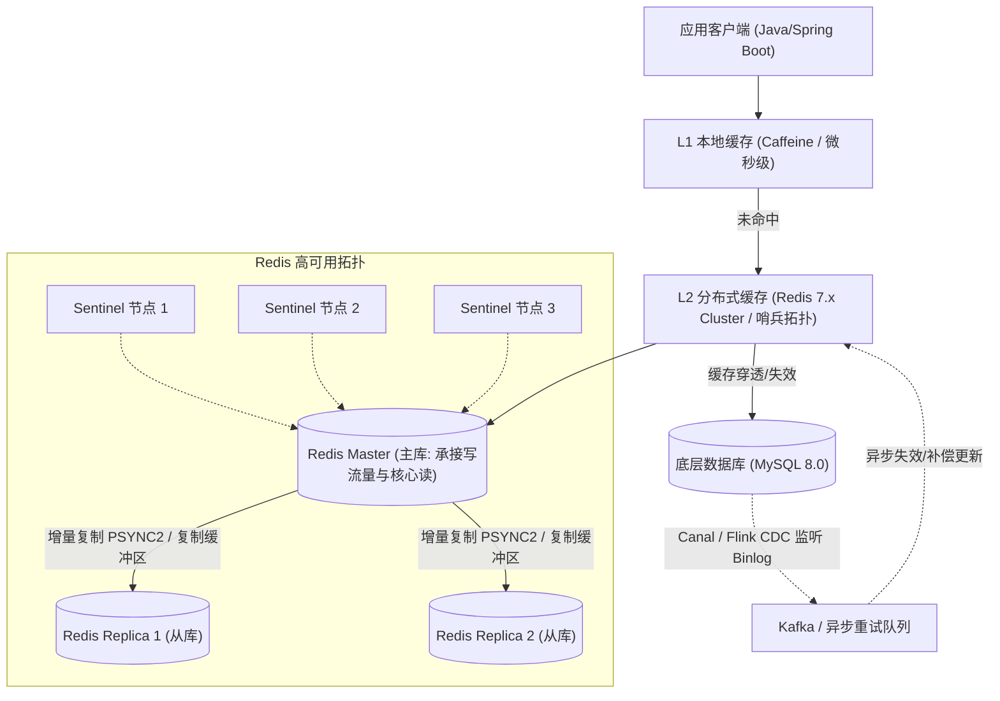
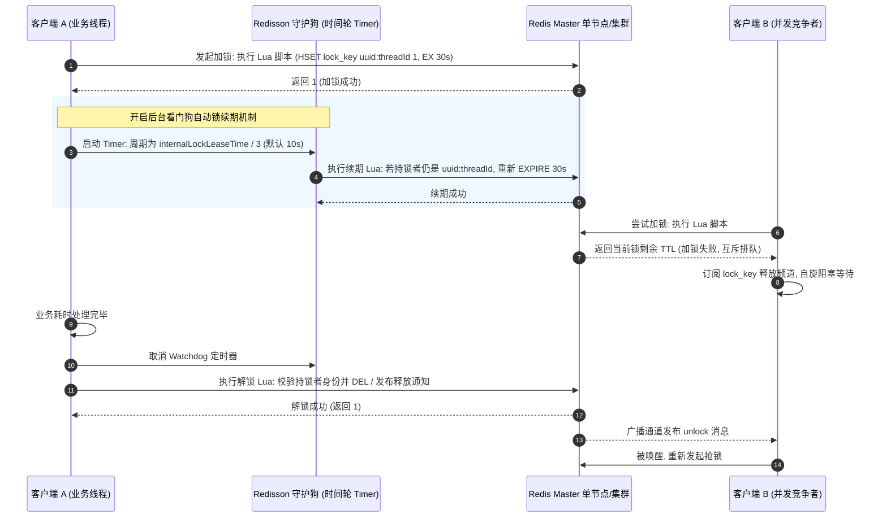
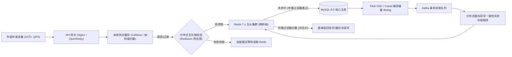
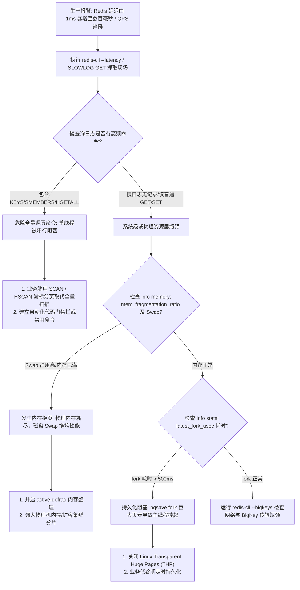
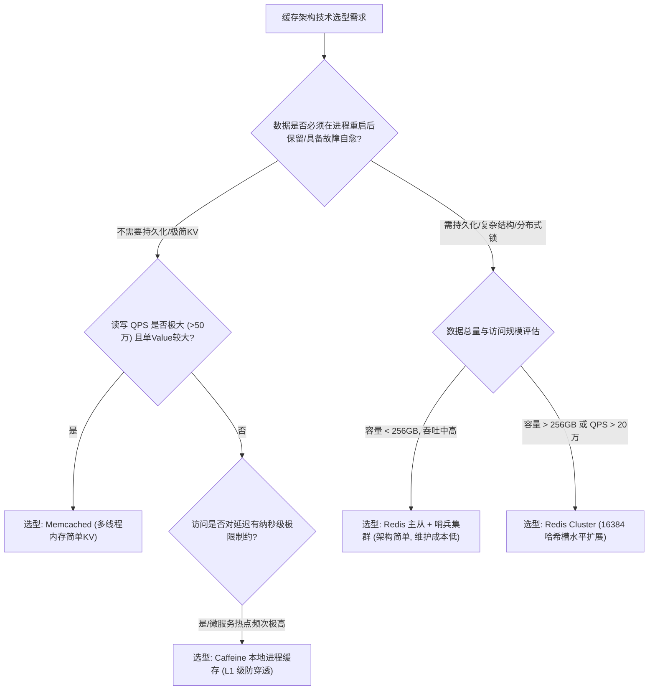
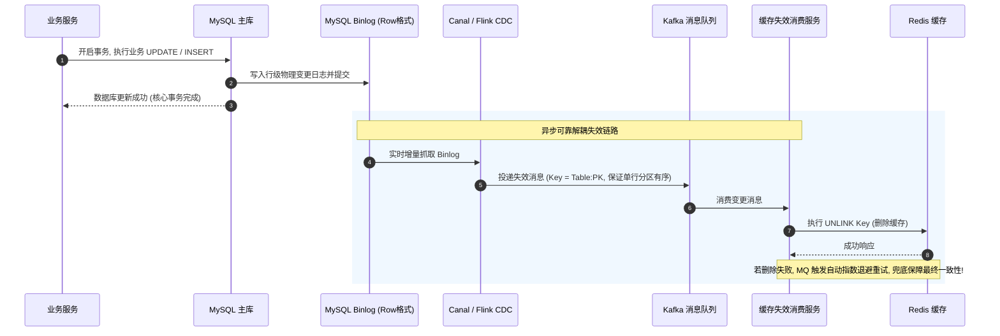
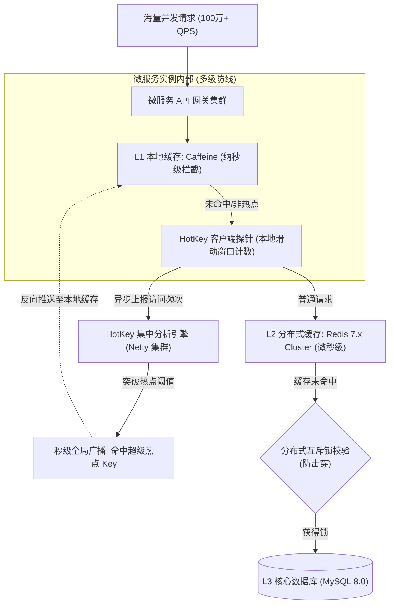
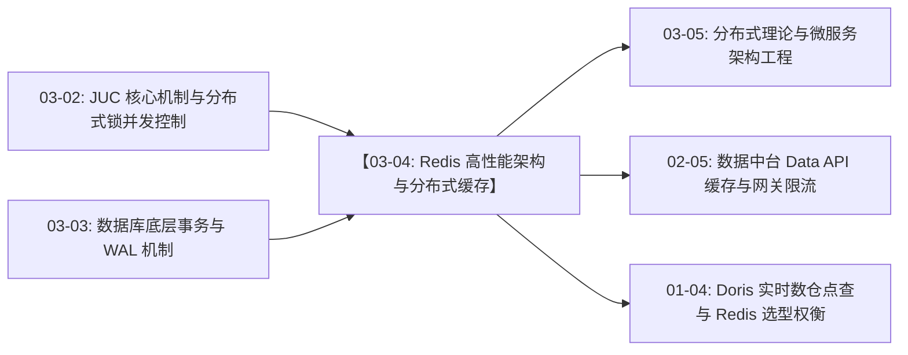

# Redis 高性能架构与分布式缓存

> **学习目标定位**：面向技术总监、数据平台研发负责人、高级数据架构师岗位，深入透析分布式缓存核心底座。彻底解构 Redis 单线程 I/O 多路复用、底层核心数据结构（SDS、Listpack、Dict 渐进式 Rehash、Skiplist 跳表）、持久化 RDB/AOF 内部机制（Fork COW 写时复制）及 Cluster 槽位路由。攻克缓存击穿/穿透/雪崩多层防御、Binlog 异步解耦的最终一致性架构、分布式锁 Redlock 论战与边界，以及大促脉冲下的内存淘汰、BigKey 治理与脑裂防范。

---

## 1. 知识概述与业务价值

### 1.1 是什么（What）
Redis（Remote Dictionary Server）是当前业界最高性能的内存键值型（Key-Value）NoSQL 存储系统：
- **单线程核心与 I/O 多路复用**：其命令执行引擎核心基于**单线程非阻塞事件循环（Reactor 模型）**，利用 Linux 的 `epoll` 机制在单个 CPU 核心上实现十万级 QPS；自 Redis 6.0+ 起，引入**多线程 I/O 处理网络协议解析与写回**，在维持命令执行原子性的同时大幅突破单核网络 I/O 吞吐瓶颈。
- **现代化演进版本（Redis 7.0 / 7.2 / 7.4）**：全面用紧凑型 **`listpack`** 彻底取代了历史存在级联更新缺陷的 `ziplist`；引入 Multi-Part AOF，消除 AOF 重写期间的内存暴涨；支持针对函数和脚本的细粒度 ACL 控制。

### 1.2 解决什么核心业务痛点（Why）
1. **解除后方 RDBMS 磁盘 I/O 承载瓶颈**：关系型数据库（MySQL/PG）单机 QPS 通常在数千至数万水位，面对双十一、突发热点秒杀、万级 IoT 设备实时状态轮询时，极易因磁盘 I/O 耗尽和连接池打满而全线雪崩。Redis 纯内存操作（纳秒/微秒级响应延迟）提供了两到三个数量级的保护缓冲垫。
2. **构建低延迟全局分布式共享状态**：为微服务集群提供毫秒级分布式互斥锁、会话 Session 共享、分布式限流令牌桶、实时 Top-N 排行榜与发布订阅管道。

### 1.3 适用场景与技术边界（Where & When）
- **最佳业务场景**：
  - 高频热点数据读取（用户鉴权 Token、换热站阀门最新遥测指标、商品详情快照）。
  - 分布式锁与资源互斥控制（防止订单重复支付、库存超卖）。
  - 实时高并发计数器与排行榜（ZSet 滑动窗口限流、热点点击统计）。
- **反模式与严禁使用边界**：
  - **大数据量长久落盘存储**：严禁将 Redis 当作低成本永久持久化数据库使用（内存硬件成本是磁盘的 10~20 倍），不可恢复的数据必须持久化至 MySQL/Doris。
  - **无界 BigKey 与超大 Hash 存储**：严禁在单个 Key 中存放数万个元素的未分片 Hash 或体积超过 5MB 的大 Value（如把大 JSON 或序列化大对象塞入一个 Key），这会在网络传输、内存分配及删除时引发长时间事件循环阻塞。
  - **依赖 Redis 事务实现金融级一致性**：Redis 的 `MULTI/EXEC` 事务**不支持原子回滚（No Rollback on runtime error）**，强一致金融扣款严禁脱离数据库事务直接依托 Redis 事务。

---

## 2. 核心概念与关系

### 2.1 核心概念全景表

| 核心组件/机制 | 英文术语 | 核心定义与工程职责 | 资源/生命周期级别 |
| :--- | :--- | :--- | :--- |
| **事件多路复用** | I/O Multiplexing (epoll) | 基于内核 `epoll_wait` 监听套接字事件，触发文件事件调度，避免多线程上下文切换与锁争用。 | 实例级 / 主线程核心 |
| **紧凑列表** | Listpack | Redis 7.0+ 取代 ziplist 的紧凑内存结构，记录当前元素长度而不记录前驱长度，彻底杜绝级联更新。 | 数据结构级 / 内存编码 |
| **渐进式哈希** | Incremental Rehash | Dict 扩容时分配两个哈希表 `ht[0]` 与 `ht[1]`，将数据迁移分散到每次增删改查请求中，消除瞬时卡顿。 | 字典级 / 动态伸缩 |
| **跳跃表** | SkipList | 带有层级多级索引的有序链表，以 $O(\log N)$ 复杂度支持范围查找与排名计算，是 ZSet 的核心底层支撑。 | 集合级 / 内存驻留 |
| **写时复制** | Copy-On-Write (COW) | RDB 快照与 AOF 重写时，主进程 `fork()` 子进程，利用操作系统页表共享内存，有写入时才复制物理页。 | 进程/内存页级 |
| **哈希槽** | Hash Slot | Redis Cluster 将全局数据划分为固定的 16384 个逻辑槽位，通过 `CRC16(key) % 16384` 决定数据分布。 | 集群级 / 拓扑分片 |
| **哨兵系统** | Sentinel | 独立运行的分布式监控进程集群，负责主从节点心跳探测、自动故障下线与新主选举（Failover）。 | 架构级 / 高可用保障 |

### 2.2 系统拓扑与交互关系图

下图展示了典型的 Redis 7.x 混合架构：主从复制 + 哨兵故障转移 + 客户端多级缓存（Guava/Caffeine 本地缓存 + Redis 分布式缓存 + 数据库双写回源）：



---

## 3. 底层工作机制与设计哲学

### 3.1 核心运行流程与状态机流转

#### 1. 单线程 Reactor 模型与多线程 I/O 的边界演进
- **为什么 Redis 早期坚决选择单线程？**
  - **内存操作不是瓶颈**：Redis 的瓶颈通常在于**内存容量**和**网络带宽**，而非 CPU 计算能力。
  - **消除并发开销**：单线程彻底消除了多线程带来的上下文切换（Context Switch）、线程安全竞争、死锁排查与互斥锁/读写锁的开销。
  - **实现极致简洁与确定性**：所有的命令天然具备串行执行的原子性。
- **Redis 6.0+ 多线程 I/O（Threaded I/O）机制**：
  - **瓶颈转移**：随着 10G/40G 网卡普及，单线程从 Socket 读取并解析数十字节的小报文成为了 CPU 消耗的最大热点（占 50% 以上时间）。
  - **责任边界**：多线程仅用于**从 Socket 读取数据、解析客户端命令协议**，以及**将执行结果格式化写回 Socket 缓冲区**。
  - **核心命令执行依然保持单线程**：具体的键值查找、修改、过期淘汰等核心业务逻辑，依然由单一主线程串行顺序执行，既维持了原本的代码简洁与线程安全原子性，又榨干了多核 CPU 的网络处理性能。

#### 2. 底层核心数据结构深度解构
1. **SDS（Simple Dynamic String 简单动态字符串）**：
   - 包含 `len`（已用长度）、`alloc`（总分配长度）、`flags`（区分 sdshdr5/8/16/32/64 紧凑头）和 `buf[]` 字节数组。
   - **设计哲学**：$O(1)$ 获取长度（杜绝 C 语言 `strlen` 的 $O(N)$ 遍历）；杜绝缓冲区溢出（动态预分配空间）；二进制安全（可以存放任意图片、序列化字节流，不以 `\0` 作为结束标志）。
2. **Listpack（紧凑列表，全面取代 Ziplist）**：
   - **历史痛点（Ziplist 级联更新）**：旧版 `ziplist` 每个节点记录了 `prevlen`（前一节点长度）。当某个节点长度从 253 字节增加到 254 字节时，其 `prevlen` 占用字节由 1 字节扩展为 5 字节，可能引发后续连续上百个节点为了记录前驱长度而连环扩容，造成严重的 CPU 卡顿。
   - **Listpack 架构革新**：每个节点仅记录 `encoding`、`data` 与 **`len`（自身长度）**。从前向后或从后向前均能正常遍历，彻底根除了级联更新（Cascading Updates）的系统性缺陷。
3. **Dict（渐进式 Rehash 状态机）**：
   - 每个字典包含两个哈希表：`ht[0]`（正常使用）与 `ht[1]`（扩容备用）。
   - **负载因子（Load Factor）**：$\frac{used}{size}$。通常无子进程执行 RDB/AOF 时为 1，有子进程时提高至 5（避免触发 COW 复制内存页）。
   - **渐进式迁移流转**：Rehash 不是一次性完成的，内部维持计数器 `rehashidx`。在此期间，对字典的每一次增删改查操作，主线程都会顺便将 `ht[0]` 上索引为 `rehashidx` 桶中的键值对平移至 `ht[1]`，并将 `rehashidx++`。后台定时任务 `databasesCron` 也会抽取时间片平滑搬迁，将几百万个 Key 的迁移开销完全摊销在每个请求的微秒级时间内。
4. **SkipList（跳跃表）**：
   - 跳跃表是一种带有随机多级索引的有序链表，每个节点随机生成层高（1~32层，上一层概率为下一层的 25%）。
   - **为什么 ZSet 选择跳表而非红黑树？**
     - **范围查询极具优势**：红黑树或平衡树进行范围查找（如 `ZRANGEBYSCORE 100 200`）需要进行中序遍历并在多层子树间跨越，开销较大；跳表只需定位到范围起始节点，随后顺着最底层的双向链表横向线性遍历即可，极其高效。
     - **实现简单且更易并发/内存紧凑**：红黑树插入删除引发复杂的自平衡旋转，代码极其晦涩；跳表修改仅涉及相邻节点指针调整，内存开销通过概率分布精准控制。

#### 3. 持久化双雄：RDB 快照与 AOF 增量日志的 COW 原理
- **RDB（Redis DataBase）内存快照**：
  - 基于 `bgsave` 命令。主进程调用操作系统的 `fork()` 系统调用派生一个子进程，由子进程遍历内存将数据以紧凑二进制形式写入临时 `.rdb` 文件。
  - **写时复制（Copy-On-Write, COW）核心**：`fork()` 瞬间并不会真正复制全量物理内存，子进程仅复制了主进程的**虚拟内存页表（Page Table）**，耗时仅几毫秒。主子进程共享同一份物理内存页，被标记为“只读”。当主进程收到新的写请求修改某个内存页时，操作系统内核触发缺页中断，**将该 4KB 物理页拷贝一份私有副本**，主进程在新副本上修改，子进程继续读取原只读页写盘。因此内存开销取决于写入量，极端情况下需预留 30%~50% 内存缓冲。
- **AOF（Append Only File）增量日志与 Multi-Part AOF**：
  - 记录每一次对 Redis 发起的写命令文本（RESP 协议）。刷盘策略由 `appendfsync` 控制（`always` / `everysec` 推荐 / `no`）。
  - **AOF 重写（Rewrite）**：为了消除过期与无效命令，通过遍历内存状态生成最小命令集。
  - **Redis 7.0 Multi-Part AOF 架构革新**：历史版本在 AOF 重写时主进程需在内存中维护一个巨大的重写缓冲区，重写结束时一次性追写，极易造成内存暴涨与阻塞；Redis 7.0 将 AOF 拆分为**Base 基础文件**与**Incr 增量文件**，重写期间新写命令直接写入新的增量 AOF，重写完成后直接由清单文件（Manifest）原子合并，彻底根除了内存翻倍隐患。

### 3.2 机制交互时序图（Mermaid）：高可靠分布式锁 Redisson 完整生命周期

分布式锁必须保证互斥性、防死锁、防误删与自动续期。下图展示了基于 Lua 脚本与 Netty 时间轮（Watchdog）的 Redisson 标准时序：



### 3.3 架构设计思想与演进权衡

1. **缓存淘汰策略（Eviction Policy）的近似计算设计**：
   - 面对有限内存，Redis 提供了 8 种淘汰策略（最常用 `volatile-lru`、`allkeys-lru`、`volatile-lfu`、`allkeys-lfu`）。
   - **为什么 Redis 不用严格的双向链表实现 LRU？**
     - 严格的 LRU 需要将每个访问的节点移到链表头部，在高并发读写下需要维护庞大的指针开销（单节点指针占用 16 字节），并引发严重的全局锁争用。
     - **近似 LRU 算法（Approximate LRU）**：Redis 每条记录对象头记录 24 位的最后访问时间戳 `lru`。淘汰时，随机采样 $N$ 个键（默认 $N=5$），挑出其中最久未访问的键淘汰；当 $N=10$ 时，其淘汰效果几乎逼近严格 LRU，但省去了海量内存指针开销。
2. **集群数据分片为什么是 16384 个哈希槽，而不是 65535？**
   - **Gossip 心跳包通信开销**：集群节点之间每秒周期性通过 Gossip 协议交换槽位心跳信息。槽位位图（Bitmap）大小：$16384 / 8 = 2\text{KB}$；若采用 65535 个槽，心跳位图大小达到 $8\text{KB}$，在大型集群（如数百节点）中会造成严重的跨网络带宽浪费。
   - **集群规模天花板**：Redis Cluster 建议的最大物理节点数通常不超过 1000 个，16384 个槽位已经能为每个节点分配充裕且均匀的槽位空间。

---

## 4. 高频复杂业务场景实操与落地

### 4.1 生产典型业务场景拓扑

在高并发工业供热数据中台或电商大促架构中，构建**端到端抗穿透、强一致、防雪崩的三级缓存立体防线**：



### 4.2 生产级配置基线与参数推荐

```ini
# [内存保护与淘汰策略]
maxmemory 32gb                               # 生产物理机通常预留 25%~30% 内存给操作系统与 COW
maxmemory-policy volatile-lru                 # 针对设置了 TTL 的键执行近似 LRU 淘汰，保护无过期核心元数据

# [网络与多线程 I/O: Redis 6.0/7.0+]
io-threads 4                                  # CPU 4核开启 2~3 线程，8核开启 6 线程，切勿超过物理核数
io-threads-do-reads yes                       # 开启多线程读 Socket 协议解析

# [持久化安全基准: AOF + RDB 混合持久化]
save ""                                       # 关闭传统的自动 RDB 刷盘，由定时脚本在业务低谷手动 bgsave
appendonly yes                                # 开启 AOF
appendfsync everysec                          # 每秒刷盘，兼顾极高吞吐与崩溃仅丢 1 秒数据的绝佳平衡
aof-use-rdb-preamble yes                      # 开启 AOF-RDB 混合持久化，大幅提速故障重启加载速度

# [主从复制与防脑裂熔断]
min-replicas-to-write 1                       # 至少有 1 个从库保持心跳连接，主库才允许写入
min-replicas-max-lag 10                       # 从库心跳延迟不超过 10 秒，否则主库拒绝写请求（防脑裂断网）
repl-backlog-size 512mb                       # 放大复制积压缓冲区，防止网络瞬断引发灾难性全量重同步

# [慢查询与延迟排查]
slowlog-log-slower-than 10000                 # 执行超过 10 毫秒记录慢查询
slowlog-max-len 1000                          # 慢查询环形保留条数
```

### 4.3 核心性能指标监控（SLA 黄金指标）

| 监控指标项 | Info 命令字段 / Exporter 键名 | 生产健康阈值 | 技术管理者告警与干预水位 |
| :--- | :--- | :--- | :--- |
| **内存碎片率** | `mem_fragmentation_ratio` | $1.0 \sim 1.4$ | $> 1.5$ 预警（说明存在大量碎片，触发 `activedefrag yes`）；$< 1.0$ 报警（物理内存不足，发生 Swap 换页）。 |
| **命中率（Hit Rate）** | `keyspace_hits` / (`hits` + `misses`) | $\ge 95\%$ | 持续跌破 $90\%$ 时报警，表明发生缓存穿透或缓存过期风暴。 |
| **连接数与拒绝数** | `connected_clients` / `rejected_connections` | $\le 5000$ / 0 | 拒绝连接数 $> 0$ 时触发 P0 级严重报警，说明连接池泄漏或突破 `maxclients`。 |
| **CPU 单核利用率** | `used_cpu_sys` / `used_cpu_user` | 单核 $\le 80\%$ | 持续 $> 90\%$ 报警，排查是否存在 BigKey、全表遍历（`KEYS *`）或复杂 Lua 脚本。 |
| **主从复制偏移量落后**| `master_repl_offset` - `slave_repl_offset` | 字节差极小 | 偏移量持续拉大说明网络拥塞，可能触发从库断开与全量重同步。 |

---

## 5. 生产异常故障深度排查与根因分析

### 5.1 典型生产事故与异常排查树

下图展示了核心生产环境遭遇 Redis 延迟突增暴涨、吞吐骤降时的排障排查与快速止血决策树：



### 5.2 核心异常场景实战复盘

#### 场景一：缓存穿透、击穿与雪崩的生产三连杀攻防复盘
- **故障一：恶意爬虫引发的“缓存穿透（Cache Penetration）”**
  - **现象**：黑客或异常脚本伪造海量数据库中不存在的 `device_id = -99999` 高频请求，缓存查不到，流量直穿底层 MySQL，导致数据库 CPU 瞬间 100%，连接池耗尽崩溃。
  - **根因**：查询的数据在缓存和数据库中均不存在，每次请求绕过缓存直接查库。
  - **治理策略**：
    1. **布隆过滤器（Bloom Filter / RedisBloom 插件）**：在网关层前置加载有效 Key 集合，计算多个哈希函数定位 Bit 数组。若布隆过滤器判定“不存在”，则请求**必定不存在**，直接阻断；
    2. **空值缓存（Cache Null Object）**：若回源数据库查无此行，向 Redis 回写一个短期标记（如 `SET key "" EX 60`），60 秒内相同恶意参数请求全被缓存拦截。
- **故障二：超级热点换热站配置过期的“缓存击穿（Cache Breakdown）”**
  - **现象**：城市供热核心调度总阀门的配置缓存到期失效瞬间，万级微服务并发请求同时涌入该 Key，瞬间引发数据库几十个线程同时执行昂贵的复杂查询计算。
  - **根因**：单一极度热点的 Key 突然失效，瞬时高并发导致缓存防御破壁。
  - **治理策略**：
    1. **互斥锁加载（Mutex Lock）**：通过 `SET key:lock uuid NX EX 10` 争抢锁，仅允许 1 个线程回源查库并回填缓存，其余线程自旋等待后读取新缓存；
    2. **逻辑永不过期（Logical Expiration）**：物理存储上不设置 TTL，而是在 Value 的 JSON 内嵌入逻辑时间戳。后台异步守护线程定期检测若即将到期，提前由后台单线程异步重新加载并覆盖。
- **故障三：午夜大促全量预热数据的“缓存雪崩（Cache Avalanche）”**
  - **现象**：运营系统凌晨统一预热了 50 万条商品信息，设置了相同的 TTL（如 2 小时）。两小时后，数十万个 Key 在同一秒内集中过期，原本分摊的读流量倾泻至数据库。
  - **治理策略**：
    1. **TTL 随机抖动打散**：`TTL = base_ttl + Random(300, 900)` 秒，让数十万 Key 的过期时间平摊在半小时窗口内；
    2. **多级缓存架构**：在应用进程内构建 Caffeine 本地缓存（TTL 设为 30 秒），即使 Redis 节点抖动，本地缓存也能拦截 99% 的请求压力。

#### 场景二：主从网络分区导致的脑裂（Split-Brain）与数据丢弃灾难
- **真实生产现象**：
  监控报警 Redis Master 与 2 个 Replica 之间网络闪断。哨兵（Sentinel）检测到 Master 失联，经过仲裁投票将 Replica 1 选举晋升为新主。然而，旧 Master 此时由于网络分区（脑裂）依然存活，且上游部分网关客户端由于 DNS/连接未重置，继续向旧 Master 写入了近 20 万笔数据。几分钟后网络自愈，哨兵将旧 Master 强行降级为新 Master 的从库，触发全量清空与复制，**导致这 20 万笔写操作被无情覆灭（永久丢失）**。
- **底层根因剖析**：
  Redis 采用异步主从复制机制，Master 处理写命令时不会强行等待从库 ACK 就向客户端返回成功。网络分区时，旧 Master 并未收到任何下线指令，在没有保护机制约束下依然放行写入。降级为 Replica 时，必须先执行 `FLUSHALL` 丢弃自身数据，再接收新主库的 RDB 快照。
- **架构级根治配置（SOP 必备）**：
  在所有 Master 节点强制开启以下双防线参数：
  ```ini
  min-replicas-to-write 1
  min-replicas-max-lag 10
  ```
  **运行逻辑推导**：当主库发现与其保持心跳且复制延迟在 10 秒以内的从库数量**少于 1 个**时（表明自己极可能陷入了网络孤岛），主库**立即主动拒绝所有写入请求**，向客户端返回错误，强制上游应用熔断报错或切流，从根源上杜绝在脑裂孤岛中接收“幽灵写入”，彻底保全数据一致性。

#### 场景三：大 Key（BigKey）删除引发的全局单线程雪崩
- **真实生产现象**：
  开发人员为了清理一个包含 500 万元素的 ZSet 排行榜，通过代码调用了 `redisTemplate.delete("rank:202611")`。执行瞬间，Redis 全局响应时间从 0.5ms 飙升至 8 秒以上，引发所有微服务出现连接超时（`Read timed out`），集群监控显示 CPU 达到 100%。
- **底层根因剖析**：
  `DEL` 命令是在主线程中同步释放内存的。当删除一个包含数百万节点的跳表或哈希表时，内存管理器必须遍历这数百万个内存节点的链表指针并逐一调用 `free()` 归还给系统 jemalloc。由于 Redis 命令执行是单线程串行的，耗时数秒的内存释放操作直接将主事件循环死死卡住。
- **根除策略**：
  1. **异步非阻塞删除（`UNLINK` 代替 `DEL`）**：Redis 4.0+ 引入 `UNLINK` 命令。主线程仅在字典中将键名脱钩（耗时纳秒级），底层的超大内存空间释放完全交由后台 `lazy_free` 子线程在后台异步平滑回收；
  2. **配置开启懒惰释放**：在配置文件中开启 `lazyfree-lazy-eviction yes`、`lazyfree-lazy-expire yes`、`lazyfree-lazy-server-del yes`；
  3. **分批迭代删除**：对于低于 4.0 历史系统，必须使用 `SSCAN` / `HSCAN` 配合循环微批删除。

---

## 6. 技术选型对比、架构演进与成本ROI

### 6.1 横向多维选型对比矩阵

| 评估维度 | Redis 7.x (Cluster/Sentinel) | Memcached | 本地缓存 (Caffeine / Guava) | 分布式 KV (RocksDB / TiKV) |
| :--- | :--- | :--- | :--- | :--- |
| **数据结构支持** | 丰富（String/Hash/List/Set/ZSet/Bitmaps/Stream） | 单一（仅支持简单 Key-Value 字符串） | 依赖 JVM 内存（任意 Java 复杂对象） | 字节数组 KV（支持范围扫描与事务） |
| **持久化与灾难恢复**| 完备（RDB 快照 + AOF 增量 + 混合重写） | 无（纯内存，重启即永久丢失） | 无（进程退出即消失） | 极强（LSM-Tree + WAL 磁盘引擎） |
| **高可用与分片扩展**| 哨兵自动选举 + Cluster 16384 槽原生分片 | 依赖客户端一致性哈希，无原生集群 | 进程内单机，随微服务实例水平分布 | 原生 Raft 多副本分布式一致性 |
| **访问吞吐与延迟** | 微秒级（单核 10万+ QPS，网络 I/O） | 亚毫秒级（多线程性能强劲） | **纳秒级**（零网络 I/O，进程内内存直读）| 毫秒级（需访问 NVMe 磁盘） |
| **核心适用场景** | 复杂业务缓存、分布式锁、排行榜、计数器 | 纯粹轻量级大 Value 读多写少缓存 | 热点配置、高频防穿透本地 L1 缓存 | 超大规模冷数据存储、强一致分布式基座 |

### 6.2 架构师技术选型决策树与成本 ROI



- **三级缓存架构成本与 ROI 测算**：
  - **背景**：某大型车联网/供热监测中台，10 万台智能网关每 3 秒发起一次心跳鉴权与参数校验，QPS 峰值达 35,000。
  - **方案 A（直接裸连单机 Redis 主从）**：网卡带宽被打满，Redis 实例 CPU 长期维持在 85% 危险警戒线，必须购买 8 节点分布式 Cluster 集群，单年云主机成本近 15 万元。
  - **方案 B（Caffeine L1 + Redis L2 联动）**：在 Spring Boot 应用网关集成 Caffeine，配置 `expireAfterWrite = 10s`。98% 的高频重复心跳请求被本地进程纳秒级拦截；穿透至 Redis 的 QPS 暴跌至 700 左右。Redis 仅需一套最低配的主从架构即可稳如磐石，**降低了 80% 的集群网络带宽与硬件采购成本**。

---

## 7. 技术经理与架构师实战管控（SOP与规范）

### 7.1 平台级多租户与资源隔离机制
1. **多租户业务命名空间（Key 命名契约）**：
   - 严禁随意命名字段，必须统一遵循团队强制规范：`{业务域}:{子系统}:{租户ID}:{主业务标识}:{业务ID}`（例如：`heating:iot:tenant_01:valve:10086`）。
   - **禁止不同业务线共用单节点**：核心高频交易系统与大数据离线计算必须实行物理集群隔离，严防大数据批量导入或算法临时跑批将在线核心缓存逐出打崩。
2. **连接池资源动态管控门禁**：
   - 针对 Lettcue / Jedis 客户端，生产必须配置连接探活（`validateConnection = true`）与合理的最小/最大空闲连接数，严禁无限制扩大连接池导致服务端单线程在处理网络事件轮询上消耗殆尽。

### 7.2 生产变更红线与降级容灾预案（SOP）

#### 1. Redis 开发运维军规十条（技术团队强制门禁）
1. **高危命令绝对封杀**：在所有生产节点的配置文件中，必须通过 `rename-command` 彻底封死危险命令：
   ```ini
   rename-command KEYS ""
   rename-command FLUSHALL ""
   rename-command FLUSHDB ""
   rename-command SHUTDOWN "SAFE_SHUTDOWN_ADMIN_2026"
   ```
2. **BigKey 强制红线**：
   - String 类型 Value 不得超过 10KB；
   - Hash、List、Set、ZSet 集合元素数量不得超过 5000 个，总内存占用不得超过 1MB。
3. **强制设置 TTL 过期时间**：除极少数核心元数据配置外，所有写入的 Key 必须显式设置合理过期时间，严禁无界常驻占用内存。
4. **禁止全量获取**：严禁使用 `HGETALL`、`LRANGE 0 -1`、`SMEMBERS`，必须改用分页游标扫描 `HSCAN`、`SSCAN` 或切片分批获取。
5. **禁用大批量 Pipeline 阻塞**：单次 Pipeline 聚合命令不得超过 500 条，防止单包过大占用客户端与服务端巨量输入缓冲区引发 OOM。
6. **热 Key 本地化治理**：预估 QPS 超过 5000 的极端单 Key，必须前置加载至 JVM 本地缓存（Caffeine），杜绝单点热 Key 打爆单分片网络带宽。
7. **慢日志每日巡查**：建立 Jenkins / 脚本自动化定时任务，每日凌晨扫描 `SLOWLOG`，发现耗时超过 20ms 的命令立即生成 Jira 工单问责。
8. **内存碎片自动化整理**：开启 `activedefrag yes`，并设置触发阈值 `active-defrag-ignore-bytes 200mb`。
9. **禁用原生 Lua 脚本耗时大计算**：Lua 脚本执行时间必须控制在 5ms 以内，严禁在脚本中执行复杂长循环逻辑。
10. **生产变更必须有回滚与旁路降级预案**：所有涉及缓存清理与切换的操作，代码层必须包含“**Redis 异常时降级读取兜底静态配置或打上熔断开关**”的容灾代码段。

#### 2. 缓存双写一致性保障标准 SOP（阿里 Canal 监听 Binlog 模式）
- **核心操作链路**：
  1. 业务应用**优先更新 MySQL 数据库**（强事务保证数据落盘）。
  2. 严禁在业务代码中执行“先删缓存再写库”（高并发下存在严重脏读并发空隙）。
  3. 部署 **Canal / Flink CDC** 伪装成 MySQL 从库，实时监听 Binlog 变更日志。
  4. 解析到对应表的 `UPDATE / DELETE` 事件后，将其投递至 Kafka **分区消息队列**（以表主键 ID 作为 Partition Key，保证单行有序）。
  5. 专属 Consumer 消费消息，**执行 Redis 对应 Key 的失效（`DEL` / `UNLINK`）**。
  6. 若缓存删除失败，利用 Kafka 的重试机制与死信队列（DLQ）进行指数退避补偿重试，确保达到**最终一致性（Eventual Consistency）**。

---

## 8. 互联网大厂高频面试真题库

> [!IMPORTANT]
> 本板块精选一线大厂（阿里、字节、美团、快手、腾讯、拼多多等）真实高频考察的 7 道核心真题。涵盖底层机制、数据结构、双写一致性、分布式锁与高可用防脑裂。**在接下来的第 9 板块中，将对下列所有题目进行逐题深度解答，严禁留白！**

### 8.1 基础概念与机制题（大厂初筛）
1. **Q1**：Redis 速度极快除了纯内存操作外，底层单线程模型到底是如何设计的？为什么 Redis 6.0 之后又引入了“多线程 I/O”？这是否破坏了它的原子性？
2. **Q2**：Redis 底层的 SDS（简单动态字符串）相较于传统 C 语言原生字符串有何本质优势？Redis 7.0 为什么用 `listpack` 彻底替代了 `ziplist`？

### 8.2 核心底层原理深度题（大厂资深技术面）
3. **Q3**：请详细阐述 ZSet 底层跳跃表（SkipList）的设计原理与时间复杂度。为什么在工程选型中跳表比红黑树、平衡二叉树更适合 Redis？
4. **Q4**：请对比 Redis 持久化 RDB 与 AOF 的底层实现。RDB 在 `bgsave` 执行写时复制（COW）时的物理内存开销与执行逻辑是什么？Redis 7.0 的 Multi-Part AOF 解决了什么核心痛点？

### 8.3 复杂生产场景与故障排障题（大厂架构与排障面）
5. **Q5**：在高并发交易场景下，数据库与缓存的双写一致性到底该如何保证？为什么“先写数据库，再删缓存”是最佳实践？在此基础上如果第二步删缓存失败了，如何设计兜底补偿方案？
6. **Q6**：生产环境如何设计一个安全可靠的分布式锁？Redisson 的 Watchdog 看门狗机制是如何实现锁续期的？在面对 Redis 主从异步复制与网络分区脑裂时，Redlock 算法的核心争议是什么？架构师该如何权衡取舍？

### 8.4 架构设计与系统规划题（技术总监/总架构师终面）
7. **Q7**：面对百万级 QPS 的超级大促峰值，如何从 0 到 1 构建防穿透、防击穿、防雪崩的多级缓存系统？当突发单 Key 热点（HotKey）和集群大 Key（BigKey）时，如何进行全自动化的识别、阻断与动态防护？

---

## 9. 结构化深度参考答案（逐题三层应答）

---

### 题目1：Redis 底层单线程模型、多线程 I/O 演进及其原子性保障

#### 简洁回答（1分钟电梯破题）：
> Redis 核心性能卓越的基石在于“**纯内存运行 + 基于 epoll 的非阻塞 I/O 多路复用 + 优化的底层数据结构**”。早期坚持单线程是为了消除线程上下文切换、锁竞争与死锁风险，确保命令执行的确定性与纳秒级性能。
> Redis 6.0 引入的“多线程 I/O”**仅仅是将耗时的网络套接字读写与 RESP 协议解析下放给辅助线程并行处理**，而**所有核心命令的执行（内存数据的增删改查）依然严格在单主线程中串行执行**。因此，多线程 I/O 丝毫没有破坏 Redis 原生命令串行执行的线程安全与事务原子性。

#### 深入回答（机制推导与边界条件）：
1. **单线程 Reactor 模型时序机制**：
   - Redis 基于 Linux 内核的 `epoll` 实现了单线程非阻塞事件循环（Reactor 模式）。
   - 主线程利用 `epoll_wait` 批量监听数千个客户端连接 Socket。当某个 Socket 处于可读状态时，内核触发文件事件（AE_READABLE），主线程调用读处理器将报文载入内存缓冲区，解析协议，执行对应命令，将响应结果挂入发送队列，整个流程全在单核上闭环。
   - **为什么没有多线程线程安全问题**：由于命令调度与内存访问是单线程串行消费事件队列中的请求，任何一个命令在执行期间都不会被另一个命令插队，天然具备物理隔离的串行原子性。
2. **多线程 I/O（Threaded I/O）的瓶颈突破推导**：
   - 现代硬件网卡已演进至 25GbE/100GbE，单主线程在处理 `read()` 系统调用、从内核缓冲区拷贝字节到用户空间以及复杂的 RESP 文本协议解析上消耗了超过 **50% 的 CPU 周期**，导致单核 CPU 先于网卡被打满。
   - **多线程工作流水线**：
     1. **主线程阶段**：`epoll` 捕获到大量待读事件，主线程将这些活跃 Socket 分发给多线程 I/O 队列。
     2. **多线程并发读**：辅助 I/O 线程并行从 Socket 读取报文，解析为具体的 Redis 命令对象，但**绝对不执行命令**。
     3. **单主线程串行执行**：主线程等待所有 I/O 线程解析完毕后，**独占串行**执行所有的命令，修改内存 Dict。
     4. **多线程并发写**：主线程将执行结果分配给 I/O 线程，由辅助线程并行通过 `write()` 系统调用将字节写回客户端 Socket。
   - 这种设计将计算（纯内存修改，极快）与 I/O（系统调用与网络拷贝，较慢）完美拆分，既维持了命令执行的单线程原子性，又使吞吐量提升了 2~3 倍。

#### 架构师/技术管理视角（权衡取舍、SLA与成本）：
> 引入多线程 I/O 是典型的“在复杂性与吞吐极限之间的精准工程权衡”：
> 1. **配置准则与 CPU 亲和性（Affinity）**：
>    - 生产部署时，`io-threads` 绝不是越大越好。官方建议 4 核 CPU 配 2~3 个线程，8 核配 6 个线程，**严禁超过物理核心数**，否则会导致线程争抢 CPU 资源反而降低吞吐。
>    - 生产环境建议通过 `taskset` 绑定 CPU 核心，减少操作系统调度抖动，保证微秒级确定性延迟。
> 2. **管理决策红线**：
>    - 多线程 I/O 默认仅开启写回（Write），读开启需配置 `io-threads-do-reads yes`。技术总监在评估系统是否开启时，应以**当前实例 QPS 是否突破 8~10 万**且 `top` 显示单核 CPU 达到 100% 为判断阈值。若业务瓶颈在内存容量或数据库慢查询，切勿盲目开启多线程 I/O 增加运维复杂度。

---

### 题目2：SDS 相比原生 C 字符串的优势，及 Redis 7.0 Listpack 替代 Ziplist 根因

#### 简洁回答（1分钟电梯破题）：
> C 语言原生字符串以 `\0` 结尾且不记录长度，存在 $O(N)$ 遍历计算长度、极易发生内存越界缓冲区溢出、以及无法包含二进制内容（图片/序列化流遇到 `\0` 截断）三大缺陷。Redis 自研的 **SDS（Simple Dynamic String）**通过元数据显式记录 `len`、预分配空闲空间 `alloc`，实现了 **$O(1)$ 常数获取长度、杜绝缓冲区溢出与 100% 二进制安全**。
> Redis 7.0 用 **`listpack`** 彻底消灭 `ziplist`，是因为 `ziplist` 的每个节点都存有前一个节点的长度 `prevlen`，一旦某个元素修改引起长度突变，会引发后续成百上千个节点连环扩容的**灾难性级联更新（Cascading Updates）**，造成单线程严重卡顿；而 `listpack` 仅记录当前元素自身长度，彻底根治了这一顽疾。

#### 深入回答（机制推导与边界条件）：
1. **SDS 结构与极致内存优化推导**：
   - 现代 Redis 采用不同大小的头结构（`sdshdr8`、`sdshdr16`、`sdshdr32` 等），通过单字节 `flags` 标识类型，消除内存对齐浪费。
   - **空间预分配与惰性释放**：
     - **预分配策略**：当修改后字符串长度小于 1MB 时，Redis 会额外分配与 `len` 相同大小的未用空间（`alloc = 2 * len`）；若大于 1MB，则固定多分配 1MB 缓冲。将 $N$ 次连续追加的内存重分配次数从 $N$ 次降至最多 $N$ 次。
     - **惰性空间释放**：当执行 `TRIM` 等缩短字符串操作时，不立即回收多余内存，而是记录在 `alloc` 中，供后续写入直接复用，消除频繁 `free()` 与 `malloc()` 系统调用。
2. **Ziplist 级联更新（Cascading Updates）发生机制全推导**：
   - 旧版 `ziplist` 节点结构为：`[prevrawlen | lensize | content]`。
   - 其中 `prevrawlen` 表示前一个节点的字节长度：
     - 若前节点长度 $< 254$ 字节，`prevrawlen` 占 1 字节；
     - 若前节点长度 $\ge 254$ 字节，`prevrawlen` 扩展为 5 字节。
   - **灾难推演**：假设一个 ziplist 内连续排列着 100 个长度介于 250~253 字节的节点（其 `prevrawlen` 均为 1 字节）。此时，若向表头插入一个 300 字节的新节点：
     - 第二个节点为了记录新节点的 300 字节，其 `prevrawlen` 必须由 1 字节扩容为 5 字节，导致该节点自身总长度从 253 暴增至 257 字节；
     - 这又导致第三个节点的 `prevrawlen` 必须由 1 字节扩展为 5 字节；
     - 以此类推，引发多达 100 次的连续内存重分配与全量字节搬迁，最坏时间复杂度高达 $O(N^2)$，单线程事件循环直接卡死数秒。
3. **Listpack 架构根治原理**：
   - Listpack 节点格式：`[encoding-type | element-data | element-tot-len]`。
   - **每个节点仅在尾部记录当前元素自身的长度（`element-tot-len`）**。
   - **双向遍历实现**：当需要从后向前回溯遍历时，读取当前节点尾部的 `element-tot-len`（该字段采用特殊的可变长度变长编码），直接向前跳跃相应字节即可命中上一个节点的尾部。任何节点的插入、修改和删除完全不影响任何相邻节点的元数据编码，**彻底从物理结构上消灭了级联更新的可能性**。

#### 架构师/技术管理视角（权衡取舍、SLA与成本）：
> 紧凑内存结构是 Redis 控制物理基础设施持有成本（TCO）的杀手锏：
> 1. **内存压缩比的商业价值**：
>    - 在存储千万级 Hash（如智能水表/热表配置）时，若使用原生 Dict，每个键值对需包装为 `dictEntry`（包含 3 个指针占用 24 字节 + jemalloc 内存碎片），内存膨胀巨大；
>    - 借助 `listpack`（底层由 `hash-max-listpack-entries = 512` 控制），数据在内存中以字节连续流存储，内存占用骤降 **60%~75%**，为企业节约海量物理服务器采购费用。
> 2. **管理与升级红线**：
>    - 升级至 Redis 7.0+ 是现代技术团队的必经之路。技术负责人在规划老旧集群改造时，应推动尽快淘汰历史 4.x/5.x 版本，全面拥抱包含 Listpack 的 7.x 稳定版本，消除由深层 `ziplist` 突变导致的偶发 P99 延迟毛刺。

---

### 题目3：ZSet 底层 SkipList（跳跃表）实现机制与选型哲学

#### 简洁回答（1分钟电梯破题）：
> 跳跃表（SkipList）是在有序链表的基础上增加了**多级跳跃索引**的数据结构，通过空间换时间，将链表原本 $O(N)$ 的查找、插入、删除复杂度降低到 **$O(\log N)$**。
> Redis 的 ZSet 在元素数量较多或 Value 较大时采用跳表（搭配一个辅助 Dict）实现。**之所以选择跳表而非红黑树**，核心原因在于：
> 1. **范围查询极具碾压性优势**：跳表底层是连续的双向有序链表，执行 `ZRANGEBYSCORE` 范围查询时，只需以 $O(\log N)$ 定位起始节点，随后沿最底层横向遍历即可；而平衡树进行范围扫描需要跨越父子子树做复杂的中序回溯遍历。
> 2. **工程实现简洁且并发锁更友好**：红黑树的插入和删除会伴随复杂的左旋、右旋与变色逻辑，极易产生代码 Bug，且内存常驻平衡位；跳表仅依赖概率算法随机生成层高，调整仅涉及相邻节点指针，更加轻量与稳定。

#### 深入回答（机制推导与边界条件）：
1. **跳跃表多层索引结构与随机化层高推导**：
   - 跳跃表节点包含：`ele`（成员对象动态字符串）、`score`（分值浮点数）、`backward`（后退指针）以及 `level[]` 数组。
   - 每一层 `level[i]` 包含：
     - `forward`：前进指针，指向该层的下一个节点；
     - `span`：**跨度**，记录当前节点与前进节点之间跳过了多少个最底层节点。
   - **跨度（Span）的工程价值**：Redis 的跳表不仅能根据分数查找，还能以 $O(\log N)$ 极速计算出某个元素的**绝对排名（Rank）**！查询过程中将沿途经过的所有层级的 `span` 累加，即为该元素的正序索引位置（支撑 `ZRANK` 命令）。
   - **随机层高生成算法（ZSKIPLIST_P = 0.25）**：
     - 每个新节点加入时，先赋予第 1 层；
     - 抛一枚四面骰子，以 $25\%$ 的概率决定是否递增一层（增加至第 2 层）；
     - 若中签，继续以 $25\%$ 概率决定是否进入第 3 层，直至失败或达到最大层高 32 层（可支撑 $2^{64}$ 个元素）。
     - **数学期望**：平均每个节点的指针层高仅为 $1 / (1 - 0.25) \approx 1.33$ 层，极度节约指针内存。
2. **ZSet 中 Dict 与 SkipList 的双剑合璧**：
   - ZSet 底层同时维系了一个 Dict 和一个 SkipList：
     - **Dict**：建立 `ele -> score` 的单向映射，支撑 `ZSCORE` 命令以 **$O(1)$** 极速时间复杂度判定元素是否存在并返回分值；
     - **SkipList**：按照 `score` 升序维护数据有序性，支撑 `ZRANGE`、`ZRANK`、`ZREMRANGEBYSCORE` 等范围与排名操作。
   - 两者通过指针共享同一份 `ele` 动态字符串，绝不产生双倍的数据内存冗余。

#### 架构师/技术管理视角（权衡取舍、SLA与成本）：
> 跳表展示了工业界经典算法选型的核心哲学——**“实用主义与工程可维护性高于学术完美主义”**：
> 1. **内存碎片与紧凑度平衡**：
>    - 当 ZSet 元素较少（`zset-max-listpack-entries = 128` 且 Value $< 64$ 字节）时，优先采用紧凑的 `listpack` 存储，只有突破阈值才升级为 Dict + SkipList。技术经理应针对业务特点微调该参数，以极致压缩内存。
> 2. **排行榜大促防抖 SOP**：
>    - 在数亿级实时打榜场景中，严禁高频调用 `ZRANGE 0 -1` 取全量数据。架构上必须强制增加 `LIMIT offset count` 进行分页限制，限制单次返回条数不超过 100 条，保护主线程 CPU 与网络带宽。

---

### 题目4：Redis 持久化 RDB 与 AOF 底层原理、COW 机制及 Multi-Part AOF

#### 简洁回答（1分钟电梯破题）：
> - **RDB（内存快照）**：将某一时刻的全量内存状态以紧凑的二进制压缩格式写入磁盘。底层通过 `bgsave` 调用操作系统的 `fork()` 派生子进程，利用 Linux 的**写时复制（Copy-On-Write, COW）**机制，在不阻塞主进程写操作的前提下异步写盘。优势在于文件极小、恢复极快，缺点是故障时丢失两次快照间的所有数据。
> - **AOF（增量日志）**：以文本协议顺序追加记录所有写命令。优势在于秒级高可靠（`everysec` 仅丢 1 秒数据），缺点是文件体积大且重放慢。
> - **Redis 7.0 Multi-Part AOF**：彻底重构了 AOF 重写机制，将原本单个 AOF 文件拆解为**基础文件（Base）、增量文件（Incr）与清单清单（Manifest）**，消除了重写期间主进程在内存中维护巨量重写缓冲区导致的内存暴涨与双重落盘痛点。

#### 深入回答（机制推导与边界条件）：
1. **写时复制（Copy-On-Write, COW）底层物理机制**：
   - 当执行 `bgsave` 时，主进程调用 `fork()` 创建子进程。
   - **虚拟内存与物理内存页解耦**：子进程创建并不复制物理内存，而是**只拷贝主进程的页表（Page Table）**。主子进程的页表虚拟地址同时映射到完全相同的物理内存页上，并将这些页的访问权限降级为**只读（Read-Only）**。
   - **触发缺页异常（Page Fault）**：
     - 若此时主进程收到客户端请求修改某个 Key，尝试写入该只读页，CPU 硬件触发缺页中断；
     - 操作系统内核捕获中断，在物理内存中**重新开辟一个新的 4KB 物理页**，将原页内容完全复制过去，并将主进程页表重新指向新页并恢复可写；
     - 子进程继续持有原只读页执行持久化，主进程则在新页上执行写入。
   - **内存翻倍风险（边界条件）**：如果系统正经历极高频的写入脉冲（如大促打点），大量物理页被修改复制，会导致系统**物理内存消耗瞬时激增 50%~80%**，若未预留足够内存，会触发系统 OOM Killer 强杀 Redis 进程。
2. **Multi-Part AOF 架构革新（Redis 7.0）**：
   - **历史版本痛点**：旧版 AOF 重写时，主进程必须把重写期间新进来的增量命令既写入原本的旧 AOF，又缓存在巨大的内存重写缓冲区（AOF Rewrite Buffer）中。重写完毕后主进程必须阻塞式将缓冲区写回新文件，导致严重的内存峰值与主线程暂停。
   - **Multi-Part AOF 解决之道**：
     - 将 AOF 拆分成：`base_aof`（重写生成的快照基础文件）+ `incr_aof`（持续写入的增量文件）+ `manifest`（版本清单）。
     - 当触发重写时，主进程**直接新建一个新的增量 AOF 文件**接纳新写入；子进程将旧的 base 和已有的 incr 重写为新的 base 文件。
     - 重写完成后，仅需更新 `manifest` 文件的指针指向新 base 与新 incr，无须进行任何内存缓冲区的写盘合并，**内存开销接近为零，重写完全平滑**。

#### 架构师/技术管理视角（权衡取舍、SLA与成本）：
> 持久化配置是数据恢复时效（RTO）与数据丢失容忍度（RPO）的综合决策：
> 1. **推荐生产黄金组合：混合持久化（AOF-RDB Preamble）**：
>    - 开启 `aof-use-rdb-preamble yes` 与 `appendfsync everysec`。
>    - AOF 重写时，前半段直接以 RDB 二进制格式写入（体积小、加载快），后半段以 AOF 文本记录增量命令。故障恢复时，既能秒级加载 RDB，又能把数据丢失控制在 1 秒以内，达成极致的 RTO 与 RPO。
> 2. **关闭 Linux 透明大页（Transparent Huge Pages, THP）强制 SOP**：
>    - Linux 默认开启 THP 会将内存分页从 4KB 放大至 2MB。在 COW 触发时，即便仅修改 1 字节，操作系统也会被迫拷贝一整块 **2MB 的大内存页**，导致写入放大 512 倍，引发严重的内存暴涨与延迟尖刺！
>    - 生产部署规范：必须通过系统脚本强制执行 `echo never > /sys/kernel/mm/transparent_hugepage/enabled`。

---

### 题目5：高并发场景下缓存与数据库双写一致性架构方案

#### 简洁回答（1分钟电梯破题）：
> 在高并发分布式架构中，**“Cache-Aside（旁路缓存）+ 先更新数据库，再删除缓存”**是业界公认的最佳实践模式。
> **为什么绝不能“先删缓存，再更新数据库”？** 因为在高并发下，线程 A 先删缓存，还未来得及写库，线程 B 并发读未命中，会立即从数据库读取旧值并回填入缓存，随后线程 A 更新库完成，导致**脏数据永久驻留缓存**。
> **针对“第二步删除缓存失败”的兜底保障**：绝不能直接指望代码同步重试，必须采用**基于 Canal / Flink CDC 监听 MySQL Binlog 异步解耦失效**的架构方案。由可靠消息队列（Kafka/RocketMQ）保证单行消费有序性，并依托死信队列与指数退避重试，保障系统达到**强鲁棒性的最终一致性（Eventual Consistency）**。

#### 深入回答（机制推导与边界条件）：
1. **并发时序极限推导：为什么“先更新库，再删缓存”也会有极小概率不一致？**
   - 理论上的并发冲突时序（图解）：
     1. 缓存此时刚好失效（过期或被淘汰）；
     2. 线程 A 并发读：去 DB 查到旧值 $V_1$；
     3. 线程 B 并发写：更新 DB 为新值 $V_2$；
     4. 线程 B 执行删除缓存操作（此时缓存本来就是空的，删除操作空转）；
     5. 线程 A 慢腾腾地将旧值 $V_1$ 回写填入缓存！导致脏数据产生。
   - **为什么这种概率在生产中无限接近于 0？**
     - 因为上述灾难发生的前提是：**步骤 3（写 DB）+ 步骤 4（删缓存）的总耗时，必须快于步骤 2（读 DB）+ 步骤 5（写缓存）的耗时**！
     - 在实际物理环境中，数据库的 `UPDATE` 涉及行锁、Undo/Redo Log 刷盘等开销，耗时（通常 5~20ms）远比纯粹的主键点查 `SELECT`（0.5ms）慢上数十倍。读操作几乎必然在写操作之前完成回填，因此该极端并发空隙在工程实践中极罕见。
2. **延迟双删（Delayed Double Delete）的弊端与反模式**：
   - 早期部分团队采用“先删缓存 -> 写库 -> 休眠 500ms -> 再次删缓存”。
   - **致命痛点**：休眠的 500ms 纯凭经验猜测，在网络波动或主从延迟拉长时完全失效；并且该方案同步阻塞业务工作线程，极大消耗应用线程池，在高并发场景下是严重的架构反模式。
3. **工业级最终一致性闭环方案（Binlog + MQ 架构）**：
   - 业务逻辑轻装上阵：应用层只管开启事务执行 `UPDATE`，成功后无需在业务代码中执行脆弱的缓存维护；
   - 旁路解耦：Canal / Debezium 解析 MySQL 的 Row 格式 Binlog，提取变更主键，封装为 JSON 事件投递至 Kafka；
   - 保证单行有序：以 `table_name:primary_key` 作为 Kafka 的 Message Key，确保同一记录的所有变更事件顺序落入同一 Partition；
   - 消费幂等删除：消费者监听到事件后调用 Redis `UNLINK` 异步删除，若网络抖动则由 MQ 框架自动重试，直至成功。



#### 架构师/技术管理视角（权衡取舍、SLA与成本）：
> 架构设计的第一铁律是“**不追求脱离业务场景的绝对一致性**”：
> 1. **弱一致性容忍与兜底设计**：
>    - 缓存的本质就是加速读，它天生不是强一致底座。所有写入 Redis 的业务数据**必须强制设置 TTL（如 30 分钟）**，作为万一出现网络分区或系统 Bug 时的硬性兜底保障（最多忍受 30 分钟不一致）。
> 2. **关键读强制回源 Hint**：
>    - 对于“用户修改收货地址后立即跳回详情页”等极端敏感读请求，前端请求带上时间戳或标记，网关路由直接透传主库查最新数据，规避毫秒级主从延迟与缓存失效延迟。

---

### 题目6：生产分布式锁严密设计、Redisson 看门狗机制与 Redlock 争议

#### 简洁回答（1分钟电梯破题）：
> 生产环境下的安全分布式锁必须满足四个核心要素：**互斥性、防死锁、防误删、原子加解锁**。基于 Redis 实现时，加锁必须使用原子命令 `SET lock_key uuid:threadId NX PX 30000`；解锁必须使用 **Lua 脚本**比对客户端标识后原子删除，严防误删他人持有的锁。
> **Redisson Watchdog（看门狗）**通过 Netty 时间轮定时器，在业务未执行完毕且未释放锁时，**每隔 $1/3$ 租约时间（默认 10 秒）自动向 Redis 发送 Lua 脚本刷新锁的 TTL 为 30 秒**，彻底解决了业务长耗时导致的锁提前超时失效问题。
> **Redlock 争议（Martin Kleppmann vs Salvatore Sanfilippo）**核心在于：Redlock 依赖系统时钟单调性（时钟跳跃会破坏安全性）且无法防御客户端长时间垃圾回收（GC Pause）；在异步主从复制下，Master 宕机可能导致新主库丢失锁记录。架构师的权衡是：**普通互斥防重入用单集群 Redisson 足矣；金融级绝对安全场景必须采用带事务版本号（Fencing Token）机制或转由 ZooKeeper / Raft 强一致引擎保障**。

#### 深入回答（机制推导与边界条件）：
1. **加锁与解锁底层 Lua 脚本机制推导**：
   - **加锁脚本（可重入锁 Hash 结构）**：
     ```lua
     -- KEYS[1]: 锁标识, ARGV[1]: 锁过期毫秒, ARGV[2]: 客户端标识(UUID:ThreadId)
     if (redis.call('exists', KEYS[1]) == 0) then
         redis.call('hset', KEYS[1], ARGV[2], 1);
         redis.call('pexpire', KEYS[1], ARGV[1]);
         return nil;
     end;
     if (redis.call('hexists', KEYS[1], ARGV[2]) == 1) then
         redis.call('hincrby', KEYS[1], ARGV[2], 1);
         redis.call('pexpire', KEYS[1], ARGV[1]);
         return nil;
     end;
     return redis.call('pttl', KEYS[1]); -- 返回剩余时间供客户端自旋排队
     ```
   - **解锁脚本（严格防误删）**：
     ```lua
     if (redis.call('hexists', KEYS[1], ARGV[2]) == 0) then
         return nil; -- 不是自己持有的锁，严禁删除！
     end;
     local counter = redis.call('hincrby', KEYS[1], ARGV[2], -1);
     if (counter > 0) then
         redis.call('pexpire', KEYS[1], ARGV[1]);
         return 0;
     else
         redis.call('del', KEYS[1]);
         redis.call('publish', KEYS[2], ARGV[3]); -- 广播释放信号唤醒排队线程
         return 1;
     end;
     ```
2. **Redisson 看门狗（Watchdog）底层心跳机制**：
   - 只有在加锁时**未指定 `leaseTime`**（或传入 -1）时，看门狗才会启动。
   - 当加锁成功，Redisson 会向内部的 `HashedWheelTimer`（时间轮）提交一个定时任务，周期间隔为 `internalLockLeaseTime / 3`（默认 $30000 / 3 = 10000$ 毫秒）。
   - 定时器触发时，向 Redis 异步发送续期 Lua 脚本：若持锁 Hash 键中包含当前线程 ID，则将其 `PEXPIRE` 重新重置为 30 秒，并再次递归将自身注册进时间轮。
   - 只要业务主线程正常运行（未死机），锁就永远不会过期；当业务执行完毕显式释放锁，或者应用所在进程发生 Crash 断电，看门狗定时器瞬间随进程消亡停止续期，Redis 在 30 秒后自动超时删除锁，彻底防止死锁。
3. **Redlock 世纪大论战剖析（Martin Kleppmann 质疑）**：
   - **论点 1：时钟跳跃灾难（Clock Drift）**：Redlock 要求在 $N/2 + 1$ 个独立主节点加锁成功。若某节点系统时间因 NTP 同步发生突跳，可能导致锁瞬间过期被其他客户端抢占。
   - **论点 2：GC Pause 与网络暂停**：客户端 A 拿到锁后遭遇长达 40 秒的 JVM Full GC STW。在此期间锁早已超时，客户端 B 抢到了锁。GC 结束后，客户端 A 复活并盲目认为自己依然持有锁，继续向存储层写入，造成严重并发数据覆灭。
   - **Martin 解决方案：Fencing Token（防护令牌）**：加锁成功后由锁管理器返回单调递增的 Token（如 101, 102）。底层存储在写入时拒绝低于历史最大 Token 的请求。

#### 架构师/技术管理视角（权衡取舍、SLA与成本）：
> 分布式锁的技术选型本质是“**CAP 定理在一致性与可用性之间的极限裁决**”：
> 1. **效率型锁 vs 正确型锁的场景划分**：
>    - **为了效率（Efficiency）**：如防止缓存击穿、防止用户重复点击提交订单、定时任务去重。99.99% 的场景直接选用单集群 **Redisson 分布式锁**，简单高效，延迟低至 1ms 以内。
>    - **为了绝对正确（Correctness）**：如银行核心账户余额扣减、大额计费结算。**严禁单纯依赖 Redis 分布式锁**。必须依赖数据库本身的行级锁、排他事务、或基于 Raft/Paxos 强一致协议的组件（如 ZooKeeper / Chubby / etcd），并配合数据库底层的乐观版本号（`WHERE version = #{version}`）形成双保险。

---

### 题目7：百万级 QPS 多级缓存架构体系设计与 HotKey/BigKey 全自动化治理

#### 简洁回答（1分钟电梯破题）：
> 面对百万级 QPS 流量海啸，单层 Redis 集群已无法承受单分片瓶颈。必须构建“**客户端本地 L1 (Caffeine) + 分布式 L2 (Redis Cluster) + 旁路存储 L3 (MySQL/Doris)”的三级缓存立体防线**。
> - **BigKey 治理**：事前建立代码静态扫描门禁与命名规范；事中利用 `SCAN` 离线分析或阿里云/自建的 RDB 内存分析工具（如 `rdb-tools`）建立每日巡查看板；处理时使用 `UNLINK` 异步删除，对集合型 BigKey 进行分片拆解（如分拆为 `key:0`, `key:1`）。
> - **HotKey 治理**：构建“**实时滑动窗口探测 + 动态本地缓存推送**”闭环体系（如京东开源的 **HotKey** 架构）。客户端 SDK 毫秒级统计访问频次，一旦突破阈值（如单秒 2000 次），自动广播推送到所有微服务的 Caffeine 本地缓存中，将 99.9% 的流量阻断在 JVM 进程内部，根本不穿透到网络层。

#### 深入回答（机制推导与边界条件）：
1. **多级缓存立体协同架构推导**：
   - **L1 级（进程内 Caffeine 缓存）**：
     - 单次读取仅需数十纳秒，直接通过 Java 对象指针访问，零网络传输、零序列化/反序列化消耗；
     - 配置微小的 TTL（如 3~5 秒）或由配置中心/MQ 广播驱逐；
   - **L2 级（Redis 7.x Cluster 集群）**：
     - 采用 16384 哈希槽分片，通过 Proxy 统一路由或客户端智能路由；
     - 读取耗时 0.5~2ms，承接 L1 未命中的长尾流量与分布式共享状态。
   - **防穿透与防雪崩保障**：
     - 在 L1 与 L2 之间前置布隆过滤器（Guava BloomFilter / RedisBloom），拦截 99% 的非法主键；
     - 回源 DB 处使用 Redisson 互斥锁控制单线程回填，消除缓存击穿。
2. **BigKey 自动化检测与分片拆解工程**：
   - **探测手段**：生产严禁使用阻塞性命令。推荐使用非阻塞探测：
     ```bash
     redis-cli -p 6379 -a password --bigkeys -i 0.01  # 每扫描 100 个休眠 10ms，避免 CPU 飙升
     ```
   - **集合拆分重构推导（Hash 拆分示例）**：
     - 原结构：`user_tags` 存放 100 万用户的标签，Value 达 200MB。
     - **两级分片公式**：
       $$\text{BucketID} = \text{CRC32}(UserID) \pmod{100}$$
       将原单 Key 拆解为 100 个小 Hash：`user_tags:00` 至 `user_tags:99`。每个小 Hash 仅包含 1 万个元素，利用 `listpack` 紧凑存储，既降低了内存开销，又将读取流量均匀分散在不同的集群槽位与节点上。
3. **HotKey 智能探测与秒级防御架构（京东 HotKey 模型）**：
   - **探测链路**：
     1. 客户端集成轻量级切面 SDK，通过滑动窗口（Sliding Window）在内存中统计每个 Key 的访问 TPS；
     2. 发现频次异动，异步将统计数据通过 Netty 投递至中心化 **HotKey Worker 探测集群**；
     3. Worker 节点聚合计算，一旦判定为全局超级热点（如某明星爆料事件微博），立即通过 Netty 长连接向所有微服务网关和业务节点下发通知；
     4. 客户端微服务收到指令后，**瞬间将该 Key 的 Value 强行载入本地 Caffeine 缓存**，并设置过期时间（如 60 秒）；
     5. 后续数百万级高并发查询直达进程内存返回，根本不向 Redis 发起任何网络请求，实现对 Redis 集群的绝对免疫。



#### 架构师/技术管理视角（权衡取舍、SLA与成本）：
> 面对极端大促，技术管理者的防线思维是“**多维降级、梯级防御与熔断自愈**”：
> 1. **动静分离降级预案（Degradation Plan）**：
>    - 核心业务必须支持“降级静态化”：当 Redis 出现集群级故障或网络延迟超过 100ms 时，网关层通过 Sentinel 触发自适应熔断，直接返回 CDN 静态兜底数据或历史只读快照，向用户提示“系统繁忙，请稍后刷新”，死守后方数据库绝对不被打死。
> 2. **容量规划与成本 ROI 模型**：
>    - 严禁为了应对 1 年仅有 1 次的大促峰值而长年租赁数倍规模的 Redis 物理集群。
>    - 必须依托多级缓存将峰值流量压制在本地内存；Redis 容量规划对齐日常 95 分位水位，大促期间通过云原生容器化实现分片弹性在线水平伸缩（Resharding），大促结束后即刻平滑缩容，将资源持有成本压至最低。

### 9.8 面试现场自然口述示范与一页纸速记卡（Day 25 复盘精华）

#### 经典真题 1：请深入讲透 Redis 为什么这么快？为什么 Redis 6.0 引入多线程后，核心命令执行依然坚持单线程？Redis 7.0 为什么用 Listpack 全面替换 Ziplist？

##### 1. 简洁回答（1分钟电梯破题）
> “Redis 之所以能实现单机 10 万+ QPS 的超低微秒级延迟，核心归功于三大设计哲学：
> 1. **纯内存数据结构与高效布局**：所有数据驻留内存，绝无磁盘随机 I/O；底层使用极致紧凑的 SDS、跳表 SkipList、渐进式 Rehash 字典与 Listpack；
> 2. **单线程非阻塞 I/O 多路复用（Reactor 模型）**：基于 Linux `epoll`，完全避免了多线程频繁上下文切换（Context Switch）与复杂的加锁、死锁争用；
> 3. **Redis 6.0 多线程与核心命令单线程的辩证统一**：
>    - **性能瓶颈推导**：Redis 的瓶颈从来不是 CPU 计算能力，而是**网络 I/O 的系统调用与协议解析开销**（读取 socket 字节流、RESP 协议反序列化、写回响应）；
>    - **职责分离**：Redis 6.0 引入的多线程**仅仅负责多套接字并发读取、命令协议解析与响应数据写回**；而核心的‘命令执行（内存读写）’依然由**唯一的主线程按单线程顺序执行**，既突破了单核网络网卡吞吐瓶颈，又完美保留了命令执行的天然原子性；
> 4. **Redis 7.0 Listpack 替换 Ziplist**：Ziplist 每个节点记录了前驱节点长度（`prevlen`），一旦插入一个大元素，会导致后续所有节点连锁重新分配内存（**致命的级联更新 Cascade Update**）；Listpack 仅记录当前元素自身长度，彻底根除级联更新死穴。”

##### 2. 深入回答（机制推导与边界条件）
- **Ziplist 级联更新产生根因与 Listpack 物理结构推导**：
  - **Ziplist 结构**：节点由 `<prevlen, encoding, entry-data>` 构成。若前驱节点长度 $< 254$ 字节，`prevlen` 占 1 字节；若 $\ge 254$ 字节，`prevlen` 必须扩容为 5 字节；
  - **灾难推导**：若列表中连续存在数千个长度刚好为 250~253 字节的元素。此时在表头插入一个 300 字节的大元素，导致后一个节点的 `prevlen` 从 1 字节扩充为 5 字节；该节点总长度随即突破 254 字节，又导致下一个节点也必须扩容……这种连锁内存重新分配（`realloc`）与字节搬迁，会瞬间卡死 Redis 主线程数毫秒甚至数百毫秒！
  - **Listpack 彻底消灭级联**：
    每个节点结构改为 `<encoding-type, element-data, element-tot-len>`。长度信息记录在**节点末尾**，且仅表示**当前元素自身的总字节数**。正向遍历顺着编码长度走，反向遍历顺着尾部长度向前倒退跳跃，节点之间彻底解耦，无论如何插入删除，绝不影响其他节点大小。
- **渐进式 Rehash（Incremental Rehash）避坑细节**：
  - Redis 字典包含两个哈希表 `ht[0]` 与 `ht[1]`。扩容时并非一次性迁移，而是在每次对字典执行增删改查时，顺带将 `ht[0]` 在索引 `rehashidx` 上的 bucket 迁移到 `ht[1]`，同时由定时任务平滑分批推进；
  - **边界注意**：在 Rehash 进行期间，所有新插入操作强制写入 `ht[1]`，保证 `ht[0]` 的元素只减不增；查询时先查 `ht[0]`，未查到再查 `ht[1]`，确保数据一致。

##### 3. 架构师/技术管理视角（权衡取舍、SLA与成本）
- **线程模型认知与多线程配置红线**：
  生产开启 Redis 6.0+ 多线程 I/O 必须极其严谨。默认配置下多线程是关闭的（`io-threads 1`）。
  - **启用条件**：只有在单机 Redis 已经跑满单核 CPU 且网卡吞吐触碰瓶颈、QPS 达到 8~10 万瓶颈时才建议开启；
  - **线程数黄金比例**：通常建议 4 核配 2~3 个 IO 线程，8 核配 6 个 IO 线程，绝对不能超过物理 CPU 核心数；盲目分配过多 IO 线程反而会因线程调度争抢导致 P99 延迟不降反升。

---

#### 经典真题 2：在高并发分布式系统中，如何保证“数据库（MySQL）与分布式缓存（Redis）的双写一致性”？为什么说“延时双删”依然存在漏洞，而基于 Canal/Flink CDC 监听 Binlog 异步补偿是工业界终极解法？

##### 1. 简洁回答（1分钟电梯破题）
> “保证双写一致性的底层核心是**‘认清分布式系统不可能实现单机 ACID，必须通过架构设计追求最终一致性（Eventual Consistency）’**：
> 1. **为什么选择‘先更数据库，再删缓存（Cache-Aside）’**：如果先删缓存再更库，并发读请求会瞬间把旧数据重新加载回缓存导致长久脏读；先更新库再删缓存，脏读窗口仅存在于‘读线程查到旧数据尚未写回缓存，而写线程已更新库并删除了缓存’的极小纳秒间隙，概率极低；
> 2. **为什么‘延时双删’不是终极解法**：延时双删（先删缓存 $\to$ 写库 $\to$ sleep(500ms) $\to$ 再次删缓存）存在两大硬伤：第一，第二次 sleep 耗时无法精准预估（网络抖动或慢查会导致第二次删除依然早于读线程写回）；第二，sleep 会严重阻塞业务主线程，且若第二次删除网络失败，缓存依然长久脏读；
> 3. **工业界终极解法——‘CDC 监听 Binlog 异步解耦补偿’**：业务代码**只专注于写 MySQL**；由基础设施层（Canal / Flink CDC）伪装成 MySQL 从库监听 Binlog，解析出变更事件投递至 MQ，由专有消费者执行 Redis 缓存失效并配备重试补偿与死信队列，实现对业务代码零侵入的最终一致性。”

##### 2. 深入回答（机制推导与边界条件）
- **先写库再删缓存的极端脏数据概率推导**：
  - 发生脏数据的充要时序：
    1. 缓存刚好失效（或已被清除）；
    2. 请求 A 读取数据库，读出旧值 $X$；
    3. 请求 B 写入数据库，将值更新为 $Y$；
    4. 请求 B 删除缓存（此时缓存本就是空的）；
    5. 请求 A 将先前读取的旧值 $X$ 写入缓存。
  - **为什么发生概率极低**：步骤 3 的写库（涉及事务、排他锁、WAL 刷盘，耗时毫秒级）远比步骤 2 的纯内存或单行查询慢得多。请求 A 要在请求 B 完整走完写库+删缓存之后才写回缓存，在现实中概率极其罕见。
- **基于 Canal + MQ 的最终一致性容错架构内核**：
  ```mermaid
  sequenceDiagram
      autonumber
      participant App as 业务应用服务
      participant MySQL as MySQL 数据库 (Master)
      participant Canal as Canal / Flink CDC
      participant MQ as Kafka / RocketMQ (顺序分区)
      participant Worker as 缓存刷新消费服务
      participant Redis as Redis 集群

      App->>MySQL: 1. 执行事务更新 (COMMIT, 写 Binlog)
      Note over App: 业务事务提交，直接返回成功，零额外网络负担
      MySQL->>Canal: 2. 准实时推流 Binlog 二进制增量日志
      Canal->>MQ: 3. 解析为 JSON 事件消息投递至 MQ (按主键 Hash 顺序)
      MQ->>Worker: 4. 消费者拉取变更消息
      Worker->>Redis: 5. 执行 DEL 或主动失效
      alt 命中异常/网络超时
          Worker->>MQ: 6. 消费 ACK 失败，MQ 指数退避重试 (重试 3~5 次)
          Worker->>Worker: 7. 多次失败进入死信队列 (DLQ) 告警人工介入
      else 执行成功
          Worker->>MQ: 8. 提交 ACK，一致性闭环完成
      end
  ```

##### 3. 架构师/技术管理视角（权衡取舍、SLA与成本）
- **强一致性与业务架构解耦的战略决策**：
  技术负责人必须向业务方讲透：**只要引入分布式缓存，就必须接受微秒至秒级的弱一致性延迟**。
  - 如果业务场景涉及**金融扣款、对账结算、核心状态流转**：强制直查数据库主库（结合悲观锁或乐观锁版本号），严禁依赖缓存做强一致决策；
  - 如果是**商品展示、大屏报表、用户信息**：容忍 100~500ms 的最终一致性。通过 Binlog 异步解耦，业务微服务无需引入复杂的分布式事务中间件，既保护了数据库写入吞吐，又消除了双写代码耦合，架构稳定性大幅跃升。

---

#### 经典真题 3：基于 Redis 的分布式锁该如何严谨设计？Redisson 的 Watchdog 看门狗是如何解决锁提前过期问题的？Martin Kleppmann 与 Antirez 关于 Redlock 的经典论战核心分歧是什么？生产该如何选型？

##### 1. 简洁回答（1分钟电梯破题）
> “严谨的 Redis 单实例/主从分布式锁，必须满足**‘原子加锁、唯一所有者、防提前释放与原子解锁’**四大铁律：
> 1. **核心原子命令与 Lua 脚本**：加锁必须使用带有随机唯一 UUID 的命令（`SET key random_uuid NX PX 30000`）；解锁必须使用 **Lua 脚本**对比 UUID 匹配后方可 `DEL`，严禁直接无脑 `DEL`（防止删除其他线程的锁）；
> 2. **Redisson Watchdog（看门狗）自愈机制**：如果业务执行耗时超出预估，锁提前过期会被其他线程并发侵入。Redisson 内部基于 Netty 的时间轮（HashedWheelTimer），在锁成功获取后开启后台看门狗守护线程，**每隔租期的 1/3（默认 10 秒）**自动向 Redis 发送 Lua 脚本重置 TTL，直至业务执行完毕显式释放或进程宕机；
> 3. **Redlock 世纪论战与选型底线**：
>    - **Martin 质疑**：分布式系统存在长 GC 停顿、时钟跳跃（Clock Drift）与网络异步延迟。如果一个客户端陷入 STW，等它醒来时 Redlock 租期早已失效，此时并发写存储必然导致数据损坏；且主从异步复制在主节点宕机时必定丢失锁；
>    - **Antirez 反驳**：时钟可以通过 NTP 渐进同步单调时钟，且任何存储层也可以借助版本号兜底；
>    - **技术负责人选型结论**：**生产中 99% 的场景直接使用 Redisson 即可满足一般性互斥控制；但涉及绝对不能重复扣款的金融级核心系统，严禁将 Redis 作为唯一安全防线，必须依托底层数据库行锁与唯一键约束做终极幂等防御！**”

##### 2. 深入回答（机制推导与边界条件）
- **Redisson 加锁与解锁 Lua 脚本内核推导**：
  - **加锁 Lua（支持可重入 ReentrantLock）**：
    ```lua
    -- KEYS[1]: 锁名称, ARGV[1]: 锁超时毫秒, ARGV[2]: 客户端UUID:线程ID
    if (redis.call('exists', KEYS[1]) == 0) then
        redis.call('hincrby', KEYS[1], ARGV[2], 1); -- 记录持有者并计数为1
        redis.call('pexpire', KEYS[1], ARGV[1]);
        return nil;
    end;
    if (redis.call('hexists', KEYS[1], ARGV[2]) == 1) then
        redis.call('hincrby', KEYS[1], ARGV[2], 1); -- 重入计数递增
        redis.call('pexpire', KEYS[1], ARGV[1]);
        return nil;
    end;
    return redis.call('pttl', KEYS[1]); -- 返回剩余生存时间供客户端等待
    ```
  - **看门狗续期边界**：只有未指定 `leaseTime`（显式传 -1）的锁才会激活看门狗。若开发者显式传入了 `lock.lock(10, TimeUnit.SECONDS)`，Redisson 认为业务明确要求硬超时，此时看门狗**不会启动**，超时后锁直接自然失效。
- **异步复制与脑裂导致的锁丢失缺陷**：
  - Redis 主从复制是**完全异步的（Asynchronous Replication）**；
  - 线程 A 在 Master 成功获取锁；Master 尚未将该 Key 同步给 Slave 便突发宕机；
  - Sentinel / Cluster 选举该 Slave 晋升为新 Master；
  - 线程 B 前来请求同一把锁，新 Master 上由于没有该 Key，立即向线程 B 发放锁；
  - **结果**：线程 A 与线程 B 同时持有同一把锁进入临界区，分布式互斥彻底被打破！

##### 3. 架构师/技术管理视角（权衡取舍、SLA与成本）
- **分布式锁的防御性编程规范（SOP）**：
  在技术管理上，严禁团队将业务正确性完全寄托在 Redis 分布式锁上。在设计方案评审时必须执行 **“双保险原则”**：
  1. **锁是第一道高并发削峰拦截网**：用来拦截 99.9% 的重复请求与并发冲突，降低后方数据库争用；
  2. **存储层唯一索引是绝对底线**：在数据库表层，针对订单号、流水号强制建立 `UNIQUE KEY` 唯一索引；
  3. **即使分布式锁因主从切换或 GC 停顿失效，后方数据库的唯一键冲突也会坚决拦截非法并发**，通过业务抛出友好提示，确保资金与核心状态绝对安全。

---

#### Day 25 一页纸速记卡（5 大黄金法则）

```text
========================================================================================
                 Day 25：Redis 高性能架构与分布式缓存（速记卡）
========================================================================================
【法则一：内存底座与 Reactor 线程模型】
  - 性能本质：纯内存纳秒级寻址 + epoll 事件多路复用，彻底消灭线程上下文切换与锁争用。
  - 6.0 多线程：仅负责并发读取 Socket、RESP 协议反序列化与网络回写；核心命令依然单线程原子执行。
  - 7.0 Listpack：彻底取代 Ziplist，记录自身长度消除前驱绑定，彻底根治级联更新（Cascade Update）。
----------------------------------------------------------------------------------------
【法则二：持久化 COW 机制与内存翻倍预警】
  - bgsave 原理：主进程 fork 子进程，利用操作系统写时复制（COW）共享页表，后台异步落盘 RDB。
  - 生产红线：大促写脉冲会导致被修改页持续分裂拷贝，引发物理内存暴涨；实例内存必须预留 30% 安全缓冲。
----------------------------------------------------------------------------------------
【法则三：双写一致性终极解法（Cache-Aside + CDC）】
  - 核心原则：先更新数据库，再删除缓存；严禁先删缓存，延时双删存在时序不确定性。
  - 架构闭环：业务只写 MySQL；基础设施层 Canal/Flink CDC 监听 Binlog 增量投递 MQ，异步失效并补偿重试。
  - 认知升级：分布式缓存必然是最终一致性；涉及金融强一致必须直查数据库行锁/版本号。
----------------------------------------------------------------------------------------
【法则四：Redisson 分布式锁与看门狗自愈】
  - 四大铁律：带有随机 UUID 的原子加锁（NX PX） + Lua 脚本匹配 UUID 原子解锁，防误删他人锁。
  - 看门狗续期：未设过期时间触发时间轮（HashedWheelTimer），每 1/3 租期自动延期，防长任务提前释放。
  - 致命短板：异步主从复制存在主挂锁丢失缺陷；金融级场景必须在数据库加唯一约束做终极幂等兜底。
----------------------------------------------------------------------------------------
【法则五：大促缓存三灾与超级热点防护】
  - 防穿透：布隆过滤器内存拦截 + 空值短缓存（30s）。
  - 防击穿：逻辑过期（Logical Expire）+ 互斥锁异步查库刷新，用户端永远返回旧数据保障平滑。
  - 防雪崩：基础 TTL + 随机离散抖动（rand 30~120s）。
  - 超级热点：HotKey 探针秒级探测，全局广播推至微服务本地 Caffeine 内存拦截，绝对保护 Redis。
========================================================================================
```

---

## 10. 知识自检与口述推演清单

- [ ] **底层单线程与多线程边界**：能否脱稿向面试官讲清楚为什么命令执行依然必须是单线程？多线程 I/O 到底负责哪几个具体阶段？
- [ ] **Listpack 彻底消灭级联更新推导**：能否在白板上画出 Ziplist 的 `prevlen` 级联扩容链路，并画出 Listpack 的自身长度结构说明为何它能根治这一缺陷？
- [ ] **写时复制（COW）物理机制**：能否说清 `bgsave` 执行瞬间虚拟内存页表与物理内存页的映射关系？为什么大促写脉冲会导致内存翻倍危险？
- [ ] **双写一致性闭环设计**：能否完整口述先写库再删缓存的逻辑，并推导为何必须借助 Binlog + MQ 实现最终一致性？
- [ ] **Redisson 锁与 Watchdog 机制**：能否脱稿写出包含持有者 UUID 的加锁与解锁 Lua 脚本？能否讲清时间轮定时器 1/3 租约周期的续期流程？

---

## 11. 知识脉络与技术图谱关联



---

## 12. 权威参考与官方进阶资料

1. **官方最新权威文档与源码仓库**：
   - [Redis Official Documentation (v7.2 / 7.4)](https://redis.io/docs/latest/)
   - [Redis Source Code: Multi-Part AOF & Listpack Implementation](https://github.com/redis/redis)
2. **经典论著与学术论战**：
   - 《Redis 设计与实现》（黄健宏 著，深入剖析 SDS、字典、跳表与事件驱动内核）
   - 《Redis 开发与运维》（付磊、张益军 著，生产环境 BigKey、内存调优与高可用实战手册）
   - [Martin Kleppmann: How to do distributed locking (Redlock 经典论战)](https://martin.kleppmann.com/2016/02/08/how-to-do-distributed-locking.html)
   - [Salvatore Sanfilippo (Antirez): Is Redlock safe? (作者反驳论点)](http://antirez.com/news/101)
3. **一线大厂开源工程实践**：
   - [Redisson: Distributed locks and objects in Java](https://github.com/redisson/redisson)
   - [JD HotKey: 京东超级热点自动探测引擎](https://github.com/JDonee/hotkey)
