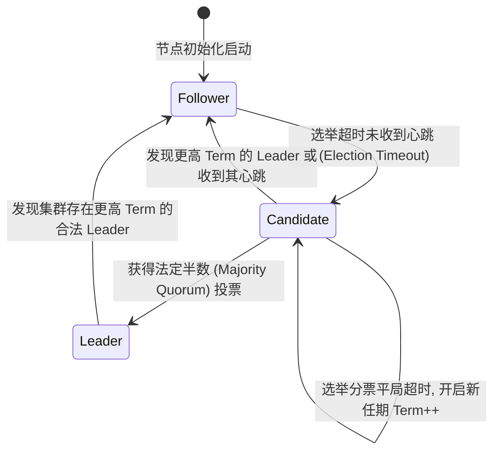
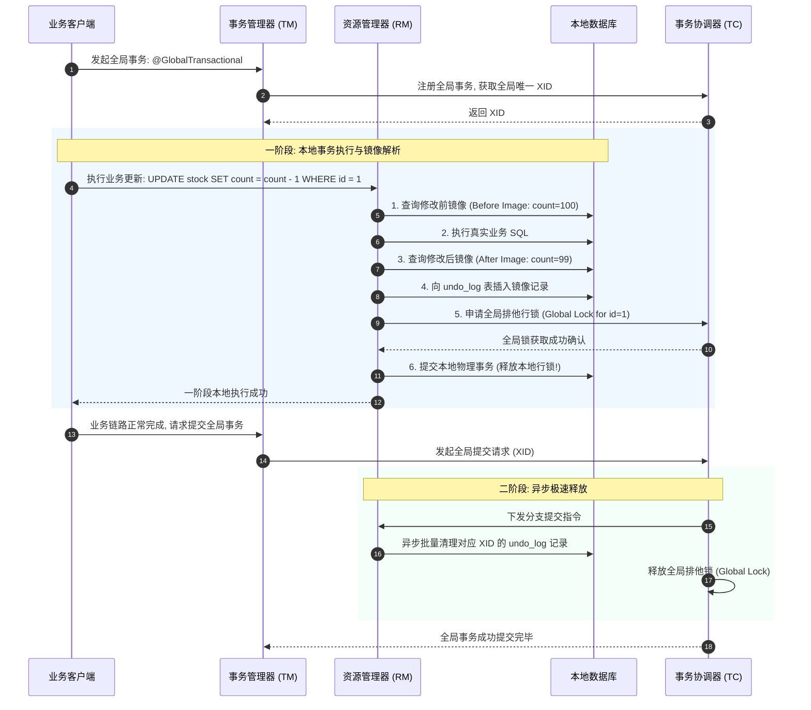
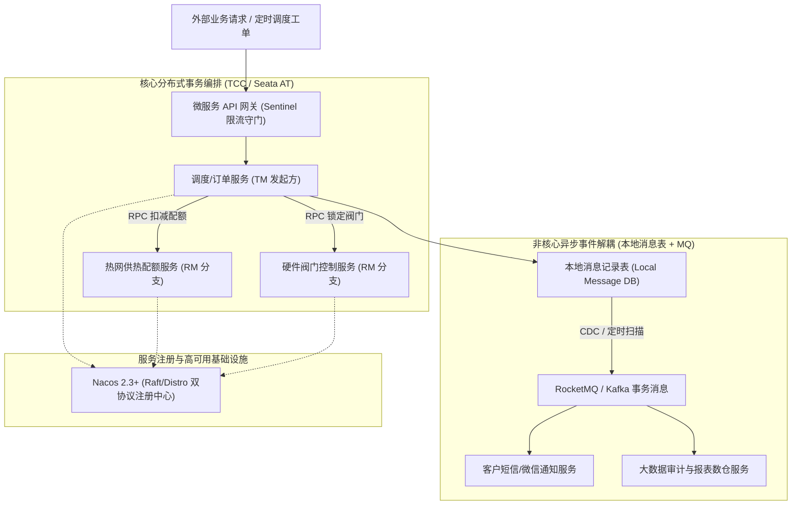
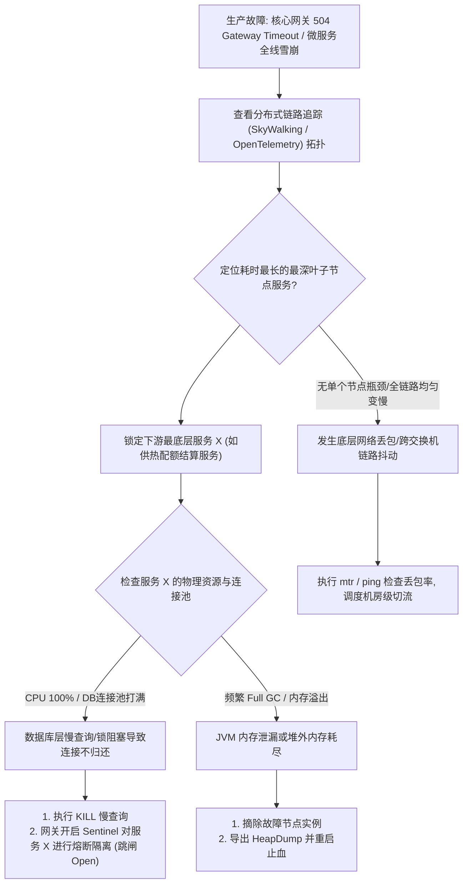
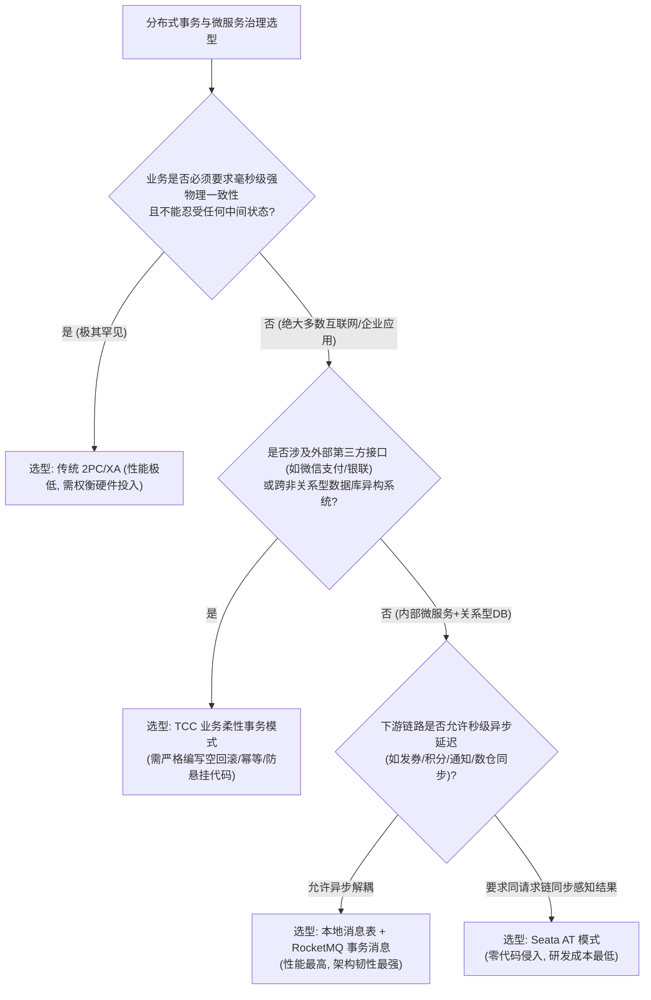
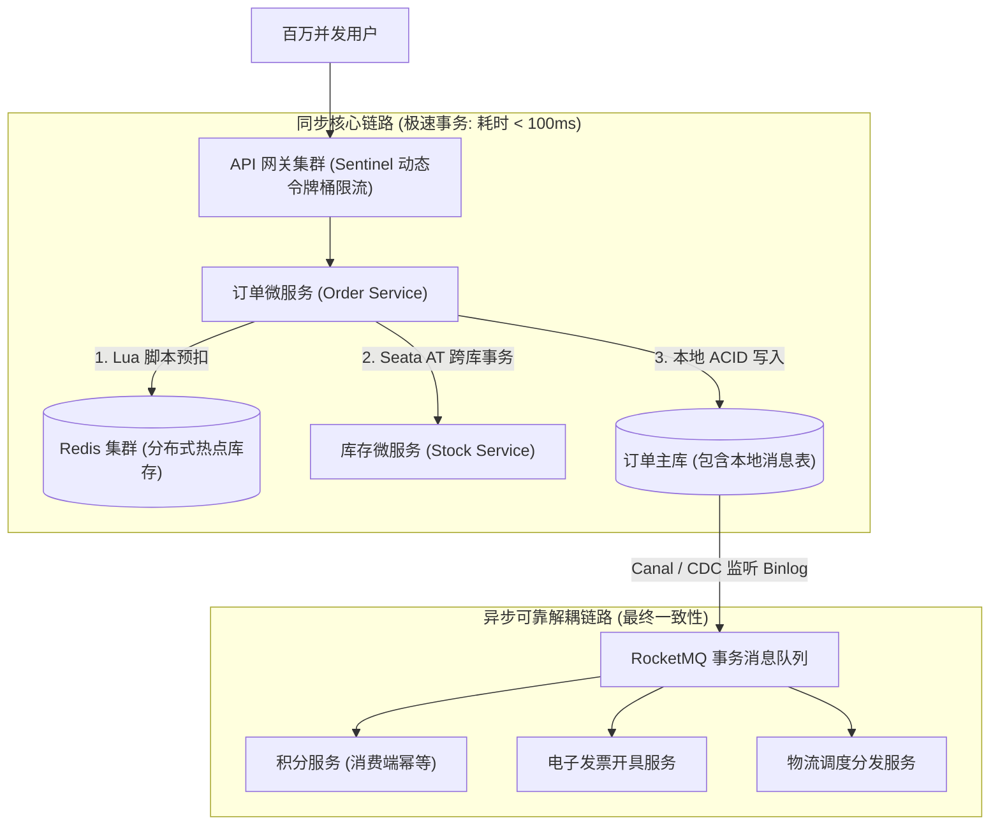
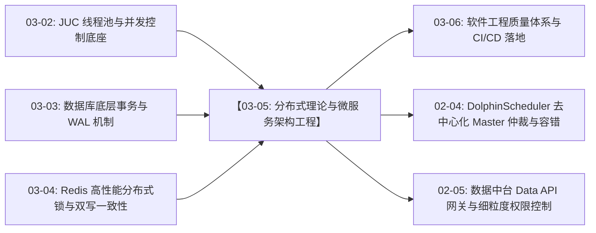

# 分布式理论与微服务架构工程

> **学习目标定位**：面向技术总监、数据平台研发负责人、高级数据架构师岗位，深入透析分布式系统的共识算法、事务协调与微服务工程治理底座。彻底攻克 CAP/BASE 工业级权衡、Raft / Multi-Paxos / ZAB 共识协议状态机（选举、日志复制、Quorum 法定人数与脑裂防御）。系统剖析分布式事务（2PC、TCC 空回滚/防悬挂、Saga、本地消息表及 Seata AT 模式原理），并建立大促脉冲下的服务雪崩防御、自适应限流熔断、金丝雀灰度发布与跨机房容灾 SLA 管控体系。

---

## 1. 知识概述与业务价值

### 1.1 是什么（What）
分布式系统是由多台通过网络互联的独立计算机节点协同构成的计算环境，对外表现为一个统一连贯的系统：
- **分布式共识协议（Consensus Protocol）**：分布式系统的灵魂。解决不可靠网络（丢包、延迟、乱序、网络分区）中多个对等节点就某一状态或日志达成绝对一致的算法，工业界代表为 **Raft、Multi-Paxos 与 ZooKeeper ZAB**。
- **微服务架构工程治理（Microservices Governance）**：现代微服务以轻量级通信（gRPC、Triple 协议、REST）为纽带，以 **Nacos / Consul** 为注册与配置中心，以 **Seata** 为分布式事务协调器，以 **Sentinel / Resilience4j** 为弹性流量防护哨兵，解决单体巨石应用在团队规模扩张、交付敏捷度与高可用扩展上的瓶颈。

### 1.2 解决什么核心业务痛点（Why）
1. **打破单机物理性能上限与消除单点故障（SPOF）**：单机无论如何垂直扩容（Scale-up），其 CPU、内存和 I/O 终有物理天花板。分布式架构通过水平扩展（Scale-out），将成千上万节点的计算与存储聚合成统一算力池，并依托多副本共识机制实现节点宕机秒级自愈。
2. **解决跨服务、跨数据源的数据一致性割裂**：在微服务化或业务垂直拆分后，原本依赖单机本地事务（ACID）的业务跨越了多个独立数据库（如订单库、库存库、账户库），分布式事务方案确保了“要么全成功，要么全补偿回滚”，消除企业级账务资产错乱。
3. **保障高并发脉冲下的系统韧性与业务连续性**：微服务网络拓扑极其错综复杂，单一服务出现延迟毛刺极易迅速耗尽上游调用方线程池，引发链式雪崩。微服务治理工程提供自适应熔断、隔离仓、流量削峰与服务降级，守住核心业务高可用红线。

### 1.3 适用场景与技术边界（Where & When）
- **最佳业务场景**：
  - 核心交易微服务（订单生成、冻结库存、扣减余额、派发积分等跨库多步骤流转）。
  - 分布式配置中心、元数据存储与分布式选主（如 Kafka Controller 选主、DolphinScheduler Master 去中心化仲裁）。
  - 智慧供热中台与万级换热站多租户调度控制系统（跨服务编排、服务发现与路由）。
- **反模式与严禁使用边界**：
  - **初创期或业务复杂度极低时盲目微服务化**：过早将几十个接口拆分为数十个微服务，会导致网络 RPC 开销暴增、联调排障极其痛苦、运维基础设施成本飙升（Martin Fowler 提出的“微服务先驱陷阱”）。
  - **全链路滥用刚性分布式事务（2PC/XA）**：严禁在高吞吐互联网交易核心链路全量开启 XA 事务，2PC 长时间持有底层数据库全局物理锁会使系统整体 TPS 暴跌 90% 以上，该场景必须采用 TCC 或“MQ 异步最终一致性”。

---

## 2. 核心概念与关系

### 2.1 核心概念全景表

| 核心组件/机制 | 英文术语 | 核心定义与工程职责 | 资源/生命周期级别 |
| :--- | :--- | :--- | :--- |
| **CAP 定理** | CAP Theorem | 分布式系统不可能同时满足一致性（Consistency）、可用性（Availability）与分区容错性（Partition Tolerance）。 | 理论基准 / 系统设计全局 |
| **BASE 理论** | BASE Theory | 基本上可用（Basically Available）、软状态（Soft State）、最终一致性（Eventual Consistency）的工程哲学。 | 理论基准 / 柔性系统设计 |
| **Raft 协议** | Raft Consensus | 通过明确的 Leader 选举、日志复制（Log Replication）和安全性约束实现强一致状态机复制。 | 集群级 / 共识状态机 |
| **法定人数机制** | Quorum / Majority | 集群中任意决议必须获得多于半数节点（$\lfloor N/2 \rfloor + 1$）同意，防止双主脑裂并确保日志交叠。 | 拓扑级 / 决策仲裁 |
| **两阶段提交** | 2PC (Two-Phase Commit) | 协调者发起 Prepare（准备）与 Commit（提交）两个阶段的阻塞式强一致分布式事务协议。 | 事务级 / 跨资源协调器 |
| **补偿型长事务** | TCC / Saga | TCC 包含 Try（预留）、Confirm（确认）、Cancel（补偿）；Saga 由一系列本地事务与逆向补偿组成。 | 业务级 / 柔性事务应用 |
| **熔断器** | Circuit Breaker | 监控远程 RPC 调用失败率，当超过阈值时跳闸断路（Open），快速失败阻断连锁雪崩。 | 接口级 / 线程与调用链 |
| **令牌桶限流** | Token Bucket Algorithm | 系统以恒定速率向桶内发放令牌，请求必须拿到令牌才被放行，兼具限流平滑性与允许突发脉冲能力。 | 实例/网关级 / 流量控制 |

### 2.2 系统拓扑与交互关系图

下图完整展示了微服务架构下分布式共识注册中心（Nacos/Raft）、流量熔断防卫（Sentinel）、分布式事务协调器（Seata）与服务 RPC 通信拓扑：

```mermaid
graph TD
    Client["客户端 / API 网关 (Spring Cloud Gateway)"] --> Sentinel["Sentinel 流量卫士 (自适应限流/熔断降级)"]
    Sentinel --> OrderService["订单微服务 (Order Service)"]
    
    subgraph Governance["分布式基础设施与注册共识集群"]
        NacosCluster["Nacos 集群 (基于 Raft 协议保证元数据强一致性 / AP-CP 双模)"]
        SeataTC["Seata TC (Transaction Coordinator 事务协调器)"]
    end
    
    OrderService -.->|服务注册与健康心跳| NacosCluster
    OrderService -->|获取服务节点地址列表| NacosCluster
    
    OrderService -->|分布式全局事务开启: @GlobalTransactional| SeataTC
    OrderService -->|RPC 调用 (Dubbo Triple / OpenFeign)| StockService["库存微服务 (Stock Service)"]
    OrderService -->|RPC 调用| AccountService["账户微服务 (Account Service)"]
    
    StockService -.->|RM 分支注册与状态上报| SeataTC
    AccountService -.->|RM 分支注册与状态上报| SeataTC
    
    subgraph DataStorage["底层存储分库"]
        OrderService --> OrderDB[("订单库 (Order DB)")]
        StockService --> StockDB[("库存库 (Stock DB)")]
        AccountService --> AccountDB[("账户库 (Account DB)")]
    end
```

---

## 3. 底层工作机制与设计哲学

### 3.1 核心运行流程与状态机流转

#### 1. Raft 共识算法核心状态机与工作流
Raft 将复杂的共识问题拆解为三个高度正交的子问题：**Leader 选举（Leader Election）**、**日志复制（Log Replication）**与**安全性（Safety）**：
- **节点三态流转（Role States）**：
  - **Leader**：处理所有客户端写请求，单向向 Follower 广播日志；
  - **Follower**：完全被动响应 Leader 的心跳与追加日志 RPC，维持随机选举超时（Election Timeout, 150ms~300ms）；
  - **Candidate**：当 Follower 在超时时间内未收到 Leader 心跳，递增任期号（`currentTerm++`），自转为 Candidate，向集群广播 `RequestVote` 请求投票。
- **Quorum 机制与防分裂选主（Split Vote Defense）**：
  - 节点在一个 Term 内只能投票给**第一个**向其拉票且**日志至少与自己一样新**的候选人（先来先到原则）。
  - **随机选举超时机制**：各节点选举超时时间随机打散（如 150ms~300ms），极大降低两个 Follower 同时成为 Candidate 导致票数均分（Split Vote）的概率；若选票平局，等待下一个随机周期重新拉票。
  - 必须获得**超过半数节点（Majority: $\lfloor N/2 \rfloor + 1$）**的同意票，Candidate 才能成功晋升为 Leader。
- **日志复制与提交判定（Commit Index）**：
  1. 客户端发送写请求给 Leader。
  2. Leader 将操作追加到本地日志，并向所有 Follower 并发发送 `AppendEntries` RPC。
  3. 当 Leader 收到**大多数（Quorum）节点的成功 ACK** 后，Leader 将该日志项标记为已提交（`commitIndex++`），并在本地应用到状态机（Apply to State Machine）。
  4. Leader 在下一次心跳或日志追加包中携带最新的 `leaderCommit`，Follower 收到后随之将日志应用到各自本地状态机，向客户端返回写成功。
- **日志覆盖与强行对齐规则**：
  - Leader 永远不会覆盖或截断自己的日志，Leader 的日志被奉为绝对权威。
  - 对于落后或日志冲突的 Follower，Leader 为每个 Follower 维护 `nextIndex` 和 `matchIndex`。如果 Follower 在 `AppendEntries` 返回一致性检查失败，Leader 递减该 Follower 的 `nextIndex` 并重试，直到找到两者日志完全吻合的点，随后**强制将 Follower 冲突点之后的所有日志截断并用 Leader 的日志完全覆盖**，实现集群最终完全一致。



#### 2. 分布式事务主流方案深度解构
1. **2PC（两阶段提交）与 3PC 的局限**：
   - **Phase 1（Prepare 阶段）**：协调者（Coordinator）向所有参与者（Participants）发送 Prepare 指令，参与者锁定本地资源、写入 Undo/Redo Log，向协调者返回 VOTE_COMMIT。
   - **Phase 2（Commit/Rollback 阶段）**：若全员准备就绪，协调者下发 Commit 指令；若任一超时或失败，下发 Rollback 指令。
   - **核心致命缺陷**：
     - **同步阻塞与性能悬崖**：所有参与者在整个事务期间持有着底层行锁与连接资源，极大抑制并发吞吐；
     - **协调者单点故障（SPOF）与数据不一致**：若协调者在 Phase 2 下发了部分 Commit 消息后突然崩溃，存活节点将处于悬空状态（不知该提交还是回滚），可能造成部分节点提交、部分节点未知的脑裂状态。
2. **TCC（Try-Confirm-Cancel）业务补偿型事务**：
   - **Try 阶段**：完成所有业务检查（一致性校验），**预留核心业务资源**（如将可用余额扣减 100，冻结余额增加 100）。
   - **Confirm 阶段**：确认执行业务，不做任何校验，直接使用 Try 阶段预留的资源（如冻结余额扣减 100，完成最终结算）。
   - **Cancel 阶段**：取消执行业务，释放 Try 阶段预留的资源（如冻结余额扣除 100，原可用余额恢复 100）。
   - **TCC 必须解决的三大工程难题**：
     - **空回滚（Empty Rollback）**：Try 阶段由于网络超时根本未执行，后续协调者直接触发了 Cancel。Cancel 必须能够识别该情况，不能对未预留的资源进行反向扣减。
     - **幂等性（Idempotence）**：Confirm 或 Cancel 在网络重试下可能被多次重复调用，底层必须依据全局事务 ID（XID）+ 分支 ID（BranchID）实现绝对幂等。
     - **防悬挂（Suspension Defense）**：网络拥堵导致 Cancel 请求比 Try 请求先到达节点，Cancel 执行了空回滚；随后被延迟的 Try 请求终于抵达，此时 Try 绝不能再执行资源冻结，必须直接拒绝，否则这笔预留资金将永远冻结挂死。
3. **Seata AT 模式（无侵入式自动补偿）机制**：
   - **Phase 1**：Seata 代理了业务的数据源（`DataSourceProxy`），在执行业务 SQL 时，自动解析 SQL 语法树（基于 Druid AST），查询出被修改记录的**修改前镜像（Before-Image）**，执行业务 SQL，再查询出**修改后镜像（After-Image）**。随后在同一本地事务中向 `undo_log` 表插入前后镜像数据，并向 TC 注册分支，释放本地数据库锁。
   - **Phase 2 提交**：若全局提交，TC 下发指令，异步批量删除 `undo_log` 记录即可，极速完成。
   - **Phase 2 回滚**：若全局回滚，校验当前数据是否与 After-Image 一致（防脏写），若一致则用 Before-Image 自动反向构造逆向补偿 SQL 并执行，回滚数据。

### 3.2 机制交互时序图（Mermaid）：Seata AT 模式与全局锁防脏写



### 3.3 架构设计思想与演进权衡

1. **CAP 定理的工业界终极裁决：为什么纯粹的 CA 系统在分布式网络中是伪命题？**
   - **网络分区（P）是客观不可抗拒的物理法则**：跨机架、跨机房甚至同交换机下的光纤老化、交换机抖动或内核丢包是客观必然发生的。一旦发生网络分区（$P$ 成立），系统必须在以下两者之间做二选一：
     - **选择 CP（保一致性，舍可用性）**：如 ZooKeeper / etcd / HBase。当节点陷入少数派分区时，立即拒绝写入或查询，宁可向客户端抛出异常，也绝不提供陈旧或错误的数据。
     - **选择 AP（保可用性，舍强一致性）**：如 Eureka / DynamoDB / Couchbase。即使节点失联，依然允许各自对外提供读写服务，数据在网络恢复后通过 Gossip 或后台线程异步对齐，接受短暂的数据不一致。
   - **结论**：**在分布式网络世界里，网络分区是必然前提（P 必须满足），真正的架构权衡永远只在 CP 与 AP 之间展开**。
2. **熔断器状态机流转设计哲学**：
   - 熔断器设计遵循有限状态机（Finite State Machine, FSM）：
     - **Closed（闭合正常状态）**：所有请求正常放行，统计滑动时间窗口内的失败率（如近 10 秒错误率突破 50%）；
     - **Open（断开熔断状态）**：当失败率超过阈值，瞬间跳闸进入 Open 状态。在此状态下，后续所有进来的请求**直接快速失败（Fail-Fast）或执行 Fallback 降级逻辑**，绝不调用下游故障接口，给下游服务留出宝贵的自愈时间窗口；
     - **Half-Open（半开试探状态）**：当熔断持续时间（如 10 秒）到期后，熔断器自动进入 Half-Open 状态，仅放行固定数量（如 5 个）真实探针请求：
       - 若探针请求全部成功，判定下游服务已完全恢复健康，熔断器自动切换回 **Closed**；
       - 若仍有任一探针请求失败，立即重新跌回 **Open** 状态，并重置熔断冷却计时。

---

## 4. 高频复杂业务场景实操与落地

### 4.1 生产典型业务场景拓扑

在太原大型智慧供热中台调度管控或大型跨境电商交易体系中，核心链路涉及跨多个微服务、多个异构数据库的协同流转，架构设计遵循“**核心链路强柔结合、非核心异步解耦、全链路兜底降级**”：



### 4.2 生产级配置基线与参数推荐

#### 1. Sentinel 核心生产流控与熔断降级配置基线
```yaml
spring:
  cloud:
    sentinel:
      transport:
        dashboard: 10.10.20.100:8080   # Sentinel 控制台地址
        port: 8719
      eager: true                     # 饥饿加载，应用启动即刻初始化心跳
      datasource:
        flow-rules:                   # 流控规则持久化至 Nacos (生产严禁存内存)
          nacos:
            server-addr: 10.10.20.50:8848
            dataId: ${spring.application.name}-flow-rules
            groupId: SENTINEL_GROUP
            rule-type: flow
        degrade-rules:                # 熔断降级规则持久化至 Nacos
          nacos:
            server-addr: 10.10.20.50:8848
            dataId: ${spring.application.name}-degrade-rules
            groupId: SENTINEL_GROUP
            rule-type: degrade
```

#### 2. Seata 2.0+ 核心生产配置参数调优
```properties
# 生产存储必须使用 db 模式或高可用 raft 模式 (严禁使用 file 内存模式)
seata.store.mode=db
seata.store.db.datasource=druid
seata.store.db.db-type=mysql
seata.store.db.url=jdbc:mysql://10.10.20.60:3306/seata_tc?useUnicode=true&characterEncoding=utf-8&useSSL=false
seata.store.db.user=seata
seata.store.db.password=SeataStrongPassword2026!

# 全局事务超时控制 (秒)
seata.service.vgroup-mapping.default_tx_group=default
seata.service.grouplist.default=10.10.20.70:8091
seata.config.type=nacos
seata.registry.type=nacos

# 客户端全局锁重试与冲突防御
seata.client.rm.lock.retry-interval=10 # 全局锁重试间隔 10ms
seata.client.rm.lock.retry-times=30    # 最大重试 30 次，防止锁死
seata.client.undo.log-save-days=7      # 定期自动清理 7 天前已提交的 undo 日志
```

### 4.3 核心性能指标监控（SLA 黄金指标）

| 监控指标项 | Prometheus / Exporter 键名 | 生产健康阈值 | 技术管理者告警与干预水位 |
| :--- | :--- | :--- | :--- |
| **RPC 调用 P99 延迟** | `dubbo_client_rt_p99` / `feign_request_duration_seconds` | $\le 50\text{ms}$ | 持续 $> 200\text{ms}$ 报警，表明下游存在慢调用或锁争用。 |
| **熔断跳闸次数** | `sentinel_block_qps` / `circuit_breaker_state` | 0 | $> 10\text{/sec}$ 触发 P1 报警，表明某下游微服务已发生雪崩。 |
| **全局事务回滚比例** | `seata_transaction_rollback_count` / `total_count` | $\le 0.5\%$ | 持续 $> 2\%$ 预警，说明上游库存超卖或数据冲突频繁。 |
| **Nacos 心跳丢失率** | `nacos_client_disconnect_count` | 0 | 瞬时出现 $> 5$ 节点失联告警，排查物理机网络分区或 GC 停顿。 |
| **线程池活跃度** | `threadpool_active_count` / `threadpool_max_size` | $\le 60\%$ | 持续 $> 80\%$ 报警，排查是否存在慢 I/O 导致调用方线程池耗尽。 |

---

## 5. 生产异常故障深度排查与根因分析

### 5.1 典型生产事故与异常排查树

下图展示了微服务架构中遭遇调用链全线超时、服务雪崩时的系统化排查与故障止血决策树：



### 5.2 核心异常场景实战复盘

#### 场景一：级联慢调用引发“服务雪崩（Cascading Failure）”全链路瘫痪
- **真实生产现象**：
  在某智慧供热平台大促首日，用户端投诉系统全面白屏无法登录，网关日志疯狂报错 `504 Gateway Timeout`。查看微服务监控，发现不仅核心业务挂了，甚至完全无关的个人中心、通知中心全线超时，所有微服务实例的 Tomcat / Netty 工作线程池全部打满（100% 处于 `WAITING` 状态）。
- **底层根因剖析**：
  溯源发现，底层“天气预测数据分析服务”因第三方气象接口超时，单个 RPC 请求耗时由原先的 50ms 恶化至 30 秒。上游调用方没有配置合理的**超时时间（Socket Timeout 默认配置了 60 秒）**，且**未配置信号量/线程池舱壁隔离（Bulkhead）**。成千上万个并发请求卡在对气象服务的等待上，导致上游调用方（包括网关）的数百个工作线程被迅速耗尽，无法再接纳任何新的请求，慢调用像病毒一样逆流而上，引发全链路系统级雪崩。
- **快速止血与根治策略**：
  1. **紧急跳闸**：在 Sentinel 控制台动态下发降级规则，将对天气预测服务的接口配置为 `DEGRADE` 状态，强制直接走 Fallback 本地静态缓存，瞬间释放全链路被卡死的数万个线程。
  2. **全面收紧超时红线**：架构规范强制规定：所有跨微服务的 RPC 调用，默认超时时间严禁超过 **1000ms**；必须配置重试次数限制（默认只读幂等接口重试 2 次，非幂等修改接口**重试设为 0**）。
  3. **落地线程池舱壁隔离（Bulkhead）**：核心关键业务与非核心旁路服务在调用端必须实行独立线程池隔离，非核心服务的卡死严禁占用核心服务的任何工作线程。

#### 场景二：Seata 分布式事务遭遇“脏写（Dirty Write）”导致回滚全面卡死
- **真实生产现象**：
  某订单创建业务因库存扣减失败触发全局事务回滚，Seata 协调器在下发回滚指令时，应用日志疯狂打印 `BranchRollbackFailed: Has dirty write! Current data does not match After-Image`。事务一直处于回滚失败重试状态，导致该商品的全局锁被无限期死锁持有，后续所有正常订单全部被拦截无法下单。
- **底层根因剖析**：
  在 Seata AT 模式下，二阶段回滚的先决条件是：**当前数据库中的物理数据必须与一阶段记录的 After-Image 完全一致**（证明期间没有其他事务篡改）。经排查发现：某开发人员在编写另一个运营后台补单功能时，**未加 `@GlobalTransactional` 注解，直接裸写本地 SQL 更新了同一行库存记录**！导致数据被外部非受控事务脏写，Seata 校验前后镜像失败，触发严重脏写保护性死锁。
- **根治策略**：
  1. **应急人工修复**：查询 `undo_log` 表获取 Before-Image，人工核实后编写补偿 SQL 强制还原，调用 Seata 控制台强制完成事务分支状态终结，释放全局排他锁。
  2. **推行强隔离门禁**：对于被 Seata 全局事务管理的共享资源表，应用端必须统一开启 `SELECT ... FOR UPDATE` 并在配置中开启 `seata.client.rm.sql-parser.check-global-lock = true`，强制所有访问该表的本地 SQL 必须向 TC 校验全局锁状态，彻底杜绝裸写绕过。

#### 场景三：ZooKeeper / Raft 跨机房专线闪断引发“双主脑裂（Split-Brain）”
- **真实生产现象**：
  某双机房部署的大数据调度集群（基于 ZAB 协议），由于跨机房主干光纤施工被挖断，机房 A 与机房 B 之间网络瞬间中断。业务发现两个机房各自选出了一个 Active 主节点，两个主节点同时向底层元数据库写入调度状态，导致调度任务重复下发、控制指令冲突错乱。
- **底层根因剖析**：
  集群总节点数被错误配置为了 **4 个节点**（机房 A 部署 2 个，机房 B 部署 2 个）。网络中断时，由于无第三方仲裁机房，任何一方都拥有 2 个节点。在判定法定半数时，部分粗糙的代码将法定人数算成了 $\ge N/2$，使得两边各自认为自己满足条件，双双晋升为 Leader，形成双主脑裂。
- **架构级根治规范（SOP 必备）**：
  1. **奇数节点与严密 Quorum 铁律**：共识集群节点总数 $N$ **必须严格为奇数（3, 5, 7）**；法定多数判定公式必须且只能是：
     $$\text{Quorum} = \left\lfloor \frac{N}{2} \right\rfloor + 1$$
     （如 5 节点集群必须拿到 3 票，任何网络分区下绝对不可能出现两个同时拿到 3 票的独立子集，从数学上彻底根除脑裂）。
  2. **跨机房“2 + 2 + 1”三机房部署范式**：主机房 A 放 2 节点，从机房 B 放 2 节点，第三方独立机房（或低配云主机）放 1 个只参与仲裁投票的 Witness 节点，确保任何单机房光纤断裂时，必定只有一边能凑足 3 票当选，另一边完全静默。

---

## 6. 技术选型对比、架构演进与成本ROI

### 6.1 横向多维选型对比矩阵

#### 1. 分布式事务主流方案多维对比矩阵
| 评估维度 | Seata AT 模式 | TCC 补偿模式 | 本地消息表 + 事务消息 | 传统 2PC / XA |
| :--- | :--- | :--- | :--- | :--- |
| **一致性保障** | 最终一致性（秒级） | 最终一致性（准实时） | **最终一致性（异步解耦）** | **强一致性（物理级）** |
| **性能与吞吐** | 极高（仅持有一阶段本地锁）| 极高（业务逻辑控制） | **最高（完全异步化）** | 极低（全局物理锁长久持有） |
| **代码侵入性** | **零侵入（注解驱动，代理数据源）**| **极高（需编写 Try/Confirm/Cancel 三套业务）**| 中等（需维护消息表与重试监听）| 低（依赖底层驱动协议） |
| **支持数据库** | 关系型（MySQL/Oracle/PG） | 任意系统（支持异构/外部三方系统）| 任意系统 | 需底层 DB 均支持 XA 规范 |
| **核心适用场景** | 企业内网微服务间跨库核心事务 | 跨企业/跨三方支付结算、超高吞吐核心交易 | 订单异步发货、积分派发、日志审计等旁路链路 | 传统银行单机群内部极少数强一致场景 |

#### 2. 分布式共识协议对比矩阵
| 评估维度 | Raft (etcd / Nacos / Consul) | Multi-Paxos (Chubby / Spanner) | ZAB (ZooKeeper) |
| :--- | :--- | :--- | :--- |
| **易理解与工程可控**| **极高（子问题正交解耦，业界首选）**| 极低（学术理论抽象，工程落地极繁复） | 较高（专门为分布式协调定制） |
| **主节点角色** | 强 Leader（单向心跳与日志广播） | 支持多 Proposer，通常固定单 Leader | 强 Leader（恢复模式与原子广播模式） |
| **脑裂防范机制** | Term 任期号 + 严格半数多数派投票 | Ballot 编号 + Quorum 决议 | Epoch 纪元号 + Quorum 决议 |

### 6.2 架构师技术选型决策树与成本 ROI



- **架构选型与成本 ROI 测算**：
  - **背景**：在物联网智慧供热计费项目中，用户充值交费后需同步扣款、开通阀门配额、生成电子发票并发送短信。
  - **方案 A（全链路同步强事务 Seata AT）**：包含开具发票和短信服务的全程耗时长达 3~5 秒，网关并发线程被打满，单机 TPS 不足 300，需要扩容 10 台应用服务器支撑并发。
  - **方案 B（核心事务 Seata AT + 旁路事件 RocketMQ 异步解耦）**：充值扣款与开通配额采用轻量级事务（100ms 内提交）；电子发票与短信通过 Kafka / RocketMQ 事务消息旁路异步消费执行。
  - **ROI 成果**：核心接口延迟从 3.5 秒缩短至 **80 毫秒**，单机 TPS 暴增 **10 倍**，微服务服务器采购成本降低 **70%**，同时由于旁路发票系统故障不再阻断用户核心交费流程，系统可用性（SLA）从 99.5% 跃升至 **99.99%**。

---

## 7. 技术经理与架构师实战管控（SOP与规范）

### 7.1 平台级多租户与资源隔离机制
1. **多租户流量标签染色与路由隔离（Traffic Labeling）**：
   - 在网关层根据 JWT 或 API Key 解析出 `Tenant-ID` 与租户级别（如 VIP 租户 vs 普通租户）。
   - 通过 Spring Cloud Gateway / Dubbo 路由标签（Tag Router），将 VIP 租户的流量自动路由至独立的**物理高保障微服务集群（专享线程池与独立数据库分片）**，普通租户流量路由至共享集群，彻底根绝“吵闹邻居（Noisy Neighbors）”踩踏现象。
2. **全链路压测与数据隔离红线（Shadow DB）**：
   - 生产环境压测请求必须由网关统一打上 HTTP Header `X-Test-Traffic: true`。
   - 所有中间件（Dubbo/Feign/Seata/RocketMQ）自动沿调用链透明透传该上下文标记。
   - 数据访问层自动路由：遇测试标记时，写操作自动路由至**影子库（Shadow Database）**，MQ 消费自动投递至**影子 Topic**，严防压测脏数据流入生产核心主库。

### 7.2 生产变更红线与降级容灾预案（SOP）

#### 1. 微服务研发与发布军规十条（技术团队强制门禁）
1. **接口必须显式配置超时**：严禁无超时或使用默认超时的 RPC 调用，Feign/Dubbo 单次调用超时强制设置在 500~2000ms 范围。
2. **读写重试规则分离**：只读幂等接口允许失败重试最多 2 次；所有写操作（`POST / PUT`）必须关闭重试（`retries = 0`），由业务端或 MQ 进行显式状态补偿。
3. **接口必须包含 Fallback 降级逻辑**：所有微服务对外暴露的核心接口，客户端调用方必须在 Feign / Sentinel 切面中编写明确的本地降级兜底方法，严禁裸抛异常。
4. **强校验 TCC 三要素**：编写 TCC 事务时，代码评审（Code Review）必须逐行检查是否实现：**空回滚防御、基于 XID 的防悬挂记录、严格的幂等幂等更新**。
5. **严禁大事务穿透 RPC**：严禁在 `@Transactional` 本地事务块内调用外部耗时微服务的 RPC 接口，必须严格拆分。
6. **配置动态刷新审计**：Nacos / Apollo 生产配置变更必须双人复核（Double-Check），禁止在大促业务高峰期动态调整流控阈值。
7. **注册中心隔离保护**：开发、测试与生产环境必须从网络物理层面进行 VPC 隔离，严禁开发人员本地服务直连生产注册中心抓取生产流量。
8. **金丝雀灰度发布（Canary Release）**：新版本上线必须遵循金丝雀 SOP：单节点灰度 10% 流量 -> 观察 30 分钟错误率与 P99 延迟 -> 逐步扩容至 50% -> 全量发布，杜绝全网一次性爆炸风险。
9. **接口向下兼容契约**：微服务发布严禁直接删除已有字段或修改字段类型，必须通过废弃注解（`@Deprecated`）保持向下兼容至少 2 个版本周期。
10. **分布式追踪链路贯通**：所有业务线程池异步派生任务时，必须通过 `TraceContext.wrap()` 包装上下文，确保 TraceID 全链路贯穿，严禁链路断头。

#### 2. 机房级网络断网突发容灾演练（SOP）
- **故障情景推演**：同城双活数据中心 A 与 B 之间海底光缆或市政施工被挖断。
- **应急处置流程**：
  1. 监控大屏在 5 秒内捕获跨机房心跳超时，Consul / Nacos 自动将故障机房对端节点标记为不可用；
  2. 智能 DNS / 网关负载均衡（GSLB）立即将公网流量按 100% 比例定向引流至健康机房；
  3. 检查共识组件状态：若机房 A 占法定多数（3/5），机房 A 自动无感继续服务；机房 B（2/5 少数派）自动自我降级为只读或拒绝写服务；
  4. 业务侧启动熔断旁路，非核心通知链路暂停，死保核心交费与换热站控制指令正常下发。

---

## 8. 互联网大厂高频面试真题库

> [!IMPORTANT]
> 本板块精选一线大厂（阿里、字节、美团、快手、腾讯、百度等）真实高频考察的 7 道核心真题。涵盖分布式共识、CAP 工业界权衡、分布式事务全场景攻防、服务雪崩及自适应熔断。**在接下来的第 9 板块中，将对下列所有题目进行逐题深度解答，严禁留白！**

### 8.1 基础概念与机制题（大厂初筛）
1. **Q1**：请深入解释 CAP 定理中的 C、A、P 含义。为什么说在分布式系统架构中，真正的权衡只能在 CP 与 AP 之间选择，而根本不可能存在 CA 系统？
2. **Q2**：请对比 Raft 协议与 Paxos 协议的核心差异。Raft 是如何通过将问题分解为 Leader 选举、日志复制和安全性来极大降低工程复杂度的？

### 8.2 核心底层原理深度题（大厂资深技术面）
3. **Q3**：Raft 算法中 Follower 是如何晋升为 Leader 的？为什么选举超时时间必须随机打散？如果网络分区导致两个候选人得票相同，系统是如何打破平局的？
4. **Q4**：请详细阐述分布式事务 TCC 模式与 Seata AT 模式的底层工作原理。在 TCC 模式下，什么是“空回滚”、“幂等”与“防悬挂”？它们在底层是如何通过状态控制彻底解决的？

### 8.3 复杂生产场景与故障排障题（大厂架构与排障面）
5. **Q5**：生产高并发场景下，什么是微服务的“服务雪崩”？Sentinel / Resilience4j 的熔断器状态机（Closed、Open、Half-Open）是如何流转的？常见的限流算法（漏桶 vs 令牌桶）有何本质区别与选型考量？
6. **Q6**：Seata AT 模式在极端并发下是如何通过“全局锁（Global Lock）”防止脏读和脏写的？如果某个未加入 Seata 全局事务的本地业务代码擅自修改了数据，会导致什么灾难性后果？如何解决？

### 8.4 架构设计与系统规划题（技术总监/总架构师终面）
7. **Q7**：面对日均亿级订单的跨服务、跨数据库流转体系，如何从 0 到 1 设计高可用、强韧性的分布式事务与微服务治理全景架构？请给出核心链路与旁路链路的架构选型、兜底降级预案及全链路压测实施 SOP。

---

## 9. 结构化深度参考答案（逐题三层应答）

---

### 题目1：CAP 定理的工业界本质剖析与“不可能存在 CA 系统”论证

#### 简洁回答（1分钟电梯破题）：
> CAP 定理指出：分布式系统无法同时兼顾**一致性（Consistency，所有节点同时看到最新数据）**、**可用性（Availability，每个非故障节点请求都能得到非报错响应）**与**分区容错性（Partition Tolerance，系统遭遇网络丢包或分区时仍能对外运作）**。
> **为什么不可能存在 CA 系统？** 因为在跨网络物理通信的真实世界中，网络分区（P）是由于光纤老化、硬件故障、GC 暂停引发的客观物理必然性。一旦网络发生分区（$P$ 成立），为了保证一致性（C），节点必须拒绝写入未同步的数据，从而牺牲可用性（A 丢失，走向 **CP**）；若为了保证可用性（A）强行允许分区两侧继续写入，数据必然产生分歧冲突，从而牺牲一致性（C 丢失，走向 **AP**）。因此，**脱离了 P 的 CA 系统在分布式架构中是根本不存在的伪命题**。

#### 深入回答（机制推导与边界条件）：
1. **严格数学推导与场景演绎**：
   - 设分布式系统有两个节点 $N_1$ 和 $N_2$。此时两者之间的网络连接发生中断（网络分区 $P$ 发生）。
   - 客户端向 $N_1$ 发起写入请求：将变量 $V$ 从 0 改写为 1。
   - 决策分支推导：
     - **分支 A（保一致性 C）**：$N_1$ 必须等待将新值 $V=1$ 同步给 $N_2$ 之后，才能向客户端返回成功。但由于网络中断，$N_1$ 无法联系到 $N_2$。为了维护“所有节点数据绝对一致”，$N_1$ 只能向客户端返回错误或超时。此时客户端的请求未得到正常响应，**系统的可用性（Availability）被无情破坏，系统表现为 CP**。
     - **分支 B（保可用性 A）**：$N_1$ 为了保证“非故障节点必须对请求做出成功响应”，直接将本地数据修改为 $V=1$ 并返回成功。随后，另一个客户端访问处于隔离区的 $N_2$ 读取 $V$。$N_2$ 毫不知情，依然返回旧值 $V=0$。此时两个节点数据产生冲突裂痕，**系统的一致性（Consistency）被彻底破坏，系统表现为 AP**。
2. **BASE 理论对 CAP 的工程妥协升华**：
   - 既然无法做到强一致（ACID），互联网工程架构提出了 **BASE 理论**：
     - **Basically Available（基本上可用）**：发生故障时，通过降级、削峰、采样响应，牺牲次要功能保障核心核心链路可用（如秒杀排队）。
     - **Soft State（软状态）**：允许系统在不同节点之间存在中间状态，允许数据同步存在时间延迟。
     - **Eventual Consistency（最终一致性）**：所有节点在经过一定时间窗口的异步同步补偿后，最终达到完全一致的状态。

#### 架构师/技术管理视角（权衡取舍、SLA与成本）：
> 技术负责人在系统立项时，必须依据业务本质定调 CP 或 AP：
> 1. **金融与核心资产调度（死守 CP 底线）**：
>    - 涉及现金扣款、大额资产对账、换热站防爆核心控制指令，必须无条件选择 **CP 模型**。宁可报错让用户重试，也绝对不允许由于并发冲突导致资产超支或物理硬件损坏。组件选型对齐 **Raft / etcd / 强一致关系型数据库**。
> 2. **互联网高频交互与社交体验（全面拥抱 AP 模型）**：
>    - 微博点赞、视频播放量统计、商品评价与非核心订单状态通知，必须全面选择 **AP 模型**。用户多等 2 秒看到点赞数完全无害，但接口报错会直接造成用户流失。组件选型对齐 **Eureka / DynamoDB / RocketMQ 最终一致性**，大幅降低分布式锁开销与网络带宽成本。

---

### 题目2：Raft 协议与 Paxos 协议的核心差异及子问题正交解耦

#### 简洁回答（1分钟电梯破题）：
> Paxos（特别是 Classic Paxos / Multi-Paxos）被公认为分布式共识的理论鼻祖，但其理论高度抽象、晦涩难懂，且未对主节点选举与日志对齐给出明确规范，工业界落地极其困难（被称为“理论只有 Lamport 懂，工程实现人人有坑”）。
> **Raft 协议的核心设计哲学是“可理解性（Understandability）与工程确定性”**。Raft 将复杂的共识算法解耦为三个完全正交的独立子问题：**Leader 选举（Leader Election）**、**日志复制（Log Replication）**与**安全性（Safety）**。通过引入明确的**强 Leader 权威**、**单向日志流**与**随机选举超时机制**，使得系统的状态机极其清晰，成为了现代开源工业界（etcd、Nacos、TiKV、SOFARaft）的事实共识标准。

#### 深入回答（机制推导与边界条件）：
1. **核心机制对比推导**：
   - **Leader 地位差异**：
     - **Paxos**：多节点（Proposer）可并发发起提议，通过两阶段（Prepare-Promise, Accept-Accepted）博弈协商，容易发生“活锁（Livelock）”；Multi-Paxos 虽引入 Leader，但 Leader 的权力不绝对，日志可能乱序确认，恢复极其晦涩。
     - **Raft**：采用**强 Leader（Strong Leader）**模式。任何时刻有且仅有一个合法 Leader。所有日志流向**严格单向由 Leader 流向 Follower**。Follower 绝不接受客户端写入，仅被动接收追加。
   - **日志连续性与安全性差异**：
     - **Paxos**：允许日志项中存在“空洞（Holes）”，先提交 index=2，后提交 index=1，状态机重放前必须打补丁填补空洞。
     - **Raft**：**强制日志连续无空洞**。Leader 追加日志必须是顺序线性的。`AppendEntries` RPC 携带前一日志项的 `prevLogIndex` 与 `prevLogTerm`，Follower 若校验不匹配直接拒绝，强迫 Leader 递归回溯对齐，彻底杜绝了日志乱序。
2. **安全性保证（Leader Completeness Property）**：
   - Raft 规定了一条铁律：**拥有最新日志的节点才有资格当选为 Leader**。
   - 候选人在向其他节点拉票（`RequestVote`）时，必须附带自己最后一条日志的 Term 和 Index。接收节点若发现候选人的日志没有自己的新（Term 小，或 Term 相同但 Index 小），直接投反对票。这确保了**凡是已经提交（Committed）的日志，必定已经存在于新选举出的 Leader 中**，新 Leader 上任无需像 Paxos 那样执行复杂的“反向日志修补”，可以直接对外服务。

#### 架构师/技术管理视角（权衡取舍、SLA与成本）：
> 这一选型哲学印证了架构学核心准则——**“可维护性与确定性高于理论极致效率”**：
> 1. **研发门槛与排障成本**：
>    - 自研或深调 Multi-Paxos 的门槛极高，全球仅有 Google（Chubby/Spanner）与阿里（X-Paxos/OceanBase）少数顶级团队能驾驭。普通技术团队若在中间件或自研分布式协调中引入 Paxos，一旦发生网络脑裂或边界异常，排查将陷入泥潭。
> 2. **技术栈生态复用**：
>    - Raft 拥有成熟完备的生产级 SDK（如 Go 的 `etcd/raft`、Java 的 `SOFAJRaft`、Rust 的 `raft-rs`）。技术总监在为企业自研分布式元数据中心、任务调度协调器选型时，应毫不犹豫地基于 Raft 生态构建，将研发交付周期缩短数月，降低技术负债。

---

### 题目3：Raft 节点选举全链路推导、随机超时机制与平局破解

#### 简洁回答（1分钟电梯破题）：
> Raft 节点晋升遵循严格的三态转换：当 Follower 的**随机选举超时（Election Timeout）**倒计时归零且未收到 Leader 心跳时，该节点立即自增任期号（`currentTerm++`），变身为 **Candidate**，给自己投票并并发向其他节点广播 `RequestVote` RPC。
> **随机选举超时时间（150ms ~ 300ms）打散**的核心目的在于**错峰竞争，极大化降低票数均分（Split Vote）的概率**。若偶发出现两个 Candidate 各得一半选票的平局僵局，两个 Candidate 将各自等待下一个随机超时期满，由于时间已被随机打散，先超时的节点能率先发起新一轮选举并成功揽获超过半数（Majority Quorum）选票，从而迅速打破僵局晋升为 Leader。

#### 深入回答（机制推导与边界条件）：
1. **拉票与投票严密规则（两大约束）**：
   - 节点 $N_A$ 收到候选人 $N_B$ 的投票请求，必须同时满足以下条件才会投赞成票：
     - **约束 1（先来先到与单任期单票）**：节点 $N_A$ 在当前任期号 `currentTerm` 内尚未把票投给其他人（`votedFor == null || votedFor == candidateId`）。
     - **约束 2（日志完整度校验）**：候选人 $N_B$ 的日志必须**至少与 $N_A$ 一样新**。比较逻辑：
       $$\begin{aligned}
       \text{若 } Term_{last}(B) > Term_{last}(A) & \implies \text{B 更优，允许投票} \\
       \text{若 } Term_{last}(B) == Term_{last}(A) \text{ 且 } Index_{last}(B) \ge Index_{last}(A) & \implies \text{B 至少一样新，允许投票} \\
       \text{否则} & \implies \text{B 日志落后，断然拒绝投票}
       \end{aligned}$$
2. **平局发生与破解状态机流转**：
   - 设 4 节点集群，节点 1 与节点 2 同时超时自荐为 Candidate，分别获得了节点 3 与节点 4 的支持，各自获得 2 票（未达法定多数 3 票）。
   - **平局状态（Split Vote）处理**：
     1. 没有人成为 Leader，整个选举周期自然流产。
     2. 各 Candidate 继续维持其本地的随机超时计时器（如节点 1 随机到 220ms，节点 2 随机到 160ms）。
     3. 节点 2 的 160ms 计时器率先归零，立即触发新一轮 Term 递增，以闪电之势向全网广播 `RequestVote`。
     4. 此时节点 1 的计时器尚在倒计时等待中，收到节点 2 具有更高 Term 的拉票请求，节点 1 必须心悦诚服地**主动降级为 Follower**，并将票投给节点 2。
     5. 节点 2 迅速拿到 3 票（超过半数），成功登基为新 Leader，并立即广播心跳宣告王权，僵局彻底瓦解。

#### 架构师/技术管理视角（权衡取舍、SLA与成本）：
> 选举超时时间配置是系统自愈时效（RTO）与误报颠簸（Flapping）的工程权衡：
> 1. **核心配置经验公式（SOP 准则）**：
>    - 官方严格建议保持以下时间尺度不等式：
>      $$\text{BroadcastTime (广播延迟)} \ll \text{ElectionTimeout (选举超时)} \ll \text{MTBF (平均故障间隔)}$$
>    - 在企业内网同机房环境中，心跳间隔通常设为 **50ms**，选举超时打散设在 **150ms ~ 300ms**，保证故障发生后系统在 **300ms 黄金时间内完成秒级自动选主恢复**。
> 2. **跨机房高延迟应对策略**：
>    - 若集群部署在跨城云专线上，网络 RTT 达到 30ms。若仍盲目套用 150ms 超时，极易因网络抖动频繁触发不必要的选举颠簸。技术总监应果断将超时阈值按比例放大至 **1000ms ~ 2000ms**，以牺牲几百毫秒的自愈时效换取整体拓扑的高度稳定。

---

### 题目4：分布式事务 TCC 与 Seata AT 底层机制、三大异常攻防

#### 简洁回答（1分钟电梯破题）：
> - **Seata AT 模式（无侵入自动化补偿）**：依托数据源代理，一阶段通过解析业务 SQL 自动抓取更新前镜像（Before-Image）与更新后镜像（After-Image），提交本地事务并申请全局锁；二阶段提交时异步清空 `undo_log`，二阶段回滚时通过前后镜像反向构造逆向回滚 SQL，对业务代码完全零侵入。
> - **TCC 模式（侵入式业务柔性事务）**：业务方必须人工实现 Try（预留核心资源）、Confirm（确认消费预留）、Cancel（释放预留）三个方法。
> - **TCC 三大核心异常与解法**：
>   1. **空回滚**：Try 因网络丢包未执行，协调者超时下发 Cancel。**解法**：Cancel 校验是否存在 Try 记录，若无则仅记录“已回滚标记”，绝不扣减资源；
>   2. **幂等性**：网络超时导致 Confirm/Cancel 重复调用。**解法**：基于全局事务流水表，利用唯一主键或状态机 CAS 保证重复调用直接放行；
>   3. **防悬挂**：Cancel 由于网络延迟比 Try 先到达执行了空回滚，随后被迟滞的 Try 抵达。**解法**：Try 执行前先查本地流水，若发现已存在该事务的 Cancel 记录，直接抛出异常拒绝预留资源。

#### 深入回答（机制推导与边界条件）：
1. **TCC 三大异常防御的事务流水表设计模型**：
   - 必须设计一张专属本地事务控制表 `tcc_transaction_log`：
     - 字段包含：`xid`（全局事务ID）、`branch_id`（分支ID）、`status`（1: TRIED, 2: CONFIRMED, 3: CANCELED）。
   - **空回滚与防悬挂时序推导**：
     ```sql
     -- [Cancel 阶段防御逻辑]
     SELECT status FROM tcc_transaction_log WHERE xid = #{xid} AND branch_id = #{branchId};
     -- 若记录不存在: 说明 Try 根本没执行成功发生超时丢失 (触发空回滚场景)
     -- 必须插入一条 status=3 (CANCELED) 的占位记录! 此时不做任何资源释放。
     
     -- [Try 阶段防悬挂逻辑]
     -- Try 迟迟抵达准备执行时:
     SELECT status FROM tcc_transaction_log WHERE xid = #{xid} AND branch_id = #{branchId};
     -- 惊奇发现已经存在 status=3 (CANCELED) 记录!
     -- 说明 Cancel 已经捷足先登执行完毕，此时坚决中止业务并回滚，严禁再执行任何资源冻结预留!
     ```
2. **Seata AT 模式在脏写防护上的底层算法**：
   - Seata 在内存中维护了一个**全局锁管理器（Global Lock Manager）**，行锁粒度为：`table_name:primary_key_value`。
   - 一阶段本地事务提交前，RM 必须向 TC 申请该记录的全局排他锁。
   - 二阶段回滚时：
     1. 读取当前数据库中的该行物理记录 $R_{current}$；
     2. 严格比对：$R_{current}$ 的所有列值是否与 `undo_log` 中的 After-Image 严格一致；
     3. 若一致：说明期间没有其他事务插入修改，安全执行逆向补偿 SQL；
     4. 若不一致：说明发生了外部脏写！此时自动化回滚绝不能盲目执行（否则会覆盖外部事务结果），立即将该分支标记为失败，发出报警介入人工审计介入。

#### 架构师/技术管理视角（权衡取舍、SLA与成本）：
> 架构选型是研发交付成本（人月）与极致性能边界的深度平衡：
> 1. **研发 ROI 裁决**：
>    - TCC 的开发成本极高，一个业务方法拆解成 3 个，代码量暴增 3 倍，且空回滚与幂等极其考验工程师的素质；
>    - 对于企业内部 90% 的普通跨库微服务流转，首选 **Seata AT 模式**，业务只需标注一个 `@GlobalTransactional`，在数天内完成微服务事务升级。
> 2. **极端高并发场景的性能天花板**：
>    - Seata AT 模式受限于全局锁竞争，且生成前后镜像需要两次额外查询，在每秒上万次扣款的高频账务核心场景无法支撑；
>    - 此时必须调集资深研发骨干，专门针对核心账务接口编写纯粹的 **TCC 模式**，将资源隔离细化到业务层（如账户冻结资金），释放底层物理行锁，达成极致的吞吐与扩展能力。

---

### 题目5：服务雪崩防范、熔断器状态机机制与限流算法剖析

#### 简洁回答（1分钟电梯破题）：
> **服务雪崩（Cascading Failure）**是指由于基础依赖服务不可用或延迟飙升，导致调用方的线程等系统资源被迅速消耗殆尽，从而引发上游调用链逐级崩溃的恶性连锁反应。
> **Sentinel / Resilience4j 熔断器状态机三态流转**：
> 1. **Closed（正常闭合）**：放行请求，统计滑动窗口内错误率；
> 2. **Open（熔断跳闸）**：错误率超标，快速失败（Fail-Fast）拦截请求走降级 Fallback；
> 3. **Half-Open（半开试探）**：熔断冷却时间到期，放行少量探针请求探测下游健康度，若成功则重置为 Closed，若失败则重新跳回 Open。
> **漏桶 vs 令牌桶**：漏桶以恒定速率流出请求，**绝对平滑但严厉抹杀突发流量**；令牌桶以恒定速率向桶内注水发放令牌，**既能限制平均速率，又允许在桶满时应对突发脉冲（Burst Traffic）**，是微服务网关限流的首选。

#### 深入回答（机制推导与边界条件）：
1. **熔断器状态机内部数学判定机制**：
   - Sentinel 采用基于 Leaning Window（滑动时间窗口，如 10 秒划分为 10 个 1 秒的格子）来动态统计。
   - **跳闸条件（Trigger Condition）**：
     - **慢调用比例熔断**：请求响应时间 $> RT_{max}$（如 200ms）被定义为慢调用。当窗口内请求数超过基线（如 20 次）且慢调用比例超过阈值（如 50%），触发跳闸。
     - **异常比例熔断**：窗口内业务异常比例超过设定阈值（如 40%），触发跳闸。
   - **Half-Open 状态的探针收敛算法**：半开状态不仅检验成功，通常还会限制并发线程数为 1，防止探针请求本身将刚刚微弱复苏的下游服务再次一脚踹死。
2. **限流算法底层物理建模对比**：
   - **漏桶算法（Leaky Bucket）**：
     - 水（请求）流入速率任意，水以恒定速率（Constant Rate）从桶底漏出。若流入量超过桶容量，溢出丢弃。
     - **致命软肋**：即使底层系统有能力瞬时处理 1000 个请求，面对突发 200 个请求时，漏桶依然机械地每秒只放行 10 个，导致原本可以瞬间处理的用户遭遇长久排队延迟。
   - **令牌桶算法（Token Bucket）**：
     - 桶容量为 $C$，系统以恒定速率 $r$ 向桶内添加令牌（Token）。
     - 请求抵达时，必须从桶内扣减指定数量令牌（通常 1 个）；
     - **突发脉冲应对机制**：若系统经历了一段闲置时间，桶内积攒了满格 $C$ 个令牌。此时突发涌入 $C$ 个请求，它们可以**在零等待时间内瞬间全部被放行处理**！随后流量平滑收敛为每秒 $r$ 个，在保护系统的同时提供了极佳的用户体验。

#### 架构师/技术管理视角（权衡取舍、SLA与成本）：
> 流量治理是技术负责人在大促期间守住业务连续性生命线的核心抓手：
> 1. **立体分层流控防线**：
>    - **第一道防线（API 网关）**：采用令牌桶算法对 IP、用户维度实施入口限流，阻断恶意爬虫与突发攻击流量；
>    - **第二道防线（微服务间 RPC）**：采用并发线程数隔离（Thread Pool / Semaphore）与慢调用熔断，防止单一脏接口拖跨全局；
>    - **第三道防线（基础底座 DB）**：在数据访问层前置配置基于 Sentinel 的 SQL 粒度慢查询熔断与自适应线程池限流，誓死守卫底层核心库不被打穿。
> 2. **规则持久化与配置审计规范**：
>    - 严禁将 Sentinel 流控规则保存在应用内存中（应用重启全部丢失）。生产必须建立 **Sentinel Dashboard + Nacos 配置持久化链路**，所有阈值的调整必须经过容量压测基线计算，并走生产变更工单审批。

---

### 题目6：Seata AT 全局锁机制、脏写防范与外部未纳管 SQL 破坏应急

#### 简洁回答（1分钟电梯破题）：
> Seata AT 模式的一阶段在提交本地事务前，必须先向 TC 申请**全局排他锁（Global Lock）**。该全局锁**仅在逻辑层面互斥其他 Seata 全局事务的分支申请，并不阻塞底层的原生物理行锁**，因此极大兼顾了并发性能。
> **如果外部非受控代码裸写 SQL 篡改了数据**，会导致二阶段准备回滚的 Seata 事务在执行数据校验时，发现物理数据与原本保存的 After-Image 不一致，判定发生了**“脏写（Dirty Write）”**！此时 Seata 为防止破坏外部数据，会**陷入持续重试死锁循环，并拒绝释放全局锁**。
> **解决手段**：应急时必须通过人工介入比对 `undo_log` 中的 Before-Image，手动执行补偿修复并强制重置事务状态；根治手段是通过在工程规范中推行 `SELECT ... FOR UPDATE` 校验全局锁，并在配置中强制启用全局锁冲突检测。

#### 深入回答（机制推导与边界条件）：
1. **全局锁对抗脏写全时序推导**：
   - 设账户初始金额 `balance = 100`。
   - **正常受控事务流**：
     - 事务 A（Seata 管理）：执行 `UPDATE balance = 90`。RM 申请全局锁 `account:1` 成功，提交本地事务，释放 MySQL 物理行锁。此时虽然本地物理锁已解，但全局锁被事务 A 牢牢持有。
     - 事务 B（Seata 管理）：尝试执行 `UPDATE balance = 80`。由于事务 A 尚未提交全局事务，事务 B 在向 TC 申请全局锁时被阻塞排队，必须等待事务 A 终结，避免了并发冲突。
   - **外部未纳管裸 SQL 致命破坏推导**：
     - 事务 C（外部直接连接 MySQL 或未加注解的代码）：直接执行 `UPDATE account SET balance = 50 WHERE id = 1`。
     - 由于事务 C 根本不经过 Seata 代理，它完全感知不到 TC 全局锁的存在。由于事务 A 早已释放了 MySQL 本地物理行锁，事务 C 瞬间执行成功并持久化为 50！
     - 此时，事务 A 发生了上游业务失败，TC 下发二阶段**回滚指令**。
     - 事务 A 的 RM 准备执行反向补偿，首先进行**校验**：
       $$\text{当前 DB 值 } (50) \ne \text{After-Image 镜像值 } (90)$$
     - 校验失败！事务 A 陷入死锁：它既不敢把 50 盲目回滚为 100（否则将无情抹杀事务 C 的 50 变更），又不能释放持有的全局锁，引发长久死锁报警。
2. **防范治理的硬核三道关卡**：
   - **关卡 1（配置强制校验）**：在业务中若执行 `SELECT ... FOR UPDATE`，配置开启 `check-global-lock = true`。此时 Seata 代理会将普通的查询增强为“不仅申请本地行锁，还必须向 TC 确认该行全局锁是否释放”，若被全局锁占用则自旋等待。
   - **关卡 2（本地补偿重试限制）**：在客户端配置 `seata.client.rm.lock.retry-times = 30` 与 `retry-interval = 10ms`，避免无休止无限期重试。

#### 架构师/技术管理视角（权衡取舍、SLA与成本）：
> 脏写事件是微服务架构治理中最经典的“管理与规范脱节”事故：
> 1. **代码门禁与架构守门（ArchUnit）**：
>    - 引入架构静态测试工具（如 ArchUnit），在 CI/CD 流水线中建立检测规则：凡是对资产表、核心交易表进行 DML 操作的 DAO 层方法，其上层调用栈中**必须显式包含 `@GlobalTransactional` 或特定事物包装切面**，严禁任何野生方法直写核心表。
> 2. **数据一致性稽核与报警机器人**：
>    - 建立基于 Flink CDC 的旁路实时稽核引擎，每秒比对业务核心数据与 `undo_log` 表的未完成分支。一旦发现某个分支重试超过 5 次，立即触发企业微信 P1 报警，通知值班架构师在 10 分钟内完成介入修复，保障业务高可用 SLA。

---

### 题目7：亿级订单微服务架构与分布式事务全景方案设计

#### 简洁回答（1分钟电梯破题）：
> 面对日均亿级订单的超大规模业务，单单一套分布式事务或治理框架无法覆盖全局，必须采用**“分层解耦、动静分离、强柔并济、异步保底”**的全景架构体系：
> 1. **核心链路（强一致/毫秒级）**：订单生成与库存预扣减采用 **Redis 预扣 + 本地轻量事务 + Seata AT / TCC** 组合，将耗时压缩在 100ms 内；
> 2. **旁路链路（最终一致/完全异步化）**：发票生成、积分增减、商户结算、物流派发等海量下游操作，**全面采用本地消息表 + RocketMQ 事务消息**实施异步解耦，保证上游核心极速响应；
> 3. **全链路兜底保障（SLA 护城河）**：微服务网关前置基于 Sentinel 的令牌桶限流；核心微服务实施线程池舱壁隔离；跨机房采用“2+2+1”多活共识部署；上线前推行全链路压测与影子库演练，保障在大促百倍峰值下系统韧性。

#### 深入回答（机制推导与边界条件）：
1. **端到端核心数据流与事务分层拓扑架构**：
   - **第一阶段（毫秒级预检与预留）**：
     - 用户在前端点击“立即下单”；
     - 网关执行 Sentinel 令牌桶鉴权与防刷限流；
     - 请求进入订单服务，通过 Redis 执行 Lua 脚本预扣减库存（极速过滤超卖）；
   - **第二阶段（核心强柔事务提交）**：
     - 订单服务开启 `@GlobalTransactional`，通过 RPC 调用库存服务进行物理库存锁定；
     - 订单服务生成未支付订单，扣减优惠券配额，提交全局事务。此时整个同步 RPC 链路仅跨 2 个核心服务，耗时控制在 80ms 以内，成功率达 99.99%。
   - **第三阶段（支付成功后的异步可靠事件编排）**：
     - 用户支付成功，订单服务在本地数据库事务中，**同时更新订单状态为已支付，并向本地消息表（`local_message`）插入一条“支付成功事件”**，借由本地 ACID 事务保证 100% 不丢事件。
     - CDC / 消息轮询任务将事件投递至 RocketMQ 顺序分区 Topic；
     - 积分服务、风控审计、通知服务各自独立并行消费。各消费方严格实现**基于消息 Key 的幂等性控制**，消费失败自动进入死信重试队列（DLQ），达到最终一致性。



2. **全链路压测与影子库隔离实施体系（SOP）**：
   - **流量染色与透传**：压测引擎注入特制请求，Header 携带 `x-shadow-traffic: true`。微服务网关拦截，通过 `TransmittableThreadLocal` 在跨线程池异步编排时传递；
   - **中间件透明路由**：
     - **数据库层**：MyBatis / Hibernate 拦截器解析标记，自动将 SQL 路由至对应的物理影子库（如 `order_db_shadow`），压测结束后一键 `TRUNCATE`，零污染生产；
     - **缓存层**：Redis Key 自动加前缀 `shadow:order:...`；
     - **MQ 层**：RocketMQ 自动将测试消息路由至 `ORDER_TOPIC_SHADOW`，由影子消费组消费并丢弃。

#### 架构师/技术管理视角（权衡取舍、SLA与成本）：
> 面对极端规模，顶尖架构师的终极追求是“**用不对称的低成本架构抵御极高的并发风险**”：
> 1. **消除无意义的分布式强事务**：
>    - 工业界 95% 的业务灾难都源于在不恰当的链路上使用了强一致性协议。通过将业务合理拆解为“同步短核心 + 异步长柔性”，消除了 90% 的分布式死锁风险。
> 2. **SLA 兜底预案的自动化与可视化**：
>    - 核心业务必须支持“一键降级开关”。大促流量突破历史峰值 120% 时，网关根据 CPU 水位自动触发自适应熔断：关闭运费计算、暂停积分实时显示、发票延迟 24 小时开具，将全部算力让渡给核心交易链路，实现企业的商业价值与投资回报率（ROI）最大化。

### 9.8 面试现场自然口述示范与一页纸速记卡（Day 26 复盘精华）

#### 经典真题 1：请深度讲透 CAP 定理与 BASE 理论的工业界辩证统一。为什么说在分布式网络中“CA 组合”在现实中根本不存在？面对网络分区（P）时，CP 架构与 AP 架构的设计权衡是什么？

##### 1. 简洁回答（1分钟电梯破题）
> “CAP 定理指出：一个分布式系统不可能同时满足一致性（Consistency）、可用性（Availability）与分区容错性（Partition Tolerance）。
> 1. **为什么‘CA 组合’是分布式伪命题**：分布式系统本质上是由跨机架、跨机房甚至跨地域的物理网络连接的。网络丢包、交换机闪断、光缆挖断等**网络分区（Partition Tolerance, P）是不可抗拒的客观物理规律**。一旦网络发生分区，节点间通信断开，系统要么选择单侧拒绝写入以维持数据一致（放弃可用性 A，成为 **CP**），要么允许各自写入导致数据不一致（放弃强一致 C，成为 **AP**）。抛弃 P 讨论分布式系统等同于假设网络永不丢包的‘单机乌托邦’，因此在分布式领域只能在 **CP 与 AP 之间做抉择**；
> 2. **BASE 理论对 CAP 的工业级超越**：BASE 理论（Basically Available 基本上可用、Soft State 软状态、Eventual Consistency 最终一致性）是互联网工程架构对 CAP 的现实妥协。它告诉我们不必执着于牺牲可用性的刚性强一致，而是通过允许短暂的中间软状态，最终在业务可容忍的时间窗口内达到数据对齐。”

##### 2. 深入回答（机制推导与边界条件）
- **CP 与 AP 选型推导与典型组件对比**：
  - **CP 架构（一致性优先）**：
    - 典型代表：ZooKeeper、Etcd、Consul、HBase；
    - 运行机制：采用强共识协议（ZAB / Raft）。当网络分区发生、部分节点失联时，无法凑齐法定半数以上人数（Quorum）的分区直接拒绝任何写请求并返回错误（牺牲 A），只允许在拥有多数派的主分区内提供服务，全力保障集群元数据或状态绝对一致；
    - 适用场景：分布式锁、主从选主、元数据配置、金融核心账本。
  - **AP 架构（高可用优先）**：
    - 典型代表：Eureka、Nacos（默认 AP 实例注册模式）、DynamoDB、Cassandra；
    - 运行机制：每个节点独立对外提供服务。当网络分区发生时，各个分区的节点依然正常接受客户端读写（保证 A），甚至允许各分区出现数据分叉；等网络恢复后，通过 Gossip 协议异步合并或版本向量（Vector Clock）解决冲突，达成最终一致；
    - 适用场景：微服务服务注册发现、商品展示缓存、大屏看板与点赞计数。

##### 3. 架构师/技术管理视角（权衡取舍、SLA与成本）
- **Nacos 的双模架构智慧与太原项目的实战选择**：
  阿里巴巴开源的 Nacos 极其高明地同时实现了 CP 与 AP 模式：
  - 对**微服务实例列表（Ephemeral 临时实例）**默认走 AP 模式（Distro 协议）：服务注册的目的是路由，即使短时间两地实例列表有轻微出入，也远好过注册中心拒绝服务导致整个微服务集群调用瘫痪；
  - 对**核心配置（Persistent 持久化配置）**走 CP 模式（Raft 协议）：配置参数涉及数据库连接池密码、开关阈值，必须强一致，绝不允许出现脏读。
  - 在太原智慧供热物联网政企项目中，设备控制指令下发采用 CP 模式（通过 Raft 严格防多头冲突），而 10 万台热表秒级遥测上报则采用 AP 模式（允许极端断网时边缘缓存、网络恢复后批量最终追数），以动静分离的精准架构设计兼顾了生产稳定与系统弹性。

---

#### 经典真题 2：请手推 Raft 共识协议的核心运作机制。Leader 选举、日志复制（Log Replication）与脑裂防御是怎样实现的？为什么随机化选举超时（Randomized Election Timeout）能精准打破分票平局（Split Vote）？

##### 1. 简洁回答（1分钟电梯破题）
> “Raft 协议的精髓在于**‘化繁为简、强主权制（Strong Leader）与法定人数机制（Quorum）’**：
> 1. **Leader 选举与随机超时**：节点处于 Follower、Candidate、Leader 三态。Follower 在选举超时未收到心跳时自增任期（Term）发起拉票。为防止多个 Follower 同时超时产生**分票平局（Split Vote）**，Raft 引入**随机化选举超时（如 150ms~300ms 随机分布）**，确保通常只有一个节点最先超时并率先集齐过半选票胜出；
> 2. **日志复制与两阶段提交**：所有写请求全由 Leader 独占处理，追加到本地 Log 后并发向 Followers 广播 `AppendEntries` RPC。只要收到**过半数（$\lfloor N/2 \rfloor + 1$）节点确认**，Leader 即提交该日志（`commitIndex` 递增）并应用到状态机，随后向客户端响应成功；
> 3. **脑裂防御机制**：依靠 Quorum 多数派法则。一个由 5 节点构成的集群，网络分区为 2 和 3 两部分。少数派分区（2 节点）永远无法凑齐过半选票（需 3 票），因此无法选出新 Leader，也无法提交任何新日志；只有多数派分区（3 节点）能合法工作，彻底杜绝双主脑裂。”

##### 2. 深入回答（机制推导与边界条件）
- **Raft 状态机流转与选举安全性约束（Leader Completeness）**：
  - **安全性红线（谁有资格当 Leader）**：并不是随便一个节点拿到过半投票就能当选。Raft 投票规则硬性规定：**投票节点如果发现候选人的日志没有自己新，坚决拒绝投票！**
  - **新旧判断标准**：比较最后一条日志的 Term，Term 大者优先；若 Term 相同，则比较 `lastLogIndex`，Index 大者（日志更长更完整）优先。该规则确保了**当选的新 Leader 必定拥有过往所有已提交的全部日志**，因此 Raft 中日志流向永远是单向的——**只能由 Leader 强行覆盖 Followers，Followers 绝对不能覆盖 Leader**；
- **分票平局（Split Vote）与随机超时微观推导**：
  - 场景：若 5 个节点的选举超时完全相同（硬编码 200ms）。在 Leader 宕机的瞬间，4 个 Follower 会在同一毫秒自增 Term 变成 Candidate 并向其他人拉票；
  - 每个人都会先给自己投一票，剩余的票被瓜分（例如 2:2 平局），导致没有任何人能够拿到过半的 3 票；
  - 如果超时时间固定，下一轮所有人又同时超时，系统将陷入永久分票死锁；
  - **随机超时机制**：每个节点在重置计时器时，从区间 $[T, 2T]$（如 $[150, 300\text{ms}]$）随机挑选一个时间。节点 A 抽到 160ms，节点 B 抽到 240ms。节点 A 必定提前 80ms 率先超时发起投票，在其他节点尚未醒来时瞬间收集齐全部选票当选并发出心跳，将其他节点压制回 Follower，完美打破平局。

##### 3. 架构师/技术管理视角（权衡取舍、SLA与成本）
- **分布式集群节点奇偶数设计原则**：
  在技术管理与集群部署标准中，为什么所有基于 Raft/Paxos 的集群（如 Etcd、ZooKeeper）**必须推荐奇数个节点（3、5、7），而严禁部署偶数个节点（4、6）？**
  - 成本与容错能力完全对等：3 节点容忍 1 节点宕机（$\lfloor 3/2 \rfloor + 1 = 2$ 票），5 节点容忍 2 节点宕机；
  - 若部署 4 个节点，其法定过半数是 $\lfloor 4/2 \rfloor + 1 = 3$ 票，同样只能容忍 1 节点宕机！多买了一台极其昂贵的服务器，系统的可用性容灾能力却**毫无任何提升**，反而增加了网络分区的概率。架构师必须具备这种精准的工程成本算账能力。

---

#### 经典真题 3：微服务架构下跨库数据一致性难题如何破局？对比 2PC、TCC、Saga 与 Seata AT 模式的优劣势。TCC 模式如何通过状态机与流水表彻底防御“空回滚、幂等重试、业务悬挂”三大死穴？

##### 1. 简洁回答（1分钟电梯破题）
> “解决微服务跨库事务，必须根据业务 SLA 实施**‘分级治理与柔性折中’**：
> 1. **主流方案技术横向对比**：
>    - **XA / 2PC（强一致性）**：底层数据库资源管理器（RM）两阶段加排他锁，锁持有时间长、性能极差，仅适用于传统单组织小规模强一致场景；
>    - **Seata AT 模式（无侵入两阶段）**：自动解析 SQL 生成前镜像与后镜像，基于全局锁（Global Lock）和 Undo Log 自动回滚，对业务代码零侵入，中台微服务首选；
>    - **TCC 模式（业务级两阶段）**：将业务拆解为 Try（冻结/预留）、Confirm（扣除）、Cancel（解冻），性能高、隔离性好，但对业务侵入极大，适合核心高并发支付、库存结算；
>    - **本地消息表 / MQ 事务消息**：异步最终一致性，吞吐最高，适合异步解耦长链路（如积分、发票、物流）；
> 2. **TCC 三大异常防御代码铁律**：通过在本地数据库设计**‘分布式事务流水表（包含 xid, branch_id, state）’**，利用本地事务保障：
>    - **空回滚防线**：Cancel 阶段先查流水表，若发现 Try 根本没执行过，不执行逆向补偿，直接插入一条状态为 `CANCELLED` 的流水占位；
>    - **幂等防线**：Confirm/Cancel 执行前检查状态，若已处理直接返回成功；
>    - **防悬挂防线**：Try 阶段先查流水表，若发现该事务分支已被标记为 `CANCELLED`（说明 Cancel 抢先一步发生），Try 直接报错拒绝执行，防止冻结资产永久挂死无法解冻。”

##### 2. 深入回答（机制推导与边界条件）
- **TCC 三大异常发生物理时序推导**：
  - **异常 1：空回滚（Empty Rollback）**：
    - 现象：事务协调器（TC）向某分支发起 `Try` RPC 调用，由于跨机房网络丢包或超时，该请求根本没有到达参与者；TC 判定超时并广播全局回滚，向该分支下发 `Cancel`；
    - 漏洞：参与者尚未执行过 `Try`（没有预留资源），若代码直接盲目执行解冻扣减，会导致资产虚增！
  - **异常 2：业务悬挂（Suspending Execution）**：
    - 现象：先前网络超时的那个 `Try` 请求并没有真正死掉，而是在网络交换机中滞留排队；在参与者执行完空回滚的 `Cancel` 之后，这个迟到的 `Try` 请求才姗姗来迟被执行；
    - 漏洞：`Try` 成功冻结了用户资产，但由于整个事务早就全局回滚完毕，TC 再也不会向其下发任何第二次调用，导致这笔冻结资产永远处于挂起（悬挂）状态，无法解冻！
- **基于本地事务流水表的代码级终极防御实现（工业标准）**：
  ```sql
  -- TCC 本地事务日志表
  CREATE TABLE tcc_transaction_log (
      xid VARCHAR(128) NOT NULL,
      branch_id BIGINT NOT NULL,
      state VARCHAR(32) NOT NULL, -- TRYING, CONFIRMED, CANCELLED
      create_time DATETIME NOT NULL,
      PRIMARY KEY (xid, branch_id)
  );
  ```
  - **Try 阶段代码**：
    ```java
    @Transactional
    public boolean tryMethod(BusinessActionContext context) {
        // 1. 防悬挂检查：先检查流水表是否已有记录（且已被 Cancel）
        TccLog log = tccLogMapper.selectForUpdate(context.getXid(), context.getBranchId());
        if (log != null && "CANCELLED".equals(log.getState())) {
            throw new BusinessException("事务已回滚，拦截迟到的 Try 请求(防悬挂)");
        }
        // 2. 执行真正的业务资源预留（如冻结余额: balance = balance - 100, frozen = frozen + 100）
        accountMapper.freezeBalance(userId, 100);
        // 3. 插入流水记录: 状态为 TRYING
        tccLogMapper.insert(new TccLog(context.getXid(), context.getBranchId(), "TRYING"));
        return true;
    }
    ```
  - **Cancel 阶段代码**：
    ```java
    @Transactional
    public boolean cancelMethod(BusinessActionContext context) {
        // 1. 查询流水表
        TccLog log = tccLogMapper.selectForUpdate(context.getXid(), context.getBranchId());
        // 2. 空回滚处理：若没有 Try 记录，直接插入一条 CANCELLED 记录防悬挂，并立刻返回
        if (log == null) {
            tccLogMapper.insert(new TccLog(context.getXid(), context.getBranchId(), "CANCELLED"));
            return true; // 成功空回滚
        }
        // 3. 幂等检查：若已经是 CANCELLED 状态，说明是重试请求，直接放行
        if ("CANCELLED".equals(log.getState())) {
            return true;
        }
        // 4. 执行真正的资源回退（解冻: balance = balance + 100, frozen = frozen - 100）
        accountMapper.unfreezeBalance(userId, 100);
        // 5. 更新状态为 CANCELLED
        tccLogMapper.updateState(context.getXid(), context.getBranchId(), "CANCELLED");
        return true;
    }
    ```

##### 3. 架构师/技术管理视角（权衡取舍、SLA与成本）
- **Seata AT 脏写（Dirty Write）与架构管控**：
  Seata AT 模式极其优雅，但有一个致命前提：**所有涉及该数据表更新的 SQL，必须全量纳入 Seata 全局事务管控！**
  - 如果某个未经 Seata 管理的后台定时任务或第三方老系统，直接通过裸 SQL `UPDATE stock SET count = count - 1` 修改了同一行记录；
  - 当 Seata 全局事务需要回滚时，会比对数据库当前行数据与该事务的“后镜像（After Image）”。若比对发现数据已经被外部第三方修改过（**发生脏写 Dirty Write**），Seata 坚决拒绝自动回滚（因为自动回滚会直接覆盖覆盖第三方的合法修改），此时该分支事务被挂起并发出严重 P0 报警，必须人工介入对账并手动修复；
  - **管理红线**：架构师在推行 Seata AT 时，必须出台严格的工程门禁规范：严禁在未申请全局锁的情况下对核心资产表进行任何外部脱离 Seata 的直接写操作。

---

#### Day 26 一页纸速记卡（5 大黄金法则）

```text
========================================================================================
                 Day 26：分布式理论与微服务架构工程（速记卡）
========================================================================================
【法则一：CAP 物理现实与 BASE 柔性取舍】
  - 现实边界：网络分区 P 客观不可避免，CA 组合在分布式网络中是伪命题；必须在 CP 与 AP 间抉择。
  - 组件取舍：ZooKeeper/Etcd 走 CP（强共识牺牲可用性）；Nacos 临时实例走 AP（保证路由高可用）。
  - BASE 哲学：通过允许短暂的软状态（Soft State），在业务可容忍窗口内达成最终一致（Eventual Consistency）。
----------------------------------------------------------------------------------------
【法则二：Raft 共识三大支柱与防脑裂】
  - 核心机制：单主强权 + 多数派法定人数（Quorum 过半）+ 严格任期 Term 纪元单向覆盖。
  - 随机超时：选举超时在 [150ms, 300ms] 离散随机，打破分票平局（Split Vote），确保率先产生单主。
  - 部署铁律：集群节点必须部署奇数个（3, 5, 7），偶数个节点不增加任何容错能力且浪费硬件成本。
----------------------------------------------------------------------------------------
【法则三：分布式事务黄金四选型】
  - 2PC/XA：强锁资源吞吐暴跌，仅限小规模传统金融；
  - Seata AT：基于前镜像与后镜像自动补偿，代码零侵入，微服务中台首选（严禁外部裸写引发脏写）。
  - TCC 模式：业务预留（Try-Confirm-Cancel），性能极佳但代码侵入大，适合核心高并发支付库存。
  - 本地消息表 / 事务 MQ：异步解耦最终一致性，吞吐最高，适合下游长链路通知与补偿。
----------------------------------------------------------------------------------------
【法则四：TCC 三大异常代码防线】
  - 核心利器：本地事务日志表（记录 xid, branch_id, state: TRYING/CONFIRMED/CANCELLED）。
  - 防空回滚：Cancel 阶段查无 Try 记录，直接插入一条 CANCELLED 记录并返回，严禁盲目逆向补偿。
  - 防悬挂：Try 阶段先查流水表，若已被标记为 CANCELLED（Cancel 抢先一步），直接报错拒执行。
  - 幂等防线：Confirm/Cancel 执行前先判状态，若已终态直接成功放行。
----------------------------------------------------------------------------------------
【法则五：微服务高可用三板斧与染色压测】
  - 隔离防扩散：线程池/信号量隔离仓，防止单一服务慢查打满全局调用线程。
  - 自适应熔断：Sentinel 监控异常比例与慢调用，Closed -> Open 跳闸快速失败 -> Half-Open 探测恢复。
  - 全链路压测：流量携带 x-shadow-traffic 染色 Header，中间件透明路由至影子库/影子队列，零污染生产。
========================================================================================
```

---

## 10. 知识自检与口述推演清单

- [ ] **Raft 选主与平局推演**：能否脱稿在白板上画出 Follower、Candidate、Leader 三态流转图，并推导为何随机超时时间能精准打破分票平局？
- [ ] **CAP 定理工程辩护**：能否向非技术业务高管清晰解释为什么分布式系统不可能同时实现 CA？面对网络分区时我们究竟如何做抉择？
- [ ] **TCC 三大异常代码防线**：能否手写出针对空回滚、幂等、防悬挂的本地事务流水表结构和判定 SQL？
- [ ] **Seata AT 脏写排查现场还原**：如果线上发生 Seata 回滚失败报“Has dirty write”，能否在 3 分钟内说清根因、定位方案及手动补偿修复步骤？
- [ ] **熔断器与限流选型**：能否画出熔断器的 Closed、Open、Half-Open 状态机？能否向面试官透彻讲清漏桶与令牌桶在应对突发脉冲时的本质差异？

---

## 11. 知识脉络与技术图谱关联



---

## 12. 权威参考与官方进阶资料

1. **官方最新规范与开源工程**：
   - [Raft Official Interactive Guide & Spec (Diego Ongaro)](https://raft.github.io/)
   - [Apache Seata Official Documentation (v2.0+)](https://seata.apache.org/zh-cn/docs/overview/what-is-seata/)
   - [Sentinel: The Flow Sentinel of Cloud Native (Alibaba)](https://sentinelguard.io/zh-cn/docs/introduction.html)
   - [Nacos Official Architecture & Consensus (Alibaba)](https://nacos.io/zh-cn/docs/architecture.html)
2. **经典学术论文与分布式理论著作**：
   - 《In Search of an Understandable Consensus Algorithm (Extended Version)》（Diego Ongaro & John Ousterhout，Raft 创世论文）
   - 《The Part-Time Parliament / Paxos Made Simple》（Leslie Lamport 著，Paxos 经典论文）
   - 《Designing Data-Intensive Applications》（Martin Kleppmann 著，第 8 章与第 9 章：分布式系统的麻烦与一致性共识）
3. **一线大厂架构实践指南**：
   - 《微服务架构设计模式》（Chris Richardson 著，深入剖析 Saga、CQRS 与本地消息表）
   - [Alibaba Sentinel 生产级高可用实践白皮书](https://github.com/alibaba/Sentinel/wiki)
