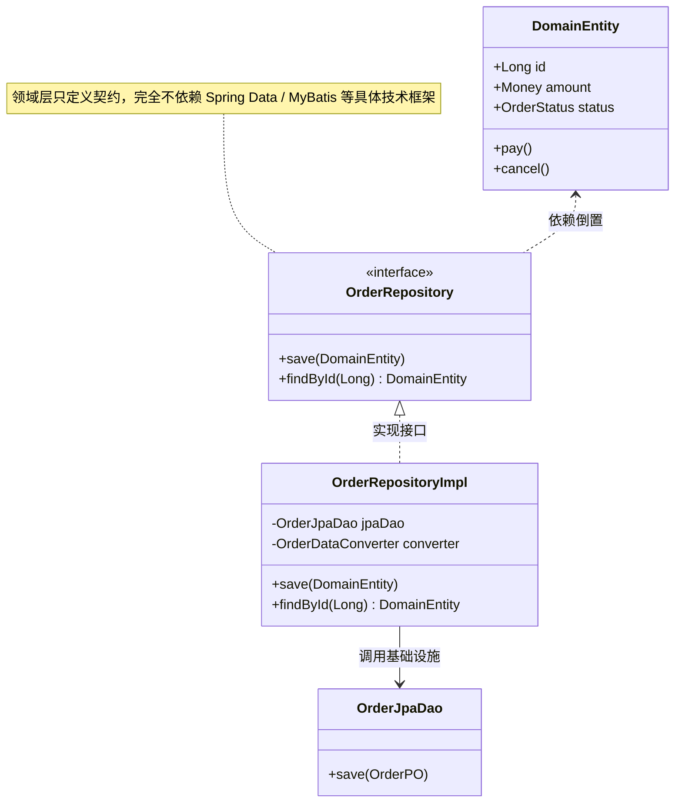
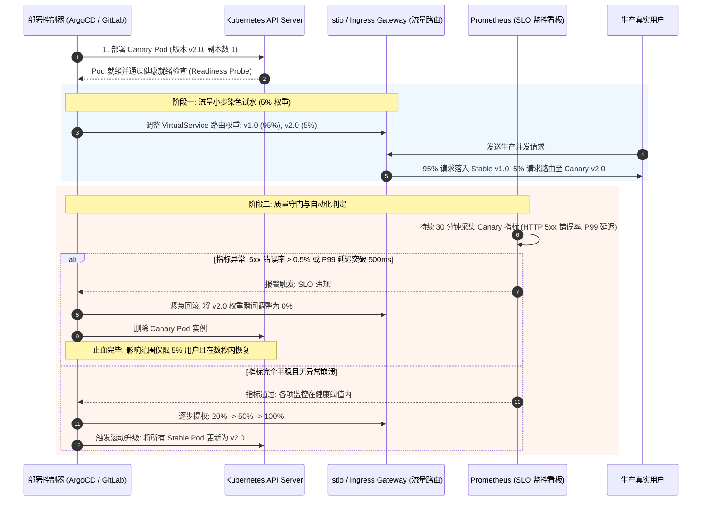
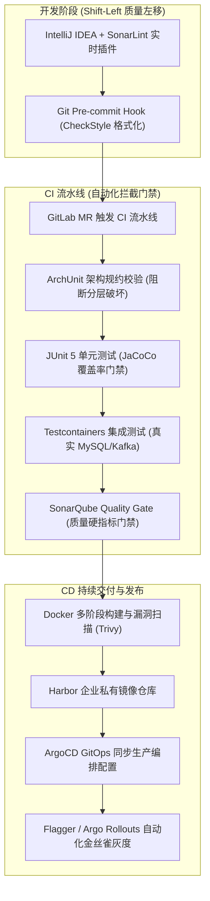
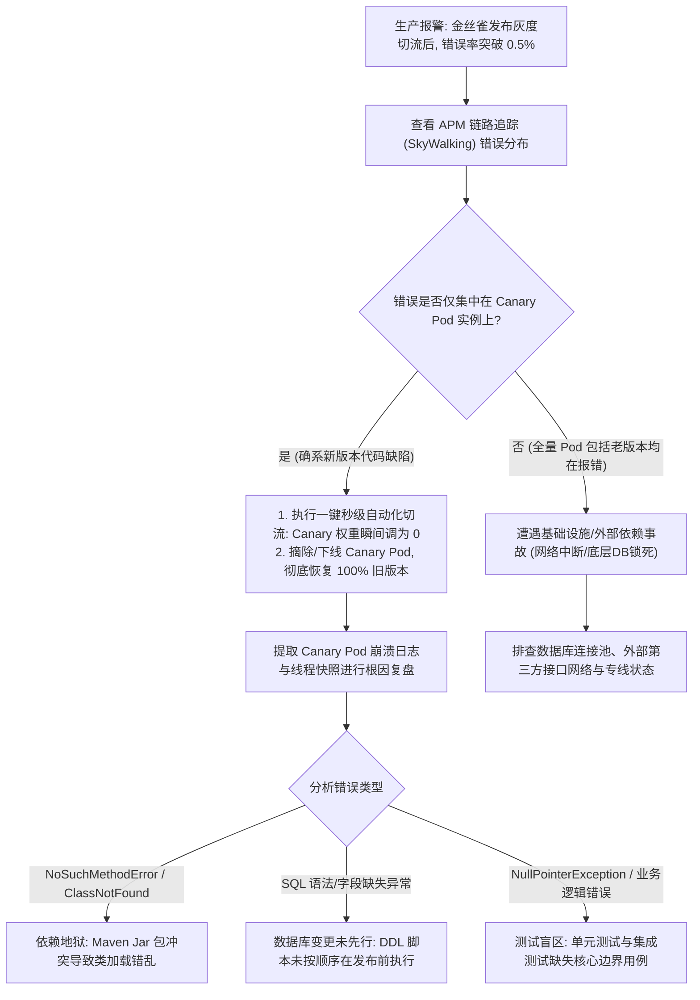
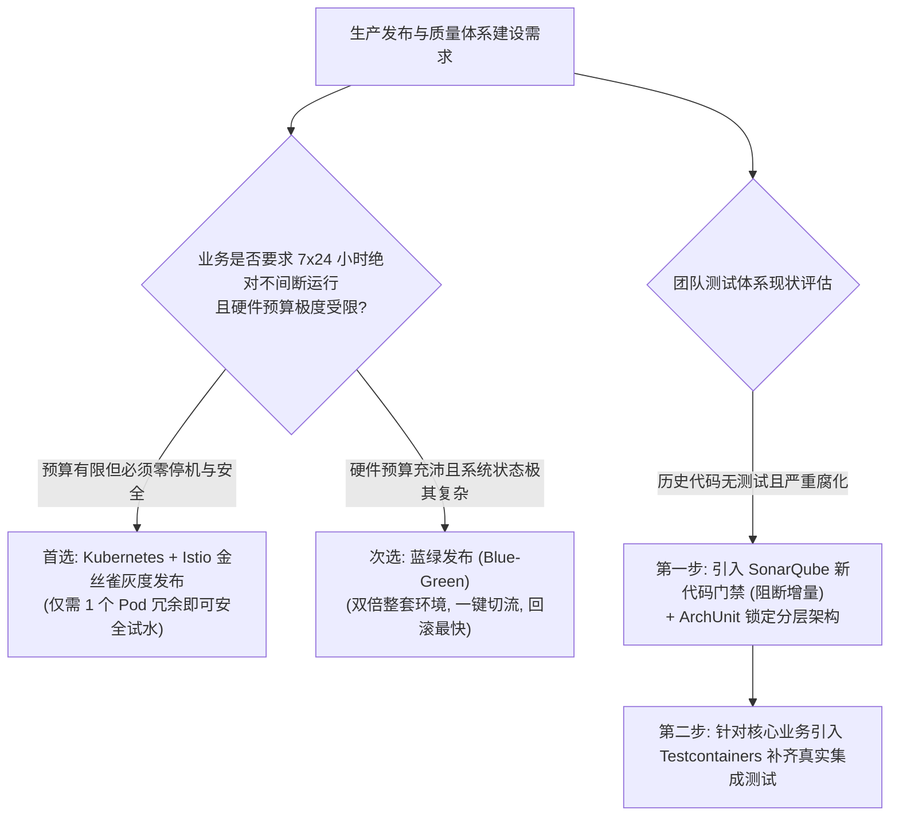
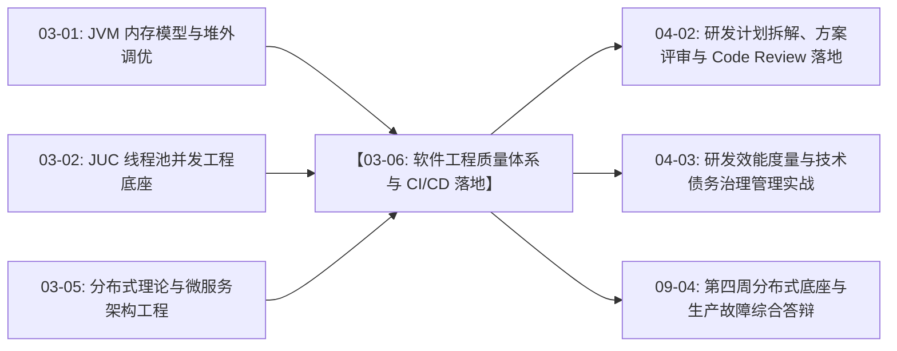

# 软件工程质量体系与 CI/CD 落地

> **学习目标定位**：面向技术总监、数据平台研发负责人、高级数据架构师岗位，系统构建现代化企业级软件工程质量保证与云原生持续交付（CI/CD）体系。彻底攻克 SOLID 原则、DDD 领域驱动架构治理、SonarQube 自动化质量门禁、Testcontainers 真实集成测试与金丝雀渐进式灰度发布。深度融合思科、Zoom、美的集团及瑞纳智能大型工业中台实战，提炼 DORA 研发效能度量模型、技术债务量化治理与防腐层设计的降维管理表达能力。

---

## 1. 知识概述与业务价值

### 1.1 是什么（What）
软件工程质量体系是保障系统在整个生命周期内具备高可靠性、可演进性、可维护性与交付敏捷度的工程实践框架：
- **工程质量与架构守护**：从代码编写阶段的 **SOLID 原则** 与 **DDD 领域驱动设计**，到静态代码分析门禁（SonarQube、ArchUnit 架构契约检查），从测试金字塔（JUnit 5、Mockito、Testcontainers 容器化集成测试）到混沌工程注入（ChaosBlade）。
- **云原生持续集成与持续交付（CI/CD）**：依托 GitLab CI / GitHub Actions 声明式流水线、Docker 多阶段紧凑镜像构建、Helm/Kubernetes 编排，实现从代码提交（Git Push）、自动化质量门禁、单元/集成测试、镜像打包签名到生产**金丝雀灰度发布（Canary Release）**与自动化回滚的端到端无人值守交付闭环。

### 1.2 解决什么核心业务痛点（Why）
1. **终结“代码越改越乱、上线如履薄冰”的系统腐化**：缺乏质量门禁的中大型项目，随着团队人员流动与需求频繁变更，极易退化为千行单方法、循环依赖、无测试覆盖的“大泥球（Big Ball of Mud）”。工程质量体系将质量内建（Built-in Quality）于流水线中，杜绝劣化代码合入主干。
2. **消灭“开发环境正常，一上生产就崩溃”的环境漂移**：通过容器化镜像（Immutable Infrastructure）与 Testcontainers 真实中间件环境，彻底根除由于本地与测试机环境差异带来的线上偶发故障。
3. **大幅压缩业务特性交付周期（Lead Time for Changes）**：通过自动化构建、自动化分级测试与金丝雀平滑切流，将原本耗时数天、依赖人工审批的手工发布压缩至数十分钟内安全交付，极大提升企业业务响应敏捷度。

### 1.3 适用场景与技术边界（Where & When）
- **最佳业务场景**：
  - 核心工业数据中台、企业级 SaaS 平台、金融级交易系统等多团队协同的大型敏捷研发体系。
  - 需要高频日级发布（Daily Release）、主干快速演进且要求 99.99% 可用性 SLA 的核心业务链路。
- **反模式与严禁使用边界**：
  - **形式主义的“代码行数（LOC）”效能考核**：严禁以提交代码行数、Commit 频次作为开发人员绩效指标，这会导致产生大量冗余样板代码与恶性刷提交。
  - **为追求 100% 单元测试覆盖率而 Mock 一切**：过度 Mock（将数据库、Redis、Spring 上下文全 Mock 掉）会导致单元测试演变为“照着业务代码重新抄了一遍”，不仅维护成本高昂，且根本无法捕获真实的 SQL 语法错误或并发连接异常。

---

## 2. 核心概念与关系

### 2.1 核心概念全景表

| 核心组件/实践 | 英文术语 | 核心定义与工程职责 | 资源/生命周期级别 |
| :--- | :--- | :--- | :--- |
| **SOLID 原则** | SOLID Principles | 面向对象五大设计原则（单一职责、开闭、里氏替换、接口隔离、依赖倒置），可演进架构基石。 | 代码/类设计级 |
| **测试金字塔** | Testing Pyramid | 单元测试为基座（快且多）、集成测试为中间层、端到端 E2E 为塔尖（少而精）的健康分层模型。 | 研发全流程 |
| **架构契约测试** | ArchUnit | 基于 Java 字节码静态断言架构设计规范（如禁止 Controller 直调 DAO、禁止包循环依赖）的测试框架。 | 代码门禁级 |
| **真实容器测试** | Testcontainers | 在测试生命周期内利用 Docker 动态拉起真实 MySQL、Kafka、Redis 容器，提供绝对真实的集成测试环境。 | 测试执行期 |
| **多阶段构建** | Multi-Stage Build | Docker 镜像构建技术，将编译环境（JDK+Maven）与运行环境（轻量 JRE）分离，将镜像压缩至最小。 | 镜像制品级 |
| **金丝雀发布** | Canary Release | 逐步将生产流量的微小比例（如 5%）引流至新版本，观察稳定后再全量滚动的渐进式交付策略。 | 生产发布级 |
| **DORA 指标** | DORA Metrics | 衡量软件交付效能的四大黄金指标：部署频率、变更提前期、变更失败率、服务恢复时间。 | 管理与度量级 |

### 2.2 系统拓扑与交互关系图

下图展示了从代码提交到生产金丝雀灰度发布的端到端自动化 CI/CD 流水线与质量门禁拓扑：

```mermaid
graph LR
    Dev["开发人员 (Feature 分支)"] -->|Git Push / MR| Repo["GitLab / GitHub 仓库"]
    
    subgraph Pipeline["自动化 CI/CD 质量流水线 (GitLab Runner / K8s)"]
        Repo --> Stage1["阶段 1: 静态检查 (CheckStyle / SpotBugs / ArchUnit)"]
        Stage1 --> Stage2["阶段 2: 单元测试 (JUnit 5 + Mockito 覆盖率 >= 80%)"]
        Stage2 --> Stage3["阶段 3: 集成测试 (Testcontainers 真实 MySQL/Kafka)"]
        Stage3 --> Stage4["阶段 4: SonarQube 质量门禁 (阻断 Block/Critical Bug)"]
        Stage4 --> Stage5["阶段 5: Docker 多阶段构建 (生成并推送 Harbor 镜像)"]
    end
    
    subgraph Deployment["云原生灰度发布与可观测性"]
        Stage5 --> ArgoCD["ArgoCD / GitOps 声明式控制器"]
        ArgoCD --> K8s["Kubernetes 生产集群"]
        K8s -->|5% 灰度流量染色| CanaryPod["金丝雀 Pod (Canary v2.0)"]
        K8s -->|95% 基准流量| StablePod["基准 Pod (Stable v1.0)"]
        CanaryPod -.-> Prometheus["Prometheus + SkyWalking 监控指标"]
        Prometheus -->|SLO 异常| AutoRollback["自动化触发秒级回滚"]
        Prometheus -->|指标平稳运行30分钟| FullRollout["全量滚动替换升级"]
    end
```



---

## 3. 底层工作机制与设计哲学

### 3.1 核心运行流程与状态机流转

#### 1. SOLID 原则与 DDD 分层架构治理
- **单一职责原则（SRP, Single Responsibility Principle）**：一个类应该仅有一个引起它变化的原因。例如：将用户鉴权逻辑与用户数据库操作严格拆分为 `AuthenticationService` 与 `UserRepository`。
- **开闭原则（OCP, Open-Closed Principle）**：对扩展开放，对修改关闭。核心逻辑通过抽象策略接口（Strategy Pattern）或责任链模式组织，增加新业务类型只需新增实现类并由 Spring 容器注册，严禁在核心逻辑中写满数十个 `if-else`。
- **依赖倒置原则（DIP, Dependency Inversion Principle）**：高层模块不应该依赖低层模块，两者都应该依赖其抽象；抽象不应该依赖细节，细节应该依赖抽象。领域层只定义 `OrderRepository` 接口，底层使用 MySQL 还是 MongoDB 由基础设施层实现，实现**核心领域逻辑与外围技术底座的完全解耦**。
- **DDD 战术设计防腐层（ACL, Anti-Corruption Layer）**：
  在与老旧系统或外部第三方对接时，绝不允许外部系统的数据模型（DTO）直接穿透污染核心领域模型。必须建立**防腐层适配器（Adapter + Translator）**，将外部混乱数据模型转换为团队内部干净严谨的领域对象（Entity / Value Object），隔绝外部系统的技术债务浸染。



#### 2. 测试金字塔与 Testcontainers 运行机制
- **测试金字塔（Testing Pyramid）分层原则**：
  - **单元测试（Unit Test, 70%）**：执行速度极快（单测试毫秒级），纯内存运行，无外部依赖。利用 Mockito 对外部依赖进行打桩，专攻领域模型边界条件、复杂算法分支。
  - **集成测试（Integration Test, 20%）**：验证多个模块或模块与真实外部组件的协同。**绝不使用 H2 内存数据库冒充 MySQL**（H2 与 MySQL 在 JSON 函数、窗口函数、锁机制与隐式转换上存在致命语法差异），必须使用 **Testcontainers** 启动真正的 Docker 容器进行集成测试。
  - **端到端测试（End-to-End Test, 10%）**：覆盖核心核心交易场景（如完整下单支付履约流程），保障端到端系统功能连贯性。
- **Testcontainers 内部工作流**：
  1. 测试启动时，Testcontainers 客户端通过系统 Socket（`/var/run/docker.sock`）连接本地 Docker 守护进程。
  2. 启动轻量级守护容器 **Ryuk**（负责监控测试 JVM 进程，确保无论测试正常退出还是被 `kill -9` 强杀，Ryuk 都能将拉起的临时测试容器彻底销毁，绝不泄露僵尸容器）。
  3. 动态拉起预定义的官方镜像容器（如 `mysql:8.0`、`confluentinc/cp-kafka:7.5`），自动映射随机空闲宿主机端口，消除端口冲突。
  4. 利用 `@DynamicPropertySource` 将动态端口注入 Spring Boot 上下文，执行真实数据库 CRUD 与事务边界测试，测试完毕容器自动销毁。

#### 3. 云原生多阶段 Docker 构建机制
传统的 Dockerfile 在一个镜像内完成 `mvn package` 与运行，产物中包含了整个 Maven 本地仓库、JDK 编译工具、源代码与操作系统冗余包，体积通常超过 1.5GB。
**多阶段构建（Multi-Stage Build）**将流水线物理切分：
```dockerfile
# 阶段 1: 编译打包构建环境 (Builder Image)
FROM maven:3.9-eclipse-temurin-21-alpine AS builder
WORKDIR /workspace
COPY pom.xml .
# 充分利用 Docker 缓存层预热依赖
RUN mvn dependency:go-offline
COPY src ./src
RUN mvn clean package -DskipTests

# 阶段 2: 纯净生产运行环境 (Runtime Image)
FROM eclipse-temurin:21-jre-alpine AS runtime
WORKDIR /app
# 创建无特权专用账号，杜绝 root 权限提权漏洞
RUN addgroup -S appgroup && adduser -S appuser -G appgroup
USER appuser
# 仅从阶段 1 复制最终编译出的瘦 Jar 包
COPY --from=builder /workspace/target/*.jar app.jar
# 容器 JVM 内存自适应参数配置
ENV JAVA_OPTS="-XX:InitialRAMPercentage=75.0 -XX:MaxRAMPercentage=75.0 -XX:+UseZGC"
ENTRYPOINT ["sh", "-c", "java $JAVA_OPTS -jar app.jar"]
```
- **核心价值**：最终生产运行镜像仅包含最精简的 JRE 与业务 Jar 包，镜像体积从 1.5GB 骤降至 **180MB**；大幅减少安全 CVE 漏洞暴露面；将 K8s 节点拉取镜像（Image Pull）时间从 30 秒缩短至 2 秒内，极大提升了弹性扩缩容效率。

### 3.2 机制交互时序图（Mermaid）：基于 K8s 与 Istio 的金丝雀灰度发布



### 3.3 架构设计思想与演进权衡

1. **分支管理模型选型权衡：Trunk-Based vs GitFlow**：
   - **GitFlow 模式**：包含 `master`、`develop`、`feature/*`、`release/*`、`hotfix/*` 众多长期分支。
     - **优缺点**：适合传统交付周期以“月”为单位的传统软件（如大型工控固件）；但在现代互联网敏捷交付中，多分支长期存在会导致极为痛苦的**“合并地狱（Merge Hell）”**，特性分支积压数周合并时引发数千行代码冲突。
   - **Trunk-Based Development（主干开发模型，现代首选）**：
     - 所有开发人员从单一主干（`main`）切出短命特性分支（生命周期不超过 1~2 天），每天多次向主干提交经过严格自动化测试的代码。
     - **特性开关（Feature Toggle）护航**：尚未完工的大功能通过代码开关（如 LaunchDarkly 或配置中心）进行包裹，代码即便合入主干并发布上生产，功能也是隐藏未启用的，将“代码部署（Deployment）”与“业务特性发布（Release）”物理剥离，彻底消灭合并冲突。
2. **ArchUnit 架构契约守护哲学**：
   - 团队口头约定或 Wiki 架构文档往往在业务催命交付时被彻底抛弃。
   - **架构即代码（Architecture as Code）**：利用 ArchUnit 编写自动化单元测试，在每次 Maven 编译时自动断言架构规范：
     ```java
     @ArchTest
     public static final ArchRule controllers_should_only_call_services =
         classes().that().resideInAPackage("..controller..")
                  .should().onlyAccessClassesThat()
                  .resideInAnyPackage("..service..", "java..");
     ```
     一旦新来的工程师在 `Controller` 中直接注入 `Dao`，流水线**直接编译报错并拒绝合并代码**，以纯自动化手段守住架构边界。

---

## 4. 高频复杂业务场景实操与落地

### 4.1 生产典型业务场景拓扑

在大型智慧能源工业互联网中台（太原项目换热站调度中台）与大规模金融级对账微服务中，端到端工程质量体系必须涵盖从代码提交到生产多机房灰度发布的每一道防线：



### 4.2 生产级配置基线与参数推荐

#### 1. GitLab CI/CD 核心流水线规范（`.gitlab-ci.yml`）
```yaml
stages:
  - test
  - quality-gate
  - build
  - deploy-canary

variables:
  MAVEN_OPTS: "-Dmaven.repo.local=.m2/repository -Dorg.slf4j.simpleLogger.showDateTime=true"
  DOCKER_DRIVER: overlay2

cache:
  paths:
    - .m2/repository

unit-and-integration-test:
  stage: test
  image: maven:3.9-eclipse-temurin-21
  services:
    - docker:26-dind                  # 支撑 Testcontainers 动态拉起容器
  variables:
    DOCKER_HOST: tcp://docker:2375
  script:
    - mvn clean verify -Ptest
  artifacts:
    reports:
      junit: target/surefire-reports/*.xml
    paths:
      - target/site/jacoco/jacoco.xml
    expire_in: 1 week

sonarqube-check:
  stage: quality-gate
  image: sonarsource/sonar-scanner-cli:latest
  dependencies:
    - unit-and-integration-test
  script:
    - sonar-scanner
      -Dsonar.host.url=${SONAR_HOST_URL}
      -Dsonar.token=${SONAR_TOKEN}
      -Dsonar.coverage.jacoco.xmlReportPaths=target/site/jacoco/jacoco.xml
      -Dsonar.qualitygate.wait=true   # 必须等待质量门禁通过，若不合格流水线直接挂掉
```

#### 2. SonarQube 生产质量门禁（Quality Gate）指标阈值硬标准
- **新代码（New Code）硬性约束**：
  - **覆盖率（Coverage on New Code）**：$\ge 80.0\%$；
  - **重复代码率（Duplicated Lines on New Code）**：$\le 3.0\%$；
  - **阻断性/严重漏洞（Blocker / Critical Issues）**：**严格为 0**；
  - **安全评分（Security Rating）**：A 级（0 Vulnerabilities）；
  - **可维护性评分（Maintainability Rating）**：A 级（技术债务比例 $\le 5\%$）。

### 4.3 核心性能指标监控（DORA 研发效能黄金四维）

| DORA 核心度量指标 | 英文术语 | 业界卓越团队标准 (Elite) | 传统低效团队现状 | 技术负责人改进抓手 |
| :--- | :--- | :--- | :--- | :--- |
| **部署频率** | Deployment Frequency | **每天多次（按需高频发布）** | 数周甚至数月发布一次 | 拆小发布单元，建立自动化测试与金丝雀灰度体系。 |
| **变更提前期** | Lead Time for Changes | **$< 1$ 小时（从代码提交到上线）** | 数天至数周（卡在人工测试） | 引入 CI 自动化流水线，杜绝人工低效手动编译测试。 |
| **变更失败率** | Change Failure Rate | **$0\% \sim 5\%$** | $> 20\%$（上线常伴随回滚） | 引入自动化金丝雀灰度切流与架构防腐代码门禁。 |
| **服务恢复时间** | Time to Restore Service (MTTR) | **$< 1$ 小时（通常在数分钟内）** | $> 1$ 天（排障耗尽心力） | 建立基于 GitOps 的一键自动化配置秒级回滚 SOP。 |

---

## 5. 生产异常故障深度排查与根因分析

### 5.1 典型生产事故与异常排查树

下图展示了当生产环境遭遇灰度发布突发异常、报警轰炸时的排查与快速回滚决策树：



### 5.2 核心异常场景实战复盘

#### 场景一：依赖地狱导致生产出现 `NoSuchMethodError` 灾难
- **真实生产现象**：
  某微服务在本地开发与单元测试阶段一切平稳，打包发布至生产运行时，用户一发起某个特定核心请求，系统瞬间抛出 `java.lang.NoSuchMethodError: com.google.common.base.Preconditions.checkArgument(...)`，直接导致主业务接口瘫痪。
- **底层根因剖析**：
  典型的 **Maven 依赖冲突与类加载器顺序覆盖问题**。项目中直接依赖了 Guava `v32.0`（包含对应的方法签名），但间接依赖的一个老旧大数据 SDK 强制引入了 Guava `v18.0`（该版本不存在该方法）。由于 Maven 的“最短路径优先”与“声明顺序优先”仲裁规则，在特定的操作系统打包顺序下，低版本的类先被载入了 JVM，导致运行时在执行到特定方法时因找不到字节码方法签名而崩溃。
- **快速止血与根治策略**：
  1. **应急止血**：立即在 GitOps 控制台触发一键回滚至上一稳定运行版本（耗时 1 分钟）。
  2. **根除依赖黑洞**：在主工程 `pom.xml` 中引入 `maven-enforcer-plugin` 插件，配置 `banDuplicateClasses` 与强制收敛机制，强制所有子模块统一使用 `dependencyManagement` 固化所有核心公共组件（Guava、Jackson、Netty）的唯一版本，一旦检测到版本冲突，直接**在编译阶段中断构建**，杜绝带病打包。

#### 场景二：生产数据库 DDL 与应用代码发布顺序不当引发的系统瘫痪
- **真实生产现象**：
  团队准备上线一个新特性，修改了订单表结构（增加了 `pay_channel` 字段且标记为 `NOT NULL`，无默认值），同时更新了 Java 代码实体类。发布人员将新代码直接全量发布上线，上线瞬间产生数千笔新增订单报错 `java.sql.SQLException: Field 'pay_channel' doesn't have a default value`，支付交易全线中断。
- **底层根因剖析**：
  违背了持续交付的基本准则——**“数据库变更必须与应用程序代码具备向后兼容性（Backward Compatibility）”**。在滚动升级期间，老版本的代码仍然在运行并处理流量，老代码执行 `INSERT INTO orders` 时根本不知道新字段的存在，导致向新增了非空约束的表中插入数据时被数据库硬性拦截。
- **防御性治理与蓝绿数据库规范（SOP）**：
  所有涉及数据库 Schema 变更的上线，必须严格遵循**“扩展与收缩（Expand and Contract）三步法”**：
  1. **第一步（扩展 Expand）**：先执行 DDL 增加新字段，但**必须允许为 NULL 或必须配置合理 DEFAULT 默认值**。此时新老代码并存运行，绝不会发生 SQL 冲突；
  2. **第二步（应用发布）**：发布新版本代码，新代码开始向新字段写入并兼容读取；
  3. **第三步（收缩 Contract）**：全量代码上线稳定运行 1 周后，执行补批脚本填补历史旧数据的空值，最后执行 DDL 将新字段修改为 `NOT NULL`，彻底杜绝 Schema 变更阻塞业务。

#### 场景三：开发环境使用 H2 导致生产 MySQL 语法直接击穿
- **真实生产现象**：
  开发人员提交的代码在本地通过了全部单元测试，CI 流水线也亮绿灯。然而部署到预发环境连接真正的 MySQL 8.0 时，所有包含深层报表统计的模块一启动就抛出 `MySQLSyntaxErrorException: You have an error in your SQL syntax`。
- **底层根因剖析**：
  工程为了图省事，在单元测试中采用了 **H2 内存数据库**冒充生产 MySQL。开发人员在 MyBatis XML 中编写了复杂的 MySQL 8.0 特有窗口函数（`ROW_NUMBER() OVER (...)`）与 `JSON_EXTRACT` 语法。H2 在早期或默认兼容模式下对这些特有方言解析规则完全不同甚至不支持，导致本地由于测试桩失真通过了测试，生产直接击穿。
- **根治策略**：
  1. **全面肃清内存伪数据库**：团队内部明令禁止在核心持久层集成测试中使用 H2、SQLite 等内存玩具冒充生产存储引擎。
  2. **全员推行 Testcontainers**：在 CI 流水线中引入基于真实 Docker 镜像的 `Testcontainers MySQL 8.0`，保证集成测试与生产物理环境在存储引擎版本、SQL 解析器、字符集与约束表现上**绝对 100% 镜像对齐**。

---

## 6. 技术选型对比、架构演进与成本ROI

### 6.1 横向多维选型对比矩阵

#### 1. 生产发布部署策略多维对比矩阵
| 评估维度 | 金丝雀灰度发布 (Canary) | 蓝绿发布 (Blue-Green) | 滚动发布 (Rolling Update) | 停机维护发布 (Downtime) |
| :--- | :--- | :--- | :--- | :--- |
| **停机时间** | **零停机（0 Downtime）** | **零停机（0 Downtime）** | **零停机（0 Downtime）** | 较长（需停机数小时） |
| **硬件资源冗余** | **极低（仅需 1 个 Canary Pod）** | **极高（需准备 2 倍整套硬件环境）** | **低（依靠原集群滚动替换）** | 零冗余 |
| **回滚速度** | **秒级（瞬间将路由权重置零）** | **秒级（路由器一键切回蓝环境）** | 慢（需重新逐个滚动回退旧镜像） | 极慢（需重新部署旧版本并拉起）|
| **生产风险暴露面**| **极小（仅 5% 灰度流量受影响）** | 较大（全量流量瞬间切入新环境） | 中等（升级过程中新老版本混部） | 极大（一旦失败全线瘫痪） |
| **网络层依赖** | 需 Service Mesh (Istio) 或高阶 Ingress | 依赖负载均衡器快速切换 VIP/权重 | 原生 K8s 即可支撑 | 无技术依赖 |

#### 2. CI/CD 流水线引擎对比
| 评估维度 | GitLab CI | GitHub Actions | Jenkins | ArgoCD (GitOps) |
| :--- | :--- | :--- | :--- | :--- |
| **配置定义模式** | 声明式 `.gitlab-ci.yml` | 声明式 YAML Workflows | Groovy 脚本（Pipeline as Code） | 纯声明式 GitOps 描述 |
| **云原生契约** | 原生与 Kubernetes Runner 融合 | 云原生生态极其繁荣 | 插件体系极其厚重，维护成本高 | 专注 Kubernetes 状态同步闭环 |
| **维护成本** | 低（开箱即用，权限一体化） | 低（公有云托管免运维） | 极高（插件依赖地狱，需专职运维）| 低（声明式自动拉取同步） |

### 6.2 架构师技术选型决策树与成本 ROI



- **技术债务量化治理与成本 ROI 测算**：
  - **背景**：某大型制造中台历史积累了 80 万行遗留 Java 代码，无单元测试，每周生产发布平均产生 3 起线上事故，全员有 40% 的工时被耗费在修复线上紧急 Bug 与救火排障中。
  - **治理举措（技术总监拍板推行质量红线）**：
    1. **锁定增量（Stop the Bleeding）**：设立 SonarQube 质量门禁，要求新提交代码覆盖率必须 $\ge 80\%$，严重漏洞必须为 0，不达标禁止合并；
    2. **配额制偿还存量债务（Debt Budget）**：每个迭代固定划拨 **20% 的研发工时（Story Points）**专门用于重构高频修改模块并编写集成测试；
    3. **推行金丝雀发布**：将原本粗暴的全量发布改为基于流量权重的渐进式金丝雀灰度。
  - **治理成果（6 个月后复盘）**：
    - 生产事故发生率骤降 **85%**；
    - DORA 变更失败率由 25% 压制到 **3%** 以内；
    - 团队救火工时下降 80%，释放出的研发算力反哺了核心业务新特性的交付，**团队整体交付效能提升超过 35%**。

---

## 7. 技术经理与架构师实战管控（SOP与规范）

### 7.1 平台级多租户与资源隔离机制
1. **CI/CD 构建资源物理隔离（Runner Grouping）**：
   - 严禁将核心交易业务的构建流水线与普通数据分析、前端静态编译共享同一个 GitLab Runner 节点。
   - 必须通过 K8s Namespace 与 NodeAffinity，划分 `runner-core`（高配专用宿主机，独占 Docker 资源，构建超时设为 10 分钟）与 `runner-batch`，防止前端 `npm build` 耗尽 CPU 内存导致后端核心安全补丁流水线卡死排队。
2. **多租户配置与凭据安全保密红线（Secret Management）**：
   - 严禁将数据库密码、阿里云 AccessKey、私有证书明文硬编码在 `application.yml` 或 Git 仓库中（通过 GitLeaks 在 pre-commit 强行拦截扫描）。
   - 统一采用 **HashiCorp Vault** 或云原生 Secrets 管理器，凭据在容器启动时动态挂载或通过环境变量注入，定期自动轮换。

### 7.2 生产变更红线与降级容灾预案（SOP）

#### 1. 软件交付上线十条军规（技术团队强制红线）
1. **主干受保护红线**：禁止任何人（包括技术总监）直推代码到 `main` / `master` 主干分支，所有改动必须通过 Merge Request（MR）且至少获得 1 位资深工程师审核（Code Review）批准。
2. **流水线全绿原则**：MR 合并前必须通过包含静态分析、单元测试、Testcontainers 集成测试的完整 CI 流水线，任一阶段红灯断然禁止合入。
3. **数据库变更必须先行且兼容**：DDL 变更必须支持向下兼容，且必须走审批流程于代码发布前在生产只读低谷期完成，严禁代码与 DDL 强绑定一次性发布。
4. **镜像不可变性（Immutable Artifact）**：在测试环境、预发环境验证通过的 Docker 镜像，必须通过镜像摘要（Digest SHA256）原封不动推送到生产环境，**严禁在生产发布时重新从源代码打包**。
5. **发布窗口红线**：严禁在周五下午或节假日最后一天执行任何核心重大版本发布（重大安全修复经应急委员会批准除外）。
6. **配置与代码绝对解耦**：所有环境差异参数必须外部化（通过 Nacos/K8s ConfigMap 注入），严禁在代码中写死判断“`if (env == "prod")`”。
7. **自动化健康就绪检查（Readiness Probe）**：每个 Pod 必须配置严格的健康检查接口，只有底层数据库连接、Redis 缓存握手成功后才向 K8s 宣告就绪，未就绪实例坚决不接纳外部流量。
8. **金丝雀灰度观察期不低于 30 分钟**：金丝雀切入 5% 流量后，必须至少观察 30 分钟黄金监控指标，严禁刚切流 10 秒无报错就粗暴拉满 100%。
9. **一键秒级自动化回滚**：上线前必须准备好回滚预案，发布系统必须具备“一键终止并秒级切回老版本”的能力，回滚决策时间严禁超过 5 分钟。
10. **线上故障无指责复盘（Blameless Post-Mortem）**：事故复盘绝不把矛头指向个人“手滑”，必须深挖流程、工具与质量门禁的系统性根因，建立可落地的预防措施工单并在下一个迭代闭环。

#### 2. 金丝雀灰度异常秒级熔断回滚流程（SOP）
- **触发条件**：金丝雀切流期间，出现以下任一指标即刻触发紧急熔断：
  - HTTP 5xx 错误率超过 0.5%；
  - 核心接口 P99 响应延迟超过 500ms（或较基准版本恶化 50%）；
  - 容器出现非正常退出（CrashLoopBackOff）。
- **执行动作（自动化与人工双保险）**：
  1. ArgoCD / Flagger 控制器自动捕获 Prometheus 警报，将流量路由权重瞬间降为 0%；
  2. 终止并摘除金丝雀 Pod，保留其运行日志与崩溃 CoreDump 至归档存储；
  3. 全量流量继续由基准稳定的旧版本承接，业务感知影响时间控制在 30 秒以内；
  4. 触发钉钉/企业微信群 P1 报警，开发团队召集紧急会诊，严禁在生产环境直接热修代码。

---

## 8. 互联网大厂高频面试真题库

> [!IMPORTANT]
> 本板块精选一线大厂（阿里、字节、美团、快手、腾讯、微软等）真实高频考察的 7 道核心真题。涵盖架构设计原则、测试金字塔、代码门禁、多阶段镜像、金丝雀发布及研发效能度量。**在接下来的第 9 板块中，将对下列所有题目进行逐题深度解答，严禁留白！**

### 8.1 基础概念与机制题（大厂初筛）
1. **Q1**：请结合面向对象设计，深入阐述 SOLID 五大原则的核心内涵。在实际微服务架构中，你如何践行“依赖倒置原则（DIP）”与“开闭原则（OCP）”？
2. **Q2**：什么是“测试金字塔”？为什么过度追求 100% 单元测试覆盖率或在单测中把所有外部依赖全部 Mock 掉，在工程实践中往往适得其反？

### 8.2 核心底层原理深度题（大厂资深技术面）
3. **Q3**：Testcontainers 是如何借助 Docker 解决传统集成测试中外部依赖（如真实 MySQL、Kafka）环境漂移问题的？它的底层守护机制 Ryuk 是如何防止容器泄漏的？
4. **Q4**：Docker 多阶段构建（Multi-Stage Build）的底层机制是什么？它是如何将一个上千兆的 Java 编译环境压缩至百兆以内纯净生产运行镜像的？

### 8.3 复杂生产场景与故障排障题（大厂架构与排障面）
5. **Q5**：在 Kubernetes 与微服务架构中，金丝雀灰度发布（Canary Release）与蓝绿发布（Blue-Green Release）底层流量路由是如何控制的？两者的优缺点及选型权衡是什么？
6. **Q6**：在持续交付流水线中，数据库 Schema 变更（DDL）往往是线上发布事故的高发区。如何设计一套与应用代码发布完全解耦、向后兼容且支持零停机热升级的数据库变更工程规范？

### 8.4 架构设计与系统规划题（技术总监/总架构师终面）
7. **Q7**：作为技术总监，如何从 0 到 1 为一支 50 人的研发团队建立端到端的软件工程质量体系与 CI/CD 流水线？如何量化度量研发效能（结合 DORA 四大指标），并在“业务催命紧急交付”与“技术债务治理红线”之间取得最佳商业与技术平衡？

---

## 9. 结构化深度参考答案（逐题三层应答）

---

### 题目1：SOLID 原则深度解构及其在微服务依赖倒置与开闭原则的落地

#### 简洁回答（1分钟电梯破题）：
> SOLID 原则是高内聚、低耦合、可演进面向对象架构的终极指导纲领：**S（单一职责）、O（开闭原则）、L（里氏替换）、I（接口隔离）、D（依赖倒置）**。
> - **开闭原则（OCP）的核心**是“对扩展开放，对修改关闭”。落地做法是**通过策略模式（Strategy）或工厂模式抽象出通用业务契约**，新增业务场景（如新增一种工业设备接入协议或新支付方式）只需新增实现类，严禁修改既有核心调度类代码，避免引发老功能回归破坏。
> - **依赖倒置原则（DIP）的核心**是“高层模块不依赖低层细节，两者统一依赖抽象契约”。落地做法是在领域层只定义 `Repository` 接口，底层使用 MyBatis、JPA 还是 Mongo 纯属基础设施细节，彻底隔绝外部底层技术的侵入污染。

#### 深入回答（机制推导与边界条件）：
1. **SOLID 五大原则本质推导**：
   - **SRP（Single Responsibility）**：一个模块只能对一类业务角色负责，避免“上帝类（God Class）”聚集数百个异构职责。
   - **LSP（Liskov Substitution）**：子类必须能够完全透明替换其父类，且不改变系统的原有行为。严禁子类重写父类方法时随意抛出未预期的异常或违背前置/后置条件。
   - **ISP（Interface Segregation）**：客户端不应该被迫依赖它不使用的接口。接口应当尽量细粒度，避免定义包含几十个方法的庞大胖接口。
2. **微服务工程中 DIP 与 DDD 整洁架构（Clean Architecture）的深度结合**：
   - 在传统的贫血分层架构中：`Controller -> Service -> Dao`，`Service` 业务逻辑直接强依赖具体的数据库 `Dao` 实现，代码被数据库持久化强行绑定。
   - **依赖倒置重构推导**：
     - **领域核心层（Domain Layer）**：定义核心实体 `HeatingStation` 与持久化契约 `HeatingStationRepository`（纯 Java 接口）；
     - **基础设施层（Infrastructure Layer）**：编写 `HeatingStationRepositoryImpl`，内部注入 MyBatis Mapper 或 Redis Client；
     - **依赖方向逆转**：外围的基础设施层主动依赖核心领域层的接口契约。当底层需要从单机 MySQL 升级为 Doris 或 ShardingSphere 分库分表时，**核心领域层的业务代码 1 行都不需要改动**，达成极致的技术解耦与可测试性。

#### 架构师/技术管理视角（权衡取舍、SLA与成本）：
> 践行设计原则必须警惕“为了设计模式而设计模式的过度抽象”：
> 1. **抽象度与认知负荷的权衡**：
>    - 如果一个业务极其简单且未来绝无扩展可能（如简单的系统静态字典查询），强行套用 DIP 和四层 DDD 架构，会导致类数量暴增 4 倍，增加新人的心智认知成本；
> 2. **团队架构规范门禁（SOP）**：
>    - 技术总监必须在团队内明确红线：**核心复杂资产领域模型（如计费、温控调度、交易）坚决推行 DIP 与防腐层（ACL）**；非核心只读查询可采用 CQRS 模式轻装上阵，直接通过轻量 SQL 映射 DTO 返回，在架构严谨性与研发敏捷度之间取得最优 ROI。

---

### 题目2：测试金字塔分层原则及过度追求 100% 覆盖率与过度 Mock 的危害

#### 简洁回答（1分钟电梯破题）：
> **测试金字塔**倡导的是一种**“底座宽大（单元测试多且快）、中间精炼（集成测试验证协同）、顶层克制（端到端 E2E 聚焦关键主链路）”**的黄金比例结构。
> **过度追求 100% 覆盖率或过度 Mock 的致命工程危害**：
> 1. **测试脆弱性与重构阻力**：过度 Mock 会使得单元测试强行绑定到业务代码的“内部私有变量与实现细节”（如断言某方法被调用了几次）。一旦开发人员对内部结构进行合理重构，业务功能完全正常，但测试代码全线飘红报错，使得测试由“安全网”沦为“创新枷锁”；
> 2. **虚假的安全感（False Confidence）**：把数据库驱动、Redis、网络 RPC 全部 Mock 掉的单元测试，哪怕覆盖率达到 100%，**也完全无法捕获生产中最致命的 SQL 语法错误、数据库字段长度溢出、并发行锁超时或连接池耗尽**。

#### 深入回答（机制推导与边界条件）：
1. **Mock 技术的滥用机制与反模式解构**：
   - **反模式示例**：测试一个 `TransferService.transfer(from, to, amount)` 方法。
     - 工程师在单元测试中 Mock 了 `accountDao.deduct()`、Mock 了 `accountDao.add()`、Mock 了外部通知。
     - 最终单测断言：`verify(accountDao, times(1)).deduct(...)`。
     - **本质问题**：这个单测根本没有验证转账逻辑是否正确，它只是把业务逻辑在测试里生硬复述了一遍。更严重的是，它完全无法验证转账中如果余额不足触发的数据库外键约束、悲观行锁死锁以及多线程并发超卖问题。
2. **健康测试体系的分工边界推导**：
   - **单元测试专攻对象**：纯业务领域计算逻辑、复杂状态机流转、数据转换工具类、边界分支（如金额四舍五入、优惠券抵扣算法）。这部分逻辑不依赖任何 I/O，单次运行时间在 1ms 以内，数百个测试能在 3 秒内执行完毕。
   - **集成测试专攻对象**：持久层 DAO（依托 Testcontainers 真实 MySQL 检验 SQL、事务回滚、索引唯一约束）、中间件交互（真实 Kafka 消费偏移量提交、Redis 分布式锁原子续期）。

#### 架构师/技术管理视角（权衡取舍、SLA与成本）：
> 质量度量必须遵循古德哈特定律（Goodhart's Law）——“**当一个指标变成目标时，它就不再是一个好指标**”：
> 1. **科学设定覆盖率红线**：
>    - 绝不在团队中强制考核“100% 覆盖率”。生产级健康指标是**“新代码单元测试覆盖率 $\ge 70\% \sim 80\%$”**，且核心判定必须关注**分支覆盖率（Branch Coverage）**与变异测试得分（Mutation Score），严禁无断言的刷覆盖率代码。
> 2. **ROI 导向的测试资源投入**：
>    - 把有限的研发工时投入到最容易出事故的交界处：**通过 Testcontainers 覆盖 100% 的核心 SQL 与分布式事务边界**，相比于写上千行毫无意义的 Mock Getter/Setter 测试，其降低线上 P0 事故的投资回报率高出数十倍。

---

### 题目3：Testcontainers 原理、环境对齐价值与 Ryuk 守护进程机制

#### 简洁回答（1分钟电梯破题）：
> **Testcontainers** 是一个支持 Java 在单元测试生命周期内**通过 Docker API 动态拉起真实外部依赖（真实 MySQL 8.0、Kafka、Redis、Elasticsearch）**的现代化开源框架。它彻底终结了以往用 H2 内存数据库冒充生产数据库带来的“SQL 语法不一致、隐式类型转换行为不一”等严重环境漂移痛点。
> **Ryuk 守护机制**是 Testcontainers 的核心安全阀：在测试启动时，它首先拉起一个轻量级容器 **Ryuk**，并通过 Socket 监听测试进程的存活性。**无论测试是正常执行完毕、发生异常中断，还是开发人员在本地点击红键强杀（`kill -9`）JVM，Ryuk 都能自动捕获并强行将本次测试派生的所有临时测试容器、网络与数据卷彻底清理销毁**，从底层杜绝僵尸容器泄漏撑爆 CI 服务器磁盘。

#### 深入回答（机制推导与边界条件）：
1. **Testcontainers 内部协作时序全推导**：
   - 步骤一：测试运行，通过本地环境变量或 `/var/run/docker.sock` 建立与 Docker Daemon 通信。
   - 步骤二：检查本地镜像缓存，若缺失自动从镜像仓库拉取声明的镜像（如 `mysql:8.0.33`）。
   - 步骤三：启动容器，**使用随机动态端口映射（Random Port Mapping）**。将容器内部标准的 3306 端口随机绑定到宿主机的空闲端口（如 54321）。这消除了多个并发执行的 CI 流水线因争抢固定 3306 端口导致构建失败的问题。
   - 步骤四：通过 Spring Boot 的 `@DynamicPropertySource` 注解，动态将 `container.getJdbcUrl()`、`container.getUsername()` 覆盖注入 Spring 的 DataSource 配置。
   - 步骤五：执行真实 SQL 脚本初始化表结构与测试桩数据，执行完整的数据库事务隔离测试。
2. **Ryuk 守护进程防泄漏工作模型**：
   - 传统基于 Java JVM `Runtime.getRuntime().addShutdownHook()` 的资源回收机制存在致命漏洞：若进程被操作系统信号量 `SIGKILL`（kill -9）强杀，JVM 的 ShutdownHook 根本没有机会被调用，导致 Docker 容器常驻后台。
   - **Ryuk 的双向心跳解法**：
     - Ryuk 作为一个独立的第三方守护容器（`testcontainers/ryuk`）运行在 Docker 引擎中；
     - Testcontainers 客户端启动后，与 Ryuk 建立一个长连接 TCP Socket，并向其注册本次测试生成的 Container ID 列表；
     - Ryuk 持续监听该 TCP 连接。一旦发现 TCP 连接因 JVM 崩溃、网络断开或进程终止而异常断开，**Ryuk 立即向 Docker Daemon 发出批量清理指令，直接强杀并物理删除所有注册的测试容器**，做到底层资源百分之百清扫干净。

#### 架构师/技术管理视角（权衡取舍、SLA与成本）：
> 引入 Testcontainers 是技术团队从“玩具级自动化”迈向“企业级工业化”的关键跨越：
> 1. **解决 CI 服务器资源瓶颈（复用与并行）**：
>    - 容器启动需要耗费数秒时间。如果每个测试类都拉起一个新 MySQL，会导致整体流水线耗时过长。
>    - **最佳工程实践（Singleton Pattern）**：在基类中采用**单例容器模式（Static Container Singleton）**，所有测试类共享同一个 MySQL 容器实例，仅在每个测试用例执行前后通过数据库事务回滚（`@Transactional`）或表数据快速截断（Truncate）清理数据，将数百个真实集成测试的整体运行时间控制在 **60 秒** 以内。
> 2. **基础设施标准化价值**：
>    - 消除“在我电脑上明明是好的”团队内部扯皮内耗，新人入职第一天拉下代码直接 `mvn verify` 即可在本地无感跑通全部真实集成测试，极大降低新人 onboarding 成本。

---

### 题目4：Docker 多阶段构建底层原理与超轻量镜像优化实操

#### 简洁回答（1分钟电梯破题）：
> **Docker 多阶段构建（Multi-Stage Build）**的底层原理是在**单一 Dockerfile 中定义多个独立的 `FROM` 阶段，每个阶段代表一个全新的基础镜像环境，且后续阶段能够跨阶段仅复制（`COPY --from=...`）上一阶段生成的特定编译制品**。
> 它彻底打破了以往“为了编译必须在镜像里塞入全部 SDK，导致镜像臃肿”的死局：第一阶段利用包含 Maven + JDK 21 的庞大镜像进行全量代码编译与打包；第二阶段直接切换到最纯净的 Alpine JRE 极简运行镜像，只把最终生成的单一业务 `.jar` 包拷贝过来，**将原本 1.5GB 的镜像体积断崖式压缩到 150MB~180MB**，大幅提升镜像分发安全与 K8s 节点拉取速度。

#### 深入回答（机制推导与边界条件）：
1. **传统单阶段镜像 vs 多阶段镜像的分层开销推导**：
   - Docker 镜像是由只读层（Layer）按联合文件系统（UnionFS）堆叠构成的。
   - **传统反模式**：即使在单阶段 Dockerfile 中写 `RUN mvn clean package && rm -rf /root/.m2`，根据联合文件系统原理，**历史层中已经写入的数百兆构建缓存根本不会从镜像底层被物理抹除**，依然占用空间并暴露出 CVE 漏洞。
   - **多阶段构建物理隔离机制**：
     - 构建引擎解析到第二个 `FROM eclipse-temurin:21-jre-alpine AS runtime` 时，完全初始化了一个全新的空文件系统；
     - 阶段 1 中产生的所有临时文件、Maven 插件、Git 元数据被完全丢弃在构建缓存中；
     - 最终镜像只保留阶段 2 声明的基础层加上 `COPY --from=builder` 拷贝的独立 Jar 包。
2. **生产级安全加固与 JVM 容器自适应参数基线**：
   - **非 Root 账号提权防护**：
     ```dockerfile
     RUN addgroup -S appgroup && adduser -S appuser -G appgroup
     USER appuser # 强制脱离 root 特权运行，防止黑客通过容器逃逸控制宿主机
     ```
   - **CGroup v2 内存感应调优**：
     历史老旧 Java 8 会把容器内存错当成宿主机总物理内存，引发容器被 K8s OOM Killer 强杀（Exit Code 137）。现代生产必须基于 Java 17/21 配置百分比内存感应：
     ```ini
     -XX:InitialRAMPercentage=75.0
     -XX:MaxRAMPercentage=75.0
     -XX:+UseZGC
     -XX:+ExitOnOutOfMemoryError  # 发生 OOM 立即让容器退出，触发 K8s 自动自愈重启
     ```

#### 架构师/技术管理视角（权衡取舍、SLA与成本）：
> 镜像体积是云原生弹性伸缩（HPA）的核心制约瓶颈：
> 1. **弹性扩容速度（MTTR 与反应时效）**：
>    - 突发大促流量涌入，K8s 触发 HPA 扩容 50 个 Pod。若镜像为 1.5GB，50 个节点同时跨网络从 Harbor 拉取镜像，会瞬间打爆内网千兆网卡，扩容拉取耗时达 2~3 分钟；
>    - 若镜像压缩至 180MB，节点能在 **3 秒内完成镜像拉取与启动**，让系统在流量洪峰击穿前完成防御扩容。
> 2. **镜像存储与安全合规成本**：
>    - 企业私有制品库（Harbor）的存储扩容开销可降低 **85%**；
>    - 精简的 Alpine / Distroless 运行时镜像消除了诸如 `curl`、`bash`、编译工具等黑客攻击跳板工具，使得企业轻松通过金融等保三级与安全漏洞扫描审计。

---

### 题目5：金丝雀发布与蓝绿发布的底层路由机制、优缺点与选型裁决

#### 简洁回答（1分钟电梯破题）：
> - **金丝雀灰度发布（Canary Release）**：新老版本并存，底层通过 Service Mesh（Istio VirtualService）或 Ingress Controller 按照**精细权重比例（如 5% -> 20% -> 100%）**或 HTTP Header（用户 ID、Cookie）将流量切向新版本。优势在于**硬件成本极低、生产风险暴露面极小**；缺点是业务必须保证新老代码完全兼容。
> - **蓝绿发布（Blue-Green Release）**：准备两套完全对等的独立生产环境（绿环境跑老版本，蓝环境跑新版本），通过负载均衡器或 DNS **一瞬间 100% 全量切流**。优势在于**切换极快、回滚仅需 1 秒**；缺点是**需要准备双倍的物理服务器资源，硬件成本昂贵**，且瞬时切流仍有较大风险。

#### 深入回答（机制推导与边界条件）：
1. **底层网络流量路由实现机制推导**：
   - **基于 Istio 的金丝雀权重分流（Envoy Sidecar 机制）**：
     - Kubernetes 部署两个独立的 Deployment：`app-v1`（副本数 10）与 `app-v2`（副本数 1）。
     - Istio Ingress Gateway 截获外部 HTTP 请求，根据 `VirtualService` 规则进行概率哈希或权重加权轮询：
       ```yaml
       spec:
         hosts:
           - order-service.prod.svc.cluster.local
         http:
           - route:
               - destination:
                   host: order-service
                   subset: v1
                 weight: 95
               - destination:
                   host: order-service
                   subset: v2
                 weight: 5
       ```
     - Envoy 根据权重算法，在连接池中动态决定将数据帧派发给哪个 Pod 的 IP。
   - **基于用户特征的精细化金丝雀（Canary by Header）**：
     - 针对于特定内测员工、白名单 VIP 租户实施精准灰度：
       ```yaml
       http:
         - match:
             - headers:
                 x-user-role:
                   exact: internal-tester
           route:
             - destination:
                 host: order-service
                 subset: v2
       ```
     - 内部测试人员的所有真实请求直接导向新版本，普通外部用户完全无感知。
2. **两者的核心缺陷与适用边界推演**：
   - **蓝绿发布的硬件死穴**：对于拥有上千台服务器的大型集群，常年维持两套完全一样的“冷备环境”在商业上是巨大的资金浪费。
   - **金丝雀发布的兼容性考验**：在金丝雀灰度期间，**新老版本是同时存活并共同处理业务数据的**！这意味着底层数据库表结构、Redis 缓存 Key 格式、跨服务 RPC 报文必须做到**双向兼容**，否则老版本读到新版本写入的格式会直接崩溃。

#### 架构师/技术管理视角（权衡取舍、SLA与成本）：
> 选型决策是企业硬件预算、业务容忍度与网络技术栈的综合权衡：
> 1. **现代技术团队首选：自动化金丝雀灰度（结合 Flagger / Argo Rollouts）**：
>    - 绝不依赖人工盯着屏幕看日志。必须采用 **Flagger / Argo Rollouts 自动化闭环**：
>      设定金丝雀分析策略：每 5 分钟递增 5% 权重，同时后台自动 PromQL 持续查询：`sum(rate(http_requests_total{status=~"5.."}[1m])) / sum(rate(http_requests_total[1m])) < 0.005`。
>      若任何一步指标超标，自动化引擎在 **3 秒内将权重瞬时归零并告警**，彻底解放运维双手。
> 2. **数据一致性兜底规范**：
>    - 无论是金丝雀还是蓝绿，技术总监必须三令五申：**发布回滚只回滚程序代码与流量路由，绝不轻易回滚生产数据库！** 代码架构必须天然支持旧版本兼容新数据格式，守住数据资产完整性红线。

---

### 题目6：数据库 DDL 变更与应用代码发布的解耦及零停机热升级规范

#### 简洁回答（1分钟电梯破题）：
> 生产发布事故中超过 60% 发生在“数据库变更与代码发布的不当耦合”。
> 彻底解决该痛点的工程规范是推行**“扩展与收缩模式（Expand and Contract Pattern，又称双相发布法）”**，将数据库变更与代码发布严格解耦为三个独立的时间阶段：
> 1. **第一阶段（扩展 Expand，发布前先行）**：先向数据库新增字段或表，**但该字段必须允许 NULL 或配置合理 DEFAULT 值**。此时线上运行的旧代码不受任何影响；
> 2. **第二阶段（代码平滑发布）**：利用金丝雀或滚动发布上线新代码，新代码逻辑开始兼容读取并写入新字段；
> 3. **第三阶段（收缩 Contract，运行稳定后收尾）**：全量上线稳定一周后，异步刷脚本补充旧数据，最后执行清理 DDL 将字段置为 `NOT NULL` 或删除无用旧字段，**彻底实现零停机热升级**。

#### 深入回答（机制推导与边界条件）：
1. **重构实战全流程推导（以字段更名拆分为例）**：
   - **业务场景**：原本表中字段为 `user_name`，需规范重命名为 `first_name` 与 `last_name`。
   - **绝对严禁的自杀式操作**：直接执行 `ALTER TABLE users RENAME COLUMN user_name TO full_name`。老代码一发查询立即全部抛出列不存在异常。
   - **标准双相发布推导时序**：
     - **步骤 1（DB 扩展 Expand）**：执行 DDL：`ALTER TABLE users ADD COLUMN first_name VARCHAR(50) DEFAULT '', ADD COLUMN last_name VARCHAR(50) DEFAULT '';`。
     - **步骤 2（代码发布 1：双写过渡期）**：
       - 发布版本 1.1 代码；
       - 代码写入逻辑：同时写入 `user_name`、`first_name`、`last_name`（保证老代码如果读 `user_name` 依然正确）；
       - 代码读取逻辑：优先读取新字段，若新字段为空则回退读取 `user_name`。
     - **步骤 3（历史数据平滑修补）**：由离线脚本或后台任务，分批将历史旧记录的 `user_name` 拆分填充到新字段中。
     - **步骤 4（代码发布 2：完全切新）**：发布版本 1.2 代码，完全废弃对 `user_name` 的读写，仅访问新字段。
     - **步骤 5（DB 收缩 Contract）**：执行最终清理 DDL：`ALTER TABLE users DROP COLUMN user_name;`，优雅平滑终结全链路。
2. **千万级生产大表 DDL 的无锁变更工具落地**：
   - 官方 MySQL `ALTER TABLE` 在执行期间可能申请元数据锁（MDL），阻塞全表读写数小时。
   - 生产必须集成 **`gh-ost`** 或 **`pt-online-schema-change`**：
     - 创建一张影子表（`_users_gho`）；
     - 在影子表上应用 DDL 变更；
     - 借助 Binlog 增量同步原表到影子表；
     - 追平数据后，通过毫秒级原子重命名（`RENAME TABLE users TO users_old, _users_gho TO users`）实现零阻塞无锁切换。

#### 架构师/技术管理视角（权衡取舍、SLA与成本）：
> 数据库版本化演进是技术团队走向成熟的试金石：
> 1. **数据库版本化迁移工具（Flyway / Liquibase）强制集成**：
>    - 严禁开发人员手工登录生产数据库粘贴执行 SQL 脚本！
>    - 必须引入 **Flyway**，将所有 DDL 脚本作为代码纳入 Git 管理（如 `V1.2__add_station_code.sql`）。服务启动或 CI 流水线部署时自动检测版本并有序应用，杜绝由于人工遗漏脚本导致的线上断崖故障。
> 2. **发布流程的责任隔离**：
>    - 架构评审阶段必须审查每一个 DDL 是否具备向下兼容性；若有破坏性改动（如删列、删表），必须给出明确的降级与双写过渡计划，否则技术委员会有一票否决权。

---

### 题目7：50 人团队软件工程质量体系规划与 DORA 效能度量落地

#### 简洁回答（1分钟电梯破题）：
> 为 50 人研发团队构建端到端质量体系与 CI/CD 落地，技术总监必须打通“**代码规范防腐 -> 质量门禁阻断 -> 分层测试兜底 -> 云原生持续交付 -> DORA 效能度量看板**”的完整闭环：
> 1. **机制立规（规范与门禁）**：推行主干开发模型（Trunk-Based），引入 ArchUnit 守护分层边界；在 CI 流水线中强制绑定 SonarQube 质量门禁（新代码覆盖率 $\ge 80\%$，阻断性 Bug 为 0，不通过禁止合入）；
> 2. **工程升级（真实测试与灰度）**：推行 Testcontainers 消除环境漂移，产物采用多阶段紧凑 Docker 镜像，生产推行基于 K8s 的金丝雀灰度发布；
> 3. **效能度量与平衡（DORA 体系）**：紧盯 **DORA 四大黄金指标**（部署频率、变更提前期、变更失败率、MTTR），杜绝考查无意义的代码行数。面对业务交付压力，严格推行**“技术债务配额制”（每个迭代固定划拨 20% 工时治理高危架构债务）**，实现商业交付敏捷度与系统底层质量的高韧性平衡。

#### 深入回答（机制推导与边界条件）：
1. **端到端研发流水线工程建设架构全景图**：
   - **阶段一：开发环境（左移质量防线）**：
     - IDE 统一安装 SonarLint 与 CheckStyle 插件；
     - Git 配置 `pre-commit` 钩子，本地触发快速语法与敏感凭据（GitLeaks）扫描；
   - **阶段二：持续集成 CI（自动化质检铁笼）**：
     - 开发者发起 Merge Request，自动触发 GitLab Runner 执行并行 Job：
       - `Job 1: 静态分析`（CheckStyle + SpotBugs + ArchUnit 架构契约检查）；
       - `Job 2: 单元测试`（JUnit 5 + JaCoCo 生成覆盖率报告）；
       - `Job 3: 集成测试`（Testcontainers 动态拉起真实的 MySQL、Kafka 执行端到端 DAO 测试）；
       - `Job 4: SonarQube Quality Gate`（异步等待 Sonar 校验，未达标直接向 GitLab 打红叉并锁定合并按钮）；
   - **阶段三：持续交付 CD（制品不可变与金丝雀灰度）**：
     - 通过 Docker 多阶段构建生成最小 Alpine 运行镜像，推送至 Harbor 并执行 Trivy 漏洞扫描；
     - ArgoCD 监听到 Git 仓库编排文件更新，将新镜像版本发布至 Kubernetes 生产环境；
     - 按照 `5% -> 20% -> 100%` 进行金丝雀切流，Prometheus 配合自动熔断回滚，实现全自动无人值守交付。
2. **DORA 研发效能四维度量工程落地模型**：
   - **部署频率（Deployment Frequency）**：从过去的“每两周封版发布一次”提升至**“每天多次按需发布”**；
   - **变更提前期（Lead Time for Changes）**：通过自动化 CI 消除人工低效测试排队，从代码提交到上线从数天缩短至 **$< 2$ 小时**；
   - **变更失败率（Change Failure Rate）**：通过测试金字塔与金丝雀灰度，将生产事故率压制在 **$3\%$ 以内**；
   - **恢复服务时间（MTTR）**：依托 GitOps 一键配置秒级回滚，将线上突发故障自愈时间控制在 **$10$ 分钟以内**。

#### 架构师/技术管理视角（权衡取舍、SLA与成本）：
> 卓越的技术总监必须具备强大的商业对话能力，彻底跳出“为了重构而重构”的技术自嗨：
> 1. **“技术债务配额制（Debt Budget）”的制度化运作**：
>    - 在每个 Sprint 迭代计划会（Planning Meeting）上，技术总监直接向业务总监与产品负责人明确规则：
>      **“本迭代 80% 的 Story Points 用于承接业务需求交付，20% 的工时必须锁死用于偿还高危技术债务与完善关键链路测试！”**
>    - 若业务强行要求 100% 抢跑需求，必须白纸黑字签署“质量风险备忘录”，告知系统在极端大促下崩溃的概率与经济损失预期，用专业的风险量化让业务方尊重工程规律。
> 2. **建立无指责工程文化（Blameless Culture）**：
>    - 生产出现线上 Bug，严禁惩处直接写代码的工程师，而是深入剖析：**“为什么我们的 CI 流水线没有拦截住这个语法错误？为什么我们的 Sonar 规则没有扫描出空指针？为什么金丝雀没有及时跳闸？”**
>    - 将每一次生产事故转化为一条新增的 ArchUnit 规则、一个补充的 Testcontainers 测试用例或一项完善的流水线门禁，使团队的工程质量体系在持续实战中越挫越勇、日臻完善。

---

## 10. 知识自检与口述推演清单

- [ ] **SOLID 原则口述与重构演练**：能否脱稿向面试官清晰解释 DIP（依赖倒置）在微服务整洁架构中是如何实现的？为什么开闭原则是消除嵌套 if-else 的最佳武器？
- [ ] **Testcontainers 核心机制推演**：能否在白板上画出 Testcontainers、Docker Daemon 与 Ryuk 守护容器的交互拓扑？能否讲清它为何能彻底根除僵尸容器泄漏？
- [ ] **Docker 多阶段镜像优化实操**：能否手写出一个基于 JDK 21 多阶段构建的 Dockerfile？能否解释为什么最终产物能从 1.5GB 骤降至 180MB？
- [ ] **数据库平滑热升级三步法**：如果生产一张 5000 万行的核心表需要新增非空字段并更名，能否准确说出 Expand and Contract 双相发布的每一步细节？
- [ ] **DORA 效能与技术管理答辩**：能否站在技术负责人的维度，系统阐述如何用 DORA 四大指标度量研发团队，以及如何用“20% 债务配额制”平衡业务与质量？

---

## 11. 知识脉络与技术图谱关联



---

## 12. 权威参考与官方进阶资料

1. **官方最新工程规范与开源框架**：
   - [Testcontainers Official Documentation (Java)](https://java.testcontainers.org/)
   - [ArchUnit: Unit test your Java architecture](https://www.archunit.org/)
   - [SonarQube Official Quality Gates Guide (v10+)](https://docs.sonarsource.com/sonarqube/latest/user-guide/quality-gates/)
   - [GitLab CI/CD Pipeline Architecture & Best Practices](https://docs.gitlab.com/ee/ci/)
2. **经典软件工程与架构权威著作**：
   - 《Clean Architecture: A Craftsman's Guide to Software Structure and Design》（Robert C. Martin 著，SOLID 原则与整洁架构开山巨著）
   - 《Domain-Driven Design: Tackling Complexity in the Heart of Software》（Eric Evans 著，DDD 领域驱动设计经典原著）
   - 《Accelerate: The Science of Lean Software and DevOps》（Nicole Forsgren, Jez Humble 著，DORA 四大黄金效能度量指标科学依据）
3. **云原生渐进式交付实战白皮书**：
   - [Argo Rollouts: Progressive Delivery for Kubernetes](https://argoproj.github.io/argo-rollouts/)
   - [Martin Fowler: Continuous Delivery & Branching Patterns](https://martinfowler.com/articles/branching-models.html)
