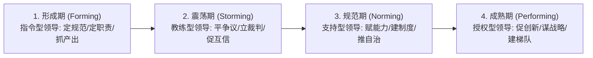
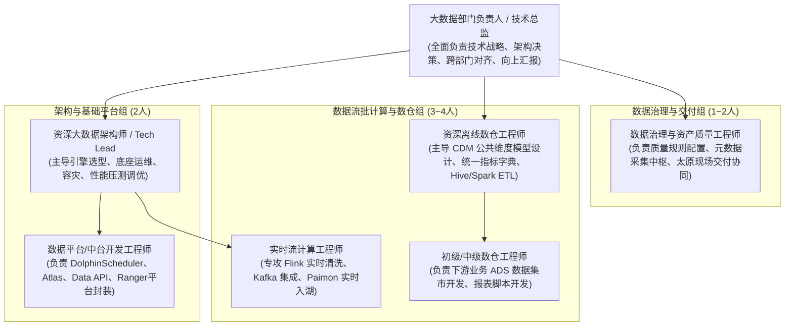
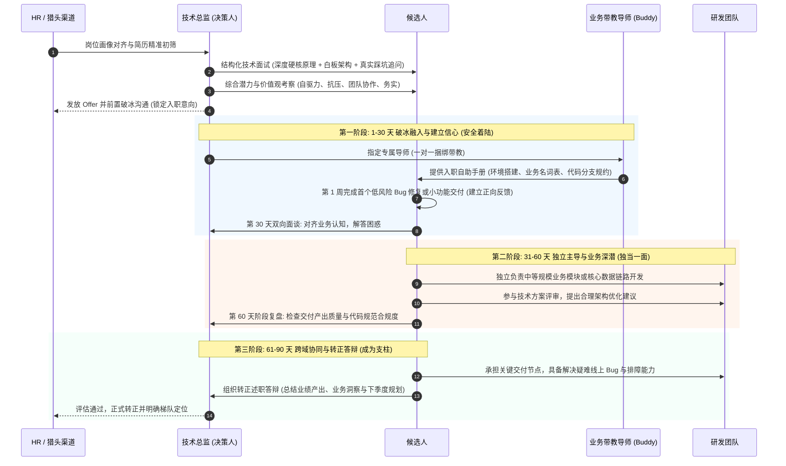

# 研发团队组建、招聘与人才梯队

> **管理维度定位**：本模块聚焦技术总监、数据平台研发负责人、大数据研发经理在从 0 到 1 组建 5~10 人精干技术团队时的核心管理抓手。全面拆解团队岗位画像、精准招聘漏斗、新人 30-60-90 天着陆飞轮、人才梯队与 Bus Factor（巴士因子）安全备份建设。深度融合美的集团、思科、Zoom 以及瑞纳智能大数据部门从 0 到 1 搭建与太原项目实战，系统提炼技术高管在人才选拔、骨干激励、危机挽留与组织人效提升上的战略格局与降维表达能力。

---

## 1. 管理场景与核心目标

### 1.1 核心痛点与业务诉求
在中大型企业数字化转型、数据中台搭建或工业物联网平台交付过程中，技术管理者面临的最核心挑战往往不是技术选型，而是**“队伍怎么拉起来、人怎么招得准、骨干怎么留得住、团队怎么打胜仗”**：
- **招聘预算与品牌劣势**：非头部互联网大厂或传统制造/工业企业，缺乏大厂光环与顶薪溢价，如何在有限预算内吸引高素质技术骨干？
- **“人岗错配”的试错代价高昂**：技术团队早期编制极度精简（5~10人），每个坑位都承载一条核心链路。招错一个人，不仅浪费 3~6 个月招聘与试用期成本，甚至会带偏核心架构、搞崩线上稳定性、带崩团队士气。
- **单点故障与巴士因子（Bus Factor = 1）隐患**：团队内部某个系统（如实时 Flink 链路或调度内核）只有一个人懂，一旦该核心骨干请假或离职，系统陷入无人敢动、无人能排障的瘫痪状态。
- **业务催促 vs 招聘门槛博弈**：业务部门疯狂催促招人赶项目，HR 疯狂推简历，管理者是否为了“填坑”而降格以求？

### 1.2 管理者的定位转变
从**“超级个人贡献者（Super IC）”**向**“团队首席政委与架构总指挥”**升维：
- **摆脱凡事亲力亲为**：不能把精力耗费在“自己写全部核心代码”，管理者的首要职责是**定义目标基线、搭准组织阵型、引入匹配人才、赋能团队拿结果**。
- **从“找最牛的人”转向“找最适配阶段的人”**：不盲目迷信大厂高 P，初创及攻坚团队需要“即战力强、皮实抗压、动手能力硬核、愿意深入业务泥坑”的实战派。
- **抓战略、带队伍、建体系、拿结果**：建立可复制的招聘 SOP 与新人落地培养体系，打造即便团队人员微调也能平稳自运转的工程自愈型组织。

---

## 2. 核心管理模型与机制

### 2.1 理论框架与管理模型

#### 1. 塔克曼团队发展阶段模型（Tuckman's Stages of Group Development）
团队从组建到成熟必经四个阶段，管理者必须在不同阶段切换管理模式：
- **形成期（Forming）**：团队成员彼此陌生，对目标和边界模糊。管理者采用**高指导、低支持（指令型）**，明确制定研发规范、分工边界与第一个迭代的硬目标。
- **震荡期（Storming）**：技术方案出现分歧，工作习惯发生摩擦，代码风格冲突。管理者采用**高指导、高支持（教练型）**，建立方案评审机制与 Code Review 裁判规则，引导对事不对人，化解冲突。
- **规范期（Norming）**：成员认同团队准则，形成默契与互信，流程制度运转顺畅。管理者采用**低指导、高支持（支持型）**，鼓励技术创新与跨领域自驱协同。
- **成熟期（Performing）**：团队自主驱动，目标高度共识，高产出且自愈能力强。管理者采用**低指导、低支持（授权型）**，赋能骨干承担更大管理职责，管理者自身抽身聚焦向上管理与长期战略规划。

#### 2. 情境领导力模型（Situational Leadership）在员工发展中的应用
根据员工的**工作能力（Competence）**与**工作意愿（Commitment）**，动态适配四种领导风格：
- **D1（低能力、高意愿，如应届生/初级新人）** $\rightarrow$ **S1 指导型（Directing）**：给出极其清晰的“第 1 步做什么、第 2 步找谁、验收标准是什么”，每日站会复盘，频繁检查纠偏。
- **D2（有一定能力、意愿低落，如遇到技术瓶颈或挫折的骨干）** $\rightarrow$ **S2 教练型（Coaching）**：多倾听痛点，共同探讨解法，在给予方向指导的同时做好情绪疏导与心理赋能。
- **D3（高能力、意愿摇摆/缺乏自信，如资深工程师初次担任 TL）** $\rightarrow$ **S3 支持型（Supporting）**：共同决策，管理者充当“坚实后盾与资源协调者”，给予充分鼓励与心理安全感。
- **D4（高能力、高意愿，如团队绝对技术王牌）** $\rightarrow$ **S4 授权型（Delegating）**：交代清晰的业务目标、边界红线与验收节点后，完全放权其自主规划实现，管理者抓里程碑交付结果。

### 2.2 机制设计与流程图

#### 1. 5~10 人精干大数据研发团队黄金组织阵型（以瑞纳智能/中台为例）

#### 2. 人才招聘与 30-60-90 天着陆飞轮全景流转图

---

## 3. 标准落地实操规范（SOP与工具链）

### 3.1 关键动作与制度规范

#### 1. 岗位画像（Job Profile）与 JD 撰写三大铁律
- **拒绝“杂货铺式”死搬教条**：严禁在 JD 中写“精通 Hadoop、Spark、Flink、K8s、Java、Python、C++”等空泛大词；
- **必须定义“前 90 天的核心输出物”**：
  - 例如招聘**实时计算工程师**，明确注明：“入职前 3 个月目标：负责接管工业物联网 10 万点位设备上报数据流，主导完成 Flink 1.19 + Paimon 实时入湖架构改造，将流作业异常断流恢复时间控制在 5 分钟内”；
- **明确软实力与硬红线标准**：
  - **加分项**：在 GitHub 有活跃开源贡献、深入阅读过 Flink/Kafka 核心源码、具备高并发排障经验；
  - **一票否决项**：面试言过其实、简历项目造假、缺乏复盘反思习惯、对业务价值漠不关心。

#### 2. 技术面试官三轮考核标准 SOP

| 面试轮次 | 核心考察维度 | 考察形式与实操手段 | 核心通过基线（准入线） |
| :--- | :--- | :--- | :--- |
| **第一轮：专业技术深度（同行专家/TL面）** | 核心底层机制、生产排障能力、真实踩坑积累 | 抓取简历中最核心技术点（如 Flink 反压、Kafka 事务、JVM GC）深挖 3 层底层根因，现场出真实生产事故场景要求给出排障决策。 | 能够讲清底层运行机理与边界条件，严禁背诵概念套话；有真刀真枪排障经验。 |
| **第二轮：系统架构与工程素养（技术总监面）** | 顶层系统设计能力、技术选型权衡、架构前瞻性、工程质量规范意识 | 现场白板推演：“针对 10 万设备遥测入库与实时大屏，从0到1画出系统架构图，阐述技术选型取舍与降级预案”。 | 具备大局观，在成本、吞吐、一致性之间有清晰的权衡推断，具备技术品味。 |
| **第三轮：综合胜任力与文化匹配（总监/HR终面）** | 自驱力、抗压能力、跨部门协作、沟通表达、学习敏捷度、稳定性 | 采用 STAR 框架深挖：“讲一件你在过去最困难、推不动且充满争议的项目，你是如何破局的？” | 具备成长型思维，积极务实，抗压皮实，认同团队企业文化，无刺头倾向。 |

#### 3. 人才梯队建设与 Bus Factor（巴士因子）提升防线
- **何为巴士因子（Bus Factor）**：指“一个团队中如果被公交车撞倒几个人，项目就会彻底瘫痪”的最小人数。若某核心系统 Bus Factor = 1，该系统处于极度高危状态。
- **治理 SOP 规范**：
  1. **关键系统双人备份（Shadow/Backup 制度）**：每一个核心系统（如 Flink 实时链路、DolphinScheduler 调度引擎、数据质量引擎），必须指定一名 Primary（主责人）与一名 Secondary（备份人）；
  2. **交叉 Code Review 与任务轮换**：Secondary 必须参与 Primary 负责模块的所有架构评审与代码审核；每季度安排 15% 的小需求由 Secondary 独立操刀上线，确保代码与架构在脑海中常驻；
  3. **架构资产文档化（Architecture as Documentation）**：核心系统的设计决策、生产排障故障树、运维 SOP 必须归档沉淀，严禁将知识锁在个别人的脑子里。

### 3.2 工具链与度量指标（Data-Driven）

| 管理维度 | 核心度量指标 | 采集工具/平台 | 警戒线/基线标准 |
| :--- | :--- | :--- | :--- |
| **招聘效能** | 简历初筛通过率、面试 Offer 转化率、入职到岗周期（Time to Hire） | 飞书招聘 / 北森 ATS | 关键技术骨干到岗周期 $\le 45$ 天；面试 Offer 转化率 $\ge 25\%$ |
| **新人达产** | 首个代码提交天数（Time to First Commit）、首个独立特性上线周期 | GitLab CI / Jira 看板 | 首周完成首个 PR 合并；30 天内独立完成首个生产特性交付 |
| **梯队安全** | 核心模块 Bus Factor、关键岗位流失备份率 | 团队技术资产盘点表 | **全团队核心模块 Bus Factor 严格 $\ge 2$**；无任何“单点黑盒系统” |
| **团队凝聚力** | 季度主动离职率（Voluntary Turnover Rate）、骨干离职挽留率 | HR 盘点系统 / 1-on-1 会谈记录 | 团队年度核心骨干主动离职率控制在 $10\%$ 以内 |

---

## 4. 常见管理挑战与冲突化解

### 4.1 典型矛盾场景

#### 场景一：薪酬预算受限与招聘预期落差的博弈
- **矛盾表象**：公司给出的薪资预算处于行业中等水平，但业务部门期望招到一个“精通大数据全栈、能扛起千万级并发、懂业务能带人”的顶级架构师。HR 反馈市场上这种人才薪资要溢价 50%，招聘陷入僵局。
- **管理者解题思路**：
  - **拆解“伪需求”**：不存在万能且便宜的人。与业务高管客观对齐：当前阶段到底是最需要“底层分布式内核研发”还是“快速把业务数仓指标理清楚”？
  - **打好“人才组合拳”**：将一个高薪大神编制拆分为**“1 名具备潜力与扎实底层的技术骨干（70% 预算）+ 1 名执行力极强的初级工程师（30% 预算）”**；
  - **情感与发展空间赋能**：对于技术骨干，薪酬并非唯一驱动力。以清晰的技术自主权、核心系统从 0 到 1 的技术把控力、直面业务总监的成长空间作为有力抓手，吸引具有向上突破渴望的高潜力人才。

#### 场景二：核心骨干突发离职危机的应急与挽留
- **矛盾表象**：项目正处于交付关键期（如太原项目验收前夕），负责核心数据中台 Data API 与 Flink 链路的独家骨干小李突然提出离职，拿到了某互联网大厂高薪 Offer，团队面临核心链路瘫痪风险。
- **管理者应对三步法（复盘案例实录）**：
  1. **第一步（真诚共情，探寻第一因）**：严禁上来就谈公司大义或道德绑架。约在咖啡厅进行 1-on-1 私下长谈，真诚祝贺对方拿到 Offer，探寻离职根本原因（薪资待遇、工作成就感不足、跨部门推诿心累、还是个人家庭原因？）；
  2. **第二步（差异化资源挽留与攻守平衡）**：
     - 若为**薪资与晋升委屈**：立即向公司高管和 HR 特批调薪与期权激励，为其争取“技术专家/架构师”职级认定；
     - 若对方**去意已决、不可逆转**：坚决保持格局与体面，祝福对方，并迅速转入“风险止血与平稳过渡”——商定合理的交接周期（不少于 3~4 周），制定极其详尽的《交接清单》，安排 Secondary 骨干全面接管代码；
  3. **第三步（团队免疫与系统重构）**：骨干离开后，绝不让悲观情绪在团队内蔓延。召开团队对齐会，重新梳理系统资产，将原本依赖小李个人的“黑盒代码”推行公开架构走查，并提升整体团队的 Bus Factor 备份。

---

## 5. 面试高频管理题

> [!IMPORTANT]
> 本板块精选一线大厂与独角兽企业对技术总监、研发经理考察最频繁的 6 道管理核心真题。**在第 6 板块中，必须全部逐题深度解答，严禁留白！**

### 5.1 团队组建与招聘考核题
1. **Q1**：如果让你从 0 到 1 组建一支 5~10 人的大数据研发团队，支撑百亿级数据中台与工业物联接入，你如何规划团队技能结构、编制预算与招聘优先级？
2. **Q2**：在中小企业或非一线大厂品牌效应不足、薪酬预算受限的情况下，你如何吸引并招募到高水平的技术骨干？
3. **Q3**：如何设计技术面试官考核标准，避免面试官“死抠生僻八股文”或凭主观喜好招错人？

### 5.2 梯队建设与危机化解题
4. **Q4**：团队关键核心骨干（如负责 Flink 实时流或数据湖的核心架构师）在业务上线冲刺期突然提出离职，你该如何应对与化解危机？
5. **Q5**：如何为团队设计可持续的人才梯队成长路径，防止团队内部出现“一人独大、其他人躺平”的单点故障（Bus Factor = 1）？
6. **Q6**：新员工入职后如何帮助其快速融入并产出业务价值？如果试用期第 2 个月发现新人能力与面试表现严重不符，你该如何处理？

---

## 6. 标准参考答案（三层维度）

---

### 题目1：从 0 到 1 组建 5~10 人大数据团队的技能规划、编制与招聘优先级

#### 简洁回答（1分钟结构化表达）：
> 组建 5~10 人大数据团队，必须遵循**“小步快跑、以业务价值为导向、先桩基后上层”**的建队原则。
> 团队阵型规划为：**1 名架构师/TL（技术总舵手） + 2 名基础平台/数据治理（底座底脚） + 3 名流批数仓与实时计算开发（核心生产力） + 1~2 名报表与资产服务化开发（价值交付）**。
> 招聘优先级采取**“倒金字塔三阶段推进”**：
> 1. **首要阶段（第 1 个月）**：优先招募 1 名具备全栈架构与实战经验的**资深大数据架构师/Tech Lead**，共同制定中台技术选型、开发规约与底层底座；
> 2. **攻坚阶段（第 2 个月）**：引入 2 名**高战力数仓与实时计算骨干**，主攻数据入湖、清洗与核心数据模型沉淀，打通端到端数据流水线；
> 3. **扩展阶段（第 3 个月）**：补充 2~3 名性价比高的中初级开发与数据治理人员，承接上层业务报表定制与资产服务化。

#### 深入回答（管理闭环：量化、机制、沟通、兑现）：
1. **技能结构雷达与岗位编制矩阵（以 8 人标准配置为例）**：
   - **架构与平台组（2人）**：
     - *资深架构师（P8对标）*：负责集群规划、选型（Flink/Kafka/Paimon/Doris）、容灾与疑难故障排查，具备带领 3~5 人攻坚的能力；
     - *平台开发工程师（P6+/P7）*：负责调度平台（DolphinScheduler）、元数据中心（Atlas）、权限（Ranger）与 Data API 网关的集成封装与运维；
   - **数仓与流计算核心组（4人）**：
     - *实时流计算专家（P7）*：专攻 10 万+ 设备秒级遥测流计算、动态质量检测与反压调优；
     - *数仓架构/模型专家（P7）*：主导 CDM 维度建模、统一指标字典、ODS 到 DWS 分层血缘治理；
     - *中级 ETL 开发工程师（P6, 2人）*：主攻日常离线批处理脚本、Spark 性能优化与历史数据清洗补录；
   - **数据资产与服务交付组（2人）**：
     - *数据治理/前端大屏开发（P5/P6, 2人）*：负责数据资产目录落地、质量大屏可视化与现场项目部署交付。
2. **招聘优先级与交付里程碑深度咬合**：
   - **第 1~30 天（桩基成型）**：架构师到岗，完成技术底座容器化与 PoC 验证，输出工程规约；
   - **第 31~60 天（管道贯通）**：流批骨干到位，打通“采集 $\rightarrow$ 湖仓 $\rightarrow$ 存储”的主链路，支撑首批核心看板上线；
   - **第 61~90 天（自愈成熟）**：全员就位，进入敏捷双周迭代，建立自动化 CI/CD 与数据质量自愈闭环。

#### 总监/管理视角（商业价值、长期主义与领导力）：
> 从技术总监视角来看，建团队本质是**“用有限的薪酬资本在特定时间内换取最大的商业产出”**：
> 1. **控制团队人效比（Revenue per Head）**：
>    - 绝不在业务方向未看清前盲目扩张扩编。5~10 人的小团队协同损耗最低，战斗力最强。宁愿给优秀骨干开出行业 80 分位的薪水招 1 个精兵，也坚决不招 3 个平庸之辈，因为平庸的工程师带来的通信开销、代码债务和线上故障会彻底吃光管理者的精力；
> 2. **建立组织抗震弹性**：
>    - 在设计岗位职责时，推行**“一专多能（T型人才）”**，要求实时同学能写数仓 SQL，数仓同学懂基础 Flink 排障，确保团队面对局部需求脉冲时具备自我调度与削峰填谷能力。

---

### 题目2：在中小企业/非互联网大厂品牌下吸引并招募高水平技术骨干

#### 简洁回答（1分钟结构化表达）：
> 在没有大厂光环和顶薪预算的前提下招募优秀骨干，必须跳出“同质化薪资内卷”，打好**“价值定位差异化、技术自主权赋能、成长加速度兑现与极具诚意的真诚沟通”**组合拳：
> 1. **差异化卖点定位**：大厂做螺丝钉，中台做主舵手。突出“从 0 到 1 主导千万级工业数据底座架构”的履历高光价值；
> 2. **技术氛围与确定性赋能**：展示严谨的工程文化、前沿的技术栈（全面采用 Flink 1.19、Java 21、Paimon、Doris），消除求职者对“传统企业做落后技术养老”的刻板偏见；
> 3. **技术总监亲力亲为的情感链接**：管理者亲自撰写专业且真诚的邀请信，面试过程给予充分专业尊重，展现团队负责人的专业厚度与领导格局。

#### 深入回答（管理闭环：量化、机制、沟通、兑现）：
1. **破解招聘漏斗四大实操抓手**：
   - **精准开源与技术社区“挖矿”**：
     - 不单纯依赖死板的招聘网站简历搜索。去 GitHub（如 Flink、Doris、Paimon 贡献者列表）、技术博客（掘金、知乎深度排障文章作者）主动接触有深度技术追求的骨干，通过同行专业技术探讨切入；
   - **打造具有技术品味的 JD（招聘说明）**：
     - 将 JD 变成一份“技术攻坚挑战书”。写明：“我们面临的是太原数十万工业传感器毫秒级调控、百亿级时序数据湖仓一体架构重构。如果你渴望跳出业务 CRUD，主导高并发实时湖仓的落地，这里有最真实的战场”；
   - **面试过程的反向吸引（Reverse Interviewing）**：
     - 面试不仅是挑选候选人，更是向优秀候选人“推销团队”的绝佳窗口。在面试最后留出 15 分钟，主动为候选人详细复盘团队当前的架构大图、技术痛点与未来 1 年的演进路线，展现团队负责人的技术厚度与清晰战略，让候选人感受到被高度尊重与渴望；
   - **机制兑现：明确晋升与项目红利**：
     - 协调公司管理层，针对核心骨干推行“关键里程碑交付奖（如太原项目一次性验收通过奖金池）”或项目期权/专项激励，把个人收益与平台成果紧密捆绑。

#### 总监/管理视角（商业价值、长期主义与领导力）：
> 优秀人才是被**“伟大的事业、清晰的方向、坦诚的团队文化与被重用的信任感”**所吸引的：
> - 很多在大厂深陷内卷、汇报 PPT、晋升天花板的资深工程师，内心极度渴望在一个真实的产业落地场景中证明自己的技术价值；
> - 作为技术负责人，我的核心竞争力在于**“能够为骨干遮风挡雨，向公司争取资源与试错空间，提供一个纯粹、追求工程质量、没有政治内耗的技术土壤”**。用我的技术声誉与人格魅力为团队背书，这就是中小型平台吸引顶级实战专家的最强杠杆。

---

### 题目3：设计技术面试官考核标准，避免“死抠生僻八股文”与招错人

#### 简洁回答（1分钟结构化表达）：
> 招错人的最大根因在于面试官缺乏系统培训，往往“凭眼缘喜好”或“照着网上面试题死抠偏门源码八股文”。
> 规避该问题的核心是建立**“面试官准入认证 + 结构化行为与能力矩阵题库 + STAR-L 证据链倒查机制”**：
> 1. **明确面试官红线**：严禁死扣生僻 API 类名或刁钻脑筋急转弯，必须围绕“**底层原理、设计哲学、真实生产踩坑与工程权衡取舍**”展开；
> 2. **推行结构化面试评价表**：将考核细化为“核心专业深度、工程素养、业务理解力、解决问题自驱力”四大客观维度，每项必须有具体问答记录支撑，杜绝“主观感觉不错”；
> 3. **影子面试（Shadow Interview）认证上岗**：新面试官必须作为副面跟随资深管理者完成至少 5 场实战面试，通过考核后方可独立主面。

#### 深入回答（管理闭环：量化、机制、沟通、兑现）：
1. **结构化技术面试四步法模型（SOP）**：
   - **第一步：基础破冰与脉络扫描（5分钟）**：
     - “请用 3 分钟介绍你最近主导的最核心系统，着重说明你在其中的具体角色与关键产出”；
   - **第二步：针对简历硬核项目顺藤摸瓜（25分钟）**：
     - 挑选候选人简历中写得最亮眼的技术亮点（如“主导了 Flink 性能优化”），连续 4 层深挖：
       1. *现象层*：“当时生产遇到了什么具体的瓶颈或报警？”
       2. *机制层*：“底层的数据流与状态机是如何流转的？为什么当时会卡在这个环节？”
       3. *决策层*：“当时对比过哪几种解决方案？为什么最终选择了方案 A 而没有选方案 B？”
       4. *边界层*：“如果现在流量再暴涨 10 倍，你这套方案的瓶颈会在哪里？你会如何重构？”
     - **判别标准**：背八股文的人在第 3、4 层必然露出马脚、语无伦次；真正操盘过的人会如数家珍、细节丰满。
   - **第三步：白板架构设计与权衡推演（15分钟）**：
     - 现场出真实开放题：“设计一个支持秒级 50 万设备上报的数据清洗与落盘拓扑，考虑背压与机器断电容灾”；
   - **第四步：反向提问与文化契合度考察（10分钟）**。
2. **面试评估报告必须包含“行为证据链（STAR）”**：
   - 面试评价中严禁出现“技术挺好”、“态度端正”等主观套话；
   - 必须记录事实证据：“候选人能够清晰阐明 Flink 信用机制（Credit-based Flow Control）与 Netty 缓冲区的交互逻辑，并能结合自身在电商大促中的两阶段加盐聚合排查倾斜，证明其具备 P7 级生产实战深度”。

#### 总监/管理视角（商业价值、长期主义与领导力）：
> 面试过程是企业技术品牌在市场上的第一张名片：
> - 傲慢、死抠无意义死知识的面试官会严重破坏公司的雇主品牌，把真正有实力的高水平人才直接推给竞对；
> - 作为技术负责人，我将面试官视同为“公司的技术形象大使”。通过常态化的面试抽检与复盘机制，把“**平等尊重、专业深挖、寻找潜力与闪光点**”融入面试官文化中，确保我们引进的每一位成员都符合团队长远发展的基线标准。

---

### 题目4：业务冲刺期关键骨干突发离职危机的应急与长效化解

#### 简洁回答（1分钟结构化表达）：
> 面对关键冲刺期核心骨干提出离职，技术管理者必须保持**“冷静克制、分级阻断、软硬兼施、以系统韧性对抗人员流动”**的处置原则：
> 1. **第一优先级（30分钟内真诚私密长谈）**：迅速排查离职真实意图，倾听真实诉求，动用所有可用管理资源进行“差异化全力挽留”；
> 2. **第二优先级（若挽留无果，签署平稳过渡备忘录）**：体面祝福，并依据劳动契约约定充分的交接缓冲期（3~4周），将系统交接拆解为按日跟踪的交付物，指派备份人员全程并行结对；
> 3. **第三优先级（长效治理）**：复盘组织漏洞，彻底破除“单点系统黑盒”，推行关键模块双人备份与架构资产透明化，杜绝组织被单一骨干“绑架”。

#### 深入回答（管理闭环：量化、机制、沟通、兑现）：
1. **应急止血与心理沟通矩阵**：
   - **场景 A（因薪酬/受委屈离职）**：
     - 立即启动绿色通道：拉齐 HRBP 与分管副总裁，在 24 小时内拿出切实可行的薪酬调整方案或提前兑现晋升承诺。很多优秀骨干提离职往往是对前期贡献未被认可的“委屈爆发”，管理者必须展现出绝对的诚意与护短担当。
   - **场景 B（去意已决，已接不可逆的大厂核心岗位 Offer）**：
     - **不打感情悲情牌**：坦诚沟通：“小李，恭喜你获得这么好的平台机会。我们共事非常愉快，我完全支持你的个人职业成长。但目前太原项目正处于验收冲刺期，系统是你亲手搭建的孩子，我希望我们能体面站好最后一班岗，这也是你职业声誉最完美的一战。”
     - **设立交接奖励与缓冲期**：协商将离职交接期定为 30 天，并明确：“若在交接期内完成知识库全量移交、带教好接班人且上线零故障，照常发放全额项目阶段奖金，并由我亲自为你出具行业高管背书的推荐信（Reference Check）”。
2. **交接流程工程化（交接清单按天验收）**：
   - 制定《核心系统交接确认单》，分为四个维度：
     - **架构资产**：数据流向图、核心状态机逻辑、配置清单、生产账号权限；
     - **代码与演练**：由接手人（Secondary）在测试环境从零编译部署并成功运行；
     - **排障手册（Runbook）**：列出历史上出现过的 Top 5 严重故障排查命令与恢复脚本；
     - **实战结对**：最后两周，所有与该系统相关的生产报警与发布，全部由接手人操刀，离职骨干在旁观察指导（Reverse Shadowing）。

#### 总监/管理视角（商业价值、长期主义与领导力）：
> 人员流动是现代软件工程不可阻挡的客观规律，**卓越的工程组织必须依赖严密的“系统韧性”而非单纯依赖“个人英雄”**：
> - 骨干离职是一面最好的镜子，暴露了团队内部的单点故障与管理盲区；
> - 作为管理者，平时就必须死守 **“Bus Factor $\ge 2$”** 的铁律。通过常规的架构走查、轮流值班（On-Call）、交叉 Code Review，让知识在团队内部透明流动。即使明天核心骨干离职，系统也能像航母一样平稳破浪前行，绝不会因为一两个人的进出而产生倾覆危机。

---

### 题目5：设计人才梯队成长路径，防止“一人独大、全员躺平”（Bus Factor = 1 治理）

#### 简洁回答（1分钟结构化表达）：
> 团队出现“一人独大、其他人躺平”，本质是**管理失职导致的“信息垄断、职责固化与成长天花板”**。
> 破局之道在于构建**“技能分级晋阶机制 + 双人主备轮换制 + 业务任务轮岗 + 强制技术分享传承”**的四位一体梯队体系：
> 1. **破除知识特权与信息垄断**：核心模块严格推行 **Primary-Secondary 双人备份制度**，任何系统严禁一人包揽，把“培养接班人”作为核心骨干晋升的硬性考核指标；
> 2. **建立梯队阶梯任务模型**：按照“基础维护 $\rightarrow$ 模块开发 $\rightarrow$ 复杂链路重构 $\rightarrow$ 顶层技术选型与评审”阶梯式压担子，激发中初级员工的突破欲望；
> 3. **设立“架构走查与技术红黑榜”**：每周开展技术分享会与架构走查，推动技术资产无保留沉淀，让整个团队共同成长。

#### 深入回答（管理闭环：量化、机制、沟通、兑现）：
1. **人才梯队技能发展阶梯模型（Career Ladder）**：
   - **L1 初级工程师（执行者）**：
     - *职责*：在导师指导下，保质保量完成明确边界的业务开发，熟练遵守代码规范；
     - *成长目标*：独立完成常规功能上线，具备基础排障能力；
   - **L2 中级工程师（独当一面者）**：
     - *职责*：独立主导某个子系统或复杂业务模块的设计与交付，担任次要模块的 Primary 或核心模块的 Secondary；
     - *成长目标*：能发现系统隐患并主动提出优化方案，参与指导初级新人；
   - **L3 资深工程师/架构骨干（技术领军者）**：
     - *职责*：主导全局技术架构演进，攻坚全链路性能与稳定性瓶颈，**强制要求为自身主导的系统培养出合格的 Secondary 接班人**；
     - *考核牵引*：**“如果你的系统没有人能接手，说明你还没做好晋升更高职级的准备”**，倒逼骨干主动分享技术、下放日常事务，抽身做更具前瞻性的架构探索。
2. **消除单点故障的机制抓手**：
   - **任务定期微轮岗（Job Rotation）**：每隔半年，在保持大阵型稳定的前提下，安排实时与离线、平台与治理模块的次要维护人员进行交叉轮换；
   - **故障注入与应急演练（Chaos Engineering）**：在预发环境演练时，故意不让系统原作者参与排障，让备份人员（Secondary）独立依据《排障手册》排查止血，倒逼排障文档的完善与备份人能力的实战化。

#### 总监/管理视角（商业价值、长期主义与领导力）：
> 优秀的管理者不培养“盲从的执行者”，而是**“批量培养未来的技术管理者与架构师”**：
> - “一人独大”不仅是对团队的风险，也是对骨干本人的伤害，因为这会把他死死拴在日常运维杂事中，无法抽身成长；
> - 通过梯队建设与分权授权，初级员工看到了晋升通道与成长希望，资深骨干释放了日常维护精力去攻克更具挑战的战略新课题。整个技术团队从“单核驱动的脆弱组织”蜕变为了“多核并发、自我迭代的高韧性作战兵团”。

---

### 题目6：新员工 30-60-90 天融入飞轮设计与试用期能力不符果断淘汰处理

#### 简洁回答（1分钟结构化表达）：
> 新员工入职必须推行**“30天融入破冰（建立信心）、60天独当一面（产出业务）、90天融入体系（转正述职）”**的结构化着陆飞轮，配套一对一 Buddy 导师制，确保人才落地生根。
> **面对试用期第 2 个月发现能力与面试严重不符时的处置原则**：
> 坚决遵循**“早发现、早沟通、早给改进机会、早做合规淘汰”**原则，严禁拖延至最后一天闪电辞退：
> 1. **第 30~45 天（书面绩效对齐与辅导）**：明确指出具体交付差距（举事实，绝不空泛指责），签订为期 2 周的清晰改进计划（Mini-PIP），提供必要辅导；
> 2. **第 60 天（考核判定与果断止血）**：若改进未达标，立即与 HR 协同启动**“试用期不符合录用条件”**的合规解除流程，依法依规文明劝退，绝不拖泥带水，止损是管理者对团队最大的负责。

#### 深入回答（管理闭环：量化、机制、沟通、兑现）：
1. **30-60-90 天新人着陆实操模型（落地飞轮）**：
   - **第 1~30 天：安全着陆与小步快跑**：
     - *前 3 天*：Buddy 协助完成开发环境搭建、权限开通、讲解代码与分支规约；
     - *第 1 周*：分派一个只有 50 行代码改动的修 Bug 任务，让新人走通“本地开发 $\rightarrow$ MR 提交 $\rightarrow$ Code Review $\rightarrow$ CI 编译 $\rightarrow$ 测试发布”全流程，消除对陌生系统的恐惧感；
     - *第 2~4 周*：独立完成一个小型业务需求交付，融入双周迭代；
   - **第 31~60 天：深入腹地与独立担当**：
     - 独立接管一个完整的业务数据模型或功能模块，主导技术方案评审，参与值班（On-Call）；
   - **第 61~90 天：文化融合与转正述职**：
     - 能够独立解决疑难故障，产出一份《系统重构与架构优化构想报告》，召开转正评审答辩会。
2. **能力不符员工辞退的合规闭环链条（管理法治思维）**：
   - **陷阱警示**：我国《劳动合同法》第 39 条规定，以“在试用期间被证明不符合录用条件”解除劳动合同，**用人单位必须承担全部举证责任**！空口无凭直接开除会引发劳动仲裁和双倍赔偿风险。
   - **合规操作四步闭环（SOP）**：
     1. *入职第一天（证据留存）*：让员工签字确认《岗位说明书与试用期录用考核标准》（明确量化指标：如按时完成 Sprint 任务、千行代码缺陷率标准、遵守代码规约）；
     2. *第 45 天（出具书面差距提醒）*：发送正式邮件或面谈纪要：“在过去的第 5 迭代和第 6 迭代中，任务 A 延期 3 天导致下游阻塞，提交的代码中包含 4 处未处理空指针导致测试环境崩溃，与入职约定的 P6 胜任力标准存在明显差距”；
     3. *提供 2 周明确改进周期（留出辅导记录）*：指派导师协助其复查代码，明确下一阶段验收标准；
     4. *第 60 天（闭环评估与解除合同）*：再次验收依然不合格，由 HR 出具《试用期考核不合格解除劳动合同通知书》，在录用条件未达成的铁证支撑下完成平稳离职交接。

#### 总监/管理视角（商业价值、长期主义与领导力）：
> 软件工程界有一句残酷但颠扑不破的真理：**“Slow to hire, Fast to fire（招聘要慢要严，辞退要快要决）”**：
> - 招错人不可怕，可怕的是管理者因为“抹不开面子”、“觉得不好意思”而将就留下一个不合格的员工；
> - 一个不合格的员工留下来，会持续产出充满漏洞的代码、拖垮身旁优秀的同事去给他擦屁股、破坏团队的质量标准、让优秀的工程师感到不公甚至愤而离职；
> - 果断淘汰不合格者，不仅是止住团队的技术负债与成本出血，更是向全团队传递坚定的信号：**我们这里只认专业、交付与担当，我们坚决对优秀的成果负责！**

---

## 7. 管理行为自检清单

- [ ] **招聘基线与画像**：在发出每一个招聘 HC 前，我是否已经清晰写明了该岗位前 90 天的核心输出物与技能边界，而不是盲目抄袭外部模板？
- [ ] **梯队安全冗余度（Bus Factor）**：在我管辖的团队中，是否存在任何一个“只有一个人懂、其他人完全不敢碰”的黑盒系统？我是否有切实推进双人备份（Primary-Secondary）？
- [ ] **情境领导力切换**：面对不同资历和意愿的下属（初级新人 vs 资深架构骨干），我是否能够灵活切换指导型、教练型、支持型与授权型管理风格，而不是搞一刀切？
- [ ] **骨干离职风控**：如果团队最核心的技术台柱子今天突然向我递交辞呈，我的系统能否在 30 天内完成安全平稳移交？我的情绪能否保持客观与大局观？
- [ ] **汰劣护盘决心**：面对试用期明显达不到基准要求的员工，我是否具备遵纪守法、用量化事实说话、果断进行合规劝退的领导力魄力？

---

## 8. 参考经典管理著作与最佳实践

1. **经典管理学与组织建设巨著**：
   - 《人月神话》（The Mythical Man-Month）—— Frederick P. Brooks 著（软件工程组织规模、沟通损耗与团队建设圣经）
   - 《情境领导者》（Management of Organizational Behavior）—— Paul Hersey & Kenneth Blanchard 著（情境领导力四象限模型）
   - 《高效能团队的五项障碍》（The Five Dysfunctions of a Team）—— Patrick Lencioni 著（缺乏信任、惧怕冲突、欠缺投入、逃避责任、忽视结果的破解之道）
2. **硅谷与顶级科技企业实战管理**：
   - 《格鲁夫给经理人的第一课》（High Output Management）—— Andrew S. Grove 著（前 Intel CEO，产出导向管理、人效杠杆与 1-on-1 会谈模型）
   - 《重新定义团队：谷歌如何工作》（Work Rules!）—— Laszlo Bock 著（Google 招聘漏斗、结构化面试与人才密度法则）
   - 《奈飞文化手册》（No Rules Rules）—— Reed Hastings 著（只招成年人、人才密度高于一切、保持坦诚反馈）
