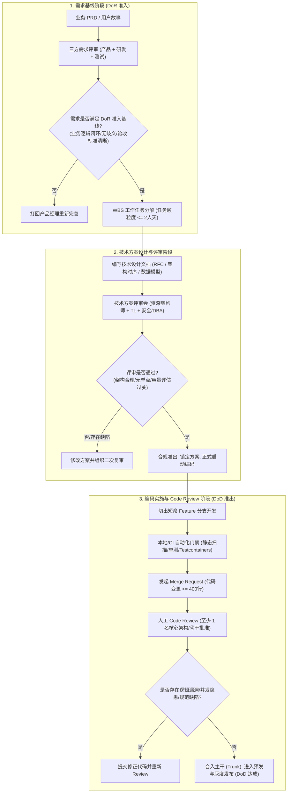

# 研发计划拆解、方案评审与 Code Review

> **管理维度定位**：本模块聚焦技术总监、数据平台研发负责人、大数据研发经理在研发过程控制中的核心把控抓手。系统解构 WBS 工作分解结构与估时模型、技术方案评审（Design Review/RFC/ADR）准入准出机制，以及 Code Review（代码审查）从制度推行、阻力破局到奖惩落地的完整工程闭环。结合美的集团、思科、Zoom 及瑞纳智能太原项目等大型软件研发与中台交付实战，提炼技术高管在过程控制、质量守门、业务排期博弈与工程文化塑造上的管理决策与降维表达能力。

---

## 1. 管理场景与核心目标

### 1.1 核心痛点与业务诉求
在中大型软件研发与数据平台交付过程中，项目延期、线上故障频发、代码腐化严重等现象层出不穷，其根本诱因往往不在于编码速度，而在于**“计划粗放、评审走形式、审查全靠猜”**：
- **WBS 拆解过粗导致“黑盒延期”**：需求拿到手只估一个“大概需要 10 人天”，没有细化到子任务、依赖接口与联调测试，开发到第 8 天突然发现底层数据模型缺失，导致项目断崖式延期。
- **技术方案评审“写完即弃”流于形式**：为了应付流程仓促写一份文档，评审会上大家一团和气“没意见”，编码时却完全按个人野路子自由发挥，架构设计与代码实现严重脱节。
- **Code Review 推行受阻陷入死局**：开发人员怨声载道：“业务需求催命都写不完，哪有时间看别人代码？”；或沦为“挑空格、挑注释”的形式主义，关键业务逻辑漏洞和并发死锁依然原封不动溜上生产。

### 1.2 管理者的定位转变
从**“被动的救火队长”**向**“研发流水线的总工与质量裁判长”**升维：
- **防患于未然（Shift-Left 质量左移）**：把 80% 的架构隐患和设计缺陷消灭在“方案评审与编码之前”，而不是等到集成测试甚至生产暴雷后再疲于奔命。
- **用制度约束与工程基线替代人情信任**：建立结构化的准入准出标准（DoR / DoD），让流程具备强制性和自运转能力，消除对“个别开发自觉性”的脆弱依赖。
- **在“交付敏捷度”与“工程严谨性”之间建立动态平衡**：既不搞官僚冗长的文山会海，也绝不放任野蛮无序的裸奔代码。

---

## 2. 核心管理模型与机制

### 2.1 理论框架与管理模型

#### 1. WBS（Work Breakdown Structure）工作分解结构法与 PERT 估算模型
- **100% 规则（100% Rule）**：下一层所有交付物的总和必须 100% 涵盖且仅涵盖上一层的范围，既不重叠，也不遗漏。
- **8/80 原则（颗粒度控制黄金法则）**：
  - 最小工作包（Work Package）的工时估算**不得低于 8 小时（1 人天），也不得高于 80 小时（2 周/10 人天）**；
  - 在敏捷双周迭代中，建议进一步收敛到 **0.5 ~ 2 人天（4 ~ 16 小时）**，确保每个工作日的每日站会都能检查明确的进度节点。
- **PERT 三点估算法（Program Evaluation and Review Technique）**：
  面对具备高度不确定性的底层技术攻坚，使用三点加权平均估算预期工时 $E$ 与方差 $\sigma$：
  $$E = \frac{O + 4M + P}{6}, \quad \sigma = \frac{P - O}{6}$$
  （$O$: 最乐观工时 Optimistic；$M$: 最可能工时 Most Likely；$P$: 最悲观工时 Pessimistic）。利用统计学给业务排期留出科学的置信区间缓冲垫。

#### 2. 技术决策记录（ADR, Architecture Decision Record）轻量级机制
为了防止方案文档“写完即弃”，推行 ADR 架构决策模型，以 Markdown 形式与源代码共同存放在 Git 仓库中（`docs/adr/`）：
- **Title**：决策标题与编号（如 `ADR-005: 采用 Apache Paimon 替代 Hudi 存储实时设备指标`）；
- **Context**：面临的业务痛点、环境约束与备选方案；
- **Decision**：最终技术决策与底层架构论据；
- **Consequences**：该决策带来的积极收益、妥协代价与潜在负债（Positive & Negative）。

### 2.2 机制设计与流程图

#### 1. 端到端研发过程控制准入准出流转全景图（从 PRD 到 CR 上线）

---

## 3. 标准落地实操规范（SOP与工具链）

### 3.1 关键动作与制度规范

#### 1. 技术方案评审（Design Review）准入与准出硬性门禁
- **必须提交技术方案的门槛（触发条件）**：
  1. 涉及核心业务数据表结构（DDL）新增或字段修改；
  2. 涉及跨微服务、跨系统的核心接口定义与契约变更；
  3. 预估研发工作量 $\ge 5$ 人天的中大型需求；
  4. 引入任何新的第三方开源中间件或改变底层存储引擎（如新引入 Doris/Paimon）。
- **技术方案模板（RFC 核心六要素）**：
  - **背景与业务目标**：解决什么业务痛点，预估带来的商业价值；
  - **系统拓扑与数据流向**：Mermaid 架构图与核心状态机时序图；
  - **接口契约定义**：前后端/跨服务 RPC 接口协议（参数、异常码、幂等设计）；
  - **数据存储设计**：分表分库方案、物理 DDL 脚本、索引设计、冷热归档策略；
  - **容量与性能压测基线**：预估 QPS/TPS 峰值、数据存储年增量、Buffer Pool/内存开销测算；
  - **稳定性与降级预案**：依赖组件挂掉时的降级 Fallback 策略、慢查询监控阈值、回滚方案。

#### 2. Code Review 落地执行细则与检查清单（CR Checklist）

| 审查维度 | 具体检查项目（SOP 标准） | 严重等级 |
| :--- | :--- | :--- |
| **业务逻辑与边界** | 1. 空指针防护（NPE）：所有外部传入参数与集合判空是否完备？ 2. 边界条件覆盖：集合溢出、除数为零、数值越界、负数检查。 3. 幂等性：核心修改/扣款接口是否具备唯一业务键防重机制？ | **Blocker (阻断)** |
| **并发与事务控制** | 1. 锁颗粒度：是否存在大事务内调用外部远程 RPC/HTTP 接口的反模式？ 2. 死锁隐患：多资源批量更新时主键是否统一升序排序？ 3. 线程池配置：是否误用了 `Executors` 无界队列导致 OOM 隐患？ | **Blocker (阻断)** |
| **数据访问与性能** | 1. 慢 SQL 隐患：是否存在 `SELECT *`、深分页、隐式类型转换导致全表扫描？ 2. 索引匹配：查询条件是否遵循联合索引最左前缀匹配？ 3. 循环查库：严禁在 `for` 循环中单条调用数据库查询/Redis。 | **Critical (严重)** |
| **代码规范与可维护** | 1. 命名规范：类、方法、变量命名是否具备自解释性，严禁抽象魔鬼数字（Magic Number）。 2. 架构分层：Controller 是否越级直调 Dao？是否违背 SOLID 原则？ | **Major (次要)** |

#### 3. Code Review 落地奖惩与红线管理
- **MR 大小红线（400 行原则）**：单个 Merge Request 的代码变更行数（Additions + Deletions）**严禁超过 400 行**（纯自动生成代码除外）。大需求必须拆分为多个独立的小 MR，小步快跑提交。超过 400 行的 MR，Reviewer 有权直接打回拒审；
- **责任捆绑与免责防线**：
  - 代码上线若出现低级 NPE 或并发死锁导致 P0/P1 事故，**作者承担 70% 责任，点击批准（Approve）的 Reviewer 承担 30% 连带责任**；
  - 倒逼 Reviewer 绝不敢随意闭眼点 Approve，必须认真仔细推演每一行逻辑；
- **技术之星激励**：每季度评选“最佳 Code Reviewer”，根据 Review 批注的质量与排查出的高危 Bug 数量给予专项奖金或作为职级晋升的关键加分项。

### 3.2 工具链与度量指标（Data-Driven）

| 管理维度 | 核心度量指标 | 采集工具/平台 | 警戒线/基线标准 |
| :--- | :--- | :--- | :--- |
| **计划精准度** | 迭代故事点交付率（Commitment Reliability）、需求排期偏差率 | Jira / TAPD | 需求排期偏差率 $\le 15\%$；迭代交付率 $\ge 85\%$ |
| **评审严谨度** | 方案评审被打回修改率、生产发布引发的需求变更比例 | Confluence / Wiki | 复杂方案首轮被打回修改率在 $20\%\sim 30\%$（过于顺利说明流于形式） |
| **CR 覆盖与深度** | MR Code Review 覆盖率、单 MR 平均评论数（Comments per MR） | GitLab / GitHub | **CR 覆盖率严格 100%**；平均评论数 $\ge 3$ 条/MR |
| **缺陷逃逸率** | 缺陷逃逸率（Defect Escape Rate = 线上Bug数 / (测试Bug数 + 线上Bug数)） | Jira Bug 追踪系统 | 缺陷逃逸率控制在 **$5\%$ 以内** |

---

## 4. 常见管理挑战与冲突化解

### 4.1 典型矛盾场景

#### 场景一：业务方锁死上线死线，但技术评估工作量严重超标
- **矛盾冲突**：业务总监在管理层会议上承诺了客户在 10 月 1 日上线新功能。技术负责人带领骨干拆解 WBS 后发现：要完整保质交付需要 35 人天，而距离上线仅剩 15 天（团队仅 2 名开发可用，上限 30 人天，缺口巨大）。业务方施压：“不管用什么方法，必须按时上，代码质量后续再改！”
- **管理者化解策略（商业博弈三板斧）**：
  1. **亮出详尽 WBS，把黑盒变白盒（数据化摆事实）**：
     - 绝不空口说“做不完”。带着打印出来的详细 WBS 任务拆解表找业务总监，指着每条任务：“前端 10 项共 12 天，后端 8 项共 18 天，联调与压测 5 天。如果我们强行压缩联调，系统在客户现场有 80% 的概率崩溃报错，直接引发商务违约”；
  2. **砍范围不砍质量，推行 MVP（最小可行产品）分期交付**：
     - 与业务重新划分需求优先级（MoSCoW 模型）：将需求归类为 **Must have（必须有）、Should have（应该有）、Could have（可以有）**；
     - 协商将 10 月 1 日交付范围聚焦在 **Must have 核心链路**（如仅上线核心自动控温与数据监控），将复杂的多维自定义报表与统计分析顺延至 10 月 20 日的二期迭代；
  3. **商务与市场价值对齐**：守住交付时间的同时守住系统质量红线，既维护了客户核心上线节点，又避免了团队通宵猝死与上线事故。

#### 场景二：开发人员对 Code Review 强烈抵触，甚至产生人际冲突
- **矛盾冲突**：推行 Code Review 2 周后，老员工小张私下抱怨：“每天业务代码都写不完，还要花 1 小时看别人的烂代码！小李还老在我的 MR 里挑刺，挑我命名不好听，故意针对我！”团队士气低落，MR 积压不前。
- **管理者破局招式**：
  1. **明确划分“机器与人工的责任边界”**：
     - 立即将代码格式、缩进、命名规范、潜在空指针等纯规则性审查，**全面下沉给 CI 自动化流水线（CheckStyle + SpotBugs + SonarQube）拦截**！
     - 宣布规约：凡是机器能检查出来的，人工严禁在 CR 里批注撕扯。**人工 Code Review 仅聚焦于三件事：业务逻辑漏洞、架构并发安全、性能慢查询**，瞬间降低 70% 的无意义沟通消耗；
  2. **建立心理安全感（Blameless Code Review）**：
     - 召开全员宣讲会定调：“**Review 的是对事不对人，Review 找出的每一个 Bug，都是在替作者挡子弹！** 如果线上出了故障，作者和 Reviewer 共同担责；如果在测试前把 Bug 掐死在 MR 里，作者绩效不受任何扣减”；
  3. **工时计入排期与限时响应机制**：
     - 制度化明确：**每个迭代研发排期必须预留 15% 的“Code Review 专项工时”**，严禁把 CR 当作员工“业余奉献”；
     - 规定 Reviewer 响应 SLA：收到 MR 评审邀请后，**必须在 4 个工作小时内给出审查反馈**，严禁卡着别人代码阻碍提测。

---

## 5. 面试高频管理题

> [!IMPORTANT]
> 本板块精选一线大厂（阿里、字节、美团、腾讯、滴滴等）对研发经理、技术总监考察最频繁的 6 道过程控制真题。**在第 6 板块中，必须全部逐题深度解答，严禁留白！**

### 5.1 计划拆解与需求博弈题
1. **Q1**：在敏捷迭代中，业务方给的时间往往很紧，研发评估的工作量常常超标，作为技术负责人你如何进行合理的 WBS 拆解与排期协商？
2. **Q2**：很多团队的技术方案评审流于形式，方案文档“写完即弃”，后续代码实现完全变形走样。你如何建立强有力的方案评审准入、准出与跟进闭环？

### 5.2 流程规范与质量守门题
3. **Q3**：在团队推行 Code Review 往往会遭到开发人员强烈抵触（“需求都写不完，哪有时间 Review”、“形式主义挑刺”），你作为管理者如何打破阻力并建立健康的工程文化？
4. **Q4**：如何制定具体的 Code Review 规约与检查清单？人工 Review 与自动化 CI 静态代码扫描（Sonar/Checkstyle）的边界如何划分？

### 5.3 风险决策与效能度量题
5. **Q5**：如果一个核心项目的技术方案出现重大架构缺陷，是在上线前几天被发现的，继续上线有严重稳定性风险，延期发布会导致业务高管问责，你作为负责人如何决策与处置？
6. **Q6**：如何客观度量 Code Review 和技术评审的效果，避免管理指标沦为员工应付差事的数字游戏（如刷无意义评论）？

---

## 6. 标准参考答案（三层维度）

---

### 题目1：敏捷迭代中业务死线与研发工期冲突的 WBS 拆解与排期博弈

#### 简洁回答（1分钟结构化表达）：
> 面对业务死线与研发工期的冲突，技术负责人必须跳出“非黑即白的对抗思维”，采取**“数据化显性呈现（WBS）、范围动态置换（砍范围保核心）、分期交付落地（MVP）”**的沟通策略：
> 1. **工作量显性化**：通过 WBS 将需求拆解为 1~2 人天的清晰工作包，列出关键依赖路径，用扎实的数据证明工时并非“虚高”；
> 2. **业务价值排序**：运用 MoSCoW 模型协同业务方砍掉非核心功能，死守上线时间交付 **MVP 核心闭环**，次要功能移至二期迭代；
> 3. **严守质量红线**：坚决不通过“取消联调、省略压测、取消 Code Review”来换取表面上线，因为隐患带上生产引发的火灾救火成本是前期开发的数倍。

#### 深入回答（管理闭环：量化、机制、沟通、兑现）：
1. **WBS 实战拆解与排期对齐机制**：
   - 绝不凭空给出“大概需要 1 个月”。在评审后 24 小时内，组织核心架构师与前后端骨干进行 WBS 细化拆解，产出包含四列的标准表格：
     - `功能点` $\rightarrow$ `底层技术任务（如新增表结构、编写 Flink 逻辑、实现 API）` $\rightarrow$ `前置依赖（如依赖用户服务接口提供）` $\rightarrow$ `悲观/乐观工时（人天）`；
   - 标注出**关键路径（Critical Path）**：清晰指出哪几个节点出现 1 天延期，整个项目就会整体延期；
2. **与业务高管的沟通话术与谈判策略（复盘实录）**：
   - “张总，我非常理解 10 月 1 日是对客户承诺的关键营销节点，我们技术的共同目标也是保障这一节点的商业成功；
   - 经过我们详细的任务拆解，总工时需要 35 人天，按目前团队满负荷运作还存在 10 人天缺口。
   - 如果我们强行全量塞入，只能压缩测试和稳定性压测时间，系统在现场一旦崩盘，会直接造成大面积客诉与商务赔偿；
   - 我建议采取**分阶段交付策略**：10 月 1 日我们确保‘在线签约与核心充值缴费’100% 稳定上线，先把收入管道打通；像‘数据历史导出、积分兑换商城’等外围次要功能，我们排在 10 月 20 日平滑升级发布。这样既保住了公司在客户面前的信誉，又守住了系统底层安全红线。”
3. **机制兑现**：
   - 形成书面的《需求分期交付备忘录》，由产品、业务与技术三方签字确认，锁死一期范围，拒绝在冲刺期随意插入新的插单需求。

#### 总监/管理视角（商业价值、长期主义与领导力）：
> 技术负责人的核心价值在于**“做业务的战略合作伙伴，而非单纯的接单码农”**：
> - 业务提需求往往处于“贪大求全”的非理性状态，技术总监要具备商业敏锐度，主动帮业务做“需求减法”，梳理出投入产出比（ROI）最高的核心最小可用集（MVP）；
> - 任何通过“牺牲工程质量、取消测试”达成的短期上线，本质上都是在向未来借高利贷。敢于基于数据事实守住质量底线，并提供建设性的分期替代方案，才是兼具担当与智慧的领导力体现。

---

### 题目2：破除技术方案评审流于形式与“写完即弃”的闭环机制

#### 简洁回答（1分钟结构化表达）：
> 技术方案评审流于形式的本质是**“缺少明确准入标准、缺少专业裁判机制、缺少上线前一致性核验”**。
> 解决该痛点的核心是推行**“RFC 模板标准化 + 架构评审委员会一票否决权 + 上线前 ADR 一致性稽核”**的三步闭环：
> 1. **会前准入门禁**：提前 24 小时发出包含容量评估、降级预案的标准技术方案，未达标直接取消评审会；
> 2. **会中把控重心**：严禁把方案评审开成“代码走查”，重点聚焦在**“技术选型权衡、数据模型扩展性、高并发瓶颈与单点故障容灾”**；
> 3. **会后一致性卡点**：将技术方案归档为 Git 中的 ADR 架构决策记录；提测与发布前，由架构师对照方案进行**架构一致性抽检**，一旦发现私自篡改核心设计，直接一票否决禁止上线。

#### 深入回答（管理闭环：量化、机制、沟通、兑现）：
1. **方案评审准入基线（DoR for Design Review）**：
   - 建立“提前 24 小时静默阅读机制”：设计人必须提前 1 天在 Wiki/Confluence 发布技术方案并 @ 所有 Reviewer。Reviewer 必须在会前在文档中留下至少 2 条批注；若会前无批注或作者方案未包含容量压测数据，会议直接取消延期，杜绝“现场临时翻看PPT”的低效拉扯；
2. **架构评审委员会（ARB, Architecture Review Board）运作**：
   - 评审委员由技术总监、资深架构师、安全负责人、DBA 组成；
   - 评审核心围绕四项硬指标打分：
     1. *数据模型是否规范*：是否满足反范式取舍、主键与索引设计是否合理；
     2. *高可用与容灾*：下游依赖挂掉时是否有降级 Fallback？是否存在单点黑盒？
     3. *容量规划*：未来 1 年数据翻 5 倍时，系统存储和查询是否会击穿？
     4. *安全合规*：敏感数据是否具备脱敏设计，接口是否具备防刷限流？
   - 评审结论明确为三类：**通过、修改后邮件复核通过、打回重写重新上会**；
3. **闭环跟进与防走样机制（Post-Review Tracking）**：
   - **文档即代码（Docs as Code）**：评审通过的方案核心结论必须转化为 Git 仓库中的 `docs/adr/ADR-xxx.md`，由架构师合并入主干；
   - **提测准入的一致性卡点**：QA 在接收研发提测时，检查项包含一条硬性门禁：“代码实现是否符合 ADR 约定？是否存在方案之外未经评审的 DDL 变更？”；
   - 一旦发现开发人员为了省事擅自在代码中绕过评审设计（如把说好的 Flink 状态缓存改为直查 MySQL），测试直接拒绝提测，倒逼研发敬畏架构方案。

#### 总监/管理视角（商业价值、长期主义与领导力）：
> 技术方案评审是团队内部**“沉淀架构资产、拉齐团队认知、传承技术品味”**的最优质战场：
> - 评审会不是管理者展示权威的技术炫技场，而是架构师对中初级开发最好的实战实操指导；
> - 通过制度化的设计评审，我们在全团队树立了“谋定而后动”的工程风气，把架构缺陷消灭在第一行代码写出之前，大幅降低了后期的返工成本。

---

### 题目3：化解 Code Review 推行阻力与建立健康的工程文化

#### 简洁回答（1分钟结构化表达）：
> 推行 Code Review 遭遇抵触，核心往往源于三大痛点：**工时被挤压、职责边界不清引发形式主义挑刺、缺乏心理安全感导致人际防御**。
> 管理者的破局抓手在于**“工具自动化削峰、制度化排期留白、规则化对事不对人、正向激励树典型”**：
> 1. **机器与人工彻底分工**：所有格式、命名、静态漏洞交由 CI 流水线（SonarQube/SpotBugs）自动化阻断，人工 CR 仅聚焦核心逻辑漏洞、并发死锁与架构性能，削减 70% 琐碎扯皮；
> 2. **工时计入排期基线**：在每个迭代中明确固定留出 10%~15% 的“Code Review 专属工作量”，不让员工“用爱发电”；
> 3. **营造“Reviewer 替作者挡子弹”的心理安全感**：线上故障共同担责，CR 排查出严重 Bug 予以嘉奖，把对抗氛围转化为技术传帮带的成长文化。

#### 深入回答（管理闭环：量化、机制、沟通、兑现）：
1. **打破阻力的“三步着陆法”实操**：
   - **第一步：高管宣讲与破冰试验（以身作则）**：
     - 技术总监与架构师带头，将自己的核心系统代码首先开放出来接受全团队的公开 Review；在会议室投屏讲解：“大家随便挑，找出我的设计漏洞有奖！”打破技术权威神话，消除工程师的恐惧感；
   - **第二步：小步快跑与 MR 限制（400 行原则）**：
     - 严格规定：一个 MR 超过 400 行，Reviewer 拥有正当理由直接拒审打回。强迫开发人员养成“按特性小步提交”的良好习惯；
     - 规定 Review 响应 SLA：必须在 4 小时内完成审查，严禁成为阻塞别人提测的瓶颈；
   - **第三步：制定友善的沟通话术规范（Code Review Etiquette）**：
     - 团队制定《CR 批注礼仪准则》：
       - 严禁侮辱性词汇（如“这写的是什么垃圾代码？”）；
       - 提倡建议型与提问型探讨（如“这里如果传入空列表，后续处理是否会抛出空指针？是否可以考虑用 `Optional` 或直接快速失败？”）；
       - 提倡赞美（每当发现同事优雅的设计或精妙的算法时，留下一句“赞！这个逻辑非常简洁严密”）。
2. **正向反馈与激励闭环**：
   - 每双周复盘会上，设立“Bug Hunter 捉虫大师”荣誉，公开表彰在 CR 环节发现高危并发漏洞或性能隐患的 Reviewer；
   - 将“带教新人完成高质量 CR”列入资深工程师的晋升述职考核项，使优秀的工程文化成为员工职业晋升的正向杠杆。

#### 总监/管理视角（商业价值、长期主义与领导力）：
> Code Review 是度量一个技术团队是否具备**“工程尊严与专业底线”**的唯一标尺：
> - 缺乏 Code Review 的团队，代码库就是一座不断堆积恶臭的技术垃圾山，最终会彻底拖垮业务敏捷度，导致优秀工程师绝望离开；
> - 作为管理者，推行 CR 必须具备战略定力。短期内可能会遇到业务催促和个别员工的习惯阵痛，但只要坚持 3 个月，线上故障率会断崖式下降 50% 以上，团队成员的代码素养会产生质的飞跃。为团队争取宝贵的质量空间，是技术管理者不可推卸的担当。

---

### 题目4：Code Review 检查清单规范及人工与自动化 CI 门禁的边界划分

#### 简洁回答（1分钟结构化表达）：
> 建设高效 Code Review 体系的核心原则是：**“凡是能由机器自动化完成的，绝不允许占用人工一秒钟；人工 Review 必须聚焦于机器无法感知的业务逻辑、架构设计与并发安全”**。
> - **自动化 CI 门禁（第一道防线）**：由 Git 钩子与 GitLab CI 负责，集成 CheckStyle（代码格式）、SonarQube（圈复杂度、坏味道）、SpotBugs（静态缺陷）、Trivy（安全漏洞）与 JaCoCo（单测覆盖率 $\ge 80\%$）。未达标者流水线直接打红叉，禁止发起人工评审；
> - **人工 Review（第二道防线）**：专注三大深度维度：**业务语义正确性（是否精准满足需求）、多线程与并发安全性（锁竞争、死锁、线程泄漏）、以及架构与性能合理性（慢 SQL、大事务、无界缓存、扩展性）**。

#### 深入回答（管理闭环：量化、机制、沟通、兑现）：
1. **人工 vs 自动化 CI 边界划分矩阵**：

| 检查大类 | 自动化 CI 门禁职责（Machine Only） | 人工 Code Review 职责（Human Expert） |
| :--- | :--- | :--- |
| **代码规范与格式** | 缩进、空格、花括号、命名大小写、未用 Import 清理、方法行数超标拦截。 | 业务变量命名是否具备自解释性、领域模型抽象是否准确。 |
| **单元测试与质量** | 强制执行全量单测，统计覆盖率；若新代码分支覆盖率 $< 80\%$ 自动阻断。 | 检查单测是否包含有效断言（Assert），识别是否存在“为了刷覆盖率而全盘 Mock”的虚假测试。 |
| **安全性与合规** | 扫描硬编码明文密码、AK/SK 秘钥泄漏、已知 CVE 高危第三方组件依赖。 | 检查是否存在水平/垂直越权漏洞、数据脱敏是否在业务全链路闭环。 |
| **并发与底层性能** | 静态识别常见语法级死锁模板、基础资源未关闭（如 IO 流未 close）。 | **深层并发分析**：事务隔离级别是否匹配、锁颗粒度是否过大、批量更新主键是否排序、缓存穿透防御逻辑是否完备。 |
| **业务逻辑与架构** | 完全无能为力（机器无法读懂业务语义）。 | **核心重点**：需求边界是否遗漏、状态机流转是否严密、是否存在破坏 DDD 分层的跨层越级调用。 |

2. **人工 Review 四步标准检查流程（Reviewer SOP）**：
   - **第 1 步：查阅关联 Issue/PRD**（2分钟）：弄清该 MR 到底是为了解决什么具体业务问题；
   - **第 2 步：审视架构契约与数据模型**（5分钟）：先看 DDL 变更与接口定义文件，确认底层骨架无硬伤；
   - **第 3 步：精读核心业务与测试用例**（10分钟）：深入检查业务逻辑分支，重点比对单元测试用例是否覆盖了边界异常；
   - **第 4 步：留下结构化反馈与签署状态**（3分钟）：
     - 若有阻断性缺陷，标记为 `Request Changes` 并详细说明修改建议；若仅为微小建议，标记为 `Comment`；若完全合规，点击 `Approve`。

#### 总监/管理视角（商业价值、长期主义与领导力）：
> 规范的边界划分彻底将资深工程师从低价值的“格式人肉编译器”中解放出来：
> - 自动化门禁保障了整个团队代码输出的“底线”，人工 Review 拔高了团队技术设计的“上限”；
> - 作为技术负责人，我将持续演进这套工具链。随着大语言模型（LLM）的发展，积极引入 AI Code Review Agent 进行第一轮初审，自动指出潜在的空指针和慢查询，进一步放大资深架构师的人效杠杆。

---

### 题目5：临近上线发现重大架构缺陷的危机处置与决策权衡

#### 简洁回答（1分钟结构化表达）：
> 上线前夕突发重大架构缺陷，是考验技术管理者**“技术判断力、商业大局观、危机决策魄力与向上沟通艺术”**的极限场景。
> 处理该危机的唯一最高准则：**“生产环境与数据资产安全高于一切，绝不允许抱着侥幸心理带病裸奔上线！”**
> 处置流程遵循**“评估影响边界 $\rightarrow$ 制定替代降级预案 $\rightarrow$ 向上透明沟通并提供选项 $\rightarrow$ 实施止血与战后复盘”**四步走：
> 1. 坚决按下暂停键阻断全量发布，宁受延期问责，也绝不引发生产崩溃导致不可挽回的商务赔偿；
> 2. 迅速召集骨干评估，拿出兼顾上线日期的**“降级版/旁路保护方案”**；
> 3. 带着解决方案向 CEO/业务总监汇报，讲清技术风险的经济后果，争取支持。

#### 深入回答（管理闭环：量化、机制、沟通、兑现）：
1. **危机决策推演实战矩阵（以太原项目为例）**：
   - **真实案例还原**：太原工业换热站调度中台上线前 3 天，全链路压测发现：原技术方案设计的实时阀门调节控制链路在高并发下由于数据库行锁竞争，导致单次 RPC 耗时高达 8 秒，一旦 10 万设备同时触发调节，数据库连接池瞬间崩溃，引发物理换热站失控爆管风险！
   - **第一步：技术负责人坚决拍板定调（零侥幸心理）**：
     - 立即通知项目管理部：“此架构缺陷具有确定性崩溃风险，绝不允许如期全量上线，我承担全部技术延期责任，立即组织技术攻关！”
   - **第二步：2 小时内拿出两套备选应对方案（提供选项而非单选题）**：
     - *方案 A（技术降级 + 业务分批）*：
       将原本的“全自动毫秒级全网闭环调节”，临时降级为“基于 Redis 令牌桶队列的削峰异步分批下发（每分钟调节 2000 台）”，先保障核心供热大屏监控正常上线，调节功能进入限流受控模式。**时间完全赶得上如期上线**；
     - *方案 B（彻底架构重构）*：
       引入分布式消息队列与 Actor 模型重构控制流，彻底解决锁瓶颈，但**必须延期 5 个工作日**；
   - **第三步：带着商业后果向上对齐预期（向上沟通艺术）**：
     - 迅速拉齐分管副总裁与业务总监闭门沟通：
       “各位领导，目前我们在压测极限场景下捕获了一个底层锁瓶颈。如果强行按原方案全量上线，在业务高峰期有 90% 概率打垮主库导致换热站掉线。
       为了守住公司业务大盘与客户信任，我准备了两套方案：我们建议采纳方案 A，既能保证在客户约定的日期顺利召开上线发布会，核心看板与受控调节功能正常运作；同时我们利用后续 5 天时间采用方案 B 完成后台无感热升级。请领导批示！”
   - **第四步：化险为夷与彻底整改**：业务高管充分理解了巨大的风险，全票赞成方案 A。团队通宵攻关完成削峰改造，项目平稳上线。

#### 总监/管理视角（商业价值、长期主义与领导力）：
> 真正的技术管理领导力，往往体现在**“在巨大的压力和不确定性面前，展现出清醒的判断力与担当的脊梁”**：
> - 平庸的管理者心存侥幸祈祷线上别出事，最终导致特大灾难引咎辞职；
> - 卓越的管理者敢于在关键时刻叫停，不仅能看清深渊，更能在短时间内拿出切实可行的工程替代路径，把一次可能引发企业灾难的重大技术危机，转化为展示团队攻坚实力与专业把控力的信任契机。

---

### 题目6：量化度量 Code Review 与技术评审效果，防范数字游戏

#### 简洁回答（1分钟结构化表达）：
> 管理学大师德鲁克曾言：“无法度量就无法管理”。但若单纯考核“代码审查条数、评审文档字数”，必然迅速演变为“员工刷无意义格式批注”的数字游戏。
> 科学度量 CR 与技术评审效果，必须**“以结果终局为导向、以缺陷拦截率为锚点、以过程健康度为体检”**，构建闭环度量指标网：
> 1. **核心结果指标（看防线是否守住）**：**生产事故数、千行代码缺陷率、以及缺陷逃逸率（Defect Escape Rate）**；
> 2. **过程健康指标（看动作是否扎实）**：**MR 大小分布（$< 400$ 行占比 $\ge 90\%$）、单 MR 有效评论深度、评审打回率**；
> 3. **管理审计抓手**：定期开展代码评审回溯抽检，发现走过场批准高危 Bug 的 Reviewer 追究连带责任，守住指标的真实性。

#### 深入回答（管理闭环：量化、机制、沟通、兑现）：
1. **科学度量指标体系建模（Data-Driven Dashboard）**：
   - **指标 1：缺陷逃逸率（Defect Escape Rate）—— 黄金核心指标**：
     $$\text{Defect Escape Rate} = \frac{\text{生产环境发现的缺陷数}}{\text{研发内部捕获的缺陷数 (CR + QA)} + \text{生产环境发现的缺陷数}} \times 100\%$$
     - *健康基线*：优秀团队应控制在 **$5\%$ 以内**。如果该指标持续走高，说明 CR 与测试防线形同虚设；
   - **指标 2：单 MR 评论深度与有效建议率**：
     - 排除自动 CI 生成的格式评论，统计人工留下的实质性业务逻辑、架构性能评论占比；
     - 杜绝“刷评论”：后台对包含“LGTM（Looks Good To Me）”、“规范很好”等纯语气助词的评论进行过滤，只度量触发代码二次修改的有效评论；
   - **指标 3：技术方案评审首轮被打回修改率**：
     - 正常健康水位应在 **$20\% \sim 35\%$**。若被打回率为 0%，说明方案评审完全流于人情形式，必须介入整顿；
   - **指标 4：CR 拦截的高危缺陷数（Pre-Release Bug Catch Rate）**：
     - 在 Jira 中设立专门标签 `Found-By-CR`，统计有多少潜在的空指针、并发死锁是在合并主干前被 Reviewer 捕获的。
2. **制度化审计与文化治理**：
   - **每月技术质量复盘会（Quality Review Meeting）**：
     - 技术总监每月随机抽检 10 个已合并上线的核心 MR，将代码投屏公开走查；
     - 如果抽检出某个 MR 存在明显的低级 SQL 慢查询或安全隐患，而 Reviewer 直接秒批 Approve：
       - 公开通报批评，扣减 Reviewer 该月的部分质量绩效分；
       - 若连续两次闭眼 Approve，暂停其评审资格，重新由架构师进行一对一辅导认证。

#### 总监/管理视角（商业价值、长期主义与领导力）：
> 度量的终极目的不是“秋后算账”，而是**“牵引团队的行为模式，让优秀的工程习惯成为组织的肌肉记忆”**：
> - 好的指标是团队一面客观的镜子，能让管理者清晰看到流水线哪个环节在出血；
> - 通过科学的度量与持续的复盘改进，整个团队树立起强烈的质量荣誉感，从根本上消灭形式主义，打造出一支对工程底座充满敬畏、战斗力极强的高绩效铁军。

---

## 7. 管理行为自检清单

- [ ] **WBS 拆解颗粒度**：在安排每个迭代任务时，我是否指导团队将工作包拆解至 1~2 人天以下，并清晰标出了关键路径与依赖？
- [ ] **方案评审准入卡点**：面对即将召开的技术评审，设计人是否提前 24 小时发布了文档？方案中是否具备清晰的数据模型、容量评估与故障降级预案？
- [ ] **Code Review 机器人工分工**：在我们的研发流水线中，格式与静态规范是否已经 100% 交由 CI 自动化工具拦截？人工 Review 是否真正聚焦于业务逻辑、并发与性能？
- [ ] **MR 体积控制**：团队内部是否有严格执行“单个 MR 严禁超过 400 行”的原则？是否存在动辄上千行代码积压在最后一天强行合并的现象？
- [ ] **危机担当与替代方案**：如果上线前夕突发重大架构瓶颈，我是否具备按下暂停键的定力，并能在 2 小时内拿出兼顾业务上线的替代降级方案？

---

## 8. 参考经典管理著作与最佳实践

1. **经典工程过程与管理学名著**：
   - 《人月神话》（The Mythical Man-Month）—— Frederick P. Brooks 著（WBS 拆解、工期估算与沟通损耗核心法则）
   - 《软件工程：现代方法》（Software Engineering: A Practitioner's Approach）—— Roger S. Pressman 著（软件过程模型与质量保证规范）
   - 《代码整洁之道》（Clean Code）—— Robert C. Martin 著（Code Review 标准与重构实践）
2. **一线大厂工程文化与实践指南**：
   - [Google Code Review Developer Guide (业界最权威 CR 规范)](https://google.github.io/eng-practices/review/)
   - [SmartBear: Best Practices for Code Review (万名开发者代码审查白皮书)](https://smartbear.com/learn/code-review/best-practices-for-peer-code-review/)
   - 《架构整洁之道》（Clean Architecture）—— Robert C. Martin 著（架构边界与依赖反转评审指南）
