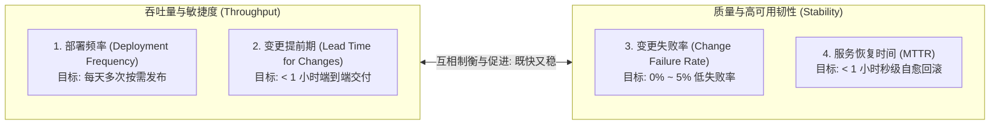
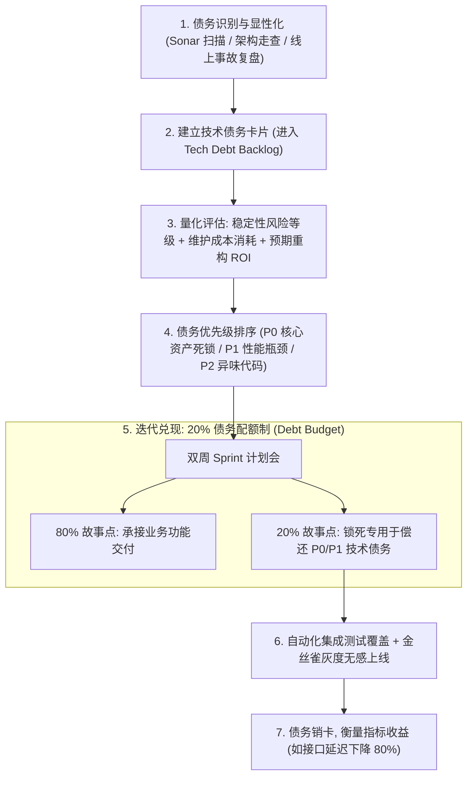

# 研发效能度量与技术债务治理

> **管理维度定位**：本模块聚焦技术总监、数据平台研发负责人、大数据研发经理在研发效能评估与系统长期健康度管控上的核心战略抓手。全面拆解 DORA 四大黄金指标体系、SPACE 研发效能框架、价值流图谱（Value Stream Mapping, VSM）瓶颈定位法，以及技术债务（Technical Debt）的显性化量化评估与“20% 债务配额制”。深度融合美的集团、思科、Zoom 及瑞纳智能工业数据中台实操，提炼技术高管将底层工程治理转化为商业语言、向上汇报可量化 ROI、化解业务与技术资源冲突的高维领导力格局。

---

## 1. 管理场景与核心目标

### 1.1 核心痛点与业务诉求
在企业数字化转型与业务规模化扩张过程中，技术管理者经常陷入两难困境：**业务部门抱怨研发响应慢、产出低；研发团队抱怨历史包袱沉重、天天救火修 Bug、根本没有时间做新需求**：
- **效能度量陷入“形式主义与变形考核”**：盲目考核代码行数（LOC）、提交次数（Commits）、工时加班打卡，导致开发人员大量生成冗余样板代码、刷提交次数，表面繁荣但业务交付依然难产。
- **技术债务“黑盒化与恶性滚雪球”**：为了抢占市场反复“走捷径（Cut Corners）”，无单元测试、无文档、硬编码、大事务。债务越积越多，系统脆弱如纸，每次修改牵一发而动全身，最终引发线上瘫痪事故。
- **技术语言与商业语言脱节**：技术负责人向 CEO 汇报时只会说“我们需要重构底层代码、重构数据库表”，被业务高管一句话怼回：“这能多卖一台设备吗？能增加 100 万营收吗？”从而永远争取不到治理资源。

### 1.2 管理者的定位转变
从**“低头拉车的技术工头”**向**“具备敏锐商业嗅觉的研发资产投资人”**升维：
- **看透技术债务的金融本质**：技术债务如同“高利贷”，适度借贷可以帮助业务抢占窗口期，但拖延不还会让利息（日常排障与返工成本）吞噬团队全部算力。
- **用商业语言包装技术价值**：把“重构底座”翻译为“**将新客户开通周期从 15 天缩短至 2 小时，将单服务器硬件成本削减 60%，杜绝核心大屏年中断电客诉**”。
- **让研发过程透明化与数据化驱动**：通过价值流分析（VSM）精准定位交付卡点，消除等待与浪费，建立科学、客观、无指责的效能度量看板。

---

## 2. 核心管理模型与机制

### 2.1 理论框架与管理模型

#### 1. DORA 四大黄金研发效能指标体系（DevOps Research and Assessment）
Google DORA 团队历经 6 年对全球上万个研发团队的实证研究，提出了衡量软件交付效能的四大北极星指标：
- **衡量吞吐量与交付敏捷度（Throughput）**：
  1. **部署频率（Deployment Frequency）**：代码成功发布至生产环境的频次（卓越标准：每天多次按需发布）；
  2. **变更提前期（Lead Time for Changes）**：代码从提交 Git 仓库到最终在生产环境平稳运行的耗时（卓越标准：$< 1$ 小时）；
- **衡量系统稳定性与交付质量（Stability）**：
  3. **变更失败率（Change Failure Rate, CFR）**：生产部署导致线上服务降级、故障或需紧急回滚/热修的比例（卓越标准：$0\% \sim 5\%$）；
  4. **服务恢复时间（Time to Restore Service / MTTR）**：生产发生故障后，从发现到彻底恢复正常服务的平均时间（卓越标准：$< 1$ 小时，通常在数分钟内）。

#### 2. SPACE 研发效能多维立体框架（GitHub / Microsoft 提出）
DORA 侧重于系统交付流水线，而 **SPACE 框架** 则从个人、团队和系统五个维度全面综合评估人效，防止单一指标导致团队疲劳变异：
- **S（Satisfaction & Well-being，满意度与健康度）**：员工对工作工具、流程的满意度，是否深陷无意义内卷；
- **P（Performance，绩效与成果）**：软件产出对业务商业目标的实际贡献度与可靠性；
- **A（Activity，研发活动度）**：代码提交量、PR 数量、评审次数（仅供参考，严禁单独作为 KPI）；
- **C（Communication & Collaboration，协同沟通度）**：跨团队需求流转速度、PR 评审响应时效；
- **E（Efficiency & Flow，效率与心流）**：开发人员能否在无打扰的环境下专注于编码与深度思考，等待 CI 构建的时间损耗。

#### 3. 技术债务象限模型（Martin Fowler Technical Debt Quadrant）
将技术债务明确分为四个象限，针对性采取治理策略：
- **谨慎且有意为之（Prudent & Deliberate）**：“我们必须现在发布，虽然知道有些边界没优化，下个月第一迭代立即偿还” $\rightarrow$ **最健康的战略债务，限时还贷**；
- **鲁莽且有意为之（Reckless & Deliberate）**：“我们没时间设计，直接硬编码复制粘贴上去！” $\rightarrow$ **严厉禁止，问责通报**；
- **谨慎且无心之失（Prudent & Inadvertent）**：“系统上线后我们才领悟出更好的领域模型” $\rightarrow$ **技术演进必然，归入常态重构**；
- **鲁莽且无意之失（Reckless & Inadvertent）**：“开发根本不懂并发，裸写多线程引发死锁” $\rightarrow$ **技能培训与招聘门禁缺位，加强 Code Review**。

### 2.2 机制设计与流程图

#### 1. 端到端价值流图谱（VSM）与交付瓶颈定位全景流转

```mermaid
flowchart TD
    subgraph VSM["端到端交付价值流分析 (Lead Time = 28天 -> 压缩至 5天)"]
        A["1. 需求提出与等待评审<br/>(耗时: 7天, 纯等待浪费)"] --> B["2. PRD 评审与 WBS 拆解<br/>(耗时: 2天, 有效增值)"]
        B --> C["3. 方案设计与技术评审<br/>(耗时: 1天, 有效增值)"]
        C --> D["4. 实际编码实施 (Coding)<br/>(耗时: 4天, 真正价值产出)"]
        D --> E["5. 等待 Code Review 合并<br/>(耗时: 3天, 沟通停滞浪费)"]
        E --> F["6. 手工提测与环境排队<br/>(耗时: 4天, 资源冲突浪费)"]
        F --> G["7. 测试回归与 Bug 返工<br/>(耗时: 5天, 质量低劣返工)"]
        G --> H["8. 手工发布与停机窗口审批<br/>(耗时: 2天, 流程繁冗浪费)"]
    end

    classDef waste fill:#ffebee,stroke:#c62828,stroke-width:2px;
    classDef value fill:#e8f5e9,stroke:#2e7d32,stroke-width:2px;
    
    class A,E,F,G,H waste;
    class B,C,D value;
    
    note["管理抓手: 真正编码仅占 4 天(14%)，其余 24 天全是等待与低效损耗！<br/>通过引入 CI/CD、金丝雀灰度、容器化测试，将端到端交付周期从 28 天压缩至 5 天！"]
```

#### 2. 技术债务闭环管理漏斗（评估、建卡、配额、消亡）

---

## 3. 标准落地实操规范（SOP与工具链）

### 3.1 关键动作与制度规范

#### 1. 20% 技术债务配额制（Debt Budgeting SOP）
- **制度红线**：每个双周敏捷迭代中，**严格将总研发故事点（Story Points）的 20% 锁定为“架构优化与债务偿还专项配额”**；
- **业务插单豁免防线**：任何业务产品经理或运营总监，**无权挤占这 20% 的债务配额**。若业务紧急插入特急需求，只能在 80% 的业务需求内部进行优先级置换，守死技术债务底线；
- **债务卡片认领与产出验证**：技术债务卡片（Tech Debt Story）必须由资深骨干承接，且必须明确**可量化的验收标准**（如：“重构数据入库链路，消除大事务，将单批入库 TPS 提升至 50,000，消除每周五偶发的 Lock Wait Timeout 报警”）。

#### 2. 技术债务四级评级与处置矩阵

| 债务等级 | 典型特征与代表场景 | 业务风险与系统破坏力 | 处置时效与强制策略 |
| :--- | :--- | :--- | :--- |
| **P0 致命级** | 核心交易涉及大事务跨 RPC、主从异步脑裂丢数据风险、未处理死锁、明文存储凭据。 | **极高**：随时可能引发全网瘫痪、资损赔偿或重大安全等保事故。 | **立即拉响警报**：暂停对应模块非紧急新特性，本周内成立专项攻坚突击排障。 |
| **P1 严重级** | 慢 SQL 缺乏联合索引、单表突破 5000 万未做归档、核心 Flink 状态未设 TTL、存在循环依赖。 | **高**：在大促或业务高峰期引发级联反压与连接池耗尽雪崩。 | **当月闭环**：排入当月前两个迭代的 20% 债务配额中强制偿还。 |
| **P2 一般级** | 模块缺乏单元测试、架构层 controller 直调 dao、硬编码配置未外部化、重构遗留废弃字段。 | **中**：增加后续人员认知负荷与维护成本，拖慢敏捷交付速度。 | **常态轮转**：在相关业务模块发生需求变更时“顺手重构（童子军法则）”。 |
| **P3 提示级** | 代码格式不统一、轻微圈复杂度超标、缺少必要注释。 | **低**：仅影响代码美观度。 | **自动化消除**：交由 CI 流水线格式化工具统一批量处理。 |

#### 3. 童子军法则（The Boy Scout Rule）与重构文化
- **法则定义**：“离开营地时，让营地比你刚来时更干净一些”；
- **工程落地**：开发人员在承接日常业务需求时，**只要修改到某个老旧遗留类，就有义务对其顺带进行微重构（提取超长方法、补充核心边界单元测试、规范变量命名）**。通过日常水滴石穿的微重构，遏制系统大面积腐化。

### 3.2 工具链与度量指标（Data-Driven）

| 效能与质量维度 | 核心度量指标 | 采集工具/平台 | 警戒线/基线标准 |
| :--- | :--- | :--- | :--- |
| **DORA 敏捷度** | 部署频率（Deployment Frequency）、变更提前期（Lead Time） | GitLab CI / ArgoCD | 核心微服务每周部署 $\ge 3$ 次；变更提前期 $\le 48$ 小时 |
| **DORA 稳定性** | 变更失败率（Change Failure Rate）、平均恢复时间（MTTR） | Sentry / Prometheus / Jira | 变更失败率 $\le 3\%$；线上故障平均恢复时间 $\le 15$ 分钟 |
| **技术债务指标** | SQALE 技术债务比率（Technical Debt Ratio）、代码坏味道 | SonarQube | 技术债务比率 $\le 5.0\%$；新代码阻断性与严重 Bug 为 0 |
| **价值流动效率** | 流动效率（Flow Efficiency = 实际工作工时 / 端到端周期工时） | Jira / 研发效能看板 | 流动效率 $\ge 25\%$（消除无谓等待与环境排队） |

---

## 4. 常见管理挑战与冲突化解

### 4.1 典型矛盾场景

#### 场景一：业务部门抱怨“需求排期太慢”，高管施压“人效低下”
- **矛盾表象**：销售总监在月度经营分析会上发难：“我们给客户承诺的报表功能，提给大数据团队一个月了还在排期！友商两周就上线了，我们研发团队效率太低，是不是人浮于事？”CEO 严厉要求技术总监给出解释与整改方案。
- **管理者的降维反击与化解策略**：
  1. **拿数据说话，画出价值流图（VSM）**：
     - 在大屏幕上展示端到端价值流看板：“张总，我们深度梳理了该需求流转的全部 30 天：
       - *第 1~12 天*：需求在业务与产品部门内部反复修改口径，等待业务总监确认需求基线，处于**未准入等待状态**；
       - *第 13~15 天*：技术评审发现该需求依赖第三方厂商的硬件协议接口，由于对方未能提供联调环境，阻塞等待 3 天；
       - *第 16~20 天*：研发团队在 4 天内以 100% 效率完成了核心编码；
       - *第 21~30 天*：测试环境与业务方验收确认耗时 10 天。
       - **结论**：真正的技术开发仅耗费 4 天，有长达 26 天损耗在**跨部门需求口径震荡、外部依赖缺失与验收拖延**上！”
  2. **将对抗转化为协同改进**：
     - 与业务部门达成新的《跨部门协同服务协议（SLA）》：推行需求准入清单（DoR），只有业务方确认口径不改且第三方环境就绪后才正式进入研发排期计时；
     - 引入统一 Data API 低代码网关与敏捷自助分析看板，让业务运营人员能自主配置 80% 的简单报表，将开发人员从繁琐的数据搬砖中彻底解放出来。

#### 场景二：历史遗留系统严重腐化，重构遭遇“新旧双写与业务脱节”
- **矛盾表象**：某套 8 年前开发的核心工业调度中台，单表包含 120 个字段，存储了数亿条混合数据，无分库分表、无单元测试。业务部门要求在此基础上开发全新的温控大模型算法调度，开发骨干反馈：“在屎山代码上加功能必死无疑，必须停下所有业务，全员闭关重构 3 个月！”业务方断然拒绝停工。
- **管理者实操解题思路（绞杀者模式 Strangler Fig Pattern）**：
  1. **否决“休克疗法大重写”（避免大跃进自杀）**：
     - 软件工程史证明，推倒一切重来的“第二系统效应”失败率高达 80%。严禁全团队停工闭关重构；
  2. **推行“绞杀者架构（Strangler Pattern）+ 防腐层（ACL）”**：
     - 保留老系统运行，在新需求前置构建**防腐层适配器**；
     - 新的温控算法调度直接构建在全新的云原生微服务与 Apache Paimon 实时湖仓上；
     - 通过 Canal 监听老数据库 Binlog，将老系统数据实时单向同步至新底座；
     - 随着新架构逐步接管流量，老系统的功能被一个模块一个模块地“抽丝剥茧”，经过 6 个月平滑演进，最终无感关闭老旧系统，实现**“高速公路上面给跑车换轮胎”**的高超工程境界。

---

## 5. 面试高频管理题

> [!IMPORTANT]
> 本板块精选一线大厂（阿里、字节、美团、腾讯、滴滴等）对技术总监、研发经理考察最频繁的 6 道效能与债务真题。**在第 6 板块中，必须全部逐题深度解答，严禁留白！**

### 5.1 研发效能度量与防坑题
1. **Q1**：作为技术负责人，你如何向 CEO 或业务高管汇报技术团队的“研发效能”？如何避免陷入“写了多少行代码、加了多少班”的低级内卷指标？
2. **Q2**：业务部门经常抱怨“提个需求要排期一个月，研发效率太低”，你如何系统性分析研发交付周期的瓶颈（Lead Time 价值流分析），并拿出破局措施？
3. **Q3**：如何理解 DORA 指标与 SPACE 效能框架的本质差异？在只有 10~30 人的中小团队中，如何轻量级落地效能度量，而不是搞重型面子工程？

### 5.2 技术债务治理与重构博弈题
4. **Q4**：在很多企业中，技术债务越积越多，系统越来越难以维护，最终引发灾难性事故。你如何对团队的技术债务进行显性化量化、评估与排期治理？
5. **Q5**：在业务需求极其紧迫、产品经理步步紧逼的情况下，你如何争取到资源对核心系统进行架构重构？请分享一次你成功推动技术重构的实战经历。
6. **Q6**：如果某个业务线为了赶进度，反复走捷径累积了大量严重技术债务（如硬编码、无单元测试、无事务保护），导致线上故障频发，你作为新上任的技术总监如何扭转这一局面？

---

## 6. 标准参考答案（三层维度）

---

### 题目1：向 CEO/业务高管汇报研发效能及规避低级内卷指标

#### 简洁回答（1分钟结构化表达）：
> 向 CEO 或业务高管汇报研发效能，核心原则是**“坚决拒绝以技术自嗨、工作量输入（代码行数、加班工时）作为度量，必须以‘业务价值产出、商业交付敏捷度、系统高可用韧性’为核心语言”**。
> 我的汇报体系遵循**“DORA 四大黄金指标 + 商业收益（成本与收入）”**模型：
> 1. **交付敏捷度**：新特性从需求确认到上线周期（Lead Time）由 30 天缩短至 5 天，响应市场速度提升 6 倍；
> 2. **业务稳定性**：核心生产大屏可用性达到 99.99%，大促故障停机时间降至 0，保障公司千万级合同顺利交付；
> 3. **资源成本 ROI**：通过冷热湖仓架构治理，单服务器承载设备数提升 3 倍，单年基础设施云成本削减 120 万元。

#### 深入回答（管理闭环：量化、机制、沟通、兑现）：
1. **坚决摒弃“虚荣内卷指标”的深层原因**：
   - **古德哈特定律（Goodhart's Law）**：当一个指标变成管理目标时，它就彻底丧失了作为度量指标的价值。
   - 若考核“代码行数（LOC）”：开发人员会故意拆写大量冗余变量、引入繁复样板代码、甚至排斥优秀的第三方开源库；
   - 若考核“Bug 修复数”：测试人员与开发人员会联合刷简单 Bug，把一个大问题拆成 10 个小 Bug 记录；
   - 若考核“加班打卡时长”：团队会滋生“白天摸鱼、晚上加班给领导看”的形式主义伪勤奋，彻底赶走追求高效率的顶尖高手。
2. **构建高管懂的“三层效能仪表盘”模型**：
   - **顶层（业务与商业价值层 - 面向 CEO）**：
     - *业务交付吞吐*：本季度完成的核心战略商业项目数、新客户定制交付准时率（$\ge 90\%$）；
     - *TCO 成本优化*：每单位遥测点位计算成本（由 0.15 元/月降至 0.03 元/月）；
   - **中间层（研发交付流效能 - 面向业务总监与产品总监）**：
     - *对齐 DORA*：发布频次（双周发布 $\rightarrow$ 按需日发布）、变更失败率（由 18% 降至 2%）；
     - *流动效率（Flow Efficiency）*：有效编码时间占比（由 10% 提升至 35%）；
   - **底层（工程基线与健康度 - 面向技术内部管控）**：
     - CI 流水线成功率、单元测试覆盖率、Sonar 技术债务比率（$\le 5\%$）。

#### 总监/管理视角（商业价值、长期主义与领导力）：
> 技术负责人的核心政治成熟度，体现在**“用商业的逻辑讲技术的贡献”**：
> - 很多技术管理者在 CEO 面前委屈地大谈“我们重构了微服务底层，把 Spring Boot 升到了 3.0”，CEO 只会觉得你是在花公司的钱找乐子；
> - 卓越的技术总监向 CEO 汇报时，会拿出一份竞对分析和财务收益表：“通过我们底层的架构优化，我们的产品在客户现场的离线部署时间由过去 2 周缩短至 1 天，使得销售团队的回款周期提前了整整 1 个月，直接改善了公司的现金流”。这才是高阶技术高管不可替代的战略价值。

---

### 题目2：系统性分析交付瓶颈（VSM 价值流分析）与破解“排期慢”

#### 简洁回答（1分钟结构化表达）：
> 业务抱怨“研发排期慢、效率低”，80% 的情况下问题**并不出在开发人员写代码太慢，而是出在跨部门端到端流转过程中充斥着大量的“非增值等待与返工损耗”**。
> 破局之道在于运用精益敏捷的**“价值流图分析法（Value Stream Mapping, VSM）”**：
> 1. **全链路绘制从需求提出到上线的端到端全时序**，用真实客观的数据把需求停滞在“等待口径确认、等待外部接口、环境排队、测试返工”的耗时显性化曝光；
> 2. **对症下药实施三大降损抓手**：推行需求准入机制（DoR）阻断需求频繁变更、推行自动化 CI/CD 与容器化测试消除排队、引入 Data API 赋能业务自助取数，彻底压缩交付周期。

#### 深入回答（管理闭环：量化、机制、沟通、兑现）：
1. **VSM 价值流图实战绘制三部曲**：
   - 提取过去一个季度 50 个已上线需求的 Jira 全量生命周期流水，将端到端交付周期（Lead Time）物理拆分为两类时间：
     - **增值工作时间（Process Time, PT）**：真正处于技术设计、有效编码、严密测试的时间（通常仅占 10%~20%）；
     - **停滞等待时间（Wait Time, WT）**：需求在需求池排队等待、等待产品补齐原型、等待技术评审排期、等待测试环境部署、等待发版窗口（通常占 80%~90%）；
   - **计算流动效率（Flow Efficiency）**：
     $$\text{Flow Efficiency} = \frac{\sum \text{Process Time}}{\text{Total Lead Time}} \times 100\%$$
     - 若流动效率低于 15%，意味着一个原本开发只需 3 天的需求，用户必须等待 20 天才能拿到！
2. **破局落地实操四步法**：
   - **第一步：前置堵住“需求反复震荡”源头（DoR 机制）**：
     - 规定需求评审前必须满足三大条件：原型保真、数据口径无歧义、验收标准（AC）可度量。未通过 DoR 严禁进入研发排期，杜绝“边做边改”引发的代码推倒重来；
   - **第二步：消灭“环境冲突与测试排队”（Testcontainers + 云原生）**：
     - 过去研发等待测试机部署平均耗时 2 天。引入 Testcontainers 容器化技术与 K8s 动态命名空间，每条 MR 自动拉起一套隔离的临时测试环境，测试完毕自动销毁，消除排队等待；
   - **第三步：小步快跑与限制在制品（WIP, Work In Progress）**：
     - 严禁每个开发人员同时并行接 4 个需求。推行限制 WIP：每个工程师当前名下只能有 1 个正在开发（In-Progress）的任务，彻底消除多任务频繁上下文切换的隐形效能杀手。

#### 总监/管理视角（商业价值、长期主义与领导力）：
> 解决“慢”的问题，管理者绝不能简单粗暴地要求团队“天天加班到 11 点”：
> - 盲目加班只会带来疲劳战、代码质量急剧劣化、更多的线上事故，最终导致更严重的测试返工和更慢的交付速度，陷入恶性循环；
> - 作为技术负责人，我的职责是**“像清道夫一样为开发团队扫清阻碍价值流动的制度与流程障碍”**。把等待的垃圾时间从 20 天削减到 2 天，团队甚至不需要加班，业务交付速度就能提升 3 倍以上。这才是系统工程学的精髓。

---

### 题目3：DORA 指标与 SPACE 框架本质差异及中小团队轻量级落地

#### 简洁回答（1分钟结构化表达）：
> - **本质差异**：
>   - **DORA 聚焦于“交付流水线成果（Pipeline Outcome）”**：通过 4 个严密的定量指标衡量系统的发布能力与故障恢复韧性，是典型的“结果导向”与“系统级视角”；
>   - **SPACE 聚焦于“多维立体的开发者全景（Developer Holistic Perspective）”**：涵盖满意度、绩效、活动、协同与心流，它强调“人是工程的核心”，防止团队为了追逐单一自动化指标而引发员工严重倦怠；
> - **10~30 人中小团队的轻量级落地策略**：
>   - **坚决不采购昂贵复杂的重型效能平台**！中小团队必须保持极简敏捷；
>   - 仅抓取核心 3 个轻量指标：**GitLab 自动统计的部署频率、Jira 追踪的平均变更失败率（线上Bug占比），以及每双周 1-on-1 会谈收集团队满意度与流程阻碍**，以极小成本达成 80% 的效能牵引效果。

#### 深入回答（管理闭环：量化、机制、沟通、兑现）：
1. **DORA vs SPACE 深度对照矩阵**：

| 评估维度 | DORA 黄金指标体系 | SPACE 研发效能框架 |
| :--- | :--- | :--- |
| **理论基石** | DevOps 精益生产与敏捷持续交付 | 组织行为学与开发者认知心理学 |
| **度量核心对象** | 代码交付流水线与生产系统稳定性 | 开发者个人、团队协同与系统产出 |
| **指标数量与属性** | 仅 4 个硬核定量指标（发布频次、提前期、失败率、恢复时间） | 5 个维度数十个定量与定性指标组合 |
| **最大优势** | 客观中立、纯自动化采集、极难被作弊刷分 | 全面防范团队倦怠、关注工程师心流与满意度 |
| **潜在盲区** | 容易忽视代码产出背后的员工加班与心智耗竭 | 评估体系相对复杂，度量成本较高 |

2. **10~30 人精干团队三步轻量落地实践**：
   - **第一步：利用现有工具零成本自动采集（Zero Extra Cost）**：
     - 不写一行外部报表代码。直接利用 GitLab CI 自带的 CI/CD Analytics 看板，开箱即用获取部署频率与构建失败率；
   - **第二步：聚焦“开箱阻碍（Friction Log）”**：
     - 在双周团队复盘会上，设立 15 分钟固定环节——“摩擦日志分享”：开发人员直接吐槽当前工具链哪一步最恶心（如本地拉起 Docker 镜像太卡、发布权限审批太慢）；
     - 技术负责人当场认领，并在下一个迭代优先安排 1 名骨干优化内部工具，保护开发者的“专注心流（Flow State）”；
   - **第三步：度量“需求前置时间中位数”**：
     - 仅在 Jira 中拉取故事卡从 `In Progress` 到 `Done` 的天数中位数，只要该指标稳定收敛在 3~5 天以内，就证明敏捷节奏健康，无需引入更复杂的度量体系。

#### 总监/管理视角（商业价值、长期主义与领导力）：
> 管理工具的引入必须匹配团队的发展阶段：
> - 30 人以下的团队，管理者甚至能叫出每个人的名字，最重要的是**“保持沟通扁平、激发个体自驱力、快速把业务原型打磨出来”**。此时搞一套重型效能度量看板，除了增加员工填工时的负担，没有任何实质收益；
> - 技术总监必须具备极强的常识感，善于利用成熟开源工具的内建能力快速体检，把最宝贵的注意力永远放在“业务交付与关键骨干的心情状态”上。

---

### 题目4：技术债务的显性化量化、评估与排期治理机制

#### 简洁回答（1分钟结构化表达）：
> 技术债务越积越多的根本原因在于**“看不见（隐性化）、算不清（缺乏量化风险）、排不上（永远被业务挤占）”**。
> 解决该痛点的工业级治理闭环是推行**“债务显性卡片化 + 风险损失量化评估 + 20% 债务配额制 + 重构验收闭环”**：
> 1. **显性化建卡**：在 Jira 中设立 `Tech-Debt` 专属缺陷池，通过 SonarQube 扫描、架构走查和事故复盘，将所有隐患全部转化为清晰的工程卡片；
> 2. **量化风险评级**：按照“稳定性崩盘风险”与“日常维护浪费工时”进行 P0~P3 分级；
> 3. **制度化配额保障**：每个 Sprint 锁死 20% 的工时配额，专款专用强制偿还，任何人无权剥夺，让还债成为组织的常规代谢机制。

#### 深入回答（管理闭环：量化、机制、沟通、兑现）：
1. **技术债务量化评估模型（Debt Scoring Model）**：
   - 建立简明公式计算技术债务优先级分值 $S_{debt}$：
     $$S_{debt} = \frac{\text{Failure Risk (故障爆炸半径 1~5)} \times \text{Maintenance Waste (每月排障耗费人天)}}{\text{Refactor Cost (重构所需人天)}}$$
   - **高优必还案例（$S_{debt}$ 极高）**：
     - 某换热站遥测数据入库代码中，单事务批量插入 2000 条，在大促高并发下频繁引发死锁，每月消耗资深架构师 3 人天去排障救火，且有打崩主库的 P0 风险；而改写为带重试的单批 200 条切片仅需 2 人天。其还债 ROI 极高，立即列入当期 P0 必须偿还清单。
2. **制度化推行“20% 债务配额制（Debt Budget）”实操**：
   - **在 Sprint 计划会上公布预算**：
     - 假设团队总可用产能为 100 故事点：
     - **80 点**：产品经理全权决定排哪些业务需求；
     - **20 点**：由技术委员会/架构师决定偿还哪些 P0/P1 技术债务；
   - **拒绝业务掺沙子**：产品经理严禁把“小业务改进”伪装成技术债务塞入这 20% 配额中；这 20% 必须纯粹用于**框架升级、消除单点死锁、解耦核心模型、补齐高危链路集成测试**；
3. **闭环验证与资产注销**：
   - 债务偿还不是改完代码就算完。必须经过严格压测与指标验证：
     - 验证指标：“该模块死锁报警归零，SonarQube 圈复杂度降至 15 以下，单测覆盖率达到 85%”；
     - 验证通过后，在系统架构图上将该模块由“高危红色”更新为“健康绿色”，注销债务卡片。

#### 总监/管理视角（商业价值、长期主义与领导力）：
> 技术债务不是技术人员的原罪，而是**组织在商业竞争中战略性承担的短期成本**：
> - 管理者的责任不是追求“绝对零债务的代码象牙塔”，那会导致企业丧失市场先机；
> - 管理者的真正职责是**“控制资产负债率”**。正如健康的现代企业必须维持合理的财务杠杆一样，健康的技术团队应该保持 5%~10% 的良性技术债务；但必须坚决阻断高利贷式的恶性债务，通过制度化的 20% 配额还贷，守住底线，让技术资产健康增值。

---

### 题目5：业务步步紧逼下争取资源完成核心架构重构的实战经历

#### 简洁回答（1分钟结构化表达）：
> 在业务紧迫下争取重构资源，切忌空谈“代码不优雅、不好维护”，必须运用**“痛点共情、风险商业化折算、提出分期平滑演进方案（绞杀者模式）”**的沟通艺术。
> **实战经历（瑞纳智能太原数据中台重构）**：
> 在太原供热物联网项目验收前夕，老旧采集架构频繁内存泄漏假死，业务部门急于催促接入另外 3 万个新测点。
> 我没有要求全员停工重构，而是向分管副总裁展示了一份**《稳定性风险与商务赔偿测算备忘录》**，讲明若在老系统上强行接入，下周降温供暖大促时主库必崩，将导致上千住户报修与客户拒付尾款；随后我提出了**“绞杀者微重构方案”**：不耽误新测点接入，利用 2 名骨干采用 Flink + Paimon 搭建新链路并行旁路分流，经过 3 周平滑验证完成无感切流，既实现了新测点按期接入，又消除了系统核心隐患。

#### 深入回答（管理闭环：量化、机制、沟通、兑现）：
1. **重构方案汇报的商业语言转化实操**：
   - **错误汇报（纯技术自嗨）**：“领导，我们现在的 Spring 代码写得太烂了，耦合严重，我们需要停下业务，用 DDD 重构一下，引入微服务和消息队列” $\rightarrow$ **100% 被业务高管否决**；
   - **正确汇报（商业风险与 ROI 转化）**：
     - “领导，我们深入分析了上个月排障数据：目前核心换热站数据管道已经运行在 92% 极限负荷下，上周由于老架构缺陷导致了 2 次供热数据断流，直接引发太原供热调度中心 2 次电话催办；
     - 如果我们下月强行并网新设备，系统在大促时有极大几率彻底雪崩，直接危及太原项目的最终验收签字与 1200 万尾款回收；
     - 我们技术团队已经设计出了一套**‘边开跑车边换轮胎’的旁路重构方案**：我们不需要全员停工，业务团队继续开发用户界面；我亲自带 2 名骨干，利用两周时间通过旁路搭建全新实时引擎，完成新老平滑切换。这不仅能消除停机风险，还能使单服务器承载能力提升 3 倍，为公司省下 40 万元服务器采购费！”
2. **绞杀者模式（Strangler Fig Pattern）平滑落地的三部曲**：
   - **第一步：建立旁路新链路（Shadow Pipeline）**：在不改动老系统的前提下，由 Kafka 镜像出一份数据流输入到全新的 Flink 1.19 + Paimon 数据湖中；
   - **第二步：数据对账与双跑（Dual-Run Verification）**：两套系统并行双跑 2 周，编写自动化对比程序比对两个库输出的指标一致性，证明新架构数据绝对准确；
   - **第三步：动态无感切流（Zero-Downtime Traffic Shift）**：在统一 API 网关上配置流量权重切流，将前端大屏与算法调度的查询逐步切向新架构，老系统自然被“绞杀”淘汰并安全下线。

#### 总监/管理视角（商业价值、长期主义与领导力）：
> 推动架构重构是检验技术负责人**“商业化领导力与专业魄力”**的终极试炼：
> - 卓越的高管不是站在业务的对立面抗议，而是站在公司的财务与战略大局上，用最专业的工程路径消除业务狂奔路上的致命暗礁；
> - 方案落地后，要及时将重构收益（如系统稳定性提升至 99.99%、单机资源消耗削减 70%）在公司高管会议上公开复盘汇报，既树立了技术团队专业靠谱的口碑，又为团队后续争取技术投入赢得了巨大的信任背书。

---

### 题目6：新任技术总监扭转全团队“狂赶进度、债台高筑”局面的组合拳

#### 简洁回答（1分钟结构化表达）：
> 空降或新接手一个“烂摊子”团队（狂赶进度、缺乏规范、线上事故频发、士气低落），技术总监绝不能盲目大发雷霆或粗暴掀桌子，必须采取**“定盘止血（抓稳核心）、立规明纪（锁住增量）、循序还债（腾挪配额）、胜仗提气（重塑文化）”**的四步重塑法则：
> 1. **第一阶段（止血锁死增量）**：立即开启 CI 自动化流水线，强制推行 Sonar 质量门禁与 Code Review，**死死守住“新提交代码必须规范”的底线，坚决不让技术债务继续扩大**；
> 2. **第二阶段（透明化向上对齐）**：向分管高管与业务伙伴坦诚呈现债务全景图与线上事故关联，争取到 20% 债务治理配额；
> 3. **第三阶段（攻坚标志性胜仗）**：挑选最折磨全员、排障耗时最多的“单一核心毒瘤模块”进行彻底拔除，用一次漂亮的无感重构胜利，让业务看到效率提升，让团队重拾工程尊严。

#### 深入回答（管理闭环：量化、机制、沟通、兑现）：
1. **破局扭转四阶段实操行动纲领（前 90 天作战图）**：
   - **第 1~30 天：听取诉求，调查摸底，锁死增量（Stop the Bleeding）**：
     - 与全员进行 1-on-1 访谈，听取核心痛点，不急于追责；
     - 部署 SonarQube 与 ArchUnit，设立唯一的硬性门禁：**“从今天起，合并入主干的新代码覆盖率必须 $\ge 80\%$，不允许产生新的阻断性 Bug”**。把增量债务的大门彻底焊死；
     - 确立事故无指责复盘机制（Blameless Postmortem），引导员工从“互相甩锅”转向“分析流程工具漏洞”；
   - **第 31~60 天：拔除头号毒瘤，打一场标杆胜仗（Build Trust）**：
     - 盘点全系统事故日志，揪出过去 3 个月引发 50% 线上报警的“头号高危模块”；
     - 亲自挂帅，调配团队最强的 2 名骨干，利用 2 周时间用最高标准的工程规范（DDD、Testcontainers 真实集成测试、自动化 CI）将其彻底重写；
     - 上线后，该模块报警归零，响应速度提升 5 倍。借此标杆胜仗向全员证明：**按照科学的工程规范做事不仅不会慢，反而能彻底从救火泥坑中解放出来！**
   - **第 61~90 天：制度固化与效能飞轮（Institutionalization）**：
     - 正式在研发流程中推行 WBS 精细拆解、RFC 方案评审与“20% 债务配额制”；
     - 建立团队技术分享与最佳实践红黑榜，表彰高质量代码贡献者。
2. **重塑团队心智与工程尊严**：
   - 破除“反正代码已经很烂了，我随便写写也能混”的破窗效应（Broken Windows Theory）；
   - 技术管理者在每一个细小环节以身作则，对优雅的代码大加赞赏，对无责任心的代码坚决打回，让追求卓越代码素养重新成为团队引以为傲的核心荣誉。

#### 总监/管理视角（商业价值、长期主义与领导力）：
> 扭转一个混乱的组织，本质是一场**“打破破窗效应、重建专业信仰与重塑团队文化”**的深刻变革：
> - 优秀的管理者绝不抱怨“前任留下的烂摊子”，因为烂摊子正是公司聘请你来彰显价值的舞台；
> - 通过由浅入深、兼顾短期交付与长期底座的科学治理，我们不仅能把一个濒临崩溃的脆弱系统挽救为高可用中台，更能将一支灰心丧气的救火杂牌军，百炼成钢打造为一支敬畏质量、能打硬仗、兼具高商业人效的卓越技术铁军。

---

## 7. 管理行为自检清单

- [ ] **效能汇报维度**：在向 CEO 或分管高管汇报团队工作时，我是否摆脱了“代码行数、加班打卡”等低级指标，能够用 DORA 指标和商业 ROI 数据化呈现团队产出？
- [ ] **交付瓶颈定位**：面对业务部门“排期慢”的反馈，我是否具备通过 VSM 价值流图谱精准定位“等待浪费与非增值损耗”的客观分析能力，而不是盲目组织全员加班？
- [ ] **技术债务可见度**：在我们的敏捷管理平台（Jira）中，是否存在清晰的 `Tech-Debt` 资产缺陷池？技术债务是否有量化的风险评分与 P0~P3 分级？
- [ ] **债务配额执行力**：在每个迭代中，我是否顶住了业务插单压力，坚决锁死了 20% 的架构与债务治理配额，专款专用保障系统长期健康？
- [ ] **重构路径科学性**：在面临老旧腐化系统的升级改造时，我是否清醒地规避了休克式大重写的陷阱，能够熟练运用防腐层（ACL）与绞杀者模式（Strangler Pattern）实现零停机平滑演进？

---

## 8. 参考经典管理著作与最佳实践

1. **研发效能度量与敏捷精益权威巨著**：
   - 《加速：精益软件与 DevOps 的科学依据》（Accelerate: The Science of Lean Software and DevOps）—— Nicole Forsgren, Jez Humble, Gene Kim 著（DORA 四大黄金效能度量指标创世圣经）
   - 《精益软件开发大局观》（Lean Software Development: An Agile Toolkit）—— Mary & Tom Poppendieck 著（价值流图谱 VSM 与消除软件研发浪费）
   - 《凤凰项目：一个 IT 运维的传奇故事》（The Phoenix Project）—— Gene Kim 著（DevOps 三步工作法、在制品 WIP 控制与系统约束理论 TOC）
2. **技术债务与重构经典**：
   - 《重构：改善既有代码的设计（第2版）》（Refactoring）—— Martin Fowler 著（代码坏味道识别、童子军法则与微重构模式）
   - 《修改代码的艺术》（Working Effectively with Legacy Code）—— Michael Feathers 著（接手遗留屎山代码的解耦、测试桩搭建与防腐重构指南）
   - [ACM: Managing Technical Debt (技术债务量化管理白皮书)](https://cacm.acm.org/magazines/2012/11/156588-a-systematic-approach-to-managing-technical-debt/fulltext)
