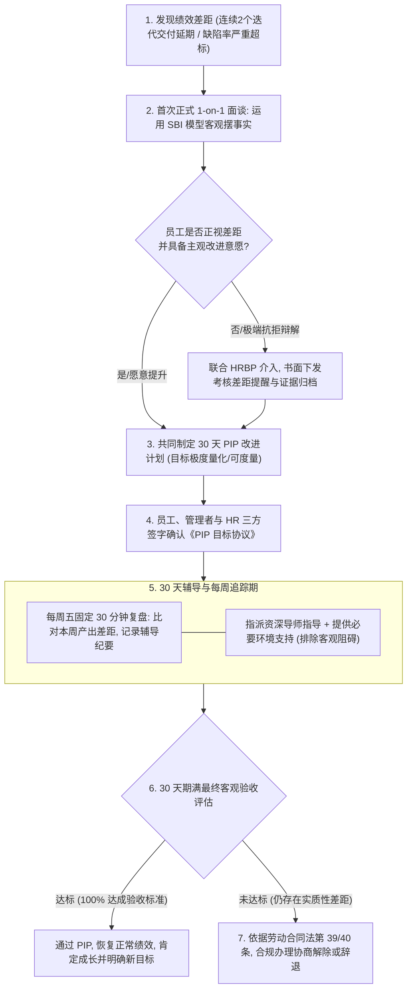
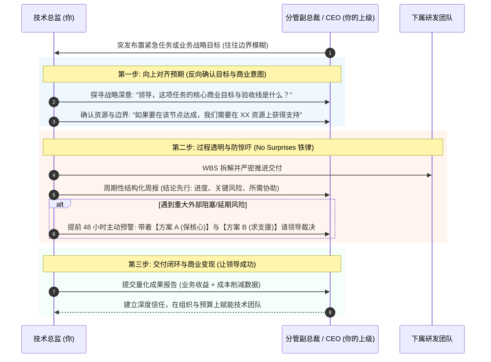

# 团队冲突化解、低绩效沟通与向上管理

> **管理维度定位**：本模块聚焦技术总监、数据平台研发负责人、大数据研发经理在处理“人际摩擦、组织阻力与权力博弈”时的核心高维领导力。系统攻克刺头员工（Brilliant Jerk）软硬治理、基于 SBI/GROW 模型的低绩效面谈与 PIP 合规辞退闭环、跨部门协同推诿的 RACI 契约破解法，以及向上对齐预期的战略沟通模型。深度结合思科、Zoom、美的集团以及瑞纳智能太原项目交付实战，提炼技术管理者在复杂人际与政治环境中化解冲突、争取资源、打造高韧性团队的实战心法。

---

## 1. 管理场景与核心目标

### 1.1 核心痛点与业务诉求
优秀的架构师习惯于面对“确定性极高的代码与算法”，而当其转型为技术总监或研发经理后，面临的最大痛苦往往来源于**“充满不确定性的人性、情绪与部门利益冲突”**：
- **刺头员工破坏团队心理安全感**：个别骨干自恃技术不可替代，在群里公开冷嘲热讽同事、抗拒流程规范、消极怠工，成为团队内部散播负能量的“毒苹果（Bad Apple）”。
- **低绩效淘汰的道德负罪感与法律风险**：管理者“心太软”，不敢面对低绩效员工，导致庸才占着坑位、优秀员工被迫背负双倍工作量甚至愤而离职；或因缺乏法定证据链仓促裁员，引发劳动仲裁和团队信任崩盘。
- **跨部门协同陷入“修罗场”**：业务怪产品逻辑混乱，产品怪研发交付慢，研发怪测试卡提测，测试怪运维环境不稳。各部门自扫门前雪，踢皮球内耗严重。
- **向上管理缺位导致“背锅受气”**：向上只知闷头做事、不主动对齐领导预期，一旦出问题成为上级眼中的“黑盒与背锅侠”；面对高层不切实际的要求唯唯诺诺应承，回过头逼死一线开发。

### 1.2 管理者的定位转变
从**“情绪化的被动受害者”**向**“驾驭复杂人际场域的政治成熟型技术领袖”**升维：
- **区分“健康的认知冲突”与“破坏性的情感冲突”**：鼓励对事不对人的技术论辩，坚决消灭攻击人身的人格冲突。
- **从“独善其身”到“成人之美”与“霹雳手段”并举**：对善良优秀的员工给予菩萨心肠的赋能与保护，对破坏团队底线的害群之马施以雷霆手段的制度化清除。
- **向上管理的本质是“做上级的战略合伙人”**：向上管理绝非阿谀奉承，而是主动成为上级的信息放大器、确定性交付者与方案供给者，帮助领导成功，从而换取下属团队宝贵的生存与发展资源。

---

## 2. 核心管理模型与机制

### 2.1 理论框架与管理模型

#### 1. 托马斯-基尔曼冲突解决模型（TKI, Thomas-Kilmann Conflict Mode Instrument）
根据**“武断性（Assertiveness，追求自身利益）”**与**“合作性（Cooperativeness，顾及对方利益）”**两个维度，界定五种冲突应对模式：
- **竞争模式（Competing，高武断、低合作）**：涉及核心架构安全、数据合规红线、反腐与公司价值观底线时，管理者必须采取强硬竞争模式，**一票否决、寸步不让**；
- **合作模式（Collaborating，高武断、高合作）**：涉及跨部门核心业务目标对齐时，追求“双赢（Win-Win）”，共同探寻第三种创造性解法；
- **妥协模式（Compromising，中武断、中合作）**：工期与范围博弈时，双方各自让步，砍掉非核心功能，达成阶段性平衡；
- **迁就模式（Accommodating，低武断、高合作）**：问题本身对技术大局无伤大雅（如前端按钮配色、非核心文案描述），而对方极度看重时，主动迁就对方，累积组织人情资本；
- **回避模式（Avoiding，低武断、低合作）**：双方情绪处于极度对立愤怒时，暂时挂起冷处理，待情绪平复后再行探讨。

```mermaid
quadrantChart
    title TKI 冲突应对五大策略矩阵
    x-axis 低合作性 (Cooperativeness) --> 高合作性
    y-axis 低武断性 (Assertiveness) --> 高武断性
    quadrant-1 合作模式 (Collaborating)<br/>[双赢方案/跨部门战略协同]
    quadrant-2 竞争模式 (Competing)<br/>[守卫红线/架构原则一票否决]
    quadrant-3 回避模式 (Avoiding)<br/>[情绪降温/暂时挂起搁置]
    quadrant-4 迁就模式 (Accommodating)<br/>[次要事项/照顾对方关系]
```

#### 2. SBI 反馈模型（Situation - Behavior - Impact）
进行绩效沟通或纠偏面谈时，严禁使用“你态度不端正”、“你太散漫”等主观评价，必须严格遵循 SBI 事实链条：
- **S（情境，Situation）**：清晰指明具体的时间、地点与业务背景（“在昨天下午 3 点的太原项目全链路压测中...”）；
- **B（行为，Behavior）**：描述客观看到的不当行为（“你在未向 DBA 报备的情况下，直接在生产主库执行了未经索引优化的批量全表删除 SQL...”）；
- **I（影响，Impact）**：说明该行为给团队、系统和客户带来的直接量化后果（“导致数据库连接池被打满 15 分钟，前端产生 300 多笔用户超时投诉，并触发了运维 P1 告警”）。

#### 3. RACI 责任分配矩阵（跨部门协同法宝）
任何跨部门项目必须白纸黑字明确四类角色，彻底根除推诿：
- **R（Responsible，经办人）**：直接负责具体执行落地的人；
- **A（Accountable，唯一主责人）**：拥有最终决策权并承担最终成败责任的人（**一件事情必须且只能有 1 个 A**，多头负责等于无人负责！）；
- **C（Consulted，咨询人）**：提供专业技术建议或方案评审的人；
- **I（Informed，知情人）**：需要同步结果进展的人。

### 2.2 机制设计与流程图

#### 1. 低绩效员工辅导与合规 PIP（绩效改进计划）流转闭环



#### 2. 向上管理三步法：成为领导的确定性交付者



---

## 3. 标准落地实操规范（SOP与工具链）

### 3.1 关键动作与制度规范

#### 1. 刺头员工（Brilliant Jerk）分型治理 SOP
- **类型一：恃才傲物型（能力极强，但极其傲慢、怼天怼地）**：
  - **治理手腕（边界红线法）**：私下 1-on-1 明确告知：“你的技术深度全团队都认可，我也非常欣赏你的解决问题能力。但在我们团队，**‘合作度与心理安全感’和‘技术代码’同等重要，两者权重各占 50%**。在群里冷嘲热讽不能展示你的聪明，只能暴露出你的不成熟。如果继续破坏团队协作氛围，即使技术再强，考核也绝不能打 A”；
  - **疏导与物理隔离**：将其调配至攻坚型独立前沿预研模块（如单一攻坚某底层算子或黑科技算法），减少其与普通数仓日常敏捷业务流的直接高频协作摩擦；
- **类型二：负能量怨妇型（能力平平，整天传播消极言论、抱怨公司、消极怠工）**：
  - **治理手腕（零容忍快速阻断）**：负能量的传染力是正能量的数倍！管理者必须在发现苗头的 48 小时内严肃介入：“如果你对当前流程有建设性改进方案，我全力支持你牵头重构；如果你只抱怨而不愿采取任何行动，请不要在工位上散播焦虑动摇军心”。若无改善，列入下个季度重点优化名单，果断予以淘汰。

#### 2. 合规 PIP（绩效改进计划）必须包含的“证据链六要素”
为了确保低绩效优化在法律层面（《劳动合同法》第 40 条）绝对无懈可击，PIP 方案必须具备以下铁证闭环：
1. **明确且被签字确认的录用/岗位标准**：有经员工签字的《岗位职责说明书》及考核指标；
2. **详实且无争议的事实差距举证**：具体的邮件、Jira 任务延期记录、Bug 严重等级报告，杜绝模糊评价；
3. **针对性的合理改进目标（SMART 原则）**：目标不可故意拔高刁难（如要求 1 周写完原本需 1 个月的功能，这会被仲裁认定为恶意排挤）；
4. **必要的组织支持与辅导证明**：指派了导师、组织了技术培训、提供了软硬件环境的记录；
5. **定期的辅导复盘纪要（双人签字）**：每周一次面谈的文字纪要，由员工和管理者共同签字确认；
6. **合规考核结论与工会/HR 通报**：考核不达标后，依法支付合法经济补偿金（N 或 N+1）完成劳动合同解除。

#### 3. 跨部门推诿治理的“服务契约（SLA）与唯一接口人制”
- **成立联合虚拟敏捷小组（Feature Team）**：将产品、研发、测试、数据治理打包进同一个双周 Sprint 目标看板，**绑定共同的业务交付成果作为整体绩效**。系统上线延期，产品、研发、测试共同背锅，彻底瓦解“我代码写完了，测试没测完不关我事”的割裂心态；
- **推行前后置服务等级协议（SLA）**：
  - 产品 $\rightarrow$ 研发：需求变更必须在 Sprint 启动前锁定，冲刺期严禁插单；若强行插单，原需求等量置换出迭代；
  - 研发 $\rightarrow$ 测试：提测必须通过冒烟测试（Smoke Test）与自动化 CI 门禁，冒烟不通过直接打回，提测计时暂停；
- **单一窗口责任人（Single Point of Contact, SPOC）**：每个跨部门项目在业务端、技术端各指定唯一一名接口人，杜绝多头沟通引发的信息失真。

### 3.2 工具链与度量指标（Data-Driven）

| 管理与组织维度 | 核心度量指标 | 采集工具/平台 | 警戒线/基线标准 |
| :--- | :--- | :--- | :--- |
| **团队氛围** | 匿名团队敬业度与心理安全感得分（Gallup Q12） | 内部季度匿名问卷 | 心理安全感得分低于 80 分立即启动组织诊断 |
| **绩效健康度** | 绩效分布比例（强制正态分布：20% 优秀、70% 达标、10% 待改进） | HR 绩效系统 | 严禁全员打满分“一团和气”，必须有明确的差异化排序 |
| **跨部门协同** | 跨部门需求阻塞工时、冒烟测试打回率 | Jira / TAPD 看板 | 冒烟测试打回率 $\le 10\%$；跨部门接口等待 $\le 1$ 个工作日 |
| **PIP 闭环率** | 绩效改进达成率、合规无仲裁离职率 | HR 劳动合规台账 | 劳动仲裁发生率严格为 0；PIP 合规留痕率 100% |

---

## 4. 常见管理挑战与冲突化解

### 4.1 典型矛盾场景

#### 场景一：老员工“没有功劳也有苦劳”，绩效落后却以功臣自居
- **矛盾冲突**：老员工老陈在公司创立初期立下汗马功劳，但近两年技术严重停滞，拒绝学习云原生与实时湖仓，负责的核心数仓任务经常延期，且在团队中散播倚老卖老的消极言论。年度绩效考核被评为“待改进（C）”后，老陈大闹总监办公室：“当年公司打天下时你们在哪？我天天加班到半夜，凭什么给我打差评？！”
- **管理者的降维化解四步走**：
  1. **充分肯定历史功勋，给予情感尊严**：“老陈，坐下喝杯茶。公司的功劳簿上有你浓墨重彩的一笔，你过去搭建的基础系统支撑了公司前期的活命与发展，这一点我和公司高层永远铭记与感恩”；
  2. **将“苦劳”与“商业结果”做职业化剥离**：“但是老陈，我们身处极其残酷的商业竞争中。客户不会因为我们天天加班很辛苦就为有 Bug 的系统买单。过去半年中，太原项目由于你维护的老模块发生了 3 次报表阻塞断流，团队 4 位年轻人连夜替你擦屁股；你拒绝接入 Git 规范导致代码多次覆盖线上。加班不能掩盖架构质量的滑坡，作为团队负责人，我必须对最终的系统稳定性和全员公平性负责”；
  3. **转换发展轨道，提供体面退路**：“如果你愿意转型，我安排架构师协助你封闭培训 1 个月补齐 Flink 技能；如果你觉得当前节奏不符合个人职业规划，公司会按照最合规且高于法定标准的补偿金，体面送你开启下一段征程”。老陈情绪平复，最终理性选择接受培训与转岗。

#### 场景二：两位核心技术架构骨干发生严重架构分歧，互不相让
- **矛盾冲突**：在重构大数据底层分析引擎时，架构师 A（原阿里背景）坚决主张采用 **Apache Doris**（主打一体化极简运维、向量化与短路点查）；架构师 B（原头条背景）坚决主张采用 **ClickHouse**（主打单表极限聚合吞吐性能）。双方在技术评审会上争得面红耳赤，互相挑刺对方方案的缺陷，团队站队割裂，项目停摆 2 周。
- **管理者裁判五步法（决策破局实录）**：
  1. **高度肯定技术热情，将情感对抗拉回科学理性**：“首先我非常庆幸团队有两位对技术底座如此执着且专业的顶尖专家，这种对技术的求真精神是团队的财富。但争议绝不能演变成个人立场的胜负欲，我们必须以公司的真实业务场景为唯一裁判依据”；
  2. **制定统一的客观 PoC 验证契约**：拒绝口头理论空对空拉扯。由管理者牵头，共同制定包含 5 个硬核维度的打分表：
     - *业务匹配度*：现场高并发行存点查（QPS > 5000）吞吐与延迟；
     - *多表 JOIN 复杂度*：数仓 CDM 层多表关联性能；
     - *私有化交付门槛*：太原客户内网环境单机及小集群运维复杂度；
     - *学习与招人成本*：团队现有 SQL 开发人员的学习迁移门槛；
     - *故障自愈与高可用*：节点宕机时的副本自动修复机制；
  3. **真实数据说话（PoC 压测）**：抽取现场 1000 万真实工业遥测数据进行双跑压测。结果显示：虽然 ClickHouse 单表聚合稍快 10%，但在多表关联、行级更新点查以及私有化极简运维上，Doris 具备压倒性优势；
  4. **终局拍板，一锤定音（Disagree and Commit）**：
     - 技术总监正式宣布：“最终选型敲定为 Apache Doris。这一决策由我全权负责！同时我要求 B 骨干践行亚马逊的‘**存异并执行（Disagree and Commit）**’文化，全心全意投入到 Doris 的集群压测与模型设计中”；
  5. **战后复盘与情感弥合**：会后单独约 B 骨干吃饭谈心，高度赞赏其专业严谨，并委以“分布式集群性能压测总指挥”重任，团队重新凝聚。

---

## 5. 面试高频管理题

> [!IMPORTANT]
> 本板块精选一线大厂（阿里、字节、美团、腾讯、滴滴等）对研发经理、技术总监考察最频繁的 6 道软技能与领导力真题。**在第 6 板块中，必须全部逐题深度解答，严禁留白！**

### 5.1 刺头员工与低绩效治理题
1. **Q1**：团队里有一个技术能力很强但性格极其孤傲、经常在群里公开怼同事、破坏团队氛围的“刺头员工（Brilliant Jerk）”，你作为管理者如何处理？
2. **Q2**：面对一个绩效长期不达标但自认为“工作很努力、经常加班”的老员工，你如何进行一次严谨有效、合情合理的低绩效面谈？如果必须推进 PIP 甚至辞退，如何做到合规且人性化？

### 5.2 跨部门协同与冲突化解题
3. **Q3**：在跨部门协同中，业务方反馈“数据中台交付延期”，而研发团队委屈抱怨“产品原型三天两头大改，测试又卡着提测不放”。面对跨部门推诿扯皮，你如何破局并建立长效机制？
4. **Q4**：团队两名核心技术骨干在核心技术选型（如实时计算引擎选 Flink 还是 Spark Streaming，存储底座选 Doris 还是 ClickHouse）上产生严重技术分歧、各执一词互不相让，导致项目停滞，你作为技术总监如何裁决？

### 5.3 向上管理与资源博弈题
5. **Q5**：如何做好“向上管理”？当上级领导对技术细节缺乏认知，提出不切实际的业务死线或不合理的技术干预时，你如何既维护技术底座又与领导保持互信？
6. **Q6**：如何向公司高层争取更多资源（如人员 HC 编制、硬件云资源预算、员工薪酬激励配额），并在资源没有完全到位的情况下依然保持团队的士气与战斗力？

---

## 6. 标准参考答案（三层维度）

---

### 题目1：技术能力强但破坏团队氛围的“刺头员工（Brilliant Jerk）”治理

#### 简洁回答（1分钟结构化表达）：
> Netflix 文化手册有一条著名的管理铁律：“**Do not tolerate brilliant jerks（绝不容忍光芒四射的混蛋）**”。再顶尖的技术能力，也无法弥补其对团队协作心理安全感带来的毁灭性打击。
> 管理者的处置遵循**“私下明确底线、职责定向分流、限期观察纠偏、坚决雷霆清退”**四步走：
> 1. **明确红线，打破特权**：私下 1-on-1 明确告知“技术与协作各占 50%，公开攻击同事零容忍”；
> 2. **职责与沟通物理隔离**：将其从高频业务协同中剥离，安排攻坚独立技术算法课题；
> 3. **若屡教不改，坚决开除**：当刺头员工离开后，团队整体产出和协作效率通常会暴涨 30% 以上，团队必须传递对“健康企业文化”的绝对信仰。

#### 深入回答（管理闭环：量化、机制、沟通、兑现）：
1. **刺头员工的系统性危害推导**：
   - 组织心理学研究表明：团队中哪怕只有 1 个散播傲慢与负能量的“混蛋”，会导致其他 80% 的普通工程师陷入**“习得性无助与防御性沉默”**——大家因为害怕被公开冷嘲热讽，在方案评审和日常沟通中不再主动提问题、不再主动指出架构缺陷，最终导致整个系统的集体智商退化，隐形事故率激增；
2. **私下 1-on-1 谈话话术与心理契约重塑（实操实录）**：
   - 绝不在公开群里与其对怼。在茶水间或咖啡厅私密环境谈话：
     - *第一步（肯定能力）*：“大刘，你在底层 Netty 性能调优和 Flink 状态序列化上的深度，全团队乃至全公司都数一数二，我个人也非常欣赏你的硬核实力”；
     - *第二步（SBI 事实指出问题）*：“但在昨天的大群里，小王提了一个关于数据血缘的问题，你公开回复‘这么白痴的问题也配做大数据？’，这种言论让小王当众极度难堪，并且破坏了团队提问的互信安全感”；
     - *第三步（明确团队考核准则）*：“在我的团队里，**‘能够赋能并成就他人、友善沟通’是与‘写出好代码’并驾齐驱的硬性考核指标**。你可以不认同别人的水平，但你必须保持职业化的尊重。如果你有不同意见，我非常欢迎你直接来找我探讨，但严禁在大群公开侮辱同事”；
     - *第四步（明确后果）*：“我给你 1 个月的调整期。如果你愿意改进沟通方式，我提拔你主导下一代底层算子预研；如果继续出现群内侮辱同事的情况，无论技术多强，季度绩效坚决一票否决打 C”。
3. **分流与终极淘汰**：
   - 随后 1 个月安排其独立攻坚底层驱动或独立预研算法，减少其跨部门业务沟通暴露面；
   - 若其性格已定型、死不悔改，技术总监必须展现出**雷霆手腕，果断启动合法解除劳动合同流程**。当其离开团队的那一天，全员往往会爆发出巨大的协作能量。

#### 总监/管理视角（商业价值、长期主义与领导力）：
> 团队建设的第一要义是**“保护优秀人才的心理安全感”**：
> - 卓越的技术总监必须有胆识拔掉害群之马。容忍一个刺头，就是在向全团队传递“只要技术好，就可以为所欲为、踩踏他人”的错误价值观，这会逼走团队里所有谦逊、有潜力、追求团队协作的真正骨干；
> - 现代软件工程是高度协同的“集团军作战”，单兵作战的个人英雄主义时代早已过去。没有团队的支撑，任何个人在大数据中台千万级链路面前都微不足道。

---

### 题目2：低绩效老员工（自认没有功劳也有苦劳）的沟通、PIP 与合规辞退

#### 简洁回答（1分钟结构化表达）：
> 面对自认“天天加班有苦劳”但业绩持续低迷的老员工，管理者必须做到**“尊重历史功勋、剥离情感与商业结果、用量化事实说话、依法依规文明退出”**：
> 1. **破除“苦劳”迷思**：商业世界的法则是“以结果论英雄”。向员工讲清加班不能替代架构稳定性和交付延期，公司无法用“苦劳”向客户买单；
> 2. **运用 SBI 模型出具客观差距清单**：不扣帽子，列出具体的故障、延期和缺陷证据，消除员工主观侥幸心理；
> 3. **推行合规透明的 30 天 PIP 改进计划**：提供导师辅导与量化验收标准；若期满未达标，依法支付合规经济补偿金体面解除，做到仁至义尽、证据链无懈可击。

#### 深入回答（管理闭环：量化、机制、沟通、兑现）：
1. **面谈实操三部曲（情理法交融）**：
   - **第一步：情感降温与历史肯定（情）**：
     - “老张，感谢你这 3 年来为公司数据底座的奠基贡献。公司每一位管理层都记得你在初期一个人扛起所有 ETL 脚本的付出，我也一直非常尊重你的敬业精神”；
   - **第二步：摆出客观商业事实（理）**：
     - “但今天作为部门负责人，我必须向你坦诚沟通当前面临的严峻挑战：
       在过去 3 个月里，你负责的 4 个批处理作业延期了 8 次，导致早上 8 点集团财务看板无法按时生成，财务总监向 CEO 投诉了两次；
       在太原项目集成中，你提交的代码由于缺乏边界空指针校验，导致系统在测试环境连续崩溃 3 天；
       我知道你每天晚上都加班到 9 点半，但这种加班大部分是在做无效的手工补数和救火。目前你的交付成果与公司对高级工程师的胜任力标准存在明显差距”；
   - **第三步：给出合规改进方案（法）**：
     - “我们绝不轻易放弃任何一位并肩作战的战友。今天我们正式签署一份《30 天绩效改进计划（PIP）》：在接下来的 4 周内，由架构师老李作为你的带教导师，我们设定 3 个明确目标：
       1. 完成所辖作业的 SQL 重构，消除大事务，跑批耗时压进 2 小时；
       2. 新代码单元测试覆盖率达到 75% 以上，千行代码缺陷率归零；
       3. 规范提测流程，连续 2 个迭代准时交付；
     - 如果 30 天后全部达成，你的绩效恢复正常，并作为逆风翻盘的榜样在全团队表彰；如果未能达成，我们将依法协商解除劳动合同，体面做好交接”。
2. **PIP 实施中的管理留痕（SOP 防御仲裁）**：
   - 每周五下午进行 30 分钟正式复盘，当场签署《周绩效辅导纪要》；
   - 严禁故意设置不切实际的陷阱（如要求 1 周学会 Rust 并重构 Flink 内核），必须设置其能力跳一跳够得着的合理目标；
   - 若 30 天期满验收不通过，HR 出具解除通知书，按照国家法定标准（N 或 N+1）足额发放补偿金，做好商业离职竞业与推荐信支持。

#### 总监/管理视角（商业价值、长期主义与领导力）：
> “心慈手软的管理者不是好人，而是制造平庸与不公的元凶”：
> - 宽容低绩效，就是对高绩效员工最大的残忍。优秀员工看在眼里，会觉得努力工作没有意义，最终优秀的离开，平庸的留下一团和气，团队彻底滑入死寂；
> - 专业的管理者用法律与流程武装自己，既做到合规合法、有理有据，又保留了对员工的人文关怀与体面退出通道，这才是现代职业经理人的成熟修养。

---

### 题目3：跨部门协同推诿（业务/产品/研发/测试扯皮）的系统性破局

#### 简洁回答（1分钟结构化表达）：
> 跨部门推诿扯皮的根本病因在于**“部门墙林立、考核目标割裂、缺乏统一端到端流程契约（DoR/DoD）”**。
> 技术负责人破局的组合拳是**“拉齐北极星目标（绑在一条船上） + 建立服务等级协议（SLA） + 打造端到端特性团队（Feature Team） + 推行 RACI 责任矩阵”**：
> 1. **绑定共同业务目标**：取消各部门孤立的局部 KPI，将“业务上线准时率与线上无故障”设为产品、研发、测试共同的终极绩效；
> 2. **建立前后置准入契约**：推行需求准入（DoR）、提测准入（冒烟测试门禁）与上线准出（DoD），哪一环节卡壳按数据归因；
> 3. **设立唯一接口人（SPOC）**：一个项目跨部门协同只认双方唯一主责人（A 角），彻底消灭多头沟通扯皮。

#### 深入回答（管理闭环：量化、机制、沟通、兑现）：
1. **建立研发与产品/业务的 SLA 契约体系（SOP 实操）**：
   - **针对“产品原型大改”的防御机制（需求冻结线）**：
     - 需求评审通过并签署 DoR 后，在双周 Sprint 冲刺期间**需求绝对冻结**；
     - 若业务方发生重大商业战略调整必须插单：业务总监必须走书面《紧急变更申请》，并遵循“**等量置换原则**”——插进一个 3 人天的新需求，必须从当前迭代中挪出 3 人天的既有需求，工期不延期，范围做置换，坚决不让开发团队当被动受气包；
   - **针对“测试卡着提测不放”的防御机制（冒烟测试打回制）**：
     - 研发提测必须通过自动化的 CI 冒烟测试套件（覆盖率 100% 核心 P0 用例）；
     - 测试人员在接收提测后 2 小时内执行冒烟验收。若主流程阻塞，立即打回并计入“研发提测质量缺陷”，提测计时中断；若冒烟通过，测试人员必须在 SLA 约定期限内（如 2 个工作日）完成测试，超时延期责任自动归属测试部门；
2. **推行端到端特性小组（Feature Team）融合**：
   - 彻底打破“产品坐一排、开发坐一排、测试坐对角”的物理与组织隔阂；
   - 成立针对太原中台交付的虚拟跨职能战队：1 名产品 + 3 名开发 + 1 名测试在同一个会议室集中办公，每日参加同一个 15 分钟站会；
   - 战队只认一个目标：“太原换热站调度模块 10 月 1 日高质量上线”。大家荣辱与共，协同损耗瞬时下降 80%。

#### 总监/管理视角（商业价值、长期主义与领导力）：
> 跨部门协同是考验技术总监**“大局观、同理心与横向领导力”**的试金石：
> - 永远不要把“产品、测试、业务”当成对立的甲乙方，大家都是同一条商业战舰上的水手；
> - 卓越的管理者善于站在对方的角度思考：“产品经理面对的是客户的逼迫，测试人员面对的是线上事故的恐惧”。通过制度化机制把模糊的人际信任固化为清晰的流程契约，用结构化透明度消除猜忌，构建起全公司最高效的跨域协同作战机器。

---

### 题目4：两大核心骨干发生严重架构分歧导致项目停滞的裁决艺术

#### 简洁回答（1分钟结构化表达）：
> 技术争论是好事情，证明团队有求真底蕴；但争论不能无限期扩散为政治站队。
> 管理者的裁决逻辑是**“降维至商业与业务场景、建立客观量化评估矩阵（PoC）、管理者最终拍板、严格执行 Disagree and Commit（存异并执行）”**：
> 1. **拉回客观现实**：明确争议的唯一裁判标准不是“谁的技术更大厂、谁的技术更酷”，而是**“哪个方案更适合我们当前的硬件预算、运维能力与交付时效”**；
> 2. **数据实证（PoC 验证）**：设计包含吞吐量、多表关联、私有化运维门槛等关键维度的双跑压测表，用真实数据说话；
> 3. **总监终局决断并承担全部责任**：方案选定后由管理者拍板并承担成败后果，要求未被采纳方案的骨干全力以赴执行，并在战后做好情感抚慰与职责授权。

#### 深入回答（管理闭环：量化、机制、沟通、兑现）：
1. **真实决策案例还原（Doris vs ClickHouse 世纪之争）**：
   - **背景**：太原智慧能源中台重构，架构师 A 主张 Doris，架构师 B 主张 ClickHouse，双方各执一词，项目停滞 2 周。
   - **管理者的破局机制（4 步裁决法）**：
     - *第 1 步：叫停无休止的口头辩论*：会议室闭门宣布：“口头争论到此为止。从今天起，我们给双方 3 天时间，基于太原现场 1000 万真实工业测点数据做 PoC 双跑打分，下周一依据测试报告做最终决断”；
     - *第 2 步：制定多维加权打分卡（Scorecard）*：
       - `维度 1: 复杂关联与行存点查能力 (权重 30%)` $\rightarrow$ Doris 胜出（支持标准 SQL、Join 性能优异、内建行存短路点查）；
       - `维度 2: 单表海量极限聚合吞吐 (权重 20%)` $\rightarrow$ ClickHouse 胜出；
       - `维度 3: 私有化客户现场极简运维 (权重 30%)` $\rightarrow$ Doris 完胜（仅 FE + BE 两种角色，无 ZK/HDFS 依赖，扩缩容秒级自愈；ClickHouse 依赖 ZK 且分片配置极其繁复）；
       - `维度 4: 团队现有技术栈学习成本 (权重 20%)` $\rightarrow$ Doris 胜出（兼容 MySQL 协议，开发人员零门槛上手）；
     - *第 3 步：数据揭晓与现场拍板*：
       综合得分 Doris 以 88 分大幅领先 ClickHouse 的 71 分。技术总监当场宣布：“根据综合得分与公司私有化交付战略，**底层存储底座正式定为 Apache Doris！我承担全部技术选型责任**”；
     - *第 4 步：践行 Disagree and Commit*：
       总监直视架构师 B：“B 专家，你的专业度有目共睹，ClickHouse 确实在极限单表上有优势，但当前阶段 Doris 更符合公司整体利益。我需要你把你的技术热情全部倾注到如何把 Doris 的向量化性能榨干上，我任命你为全链路性能调优的总指挥！”架构师 B 心服口服，欣然领命。

#### 总监/管理视角（商业价值、长期主义与领导力）：
> 技术决策的最高境界是**“没有完美的架构，只有最适合特定阶段与环境的妥协”**：
> - 管理者必须具备“裁判长”的魄力与担当。在关键节点上，拖延不决是最大的失职；
> - 拍板之后，保护团队团结高于一切。通过真诚的私下会面与重新赋能，让未被采纳方案的专家感受到专业尊严与被重用，把团队的内部阻力瞬间转化为对外攻坚的技术合力。

---

### 题目5：向上管理的本质及领导提出不切实际要求时的沟通艺术

#### 简洁回答（1分钟结构化表达）：
> **向上管理（Managing Up）的本质绝对不是阿谀奉承，而是“与上级建立高信任度的战略协同，成为领导的信息雷达、方案供给者与确定性交付者，共同促成商业目标的达成”**。
> 当上级领导提出不切实际的业务死线或不合理的技术干预时，平庸的管理者只会当场顶撞或盲目答应，而卓越的管理者的处理艺术是**“理解商业意图、绝不当面说‘不’、数据化呈现客观约束、给出建设性的替代路径（方案 A & 方案 B）”**：
> 1. 先探寻领导指示背后的深层商业第一因；
> 2. 用数据和架构事实讲清强行推进的经济损失与系统性风险；
> 3. 永远带着方案去找领导，让领导做选择题，而非留一道难题让领导难堪。

#### 深入回答（管理闭环：量化、机制、沟通、兑现）：
1. **向上管理四大核心铁律**：
   - **铁律 1：没有惊吓（No Surprises 铁律）**：绝不让领导在开会时从别人嘴里听到你的系统崩了。坏消息提前 48 小时报，且必须附带解决方案；
   - **铁律 2：带着方案提问题（Bring Solutions, Not Problems）**：向上汇报永远是“领导，目前我们遇到阻碍 X，我准备了方案 1（耗时短但有约束）和方案 2（需资源但更彻底），我个人推荐方案 1，请您批示”；
   - **铁律 3：理解上级的压力与痛点**：副总裁对技术的干预，背后往往承受着来自董事会、资本方或重大客户违约的巨大压力；
   - **铁律 4：对齐沟通风格（Data-Driven vs Big-Picture）**：面对抓细节的领导给详实数据，面对抓大局的领导讲商业战略与里程碑。
2. **领导提出不切实际要求时的实战沟通话术（场景还原）**：
   - **领导施压**：“这个项目下周一必须全量上线，我不管你们怎么搞，必须给我搞定！”
   - **错误回应**：“领导这绝对不可能，技术上根本做不到，你这是瞎指挥！” $\rightarrow$ **当场引爆冲突，领导威严受损，信任彻底破裂**；
   - **高情商专业回应**：
     - *第一步（肯定意图）*：“领导，我非常理解下周一上线对集团本季度财报和客户签约演示的关键意义，我们技术团队的目标和您完全一致，我们誓死捍卫周一的关键节点”；
     - *第二步（展示客观物理边界）*：“但是作为技术负责人，我必须向您尽职报告客观事实：目前这个系统涉及 10 万个底端阀门通信，如果我们在没有经过压力测试的情况下在周一全量打开，有极大可能会引发太原市主换热站物理管道超压爆管，造成不可挽回的市政安全事故与法律风险”；
     - *第三步（给出创造性替代方案）*：“为了既确保您在周一的重要客户演示圆满成功，又死守安全红线，我给您准备了一个**‘保驾护航双赢方案’**：
       周一当天，我们先上线前台高保真的交互大屏和示范换热站控制（覆盖核心 2000 个测点），确保领导现场演示功能 100% 震撼且稳如泰山；
       演示结束后，我们利用接下来 5 天时间通过后台滚动灰度升级全量并网。
       这样既保住了集团在客户面前的卓越形象，又彻底排除了安全隐患。您看这样安排可行吗？”
     - **结果**：领导不仅欣然采纳，而且会高度赞赏你的大局观与危机化解能力。

#### 总监/管理视角（商业价值、长期主义与领导力）：
> 向上管理是技术总监能否为团队争取到阳光雨露的最核心能力：
> - 上级领导是你最核心的资源提供者。如果向上管理失败，你的下属会天天替不合理的指挥加班买单，最终团队散架；
> - 成为上级“最信任的王牌将军”：领导知道把最难的仗交给你，你不仅能打赢，而且绝不会让他踩雷。这种基于专业与智慧建立的深层信任，是你在公司推动任何重大技术变革的最大护城河。

---

### 题目6：向高层争取资源与在资源受限下激发团队战斗力

#### 简洁回答（1分钟结构化表达）：
> 向高层争取资源，切忌像乞丐一样哭穷要人，必须采取**“商业投资视角（ROI 对齐）、用阶段战果换取增量信任、算清不投入的损失账本”**。
> **在资源未完全到位的艰苦攻坚期，保持士气与战斗力依靠三大法宝**：
> 1. **清晰的愿景与阶段性里程碑胜利**：给团队描绘打赢这场硬仗后个人在业界的履历高光与职级红利，小步快跑用连续的小胜仗提振士气；
> 2. **管理者以身作则与护短担当**：困难时刻管理者冲在最前面，替团队遮风挡雨扛住外部指责，严禁把压力下卸；
> 3. **极具仪式感的情感关怀与即时激励**：庆功宴、专属战袍、当面真诚致谢，在精神与物质两端给足关怀。

#### 深入回答（管理闭环：量化、机制、沟通、兑现）：
1. **向公司高层争取资源的“商业投资推演报告”（SOP 实操）**：
   - 严禁空口说“我们人手不够，需要招 5 个人”；
   - 撰写标准商业投资报告（Business Case）：
     - *投资成本（Cost）*：新增 3 名实时大数据工程师，年化人力成本 120 万元；
     - *商业收益（Revenue / Saving）*：能够承接太原二期 3000 万合同的自主交付，消灭外部 400 万的第三方供应商外包采购成本，**单年为公司净节省 280 万元**；
     - *风险测算（Risk of Inaction）*：如果不增加资源，当前团队满负荷运作，太原项目验收将推迟 3 个月，导致公司 1500 万尾款逾期产生利息损失，并面临大促宕机索赔；
   - **成果**：CEO 看到的是一份清晰的“**投入 120 万净省 280 万**”的划算财务买卖，审批瞬间通过。
2. **在“小米加步枪”资源匮乏期的战斗力激发实战（太原攻坚复盘）**：
   - **明确战役的崇高意义（赋予工作崇高感）**：
     - 在动员会上向骨干讲明：“兄弟们，太原项目是全国首个 10 万级工业供热中台标杆。一旦我们做成了，这个系统将成为全行业的教科书，在座各位的名字都会刻在公司的发展里程碑上，你们跳出去就是市场上最抢手的工业物联网架构师！”；
   - **管理者的“护短与挡子弹”**：
     - 外部有投诉，总监一个人在管理层会议上全部扛下来：“项目延期是我的战略排期问题，团队已经在超负荷攻坚，请给技术团队 1 周时间，我立军令状解决！”回到团队内部只有赋能与疏导，绝不把焦虑转嫁给下属；
   - **即时激励与仪式感（Surprise & Delight）**：
     - 项目攻坚期间，每天晚上亲手为团队送上夜宵水果；
     - 攻坚上线当晚，准备香槟与蛋糕，拉横幅合影留念；
     - 协同 HR 设立“特批专项激励奖金池”，在上线当周直接将现金打入骨干账户，绝不拖延至年终画大饼。

#### 总监/管理视角（商业价值、长期主义与领导力）：
> 真正卓越的技术统帅，**“在顺境中善假于物（善于整合顶级资源），在逆境中凝心聚力（善于带残兵打绝地反击的胜仗）”**：
> - 资源永远是稀缺的，没有哪个公司会给你准备好 100% 充裕的资源再去打仗；
> - 优秀的领导力是在不确定性中给团队注入确定性，在资源匮乏中点燃团队的荣誉感与求胜欲。带出一支能打大仗、硬仗、恶仗的铁军队伍，是技术总监对企业和自身职业生涯最宝贵的答卷。

---

## 7. 管理行为自检清单

- [ ] **刺头员工治理底线**：在我的团队中，是否存在某位因技术强而享有特权、经常侮辱同事的员工？我是否有魄力对其设定“协作与技术各占 50%”的红线，乃至依法清除？
- [ ] **低绩效面谈客观性**：在进行绩效辅导沟通时，我是否能熟练运用 SBI 事实模型摆出量化证据，而不是凭主观情绪指责下属态度不端正？
- [ ] **PIP 流程合规留痕**：如果团队不得不启动低绩效辞退，我们是否具备完备的岗位职责确认书、辅导纪要与改进数据支撑，能够经受住劳动仲裁的严格法律检验？
- [ ] **跨部门推诿破局抓手**：面对业务与测试的扯皮，我是否推动了联合 Feature Team 目标的绑定与 DoR/DoD 服务契约？是否存在职责不清的多头负责？
- [ ] **向上管理确定性**：在面对直属上级时，我是否做到了“No Surprises（无意外惊喜）”？当领导提出不合理需求时，我是否能带着方案 A 和方案 B 与领导达成共赢？

---

## 8. 参考经典管理著作与最佳实践

1. **组织冲突与领导力权威名著**：
   - 《高效能团队的五项障碍》（The Five Dysfunctions of a Team）—— Patrick Lencioni 著（破除缺乏信任与惧怕冲突，建立健康的团队辩论文化）
   - 《关键对话：如何高效能沟通》（Crucial Conversations）—— Kerry Patterson 著（高风险、高情绪、意见不一场景下的沟通破局圣经）
   - 《非暴力沟通》（Nonviolent Communication）—— Marshall B. Rosenberg 著（观察、感受、需要、请求四步表达法）
2. **硅谷实战管理与人才治理解密**：
   - 《难事心得》（The Hard Thing About Hard Things）—— Ben Horowitz 著（硅谷顶级 VC 创始人，创业逆境中的裁员、降薪、刺头治理与硬核领导力）
   - 《重新定义管理：给经理人的第一堂课》（The Making of a Manager）—— Julie Zhuo 著（前 Facebook 副总裁，技术 IC 向成熟管理者的心路蜕变）
   - 《奈飞文化手册》（No Rules Rules）—— Reed Hastings 著（全面阐述 Brilliant Jerks 零容忍与人才密度法则）
