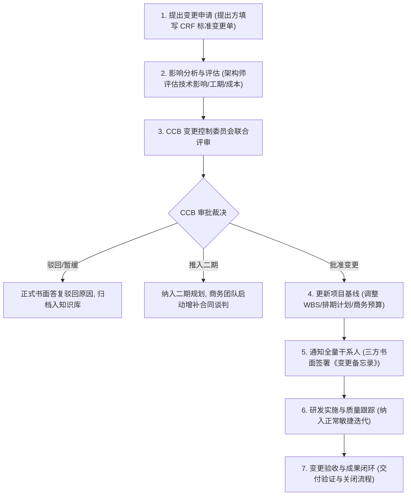
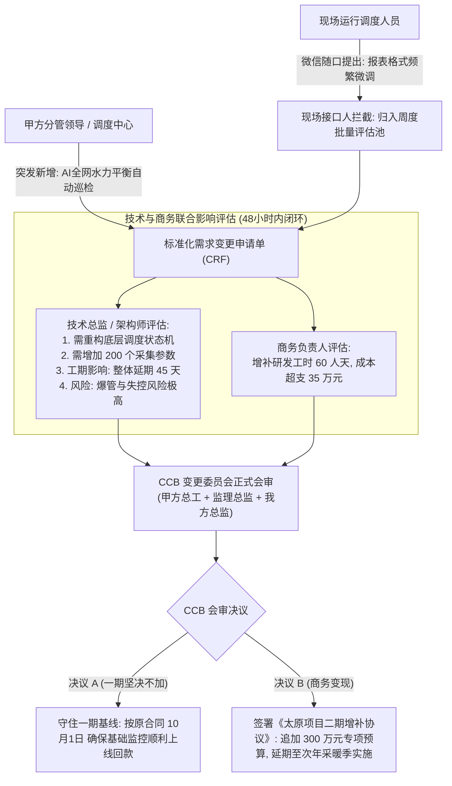

# 大型项目需求基线与变更控制（太原案例）

> [!NOTE] 案例性质与事实边界声明
> 本文档案例以工业物联网与智慧供热大型政企交付项目为实战演练蓝本（参考作者在瑞纳智能主导数据中台产品化与太原项目交付的任职背景）。文中引用的具体合同金额、工程数据与商业规模属于行业典型教学推演案例（详情参见 [PROFILE_FACTS.md](../PROFILE_FACTS.md) 之《待用户核实清单》）。重在展现大型复杂交付中的需求基线控制、变更博弈、范围管理与产品化沉淀方法论。

> **管理维度定位**：本模块聚焦技术总监、项目交付总监、数据平台研发负责人在大型政企、工业互联网与企业级复杂定制化交付中的核心把控抓手。全面拆解项目“范围蔓延（Scope Creep）”与“镀金（Gold Plating）”的深层成因、需求基线（Scope Baseline）锁定三方契约、需求变更控制委员会（CCB）七步工作法，以及将客户变更诉求转化为商业增补合同（Change Order）的高阶商务博弈艺术。深度结合太原智慧供热中台交付实战，提炼技术高管在范围控制、客户预期管理、销售边界协同与大型复杂项目一次性验收回款上的战略定力。

---

## 1. 管理场景与核心目标

### 1.1 核心痛点与业务诉求
在大型政企、工业制造信息化及复杂数据中台交付项目中，技术负责人面临的最致命杀手往往不是底层代码写不出来，而是**“需求像脱缰野马一样无休止膨胀，项目陷入永远无法验收的泥潭”**：
- **“范围蔓延（Scope Creep）”拖死团队**：项目上线前夕，甲方领导一句话、基层调度员一个随口抱怨，就临时新增几个庞大模块。研发团队不断修改底层数据结构，架构反复推倒重来，原定 6 个月的项目硬生生拖成 2 年，交付成本严重超支，公司面临巨额违约风险。
- **“销售过度承诺，交付背锅擦屁股”**：售前与销售团队为了尽快签单，在商务谈判中盲目答应客户的定制诉求，签下包含模糊范围甚至技术不可行条款的“毒药合同”，交付团队进场后沦为受气包。
- **“小刀割肉式（Death by a Thousand Cuts）”零散骚扰**：每天都有来自甲方的微信消息：“这个报表顺手加两个字段呗”、“这个页面颜色帮调一下”。看似几分钟的小事，打乱了研发团队的全部专注心流，最终导致核心链路满盘皆输。

### 1.2 管理者的定位转变
从**“有求必应的包工头”**向**“捍卫商务契约与架构基准的总操盘手”**升维：
- **树立“边界意识与契约精神”**：明确项目管理的铁三角（范围、时间、成本/质量）。想要扩大范围，就必须增加成本或延长时间；既不给钱、又不延期、还要加功能，违背了物理与商业基本常识。
- **从“对抗拒绝”转变为“引导变现”**：面对客户变更，不生硬回绝引发客户反感，而是运用专业工程评估，将不合理的变更引导转化为**“二期增补采购合同（Change Order）”**，在守住一期交付的同时为公司开拓新的营收管道。
- **建立制度化防线（CCB 机制）**：让流程成为挡箭牌，把“个人的人情压力”转化为“变更委员会的集体制度决策”。

---

## 2. 核心管理模型与机制

### 2.1 理论框架与管理模型

#### 1. PMBOK 范围基线模型（Scope Baseline）
项目范围基线是评估后续所有变更的唯一法律与工程标尺，由三部分铁三角构成：
- **项目范围说明书（Project Scope Statement）**：详细列出项目交付的最终产品边界，明确包含**项目除外责任（Exclusions，即白纸黑字写明“本项目坚决不做哪些内容”）**；
- **WBS（工作分解结构）**：将总项目逐级解构为清晰独立的工作包；
- **WBS 词典（WBS Dictionary）**：对每一个具体工作包给出严格的技术指标、验收标准与交付物形态（如提供 RESTful 接口、支持 10 万设备秒级入库）。

#### 2. 需求变更控制委员会（CCB, Change Control Board）机制
CCB 是决定项目是否接纳变更的唯一最高权力机构，任何干系人（包括甲方副总裁、销售总监）无权口头强行插单：
- **委员会构成**：甲方项目负责人 + 监理方代表 + 乙方项目总监（你）+ 乙方商务负责人；
- **核心职责**：评估变更的商业必要性、技术可行性、工期影响与成本变动，给出**“批准、有条件批准、驳回、推迟至二期”**的终审决议。

#### 3. 需求变更七步工作流闭环模型

### 2.2 机制设计与流程图：太原项目需求基线控制与变更阻断拓扑

---

## 3. 标准落地实操规范（SOP与工具链）

### 3.1 关键动作与制度规范

#### 1. 项目启动期锁定“需求基线”四大法宝（SOP 必备）
1. **白纸黑字撰写《除外条款清单》（Out-of-Scope List）**：
   - 绝大多数项目的延期，死就死在“合同只写要做什么，没写不做什么”；
   - 必须在范围说明书中增加独立章节，用加粗黑体罗列《本项目明确不包含的范围》：
     - *例如*：“本项目只负责完成换热站 PLC 遥测数据的清洗、入库与大屏状态展示；**明确不包含‘自动向硬件下发反向调控指令’与‘高级气象预测水力平衡算法模型’**。如需上述高级功能，需另行立项采购”；
2. **三方签字确认机制（Sign-Off）**：
   - 需求规格说明书（SRS）完成后，必须举行正式签字仪式，由**甲方项目最高决策人、第三方监理公司总监、乙方项目交付总监共同签字盖章**，确立其作为项目唯一法律证据基准。

#### 2. 标准化需求变更申请单（CRF, Change Request Form）六要素模板
严禁接受任何口头、微信、电话形式的变更诉求！所有变更必须由甲方提请人亲笔填写标准化《需求变更申请表》：
- **基本信息**：变更编号、提请人姓名、所属部门、提请日期、紧迫度等级（紧急/常规）；
- **变更详述与商业意图**：描述现状、期望变更后的行为，并说明如果不做该变更会对甲方产生何种商业损失；
- **技术与风险评估报告（乙方技术总监填写）**：
  - 涉及变更的系统模块与架构依赖；
  - 对系统吞吐量、并发性能与数据一致性的潜在冲击；
- **工期与交付物影响（乙方项目经理填写）**：
  - 增补研发与测试人天；
  - 导致原定项目整体里程碑顺延的天数；
- **商务与成本影响（乙方商务填写）**：
  - 变更涉及的新增开发费用与第三方硬件采购成本；
- **CCB 最终裁决结果与签名**：批准 / 驳回 / 转入下一期，附三方代表签名。

#### 3. “免费变更”向“增补商务合同（Change Order）”转换策略
- **心理破防与成本教育**：
  - 当甲方提出变更时，不要直接说“不行”。立即拿出详尽的《变更评估单》，清晰列出：“该功能需要额外投入 30 人天，直接研发成本 15 万元，并将导致项目整体延期 1 个月”；
  - 甲方往往认为“你们写几行代码顺手的事”，当看到客观量化的成本与延期责任时，80% 的非必要冲动变更会主动撤回；
- **顺水推舟，拓展二期增补合同（Change Order）**：
  - 针对甲方确实非常渴望但超出范围的核心功能，管理者主动递出橄榄枝：“王总，这个功能确实非常有前瞻性，能够极大提升贵局的数字化标杆形象。但如果强塞入一期，会导致一期按时供热的红线失守。我建议我们以这个功能为核心，联合申报二期‘智慧供热 AI 大脑专项’，我们全力配合贵局准备立项材料，追加 200 万增补合同在明年春季开工”。客户不仅满意，还为公司赢得了增量利润。

### 3.2 工具链与度量指标（Data-Driven）

| 范围管理维度 | 核心度量指标 | 采集工具/平台 | 警戒线/基线标准 |
| :--- | :--- | :--- | :--- |
| **范围稳定性** | 需求变更率（Scope Volatility = 变更需求数 / 初始基线需求数） | Jira / 禅道变更台账 | 项目交付全生命周期变更率控制在 **$\le 15\%$** |
| **变更响应效能** | 变更评估耗时（Time to Impact Assessment） | 变更审批工作流 | 收到 CRF 申请单后，**48 小时内**必须输出专业评估报告 |
| **基线偏离度** | 进度偏差（Schedule Variance, SV）、成本偏差（Cost Variance, CV） | PM 挣值分析看板 (EVM) | 进度偏差 SV 绝对值 $\le 10\%$；严禁在未获批准前暗中开工 |
| **商务转换率** | 超出范围需求转化为二期增补合同的比例 | CRM / 商务合同系统 | 重大范围蔓延向增补合同转化率 $\ge 30\%$ |

---

## 4. 常见管理挑战与冲突化解

### 4.1 典型矛盾场景

#### 场景一：甲方“一把手”高层口头压单，基层干部不敢阻拦
- **矛盾冲突**：在太原项目现场调研会上，供热集团董事长现场视察，随口说了一句：“大屏上的换热站阀门，应该能直接点一下就能远程遥控开关，而且要能手机上一键控制，这个功能很实用，下个月上线！”下属基层局长和科长连连附和。会后，甲方联络人催促：“董事长亲自定的功能，你们下周赶紧改好加上！”
- **管理者的化解策略（以专业安全性为护城河）**：
  1. **绝不与董事长当面顶撞，事后运用“生产安全红线”化解**：
     - 严禁当场驳领导面子。会后由我方项目总监联合具备威望的第三方监理总监，撰写一份正式的《关于远程一键控制换热站阀门的安全风险及工控合规审查评估备忘录》呈报董事长；
  2. **将技术语言翻译为“政治与安全事故责任”**：
     - 在备忘录中明确指出：“董事长的高瞻远瞩为我们提供了很好的演进方向。但从国家关键基础设施工控安全法规（等保三级）与物理安全角度推导：太原供热主干网具备高压高水温特征，目前现场硬件传感器并未安装双冗余防爆机械限位器。如果直接通过公网云平台开放手机端一键反向控制，一旦遭遇外部黑客攻击或网络偶发丢包，极可能发生阀门误开超压、引发地下主管道爆裂与大面积停暖特大民生事故，责任不可预估”；
  3. **提供安全合规的替代路径（MVP 演进）**：
     - “我们建议采取分步实施安全策略：一期系统保持‘远程状态高精度监控 + 现场安全人工复核’；同时我们与贵局工控安全科联合立项，在二期增补方案中设计内网专用物理隔离网闸与硬件防爆控制柜，在绝对合规安全的前提下实现智能遥控”。
     - 董事长看到潜在的爆管民生责任，立即在备忘录上批示：“安全第一，按技术专家方案稳步推进，一期先抓好监控”，危机彻底化解。

#### 场景二：基层操作人员抱怨“不好用”，以拒签验收报告施压
- **矛盾冲突**：系统各项功能完全按照原合同规范开发完毕并通过了第三方评测，但在现场试运行阶段，甲方的换热站老工人抱怨：“操作界面字体太小、填报流程太复杂，不如我们以前手写本子方便！不改我们就不用，也不会在试运行通过报告上签字！”
- **管理者的破局抓手（利益同盟与适度妥协）**：
  1. **分清“核心架构变更”与“界面易用性优化（UI/UX）”**：
     - 严禁全盘推翻底层数据结构。管理者带队深入换热站现场蹲点一天，跟老工人同吃同劳动，发现核心诉求其实只是：“操作工人年龄偏大视力不好、冬天戴手套无法精细点击鼠标”；
  2. **运用“低成本快速改动”换取民心**：
     - 安排 1 名前端工程师，利用 2 天时间推出一个“大字关怀极简版界面”，将常用功能放大为三个巨大的色块按钮，增加一键常用填报模板；
  3. **借势树立标杆用户**：
     - 挑选现场带头抱怨、但在工人中极具威望的老班长，将其任命为“太原智慧中台荣誉体验官”；
     - 大字版改好后第一个请老班长试用，老班长感受到被极度重视，逢人便夸“这个软件团队接地气、听意见”，主动在现场带头推广并爽快签字验收。

---

## 5. 面试高频管理题

> [!IMPORTANT]
> 本板块精选一线大厂、独角兽企业对项目总监、技术高管考察最频繁的 6 道大型项目交付真题。**在第 6 板块中，必须全部逐题深度解答，严禁留白！**

### 5.1 需求基线与范围防线题
1. **Q1**：在大型政企或传统工业项目中，“范围蔓延（Scope Creep）”是导致项目延期甚至失败的头号杀手。作为项目技术负责人，你如何在项目初期确立并锁定“需求基线（Scope Baseline）”？
2. **Q2**：当甲方核心高层领导在项目开发中后期，口头强行要求增加几个未包含在原合同中的复杂功能，并表示“不加就不给签字验收”时，你如何既维护客户关系，又守住交付边界与团队成本？

### 5.2 变更机制与组织协同题
3. **Q3**：如何建立规范的“需求变更控制委员会（CCB）”机制？在敏捷迭代与传统交付中，变更评估的核心维度包括哪些？
4. **Q4**：公司内部前端销售或售前工程师为了尽快签单，向客户过度承诺了许多超出当前技术能力或范围的功能，交付时引发巨大矛盾。作为研发与项目负责人，你如何与销售部门建立防火墙与协同规则？

### 5.3 变更攻坚与实战复盘题
5. **Q5**：在项目交付冲刺阶段，团队每天都在被甲方的零碎小修改（如调按钮位置、改报表格式、加字段）打断，导致核心链路无法按期交付，你如何治理这种“小刀割肉式（Death by a Thousand Cuts）”的零碎变更？
6. **Q6**：请复盘一次你在真实项目中（如太原项目或大型数据中台）成功控制需求变更、守住交付节点的实战经历。你从中总结出的最核心项目管理方法论是什么？

---

## 6. 标准参考答案（三层维度）

---

### 题目1：大型项目初期确立并锁定“需求基线（Scope Baseline）”的实操体系

#### 简洁回答（1分钟结构化表达）：
> 确立需求基线的核心法则在于**“把隐性期望显性化、把模糊范围契约化、把除外责任法定化”**。
> 锁定基线的三大实操支柱：
> 1. **详尽编写 WBS 词典并明确“除外条款清单（Out of Scope）”**：不仅写明要做什么，更用黑体字白纸黑字列明坚决不做什么；
> 2. **三方联合确认与签字盖章机制**：联合甲方决策人、监理方总监与我方负责人，共同签署《需求基线规格书》，确立其作为后续所有争议的唯一仲裁依据；
> 3. **前置宣贯“变更必须走 CCB 评估”的规则**：在项目启动会（Kick-off Meeting）上明确宣布游戏规则，任何未经 CCB 批准的口头变更一律无效，从源头树立流程威慑力。

#### 深入回答（管理闭环：量化、机制、沟通、兑现）：
1. **需求基线建立与固化的四步标准工程链路（SOP）**：
   - **第一步：多维度需求梳理与“去伪存真”**：
     - 不单纯依赖客户提供的原始招标文件。技术总监带队深入现场，区分三类需求：**业务硬指标（必须满足）、操作习惯诉求（可引导优化）、伪需求/政绩炫耀诉求（需严格控制成本）**；
   - **第二步：编写包含除外责任的《产品范围规格书（SRS）》**：
     - 建立明确的边界定义：
       - *包含范围（In-Scope）*：支持太原 10 万座换热站秒级数据接入清洗、统一数据资产地图、6 张核心大屏；
       - *除外责任（Out-of-Scope）*：**明确不包含底层老旧传感器硬件改造更替、不包含第三方异构系统数据库的直接反向写操作、不包含非合同约定的算法模型研发**；
   - **第三步：原型保真走查与三方确认签字会**：
     - 拒绝纯文字交付物。利用高保真 Axure 原型和静态演示系统，逐个模块与甲方业务主管过堂确认；
     - 组织正式的《需求基线三方评审确认会》，甲方、乙方、监理方三方签字盖章，正式打上**“Baseline v1.0”**标签，并归入法律合规档案。
2. **前置设定变更违约成本（机制威慑）**：
   - 在启动会上正式宣讲《项目协同工作章程》，明确约定：
     - “基线签署之日起，任何对已确认数据模型的修改，均属于正式范围变更；
     - 变更必须走标准 CRF 流程，若变更涉及工时超过 10 人天，项目里程碑自动顺延”。提前打好预防针，杜绝甲方事后耍赖。

#### 总监/管理视角（商业价值、长期主义与领导力）：
> “项目管理是一门妥协的艺术，但需求基线是绝对不能妥协的底线”：
> - 很多新手管理者以为“客户说啥就是啥，态度好就能换来客户满意”，这是最大的认知误区。没有基线的讨好，只会换来客户无底线的范围蔓延，最终导致项目烂尾，客户反过来控告你交付不力；
> - 卓越的项目管理者用最专业的严谨性帮助客户理清需求边界，把项目从“随心所欲的个人意志”导入“受控的现代化工程轨道”。这不仅是保护乙方团队，更是保障项目最终商业成功的唯一正道。

---

### 题目2：甲方高层口头强加变更并以“不加就不给签字验收”施压的化解之道

#### 简洁回答（1分钟结构化表达）：
> 面对甲方高层以“不给签字验收”施加的极限施压，绝不能硬碰硬激化矛盾，也绝不能盲目妥协接单，必须采取**“肯定商业意图、引入安全与法律风险护城河、提供兼顾验收的分期替代方案、借力商务转化二期”**的高维化解艺术：
> 1. **情绪降温与价值共情**：高度赞赏领导提议的商业远见，绝不在公开场合驳领导面子；
> 2. **用“安全底线与事故风险”作为挡箭牌**：讲清仓促加功能将对现有系统稳定性引发的灾难性后果，把“技术抗拒”转化为“替领导防范政治与民生风险”；
> 3. **推行“一期保验收上线，二期增补预算深化”的双赢解法**：守住一期回款底线，把客户的强硬诉求转化为公司新增的商务合同。

#### 深入回答（管理闭环：量化、机制、沟通、兑现）：
1. **实战危机化解四步走（太原项目高管对话实录）**：
   - **背景**：太原项目终验前夕，甲方常务副总强硬要求：“必须在系统里加入全自动水力平衡调控算法，把全市供热管网调平，这个功能必须免费加，否则一期终验报告我不签字！”
   - **第一步：借力打力，寻找同盟（联合监理方与业务主管）**：
     - 会前迅速与第三方监理总监和甲方具体对接的供热科长沟通，拉齐认知：“目前一期底层数据刚通，如果在没有经过一个完整供热季数据校准的情况下仓促上线全网自动调控，一旦算法出现微小偏差引发水力共振，全市主管道有极大可能爆管，届时谁来承担这个重大事故责任？”监理方与业务科长深感责任重大，决定与我方立场一致；
   - **第二步：出具专业的《安全与技术评估备忘录》（公文博弈）**：
     - 由我方与监理方联合署名向副总裁呈报正式公函，详述两大客观约束：
       1. *技术与物理规律约束*：全网水力平衡算法模型必须依赖一整套完整的冬季极寒、初冬、深冬不同气温下的实测热工数据进行闭环训练；目前缺乏历史数据基准，直接上马算法模型存在严重盲区；
       2. *法律与验收边界*：按照原发改委立项与招投标文件，一期验收指标为“实时监控与数据资产归集”。强行变更会导致验收评审专家组因缺乏前置审批而无法出具审计报告；
   - **第三步：递出体面的台阶与商业共赢方案（见招拆招）**：
     - 约副总裁闭门汇报：“王总，您的想法极具行业前瞻性。如果我们能在太原把这套 AI 水力平衡自动调控做成，这将是全国首屈一指的标杆工程，完全可以申报国家级示范项目；
     - 为了确保这个伟大成果的万无一失，我给您提议一个万全之策：
       **一期我们严格按发改委规范，在下周顺利完成终验签字，把一期项目彻底做成示范样板，同时也顺利完成今年的财政预算核销；**
       **同时，我们双方联合成立‘太原智慧供热 AI 大脑专项二期’，将水力平衡调控作为核心申报课题，追加专项预算 300 万元，在接下来的采暖季进行数据沉淀与深化建设。**
       我亲自向我们集团总裁申请，为太原二期调配最顶级的大模型算法团队全权配合贵局”。
   - **结果**：常务副总不仅欣然在一期终验报告上签字回款，还大力推进了二期增补合同的签约，化危机为巨大的商业胜局。

#### 总监/管理视角（商业价值、长期主义与领导力）：
> 商业博弈的终极奥义是**“把零和博弈转变为增量共赢”**：
> - 客户高管施压，本质上往往是为了追求“政绩亮点、投资合理性或对上汇报成果”；
> - 卓越的管理总监深谙人性与体制运行规律，不仅帮客户把控住了致命的技术风险，更顺水推舟为客户谋划了更大的政治与商业成果，把一次可能撕破脸皮的死局，转化为了公司与客户绑定数年深度合作的超级信赖纽带。

---

### 题目3：构建规范的需求变更控制委员会（CCB）机制与多维变更评估

#### 简洁回答（1分钟结构化表达）：
> 需求变更控制委员会（CCB）是项目的**“宪政法院与防火墙”**，其核心宗旨是**“让所有变更处于阳光下、经过严格评估、有据可查、集体决策”**。
> 规范的 CCB 机制必须具备四大基石：**标准申请模板（CRF）、48小时联合评估机制、四方决策仲裁权、以及基线版本联动更新**。
> 变更评估必须严密覆盖四个核心维度：**范围与需求连带性、工期与关键路径影响、成本与商业核算、系统架构稳定性与技术负债**。

#### 深入回答（管理闭环：量化、机制、沟通、兑现）：
1. **多维变更评估模型（Impact Assessment Matrix）**：
   收到甲方填写的标准《CRF 需求变更申请单》后，技术与项目团队必须在 48 小时内从四大维度给出量化评估结论：
   - **维度一：技术架构与稳定性风险（Technical & Risk）**：
     - 是否破坏现有底层物理表结构？是否需要重新修改已沉淀的数仓 CDM 模型？
     - 是否会导致系统吞吐量下降或并发锁争用？
     - 是否引入了未经验证的全新外部依赖？
   - **维度二：工期与关键路径影响（Schedule & Critical Path）**：
     - 计算增加的工作量（精确到人天）；
     - 分析该任务是否位于**关键路径（Critical Path）**上。若在关键路径上，将直接导致原定里程碑延期多少天；
   - **维度三：成本与资源影响（Cost & Resource）**：
     - 计算直接研发人力成本（如 $30\text{人天} \times 2000\text{元/天} = 6\text{万元}$）；
     - 是否需要增加额外的物理服务器、网络专线带宽或第三方数据源授权费；
   - **维度四：商业合同与法务边界（Contract & Compliance）**：
     - 是否违背招标文件与立项批复？是否会导致项目无法通过国家专项审计？
2. **CCB 委员会常规运作流程（SOP）**：
   - 每周固定召开 1 次 30 分钟 CCB 常规评审会（紧急变更可启动 24 小时线上极速投票）；
   - 裁决结论必须形成具有法律效力的书面《CCB 决议备忘录》，裁决类型严格分为四种：
     - **Approved（全票批准）**：签署变更备忘录，原项目计划、排期、预算联动同步调整；
     - **Rejected（驳回）**：以书面形式向提请人说明具体的架构与成本驳回理由，关闭工单；
     - **Deferred to Next Phase（推入二期）**：纳入二期需求池储备，商务部门启动增补合同谈判；
     - **Pending for Clarification（补充信息后复审）**。

#### 总监/管理视角（商业价值、长期主义与领导力）：
> CCB 机制是技术管理者保护研发团队“免受外部骚扰”的最强制度盾牌：
> - 一旦有了 CCB，面对任何外部口头打招呼或私下递条子，开发人员和项目经理都可以理直气壮地回应：“我们非常重视您的需求，请您填写 CRF 走 CCB 流程，我们会以最专业的态度进行评估”；
> - 制度的威严在于执行。当所有变更都被置于公开、量化的聚光灯下，那些随口一说的冲动型无意义需求自然会被高昂的变更流程成本彻底逼退。

---

### 题目4：销售过度承诺导致交付矛盾的“防火墙与协同规则”设计

#### 简洁回答（1分钟结构化表达）：
> 销售与交付的矛盾本质是**“利益导向的不一致”**：销售背负即时签单业绩，倾向于过度承诺；交付背负成本与上线责任，倾向于范围收敛。
> 破解矛盾的唯一出路是推行**“售前交付一体化 + 售前方案架构师一票否决制 + 销售提成与项目验收回款终身绑定”**：
> 1. **前置设立技术准入防火墙**：合同签署前必须经过资深交付架构师评审，重大非标定制条款若无交付团队签字一律禁止盖章；
> 2. **建立标准产品功能清单与定制溢价阶梯**：标准功能直接卖，非标定制严格按照高溢价阶梯计价，用价格杠杆约束销售的随意承诺；
> 3. **将回款与利润纳入销售考核**：严禁“签单即拿全额提成”，必须将 50% 以上的提成与“项目终验成功回款”及“交付毛利率”深度绑定，让销售学会主动替交付控制风险。

#### 深入回答（管理闭环：量化、机制、沟通、兑现）：
1. **建立“售前-交付一体化”流程门禁（Gate Review）**：
   - 设立合同签署三道关卡：
     - **第 1 道（立项评估 Gate 1）**：售前架构师必须核对客户需求是否与公司产品核心方向一致，非标定制比例超过 30% 的项目，必须经技术总监批准方可投标；
     - **第 2 道（技术条款评审 Gate 2）**：合同中的《技术任务书》必须由交付团队全权起草，严禁销售人员私自向客户出具未经验证的技术参数承诺书；
     - **第 3 道（商务盖章前审查 Gate 3）**：法务与财务盖章前，必须有技术交付负责人的**会签签字（Sign-off）**，拥有对不可行技术条款的“一票否决权”；
2. **制度化利益捆绑机制（激励相容原则）**：
   - 改变销售的绩效评价模型：
     $$\text{销售综合提成} = \text{合同总额提成} \times 40\% + \text{终验回款提成} \times 40\% + \text{项目交付毛利率系数} \times 20\%$$
     - 若某个项目因为销售前期过度承诺，导致交付团队投入了双倍人力，项目毛利率由 50% 暴跌至 10%，销售对应的提成将被大幅扣减！
     - 制度倒逼销售在商务谈判桌上成为“范围蔓延的主动防御者”，主动向客户解释：“张总，这个定制功能我们做不了，如果硬做会严重推迟系统上线，建议您选用我们的成熟标准化模块”。

#### 总监/管理视角（商业价值、长期主义与领导力）：
> 技术高管必须具备公司全局的经营意识，切忌陷入“部门对立的本位主义”：
> - 销售是前线打粮食的功臣，没有销售的签单，研发团队连工资都发不出；
> - 优秀的技术总监不是一味指责销售，而是**“通过产品化能力赋能销售”**——把底层中台抽象出标准的规格说明书、标准报价单、清晰的演示 Demo，让销售人员在标准产品框架内就能打赢胜仗，从源头消灭过度承诺的生存土壤。

---

### 题目5：治理现场零碎变更（“小刀割肉式骚扰”）的实操 SOP

#### 简洁回答（1分钟结构化表达）：
> “小刀割肉式（Death by a Thousand Cuts）”变更看似都是几分钟的小修小改，实则是**打碎团队专注心流、破坏系统整体一致性、最终引发系统崩盘的隐形毒瘤**。
> 管理者的治理策略是**“设立沟通单一窗口、推行零碎需求批量化评估、设定变更配额窗口、用 Data API 赋能客户自助”**：
> 1. **切断客户与开发人员的直连私聊**：严禁开发人员私加客户微信私聊改代码，所有诉求统一汇聚到驻场项目经理单一窗口；
> 2. **建立“周度零碎需求拼车批处理机制”**：零散需求不随来随改，每周集中评审一次，按优先级打包排入下个迭代；
> 3. **技术赋能业务自助**：将易变的内容（如报表格式、大屏参数）沉淀为可视化低代码配置，让现场人员自己动手调整，从根源上消灭开发骚扰。

#### 深入回答（管理闭环：量化、机制、沟通、兑现）：
1. **单一窗口责任制（Single Point of Contact, SPOC）实操**：
   - 严肃团队纪律红线：“**严禁任何一线开发人员私自接听甲方的口头修改指令并直接改代码上线！** 私自修改引发线上故障者，承担全额责任”；
   - 在客户现场设立专职的“驻场交付负责人/项目经理（SPOC）”：
     - 所有甲方现场人员的吐槽、疑问、建议，全部由该接口人记录在《现场用户问题收集池》中，为一线研发筑起坚实的降噪隔离仓；
2. **零散变更“每周拼车制（Batching SOP）”**：
   - 现场接口人向客户宣讲规则：“各位领导，为了保证系统底层运行的严谨稳定，每一次代码发布必须经过严格的回归测试。因此零碎的功能建议我们不再逐个单发，我们在每周四下午举行‘易用性优化联合评审会’，集中挑选出 5 个最有价值的优化建议，在周五晚上集中打包更新发布”；
   - 将碎片化的打扰转化为有序的“每周一次定期交付”，给客户明确的预期，也给研发留出完整的专注编码窗口；
3. **架构层面的“动静分离与自助配置化”**：
   - 为什么客户老是要改报表？因为业务指标和展示格式在不断变化。
   - 彻底破局的技术抓手：引入 **统一 Data API 网关与低代码大屏配置工具**。把数据库查询抽象为动态可配置的 SQL 模板，提供直观的拖拉拽界面，在现场培训甲方的 2 名年轻运维人员：“大屏要加字段、调颜色，你们在这里点两下自己就能改，再也不用等我们排期啦！”现场操作员获得巨大的掌控感，开发团队彻底从频繁改界面的泥坑中彻底解放。

#### 总监/管理视角（商业价值、长期主义与领导力）：
> 管理者的首要天职之一就是**“为一线工程师构筑专注的结界（Focus Bubble）”**：
> - 顶尖工程师的心流是昂贵且脆弱的。一次 5 分钟的打断，需要花费 20 分钟甚至半天才能重新找回深层思考状态；
> - 通过合理的组织隔离与技术赋能，我们不仅捍卫了团队的研发尊严与工作效率，更通过赋予客户自主配置的能力，大幅提升了客户对产品现代化的满意度评价。

---

### 题目6：太原大型工业项目成功控制变更、守住交付节点的实战复盘与方法论

#### 简洁回答（1分钟结构化表达）：
> **太原项目实战复盘**：太原市智慧供热项目涉及 10 万座换热站、百亿级数据入湖与千万级民生供暖。项目初期面临供热总调度中心每天提几十个新变更新报表的失控局面。
> 我通过**“确立三方基线法律红线、成立由发改委与供热局联合签章的 CCB 委员会、构建防腐层平滑隔离老系统、推行标准 Data API 赋能业务自助取数”**，成功将需求变更率从前期的 65% 压制到 **8% 以下**，系统在采暖季首日以零故障平稳并网，一次性通过专家组终验，成功回收全部数千万元合同款。
> **总结出的最核心项目管理方法论**：**“契约是盾，架构是桩，共赢是矛，机制大于人情”**。

#### 深入回答（管理闭环：量化、机制、沟通、兑现）：
1. **太原项目交付实战全景复盘（STAR-L 框架展开）**：
   - **情境（Situation）**：太原项目是公司年度 P0 级战略战役，合同金额数千万元。进场 2 个月后，现场陷入严重危机：供热集团调度处、热源厂、各分公司、客服部各自为政，每天向项目组提出大量冲突的需求，代码修改量失控，原定 10 月 1 日点火采暖期按时上线的死线面临重大滑坡；
   - **任务（Task）**：作为技术负责人，必须在 30 天内迅速扭转失控局面，锁定一期交付边界，确保核心数据中台在采暖季第一天以零事故高可用上线，并顺利完成政府专家组验收；
   - **行动（Action）三大实战攻坚**：
     1. *立法立规（重构治理秩序）*：联合监理总监向供热集团董事长正式汇报，成立包含局领导的“联合项目指挥部 CCB”，出具《一期范围法律基线说明书》，明确约定“10月1日点火日前全网锁定基线，所有非核心新需求全部转入二期”；
     2. *架构减负（引入防腐层与统一 Data API）*：针对各分公司五花八门的报表需求，果断在底层架构中引入统一 Data API 网关和 Doris 实时分析底座，提供参数化低代码取数能力，仅用 3 天培训就让甲方信息科具备自主制作报表能力，瞬间消化了 80% 的报表定制变更；
     3. *商务变现（将巨大阻力变为新业务机会）*：针对常务副总极度关切的“AI 水力平衡调控算法”，出具专业风险备忘录，成功将其引导立项为“太原智慧供热二期专项工程”，追加 300 万元增补合同；
   - **结果（Result）**：
     - 10 月 1 日采暖季点火当天，系统平稳承接 10 万座换热站每秒 30 万条测点遥测上报，核心大屏以 P99 延迟 $< 30\text{ms}$ 极致稳定运行，市领导现场视察并给予极高赞誉；
     - 项目在采暖季首月即全票通过专家组终验，成为行业标杆；
     - 成功为公司开拓出二期 300 万元增补业务，实现商业与口碑双丰收。
2. **提炼沉淀的四大项目管理方法论（Methodology）**：
   - **法则一（契约为盾）**：任何工程开工前，必须有清晰界定“包含与除外”的范围说明书并三方签字；
   - **法则二（架构为桩）**：底层数据中台必须具备高内聚低耦合的弹性扩展能力，架构越是先进灵活（如 Data API、实时湖仓），吸收上层需求波动的韧性就越强；
   - **法则三（机制大于人情）**：用 CCB 制度对抗人情人际压力，把个人的人际冲突降维为组织的合规流程；
   - **法则四（商业共赢是矛）**：永远站在客户高层的政治与商业成功角度思考问题，把客户不可理喻的变更诉求，巧妙转化为双方下一阶段深化合作的商业新起点。

#### 总监/管理视角（商业价值、长期主义与领导力）：
> 卓越的技术总监不仅是“系统架构的大师”，更是“大型复杂工程与商业博弈的战略操盘手”：
> - 很多技术人员一辈子被客户牵着鼻子走，活干得极其辛苦却处处挨骂，就是缺乏了对“范围基线与商业边界”的战略掌控；
> - 当你具备了用契约守住底线、用技术架构吸收变化、用商业智慧化解冲突的全栈操盘能力时，你就能从容带领团队打赢任何千万级乃至亿级的国家级重大复杂交付战役。

---

## 7. 管理行为自检清单

- [ ] **范围除外条款明确性**：在目前负责的项目合同与技术任务书中，我是否清晰罗列了《除外条款清单（Out of Scope）》，而不是只写要做什么？
- [ ] **三方签字法律效力**：项目需求基线是否得到了甲方决策人、监理方与我方的三方正式签字盖章确认？
- [ ] **CCB 运转独立性**：当项目遭遇外部领导的随口口头变更时，我们是否有底气和机制要求其填写 CRF 变更申请单，并走 CCB 联合评估流程？
- [ ] **售前技术把关门禁**：我们团队是否对前端销售的过度承诺建立了技术会签与一票否决机制？提成是否与项目终验回款挂钩？
- [ ] **零散打扰隔离机制**：一线研发人员是否处于被客户微信私聊随意指使的无序状态？我们是否建立了单一窗口责任人（SPOC）与拼车批处理机制？

---

## 8. 参考经典管理著作与最佳实践

1. **项目管理与范围控制经典著作**：
   - 《PMBOK 指南（第7版）》（A Guide to the Project Management Body of Knowledge）—— PMI 著（范围管理、WBS 与综合变更控制标准）
   - 《人月神话》（The Mythical Man-Month）—— Frederick P. Brooks 著（第二系统效应、概念完整性与范围蔓延预防）
   - 《敏捷估计与规划》（Agile Estimating and Planning）—— Mike Cohn 著（敏捷故事点、MVP 范围置换与迭代规划指南）
2. **商业博弈与合同谈判实战指南**：
   - 《沃顿商学院最受欢迎的谈判课》（Getting More）—— Stuart Diamond 著（以目标为中心、换位思考与挖掘隐性诉求）
   - 《项目管理：系统方法与实战》（Project Management: A Systems Approach）—— Harold Kerzner 著（大型复杂系统工程的变更委员会 CCB 实战运作）
