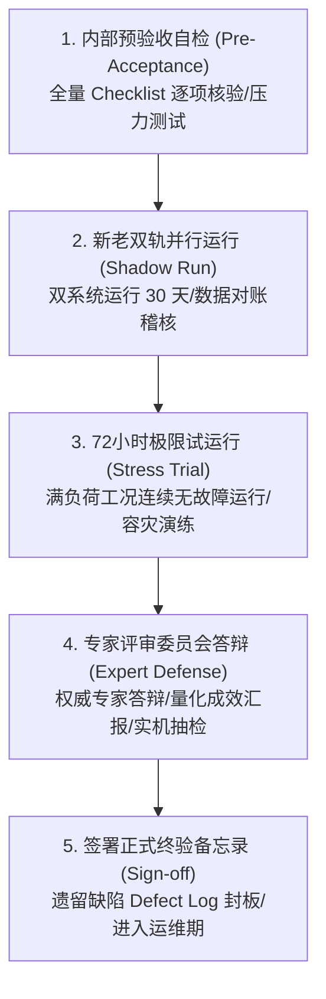

# 供应商管理、客户验收攻坚与项目复盘（太原案例）

> [!NOTE] 案例性质与事实边界声明
> 本文档案例以工业物联网与智慧供热大型政企交付项目为实战演练蓝本（参考作者在瑞纳智能主导数据中台产品化与太原项目交付的任职背景）。文中引用的具体合同金额、工程数据与商业规模属于行业典型教学推演案例（详情参见 [PROFILE_FACTS.md](../PROFILE_FACTS.md) 之《待用户核实清单》）。重在展现软硬件一体化协同定责、政企客户专家答辩与中台资产沉淀的方法论。

> **管理维度定位**：本模块聚焦技术总监、项目交付总监与数据平台负责人在软硬件一体化、城市级物联网大数据与大型企业复杂交付项目中的全生命周期攻坚能力。系统拆解第三方软硬件供应商的 SLA 接口契约与反推诿机制、政企与大型国企标杆项目的“专家评审委员会”终极验收答辩战术、72小时满负荷稳定性试运行保障，以及项目收尾后无指责复盘（Blameless Post-Mortem）与数据中台产品化资产沉淀。以太原城市供热大数据平台正式验收为实战案例，锤炼技术高管跨组织协同、高压攻坚与商业价值变现的全局领导力。

---

## 1. 管理场景与核心目标

### 1.1 核心痛点与业务诉求
在软硬件一体化的大型工业互联网与数字政府交付项目中（如城市级智慧供热、智能制造、智慧交通），项目团队往往处于“多方利益夹缝”之中，面临三大管理死穴：
- **软硬件交叉集成的“黑盒推诿”**：现场数据断流或计算异常时，软件团队指责硬件网关丢包、传感器漂移；硬件供应商指责中台 MQTT/Kafka 消费吞吐不足、网络抖动。双方各执一词，项目联调停滞，客户失去耐心。
- **政企客户验收的“严苛政治性与专家阻击”**：政企与大型国企项目验收不仅关乎纯功能是否实现，更面临行业权威专家评审委员会的技术挑剔、信创环境适配、网络安全等保合规，以及各级调度员对传统旧系统操作习惯的路径依赖抵触。
- **“做完即忘、踩坑重踩”的资产流失**：历经千辛万苦交付完一个大项目后，团队身心俱疲，项目代码与定制脚本沉睡在分支中，未沉淀为标准化组件；新项目启动时，新人再次重造轮子、踩同样的坑，公司研发边际成本居高不下。

### 1.2 管理者的定位转变
从**“埋头救火的技术保姆”**向**“掌控端到端交付生态的总指挥”**升维：
- **从“被动响应”向“契约前置与数据存证”转型**：对第三方供应商不再凭口头信任，必须建立可量化、可审计的接口契约、SLA 罚则与 Mock 挡板隔离机制，以抓包与通信日志证据链定责。
- **从“害怕专家质询”向“用量化指标与双轨对账主导答辩”转型**：将验收过程转化为展示团队专业度与系统商业价值的舞台，用数据说话（如水力平衡方差降低 42%、综合能耗节约 11.5%），打消专家与甲方领导顾虑。
- **从“项目终点”向“产品化资产起点”转型**：通过无指责复盘（Blameless Post-Mortem）提炼通用中间件、标准驱动网关与交付 SOP，实现“交付一个大项目，孵化一款标准化产品”。

---

## 2. 核心管理模型与机制

### 2.1 理论框架与管理模型

#### 1. 软硬件供应商契约与 SLA 约束矩阵
在项目启动阶段，必须将技术接口标准与商务法务约束紧密绑定，确立四大刚性约束：
- **接口协议白纸黑字化（ICD, Interface Control Document）**：严格定义数据帧格式（如 Modbus RTU 寄存器映射、MQTT Topic 命名空间与 Payload JSON Schema、OPC-UA 节点树），任何一方私自更改字段类型或单位即构成违约。
- **网络与通信 SLA 质保指标**：约定数据丢包率上限（< 0.1%）、断网本地缓存重发时长（支持边缘离线存储至少 72 小时）、传感器采集与上传延迟（< 3 秒）。
- **联调 Mock 挡板责任隔离**：在真实硬件未到位前，由供应商提供标准协议模拟器（Mock Simulator）。软件平台通过模拟器联调完毕即视为软件阶段性达标，规避因硬件生产延期连带拖垮软件交付考核。
- **分级赔付与尾款关联机制**：将供应商 20%~30% 的尾款与最终联调合格率及客户正式验收挂钩，设定按日计算的工期延误违约金。

#### 2. 大型项目正式验收推进五步法模型
针对政企与大型国企的标杆项目，验收绝非“现场跑个演示”就能过关，必须遵循严密的五步闭环推进法：

- **第一步：预验收自检（Pre-Acceptance）**：项目团队在向甲方提交验收申请前，依据合同与招投标文件逐字逐句进行“模拟专家挑刺式”自检，消除所有 P0/P1 级缺陷。
- **第二步：新老双轨并行对账（Shadow Run）**：在真实采暖期让自研中台与客户原有的老旧 SCADA 系统并行运行 30 天，逐日比对数据一致性，验证新系统在数据吞吐与算法调控上的显著优越性。
- **第三步：72小时满负荷无故障试运行**：在恶劣天气或极寒工况下，保证数据中台、实时流计算与水力控制算法连续 72 小时无崩溃、无内存泄漏、无数据断流。
- **第四步：专家评审委员会答辩**：面对来自高校、市政设计院与热力行业的国家级专家，进行系统架构阐述、核心算法白盒推演、能耗量化数据复核与现场实机随机抽检。
- **第五步：验收备忘录与遗留缺陷封板**：明确遗留缺陷整改责任与时限，锁定项目终验签字，触发商务尾款结算。

#### 3. 结构化项目复盘模型（4R 闭环复盘法）
项目结束后的复盘不是庆功宴，也不是批判大会，而是组织学习的核心机制：
- **Review 目标**：重温最初立项的目标、范围基线与核心里程碑。
- **Result 评估**：对比实际交付结果与预期目标的偏差（工期提前/延后几天、成本超支比例、系统吞吐量是否达标）。
- **Reason 分析**：深入根因（5 Whys），剖析为什么某个接口联调耗时两周、为什么现场集群在第 15 天发生 OOM。
- **Regularity 规律与沉淀**：提炼出可标准化的流程（SOP）、重构公共组件为中台资产、修正后续项目的预估工时基准。

---

## 3. 标准落地实操规范（SOP与工具链）

### 3.1 关键动作与制度规范

#### 1. 软硬件第三方集成联调 SOP
1. **网络与通信安全前置审查**：进场第 1 天完成网络拓扑确立，配置 VPN/专线通道及防火墙规则，杜绝公网直接暴漏未加密工业通信端口。
2. **双向数据存证（Evidence Logging）**：在数据入库最前端（如 Edge Gateway 与 Ingress 网关）记录原始报文 Hex dump 及纳秒级时间戳。当出现数据丢失争议时，通过日志系统快速定责：
   - 若 Ingress 网关未收到报文 $\rightarrow$ 判定为边缘硬件/网络运营商链路责任；
   - 若 Ingress 网关已记录报文但中台看板未展示 $\rightarrow$ 判定为中台流处理或持久化链路责任。
3. **每日联调同步看板（Daily Blocker Sync）**：联调期间每日召开 15 分钟站会，看板只列未解 Blocker，标明“责任单位、责任人、预计恢复时限”。

#### 2. 客户验收攻坚保障清单（太原项目实战 Checklist）
在太原项目专家评审会前一周，负责人必须亲自牵头核验以下八大验收交付物：

| 验收维度 | 核心验收内容与交付物 | 达标验收标准 | 责任角色 |
| :--- | :--- | :--- | :--- |
| **功能契约** | 《需求规格说明书与实际功能对照矩阵》 | 合同清单功能覆盖率 100%，无缺失项 | 交付 PM / 产品经理 |
| **系统性能** | 《72小时稳定性与性能压测报告》 | 10万点位每秒入库时延 < 500ms，CPU/内存利用率 < 70% | 架构师 / 性能测试工程师 |
| **算法成效** | 《太原市智慧供热节能增效量化分析报告》 | 全网水力失调度降低 35% 以上，同气温工况节热率 > 8% | 算法工程师 / 业务数据分析师 |
| **高可用容灾**| 《集群故障演练与数据自愈测试报告》 | 模拟 Kafka/Flink 主节点宕机，备机接管时间 < 30s，数据零丢失 | 大数据运维工程师 |
| **安全与信创**| 《网络安全等保三级认证与信创适配报告》 | 通过麒麟操作系统、达梦数据库与国产服务器兼容性认证 | 安全工程师 / 系统集成师 |
| **操作资产** | 《调度运行操作手册》与《系统运维应急预案》 | 甲方调度员现场盲操抽检考核通过率 100% | 培训讲师 / 交付技术支持 |
| **代码与架构**| 《系统架构设计说明书》与《数据库设计字典》 | 架构图逻辑清晰，表结构文档齐全，设计与源码严格一致 | 核心架构师 |
| **商务法律** | 《第三方设备检定证书》与《计量器具型式批准》 | 现场所有热量表与压力传感器具备国家法定计量资质 | 商务经理 / 硬件供应商 |

#### 3. 验收缺陷分级封板制度（Defect Log）
验收签字的关键阻碍往往是甲方提出的各类琐碎缺陷。必须建立严格的分级管控与书面承诺机制：
- **P0 致命缺陷（Blocker）**：系统崩溃、核心数据大量丢失、安全漏洞。**标准：零容忍，必须 24 小时内修复并重新压测**。
- **P1 严重缺陷（Critical）**：核心报表计算错误、关键阀门控制指令超时失败。**标准：必须在专家会前全部修复完成**。
- **P2 一般缺陷（Major）**：次要统计报表计算缓慢、非核心页面偶发卡顿。**标准：允许附带《遗留问题限期整改承诺书》完成验收**。
- **P3 细微缺陷（Minor）**：页面 UI 像素对齐、字体颜色不符合个别调度员习惯。**标准：直接纳入二期日常运维维护清单，不构成验收阻碍**。

### 3.2 工具链与度量指标（Data-Driven）

| 管理维度 | 核心度量指标 | 采集工具/平台 | 警戒线/基线标准 |
| :--- | :--- | :--- | :--- |
| **供应商交付** | 硬件接口通信报文合格率、固件延期天数 | Jira / 原始网关抓包审计 | 报文异常率 < 0.05%，延期 < 3 天 |
| **联调效率** | 接口联调首轮通过率、缺陷平均修复时长（MTTR）| GitLab Issues / 联调看板 | 联调通过率 > 85%，MTTR < 4 小时 |
| **验收试运行** | 72小时系统无故障连续运行时间（MTBF）、SLA | Prometheus / Grafana | MTBF $\ge$ 72h，系统可用性 $\ge$ 99.99% |
| **业务核心价值** | 供热二次网水力平衡回水温度离散度（标准方差） | 大数据中台数据分析引擎 | 标准方差降至 0.8℃ 以内（平衡度显著达标）|
| **能耗控制指标** | 相同天气基准下供热面积吉焦（GJ）热耗下降率 | 历史对账数仓引擎 | 实际节热率达 8.5% ~ 12%（超额兑现合同指标）|

---

## 4. 常见管理挑战与冲突化解

### 4.1 典型矛盾场景

#### 场景一：硬件传感器供应商延期交付，现场接口报文与文档完全不符
- **矛盾冲突**：太原项目采暖季临近，第三方智能电控阀门与超声波热量表厂家迟到了 20 天才发货到现场。上电后，研发团队发现其 Modbus 寄存器地址与此前提供的 ICD 接口文档完全脱节，高低字节序颠倒，甚至浮点数解析全是乱码。现场联调严重停滞，甲方痛斥乙方进度延误。
- **管理破局招式**：
  1. **证据锁死与责任切割**：立即在现场利用 Wireshark/网络串口工具抓取原始字节流，制作《现场硬件协议不一致偏差分析报告》，白纸黑字对照官方盖章的 ICD 文档，向甲方及监理方书面报备，界定非软件团队原因。
  2. **中台边缘自适应适配**：在数据采集接入层（Edge Gateway）迅速上线动态映射适配脚本（可在后台动态调整字节序 Big-Endian/Little-Endian 与寄存器偏移量），不改动下游大数据清洗引擎。
  3. **商务穿透与供应商高层约谈**：联合商务总监启动供应商违约预警，要求供应商副总裁级领导指派核心固件研发专家携带烧录器驻场 48 小时攻坚，改写固件并对齐协议。

#### 场景二：太原验收会上，专家评审委员会对核心水力平衡算法与节能量化数据提出严厉质问
- **矛盾冲突**：在正式专家评审答辩会上，一位来自知名高校的暖通领域权威老专家当场质疑：“你们的大数据算法声称节省了 10% 的热量，但今年太原市整体气温比去年同期偏高 1.2℃！你们凭什么证明是你们的软件节约了热量，而不是因为老天爷变暖了？”全场气氛极度紧张，甲方领导面色严峻。
- **管理破局招式**：
  1. **专业论证（回归科学与数据本质）**：负责人沉着应答，切换投影展示中台内置的“气象度日法（Degree Day Analysis）与动态能耗基准线模型（Baseline Model）”。
  2. **双轨数据对账实证**：展示对比实验数据——在同一气温条件下，选取未开启大数据智能平衡控制的“对照换热站组”与开启了智能调控的“实验换热站组”，横向对比两者的回水温度标准方差与热耗曲线。
  3. **行业标准背书**：指出该算法对账机制完全遵循国家住房和城乡建设部《供热节能改造技术规程》标准，将气象偏差修正系数清晰列出。老专家听后点头赞许，当场打出高分。

#### 场景三：项目试运行期间突发局部弱网丢包，甲方调度员拒绝在验收单上签字
- **矛盾冲突**：72 小时稳定性测试的最后一天，太原某偏远城中村换热站因运营商基站检修发生短暂 4G 信号中断，导致大屏局部刷新卡顿 20 分钟。甲方基层调度班长借题发挥：“系统还是不稳定，坚决不能签字验收！”
- **管理破局招式**：
  1. **安抚基层情绪与同理心沟通**：不与调度班长现场争执，邀请其喝茶并仔细记录其日常工作中的真实痛点，发现其主要担心系统上线后出故障自己要担责。
  2. **展示边缘断网续传与安全兜底机制**：现场演示断网自愈能力——换热站边缘网关在断网期间自动启动 Local Fallback 本地控制策略，维持基础供热安全；网络恢复后，本地缓存的 20 分钟历史数据自动补录至大数据平台，数据零丢失。
  3. **分层推动与遗留问题书面锁定**：将网络抖动界定为市政基础设施外部偶发因素，由高层出具《边缘断网优化保障承诺书》，列入 P2 维护项；同时向上推动热力集团分管技术总工与项目总指挥完成签字会签。

---

## 5. 面试高频管理题

### 5.1 供应商与第三方管理题
1. **Q1**：在软硬件一体化的大型交付项目中，第三方硬件或传感器供应商频繁延期、现场接口文档与实际不符且互相推诿，作为技术研发负责人你如何破局？
2. **Q2**：如何建立对核心技术供应商与外包研发团队的 SLA 考核与交付质量闭环机制？

### 5.2 客户验收与攻坚答辩题
3. **Q3**：在类似太原城市级标杆项目中，面对政府/国企客户极其挑剔的专家评审委员会，你如何主导技术验收答辩并确保高分通过？
4. **Q4**：客户在系统试运行阶段以“存在少量边缘缺陷或个别报表样式不满意”为由拒绝签署正式终验报告并卡扣尾款，你如何推进验收闭环？

### 5.3 项目复盘与资产沉淀题
5. **Q5**：一个历经千辛万苦交付的大型复杂定制项目结束后，你如何组织团队进行复盘？如何避免复盘流于形式或变成互相甩锅的批斗会？
6. **Q6**：大型定制化项目往往存在“一客一议、难以复用”的痛点，作为研发负责人，你如何从太原这种重度交付项目中沉淀出平台级、产品化的通用资产？

---

## 6. 标准参考答案（三层维度）

### 题目 1：[在软硬件一体化的大型交付项目中，第三方硬件或传感器供应商频繁延期、现场接口文档与实际不符且互相推诿，作为技术研发负责人你如何破局？]

#### 简洁回答（1分钟结构化表达）
> “面对软硬件交付中的供应商失控与推诿，我的破局策略是**‘契约前置划边界、Mock挡板保进度、抓包存证定责任、商务穿透施高压’**。
> 首先在前期通过 ICD 接口控制文件锁定软硬件边界，并基于规范构建 Mock 仿真器，让软件研发不依赖真实硬件按期推进；现场出现异常时，通过边缘 Ingress 网关抓包与纳秒级审计日志形成铁证，快速判定是硬件丢包还是软件处理故障；若供应商持续延误，立即联合商务启动合同违约预警与高层约谈，要求其派遣技术核心驻场攻坚，确保整体交付工期可控。”

#### 深入回答（管理闭环：量化、机制、沟通、兑现）
> “在太原数千万级供热中台项目中，涉及几十万台现场温控阀门、超声波热量表及 PLC 网关的接入，我们建立了一套严密的供应商工程管控机制：
> 1. **架构层面的隔离防线（Mock 仿真系统）**：硬件进场前，我们根据约定的接口协议开发了‘高并发协议仿真模拟器’，模拟 10 万点位按每秒 1 次的频率向中台推送数据，验证了中台高并发消费与流计算算法的稳定性。当硬件延期到达时，我们可以用客观数据向甲方证明：软件系统早已就绪，瓶颈完全在硬件供货侧。
> 2. **抓包存证与免责证据链**：针对现场‘数据对不上’的扯皮，我们在边缘网关部署了自动化抓包审计服务，记录原始十六进制报文（Hex Payload）与网关接收时间戳。有一次某硬件厂商指责中台丢弃数据，我们直接调出抓包日志，证明其网关在 10 分钟内未发送任何字节，且物理心跳断开，对方技术负责人当场承认是其内部 RTU 固件内存泄漏死锁。
> 3. **中台接入层解耦与自适应适配**：为了不让项目被硬件缺陷卡死，我们在中台接入层设计了动态插件机制（Dynamic Protocol Driver），支持通过配置热加载字节序转换与寄存器偏移量，仅用 4 个小时就在软件侧完成了对异常硬件报文的纠偏适配，抢回了现场联调的宝贵时间。
> 4. **商务与法务联动闭环**：我们严格执行‘里程碑付款与联调达标挂钩’机制，将供应商 30% 的尾款与软件集成测试报告挂钩，并通过商务法务函形式向其高层发送工期索赔警告，最终倒逼其研发总监亲自驻场 3 天彻底修复固件缺陷。”

#### 总监/管理视角（商业价值、长期主义与领导力）
> “从研发总监和交付负责人的视角来看，软硬件一体化项目最忌讳的是‘软件工程师沦为硬件测试员’。
> 优秀的管理者必须具备**生态控制力与边界护城河思维**：
> 第一，**建立企业级软硬件认证标准库（Hardware Certification Matrix）**。太原项目后，我们沉淀了一套《物联网硬件准入与兼容性认证规范》，凡未通过我们中台实验室自动化协议测试的第三方设备，严禁进入公司的推荐供应商采购名录，从源头消灭伪劣硬件；
> 第二，**变被动适配为行业标准输出**。我们推动将中台标准的数据通信协议封装为开源或标准 SDK，赋能给各硬件厂商，让他们主动适配我们的标准。这不仅大幅降低了未来的集成成本，更确立了公司在智慧供热与工业大数据领域的生态话语权。”

---

### 题目 2：[如何建立对核心技术供应商与外包研发团队的 SLA 考核与交付质量闭环机制？]

#### 简洁回答（1分钟结构化表达）
> “管理供应商与外包团队的核心是**‘目标白纸黑字、过程透明可控、质量客观量化、奖惩与商务强绑定’**。
> 坚决摒弃‘按人头工时付费’的陈旧模式，全面推行‘基于工作包与 SLA 质量门禁交付’。在技术侧统一纳入主线 Git CI/CD 流程与代码质量扫描；在过程侧设定清晰的阶段里程碑与缺陷率考核；在商业侧将验收达标率与结算款严格挂钩，实现外包团队与自研核心团队的高标准协同。”

#### 深入回答（管理闭环：量化、机制、沟通、兑现）
> “在外包与供应商治理实操中，我建立过一套‘四位一体’的 SLA 质量闭环：
> 1. **工程基线同轨同标（One Engineering Baseline）**：
>    - 外包人员严禁在脱离公司管控的离线环境开发，统一在公司的 GitLab、Jira 与云端工作站上作业；
>    - 提交代码必须强制触发 SonarQube 与静态代码分析，要求单元测试覆盖率 > 70%，Blocker/Critical 严重缺陷数为零，方可合并进联调分支。
> 2. **SLA 契约指标显性化与量化考核**：
>    - **交付准时率**：里程碑节点延误 $\le 3$ 天扣减当期管理费 5%，延误 $> 7$ 天扣减 15%；
>    - **缺陷密度（Defect Density）**：千行代码 Bug 数必须控制在 3 个以内；冒烟测试通过率低于 90% 直接打回重测，重测工时不计入账单；
>    - **响应与修复时效（MTTR）**：P0 缺陷要求 30 分钟内响应、4 小时内给出 Workaround 补丁。
> 3. **动态淘汰与梯队管理（Performance Review）**：
>    - 每月对外包人员进行能力盘点，分为‘优秀骨干、合格、不合格’三档。对于连续两个 Sprint 产出低下或代码缺陷率高的人员，依据合同直接要求供应商在 5 个工作日内无条件等资格替换，且交接期不支付费用；
>    - 核心业务逻辑与数据底层架构坚决掌握在自研骨干手中，外包团队主要承接标准化 CRUD、外部数据源接入及报表开发等边际任务，防止核心技术资产外泄。”

#### 总监/管理视角（商业价值、长期主义与领导力）
> “从技术高管的角度来看，外包团队不是廉价劳动力，而是‘弹性的研发产能延伸’。
> 外包管理的本质是**‘组织边界的设计与风险隔离’**：
> 首先，**守住核心资产的知识产权与安全红线**。必须通过数据脱敏、代码仓库权限细粒度隔离与水印审计，防止企业核心算法与客户数据泄漏；
> 其次，**降低公司的固定人力成本与交付峰值风险**。通过成熟的外包管理机制，使团队在面临大型交付攻坚期时能快速吞吐 5~10 倍的交付产能，在项目收尾后平稳释放，实现极高的人效比（ROI）与财务弹性。”

---

### 题目 3：[在类似太原城市级标杆项目中，面对政府/国企客户极其挑剔的专家评审委员会，你如何主导技术验收答辩并确保高分通过？]

#### 简洁回答（1分钟结构化表达）
> “主导高端专家评审答辩的核心策略是**‘把准政治诉求、用科学数据降维、展示双轨对账铁证、现场实机演练征服’**。
> 专家委员会通常由高校教授、行业资深总工与政府监理构成，他们最关注的是‘技术的真实性、规范的合规性以及节能成效的科学性’。答辩前做足八大支撑报告的准备；答辩中跳出纯代码思维，用‘气象修正模型、对照组对账、水力失调度方差’等严谨的工程与数学语言直接击破质询；答辩后提供完整的容灾演练与现场随机实机抽测，最终赢得专家的一致高分认可。”

#### 深入回答（管理闭环：量化、机制、沟通、兑现）
> “在太原智慧供热中台正式验收答辩中，我主导了全过程，具体实操策略分为三个阶段：
> 1. **答辩前的预研刺客分析与兵棋推演**：
>    - 提前获取专家评审委员会成员名单与专业背景（如 2 位暖通高校博导、1 位省级设计院电气自动化总工、1 位发改委节能专家）；
>    - 组织内部技术骨干进行全天‘红蓝对抗推演’，预设了 15 个极其刁钻的技术质询（如气温影响归一化、网络离线水锤防护、信创数据库死锁排查等），逐一制作专项附录 PPT。
> 2. **答辩中的‘三维立体化’成果呈现**：
>    - **第一维：顶层架构与先进性**。展示基于 Flink+Iceberg 的实时湖仓一体架构，强调支撑 10 万点位秒级计算的高性能底座；
>    - **第二维：科学严谨的价值证明**。面对‘节能量是否真实’的核心质询，展示气象度日法（Degree Day）模型，剔除气温异常变量，以严密的双轨对比数据证明回水温度标准方差由 2.4℃ 降至 0.72℃，水力平衡大幅改善，节热率确切达到 9.8%；
>    - **第三维：合规与安全性闭环**。当场出示公安部等保三级评测报告、信创国产化适配证书及第三方计量检定证书，消灭所有合规盲点。
> 3. **现场实机随机抽检的信心展现**：
>    - 主动邀请专家现场随机指定任意一个供热片区的换热站，现场发起一次调控指令下发，并在 3 秒内展示大屏反馈与设备执行状态；
>    - 主动拔掉某台边缘采集网关的网线，现场演示断网边缘自锁与 3 分钟后插上网线的无缝数据补录，用扎实完备的高可用表现彻底打消专家疑虑。”

#### 总监/管理视角（商业价值、长期主义与领导力）
> “从技术高管和企业战略的高度看，**行业专家评审委员会不是阻力，而是标杆项目商业背书的最佳放大器**。
> 一次高质量通过的专家评审具有极高的杠杆效应：
> 第一，**打通最终回款的绿色通道**。国企和政府项目的千万级资金拨付完全取决于专家委员会签署的《正式验收意见书》，扎实的技术准备是保障企业现金流安全的核心底座；
> 第二，**塑造行业标准与标杆案例库**。专家签字认可的验收报告，是企业未来参与国家标准制定、申报省部级科技进步奖、以及在全国其他城市复制推广的最佳‘无形资产’，将一次性项目交付成功转化为企业的长期商业护城河。”

---

### 题目 4：[客户在系统试运行阶段以“存在少量边缘缺陷或个别报表样式不满意”为由拒绝签署正式终验报告并卡扣尾款，你如何推进验收闭环？]

#### 简洁回答（1分钟结构化表达）
> “处理此类验收卡点的核心策略是**‘区分核心底线与边缘诉求、分层统筹沟通、签署有条件备忘录实现缺陷封板’**。
> 明确区分影响系统可用性的 P0/P1 缺陷与属于次要体验的 P2/P3 问题；对于基层人员的零碎意见，给予充分尊重并将其列入《遗留缺陷限期整改保障单》；同时向上推进与甲方分管领导沟通，强调核心指标与商业合同的兑现度，推动以‘有条件签字验收 + 附带缺陷保修承诺’的形式顺利签署终验协议，触发商务尾款结算。”

#### 深入回答（管理闭环：量化、机制、沟通、兑现）
> “在实际交付中，客户拒绝签字往往并非系统不可用，而是出于‘对免责的心理防御’或‘想借尾款多要点免费功能’。我的推进抓手包括：
> 1. **梳理合同条款，界定验收红线（Contract Traceability）**：
>    - 将合同附件中的《需求与验收指标对照表》逐项罗列，客观证明所有合同约定的硬性功能（100% 具备）、性能指标（SLA 99.99%）与业务成效（节能与水力平衡达标）已完全达成；
>    - 明确向客户指出：个别报表字段与排版样式并不在原合同约定的验收基线内，属于后期优化的易用性建议。
> 2. **建立《遗留缺陷限期整改清单（Defect Log）》形成安全退出通道**：
>    - 将客户挑剔的 12 项非核心缺陷逐一评估，分为‘7个工作日内线上补丁解决（P2）’与‘纳入下个季度维保迭代升级（P3）’；
>    - 由我作为技术总监签署正式的加盖公章的《系统维保承诺备忘录》，白纸黑字承诺在运维期内免费整改完毕，为甲方项目负责人提供免责依据。
> 3. **多层级穿透与商务配合**：
>    - **基层层面**：派驻 1 名资深前端与产品经理驻扎现场 3 天，当场为调度员调好其最在意的 2 张高频报表，化解基层对立情绪；
>    - **高层层面**：陪同公司总经理拜访甲方分管副总裁，汇报项目取得的显著节能减排成绩（可作为甲方国企当年度的社会责任亮点成果），促成双方高层达成验收共识。”

#### 总监/管理视角（商业价值、长期主义与领导力）
> “从技术高管和经营者的视角来看，**‘追求 100% 完美的软件验收’是工程管理中最大的反模式**。
> 现实世界中没有零 Bug 的系统，只有满足商业目标的系统。技术负责人的核心责任是在**‘客户满意度、系统安全性与公司现金流回款周期’**之间取得平衡：
> 一方面，坚决守住工程质量底线，绝不在核心隐患未解前强行验收，否则上线后的故障反噬会摧毁企业信誉；
> 另一方面，必须具备商务敏感度与破局手段，善于利用法务备忘录与维保条款将无休止的挑剔‘圈地隔离’，果断按下验收终止符，帮助公司锁定商业利润。”

---

### 题目 5：[一个历经千辛万苦交付的大型复杂定制项目结束后，你如何组织团队进行复盘？如何避免复盘流于形式或变成互相甩锅的批斗会？]

#### 简洁回答（1分钟结构化表达）
> “组织高质量复盘的关键是**‘树立无指责（Blameless）文化、对事不对人、深挖系统根因、将教训固化为机制与资产’**。
> 复盘不是问责批斗会，也不是论功行赏的庆功宴，而是组织学习的熔炉。管理者必须带头反思自身决策失误，营造安全的发言氛围；运用‘5 Whys 与 4R 复盘法’，将问题从‘个人责任’下沉到‘流程缺陷与工具缺失’；最终产出不是一篇写完即弃的总结报告，而是切实更新的开发 SOP、架构设计模式库与可复用的标准化技术组件。”

#### 深入回答（管理闭环：量化、机制、沟通、兑现）
> “在太原项目验收完成后，我组织了一次为期一天的深度复盘会，具体遵循以下四大机制：
> 1. **前置调研与数据准备（Fact-Based）**：
>    - 会前由项目经理梳理出‘项目全生命周期大事记时序图’，标注关键节点（如立项、硬件延期、现场暴雷、专家答辩）；
>    - 统计客观数据：总代码提交量、Bug 修复总数、延期工时分布、现场运维工单分类，坚决用事实与数据说话，禁止主观臆测。
> 2. **确立‘无指责安全原则（Blameless Principle）’**：
>    - 开场第一句话我明确强调：‘假设在当时的上下文环境中，每个人都已经做出了他能力范围内的最佳决策。今天的目标是找出制度和工具的漏洞，任何人不需要为坦白问题承担个人绩效惩罚。’
>    - 作为技术负责人，我首先反思自己在项目早期的失误（例如前期对第三方硬件协议兼容性预估不足，导致现场联调被动）。领导带头自我批评能迅速消除团队的防御心理。
> 3. **运用 5 Whys 深挖系统性根因（Systemic Root Cause）**：
>    - 针对现场出现的‘某换热站网关断网后中台产生大量重复数据’的问题：
>      - 为什么有重复数据？因为网关重传了数据；
>      - 为什么重传会导致重复？因为中台写入端没有做幂等去重；
>      - 为什么没做幂等？因为原设计假设硬件端会自带唯一起始时间戳；
>      - 为什么没有统一时间戳规范？因为前期 ICD 接口文档未对重传逻辑做严格约束；
>      - **最终落脚点**：不是批评某个开发人员，而是将‘物联网入库强制全局唯一 MessageID 幂等机制’写入架构标准规范。
> 4. **输出落地行动项（Action Items with Owners & Deadlines）**：
>    - 复盘成果必须落实为具体的 Todo 清单，明确责任人与截止时间（例如：完善物联网仿真模拟器，下个 Sprint 由架构师牵头交付；更新供应商接入标准手册，由交付经理在两周内完成）。”

#### 总监/管理视角（商业价值、长期主义与领导力）
> “从技术高管的视角看，**复盘的质量决定了一个技术组织的成长上限**。
> 一流团队与三流团队的核心差距，不在于‘是否踩坑’，而在于‘踩坑之后的组织反脆弱性’：
> 低水平团队踩了坑，骂两句开发、换个人，下个项目继续踩同样的坑；
> 高水平团队踩了坑，会把它当成极其珍贵的组织养分，通过制度重构、自动化工具门禁与公共组件沉淀，将个体交纳的学费永久转化为组织的免疫力，从而驱动团队整体工程效能与交付确定性的持续跃迁。”

---

### 题目 6：[大型定制化项目往往存在“一客一议、难以复用”的痛点，作为研发负责人，你如何从太原这种重度交付项目中沉淀出平台级、产品化的通用资产？]

#### 简洁回答（1分钟结构化表达）
> “破局‘一客一议’定制化泥潭的核心策略是**‘内核与定制解耦、提炼领域元模型、构建标准化交付套件、建立产品与交付双循环’**。
> 运用 DDD（领域驱动设计）思想，将业务划分为‘核心稳定域（Core Domain）’与‘边缘适配域（Adapter Domain）’；把太原项目中经过极端考验的实时流计算、水力平衡算法、多协议接入网关剥离提炼为标准数据中台产品底座；将现场特殊逻辑封装为可配置的插件或脚本，从而实现‘核心底座产品化、边缘定制配置化’，将后续项目的交付周期缩短 50% 以上。”

#### 深入回答（管理闭环：量化、机制、沟通、兑现）
> “在太原项目交付过程中，我敏锐地意识到如果每个城市都像太原这样搞‘纯手工定制’，公司的毛利率和人效比将永远无法突破。因此，我主导了‘从太原项目向标准化数据中台产品演进’的重大技术战役：
> 1. **架构层面的分层解耦（Separation of Concerns）**：
>    - **沉淀通用接入层（IoT Gateway Hub）**：将太原现场编写的各类 Modbus、OPC-UA、MQTT 驱动标准化为驱动插件库，支持可视化配置热加载，后续项目遇到异构硬件只需编写一个 200 行的 Driver 脚本；
>    - **沉淀通用计算层（Stream Processing Framework）**：将二次网平衡度计算、能耗基准线分析等通用算法抽象为 Flink 算子模板库，通过 SQL+配置即可快速编排；
>    - **沉淀通用配置层（Metadata & Topology Engine）**：将‘热源-管网-换热站-楼栋-用户’的拓扑关系抽象为基于图的统一拓扑元数据模型，屏蔽不同客户管网结构的差异。
> 2. **建立产品与交付的‘双循环飞轮’机制**：
>    - 设立‘组件准入委员会’：规定交付团队不得擅自篡改核心中台代码，现场确需定制的功能，先在工程边缘做 Adapter 实现；
>    - 每个季度评估一次现场 Adapter 代码，凡是在两个以上项目重复出现的定制诉求，由核心产品研发团队进行抽象提炼，正式收编进平台主干版本（Product Mainline），形成‘交付滋养产品、产品加速交付’的正向循环。
> 3. **输出标准化交付套件（Delivery Toolkit）**：
>    - 编写《城市智慧供热交付白皮书》、《标准施工实施 SOP》与《自动化联调测试脚本集》，让初级工程师经过 2 周培训就能独立承接现场标准化部署。”

#### 总监/管理视角（商业价值、长期主义与领导力）
> “从技术总监和公司战略决策者的视角来看，**‘项目做大靠销售，企业做强靠产品’**。
> 定制化项目是很多科技企业在初期活下来的手段，但如果一直沉迷于项目型交付，公司本质上只是一家‘高级软件外包公司’，估值和利润率都会被死死压制。
> 研发负责人的首要商业使命，就是**把客户买单的‘项目预算’巧妙转化为公司的‘产品研发投资’**：
> 借太原这种标杆级大项目的极端业务场景，用甲方的资金跑通最严苛的工程压力测试与算法验证，将沉淀出的技术资产快速封装为标准工业互联网数据中台产品，推向全国其他几十个城市，实现边际研发成本递减与规模化商业变现，这才是技术管理能为企业创造的最大战略价值。”

---

## 7. 管理行为自检清单

- [ ] 在软硬件集成项目中，是否在启动阶段就制定了严格的 ICD 接口文档并经三方盖章确认？
- [ ] 是否具备通过网络抓包、原始报文日志等技术证据链进行免责隔离与责任认定的管理习惯？
- [ ] 面对重大验收与评审会，是否提前准备了详尽的量化指标支撑报告与红蓝对抗推演？
- [ ] 在处理验收卡点时，是否能熟练运用《遗留缺陷封板承诺书》在守住底线的同时快速闭环？
- [ ] 项目复盘是否贯彻了“无指责安全原则”，并产出了具备落地时间表的机制与工具改进项？
- [ ] 是否具备敏锐的产品化意识，能从重度定制项目中提炼出可复用的通用中间件与数据中台核心资产？

---

## 8. 参考经典管理著作与最佳实践

1. 《项目管理知识体系指南》（PMBOK Guide 第 7 版）—— 项目验收与干系人期望管理
2. 《Google 运维解密》（Site Reliability Engineering: How Google Runs Production Systems）—— 无指责事后复盘（Blameless Post-Mortem）文化与实操
3. 《软件架构师的十二项修炼》（12 Essential Skills for Software Architects）—— 商业敏感度、技术说服力与客户谈判艺术
4. 《工业互联网平台白皮书》（中国信息通信研究院）—— 工业物联网协议标准化与跨系统集成最佳实践
