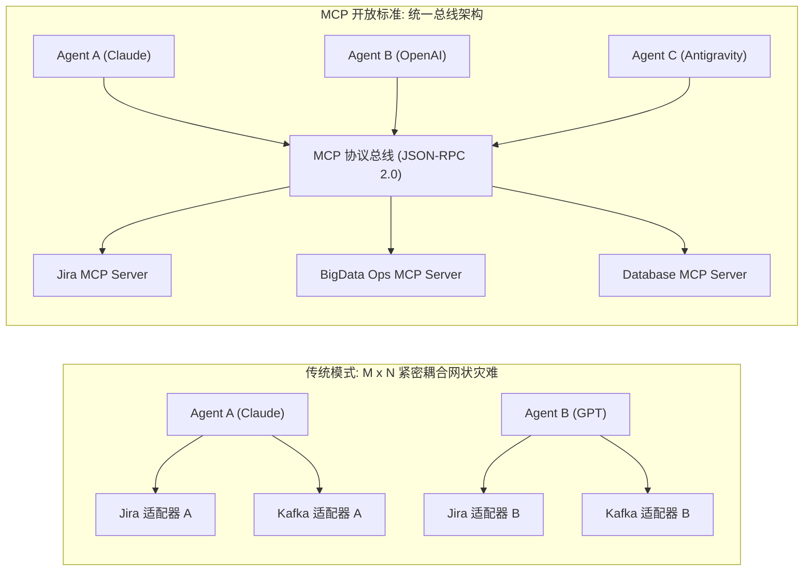
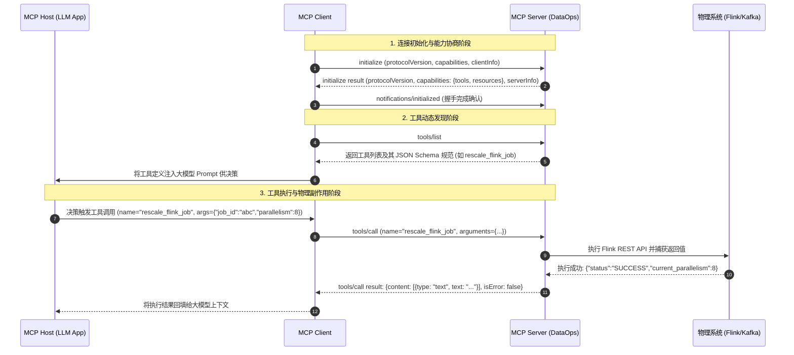
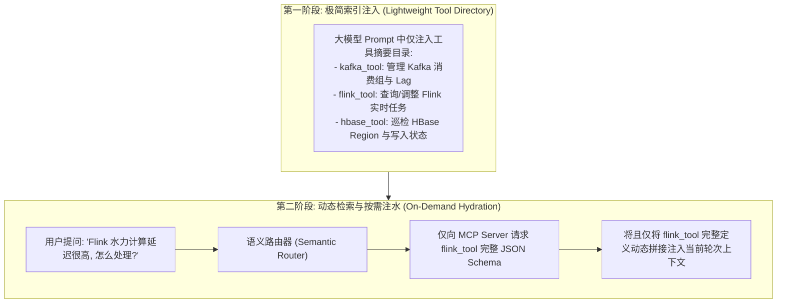
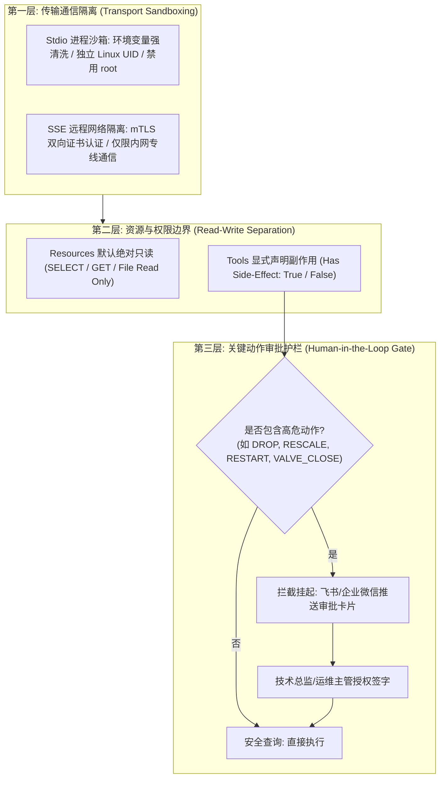
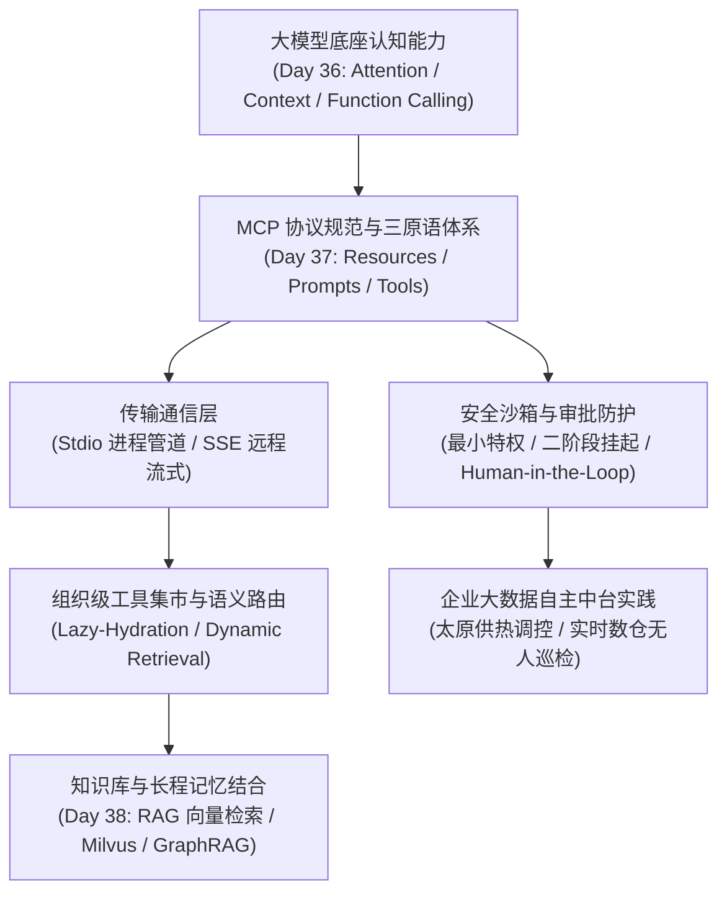

# Skills 设计与 MCP 协议标准体系

> **架构师视角定位**：本模块聚焦 AI 智能体（AI Agent）跨生态能力扩展的核心标准协议 —— Anthropic 主导并迅速成为行业事实标准的 **MCP（Model Context Protocol，模型上下文协议）** 与模块化 **Skills 设计体系**。全面拆解从 MCP Client/Server 双向架构、JSON-RPC 2.0 报文规范、三大核心原语（Resources、Prompts、Tools），到 Stdio 管道隔离、SSE 远程传输、工具上下文动态注水（Dynamic Context Hydration）与多层安全沙箱防护。结合大数据平台智能运维（BigData DataOps Server）与工业物联网高危设备安全受控场景，为技术总监、数据平台研发负责人与高级架构师构建一套解耦模型底座与物理世界系统、杜绝接口 $M \times N$ 网状耦合的企业级开放工具协议标准。

---

## 1. 知识概述与业务价值

### 1.1 MCP (Model Context Protocol) 协议的诞生背景与范式革命
在大模型智能体爆发的早期，各家模型厂商与开源框架各自为战，形成了严重的“孤岛困境”：
- **割裂的“烟囱式”工具集成**：OpenAI 推出私有的 Function Calling 格式，Anthropic、Google Gemini 与 LangChain 均有独立定义的 Tool 规范。开发者若想让同一个“大数据运维工具箱”支持不同模型，必须针对每种模型编写一套胶水代码（Glue Code）。
- **$M \times N$ 的网状复杂度爆炸**：如果有 $M$ 个大模型宿主应用（Claude Desktop, Cursor, Antigravity, 自研 Agent 平台），需要对接 $N$ 个企业内部系统（GitHub, Jira, Kafka, Flink, 内部知识库），整个行业需要开发和维护 $M \times N$ 个定制化插件，维护成本极高且极易损坏。
- **范式革命 —— AI 时代的“USB-C 开放接口”**：2024 年底 Anthropic 开源推出的 **Model Context Protocol (MCP)** 彻底改变了这一格局。MCP 类比于现代硬件的 USB-C 接口或微服务体系的 gRPC/LSP（Language Server Protocol）：
  - 它定义了一套通用的开放协议标准；
  - 任何数据源或工具只需编写一次 **MCP Server**，即可无缝插入任何支持 MCP 的 **MCP Host/Client**（无论是哪家大模型底座），将系统耦合度从 $O(M \times N)$ 骤降为 $O(M + N)$。



### 1.2 Skills 架构设计哲学与分层抽象
在 Agent 的工程化落地中，业界经常混淆 **Tool、Skill 与 Plugin** 的概念。架构师必须建立清晰的分层抽象：
1. **Tool（物理工具原语）**：单个具体的原子操作函数（Atomic Function），如 `query_kafka_lag(topic)` 或 `read_file(path)`，输入明确的参数，返回确定的数据。
2. **Skill（高阶技能工作流）**：为了达成某一类复杂业务目标而封装的**专业知识、Prompt 范式、子工具编排与执行策略的集合**。例如“大数据反压排查 Skill”，它包含反压排查的 SOP 手册、故障诊断思维链、优先执行顺序以及依赖的一组原子 Tools。
3. **Plugin（企业级插件包）**：组织治理与部署维度的实体单元，包含元数据清单（Manifest）、版本号、安全权限声明（Permissions）、若干个关联的 Skills 以及底层的 MCP Servers。

### 1.3 企业级大数据与基础架构中台业务价值
- **解耦核心数据资产与第三方大模型**：通过在内网部署私有 MCP Server，大模型宿主程序无需直接入侵企业内网数据库，只需通过标准化的 JSON-RPC 契约与内网 MCP Server 交互，敏感数据不出域。
- **跨部门运维工具原子化复用**：大数据团队编写的 `flink-management-mcp` 可以被公司内部的 SRE Agent、AI-BI 问数 Agent 以及开发者的本地 IDE 无缝共享，工具研发边际成本递减为零。

---

## 2. 核心概念与关系

### 2.1 MCP 核心三角色架构
MCP 协议标准定义了清晰的拓扑分工：

```mermaid
flowchart TD
    subgraph HostApp["1. MCP Host (宿主环境)"]
        UI["用户界面 / 聊天窗口"]
        Orchestrator["LLM 编排中枢 (Brain)"]
        UI <--> Orchestrator
    end

    subgraph ClientLayer["2. MCP Client (协议客户端)"]
        ClientCore["MCP 协议客户端引擎"]
        ConnManager["连接与生命周期管理器"]
        SecurityGate["安全权限与审批守卫"]
        ClientCore --- ConnManager
        ClientCore --- SecurityGate
    end

    subgraph ServerLayer["3. MCP Server (数据与工具提供端)"]
        StdioServer["本地子进程 Server (Stdio 管道)"]
        SSEServer["远程独立服务 Server (HTTP + SSE)"]
        Resources["Resources<br/>(只读数据源/日志/指标)"]
        Prompts["Prompts<br/>(预制工作流/分析模板)"]
        Tools["Tools<br/>(有物理副作用的执行函数)"]
        
        StdioServer --> Resources
        StdioServer --> Prompts
        StdioServer --> Tools
        SSEServer --> Tools
    end

    Orchestrator <--> ClientCore
    ConnManager <-->|JSON-RPC 2.0 (Stdio / SSE)| StdioServer
    ConnManager <-->|JSON-RPC 2.0 (HTTP + SSE)| SSEServer
```

- **MCP Host（宿主应用）**：发起人机交互的大模型容器（如 Antigravity, Claude Desktop, 自研企业 Agent）。负责与大模型（LLM）通信，决定何时需要调用工具，并向用户展示最终结果。
- **MCP Client（客户端协议栈）**：嵌入在 Host 内部的协议驱动器。负责解析 Host 的配置，拉起本地 Server 进程或建立远程网络连接，维持 1 对 N 的 Server 会话，执行 Schema 转换与路由转发。
- **MCP Server（服务提供端）**：轻量级应用程序。通过标准协议向 Client 声明自己具备哪些能力，暴露具体的只读数据（Resources）、预制工作流（Prompts）与可执行操作（Tools）。

### 2.2 MCP 核心原语三大支柱

| 核心原语 | 本质定位 | 特征与操作性质 | 典型企业场景范例 | 对应 MCP 协议方法 |
| :--- | :--- | :--- | :--- | :--- |
| **Resources** | **只读数据源（Read-Only Data）** | 被动、无物理副作用、类比于 REST 中的 `GET`。用于为模型注入背景知识或实时上下文。 | 查看 Kafka 实时消费堆积指标、读取 Flink 日志文件、查看数仓表结构。 | `resources/list`<br/>`resources/read`<br/>`resources/subscribe` |
| **Prompts** | **交互工作流模板（Reusable Workflows）** | 预制的结构化提示词模版。指导模型按照最佳实践进行分步思考与参数收集。 | “大数据生产事故应急诊断模板”、“太原供热管网水力平衡调优决策指南”。 | `prompts/list`<br/>`prompts/get` |
| **Tools** | **物理执行函数（Actionable Functions）** | 主动、具有物理副作用、类比于 REST 中的 `POST/PUT/DELETE`。需要严格的安全审查。 | 调整 Flink 算子并发度、重启异常 TaskManager、下发换热站智能阀门开度控制。 | `tools/list`<br/>`tools/call` |

### 2.3 核心通信层与交互时序图（端到端握手与调用）



---

## 3. 底层工作机制与设计哲学

### 3.1 协议连接与生命周期管理

#### 1. JSON-RPC 2.0 基础报文规范
MCP 完全建立在标准的 JSON-RPC 2.0 规范之上，保证了跨语言（Python/Java/Go/TypeScript）与跨操作系统的极致兼容性：
- **请求报文（Request）**：
  ```json
  {
    "jsonrpc": "2.0",
    "id": 101,
    "method": "tools/call",
    "params": {
      "name": "query_kafka_lag",
      "arguments": { "cluster": "taiyuan_prod", "topic": "station_telemetry" }
    }
  }
  ```
- **成功响应报文（Response）**：
  ```json
  {
    "jsonrpc": "2.0",
    "id": 101,
    "result": {
      "content": [
        {
          "type": "text",
          "text": "{\"topic\": \"station_telemetry\", \"lag\": 42000, \"status\": \"WARNING\"}"
        }
      ],
      "isError": false
    }
  }
  ```
- **单向通知（Notification）**：无 `id` 字段，无需对端回复确认。例如当 Server 动态热加载新工具时，发送 `notifications/tools/list_changed`，通知 Client 重新刷新工具清单。

---

### 3.2 上下文动态注水（Dynamic Context Hydration）机制

在传统的 Agent 架构中，如果注册了 50 个工具，宿主系统会将这 50 个工具的完整 JSON Schema（平均每个工具消耗 300~500 Tokens）全部拼接到初始 System Prompt 中。
- **痛点**：仅工具定义就直接吞噬了 20K~30K Tokens，不仅造成极其昂贵的 Token 浪费与推理延迟暴增，更由于长文本“迷失在中间（Lost in the Middle）”效应，导致模型产生工具匹配错乱与参数幻觉。
- **MCP 的双层优雅治理 —— 渐进式/按需注水（Lazy-Hydration & Two-Tier Routing）**：



---

### 3.3 安全沙箱（Security Sandbox）与权限边界控制

让大模型直接控制物理世界是极其高危的行为。生产级 MCP 架构必须遵循**最小特权原则（Principle of Least Privilege）与三层隔离防线**：



---

## 4. 高频复杂业务场景实操与落地

### 场景一：基于 MCP 协议的企业级大数据平台运维 Server（BigData Ops MCP Server）
- **业务诉求**：构建一个基于 Python/Java 的自研 MCP Server，向平台运维 Agent 暴露 Kafka 集群与 Flink 实时引擎的受控管理能力。
- **架构代码实现（基于 FastMCP 框架）**：

```python
#!/usr/bin/env python3
# -*- coding: utf-8 -*-
"""
企业级大数据运维 MCP Server (BigDataOpsServer.py)
标准遵循: MCP 2024 Specification / JSON-RPC 2.0
"""
from mcp.server.fastmcp import FastMCP
import requests
import json

# 初始化 MCP Server
mcp = FastMCP("BigData-Ops-Platform")

# 1. 注册只读资源 (Resource): 提供集群拓扑与健康度元数据
@mcp.resource("bigdata://clusters/summary")
def get_cluster_topology() -> str:
    """提供当前太原工业中台大数据集群节点与服务健康状态概览 (只读)"""
    return json.dumps({
        "cluster_name": "Taiyuan-Industrial-Prod",
        "kafka_brokers": 5,
        "flink_taskmanagers": 12,
        "active_jobs": 8,
        "cluster_status": "HEALTHY"
    })

# 2. 注册诊断工具 (Tool): 查询特定 Topic 堆积情况 (安全只读工具)
@mcp.tool()
def query_kafka_lag(cluster_id: str, topic_name: str) -> str:
    """
    查询指定 Kafka 集群特定 Topic 的各分区消费堆积详情 (Lag)。
    :param cluster_id: 集群标识，例如 'taiyuan_prod'
    :param topic_name: 消费主题，例如 'heating_station_telemetry'
    """
    # 模拟调用 Kafka AdminClient 或 Prometheus 接口
    return json.dumps({
        "topic": topic_name,
        "total_lag": 125000,
        "partitions": [
            {"partition": 0, "lag": 45000, "consumer_lead": "flink_consumer_group_1"},
            {"partition": 1, "lag": 80000, "consumer_lead": "flink_consumer_group_1"}
        ],
        "severity": "CRITICAL" if 125000 > 100000 else "NORMAL"
    })

# 3. 注册执行工具 (Tool): 调整 Flink 算子并发度 (高危物理写工具)
@mcp.tool()
def rescale_flink_job(job_id: str, new_parallelism: int, require_savepoint: bool = True) -> str:
    """
    动态弹性伸缩 Flink 实时作业的并发度 (具有物理副作用，需触发状态保存)。
    :param job_id: Flink 任务 ID (32位十六进制字符串)
    :param new_parallelism: 期望调整的目标并发度 (取值范围: 1 - 64)
    :param require_savepoint: 是否在伸缩前强制触发 Savepoint 容灾快照
    """
    if new_parallelism > 32:
        return json.dumps({"status": "FAILED", "reason": "并发度超过单作业配额安全硬限制 (Max: 32)"})
    
    # 模拟与 Flink JobManager REST API 进行通讯
    # POST /jobs/:jobid/rescaling
    return json.dumps({
        "status": "SUCCESS",
        "job_id": job_id,
        "old_parallelism": 4,
        "new_parallelism": new_parallelism,
        "savepoint_path": "hdfs:///flink/savepoints/sp-auto-rescale-001" if require_savepoint else "NONE"
    })

if __name__ == "__main__":
    # 使用标准 Stdio 管道方式启动
    mcp.run(transport="stdio")
```

---

## 5. 生产异常故障深度排查与根因分析

### 故障一：Stdio 管道死锁与缓冲区污染（Stdio Pipe Poisoning & Deadlock）

#### 1. 故障现场还原
某团队在自研 Python MCP Server 时，为了方便调试，在工具函数中顺手加入了 `print("DEBUG: fetching kafka metrics...")`。
服务启动后，宿主客户端（如 Claude Desktop）突然发生超时报错：`JSONRPCParseError: Unterminated string at line 1`，所有工具全部离线。

#### 2. 深度根因分析（Root Cause）
- **传输层契约破坏**：在 `transport="stdio"` 模式下，**标准输出 `sys.stdout` 是专门且唯一保留给 JSON-RPC 2.0 协议帧传输的数据通道**！
- 任何通过 `print()` 输出的非结构化纯文本字符串，都会直接被掺杂进 JSON-RPC 消息流中。客户端读取时发现不是合法的 JSON 报文，直接触发语法解析崩溃；
- 若开发者输出了超长无换行字符，填满了 OS 默认的管道缓冲区（Pipe Buffer，Linux 通常为 64KB），而客户端因等待有效 JSON 分界符挂起不读，最终引发**双向死锁假死（Deadlock）**。

#### 3. 架构级根治措施
1. **重定向标准输出至日志管道**：在 MCP Server 初始化代码的最前端，强行将原生 `sys.stdout` 隔离，非协议日志统一强制输出至 `sys.stderr` 或专用的本地滚动日志文件：
   ```python
   import sys
   import logging
   # 严禁向 stdout 打日志！
   logging.basicConfig(stream=sys.stderr, level=logging.INFO, format="%(asctime)s [%(levelname)s] %(message)s")
   ```
2. **进程层面的数据校验与 Framing**：严格遵循带换行符或 Content-Length 头（类似 LSP 规范）的帧解析器，遇到非法非 JSON 字符主动静默过滤或记录异常并自愈。

---

### 故障二：工具上下文定义暴涨引发首字延迟雪崩（TTFT Spike & Lost in the Middle）

#### 1. 故障现象
平台团队将数仓与运维全量 120 个 API 全部打包注册进同一个 MCP Server 中。
上线后，分析师反馈每次向 Agent 提一个简单问题（如“查一下昨天总能耗”），系统光是等待思考就要耗时 15 秒以上（Time-To-First-Token, TTFT 极其漫长），且模型经常错误地调用无关的重试工具。

#### 2. 根因剖析
- 120 个工具的 JSON Schema 定义累计耗费了 35,000 个 Tokens。每次用户提问，系统必须先对这 35K Tokens 做全量自注意力 Prefill 计算，导致 GPU 算力直接被打满；
- 庞大的工具列表引发了典型的“迷失在中间”效应，真正需要调用的几个核心工具被淹没在长文本中间，模型的注意力检索召回率暴跌至 45% 以下。

#### 3. 生产根治策略（分层检索与语义裁剪）
1. **工具命名空间与标签化（Tagging & Categorization）**：将全量工具划分为若干领域子集（如 `dataops`, `bi_query`, `security`）。
2. **轻量级 Embedding 语义路由（Semantic Tool Filtering）**：
   - 用户提问输入后，本地轻量模型（如 `bge-small`）计算语义相似度，从 120 个工具中仅召回 Top-5 最相关的候选工具；
   - 动态构造 `tools/list` 结果回传给当前 LLM 轮次，将上下文注入开销从 35K Tokens 暴力压缩至 1.5K Tokens，TTFT 从 15 秒直降至 800 毫秒以内。

---

## 6. 技术选型对比

### 6.1 智能体扩展协议与集成标准横向对比

| 协议/机制 | 主导机构/厂商 | 通信规范 | 跨生态通用性 | 是否解耦模型底座 | 适用生产场景 |
| :--- | :--- | :--- | :--- | :--- | :--- |
| **Model Context Protocol (MCP)** | **Anthropic / 开放开源** | **JSON-RPC 2.0 (Stdio / SSE)** | **极高（行业统一标准趋势，支持全厂商模型）** | **完全解耦（一次编写，全生态运行）** | **企业内部工具平台、多模型统一基座（强烈推荐）**。 |
| **OpenAI Function Calling** | OpenAI | 专有 HTTP POST Payload | 仅限兼容 OpenAI API 规范的模型 | 紧密绑定 OpenAI 协议栈 | 仅使用 GPT 系列单一技术栈的轻量场景。 |
| **OpenAPI / Swagger Plugins** | OpenAPI Consortium | 传统 RESTful HTTP/JSON | 中等（需大模型直接解析庞大的 OpenAPI YAML） | 中等（需运行时适配转换） | 已有成熟 REST 微服务对外提供标准 OpenAPI 接口。 |
| **LangChain Tools** | LangChain 开源社区 | 内存 Python 对象 / In-Process | 低（强依赖 Python 进程内依赖注入） | 紧密绑定 LangChain 框架代码 | 纯 Python 算法团队实验原型开发。 |

### 6.2 MCP Server 传输层选型对比（Stdio vs SSE）

| 传输模式 | 底层通信介质 | 物理部署位置 | 优势 | 劣势与限制 | 推荐场景 |
| :--- | :--- | :--- | :--- | :--- | :--- |
| **Stdio** | 操作系统标准输入输出管道 (`stdin/stdout`) | 与 Host 部署在**同一操作系统节点**（本地子进程） | 极低通信延迟、无网络端口占用、天然随宿主进程退出而销毁。 | 无法跨机器通信、单机资源受限、排查调试困难。 | 开发者桌面端（如 Cursor, Claude Desktop, Antigravity 本地插件）。 |
| **HTTP + SSE (Server-Sent Events)** | 网络套接字 (HTTP POST 发指令，SSE 流式回传) | **分布式远程微服务**（K8s 集群 / 私有云） | 跨网络分布式部署、支持高并发、易于负载均衡与鉴权监控。 | 需维护网络连接、需处理断网重连、有网络传输延迟与安全通道要求。 | **企业级生产环境、内部私有云微服务、多用户共享工具集群（推荐）**。 |

---

## 7. 技术经理与架构师实战管控

### 7.1 组织级 MCP Server 生态管控与准入治理
随着业务发展，各个系统团队都会开发自己的 MCP Server。技术管理者必须建立**“企业工具集市（MCP Tool Registry）”**，防止混乱与安全失控：
1. **准入静态门禁（Contract Linting）**：
   - 所有的 Tool 必须包含清晰中文与英文双语语义描述（Description），严禁模糊的 `do_process()` 命名；
   - 强制约束入参 Schema 必须显式声明必填项（`required`）、类型（`type`）及枚举范围（`enum`），防止诱发参数幻觉。
2. **生命周期与版本兼容管理（SemVer）**：
   - MCP Server 必须支持语义化版本（如 `v1.2.0`），禁止不向后兼容的字段直接删除；若有重大重构，采用平滑废弃标签（`deprecated`）。

### 7.2 细粒度 RBAC/ABAC 权限隔离体系
在大数据中台场景下，不同的用户对工具的访问权限截然不同：
- **初级分析师**：仅向其动态注入 `resources/read` 与只读类工具（`query_sql`, `get_metrics`）；
- **资深 SRE 专家**：经过 SSO 双因子认证后，方可动态解锁具备物理修改能力的写工具（`rescale_flink_job`, `restart_service`）；
- **权限拦截在 MCP Client 层强制执行**：即使模型由于被注入越权输出了高危工具调用指令，Client 在向 Server 发送 `tools/call` 前依据用户 Token 进行鉴权，无权操作直接就地抛出 `403 Forbidden`，不触发后端网络请求。

---

## 8. 互联网大厂高频面试真题库

### 8.1 协议架构与标准原语题
- **Q1**：什么是 MCP（Model Context Protocol）协议？它与传统大模型厂商私有的 Function Calling 或 RESTful OpenAPI 插件机制有什么本质区别？解决了什么架构痛点？
- **Q2**：请详细阐述 MCP 协议的三大核心原语（Resources、Prompts、Tools）的设计意图与边界划分，它们在上下文管理与数据流动中分别扮演什么角色？

### 8.2 通信底层与传输机制题
- **Q3**：MCP 支持 Stdio 和 SSE 两种传输层协议，它们各自的底层通信机制、优缺点以及适用生产场景是什么？在基于 Stdio 通信时，如何防止开发者的日志输出破坏协议报文？
- **Q4**：当企业内部有上百个运维或业务工具需要暴露给 Agent 时，如果全部通过 tools/list 注入 Prompt 会导致上下文爆炸与幻觉。架构上如何设计“惰性加载（Lazy-loading）与动态工具检索（Dynamic Tool Retrieval）”机制？

### 8.3 安全隔离与生产高可用题
- **Q5**：在工业控制与大数据平台中，Agent 通过 MCP Server 调用具有物理副作用的高危工具（如重启 Flink 任务、调节供热阀门、删除表数据）时，如何构建绝对安全的多层沙箱与审批拦截体系？
- **Q6**：如何设计一个生产级 MCP Server 的高可用容灾与监控链路？当底层依赖的分布式服务发生抖动或慢查询时，如何防止整个 Agent 宿主程序被级联阻塞？

---

## 9. 结构化深度参考答案

### 题目 1：[什么是 MCP（Model Context Protocol）协议？它与传统大模型厂商私有的 Function Calling 或 RESTful OpenAPI 插件机制有什么本质区别？解决了什么架构痛点？]

#### 简洁回答（1分钟电梯破题）
> “MCP 是由 Anthropic 主导开源的开放智能体上下文协议，类比于 **AI 时代的‘USB-C 标准接口’** 或语言服务器协议（LSP）。
> 其与厂商私有 Function Calling 或传统 OpenAPI 的本质区别在于：它彻底**解耦了‘模型客户端（Host）’与‘底层工具与数据源（Server）’**。
> 它解决了传统微服务集成中 $M$ 个大模型客户端对接 $N$ 个内部系统所导致的 $O(M \times N)$ 网状胶水代码灾难；通过标准化的 JSON-RPC 2.0 规范，提供统一的 Resources（数据）、Prompts（工作流）和 Tools（执行）三原语抽象，实现了一次编写、全生态跨模型跨平台热插拔运行。”

#### 深入回答（机制推导、协议数据流、工程实现与边界条件）
> “从架构演进、报文机制与解耦深度展开剖析：
> 1. **架构演进与破局背景**：
>    - **传统 Function Calling 痛点**：OpenAI、Anthropic、Gemini 的工具定义 Schema 各不相同。开发者为了让 Agent 调用 Kafka 运维命令，必须在 Python 代码中手写特定厂商的 Adapter。一旦切换底座模型（如从 GPT-4o 切换为本地部署的 DeepSeek），所有工具绑定代码全部需要推倒重写；
>    - **OpenAPI 插件机制痛点**：Swagger/OpenAPI 本质是为人类与通用 HTTP 设计的，文档极其冗长，直接扔进 Prompt 会耗尽上下文；且缺乏实时双向通知（Notification）与会话生命周期管理能力；
>    - **MCP 标准协议抽象**：MCP 统一规范了 Client-Server 间的交互生命周期。Client 只管路由与展示，Server 只管物理执行，两者通过双向 JSON-RPC 2.0 报文解耦。
> 2. **核心运行机制与握手协商**：
>    - 连接建立时执行标准的 `initialize` 握手，双方交换 `capabilities` 字典：
>      - Client 声明是否支持提示词建议、Roots 文件树感知与采样回调；
>      - Server 声明是否支持资源订阅（`resources/subscribe`）、工具动态刷新通知（`listChanged`）；
>    - 这一协商机制赋予了系统极强的向前与向后兼容性（Forward/Backward Compatibility），底层 Server 升级新增工具，上层 Host 无需重启即可动态感知。”

#### 架构师/技术管理视角（生态解耦、ROI、安全合规、企业级工具集市治理）
> “从技术总监与平台负责人的视角看，**拥抱 MCP 是企业构建 AI-Native 技术基座最具战略价值的架构决策**。
> 第一，**保障资产的长期投资回报率（Protecting Asset ROI）**。大模型技术日新月异，今天 Claude 领先，明天 DeepSeek 性价比称王。企业如果将内部工具与某一家模型强绑定，迁移成本将高不可攀。基于 MCP 构建企业级 Tools 与 Resources，无论外部模型如何洗牌，企业内部的数字资产与工具库坚如磐石；
> 第二，**建立跨部门协同的统一总线**。数据团队开发一个 `iceberg-lakehouse-mcp`，安全团队开发一个 `identity-iam-mcp`，不同部门的 Agent 都可以像拼积木一样按需装配，彻底打破企业内部的数据孤岛与重复造轮子现象。”

---

### 题目 2：[请详细阐述 MCP 协议的三大核心原语（Resources、Prompts、Tools）的设计意图与边界划分，它们在上下文管理与数据流动中分别扮演什么角色？]

#### 简洁回答（1分钟电梯破题）
> “MCP 严密定义了三大原语，构建了清晰的读、写与认知引导边界：
> - **Resources（只读数据）**：充当模型的‘外部只读感官’，类比 REST `GET`。用于安全地为上下文注水（如读取 Kafka 日志、数仓元数据），天然幂等且无物理破坏性；
> - **Prompts（认知工作流）**：充当‘预制专家作业指南’。封装经过专业工程师调优的思维链与任务分解 SOP，引导大模型按标准流程行动；
> - **Tools（物理执行函数）**：充当模型的‘物理执行手脚’，类比 REST `POST/DELETE`。具有物理副作用（如调整 Flink 并发、控制工业阀门），必须绑定严格的安全校验与人工审批门禁。”

#### 深入回答（机制推导、协议数据流、工程实现与边界条件）
> “从底层数据流向与控制权归属深度剖析：
> 1. **Resources 的被动注入与订阅机制**：
>    - **URI 唯一定位**：资源采用类似标准 URI 的统一标识体系（如 `file:///var/log/flink.log` 或 `postgres://prod/tables/stations`）；
>    - **主动订阅与差量推送**：支持 `resources/subscribe` 协议。当监控到工业传感器回水温度发生突变时，MCP Server 可以主动向 Client 推送 `notifications/resources/updated`，驱动 Agent 自动触发自愈巡检，无需宿主轮询。
> 2. **Prompts 的交互式驱动特性**：
>    - Prompts 绝非静态字符串，而是带有参数签名（Arguments Schema）的可交互函数。
>    - 例如定义一个 Prompt `incident_postmortem(incident_id)`，当在 Host 界面输入此命令时，Server 会返回预先设计好的复杂多角色 Prompt 结构（System + User），将排障规范以最高信息密度注入模型。
> 3. **Tools 的控制反转与两阶段执行**：
>    - Tools 遵循强类型 JSON Schema 契约。模型只能输出参数建议，执行权牢牢掌握在宿主与 Server 物理环境中；
>    - 工具执行完毕后，返回统一的 Content 数组（支持文本、图片、甚至二进制附件句柄），确保多模态信息无缝回填进模型的上下文短期记忆中。”

#### 架构师/技术管理视角（生态解耦、ROI、安全合规、企业级工具集市治理）
> “从架构设计哲学的高度审视，**‘读写分离’是大型系统永恒的黄金法则，MCP 将这一思想在 AI 领域发挥到了极致**。
> 很多初级架构师将所有外部能力通通做成 Tools，导致模型在‘查看指标’这种纯读操作时，也误用工具调用，消耗双倍交互延迟。
> 规范化设计准则：
> 凡是只读查询、历史检索、状态感知，强制要求团队必须实现为 **Resources**，利用 Client 端的只读管道快速注水并享受缓存加速；
> 凡是有状态变更、写库、调参、网络下发的操作，强制定义为 **Tools** 并绑定审计日志。明确的界限不仅让模型注意力更加聚焦，更在架构底层筑起了安全红线。”

---

### 题目 3：[MCP 支持 Stdio 和 SSE 两种传输层协议，它们各自的底层通信机制、优缺点以及适用生产场景是什么？在基于 Stdio 通信时，如何防止开发者的日志输出破坏协议报文？]

#### 简洁回答（1分钟电梯破题）
> “Stdio 基于本地操作系统匿名管道（Standard Input/Output），零网络开销、生命周期与宿主绑定，但受限单机，适用于开发者桌面端本地工具集成；SSE（Server-Sent Events）基于 HTTP 协议（POST 提交指令，SSE 管道单向异步流式回传事件），支持跨机器分布式部署与负载均衡，适用于企业云端集中式微服务。
> 在 Stdio 模式下，标准输出 `stdout` 是专供 JSON-RPC 协议报文传输的纯净信道。防止日志污染的根本手段是**在 Server 启动前全局重定向日志输出流至 `stderr` 或物理文件，严禁使用原生 `print()` 打印调试信息**。”

#### 深入回答（机制推导、协议数据流、工程实现与边界条件）
> “从操作系统 I/O 模型与网络协议栈展开剖析：
> 1. **Stdio 通信机制与管道死锁陷阱**：
>    - **底层机理**：Host 通过 `fork()` 和 `exec()` 衍生（Spawn）子进程，将 Host 的写管道重定向到子进程的 `stdin`，将子进程的读管道对接 Host 的 `stdout`；
>    - **缓冲区陷阱**：操作系统管道有固定的内核缓冲区大小（Linux 默认 65536 字节）。如果子进程疯狂向 `stdout` 输出非协议调试日志导致管道填满，而 Host 客户端正处于阻塞等待完整 JSON 结束符状态，两者互相等待，立即引发**死锁挂起（Deadlock）**；
>    - **工程防护代码**：
>      ```python
>      import sys, os, logging
>      # 1. 强制将标准输出切换为无缓冲模式 (Unbuffered)
>      sys.stdout.reconfigure(line_buffering=True)
>      # 2. 将全局 root logger 的输出重定向到标准错误 (stderr)
>      logging.basicConfig(stream=sys.stderr, level=logging.INFO)
>      ```
> 2. **HTTP + SSE 远程通信架构**：
>    - **双通道解耦**：客户端通过常规 HTTP POST 向 `/messages` 发送 JSON-RPC 请求；
>    - **长连接推送**：服务端通过建立长久挂起的 HTTP 连接，响应头设置 `Content-Type: text/event-stream`，利用 `event: message\ndata: {...}\n\n` 持续向客户端推送异步结果与状态变更通知；
>    - **网络韧性保障**：必须配置 HTTP Keep-Alive 心跳包，并在客户端实现指数退避重连机制，防范跨公网传输时的中间代理超时断开。”

#### 架构师/技术管理视角（生态解耦、ROI、安全合规、企业级工具集市治理）
> “从企业基础设施演进的视角来看，**系统演进必须遵循‘研发本地用 Stdio、生产集群用 SSE’的双轨落地模式**。
> 本地开发阶段，让工程师基于 Stdio 快速单机联调，降低环境依赖；
> 进入生产环境后，必须全面收编为分布式 **SSE MCP 微服务集群**：
> 将涉及 Flink、Kafka、太原换热站核心控制等敏感系统的 MCP Server 统一容器化部署在内网 K8s 中，前端挂载 Envoy/Nginx 实施 mTLS 双向认证、API 鉴权与流量熔断。严禁在生产宿主容器中直接拉起本地特权进程，这是保障企业主机安全的底线要求。”

---

### 题目 4：[当企业内部有上百个运维或业务工具需要暴露给 Agent 时，如果全部通过 tools/list 注入 Prompt 会导致上下文爆炸与幻觉。架构上如何设计“惰性加载（Lazy-loading）与动态工具检索（Dynamic Tool Retrieval）”机制？]

#### 简洁回答（1分钟电梯破题）
> “破局上百个工具撑爆上下文的核心策略是**‘双层工具路由（Two-Tier Tool Routing）与动态惰性注水（Lazy-Hydration）’**。
> 严禁全量注入！第一层在宿主 Prompt 中仅保留极简的命名空间/领域目录或轻量级摘要；第二层在 Agent 思考阶段，利用**向量语义检索（Tool Vector Search）或小模型路由分类器**，根据用户当前意图动态筛选出 Top-3 到 Top-5 个最相关的工具，并在执行前夕‘按需请求’其完整的 JSON Schema 注入当前轮次上下文，将 Token 消耗压降 90% 以上并消除工具选择幻觉。”

#### 深入回答（机制推导、协议数据流、工程实现与边界条件）
> “从检索增强架构与 MCP 协议动态能力深度推导演进：
> 1. **全量注入的灾难性后果**：
>    - 设单个工具 Schema 平均占用 400 Tokens，100 个工具即消耗 40,000 Tokens。在每次 ReAct 循环中，即便只执行一个简单查询，每一步都要对这 40K Tokens 进行自注意力计算，导致 API 费用暴增 10 倍，推理耗时飙升；更致命的是注意力被海量无用参数稀释，引发工具选择漂移。
> 2. **双层动态检索与注水系统架构**：
>    - **步骤 1：工具元数据离线向量化（Tool Indexing）**：
>      - 对所有工具的 `name` 与 `description` 生成密集向量（Dense Embedding），落入轻量级本地向量库（如 LanceDB 或 Pgvector）；
>    - **步骤 2：第一层意图对齐与动态过滤（Dynamic Pruning）**：
>      - 当用户提出：“查一下为什么太原万柏林区换热站回水温度不达标”；
>      - 语义检索模块根据用户 query 检索工具库，仅召回相关度最高的工具集合：`[query_heating_station_status, get_water_balance_variance]`；
>    - **步骤 3：第二层协议按需加载（On-Demand Schema Fetch）**：
>      - Client 动态向对应的 MCP Server 发送只包含选定工具的查询请求，将完整的输入参数定义拼装进当前轮次的 System Prompt 中；
>    - **步骤 4：执行完毕即刻卸载（Ephemeral Context）**：
>      - 当该工具调用完成并获得结果后，下轮对话可将该工具的完整 Schema 再次折叠为简短引用，保持上下文永远纯净。”

#### 架构师/技术管理视角（生态解耦、ROI、安全合规、企业级工具集市治理）
> “从系统吞吐与财务成本视角看，**动态工具检索不是‘锦上添花’的优化，而是大规模企业级 Agent 能否走出实验室、具备商业化可行性的‘生死线’**。
> 很多失败的 Agent 项目，根本原因就是把系统做成了一个‘笨拙的胖子’。
> 架构设计必须树立**‘上下文预算精细化（Token Budgeting）’**理念：
> 大脑（LLM）的算力是极其昂贵的。架构师的职责是通过传统高性能信息检索技术（IR）做好预处理，让大模型只在‘最后做决定的那一瞬间’看到最精炼的信息。用几毫秒的本地向量检索，换取模型推理端数十秒的延迟节省与 90% 的 Token 成本节省，这是卓越架构师必须具备的工程 ROI 定力。”

---

### 题目 5：[在工业控制与大数据平台中，Agent 通过 MCP Server 调用具有物理副作用的高危工具（如重启 Flink 任务、调节供热阀门、删除表数据）时，如何构建绝对安全的多层沙箱与审批拦截体系？]

#### 简洁回答（1分钟电梯破题）
> “构建高危工具安全防御体系的核心原则是**‘最小权限沙箱隔绝物理风险、确定性规则前置拦截越权、双因子 Human-in-the-Loop 两阶段授权闭环、全链路审计日志存证防篡改’**。
> 在 MCP Server 侧通过只读账号与容器沙箱限制物理破坏力；在工具定义中显式标记高危元数据（Has Side-Effect）；在 Client 拦截器层建立两阶段挂起机制（2-Phase Commit）：凡命中高危动作，Agent 立即暂停并向企微/飞书推送包含参数与影响推演的审批单，必须由带班总工密码/生物认证确认后方可释放执行令牌。”

#### 深入回答（机制推导、协议数据流、工程实现与边界条件）
> “在太原智慧供热与工业大数据等关乎民生与安全的重大场景中，必须部署四道纵深防御闸门：
> 1. **第一道门：元数据风险分级打标（Risk Classification）**：
>    - 在 MCP Server 工具注册时，强制定义安全元属性：
>      ```python
>      @mcp.tool(risk_level="CRITICAL", requires_approval=True)
>      def emergency_shutoff_valve(station_id: int): ...
>      ```
> 2. **第二道门：确定性业务语义硬护栏（Deterministic Business Guardrails）**：
>    - 绝不大模型说什么就执行什么。在 Server 端嵌入确定性规则引擎：
>      - 例如调节供热阀门：即使模型传入 `opening: 100%`，Server 内部的安全控制模块校验发现当前管网压差过高，直接触发硬件水锤保护规则，强制修正截断为 `opening: 60%`，并返回警告；物理安全永远高于模型意图。
> 3. **第三道门：Human-in-the-Loop 两阶段中断与授权状态机**：
>    - **Phase 1 (Propose)**：Client 捕获到模型发起 `CRITICAL` 工具调用，**不执行物理调用**，生成全局唯一审批 ID（Approval Ticket），并将状态机切换为 `WAITING_FOR_HUMAN`；
>    - **Phase 2 (Authorize & Resume)**：
>      - 向值班总监的企业微信推送卡片：*‘Agent 提议对 104 号站执行阀门开度下调至 20%，预期节热但可能导致末端供热不足，是否批准？’*
>      - 总监点击同意后，系统向 MCP Client 发送 Webhook，唤醒挂起的执行线程，调用真实的底层 PLC 接口并回传结果。
> 4. **第四道门：物理环境容器化沙箱与不可篡改审计链（Immutable Audit Log）**：
>    - 所有涉及代码执行或网络请求的 MCP Server，必须运行在具备 Seccomp 与 AppArmor 隔离的非 Root Docker 容器内，禁用主机敏感目录挂载；
>    - 所有的工具调用参数、审批人 ID、执行前后快照统一以 JSON 格式追加写入不可篡改的日志存储（如 WORM 存储或 Kafka 专用审计 Topic），留存至少 3 年以备责任倒查。”

#### 架构师/技术管理视角（生态解耦、ROI、安全合规、企业级工具集市治理）
> “从技术高管和企业法人风险责任的角度看，**任何没有人工兜底防线（HITL）的自动化物理控制系统，都是悬在企业头顶的达摩克利斯之剑**。
> 在软件工程中，系统挂了可以重启；但在工业互联网、市政供热、电力调度或金融交易中，一次失控的指令可能导致水力管网物理爆管、大面积居民挨冻、或千万级资金瞬间蒸发。
> 架构决策的第一准则：
> **‘永远不要把物理世界的生杀大权交给统计概率模型’**。
> 智能体可以协助分析、可以提供最优秀的优化策略、可以自动写好执行脚本，但按下发射按钮的手指，在任何时候都必须是拥有法律责任能力的人类工程师。守住安全红线，是技术高管最崇高的职业操守。”

---

### 题目 6：[如何设计一个生产级 MCP Server 的高可用容灾与监控链路？当底层依赖的分布式服务发生抖动或慢查询时，如何防止整个 Agent 宿主程序被级联阻塞？]

#### 简洁回答（1分钟电梯破题）
> “生产级 MCP Server 高可用架构的核心是**‘无状态水平伸缩、非阻塞异步 I/O、分布式熔断降级与链路追踪可观测性’**。
> 采用 HTTP+SSE 模式部署无状态 Server 集群，通过 K8s Ingress 负载均衡；在代码层全量使用异步 I/O（Asyncio / Netty），防止慢查询打满连接池；引入 Resilience4j / Sentinel 建立工具级熔断器（Timeout & Circuit Breaker），当底层大数据集群出现慢查询时在 3 秒内快速失败并返回结构化降级响应；全链路透传 W3C Trace Context，实现端到端分布式链路监控。”

#### 深入回答（机制推导、协议数据流、工程实现与边界条件）
> “从分布式服务治理与全链路可观测性两方面深度剖析：
> 1. **非阻塞异步运行时防级联雪崩**：
>    - 在 Python/Java MCP Server 中，所有的工具执行函数必须声明为 `async` 异步函数。严禁在工具处理线程中执行同步阻塞式长查询；
>    - 建立独立的线程池隔离（Bulkheading）：将只读轻量工具（`get_status`）与耗时重度工具（`generate_heavy_report`）分配在不同的线程池中，防止耗时任务耗尽 Worker 线程引发级联瘫痪。
> 2. **超时控制与熔断状态机（Circuit Breaker Pattern）**：
>    - **单步超时（Timeout）**：MCP Client 为每一个 `tools/call` 请求配置硬性超时（如 5 秒）。一旦超时，Client 立即向对端发送取消信号，并直接向模型生成一个系统级降级回复：`{"isError": true, "content": "Tool execution timed out. Please retry with a smaller time range."}`；
>    - **熔断保护（Closed -> Open -> Half-Open）**：若底层 Kafka/Flink API 连续 5 次报错，熔断器跳闸（Open），后续 30 秒内的所有请求直接本地快速失败，保护底层濒危的集群不被 Agent 的高频重试流量彻底打垮。
> 3. **全链路可观测性与 Trace 贯通**：
>    - 在 MCP JSON-RPC 报文的 `_meta` 扩展字段中透传 OpenTelemetry 标准的 `traceparent` 与 `tracestate` 头部；
>    - 使得一次从用户交互发起的请求，其 Trace ID 能无缝穿透：`Agent Host -> MCP Client -> MCP Server -> Flink REST API -> Kafka Broker`，在 Grafana Tempo/Jaeger 上形成完整的调用瀑布流，故障排查一目了然。”

#### 架构师/技术管理视角（生态解耦、ROI、安全合规、企业级工具集市治理）
> “从架构演进的角度来看，**当 MCP Server 承担了企业核心资产的对外暴露职能时，它就已经演变成了企业核心微服务基础设施的一部分**。
> 很多团队把 MCP Server 当作普通脚本来写，缺乏最起码的高可用防护，一旦被多个 Agent 高频并发调用，瞬间成为全平台的单点故障（SPOF）。
> 技术负责人的治理标准：
> 必须按照**‘P0 核心微服务的标准’**治理 MCP Server：
> 纳入企业统一的 Prometheus 监控大盘、配置自动化金丝雀发布流水线、实施定期的故障演练与混沌工程压测，确保连接不断、性能不崩、指标透明，唯有如此才能撑起企业级大模型自主决策的宏图大厦。”

---

### 9.7 面试现场自然口述示范与一页纸速记卡（Day 37 复盘精华）

#### 核心问题 1：什么是 MCP（Model Context Protocol）协议？它如何将大模型与企业内部系统的集成复杂度从 $O(M \times N)$ 降低到 $O(M + N)$？其三大核心原语（Resources、Prompts、Tools）的设计哲学是什么？

- **简洁回答（1分钟电梯破题）**：
  > “MCP（Model Context Protocol）是 Anthropic 主导开源的开放智能体上下文协议，堪称 **AI 时代的‘USB-C 标准接口’**。
  > 过去 $M$ 个大模型宿主应用对接 $N$ 个企业内部系统需要编写 $M \times N$ 个定制化胶水代码；MCP 通过标准化的 JSON-RPC 2.0 报文与能力协商，让企业系统只需编写一次 MCP Server，即可插入任意支持 MCP 的 Host 客户端，将系统复杂度由 $O(M \times N)$ 骤降至 $O(M + N)$。
  > 其三大原语遵循严密的读写分离设计哲学：
  > **Resources（只读数据，类似 GET，天然幂等无副作用）、Prompts（工作流指南，封装专家 SOP 提示词）、Tools（可执行函数，类似 POST/DELETE，有物理副作用，强绑定审计审批）**。”

- **深入回答（机制推导与边界条件）**：
  > 1. **架构解耦与跨生态热插拔机制**：
  >    - 传统私有 Function Calling 导致代码与 OpenAI 或 Claude 强绑定，更换底座模型时代价高昂；
  >    - MCP 采用三层解耦（Host、Client、Server），连接建立时执行 `initialize` 握手协商 `capabilities`（例如客户端是否支持文件感知，服务端是否支持工具变更通知 `listChanged` 与数据差量订阅 `resources/subscribe`），实现底座模型与工具生态的完全正交解耦。
  > 2. **三大核心原语的职责分工**：
  >    - **Resources**：支持类似 `postgres://prod/tables` 的统一 URI 定位，充当模型的‘只读感官’，用于安全地为上下文注水，支持被动读取与主动差量推送；
  >    - **Prompts**：参数化的预制交互模板（如 `incident_postmortem(id)`），将经验丰富的架构师排障思维链结构化注入模型，引导其按最优规范行动；
  >    - **Tools**：强类型 JSON Schema 契约，模型只能输出参数建议，真实的执行权牢牢掌握在宿主环境与 Server 物理沙箱中。

- **架构师/技术管理视角（权衡/成本ROI/多租户SLA/团队SOP）**：
  > “拥抱 MCP 是保障企业数字资产长期投资回报率（ROI）的战略性决策：
  > - 大模型技术日新月异，今天 Claude 领先，明天 DeepSeek 性价比称王。企业如果把业务工具和某一家模型私有 API 绑死，未来的迁移重构成本将不可承受；
  > - 基于 MCP 构建企业私有工具总线（如大数据湖仓 MCP、Kubernetes 运维 MCP），无论外部模型底座如何洗牌，企业内部沉淀的数字资产与自动化手脚坚如磐石，彻底消除厂商锁定风险。”

---

#### 核心问题 2：在生产环境面对企业上百个复杂的运维或数据工具时，全量注入 Schema 会引发严重的上下文爆炸与选择幻觉，架构上如何设计“两层语义路由（Two-Tier Semantic Routing）与动态惰性注水（Lazy-Hydration）”机制？

- **简洁回答（1分钟电梯破题）**：
  > “将上百个工具的 JSON Schema 一股脑塞入 Prompt 属于典型的‘上下文懒惰病’，会导致单次交互吞吐几十万 Token、API 成本暴增十倍，并引发注意力稀释与工具选择漂移。
  > 破解的核心是**‘两层语义路由与动态惰性注水（Lazy-Hydration）’**：
  > 第一层在宿主 Prompt 中仅保留极简的命名空间/目录概览；
  > 第二层基于**向量语义检索（Tool Vector Search）或轻量分类器**，根据用户当前输入动态筛选出 Top-3 到 Top-5 相关工具；在执行前夕才向对应 MCP Server 按需获取其完整参数 Schema 注入当前轮次上下文，执行完毕即刻卸载，将 Token 消耗压降 90% 以上。”

- **深入回答（机制推导与边界条件）**：
  > 1. **全量注入的灾难性后果与注意力稀释**：
  >    - 设单个工具 Schema 平均占用 400 Tokens，100 个工具即吞噬 40K Tokens，单轮循环仅传输 Schema 就要耗费数秒且成本高昂；更危险的是长文本中注意力权重被大量无关工具名称稀释，引发‘迷失在中间’与选择幻觉。
  > 2. **两层语义检索与动态注水流水线**：
  >    - **工具元数据离线建库**：离线对工具 `name`、`description` 和领域标签生成 Dense Embedding，存入高性能向量库（如 LanceDB/Milvus）；
  >    - **运行时意图过滤（Runtime Pruning）**：用户输入“太原换热站回水温度过高”，检索模块在 5ms 内命中与供热、水力平衡相关的 3 个核心工具；
  >    - **按需注水（On-Demand Hydration）**：MCP Client 仅向对应的 Server 抓取这 3 个工具的完整 JSON Schema 临时注入 System Prompt；
  >    - **短暂上下文生命周期（Ephemeral Context）**：工具执行完毕并返回结果后，下轮对话可将参数定义重新折叠为简短句柄，保持上下文永远纯净精悍。

- **架构师/技术管理视角（权衡/成本ROI/多租户SLA/团队SOP）**：
  > “架构设计必须树立**‘上下文预算精细化（Token Budgeting）’**理念：
  > - 大模型（Brain）的自注意力计算极其昂贵，而传统向量检索（IR）的开销几乎可以忽略不计；
  > - 架构师的责任就是用几毫秒的本地信息检索做好预处理，让大模型只在‘最后做决定的那一瞬间’看到最精炼的信息，用确定性的工程手段换取 90% 的财务成本节约与极致的响应速度，这是大型系统走出实验室的必经之路。”

---

#### 核心问题 3：当 Agent 通过 MCP Server 触达核心生产系统（如重启 Flink 任务、写业务库、控制工业阀门）等有物理副作用的高危场景时，如何设计两阶段挂起（Two-Phase Approval）与 Human-in-the-Loop（人机协同）安全防线？

- **简洁回答（1分钟电梯破题）**：
  > “任何没有人工兜底防线的自动化物理控制，都是悬在企业头顶的达摩克利斯之剑。核心防御体系是**‘最小权限沙箱隔绝物理风险、确定性规则前置拦截越权、两阶段挂起（Two-Phase Approval）人机协同授权、全链路不可篡改审计链’**。
  > 在工具定义中显式标记高危元数据（Has Side-Effect）；
  > 执行层建立两阶段挂起机制：凡命中高危动作，Agent 立即暂停并将状态切换为 WAITING_FOR_HUMAN，向审批端推送包含参数与影响推演的卡片；必须经带班总工密码/生物认证确认后，才释放执行令牌调用底层接口。”

- **深入回答（机制推导与边界条件）**：
  > 1. **四道纵深防御闸门设计**：
  >    - **第一道（元数据风险分级）**：在 MCP Tool 注册时强制标记 `@mcp.tool(risk_level="CRITICAL", requires_approval=True)`；
  >    - **第二道（确定性业务规则硬拦截）**：Server 内部前置规则引擎（如控制阀门开度若超过当前压差极限，硬性截断为安全阈值并告警，物理安全永远高于模型意图）；
  >    - **第三道（Two-Phase Approval 两阶段挂起状态机）**：
  >      - Phase 1 (Propose)：Client 拦截到 CRITICAL 工具调用，不执行底层物理调用，生成唯一审批工单 ID，任务挂起；
  >      - Phase 2 (Authorize & Resume)：向值班总监推送企微卡片，附带‘操作原因、受影响范围、备选降级方案’。总监点击批准后，Webhook 唤醒 MCP Client 释放令牌执行真正的 PLC 或集群运维操作；
  >    - **第四道（容器沙箱与 WORM 审计链）**：MCP Server 运行于无特权 Docker 容器内，禁用宿主机敏感挂载；所有调用与审批记录以 JSON 格式追加存入不可篡改的审计日志库，留存至少 3 年。

- **架构师/技术管理视角（权衡/成本ROI/多租户SLA/团队SOP）**：
  > “架构决策的第一铁律：**‘永远不要把物理世界的生杀大权交给统计概率模型’**：
  > - 在微服务中系统挂了可以重启，但在工业供热、电力调度或金融清算中，一次失控指令可能导致管网爆管或资金蒸发；
  > - 智能体可以提供最优策略和排障建议，但按下最终发射按钮的手指必须是承担法律责任的人类工程师。守住安全底线是技术管理者的最高职业操守。”

---

### Day 37 一页纸速记卡（5 大黄金法则）

1. **MCP 开放协议解耦**：统一 JSON-RPC 2.0 总线，一次编写全生态复用，网状复杂度从 $O(M \times N)$ 降至 $O(M + N)$。
2. **三大原语读写分离**：Resources 只读注水无副作用，Prompts 封装专家 SOP，Tools 物理执行强绑定安全审计。
3. **动态注水治上下文膨胀**：离线向量化工具元数据，两层语义检索 Top-5 工具按需注水，压降 90% Token 成本。
4. **通信双轨落地**：本地研发用 Stdio 管道（禁止 print 污染 stdout），生产集群用 HTTP+SSE 容器微服务集群。
5. **HITL 两阶段安全闭环**：高危工具标记 CRITICAL，拦截器两阶段挂起任务，生成审批卡片经人工确认后释放执行令牌。

---

## 10. 知识自检与口述推演清单

- [ ] 能否在白板上手绘 MCP 的 Host、Client、Server 三层架构，并阐述其如何将网状复杂度由 $O(M \times N)$ 降至 $O(M + N)$？
- [ ] 能否清晰讲透 Resources（只读数据）、Prompts（工作流指南）与 Tools（物理操作）的边界与设计哲学？
- [ ] 能否系统分析 Stdio 传输与 SSE 传输的底层差异，并解释在 Stdio 模式下为什么一条 `print()` 语句会导致协议崩溃死锁？
- [ ] 面对企业上百个工具的上下文爆炸难题，能否给出基于语义检索（Semantic Routing）的动态工具注水方案？
- [ ] 能否针对工业与数据中台的高危操作，设计一套包含两阶段挂起（Two-Phase Approval）与 Human-in-the-Loop 的防御体系？
- [ ] 能否推演一个生产级 MCP Server 如何通过异步 I/O、线程池隔离与熔断器保障整个 Agent 系统的稳定性？

---

## 11. 知识脉络与技术图谱关联



---

## 12. 权威参考与官方进阶资料

1. **Anthropic MCP 官方规范**：《Model Context Protocol Specification 2024》（modelcontextprotocol.io）
2. **MCP Python SDK 官方仓库**：`modelcontextprotocol/python-sdk` 与 FastMCP 最佳实践
3. **JSON-RPC 2.0 官方规范**：《JSON-RPC 2.0 Specification》（jsonrpc.org）
4. **语言服务器协议（LSP）思想渊源**：《Language Server Protocol Specification》（Microsoft）
5. **分布式熔断与容错设计**：《Release It!: Design and Deploy Production-Ready Software》（Michael T. Nygard）
