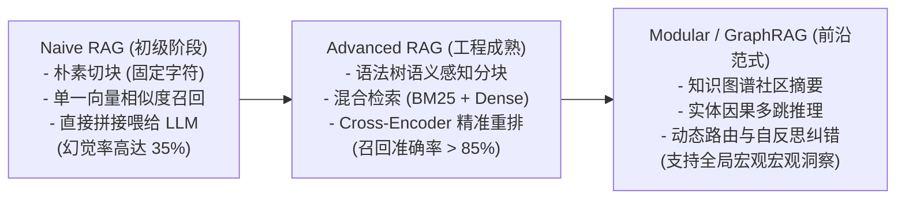
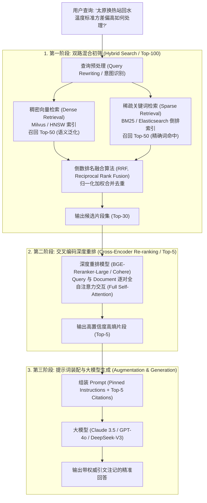
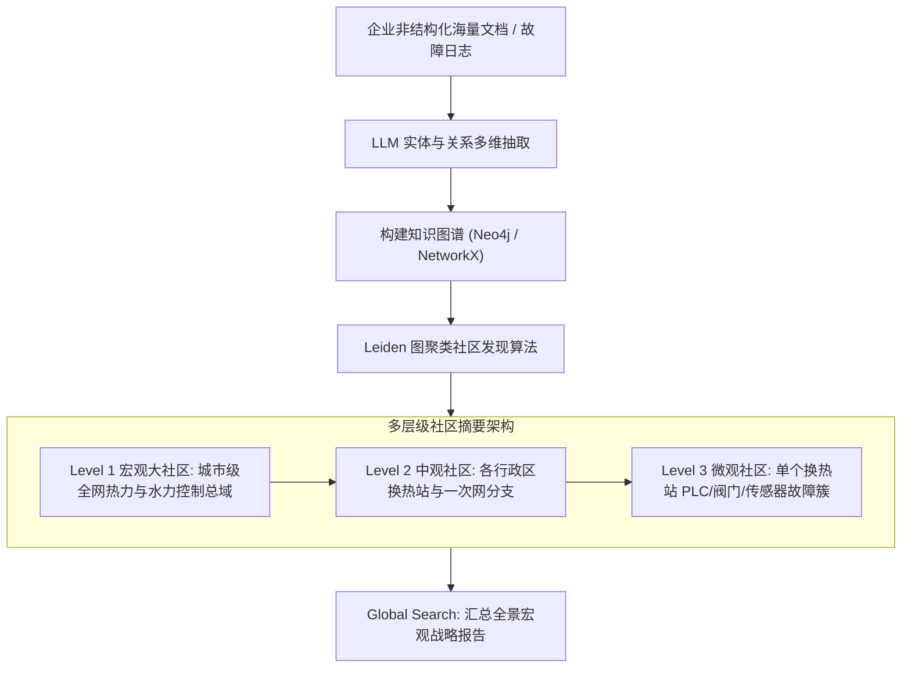
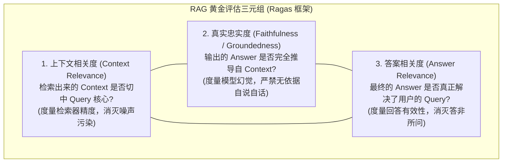
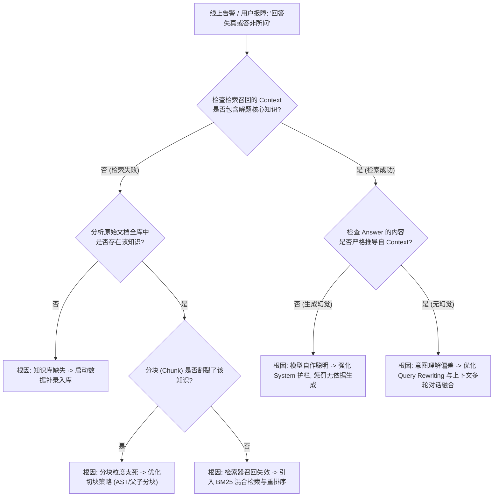
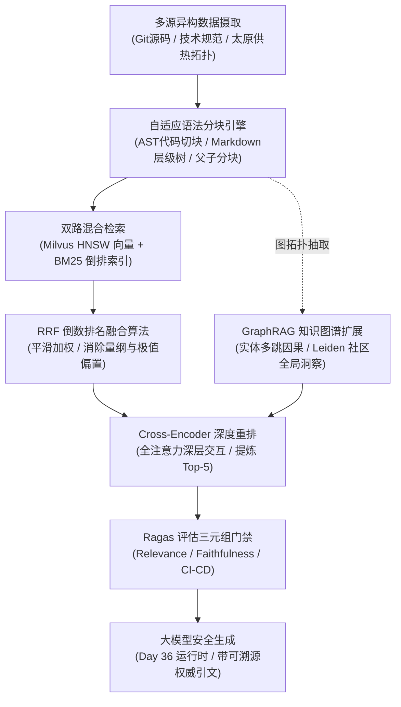

# RAG 架构设计与向量检索实战

> **架构师视角定位**：本模块聚焦大语言模型在企业私有域落地最关键的护城河技术 —— **检索增强生成（RAG, Retrieval-Augmented Generation）与高性能向量检索架构**。系统拆解从非结构化多源数据摄取、基于语义与语法的自适应分块（Chunking）、稠密向量（Dense）与稀疏关键词（BM25/Sparse）混合检索、倒数排名融合（RRF）、交叉编码器（Cross-Encoder）重排序，到 HNSW 索引图算法底层数学推导、GraphRAG 全局拓扑社区发现，以及生产级 RAG 评估三元组（Context Relevance, Faithfulness, Answer Relevance）。结合工业互联网与大数据平台海量排障文档、SQL 元数据治理与太原供热管网复杂技术图谱实战，为技术总监、数据平台研发负责人与高级架构师构建一套高召回、低幻觉、低延迟的企业级 RAG 生产架构方法论。

---

## 1. 知识概述与业务价值

### 1.1 检索增强生成（RAG）本质定义与范式演进
大语言模型虽然蕴含庞大的通用世界知识，但在直接赋能企业核心业务时，面临三大难以逾越的鸿沟：
- **知识断层（Knowledge Cutoff）与时效性缺失**：模型预训练完成后权重固化，无法感知昨天发生的 Flink 线上故障日志或今晨刚更新的太原供热调度排班表；
- **私域盲区（Private Domain Blindness）**：企业内部专有代码、技术规范、水力计算专利模型和脱敏指标体系从未参与公网预训练；
- **致命幻觉（Hallucination Trap）**：在无依据支撑的高精度工业与金融场景下，自回归模型“自信地胡说八道”可能引发灾难性的生产事故。

**RAG 的本质**：以**外挂可验证知识库（Verifiable External Knowledge Base）**的方式，在生成回答前通过精确检索将相关事实片段注入模型 Prompt 上下文中，将大模型的角色从单纯的“无依据记忆检索库”转化为“基于确凿事实的推理与总结引擎”。



### 1.2 企业级核心业务价值与工业大数据知识库痛点
在大型工业集团、政企交付与数据中台场景中，高质量生产级 RAG 具有不可替代的战略价值：
1. **千亿级分布式排障效率跃升**：将十年沉淀的 Confluence 踩坑记录、Jira 缺陷复盘、代码注释与 SRE 应急预案向量化。当集群触发 Exit Code 137 OOM 或网络死锁时，Agent 在 2 秒内跨文档精准召回历史最佳处置方案，MTTR 压降 70%。
2. **极低成本的数据新鲜度维护**：与重新全量预训练（耗费数百万美元）或微调（Fine-Tuning，容易遗忘历史知识且无法彻底消灭幻觉）相比，RAG 只需以增量方式将新文档切片并写入向量数据库，数据更新周期达到**秒级**，且研发与算力成本下降 99%。
3. **法律与合规溯源（Auditability）**：每一句 AI 生成的结论，均可显式附带权威引文来源（Citation，精准定位到 PDF 页码或 Git 源码行号），彻底消灭合规黑盒。

---

## 2. 核心概念与关系

### 2.1 文档切分与分块策略（Chunking Strategies）
文档分块绝非简单的“每 500 个字符砍一刀”，分块质量直接决定了向量检索的生与死：

| 分块策略 | 工作机制 | 优势 | 劣势与瓶颈 | 生产推荐场景 |
| :--- | :--- | :--- | :--- | :--- |
| **固定窗口分块 (Fixed-size Chunking)** | 按固定 Token 数（如 512）切分，保留 10%~20% 重叠（Overlap）。 | 实现极简单、切分计算开销极低。 | 极易在句子、段落或代码块中间切断，导致语义上下文割裂。 | 纯文本小说、非结构化长篇叙事（不推荐核心业务使用）。 |
| **层级分块 (Hierarchical Chunking)** | 基于 Markdown/HTML 的 `#`、`##`、`###` 标题树结构建立父子节点树（Parent-Child）。 | 保留完整的章节上下文，子块用于检索命中，父块用于喂给 LLM 生成。 | 需要输入文档具备规整的排版格式。 | **技术规范白皮书、架构设计说明书、官方 API 手册（强烈推荐）**。 |
| **语法感知分块 (AST-aware Chunking)** | 基于 Tree-sitter 等抽象语法树解析器，按类（Class）、函数（Function）边界切分代码。 | 保证一个函数或一个 SQL 存储过程作为一个完整语义单元，零语法截断。 | 对损坏的代码或混合语法文本解析成本较高。 | **代码知识库（GitLab 源码、Flink 算子代码、SQL 视图）**。 |
| **语义分块 (Semantic Chunking)** | 计算相邻句子之间的 Embedding 相似度，在语义断崖式下跌（Distance Spike）处切分。 | 纯语义驱动，切块内部信息高度内聚。 | 摄取阶段需对每个句子调用 Embedding 模型，开销大、耗时增加 5 倍。 | 高价值法律条款、医学病例、金融尽调报告。 |

### 2.2 向量嵌入与语义空间（Embedding Models）
- **稠密向量（Dense Embedding）**：通过深度神经网络将文本映射为连续低维向量空间（如 768/1024/1536 维）。擅长捕获**近义词、跨语言概念与深层语义意图**（如理解“水力失调”与“回水温度不均衡”含义相近）。
  - 代表模型：`BAAI/bge-m3`（支持 8192 上下文，多语言全能王）、`text-embedding-3-large`（OpenAI）。
- **稀疏向量（Sparse / Lexical Embedding）**：基于词频统计与倒排索引（如传统 BM25、深度学习加权的 SPLADE）。擅长精准匹配**专用专有名词、产品型号、错误码、工号与函数名**（如精确匹配 `Exit Code 137`、`0x7FA8B`、`stations_variance_di`）。

### 2.3 混合检索与重排序全链路架构



---

## 3. 底层工作机制与设计哲学

### 3.1 向量索引 HNSW 底层图算法与数学原理

在高维向量空间中，暴力计算欧氏距离或余弦相似度（Flat 索引）的复杂度为 $O(N \cdot D)$，在千万级数据量下延迟高达数秒。
**HNSW（Hierarchical Navigable Small World，分层可导航小世界图）** 是工业界性能最卓越的 ANN（近似最近邻）图索引：

```mermaid
flowchart TB
    subgraph Layer2["Layer 2 (顶层稀疏图: 粗粒度快速跳跃)"]
        L2_N1["Node A"] ------> L2_N2["Node D"]
    end

    subgraph Layer1["Layer 1 (中间层图: 中粒度快速过渡)"]
        L1_N1["Node A"] ---> L1_N3["Node B"] ---> L1_N2["Node D"]
    end

    subgraph Layer0["Layer 0 (底层密集图: 全量节点高精度收敛)"]
        L0_N1["Node A"] -> L0_N4["Node A1"] -> L0_N3["Node B"] -> L0_N5["Node C"] -> L0_N2["Node D"]
    end

    Enter["查询向量 Q 进场"] --> L2_N1
    L2_N2 -.->|下沉| L1_N2
    L1_N3 -.->|下沉| L0_N3
    L0_N5 --> BestMatch["找到最近邻点 (Nearest Neighbor)"]
```

#### 1. 核心数学思想：跳表（Skip-List）在图结构上的多维升华
- **小世界网络特性（Six Degrees of Separation）**：图中的任意两个节点平均只需极短的跃点数（Hop）即可互相抵达；
- **分层几何递减概率**：每个新向量插入时，按照概率公式 $l = \lfloor -\ln(\text{uniform}(0, 1)) \cdot m_L \rfloor$ 随机决定其最高存在于第几层（层数越高，节点越稀疏）；
- **贪婪寻优路由（Greedy Routing）**：
  - 从顶层唯一的进入点（Enter Point）开始搜索，计算当前节点所有邻居与查询向量 $Q$ 的距离；
  - 贪婪地跳转到距离 $Q$ 最近的邻居节点，直到当前层无法再找到更近的节点（局部最优）；
  - 将此局部最优节点作为“入口点”**下沉（Drop Down）到下一层**继续贪婪搜索；
  - 到达最底层的密集图（Layer 0）后，在一个扩展候选队列中（容量为 $ef$）做高精度局部收敛，输出 Top-K。
- **时间复杂度**：由暴力检索的 $O(N)$ 戏剧性降为 **$O(\log N)$**，实现千万级向量毫秒级（< 5ms）极速响应。

#### 2. 架构师调优核心参数
- **$M$（每个节点的最大双向连边数）**：通常设为 $16 \sim 64$。$M$ 越大，索引内存占用越大，建图越慢，但高维召回率越高。
- **$efConstruction$（建图时的探索深度）**：通常设为 $100 \sim 400$。仅影响离线建图时间，不影响在线查询延迟，建议在离线构建时尽量调高以保证图质量。
- **$efSearch$（在线查询时的探索深度）**：动态调控旋钮。$efSearch$ 越大，检索延迟微幅增加，召回率收敛于 99% 以上。

---

### 3.2 倒数排名融合（RRF）算法数学推导

#### 1. 为什么不能直接加权相加原始相似度分数？
在混合检索中，稠密向量（Dense）输出的是余弦相似度分数（范围 $[0, 1]$），而稀疏检索（BM25）输出的是基于逆文档频率的 TF-IDF 无界分值（范围可能在 $[0, 45]$ 之间）。
两者**概率分布完全不同、量纲不同、方差极大**。直接将其 `Score = 0.5 * Dense + 0.5 * BM25` 属于典型的数学反模式，会导致 BM25 分值绝对支配排序结果。

#### 2. RRF（Reciprocal Rank Fusion）的数学无偏设计
RRF 完全摒弃了容易失真的“绝对分数”，转而采用稳定、无量纲的**“排名次序（Rank）”**进行交叉融合：

$$RRF\_Score(d \in D) = \sum_{m \in M} \frac{1}{k + r_m(d)}$$

- $M$：检索通道集合（如 $M = \{\text{Dense}, \text{Sparse}\}$）；
- $r_m(d)$：文档 $d$ 在检索通道 $m$ 中的绝对排位名次（从 1 开始计，$1, 2, 3 \dots$）；
- $k$：平滑常量常数（业界生产标准经验值推荐 **$k = 60$**）。

> **[!NOTE] 为什么常量取 $k=60$？**
> 当 $k=60$ 时，排第 1 名的权重为 $\frac{1}{61} \approx 0.01639$，排第 2 名的权重为 $\frac{1}{62} \approx 0.01612$。平滑常数能够有效防止排在第 1 名的单个通道极端压制另一个通道中排在第 2、第 3 名的优质文档，使得**在两个通道中均进入前列的共识文档（Consensus Documents）获得最高的综合排名优先权**。

---

### 3.3 交叉编码器（Cross-Encoder Reranker）底层机制对比

| 维度 | 双编码器 (Bi-Encoder / Embedding) | 交叉编码器 (Cross-Encoder / Reranker) |
| :--- | :--- | :--- |
| **计算架构** | **两个独立网络，解耦前向传播**：<br/>$v_q = \text{Encoder}(Query)$<br/>$v_d = \text{Encoder}(Doc)$ | **单一深度网络，全交互全注意力**：<br/>$\text{Score} = \text{Encoder}(Query \parallel [SEP] \parallel Doc)$ |
| **自注意力机制** | Query 内部 Token 互相关注；Doc 内部 Token 互相关注。**两者之间无 Cross-Attention 交互**。 | **全量矩阵无死角交互**：Query 的每一个 Token 都能与 Doc 的每一个 Token 做深层点积自注意力计算。 |
| **离线预处理** | 极佳。文档库可预先离线抽取向量存入 Milvus，检索时只需单次向量点积。 | **极差。无法离线预存**。每次查询必须在运行时将候选文本与 Query 拼死拼接后实时跑深度前向传播。 |
| **计算复杂度** | 检索阶段计算点积：$O(D)$（微秒级）。 | 运行时重排：$O(K \cdot L^2)$，$K$ 为候选数，$L$ 为拼接总长度（几十毫秒级）。 |
| **语义判别精度** | 中等偏高（容易丢失细粒度逻辑修饰与条件约束）。 | **极高（SOTA）**，能敏锐捕获细微的因果与否定关系（如“不包含”、“除了”）。 |
| **生产角色** | **第一阶段：快速粗筛（召回 Top-100）**。 | **第二阶段：高精度重排（从 100 提炼 Top-5）**。 |

---

### 3.4 GraphRAG 与知识图谱融合原理

微软提出的 **GraphRAG** 是针对传统向量 RAG 致命缺陷的重大突破：
- **传统向量 RAG 的致命弱点 ——“盲人摸象”**：传统向量检索基于局部 Chunk 相似度。如果用户提问全局宏观问题（如“*复盘整个太原供热采暖季期间，全网最主要的能耗浪费根因有哪些？*”），由于该问题无法精准匹配某几个具体的 Chunk，传统 RAG 检索召回的尽是零星细节，回答支离破碎；
- **GraphRAG 的图谱社区发现机制（Community Summarization）**：
  1. **实体与关系知识提取**：利用大模型从全量文档中离线抽取实体（换热站、调节阀、热源厂、SRE人员）及它们之间的关系拓扑（调控、影响、故障因果）；
  2. **社区发现聚类（Leiden Algorithm）**：利用图论算法将庞大的图谱自底向上聚合为多层级社区（Hierarchical Communities）；
  3. **自底向上预生成多尺度摘要**：由大模型对每个社区预先撰写宏观总结报告；
  4. **全局检索（Global Search）响应**：当收到宏观分析查询时，直接并行检索不同社区的摘要报告并做 Map-Reduce 合成，实现前所未有的全景洞察力。



---

## 4. 高频复杂业务场景实操与落地

### 场景一：大型企业级运维与排障知识库 RAG（混合检索 + BGE-Reranker）
- **业务诉求**：太原工业互联网中台积累了上万份技术文档，涵盖 Java 线程死锁日志、Flink 算子反压排查、Kafka 消费组配置以及水力平衡调优实战手册。要求 Agent 在面对复杂技术提问时，实现 100% 准确定位并附带权威引文。
- **架构实现代码（基于 Milvus 2.4 + BM25 + BGE-Reranker）**：

```python
#!/usr/bin/env python3
# -*- coding: utf-8 -*-
"""
企业级生产级混合检索与重排序服务 (hybrid_rag_engine.py)
包含: BM25 稀疏检索 + Milvus 2.4 HNSW 稠密检索 + RRF 融合 + Cross-Encoder 精准重排
"""
import numpy as np
from typing import List, Dict, Any
from pymilvus import MilvusClient
from rank_bm25 import BM25Okapi
from sentence_transformers import CrossEncoder

class HybridRAGEngine:
    def __init__(self, milvus_uri: str, collection_name: str, reranker_model_path: str):
        # 1. 初始化 Milvus 客户端与集合
        self.milvus = MilvusClient(uri=milvus_uri)
        self.collection = collection_name
        
        # 2. 初始化本地倒排索引 (BM25) 与语料库内存映射
        self.corpus: List[Dict[str, Any]] = []
        self.bm25: BM25Okapi = None
        
        # 3. 初始化 Cross-Encoder 重排模型 (深度自注意力)
        self.reranker = CrossEncoder(reranker_model_path, max_length=512)

    def load_corpus_and_build_bm25(self, documents: List[Dict[str, Any]]):
        """离线构建 BM25 词表倒排索引"""
        self.corpus = documents
        tokenized_corpus = [doc["content"].lower().split() for doc in documents]
        self.bm25 = BM25Okapi(tokenized_corpus)

    def _dense_search(self, query_vector: List[float], top_k: int = 50) -> List[Dict[str, Any]]:
        """基于 Milvus 2.4 执行 HNSW 稠密向量搜索"""
        search_params = {"metric_type": "COSINE", "params": {"ef": 64}}
        results = self.milvus.search(
            collection_name=self.collection,
            data=[query_vector],
            limit=top_k,
            output_fields=["doc_id", "content", "source_url"],
            search_params=search_params
        )
        hits = []
        for rank, hit in enumerate(results[0], start=1):
            hits.append({
                "doc_id": hit["entity"]["doc_id"],
                "content": hit["entity"]["content"],
                "source": hit["entity"]["source_url"],
                "rank": rank,
                "score": hit["distance"]
            })
        return hits

    def _sparse_search(self, query: str, top_k: int = 50) -> List[Dict[str, Any]]:
        """基于 BM25 执行精确关键字搜索"""
        tokens = query.lower().split()
        scores = self.bm25.get_scores(tokens)
        top_indices = np.argsort(scores)[::-1][:top_k]
        
        hits = []
        for rank, idx in enumerate(top_indices, start=1):
            if scores[idx] <= 0:
                continue
            hits.append({
                "doc_id": self.corpus[idx]["doc_id"],
                "content": self.corpus[idx]["content"],
                "source": self.corpus[idx]["source_url"],
                "rank": rank,
                "score": float(scores[idx])
            })
        return hits

    def reciprocal_rank_fusion(self, dense_hits: List[Dict], sparse_hits: List[Dict], k: int = 60, top_n: int = 30) -> List[Dict]:
        """倒数排名融合 (RRF) 算法实现"""
        rrf_scores = {}
        doc_store = {}

        for hit in dense_hits:
            d_id = hit["doc_id"]
            doc_store[d_id] = hit
            rrf_scores[d_id] = rrf_scores.get(d_id, 0.0) + (1.0 / (k + hit["rank"]))

        for hit in sparse_hits:
            d_id = hit["doc_id"]
            if d_id not in doc_store:
                doc_store[d_id] = hit
            rrf_scores[d_id] = rrf_scores.get(d_id, 0.0) + (1.0 / (k + hit["rank"]))

        # 按 RRF 分值从大到小排序
        sorted_docs = sorted(rrf_scores.items(), key=lambda x: x[1], reverse=True)[:top_n]
        return [doc_store[doc_id] for doc_id, _ in sorted_docs]

    def search_and_rerank(self, query: str, query_vector: List[float], final_k: int = 5) -> List[Dict[str, Any]]:
        """两阶段级联流水线: 混合初筛 (Top-100) -> RRF 融合 (Top-30) -> Cross-Encoder 重排 (Top-5)"""
        # 第一阶段: 并行双路检索
        dense_hits = self._dense_search(query_vector, top_k=50)
        sparse_hits = self._sparse_search(query, top_k=50)

        # 融合候选集
        candidates = self.reciprocal_rank_fusion(dense_hits, sparse_hits, k=60, top_n=30)
        if not candidates:
            return []

        # 第二阶段: Cross-Encoder 深度全交互重排
        pairs = [[query, doc["content"]] for doc in candidates]
        rerank_scores = self.reranker.predict(pairs)

        for i, doc in enumerate(candidates):
            doc["rerank_score"] = float(rerank_scores[i])

        # 依据重排置信度最终截断
        final_top = sorted(candidates, key=lambda x: x["rerank_score"], reverse=True)[:final_k]
        return final_top
```

---

## 5. 生产异常故障深度排查与根因分析

### 故障一：语义上下文切片断裂引发排障重大误判（Chunk Context Fragmentation）

#### 1. 故障现象
在一次针对太原换热站调压阀故障的问答中，知识库存储了供热安全规程：“*在二次网压力低于 0.2 MPa 时，严禁开启 2 号主循环泵，否则将导致水锤甚至爆管事故；必须先启动补水定压泵进行注水加压。*”
由于系统采用了固定 500 字符切分，切分点恰好落在“*严禁开启 2 号主循环泵*”之后！
- **Chunk A** 包含：“...在二次网压力低于 0.2 MPa 时，严禁开启 2 号主循环泵...”
- **Chunk B** 包含：“...否则将导致水锤甚至爆管事故；必须先启动补水定压泵进行注水加压。”
当值班员询问“*当前压力 0.15 MPa，补水泵故障，如何紧急升压？*”时，向量检索仅召回了无关的 Chunk C，大模型因缺乏完整上下文，给出了致命建议：“*尝试直接启动 2 号主循环泵*”，险些引发爆管事故。

#### 2. 深度根因与解决防线
- **纯字符物理截断摧毁语义完整性**：绝对禁止按裸字符切断技术文档；
- **架构级解决方案 —— 父子文档层级索引（Parent-Child Indexing / Small-to-Big Retrieval）**：
  - **检索粒度（Small Chunk）**：以句子或独立段落（128 Tokens）构建向量索引用于精准命中；
  - **生成粒度（Big Chunk / Parent Chunk）**：每个子 Chunk 在数据库中存储 `parent_doc_id`。一旦子 Chunk 被向量检索命中，运行时在拼装 Prompt 时**向上回溯加载其所属的整个完整章节（2048 Tokens）**。既保证了检索的尖锐度，又保障了送入模型的上下文完整性。

---

### 故障二：向量召回率极高但生成质量恶化（Needle in a Haystack Noise Poisoning）

#### 1. 故障现象与复盘
测试显示检索模块的前 20 个片段全部成功召回了相关知识点，然而 LLM 生成的最终答案漏洞百出，甚至频繁漏掉第 10 个片段中的关键排查参数。

#### 2. 根因剖析
1. **上下文噪声中毒（Context Poisoning）**：摄入的 20 个片段中存在 15 个陈旧版本或表述雷同的冗余片段，冲淡了核心事实；
2. **“迷失在中间”效应发作**：关键的核心判断依据恰好排在第 8~12 个片段，处于注意力“U型曲线”的盲区低谷，大模型直接“视而不见”。

#### 3. 生产根治防线（三步精炼流水线）
1. **去重与最大边际相关性（MMR, Maximal Marginal Relevance）**：在重排前，剔除与已选片段余弦相似度大于 0.85 的高度重复内容，保证召回片段的多样性；
2. **相关性硬阈值截断（Confidence Thresholding）**：Cross-Encoder 重排得分低于特定阈值（如 `rerank_score < 0.2`）的片段一律丢弃，绝不为了凑满 Top-K 滥竽充数；
3. **Prompt 布局重排（Sandwich Injection）**：将最相关的第 1 名片段置于 Prompt 绝对底部，第 2 名置于绝对开头，彻底消灭中间盲区。

---

## 6. 技术选型对比

### 6.1 向量数据库底座横向对比矩阵

| 评估维度 | **Milvus 2.4+** | **Pgvector 0.7+ (PostgreSQL)** | **Qdrant** | **Chroma** |
| :--- | :--- | :--- | :--- | :--- |
| **底层架构** | **存算分离分布式架构** (Coordinator/Worker/Pulsar/MinIO) | 关系型数据库嵌入式插件 | Rust 编写的自包含高性能向量引擎 | 纯 Python/SQLite 嵌入式存储 |
| **数据承载规模** | **十亿级 (Billion-scale)** 超大规模向量 | 百万级 ~ 千万级 (Million-scale) | 亿级 (Hundred-Million-scale) | 十万级 (小型轻量) |
| **索引算法支持** | **极其完备** (HNSW, IVF-Flat, DiskANN, GPU-IVF) | HNSW, IVFFlat | HNSW, 标量量化优化 | HNSW |
| **标量混合过滤** | **极强 (支持强大标量过滤表达式与动态分区)** | 极强 (原生利用 PG 全套丰富 SQL 过滤与事务) | 强 (高效 Payload 过滤) | 弱 (简单元数据过滤) |
| **运维与部署成本** | 较高 (依赖 K8s、Etcd、MinIO、Kafka/Pulsar，组件重) | **极低 (已有 PostgreSQL 实例一键安装扩展即可)** | 中等 (单个二进制文件或 Docker 镜像) | 极低 (无独立部署) |
| **生产选型决策** | **企业级统一数据中台、千亿级工业时序图谱核心底座**。 | **中小型项目、敏捷上线、已有 PG 基础设施团队首选**。 | 追求单机高并发高吞吐的微服务应用。 | 个人实验、黑客松、快速原型。 |

---

## 7. 技术经理与架构师实战管控

### 7.1 RAG 检索端到端评估体系（Ragas 框架核心度量）
严禁用“人工抽检感觉挺好”作为上线标准。生产级 RAG 必须建立由**“评估三元组（RAG Triad）”**驱动的自动化质检门禁：



- **CI/CD 质检基线门禁**：在每次更新 Embedding 模型、调整分块策略或更换重排模型时，自动化流水线必须对 500 个标准问答金标测试集（Golden Dataset）进行回归跑分：
  - **Faithfulness 必须 $\ge 0.95$**（核心红线：工业场景对无依据回答零容忍）；
  - **Context Relevance 必须 $\ge 0.85$**；
  - **Answer Relevance 必须 $\ge 0.90$**；任一指标劣化超过 2% 自动阻断合入与发布。

### 7.2 数据权限与标量前置过滤（Pre-filtering vs Post-filtering）
在企业多租户中台场景中，不同部门与岗位的员工权限截然不同（如普通调度员不能查看高管经营财报与系统底层密钥）：
- **后置过滤（Post-filtering）反模式**：先通过向量检索召回 Top-100，然后在内存中根据权限过滤。如果 Top-100 全部属于无权限的保密文档，用户将直接看到“未检索到相关内容”，造成严重的**结果截断断流**；
- **前置过滤（Pre-filtering / Single-stage Filtering）**：在 Milvus/Pgvector 执行 HNSW 遍历图时，直接在索引遍历过程中同步评估标量表达式：
  ```sql
  -- 向量相似度计算与标量权限过滤在同一个 HNSW 图遍历中并发执行
  SELECT id, content FROM knowledge_base 
  WHERE department_id IN ('heating_ops', 'public') AND security_level <= 2
  ORDER BY embedding <=> query_vector LIMIT 5;
  ```
  确保召回的每一条候选数据 100% 具备业务访问合法性，从底层消除越权渗透隐患。

---

## 8. 互联网大厂高频面试真题库

### 8.1 分块与向量索引底层原理题
- **Q1**：在构建企业级 RAG 系统时，为什么不能简单使用固定字符长度（如固定 500 字符）切分文档？针对技术代码、Markdown 架构图与企业技术规范，你如何设计结构化的切块（Chunking）策略？
- **Q2**：请从底层数学与工程原理推导 HNSW（Hierarchical Navigable Small World）向量索引的工作机制，为什么它能在高维向量检索中同时兼顾毫秒级低延迟与高召回率？

### 8.2 混合检索与重排序算法题
- **Q3**：什么是混合检索（Hybrid Search）？为什么“关键词检索（BM25）+ 稠密向量检索（Dense Embedding）”在企业级场景中远胜于纯向量检索？倒数排名融合（RRF）算法的数学原理与设计考量是什么？
- **Q4**：Bi-Encoder（双编码器）与 Cross-Encoder（交叉编码器）的底层计算机制有什么根本不同？为什么生产级 RAG 架构必须采用“双编码器初筛 + 交叉编码器重排序（Re-ranking）”的两阶段级联架构？

### 8.3 架构演进与前沿治理题
- **Q5**：什么是 GraphRAG？它解决了传统向量 RAG 在处理跨文档宏观总结、全局意图以及多跳因果关系推理时的什么致命缺陷？其核心的社区发现（Community Detection）算法原理是什么？
- **Q6**：在企业生产环境中，如何建立一套量化的 RAG 质量评估体系（如 Ragas 框架的三元组指标）？当线上用户反馈“回答不准确或答非所问”时，架构师如何系统性定位是检索问题、切块问题还是生成模型自身的问题？

---

## 9. 结构化深度参考答案

### 题目 1：[在构建企业级 RAG 系统时，为什么不能简单使用固定字符长度（如固定 500 字符）切分文档？针对技术代码、Markdown 架构图与企业技术规范，你如何设计结构化的切块（Chunking）策略？]

#### 简洁回答（1分钟电梯破题）
> “固定字符分块是机械的物理切分，极易在句子、条件判断或函数签名中间发生截断，破坏语义连贯性并丢失前置上下文。
> 工业级 RAG 必须遵循**‘语义完整性、结构边界对齐与检索生成分离’**的原则：
> 针对代码采用基于 AST 语法树的语言级切块，保证单个函数与类结构的完整；针对 Markdown 规范采用层级分块（Hierarchical Chunking），利用标题树维护父子层级上下文；并采用**‘小块检索、大块喂给模型（Small-to-Big Parent Retrieval）’**的架构，从根本上兼顾向量命中精度与大模型理解深度。”

#### 深入回答（机制推导、数学公式、工程架构与边界条件）
> “从异构文本的物理特征与分块工程落地深入展开：
> 1. **不同文档类型的自适应分块实操**：
>    - **技术代码与 SQL（AST-aware Chunking）**：使用 Tree-sitter 等代码解析器构建语法树。每一个完整的函数（Function）、方法（Method）或 SQL 存储过程作为一个独立 Chunk，并在 Chunk 头部强制注入包名、类名及依赖导入列表（Imports），杜绝上下文孤岛；
>    - **Markdown 架构说明与技术白皮书（Hierarchical Header-based Chunking）**：
>      - 严格依据 `#`、`##`、`###` 标题树切分；
>      - 在切出的叶子 Chunk 头部追加元数据全路径：`{"breadcrumb": "太原供热中台 > 水力平衡算法 > 阻力系数标定"}`，使原本脱离章节的片段自带完整全局意图；
>    - **架构图与拓扑表格（Markdown Table / Mermaid Preservation）**：表格严禁逐行切分！必须将整个表格完整保留在一个 Chunk 中，或利用小型模型预先为表格生成一句话语义总结追加在表格头部。
> 2. **检索与生成解耦机制（Parent-Child / Small-to-Big Retrieval）**：
>    - **矛盾所在**：向量 Embedding 模型喜欢‘短小、语义高度集中’的文本（如 128 Tokens），向量相似度计算极尖锐；而大语言模型生成时喜欢‘宏观、上下文丰富完整’的文本（如 2048 Tokens）；
>    - **解耦设计**：
>      - 切分时将大章节（Parent Chunk，2048 Tokens）切分为 8 个连续的小片段（Child Chunks，256 Tokens）；
>      - 向量数据库中仅为 Child Chunks 建立向量索引；
>      - 当某个 Child Chunk 被检索命中后，通过其绑定的 `parent_id` 自动从文档库中加载其所属的完整 Parent Chunk 注入 LLM Prompt。用最小的向量噪点评分，换取最丰满的生成上下文。”

#### 架构师/技术管理视角（业务 ROI、安全隔离、成本预算、多模型路由策略）
> “从技术负责人的全局视角看，**在 RAG 系统的生命周期中，‘切块策略（Chunking）’是投入产出比（ROI）最高、但最容易被初级团队忽视的环节**。
> 很多团队在回答质量差时，第一反应是花几十万去换更大的模型或重新微调，结果收效甚微；其实 80% 的检索幻觉源于前期数据清洗和切块阶段的粗制滥造。
> 架构治理红线：
> 宁可多花 3 周时间打磨一套高质量的文档自适应解析与清洗脚本，也绝不在脏乱差的切块基底上裸跑大模型。**‘Garbage in, Garbage out’** 是计算机科学永恒的真理，在 RAG 架构中体现得尤为残酷。”

---

### 题目 2：[请从底层数学与工程原理推导 HNSW（Hierarchical Navigable Small World）向量索引的工作机制，为什么它能在高维向量检索中同时兼顾毫秒级低延迟与高召回率？]

#### 简洁回答（1分钟电梯破题）
> “HNSW 是跳表（Skip-List）思想在多维图结构上的空间升维实现。它通过将全量向量构建为**自顶向下、由稀疏到密集的多层几何图拓扑**。
> 检索时从顶层稀疏图以极少跃点（Hop）进行大跨度贪婪路由快速逼近目标区域，然后逐层下沉至底层密集图做局部高精度收敛，将暴力检索的 $O(N)$ 复杂度骤降至 $O(\log N)$；结合小世界网络短路径特性与启发式连边剪枝算法，使千万级高维向量检索能在 5 毫秒内实现超过 98% 的高召回率。”

#### 深入回答（机制推导、数学公式、工程架构与边界条件）
> “从图算法拓扑、路由收敛推导与物理连边剪枝展开：
> 1. **多层图拓扑概率分布推导**：
>    - 每个节点在插入时，其最大层级 $l$ 遵循指数衰减概率分布：$l = \lfloor -\ln(\text{uniform}(0, 1)) \cdot m_L \rfloor$，其中归一化因子 $m_L = \frac{1}{\ln(M)}$；
>    - 这一数学设计保证了：绝大部分节点只存在于底层 Layer 0，层数越高节点数量呈几何级数急剧减少（类似跳表索引稀疏层），顶层通常只有几个‘高速公路互联节点’。
> 2. **贪婪路由算法（Greedy Routing on Graphs）**：
>    - **输入**：查询向量 $Q$，进入点 $v_{enter}$；
>    - 在当前层 $l$，计算 $v_{enter}$ 的所有出边邻居 $\mathcal{N}(v)$ 与 $Q$ 的距离，找到比当前点更接近 $Q$ 的邻居 $v_{next}$ 并跃迁过去；
>    - 重复跳跃直到达到当前层的局部最小值（当前节点比其所有邻居都更接近 $Q$）；
>    - 将该局部最小值作为新入口，切换至 $l-1$ 层重复执行上述搜索；
>    - 到达最底层 Layer 0 后，维护一个容量为 $efSearch$ 的动态优先队列（Min-Heap），在此局部邻域内做细粒度高精度聚敛，输出 Top-K。
> 3. **启发式连边选择与小世界特性（Heuristic Edge Selection）**：
>    - 朴素图可能由于节点扎堆而退化为孤立团（Clustering）。HNSW 在为节点建立 $M$ 条连边时，不仅考虑距离最近，更强制加入**‘角度多样性判定（Angle Diversity）’**：如果候选邻居 $e_2$ 距离当前节点很近，但它离已经选中的邻居 $e_1$ 更近，算法会放弃 $e_2$ 转而选择另一个方向略远但能跨越全局的节点；
>    - 这一剪枝规则确保了图兼具‘局部聚集性’与‘全局长程穿透性’，有效避免了贪婪搜索陷入局部死循环。”

#### 架构师/技术管理视角（业务 ROI、安全隔离、成本预算、多模型路由策略）
> “从架构选型与容量规划的视角看，**HNSW 是用大量的‘物理内存空间’换取极致的‘查询延迟性能’**。
> 架构师在生产落地时必须算清显存与内存账：
> HNSW 除了存储原生向量外，每个节点还需要为 $M$ 条连边维护指针列表。在千万级 1536 维向量下，单节点内存消耗往往高达几十 GB。
> 架构决策准则：
> 第一，**千万级以内热数据**：坚决采用全内存 HNSW，配合合理的 `efSearch`（如 64 或 128），将 P99 检索时延牢牢控制在 10ms 以内；
> 第二，**十亿级海量工业测点历史数据**：内存成本无法承受时，应果断演进至 **DiskANN** 架构（利用 NVMe SSD 存储压缩图，仅在内存常驻路由骨架），将内存占用压降 80%，以 20ms 的微幅延迟代价换取数百万硬件采购成本的节省。”

---

### 题目 3：[什么是混合检索（Hybrid Search）？为什么“关键词检索（BM25）+ 稠密向量检索（Dense Embedding）”在企业级场景中远胜于纯向量检索？倒数排名融合（RRF）算法的数学原理与设计考量是什么？]

#### 简洁回答（1分钟电梯破题）
> “混合检索是将**基于词频倒排的稀疏精确匹配（BM25）与基于语义向量的稠密概念泛化（Dense）**并行执行并融合打分的架构。
> 纯向量检索存在‘泛化有余而精准不足’的硬伤，在面对专有名词、错误码、数字编号及缩写时极易产生语义漂移；而 BM25 擅长精准定位专有名词但缺乏语义理解，两者具有天然的高度互补性。
> 倒数排名融合（RRF）通过公式 $RRF(d) = \sum \frac{1}{k + r_i(d)}$，完全摒弃易失真的绝对分值，转而基于名次倒数平滑聚合，能让在两路检索中均取得高共识的文档脱颖而出，大幅提升系统鲁棒性。”

#### 深入回答（机制推导、数学公式、工程架构与边界条件）
> “从信息检索信息论、数学分布与极端场景推导演进：
> 1. **为什么纯向量检索在工业与企业场景必然翻车？**
>    - **案例**：用户提问“*如何排查 Flink 报错 Exit Code 137？*”；
>    - 稠密向量模型在语义空间中，把“Exit Code 137”理解为泛化的“程序异常退出”，因而可能召回关于“Exit Code 1”、“NullPointerException”、“OutOfMemoryError”等大量语义相近但解决思路截然不同的文档；
>    - **专有名词稀释效应**：向量模型的维度有限（如 1024 维），必须把几十万个生僻技术词汇压缩到同一个低维连续流形上，导致生僻特定字符串的区分度极低。而 BM25 依据倒排索引中的 IDF（逆文档频率），对“137”这种生僻 Token 赋予极高权重，实现 100% 精确击中。
> 2. **RRF 算法数学机理与参数考量**：
>    - **传统线性加权的破产**：设想 Dense 分数范围为 $[0.72, 0.95]$，BM25 分数范围为 $[0, 38.5]$。即便做 Min-Max 归一化，由于测试集分布变化，极值漂移会导致权重失衡；
>    - **RRF 的抗噪数学设计**：
>      $$S_{RRF}(d) = \frac{1}{60 + \text{Rank}_{\text{dense}}(d)} + \frac{1}{60 + \text{Rank}_{\text{sparse}}(d)}$$
>    - **边界效应分析**：
>      - 某文档在 Dense 中排第 1，在 BM25 中排第 2：$S = \frac{1}{61} + \frac{1}{62} \approx 0.0325$（极高，稳居榜首）；
>      - 某文档在 Dense 中排第 1，但在 BM25 中无召回（视为第 100 名）：$S = \frac{1}{61} + \frac{1}{160} \approx 0.0226$；
>      - 常数 $k=60$ 是极佳的阻尼器（Damper），使得高排位之间的差距不会呈现爆炸性拉开，最大程度尊重双通道的客观共识。”

#### 架构师/技术管理视角（业务 ROI、安全隔离、成本预算、多模型路由策略）
> “从技术高管和交付负责人的视角看，**‘只做向量检索’是近年来 AI 领域最典型的学术脱离工程现实的通病**。
> 在企业真实业务场景中，用户的提问充满了个性化缩写、特定设备编号（如‘太原 104 号换热站’）和精准指标。
> 架构决策红线：
> 任何向企业客户交付的生产级 RAG 系统，必须**强制将混合检索（Hybrid Search）列为 P0 准入架构标配**。
> 宁可在基础设施层多部署一个轻量级 ES/BM25 引擎或使用 Milvus 2.4/Pgvector 的内置混合检索能力，也绝不允许裸跑纯向量模型。用极低的工程开销换取关键术语检索准确率从 60% 跃升至 99%，这是守住系统可用性底线的根本保证。”

---

### 题目 4：[Bi-Encoder（双编码器）与 Cross-Encoder（交叉编码器）的底层计算机制有什么根本不同？为什么生产级 RAG 架构必须采用“双编码器初筛 + 交叉编码器重排序（Re-ranking）”的两阶段级联架构？]

#### 简洁回答（1分钟电梯破题）
> “双编码器（Bi-Encoder）将 Query 与 Document 独立分别编码为单一向量，检索时只做低维点积计算，计算快、支持海量离线预存，但两者之间无注意力交互，精度有天花板；交叉编码器（Cross-Encoder）将两者拼接后送入同一个网络，所有 Token 之间进行深度自注意力点积，判别精度极高，但无法离线预存、计算极重。
> 两阶段架构结合了两者的优势：**第一阶段用双编码器在几毫秒内从百万级全量库中快速初筛出 Top-100 候选集；第二阶段用交叉编码器对这 100 个片段进行深度交叉重排，提炼出 Top-5 高精片段**，实现‘吞吐与精度、延迟与成本’的帕累托最优。”

#### 深入回答（机制推导、数学公式、工程架构与边界条件）
> “从注意力矩阵计算量与信息交互保真度深入推导：
> 1. **深层计算差异对比**：
>    - **Bi-Encoder（Embedding 模型）**：
>      - 序列分别通过 Transformer：$H_Q = \text{Encoder}(Q)$，$H_D = \text{Encoder}(D)$；
>      - 通过 Pooling（如 Mean Pooling）将变长序列强行压缩为一个固定维度的单一全局向量 $\vec{v}_Q$ 和 $\vec{v}_D$；
>      - **信息损失物理瓶颈**：一段 500 字的复杂技术文档中包含的微妙因果、前置限定词、否定关系，在被强行压缩成一个 1024 维向量的瞬间，发生了不可逆的信息有损压缩；
>    - **Cross-Encoder（Reranker 模型）**：
>      - 输入为拼接序列：$X = [CLS] \parallel Q \parallel [SEP] \parallel D \parallel [SEP]$，长度为 $N = L_Q + L_D$；
>      - 自注意力计算全量展开：
>        $$\text{Attention}_{i,j} = \frac{q_i k_j^T}{\sqrt{d_k}}, \quad \forall i, j \in [1, N]$$
>      - Query 中的每个词（如“不”、“必须”）都能直接对 Document 中的每个条件词施加高权重偏置，细粒度逻辑判别力达到极致。
> 2. **级联流水线的计算复杂度精算**：
>    - 设企业文档库有 $N = 1,000,000$ 条分块。如果直接用 Cross-Encoder 重排全库：
>      每次用户提问都需要跑 100 万次深度模型推理，GPU 显存将瞬间崩溃，单次问答耗时需数小时；
>    - **级联架构（Cascade Architecture）的算力平衡**：
>      - 阶段一（Bi-Encoder）：100 万次向量余弦点积在 HNSW 图上仅耗时 **3 毫秒**，召回 Top-100；
>      - 阶段二（Cross-Encoder）：仅对 100 对候选对跑推理，单卡 GPU 耗时约 **30~50 毫秒**；
>      - 全链路总延迟控制在 60 毫秒以内，而最终呈现给大模型的 Top-5 精确度与全库深度重排完全持平。”

#### 架构师/技术管理视角（业务 ROI、安全隔离、成本预算、多模型路由策略）
> “从系统延迟与商业 ROI 的维度审视，**‘粗筛 + 精排’是整个计算机工程界数十年来沉淀下来的最经典、最无懈可击的系统设计模式**（从高并发推荐系统搜索流，到现代 RAG 架构一脉相承）。
> 生产落地准则：
> 很多初级工程师为了追求极低延迟，省去了重排阶段，导致大模型经常收到一堆相似度很高但逻辑毫无关联的‘语义废话’；或者为了追求精度，把上百个候选片段全扔给大模型让其自行判断，导致 API 成本暴涨且触发 Lost in the Middle 幻觉。
> 引入一个轻量级的开源本地 Reranker（如 BGE-Reranker-Large），用极微小的本地 GPU 计算开销，换取终端大模型输入 Token 数量下降 80%，并使最终问答准召率提升 25% 以上，这是工业级架构设计最精妙的 ROI 权衡。”

---

### 题目 5：[什么是 GraphRAG？它解决了传统向量 RAG 在处理跨文档宏观总结、全局意图以及多跳因果关系推理时的什么致命缺陷？其核心的社区发现（Community Detection）算法原理是什么？]

#### 简洁回答（1分钟电梯破题）
> “GraphRAG 是微软提出的**融合知识图谱与层次化社区摘要的新型检索增强架构**。
> 传统向量 RAG 的致命缺陷是只能进行‘局部微观片段检索’，面对‘跨全库宏观总结’或‘跨文档多跳因果推理’时完全无能为力（如盲人摸象）；
> GraphRAG 通过从全量文本中抽取实体关系构建知识图谱，运用 **Leiden 社区发现算法**将图拓扑自底向上聚合为多层级社区，并预先由大模型生成各级社区摘要；在检索时通过 **Global Search（Map-Reduce 式全景总结）与 Local Search（实体子图微观下钻）** 协同，实现前所未有的全景洞察力。”

#### 深入回答（机制推导、数学公式、工程架构与边界条件）
> “从图论算法、多尺度抽象与查询执行引擎展开深度推导：
> 1. **传统向量 RAG 的‘多跳推理’断裂机理**：
>    - 假设文档 A 记录：*换热站 A 压力骤降是因为 3 号阀门密封圈老化*；
>    - 文档 B 记录：*3 号阀门由供应商 X 制造，批次号为 B2024*；
>    - 用户提问：*“今年供应商 X 的哪些设备导致了现场压力事故？”*
>    - 传统向量检索：查询中包含‘供应商 X’和‘压力事故’。但由于文档 A 没有供应商 X，文档 B 没有压力事故，两篇文档在向量空间中与 Query 的余弦相似度均极低，检索双双落选，大模型被迫产生幻觉。
> 2. **知识图谱的因果连通性**：
>    - GraphRAG 抽取出实体路径：`(换热站A) --[发生事故]--> (3号阀门) --[属于]--> (供应商X)`；
>    - 图遍历算法（Graph Traversal）能在 1 毫秒内沿着连边进行多跳跃迁，把两篇本不相关的文档通过实体桥梁精准缝合，提供无可争议的逻辑因果链。
> 3. **Leiden 社区发现（Community Detection）核心数学机理**：
>    - **模块度最大化（Modularity Optimization）**：
>      $$Q = \frac{1}{2m} \sum_{i,j} \left[ A_{ij} - \frac{k_i k_j}{2m} \right] \delta(c_i, c_j)$$
>      衡量图在划分为若干社区后，社区内部连边密度与随机图预期连边密度的差异；
>    - **Leiden 算法的三阶段演进**：
>      - 相对于经典的 Louvain 算法容易产生断裂社区缺陷，Leiden 在节点局部移动后，增加了**‘社区精炼阶段（Refinement Phase）’**；
>      - 强制保证划分出的每一个子社区内部在拓扑上都是连通的，并递归构建分层社区树（Level 0 $\rightarrow$ Level 1 $\rightarrow$ Level 2）；
>    - **预先生成多尺度层次摘要（Hierarchical Summaries）**：
>      - 对底层的几十个微观故障点，生成 Level 3 摘要；
>      - 对中层的换热管网分支，汇聚 Level 3 生成 Level 2 摘要；
>      - 对全网顶层生成 Level 1 宏观战略摘要。
> 4. **Global Search 查询机制**：
>    - 用户提问宏观问题时，系统不再检索原始向量片段，而是直接并行检索 Level 1 与 Level 2 的社区报告，利用 LLM 进行 Map（各社区独立总结）+ Reduce（全景综合输出），实现对数万篇文档全局趋势的秒级归纳。”

#### 架构师/技术管理视角（业务 ROI、安全隔离、成本预算、多模型路由策略）
> “从架构演进的高维视角审视，**GraphRAG 代表了非结构化数据管理与结构化知识工程深度融合的未来终局**。
> 然而，架构师必须保持清醒的理性定力，算清其高昂的‘前期构建成本账’：
> GraphRAG 在离线摄取阶段，需要调用大模型对海量文本做数十万次实体抽取与社区摘要，初始 Token 消耗与算力成本是传统向量 RAG 的数十倍！
> 最佳实践落地策略：
> 第一，**避免全盘 GraphRAG 化**。对于日常 80% 的简单技术查阅、参数查询，坚决继续走高性价比的‘向量+BM25 混合检索’；
> 第二，**实施高价值关键资产图谱化**。仅将企业最核心的系统拓扑架构（如太原‘热源-管网-换热站-楼栋’五级物理拓扑、微服务依赖因果网）纳入 GraphRAG 构建，实现‘局部精确图谱 + 全局混合检索’的双轮驱动架构，实现商业价值与算力 ROI 的完美平衡。”

---

### 题目 6：[在企业生产环境中，如何建立一套量化的 RAG 质量评估体系（如 Ragas 框架的三元组指标）？当线上用户反馈“回答不准确或答非所问”时，架构师如何系统性定位是检索问题、切块问题还是生成模型自身的问题？]

#### 简洁回答（1分钟电梯破题）
> “量化 RAG 质量的核心是基于 **Ragas 黄金三元组（Context Relevance、Faithfulness、Answer Relevance）** 构建自动化测试基准线。
> 当线上发生回答劣化时，遵循**‘分层责任归因三步法’**定位：
> 1. 首先核验 **Context Relevance**：若检索召回的片段与 Query 不相关，断定为**检索/分块缺陷**；
> 2. 若 Context 高度相关，核验 **Faithfulness**：若回答的内容无法从召回的 Context 中推导出，断定为**大模型幻觉与 Prompt 约束失效**；
> 3. 若前两者均达标，核验 **Answer Relevance**：若回答真实依据 Context 但未解决用户核心痛点，断定为**用户意图理解偏离或 Query 改写模块缺陷**。”

#### 深入回答（机制推导、数学公式、工程架构与边界条件）
> “从评估指标数学定义与全链路故障排查决策树深入展开：
> 1. **RAG Triad 评估指标的数学形式化**：
>    - **上下文相关度（Context Relevance）**：
>      $$\text{Context Relevance} = \frac{|\text{Context 中与 Query 强相关的高价值句子数}|}{|\text{召回的 Context 总句子数}|}$$
>      *指标低：说明检索器召回了大量垃圾噪声，需排查向量模型、降低 Top-K 或调高 Rerank 阈值；*
>    - **真实忠实度（Faithfulness / Groundedness）**：
>      $$\text{Faithfulness} = \frac{|\text{Answer 中能从 Context 找到确凿事实支撑的主张数（Claims）}|}{|\text{Answer 包含的全部独立事实主张数}|}$$
>      *指标低：说明模型在脱离参考文档信口开河（幻觉严重），需优化 System Prompt 增加‘若文档未提及请直接说明不知道’的硬约束；*
>    - **答案相关度（Answer Relevance）**：
>      - 利用小模型根据生成的 Answer 反推可能的 Query，计算反推 Query 向量与原始 User Query 向量的余弦相似度：
>      $$\text{Answer Relevance} = \frac{1}{N} \sum_{i=1}^N \cos(\vec{v}_{q}, \vec{v}_{q\_generated\_i})$$
>      *指标低：说明模型答非所问、东拉西扯。*
> 2. **生产线上故障根因定位决策树（Root Cause Decision Tree）**：



#### 架构师/技术管理视角（业务 ROI、安全隔离、成本预算、多模型路由策略）
> “从研发总监和质量工程负责人的高度审视，**‘没有可度量指标的系统，就无法进行任何可靠的工程迭代’**。
> 在很多技术团队中，RAG 调优沦为‘几个工程师凭感觉改改 Prompt，看两个 Case 觉得不错就直接上线’的作坊式野路子，结果一到真实复杂场景就漏洞百出。
> 制度化落地抓手：
> 第一，**建立企业级金标评测集（Golden Testset）**。由业务专家、SRE 架构师和测试团队联合梳理 300~500 个覆盖高频、生僻、长尾、越权提问的标准问答对；
> 第二，**建立自动化回归防护网（CI/CD Eval Gate）**。任何一次检索参数修改、Prompt 调整或依赖库升级，必须由 Ragas 在预发环境完成全量无监督+半监督评分，生成可视化的《RAG 质量体检报告》。用客观、可复现、严密的量化数据驱动架构演进，这是构建高可靠企业级 AI 系统的唯一正道。”

---

## 10. 知识自检与口述推演清单

- [ ] 能否向团队阐明为什么简单的固定字符分块会摧毁业务代码与 Markdown 规范的语义，并推演父子文档（Parent-Child）分块的设计？
- [ ] 能否在白板上手绘 HNSW 分层小世界图，推导从顶层稀疏跳跃到底层细粒度收敛的 $O(\log N)$ 路由机理？
- [ ] 能否讲透为什么 BM25 与稠密向量的分值不可直接相加，并写出 RRF 倒数排名融合算法的数学公式？
- [ ] 能否系统对比 Bi-Encoder 与 Cross-Encoder 的自注意力计算差异，并给出两阶段级联架构在延迟与精度上的权衡依据？
- [ ] 能否用实体因果跳跃和社区发现（Leiden 算法），解释 GraphRAG 为何能解决宏观全局总结与多跳推理难题？
- [ ] 面对线上用户抱怨“回答答非所问”，能否运用 Ragas 评估三元组（Context Relevance, Faithfulness, Answer Relevance）画出三步定责决策树？

---

## 11. 知识脉络与技术图谱关联



---

## 12. 权威参考与官方进阶资料

1. **RAG 奠基论文**：《Retrieval-Augmented Generation for Knowledge-Intensive NLP Tasks》（Lewis et al., NeurIPS 2020）
2. **HNSW 核心论文**：《Efficient and Robust Approximate Nearest Neighbor Search Using Hierarchical Navigable Small World Graphs》（Malkov & Yashunin, IEEE TPAMI 2020）
3. **微软 GraphRAG 论文**：《From Local to Global: A Graph RAG Approach to Query-Focused Summarization》（Edge et al., Microsoft Research 2024）
4. **Milvus 官方文档**：《Milvus Architecture and Vector Index Overview》（milvus.io）
5. **Ragas 评测框架论文**：《RAGAS: Automated Evaluation of Retrieval Augmented Generation》（Es et al., EMNLP 2023）
6. **BGE 系列模型文档**：《BAAI General Embedding (BGE) Technical Report》（Beijing Academy of Artificial Intelligence）
