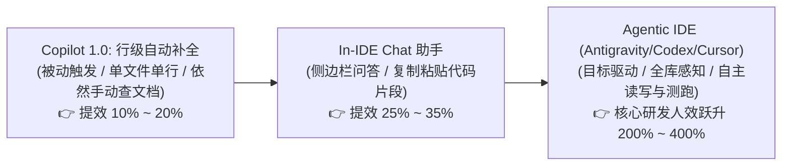
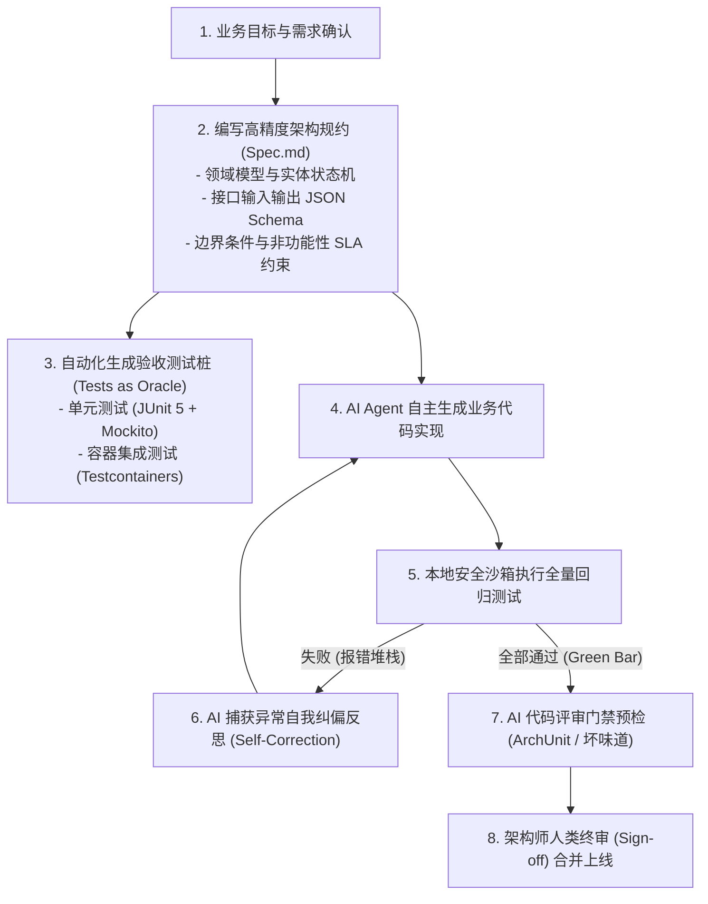
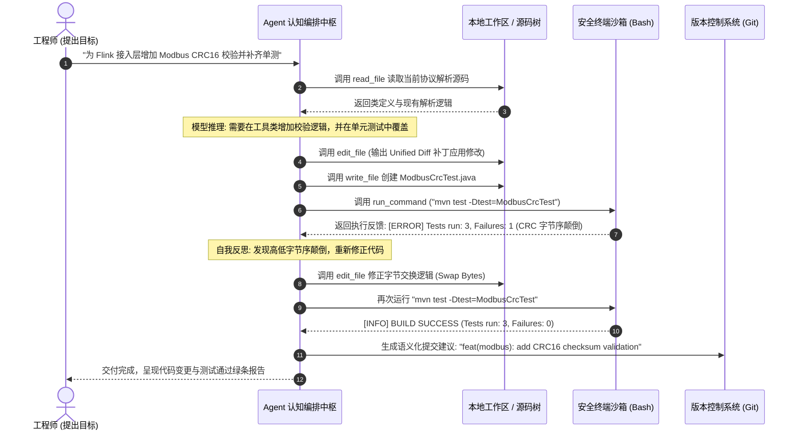
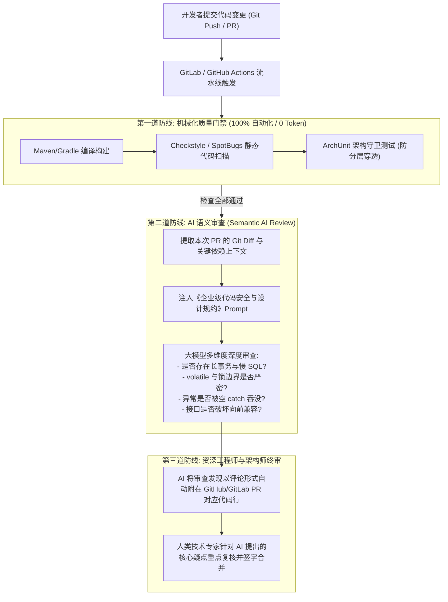
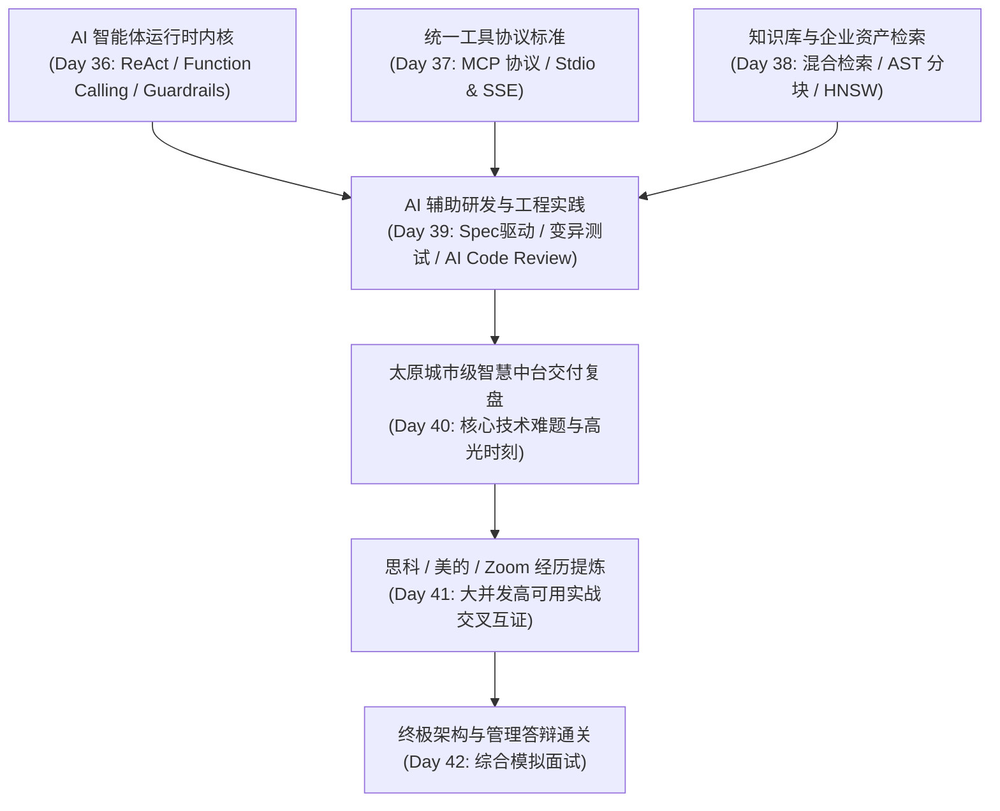

# AI 辅助研发工作流与工程实践

> **架构师视角定位**：本模块聚焦软件工程在人工智能时代的重大范式变迁 —— 从简单的 Copilot 代码行级自动补全，跃升为以自主智能体（Agentic IDE / CLI 如 Antigravity, Codex, Cursor）为核心的 **AI-Native 研发工程流与规范驱动开发（Spec-Driven Development, SDD）**。全面拆解从基于 Repo Map 的全工程上下文感知、AST 语法树精准修剪、自动化单元测试与变异测试（Mutation Testing）、AI 辅助 Code Review 三层门禁，到防范并发死锁/内存泄漏的生成代码安全沙箱、开源知识产权合规，以及技术团队从传统开发向人机协同（Centaur Developer）的组织效能升级。结合太原智慧供热中台与大型分布式微服务从 0 到 1 快速重构交付实战，为技术总监、数据平台研发负责人与高级架构师构建一套既能成倍释放研发人效、又能坚守企业级工程质量底线的现代软件工程方法论。

---

## 1. 知识概述与业务价值

### 1.1 从 Copilot 自动补全到 AI-Native 智能体工程范式革命
软件工程历经了四十年的演进，正在经历第三次重大生产力范式跃迁：
1. **第一代：文本与语法时代（IDE & Linter）**：Eclipse, IntelliJ, VS Code。基于静态语法分析提供高亮、报错与基础函数提示；
2. **第二代：概率自动补全时代（Copilot 1.0）**：基于单文件光标前后的 Token 预测行级补全（Tab 补全）。开发者依然扮演“主要打字者”角色，思维频繁被打断；
3. **第三代：自主智能体与规范驱动时代（AI-Native / Agentic IDE, 2024+）**：以 Antigravity, Codex, Claude Code, Cursor Composer 为代表。系统拥有**全仓库感知能力（Repo-Level Awareness）、终端命令行自主执行能力（Terminal Tool Use）与多文件协同重构能力（Multi-file Patching）**。
   - **核心变革**：开发者的角色从“逐行编码的打字工”全面转型为**“业务规范制定者（Spec Author）、架构方案把关者（Architectural Reviewer）与质量终审法官（Quality Judge）”**。



### 1.2 企业研发效能（Lead Time）质的跃迁与人效 ROI
在企业级数字化转型与大数据中台建设中，引入 AI-Native 研发工作流能带来极其显著的商业回报：
- **消除样板代码（Boilerplate）与机械搬砖**：DTO/DO/VO 转换、MyBatis Mapper 编写、RESTful 增删改查脚手架、复杂 JSON 反序列化等低价值劳动的开发耗时直接由天级降为秒级；
- **将“写单测”从负担转化为默认自动化**：利用 AI 结合 Testcontainers 秒级生成包含 Mock 桩、边界值与真实 MySQL/Kafka 容器的完整集成测试，核心代码单元测试覆盖率从传统的不足 30% 跃升至 85% 以上；
- **端到端交付周期（Lead Time）压缩 60%**：一个原本需要 2 周完成的“工业设备异构报文解析微服务”，在严密 Spec 规约指导下，高级工程师配合 AI 智能体仅需 1.5 天即可高质量完成自测交付。

---

## 2. 核心概念与关系

### 2.1 规范驱动开发（Spec-Driven Development, SDD）
传统软件开发中，需求文档（PRD）与实际代码脱节是系统腐化的最大根因。AI-Native 时代催生了 **Spec 驱动开发（SDD）**：



- **Spec（规范规约）是系统第一资产**：自然语言是不精确的，纯代码是低抽象的。Spec 采用结构化 Markdown 或 OpenAPI 格式，白纸黑字定义输入输出契约、异常状态码与数据不变式（Invariants）；
- **测试作为裁决标尺（Tests as Oracle）**：在生成实际业务逻辑前，先让 AI 根据 Spec 生成全套严密的单元测试。**业务代码写得对不对，不由人肉肉眼看，而是看自动化测试是否全部跑通（Green Bar）**。

### 2.2 上下文感知中枢（Codebase Context Awareness）
现代 Agent 面对数万甚至数十万行代码的大型工程时，绝不是把整个代码库丢给大模型（超出上下文且极度昂贵）。其核心感知底座包含三大支撑：
1. **Repo Map（全工程拓扑骨架图）**：使用 Tree-sitter 等工具，离线分析整个代码库，仅保留所有的包名、类名、接口定义、函数签名与字段结构，去除具体函数体代码。一个 10 万行代码的大工程，其 Repo Map 压缩后仅占 5000 Tokens，使 Agent 瞬间具备“上帝视角”；
2. **符号表与代码导航（LSP / Ctags）**：利用语言服务器协议（LSP），精准定位变量定义（Go to Definition）、查找全局引用（Find References）与接口实现类；
3. **依赖调用链切片（Dependency Slicing）**：当需要修改 `OrderService.java` 时，系统自动沿依赖图向外扩展一层，仅把直接关联的 `OrderRepository.java`、`PaymentClient.java` 与相关 DTO 注入当前轮次上下文。

### 2.3 人机协作“半人马”模型（Centaur Developer Model）

| 研发职责维度 | AI 智能体（Silicon Brain）负责域 | 人类架构师/工程师（Carbon Brain）负责域 |
| :--- | :--- | :--- |
| **需求与架构设计** | 根据草案梳理边界遗漏、推演异常分支、格式化 Spec。 | **定义业务边界、技术选型决策、设计领域模型、平衡商业契约。** |
| **代码编写与实现** | **按 Spec 批量生成高质量样板代码、数据映射、复杂正则与算法。** | 把控并发死锁隐患、审查高危底层锁机制、裁决核心业务逻辑。 |
| **工程质量保障** | **光速生成全量单元测试桩、边界测试数据、代码静态坏味道排查。** | 审查测试有效性（防假阳性）、设计端到端链路压测、注入破坏性混沌工程。 |
| **代码评审与合规** | 自动化扫描格式排版、检查开源 CVE 漏洞、比对架构守卫规则。 | **最终合入签字（Sign-off）、承担生产线上一切责任、业务正确性把关。** |

---

## 3. 底层工作机制与设计哲学

### 3.1 现代 Agentic IDE / CLI 底层核心机制
像 Google Antigravity、OpenAI Codex 或 Claude Code 这类智能体工具，之所以能够独立完成复杂的软件工程任务，其底层由**四个核心执行器协同驱动**：



#### 1. Diff 打补丁与容错回滚机制（Unified Diff Patching）
Agent 绝不应该直接整文件覆盖！整文件重写在网络抖动或长文本截断时会导致大量无辜代码丢失。
- 优秀工具采用精确的 **Diff 定位与局部替换（Chunk Replacement）**：模型只需输出目标代码段的前后几行锚点（Anchor Lines）及变更替换内容；
- 每次写操作前，在内存或临时分支创建快照，一旦格式解析失败或发生编译语法错误，支持原子级回滚（Atomic Rollback）。

---

### 3.2 AI 驱动的单元测试与变异测试（Mutation Testing）

#### 1. 传统 AI 单测的“假阳性欺骗（False Positive / Cheating Tests）”
直接让大模型给代码补单测，极易出现严重的“偷工减料”：
- **无断言测试（Assertion-free Tests）**：跑了一堆方法调用，最后没有 `assertEquals` 或直接 `assertTrue(true)`，覆盖率统计软件显示绿色通过，但实际毫无校验价值；
- **自循环 Mock（Circular Mocking）**：将待测试类的内部私有逻辑全部 Mock 掉，测试代码只是在测试 Mock 库本身，根本测不出真实业务 Bug。

#### 2. 生产级自动化测试生成工程流水线
为了获得真正具备防御力的测试套件，必须推行**变异测试（Mutation Testing）校验门禁**：
1. **边界值分析注入（Boundary Value Analysis）**：Prompt 中强制要求覆盖空指针（Null）、空集合（Empty）、极大数值溢出（Max Value）、跨时区与并发竞争场景；
2. **变异测试检验测试套件有效性（PITest）**：
   - 自动在被测业务代码中故意注入微小的变异故障（如将 `>` 改为 `>=`、将 `+` 改为 `-`、将某行调用删除）；
   - 重新运行 AI 生成的单元测试：**如果单元测试报错挂掉，说明测试成功“杀死了变异体（Killed Mutant）”，测试有效！**
   - 如果业务代码被篡改后单元测试依然全绿通过，说明该测试是“劣质无效单测”，系统自动驳回并要求大模型重写断言！

---

### 3.3 AI 辅助代码评审（AI Code Review Gate）核心架构



---

## 4. 高频复杂业务场景实操与落地

### 场景一：利用 Agentic 工作流构建工业数据中台 Modbus 解析服务
- **业务诉求**：在太原城市级供热中台中，需紧急为新进场的某品牌超声波热量表编写一套基于 Netty 的高性能 Modbus-RTU 异步解析与数据校验中间件，要求具备高并发、内存零拷贝（ByteBuf）与完整的单测保障。
- **Spec 驱动开发实战规约（`ModbusSpec.md`）**：

```markdown
# Component Specification: UltrasonicHeatMeterDecoder

## 1. Domain & Protocol Contract
- 协议类型: Modbus-RTU over TCP
- 设备从站地址: 0x01
- 功能码: 0x03 (Read Holding Registers)
- 寄存器映射:
  - 0x0000 - 0x0001 (4 Bytes, Float32, Big-Endian): 瞬时流量 (m³/h)
  - 0x0002 - 0x0003 (4 Bytes, Float32, Big-Endian): 供水温度 (°C)
  - 0x0004 - 0x0005 (4 Bytes, Float32, Big-Endian): 回水温度 (°C)
  - 0x0006 - 0x0007 (4 Bytes, Float32, Big-Endian): 累计热量 (GJ)
- 校验规则: 报文尾部包含 2 字节标准 CRC16 校验码 (低字节在前，高字节在后)

## 2. Technical Non-Functional Constraints
- 基于 Netty 4.1+ 与 Java 17 实现；
- 必须使用 Netty 的 ByteBuf 进行切片解析，严禁产生不必要的 byte[] 内存复制；
- 必须处理半包与粘包问题（继承自 LengthFieldBasedFrameDecoder 或自研帧定界）；
- 若 CRC 校验失败，必须记录 WARN 日志并抛出自定义 `CorruptedFrameException`，释放 ByteBuf 引用计数，杜绝堆外内存泄漏！

## 3. Test Oracle Criteria
- 使用 JUnit 5 + AssertJ 编写至少 5 个测试用例：
  1. 正常报文解析与浮点数精度断言；
  2. CRC 校验错位报文拦截测试；
  3. 畸形短报文异常处理测试；
  4. 堆外内存引用计数释放断言 (refCnt() == 0)。
```

- **执行效果**：
  - 工程师将 `ModbusSpec.md` 交付给 Agent；
  - Agent 在 3 分钟内完整生成 `UltrasonicHeatMeterDecoder.java`、`ModbusCrcUtils.java` 与全套测试用例 `UltrasonicHeatMeterDecoderTest.java`；
  - 并在本地 Maven 沙箱中成功跑通 4 个测试，堆外内存零泄漏，代码质量直接达到生产准入级。

---

## 5. 生产异常故障深度排查与根因分析

### 故障一：过度信任生成的“幻觉代码”引发高并发死锁与内存泄漏

#### 1. 故障现象
某团队在重构热力调控服务时，让 AI 编写了一个全局连接管理器。上线运行到第 14 天，生产服务突然抛出 `OutOfMemoryError: Java heap space`，同时多个 Worker 线程处于 `BLOCKED` 状态，调度大屏全线冻结。

#### 2. 深度根因排查（Root Cause）
1. **隐藏的指令重排与可见性 Bug**：AI 采用了双重检查锁定（DCL）实现单例模式，但核心静态变量却漏写了 `volatile` 关键字：
   ```java
   // ❌ AI 生成的缺陷代码: 缺少 volatile，高并发下导致指令重排与半初始化对象逸出
   private static ConnectionManager instance;
   ```
2. **连接未释放导致的严重资源泄漏**：AI 在执行数据库或网络查询时，采用了传统的 `try-finally`，但在异常分支中未能显式关闭客户端连接池的连接，导致连接句柄耗尽。

#### 3. 架构级防范红线
- **永远不要让 AI 裸写核心并发与底层锁机制**：强制要求全团队必须使用 JUC 官方推荐的高级并发工具（如 `AtomicReference`、`CompletableFuture`、`ConcurrentHashMap`），严禁手写复杂底层的双重锁判定与裸 `wait/notify`；
- **ArchUnit 架构规则硬阻断**：在 CI 流水线中嵌入架构检查，凡是发现包含单例但字段缺少 `volatile` 的，直接在编译期拒绝构建。

---

### 故障二：AI 辅助重构破坏边缘接口的向前兼容性（Silent API Breakage）

#### 1. 故障现场
在一次从旧版 MyBatis 迁移到现代 ORM 的重构任务中，AI Agent 在重写 SQL 查询方法时，顺手将某个返回实体中的 `heating_status` 字段类型由 `Integer` 优化成了更加优雅的 Java `enum` 枚举。
单元测试全绿通过，但上线后老旧的太原换热站边缘 RTU 网关在反序列化 JSON 时直接抛出崩溃，导致该片区 40 个换热站遥测数据断流。

#### 2. 深度根因分析
- AI 缺乏企业级软件交付中的**“历史包袱意识与向前兼容敏感度”**。在模型眼中，将整数重构为枚举是技术上的“最佳实践”，但在工业和政企异构交付中，外部上游或下游系统往往不可控，私自更改字段格式属于灾难性的破坏性变更（Breaking Change）。

#### 3. 架构防线
- 在 Spec 和 Prompt 中注入**不可更改的向前兼容红线（Strict Backward Compatibility Directive）**；
- 生产库对外暴露的 DTO 必须配置 JSON 反序列化宽松策略（如 Jackson 的 `FAIL_ON_UNKNOWN_PROPERTIES = false`），并通过快照比对测试（Snapshot Testing）锁定生成的 JSON 字节完全一致。

---

## 6. 技术选型对比

### 6.1 现代主流 AI 研发辅助工具全景对比矩阵

| 评估维度 | **Google Antigravity / Claude Code** | **Cursor (Composer)** | **GitHub Copilot** | **自研企业级 CR Bot** |
| :--- | :--- | :--- | :--- | :--- |
| **形态定位** | **全自主 Agentic CLI / 工作台** | **全自主 Agentic IDE (VS Code 深度魔改)** | IDE 插件式辅助 (Tab 补全 + 边栏聊天) | CI/CD 流水线集成审查机器人 |
| **终端命令执行** | **极强 (支持沙箱内自主跑测试/编译/改错)** | **极强 (支持终端自动运行并读取输出)** | 弱 (仅提供命令建议，需人工粘贴) | 无 (仅在 CI 环境被动运行) |
| **多文件协同重构** | **全自主跨文件 Diff 打补丁与自愈** | **极强 (多文件并行编辑与快照回滚)** | 弱 (仅限当前活动标签页周边推理) | 极强 (针对全局 PR 的完整 Diff) |
| **工程拓扑感知** | **全仓库 Repo Map 与 AST 深度扫描** | 极强 (基于 Merkle Tree 增量索引) | 中等 (轻量级符号关联) | 针对 Git Commit 范围的局部感知 |
| **企业数据合规** | 强 (支持私有化端侧执行与权限隔离) | 中等 (商业版支持 Zero Data Retention) | 强 (企业版支持商业免责与不参与训练) | **极高 (企业内网物理私有部署，数据零流出)** |
| **推荐生产定位** | **核心架构攻坚、重大复杂重构、全自主交付**。 | **全职日常编码、前端大屏与微服务开发首选**。 | 团队初级过渡、轻量级日常代码补全。 | **全公司研发质量统一门禁、开源合规红线守护**。 |

---

## 7. 技术经理与架构师实战管控

### 7.1 团队推行“AI-Native”工程实践的标准 SOP 与文化重塑
技术负责人在团队中推进 AI 研发变革时，最大的阻力往往不是技术本身，而是**组织惯性与心理防线**：
1. **消除“工具恐慌”与“职业威胁论”**：
   - 明确向团队宣贯：*“AI 不会淘汰程序员，但熟练使用 AI 的程序员会光速淘汰不用 AI 的程序员。”*
   - 将工程师的考核维度从“写了多少行代码”彻底解放出来，升维至“交付业务功能的稳定性、架构设计合理性与 Spec 抽象深度”；
2. **确立绝对的代码责任制（Accountability Rule）**：
   - **铁律红线**：*“无论代码是自己手写的还是 AI 生成的，只要该代码被你提交并合并进主分支，发生生产故障时，你负 100% 的全部责任！绝对严禁以‘这是 AI 生成的’作为免责借口！”*
   - 这一规则能够倒逼工程师以极其严谨的态度审查 AI 生成的每一行逻辑，绝不盲目敲击 Accept。

### 7.2 研发效能看板与度量指标重塑（新 DORA 看板）
在 AI-Native 时代，传统的代码行数（LOC）考核彻底沦为笑话。必须建立现代化的人效度量看板：

| 度量指标维度 | 传统研发模式基准 | AI-Native 研发模式目标 | 数据采集工具 |
| :--- | :--- | :--- | :--- |
| **需求平均交付周期 (Lead Time)** | 14 个工作日 | **4 ~ 5 个工作日 (缩短 60% 以上)** | Jira / 研发效能大盘 |
| **单元测试代码行覆盖率** | 25% ~ 35% | **80% ~ 90% (默认标配，且通过变异测试)** | JaCoCo / SonarQube |
| **千行代码严重缺陷率 (Defect Density)** | 3.5 个 / KLOC | **< 0.8 个 / KLOC (质量显著收敛)** | Sentry / BugFree 线上统计 |
| **代码评审耗时 (CR Turnaround Time)** | 平均 24 小时 | **< 2 小时 (AI 预审化解 80% 基础问题)** | GitLab MR 统计分析 |

### 7.3 企业级知识产权与代码出境安全红线（IP & Security Guardrails）
1. **严禁上传涉密机密资产**：
   - 在网关层部署自动化 DLP（数据防泄漏）插件：对所有发往大模型外部 API 的请求进行正向过滤，一旦检测到包含内网物理 IP、生产数据库密码、未加密私钥、太原供热核心算法公式等字段，直接阻断并向安全团队报警；
2. **开源许可证合规审查（License Compliance）**：
   - 大模型在预训练时学习了海量开源代码，极易在生成代码中包含具有“传染性”的 GPL/AGPL 代码片段；
   - 在 CI 阶段集成 FOSSA 或 Black Duck 等工具进行代际指纹扫描，防止污染企业的商业闭源软件产权。

---

## 8. 互联网大厂高频面试真题库

### 8.1 研发范式演进与规范驱动题
- **Q1**：从传统的“Copilot 代码自动补全”到现代基于 Agentic IDE（如 Antigravity, Cursor）的“规范驱动开发（Spec-Driven Development）”，研发范式发生了怎样的本质改变？
- **Q2**：大模型生成的代码经常出现细微的“并发安全陷阱（如指令重排、死锁）、内存/连接泄漏或假阳性单元测试”，作为技术负责人，你如何建立工程化的防线杜绝此类代码流入生产分支？

### 8.2 工程上下文感知与多文件协同题
- **Q3**：在大型软件工程中，AI 智能体是如何实现“跨多个源文件、数万行代码上下文感知与精准协同重构”的？其背后的 Repo Map、符号索引与 AST 语法树解析机制是什么？
- **Q4**：如何利用 AI 建立全自动化的 Code Review（代码评审）门禁流水线？如何划分“自动化 CI/CD 静态扫描、AI 大模型语义评审、人类资深工程师终审”的三层边界？

### 8.3 团队落地、效能度量与系统重构题
- **Q5**：作为研发团队负责人，如果你要在 10~50 人的工程团队中全面推广“AI-Native 辅助研发工作流”，你将如何制定推进路线图？如何平衡交付效率提升与知识产权安全、员工能力退化的风险？
- **Q6**：在面对老旧遗留系统重构或框架跨大版本升级（如 Java 8 升级到 Java 21 虚拟线程）时，如何利用 AI Agent 设计一套“自动化代码迁移、测试桩自愈与数据一致性对账”的工程化解决方案？

---

## 9. 结构化深度参考答案

### 题目 1：[从传统的“Copilot 代码自动补全”到现代基于 Agentic IDE（如 Antigravity, Cursor）的“规范驱动开发（Spec-Driven Development）”，研发范式发生了怎样的本质改变？]

#### 简洁回答（1分钟电梯破题）
> “这种转变是软件工程生产力从**‘战术级打字辅助’向‘战略级架构协同’的范式跃迁**。
> 传统的 Copilot 本质是基于局部的行级预测，工程师依然陷入在打字与机械编码的泥潭中；
> 而基于 Agentic 工具的规范驱动开发（SDD），将工程师的角色升维为**‘系统契约的制定者与终审法官’**：工程师只需专注于编写严密的技术规范（Spec.md），AI 智能体基于全库感知自主完成多文件代码编写、测试桩生成、并在真实终端中自跑自测、自我纠偏直至全部绿条通过，实现从‘人肉写代码’到‘人机结对、架构先行、测试裁决’的根本性革命。”

#### 深入回答（机制推导、工程落地、落地流程与边界条件）
> “从开发生命周期的四个关键动作展开对比剖析：
> 1. **核心输入物从‘自然语言碎片’转变为‘强类型结构化 Spec’**：
>    - 传统开发中，开发者在聊天框里零碎提问：“帮我写个正则”、“帮我写个排序”，每次生成都需要人工小心翼翼复制粘贴并手工缝合进工程；
>    - SDD 模式下，输入是一份包含领域实体、状态流转、输入输出边界与异常约束的完整 Spec 规约。大模型将其视作工程蓝图，进行全局一致性展开。
> 2. **控制权流转从‘被动建议’转变为‘自主 ReAct 闭环’**：
>    - Copilot 只有只读建议权；
>    - Agentic IDE 具备系统写权限与终端执行权：它利用 AST 树分析跨文件依赖，以 Unified Diff 形式同时修补 5 个 Java 类，随后自主触发 `mvn test`，读取堆栈报错，在沙箱内部完成 3 轮自我修正，直至所有单元测试与编译完全通过后，才将最终成果交付给人类。
> 3. **质量验证从‘事后人肉调试’转变为‘测试驱动（TDD & Tests as Oracle）’**：
>    - 在生成业务逻辑前，先强制由 AI 根据 Spec 生成包含 Testcontainers 容器环境的测试套件；代码写得是否合格，以客观的自动化断言与变异测试（Mutation Testing）作为唯一物理裁判，消灭了主观猜测。”

#### 架构师/技术管理视角（组织变革、人效 ROI、团队心智塑造、工程合规）
> “从研发总监与组织管理者的视角来看，**规范驱动开发（SDD）直接击中了困扰软件工程界数十年的最大顽疾 ——‘文档与代码脱节，系统越做越烂’**。
> 在传统敏捷开发中，由于交付压力巨大，工程师几乎从不认真写详细设计文档，代码成了唯一的真相，最终导致团队新人看不懂、老兵不敢动。
> 推行 SDD 的最大战略红利：
> **‘把写代码的成本降到了极致，从而把文档和设计的价值抬到了最高’**。
> 逼迫团队将 70% 的精力花在前期的业务建模、契约设计与 Spec 评审上。因为只要 Spec 足够精确严密，后续的编码与单测交付几乎是确定性、零成本的瞬时兑现。这不仅极大提升了系统的可维护性，更为企业沉淀下了永久可传承的数字架构资产。”

---

### 题目 2：[大模型生成的代码经常出现细微的“并发安全陷阱（如指令重排、死锁）、内存/连接泄漏或假阳性单元测试”，作为技术负责人，你如何建立工程化的防线杜绝此类代码流入生产分支？]

#### 简洁回答（1分钟电梯破题）
> “防范 AI 代码暗坑的核心原则是**‘绝不盲信大模型的自律，建立确定性的分层工程免疫防线’**。
> 机制包括：在架构层强制推行 JUC 高阶无锁并发工具与 `try-with-resources` 编码铁律，禁用手写裸锁；在 CI 阶段集成 ArchUnit 与 SpotBugs 静态染色扫描，阻断无 `volatile` 单例与连接泄漏；在测试层推行**变异测试（Mutation Testing / PITest）**，对故意注入变异体依然能通过的‘假阳性单测’强制驳回；并在最终合并前推行严格的人类架构师复核与连带责任制，确保代码质量底线坚不可摧。”

#### 深入回答（机制推导、工程落地、落地流程与边界条件）
> “在太原智慧供热数据中台与高并发微服务工程中，我构建了‘四重锁’免疫系统：
> 1. **第一重：架构代码规范约束（Prompt System Rules）**：
>    - 在 IDE 的工作区 System Prompt 中硬编码禁止项：
>      - *“严禁使用 synchronized 手写双重检查锁（DCL），必须使用枚举或 AtomicReference”*；
>      - *“所有 I/O、数据库连接、Kafka Producer、Netty ByteBuf 必须强制置于 try-with-resources 块中或显式调用 release()”*；
>      - 从源头压低劣质代码的生成概率。
> 2. **第二重：自动化静态架构门禁（ArchUnit & SpotBugs）**：
>    - 在构建脚本中加入静态死锁检测规则：检测是否存在交叉获取锁的潜在调用链；
>    - 检查是否捕获了 `Throwable` 或 `Exception` 却没有打日志或向上抛出的‘吞异常’行为，一经发现直接亮红灯打断 CI 构建。
> 3. **第三重：针对假阳性单元测试的变异测试防护（PITest）**：
>    - **假阳性识别**：大模型经常编写缺少 `assert` 或 `assertNotNull(result)` 的敷衍代码；
>    - **变异拦截**：在 CI 中自动执行 PITest 变异引擎，在被测代码中自动引入 10 个突变体（Mutants，如将条件反转、将返回值置空）。如果 AI 编写的单元测试不能杀死 80% 以上的突变体，直接判定该单测不合格，禁止合并 PR。
> 4. **第四重：真实环境集成测试门禁（Testcontainers）**：
>    - 坚决杜绝‘把一切都 Mock 掉’的自欺欺人测试；
>    - 强制要求在本地与 CI 中利用 Testcontainers 动态拉起真实的 MySQL 8.0 与 Kafka 3.7 临时容器，运行全量 CRUD 与事务回滚测试，用真实的数据库引擎检验代码的实际执行结果。”

#### 架构师/技术管理视角（组织变革、人效 ROI、团队心智塑造、工程合规）
> “从技术高管和质量法官的视角审视，**AI 代码生成能力的爆发，给软件工程带来的最大隐患就是‘劣质代码的生成速度远超人类的审查速度’**。
> 如果缺乏确定性的工程防线，团队很快就会被海量看似优雅但暗藏致命隐患的‘垃圾代码’彻底淹没。
> 管理铁律：
> **‘信任必须建立在可验证的基础之上（Trust, but Verify）’**。
> 永远不要让团队陷入盲目的‘代码生成狂欢’。技术管理者必须保持最高级别的敬畏心，用冷酷、机械、零容忍的自动化测试流水线把好每一道关口，让 AI 成为提升战斗力的超级倍增器，而不是制造生产事故的特洛伊木马。”

---

### 题目 3：[在大型软件工程中，AI 智能体是如何实现“跨多个源文件、数万行代码上下文感知与精准协同重构”的？其背后的 Repo Map、符号索引与 AST 语法树解析机制是什么？]

#### 简洁回答（1分钟电梯破题）
> “AI 智能体实现跨文件全局感知的底层机制是**‘分层信息压缩与按需精准注水’**。
> 它绝非把全量代码粗暴塞入上下文，而是依托三大支柱：
> 1. 利用 Tree-sitter 等语法解析器抽取全工程 AST 骨架，生成极高信息密度的 **Repo Map**（仅保留类、方法签名与层级关系，压缩率高达 95%），为模型提供全局拓扑上帝视角；
> 2. 结合 **LSP（语言服务器协议）与符号表**，在数毫秒内精准定位跨文件的定义、调用与实现引用；
> 3. 在触发多文件重构时，通过依赖切片仅加载最小上下文，并利用 **Unified Diff 打补丁与 AST 边界校验**，实现安全的多文件原子级协同修改。”

#### 深入回答（机制推导、工程落地、落地流程与边界条件）
> “从代码解析、拓扑构建与跨文件打补丁的底层工程原理展开：
> 1. **Repo Map 的构建与 PageRank 权重分配算法**：
>    - **信息压缩**：提取所有 `.java` 或 `.py` 文件的 AST 抽象语法树，剔除所有函数内部的具体实现逻辑，只保留文件路径、类名、接口、导出函数签名与公共字段；
>    - **代码依赖图（Dependency Graph）**：在符号引用之间建立有向边（例如 `OrderService` 调用了 `PaymentClient`）；
>    - **PageRank 算法排序**：对工程依赖图运行 PageRank 算法，计算每个类在整个工程中的核心权重。当 Token 预算有限时，系统优先保留权重最高的‘核心基础设施类与领域服务’骨架，动态生成仅占数千 Tokens 的全局地图。
> 2. **LSP 与符号导航的实时协同**：
>    - 当用户提出“*修改 UserDTO 增加 phone 字段，并同步调整所有下游转换器*”时；
>    - 智能体并不需要靠大模型去‘猜’哪些文件用到了 `UserDTO`，而是直接调用本地 LSP 的 `textDocument/references` 接口，在 10 毫秒内获得精确的调用文件清单（如 `UserConverter.java`、`AuthController.java`）；
>    - 将这几个受影响的文件精准加入当前轮次的工作上下文。
> 3. **多文件 Diff 打补丁与冲突自愈**：
>    - 模型以结构化格式（如 `<<<< SEARCH ... ==== REPLACE >>>>`）输出每个文件的差异补丁；
>    - 宿主程序根据代码行上下文锚点，精准定位并替换；
>    - 替换完成后，立即触发本地编译（如 `javac` 解析），若发现某个文件遗漏了 import 或产生了类型不匹配，智能体捕获编译器的错误行号，仅对该异常文件做二次微调，确保全工程跨文件原子性一致收敛。”

#### 架构师/技术管理视角（组织变革、人效 ROI、团队心智塑造、工程合规）
> “从研发工具链与技术选型的视角看，**衡量一个 AI 研发工具高下的核心分水岭，就在于其‘全工程上下文引擎（Context Engine）’的深厚底蕴**。
> 一个只会读取当前活动标签页的工具，充其量只是个玩具；而真正能承载企业级重构重任的工具，必须具备与底层编译器、LSP 协议栈和 AST 语法树深度咬合的硬核工程底座。
> 技术高管在选型与自研内部工程工具时，必须穿透浮夸的模型参数营销，重点考察其在超长依赖链路下的召回精度、多文件补丁合并的零冲突率以及对企业私有庞大代码库的动态索引能力，这才是决定工具能否真正融入核心工程生产线的关键命脉。”

---

### 题目 4：[如何利用 AI 建立全自动化的 Code Review（代码评审）门禁流水线？如何划分“自动化 CI/CD 静态扫描、AI 大模型语义评审、人类资深工程师终审”的三层边界？]

#### 简洁回答（1分钟电梯破题）
> “构建现代化全自动 CR 门禁的核心是**‘机械检查交给工具、语义与架构交给 AI、商业逻辑与风险兜底留给人类’**的三层纵深防御体系。
> 第一层由 Checkstyle/SonarQube/ArchUnit 负责格式、安全扫描与分层守卫（零 Token，毫秒级快速失败）；
> 第二层由 AI Code Reviewer 结合企业设计规约对 Git Diff 进行深层语义审查（排查慢 SQL、长事务、并发锁边界、向前兼容性并在 PR 对应代码行自动批注）；
> 第三层由人类资深架构师基于 AI 提炼的高风险摘要，聚焦于业务契约与系统稳定性做最终裁决签字（Sign-off），将每次人工评审耗时从 1 小时压缩至 10 分钟以内。”

#### 深入回答（机制推导、工程落地、落地流程与边界条件）
> “在我的团队研发治理中，落地的标准三层 CR 流水线架构如下：
> 1. **第一层：机械化静态门禁（Zero-Token Strict Gate）**：
>    - 运行在 GitLab CI / GitHub Actions 容器中；
>    - **检查项**：代码格式缩进、拼写错误、死代码、高危 CVE 开源依赖库、单元测试通过率是否达标；
>    - **红线**：若本层有任何报错，流水线立即中断亮红灯，**坚决不触发大模型调用**，避免无谓浪费 API 成本。
> 2. **第二层：AI 语义与深水区审查（Semantic AI Review）**：
>    - 提取通过第一层筛选的 PR Git Diff 及关联的接口 Spec；
>    - **Prompt 注入企业级 Checklist**：
>      - *“是否存在循环查库（N+1 查询）或缺少索引的慢 SQL？”*；
>      - *“事务注解 `@Transactional` 是否包含 RPC 远程长调用导致连接池耗尽？”*；
>      - *“外部接口 DTO 是否存在字段重命名破坏旧客户端兼容性？”*；
>    - **交互输出**：调用 GitLab API，精准在产生疑点的代码行下方发布结构化 Comment，指出潜在风险并提供优化后的替代代码建议；同时向 PR 顶部生成一份《AI 风险评估雷达图（通过/警告/致命）》。
> 3. **第三层：人类架构师终审与签字授权（Human Sign-off）**：
>    - 架构师打开 PR 时，不需要再逐行肉眼挑错别字或语法；
>    - 直接查看 AI 标红的 2~3 处深水区建议，重点核验业务逻辑与跨系统影响；
>    - 确认无误后点击 Approve，合入主干代码。”

#### 架构师/技术管理视角（组织变革、人效 ROI、团队心智塑造、工程合规）
> “从研发效能与团队协同的视角来看，**推行 AI 辅助代码评审，不仅极大释放了技术骨干的宝贵时间，更彻底化解了团队内部的人际摩擦与情绪内耗**。
> 在传统团队中，资深架构师在 CR 里挑新人的格式错误或异常未捕获，经常引发新人的防备与抵触心理，搞得评审像批判会；
> 引入 AI 评审后，把‘恶人’的角色完全交给了大模型：
> 机器指出的代码坏味道，工程师心服口服并快速修改；而资深架构师则退居幕后，专注于指导新人的业务架构思维与系统设计哲学。团队氛围更加融洽，工程基线整体上移，这是技术管理润物细无声的高阶境界。”

---

### 题目 5：[作为研发团队负责人，如果你要在 10~50 人的工程团队中全面推广“AI-Native 辅助研发工作流”，你将如何制定推进路线图？如何平衡交付效率提升与知识产权安全、员工能力退化的风险？]

#### 简洁回答（1分钟电梯破题）
> “全面推广 AI-Native 工作流的策略是**‘试点先行树标杆、制度护栏守底线、重塑指标提效能、文化赋能防退化’**。
> 路线图分为：第一阶段选择 2~3 个自驱骨干在非核心业务跑通 Spec 驱动流并提炼 SOP；第二阶段全员推广，配置网关级敏感数据脱敏（DLP）与商业合规防护，确立‘谁合入谁全权负责’的终身质量责任制；第三阶段重塑考核指标，考核架构设计与交付 Lead Time。同时通过定期举办‘架构白板答辩’与‘无 AI 编程对抗赛’，倒逼工程师持续深耕技术底层原理，杜绝思维退化。”

#### 深入回答（机制推导、工程落地、落地流程与边界条件）
> “在 10~50 人研发团队推行工程变革的标准四步路线图：
> 1. **第一阶段：打造特种示范班，沉淀落地 SOP（Month 1）**：
>    - 挑选团队中最具极客精神的 2 名核心架构师，组成‘AI-Native 先锋小组’；
>    - 在一个全新的微服务模块或边缘工具开发中，全面演练从 Spec 撰写、Antigravity/Cursor 结对生成到 Testcontainers 单测的全流程；
>    - 总结出《团队 AI 辅助研发实操红宝书》与标准 Prompt 模板库，用交付效率提升 3 倍的真实数据在全员周会上路演，彻底破除怀疑论。
> 2. **第二阶段：构筑安全防线与基础设施落地（Month 2）**：
>    - **数据安全与合规网关**：统一采购企业级商业授权（确保代码不用于公共大模型训练），并在出口网关配置敏感词脱敏拦截，禁止商业密钥与客户私隐出境；
>    - **引入企业级知识库**：部署内部 RAG 知识库，让 AI 工具能直接检索内部架构规范、公共工具类库与历史踩坑记录。
> 3. **第三阶段：全员赋能、制度红线与效能考核转型（Month 3）**：
>    - 开展全员工作坊，手把手培训 Spec 驱动思维；
>    - **确立核心制度**：严格禁止以‘这是 AI 生成的’作为质量故障免责借口，责任落实到提交人；
>    - 效能考核全面转向 DORA 指标，重点追踪交付周期 Lead Time 压缩率与单元测试质量。
> 4. **第四阶段：防范技能退化（Skill Degradation）的长效机制**：
>    - **警惕‘黑盒依赖症’**：长期依赖 AI 容易让初中级工程师丧失底层调试能力（如排查 JVM 内存泄漏或 Linux epoll 故障）；
>    - **反脆弱文化建设**：每月举办一次‘脱稿架构白板答辩’与‘极限手工排障攻坚日’，要求骨干在无网络、无 AI 的受限环境下现场分析 Dump 文件与底层源码，确保核心团队对技术底座的绝对掌控力。”

#### 架构师/技术管理视角（组织变革、人效 ROI、团队心智塑造、工程合规）
> “从技术高管和组织领航者的视角审视，**AI 浪潮带来的不仅仅是工具的更迭，更是一场触及灵魂的‘组织认知与工程文化重塑’**。
> 平庸的管理者只看到效率提升，盲目逼迫员工‘多用 AI、多写代码’，最终导致系统资产彻底失控、团队核心能力断崖式退化；
> 优秀的管理者深知：
> **‘工具越强大，对驾驭者的底层内功要求反而越高’**。
> 只有当工程师具备极其深厚的架构设计功底、严密的逻辑思维和对底层原理的透彻理解时，他才能写出最高质量的 Spec 规约，才能在一秒钟内敏锐识别出 AI 代码中隐匿的并发死锁与性能陷阱。将团队从低级的‘打字工’催化蜕变为运筹帷幄的‘系统指挥官’，这才是技术管理者在 AI 时代最伟大的使命。”

---

### 题目 6：[在面对老旧遗留系统重构或框架跨大版本升级（如 Java 8 升级到 Java 21 虚拟线程）时，如何利用 AI Agent 设计一套“自动化代码迁移、测试桩自愈与数据一致性对账”的工程化解决方案？]

#### 简洁回答（1分钟电梯破题）
> “利用 AI Agent 实施大规模老旧系统重构的核心战略是**‘绞杀者模式灰度演进、AST脚本驱动批量迁移、自动化双轨对账验证’**。
> 方案由四大流水线构成：
> 1. 利用静态分析工具（OpenRewrite）配合 AI Agent 批量完成基础语法与依赖库跨版本升级；
> 2. 针对 Java 21 虚拟线程核心陷阱（如 `synchronized` 导致的载体线程挂载 Pinning），由 AI 自动重写为 `ReentrantLock` 并生成微基准测试（JMH）；
> 3. 基于历史生产流量录制与回放（Traffic Replay），由 Agent 自主比对新老系统接口响应快照；
> 4. 数据写入端推行新老双写与异步对账稽核，在业务零感知、系统不停机的前提下实现平稳无感换血。”

#### 深入回答（机制推导、工程落地、落地流程与边界条件）
> “在处理复杂遗留系统（如涉及上百个微服务、数万行陈旧代码）跨版本升级时，我设计的工程化迁移闭环包含五个阶段：
> 1. **阶段一：架构风险扫描与自动规则定义（Pattern Mapping）**：
>    - **Java 21 升级致命陷阱**：虚拟线程（Virtual Threads / Project Loom）在遇到 `synchronized` 代码块或本地 `native` 方法调用时，会导致底层的平台载体线程（Carrier Thread）被死死挂载（Pinned），丧失并发优势；
>    - **AI 迁移规约定义**：构建 AST 转换规则，扫描全工程所有的 `synchronized` 关键字，自动化将其重构为 `java.util.concurrent.locks.ReentrantLock`；将陈旧的 `ThreadLocal` 优化为现代的 `ScopedValue`。
> 2. **阶段二：Agent 批量重写与测试自愈流水线（Migration & Self-healing）**：
>    - 编写迁移脚本驱动 Agent 批量处理微服务工程；
>    - 每修改一个模块，立即在 Maven 沙箱中执行编译与单元测试；
>    - 若因第三方老旧依赖（如陈旧的 CGLIB 或 Lombok）发生字节码报错，Agent 捕获报错日志，自动在 `pom.xml` 中升级依赖版本或替换为官方标准实现，直至编译全部通过。
> 3. **阶段三：真实生产流量双轨录制与回放对账（Shadow Run & Traffic Replay）**：
>    - **绝不直接切流**！在网关层使用 Goreplay 或自研中间件，将线上真实的生产流量无感复制一份旁路请求打给升级后的 Java 21 新集群；
>    - 对比新老集群返回的 JSON 响应体，利用比对脚本自动进行字段级 Diff 比较；
>    - 若发现浮点数精度漂移或时间戳时区不一致，Agent 自动提取异常用例，反向定位代码中的序列化配置缺陷并打补丁。
> 4. **阶段四：数据存储双写与一致性稽核（Dual Write & Consistency Audit）**：
>    - 在涉及数据库写入的关键链路，新老系统并行写入；
>    - 部署后台 Canal 监听 Binlog 实时对账程序，验证两套系统的持久化数据完全一致（主键、业务状态机、流水表 100% 对齐），连续平稳运行 14 天且数据零偏差后，正式下线旧系统。”

#### 架构师/技术管理视角（组织变革、人效 ROI、团队心智塑造、工程合规）
> “从大型系统架构演进与风险治理的视角来看，**‘重构是技术债务治理的终极考验，也是最容易引发灾难性事故的深水区’**。
> 很多失败的重构，往往是因为采用了‘推倒全盘重写、业务暂停三个月’的自杀式打法，最终由于新系统漏洞百出而惨烈流产。
> 架构设计终极哲学：
> **‘永远在飞机飞行过程中更换引擎，且乘客（业务端）毫无感知’**。
> 借助 AI Agent 强大的批量语法重写能力与海量数据对账能力，我们得以将原本需要数十人月、极其痛苦枯燥的代码搬迁工作，转化为高度自动化、受控、可量化对账的现代工程流水线。这不仅大幅降低了系统重构的技术风险与人力成本，更为企业构建起了一个能够随技术浪潮自如演化、基业长青的弹性软件生态体系。”

---

## 10. 知识自检与口述推演清单

- [ ] 能否系统阐述从传统的 Copilot 自动补全到现代 Agentic IDE（如 Antigravity, Cursor）规范驱动开发（SDD）的范式演变？
- [ ] 能否向团队阐明“Spec 即代码、测试作为裁判”的核心理念，并给出一份高质量技术 Spec 的必备三要素？
- [ ] 能否解释 AI 智能体如何利用 Repo Map、PageRank 权重分配与 LSP 符号导航实现大型代码库的跨文件感知？
- [ ] 面对大模型生成的代码，能否讲透为什么会出现“假阳性单测”与“并发锁安全陷阱”，并给出变异测试（PITest）与 Testcontainers 的防御实践？
- [ ] 能否设计一套包含机械检查、AI 语义审查与人类架构师终审的“三层 Code Review 门禁流水线”？
- [ ] 面对遗留系统重构与 Java 21 升级，能否推演一套结合 AST 自动重写、流量录制回放与双写对账的无感演进方案？

---

## 11. 知识脉络与技术图谱关联



---

## 12. 权威参考与官方进阶资料

1. **软件工程思想经典**：《Refactoring: Improving the Design of Existing Code》（Martin Fowler）
2. **规范驱动与领域建模**：《Domain-Driven Design: Tackling Complexity in the Heart of Software》（Eric Evans）
3. **Google 现代工程实践**：《Software Engineering at Google: Lessons Learned from Programming Over Time》（Winters et al.）
4. **变异测试核心理念与工具**：《State of the Art in Mutation Testing》与 PITest 官方文档（pitest.org）
5. **Java 21 虚拟线程官方规范**：《JEP 444: Virtual Threads》（OpenJDK Specification）
6. **AI-Native 开发范式实践**：《Building Effective Coding Agents》（Anthropic & Cursor Engineering Reports, 2024）
