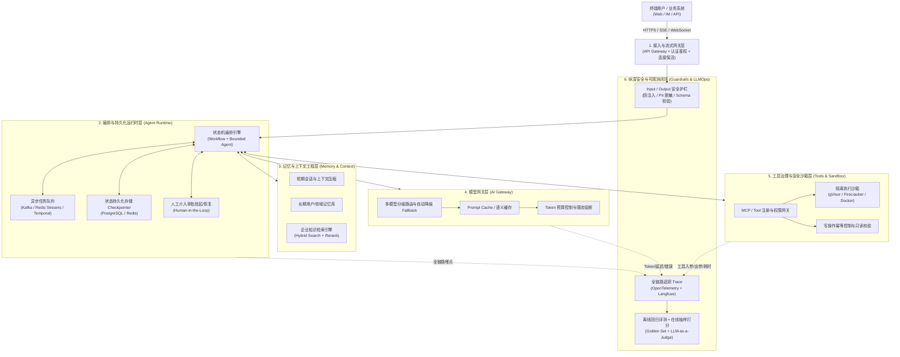
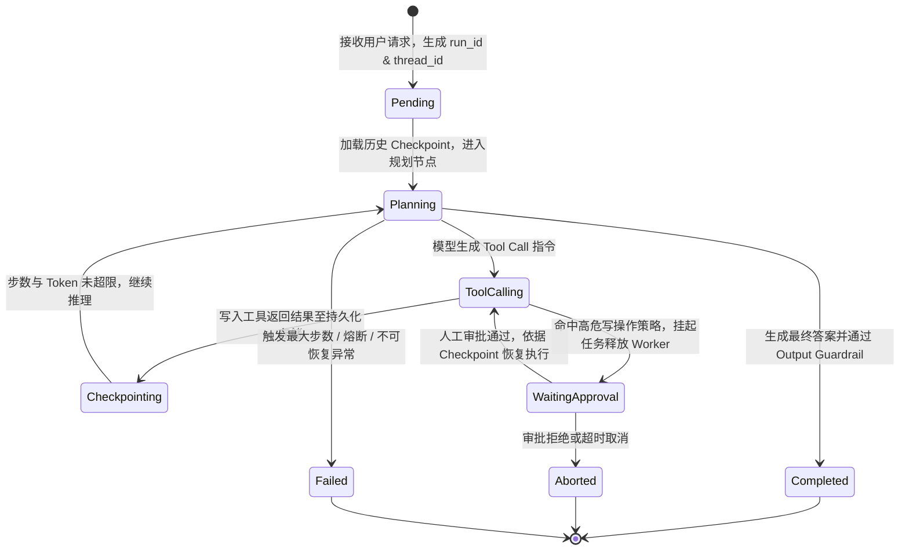
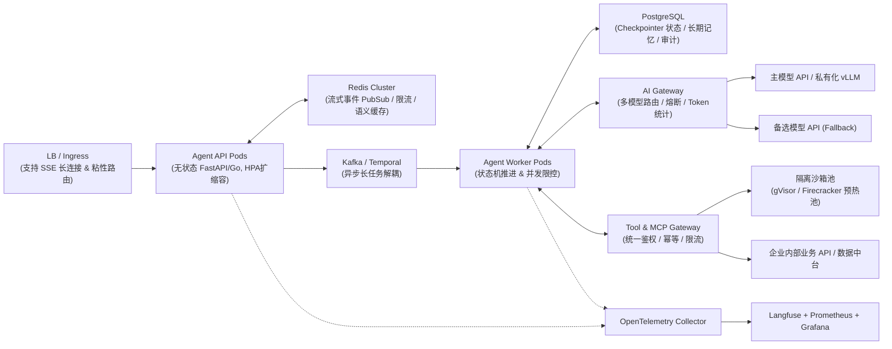
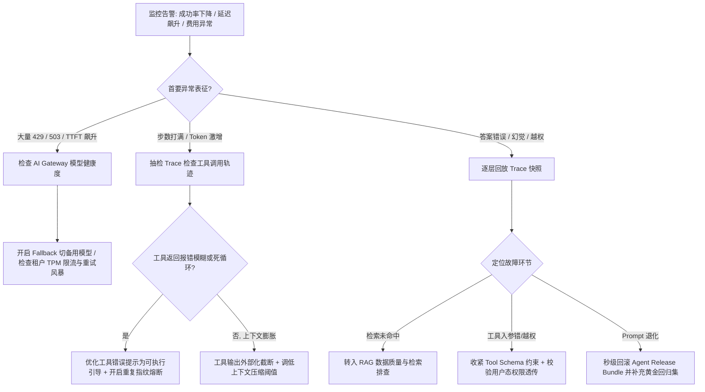
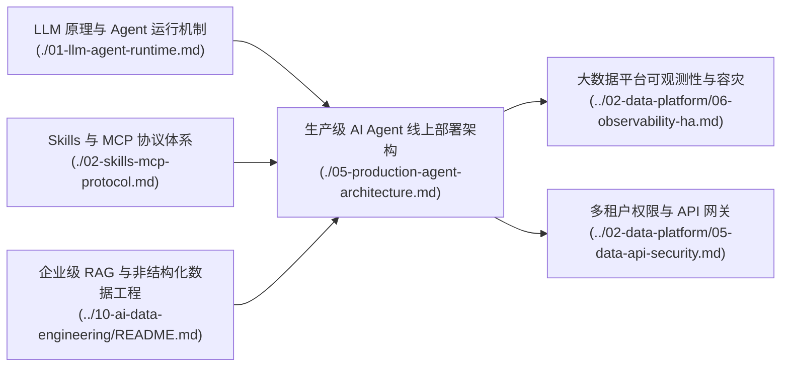

# 生产级 AI Agent 系统架构设计与线上部署技术要点

> [!NOTE] 案例性质说明
> 本篇围绕“如何设计一款能够在线上稳定部署运行的企业级 AI Agent 系统”展开架构与工程推演。文中的架构拓扑、参数配比与线上故障场景均属于通用企业级工程教学案例，用于构建 AI 平台架构设计能力，不代表个人过往已上线的商业项目声明（详见 [PROFILE_FACTS.md](../PROFILE_FACTS.md)）。

> **学习目标定位**：面向技术总监、数据平台研发负责人与 AI 架构师岗位，系统打通“Demo 级 Agent”到“生产级线上 Agent 系统”之间的工程鸿沟。重点掌握无状态服务编排与状态持久化、AI Gateway 路由容灾、工具执行沙箱与幂等性、安全护栏、全链路可观测性、离线/在线评测体系及 Prompt/模型版本灰度发布的核心技术要点。

---

## 1. 知识概述与业务价值

### 1.1 什么是生产级线上 AI Agent 系统（What）
在笔记本或本地脚本中用几十行代码串联 LLM + ReAct 循环 + 几个 Python 函数，只能称为 **Prototype / Demo Agent**。而一款能够**在线上部署运行、承载真实企业流量与业务 SLA 的生产级 Agent 系统**，本质上是一个**“以确定性分布式软件工程底座，约束与驾驭非确定性大模型推理内核”**的混合分布式系统。

### 1.2 从 Demo 到线上部署的核心鸿沟（Why）
传统微服务系统的核心假设是“相同输入 $\to$ 相同输出、单次请求耗时百毫秒级、无跨步长状态”；而生产级 Agent 打破了这三大假设，直接带来六大线上工程挑战：

| 维度 | Demo / 本地脚本阶段 | 生产级线上部署面临的真实风险 |
| :--- | :--- | :--- |
| **执行确定性** | 偶发输出格式错误或死循环，手动重跑即可 | 线上用户面临不可控的错误工具调用、死循环烧干 Token 预算，甚至触发高危写操作 |
| **状态与长耗时** | 任务放内存变量里跑 30 秒，进程挂了重来 | 单次复杂任务跨越多轮推理与工具调用（耗时数秒至数分钟），Pod 重启、网络断连或需要人工审批时必须支持**断点续跑** |
| **并发与流式 I/O** | 单用户同步等待结果返回 | 高并发 SSE/WebSocket 长连接打满网关句柄；上游 LLM API 触发 429 限流导致全线雪崩 |
| **安全与权限边界** | 直接用开发者个人 API Key 和本机环境执行代码 | Prompt Injection 诱导越权读取他人数据、删除数据库表，或在宿主机执行恶意 Shell 命令 |
| **可观测性与排障** | 只打印控制台日志 | 一次请求内部包含 5 次 LLM 调用、3 次检索、4 次工具调用，无法定位究竟是 Prompt、检索、工具还是模型本身出错 |
| **迭代与发布风险** | 改完 Prompt 直接覆盖上线 | 修改一句话 Prompt 可能导致其他 20% 历史场景效果退化，缺乏回归评测与灰度回滚机制 |

### 1.3 适用场景与工程边界（Where & When）
- **核心原则（Anthropic / 业界共识）**：**能用确定性工作流（Workflow）解决的环节，不要交给自由自治的 Agent**。
- **分层选型边界**：
  - **确定性固定流程**（如标准审批、固定报表生成）：直接用 DAG 工作流 / 代码实现，延迟低、成本低、100% 可控；
  - **半结构化多步决策**（如智能运维排障、复杂跨系统问数、客户工单自动化处理）：采用 **Workflow 骨架 + 局部节点 Agent 化（Bounded Autonomy）**；
  - **开放式探索任务**（如深度研究、自主代码修改与测试修复）：采用完整 **Stateful Agent Runtime + 严格沙箱隔离 + 人工审批门禁**。

---

## 2. 核心概念与系统分层架构

### 2.1 生产级线上 Agent 六层核心架构全景



### 2.2 线上部署的核心组件职责表

| 架构层 | 核心组件 | 解决的线上痛点 | 关键技术实现 |
| :--- | :--- | :--- | :--- |
| **接入层** | SSE / WebSocket 网关 | LLM 首字延迟高，防止同步 HTTP 超时断开 | Server-Sent Events 流式推送、心跳保活、断线 `Last-Event-ID` 续传 |
| **运行时层** | Durable State Machine | Pod 重启丢状态、长任务超时、人工审批阻塞线程 | 外置 Checkpointer（PostgreSQL/Redis）、Temporal/Celery 异步执行引擎 |
| **模型网关层** | AI Gateway | 单一模型限流（429）、宕机、高成本与 API 协议碎片化 | OpenAI 兼容统一协议、分级路由、熔断降级、按租户 Token 令牌桶 |
| **工具与沙箱层** | Tool Gateway & Sandbox | 恶意代码逃逸、数据越权访问、重试引发重复下单/扣款 | MCP 统一契约、gVisor/Firecracker 微虚机、用户态委托鉴权、幂等键 |
| **安全护栏层** | Input/Output Guardrails | Prompt 注入攻击、PII 隐私外泄、非法 SQL、事实幻觉 | 规则引擎 + 轻量分类模型双重拦截、结构化输出约束（JSON Schema） |
| **观测与评测层** | LLMOps 闭环 | 黑盒排查困难、改 Prompt 引发线上回归退化 | OpenTelemetry Trace 树、黄金集 CI 门禁、Canary 灰度发布与秒级回滚 |

---

## 3. 线上部署的八大核心技术要点深度剖析

### 3.1 技术要点一：无状态计算与状态持久化（Durable Execution）
线上 Agent 服务绝不能将对话状态与中间推理步保存在应用进程的内存中，否则 K8s 滚动发布、HPA 缩容或 OOM 重启会直接导致正在执行的复杂任务中断。



- **Checkpointer 设计要点**：
  - 每个执行步骤（Superstep / Node Transition）结束时，将 `(thread_id, run_id, step_index, state_snapshot, token_usage)` 原子化持久化到 PostgreSQL 或 Redis；
  - 支持**时间旅行调试（Time-Travel Replay）**：线上出错时，研发人员可直接拉取第 `step_index = 3` 的状态快照在测试环境精准复现；
  - 支持 **Human-in-the-Loop（人工介入）无阻塞挂起**：当 Agent 申请执行高危操作（如批量变更配置、发送外部邮件）时，状态落盘后立即释放计算 Worker 线程，等待审批回调事件再唤醒继续执行。

### 3.2 技术要点二：流式传输、异步化与优雅停机（Streaming & Async I/O）
- **快任务 vs 慢任务分层**：
  - **交互式短任务（< 30 秒）**：采用 **SSE（Server-Sent Events）** 实时推送 `thinking`（推理进度）、`tool_start`/`tool_end`（工具状态）和 `delta`（流式文本），降低用户主观等待延迟（TTFT 控制在 1.5~2.5 秒内）。
  - **长耗时后台任务（> 30 秒，如深度研究、批量文档分析）**：请求入队（Kafka / Redis Streams / Temporal），立即返回 `task_id`；后端 Worker 异步推进并将事件写入 Redis Pub/Sub，前端通过 SSE 订阅事件流并支持断线后基于 `event_id` 增量补拉。
- **K8s 滚动发布与优雅停机（Graceful Shutdown）**：
  - 普通 Web 服务的 `terminationGracePeriodSeconds` 通常为 30 秒，但 Agent 长连接可能持续 2~5 分钟；
  - 线上部署需配置：收到 `SIGTERM` 后立即摘除 Readiness 探针不再接新流量 $\to$ 等待存量 SSE 连接在宽限期完成当前 Step 并将状态写入 Checkpointer $\to$ 客户端重连到新 Pod 时凭 `run_id` 无缝续接。

### 3.3 技术要点三：AI Gateway 与多模型容灾路由
线上严禁业务代码直接硬编码调用单一模型厂商 SDK，必须经由统一的 **AI Gateway（如 LiteLLM / Portkey / 自研网关）**：
1. **统一协议抽象**：屏蔽 OpenAI、Anthropic、DeepSeek、Qwen 及私有化 vLLM 的协议差异，更换底层模型零侵入业务代码；
2. **多级容灾与熔断（Fallback & Circuit Breaker）**：当主模型供应商返回 `429 Too Many Requests`、`503` 或 TTFT 连续超过阈值（如 8 秒）时，网关自动平滑切换至备用区域 Endpoint 或同梯队备选模型；
3. **分级路由（Model Routing）降本**：
   - 意图识别、Query 改写、简单信息提取 $\to$ 路由至低成本高并发小模型（成本降低 80%+，延迟降至 300ms 级）；
   - 复杂多步规划、代码生成、深度推理 $\to$ 路由至旗舰大模型；
4. **租户级 Token 限流与预算硬上限**：同时实施 RPM（每分钟请求数）与 TPM（每分钟 Token 数）双维度令牌桶限流，防止单一租户或异常循环打满全公司额度。

### 3.4 技术要点四：上下文工程与记忆分层治理（Context & Memory Management）
线上多轮 Agent 最大的隐蔽杀手是**上下文窗口无节制膨胀**（工具返回几万 Token 的原始 JSON/HTML 日志，瞬间推高费用并引发“迷失在中间”注意力退化）：
- **三层记忆架构**：
  1. **短期工作记忆（Working Memory）**：当前会话的精确对话与工具调用轨迹；
  2. **中期压缩摘要（Compaction / Sliding Summary）**：当上下文达到阈值（例如窗口容量的 60%），触发异步压缩，将早期多轮工具输出折叠为结构化事实摘要，保留最近 N 轮原文；
  3. **长期持久化记忆（Long-term Memory）**：跨会话保存用户偏好、业务实体画像与历史决策，按需通过混合检索注入，严禁全量塞入 System Prompt。
- **工具输出截断与外部化（Tool Output Offloading）**：工具返回超大结果时，将全文存入对象存储/临时表，仅向 Agent 上下文返回前 2KB 摘要 + 文件句柄，由 Agent 按需分页读取或用脚本过滤。

### 3.5 技术要点五：工具治理、安全沙箱与幂等性设计
Agent 具备“改变外部世界状态”的能力，工具层的可靠性与安全性是线上底线：
1. **代码与命令执行强沙箱隔离**：
   - 严禁在 Agent 宿主 Pod 中直接 `exec()` 或 `subprocess` 执行模型生成的代码；
   - 必须使用独立隔离环境：**gVisor / Kata Containers / Firecracker MicroVM / E2B**，配合严格限制：只读根文件系统、CPU/内存 cgroups 上限、执行超时强制 Kill（如 30 秒）、默认禁用外网访问（仅开放白名单出口）。
2. **身份透传与最小权限（Delegated Auth & Least Privilege）**：
   - 严禁给 Agent 分配超级管理员账号（Superuser Token）去查询企业数据库或知识库；
   - 每次工具调用必须携带当前终端用户的身份上下文（OAuth Token / RBAC 角色列表），由下游工具与检索系统执行权限校验，确保“用户无权看的数据，Agent 绝对查不到”。
3. **工具调用幂等性（Idempotency）与写操作确认**：
   - 所有**只读类工具**（查询、检索、计算）自动放行，但必须设置超时与最大返回体大小；
   - 所有**写操作/外部副作用工具**（创建工单、修改配置、发送通知、执行变更 SQL）必须携带基于 `(run_id, step_index, args_hash)` 生成的 `idempotency_key` 防止网络重试导致重复执行，并根据风险等级触发 Human-in-the-Loop 二次确认。

### 3.6 技术要点六：纵深安全护栏（Defense-in-Depth Guardrails）
- **输入护栏（Input Guardrail）**：
  - 敏感信息（身份证号、手机号、AK/SK 密钥）进入外部模型前自动识别并占位脱敏，响应返回后再还原；
  - 拦截明显越狱与 Indirect Prompt Injection（尤其需防范从外部网页、PDF、邮件中读取的恶意指令劫持 Agent 执行非法工具）。
- **执行护栏（Runtime Guardrail）**：
  - 硬性上限：`max_iterations`（如 10 步）、`max_tool_calls_per_run`（如 15 次）、`max_wall_clock_seconds`（如 180 秒）、`max_cost_usd_per_run`；
  - 重复调用检测：连续 2 次以相同参数调用同一工具且返回相同报错时，自动拦截并注入纠偏提示或降级转人工。
- **输出护栏（Output Guardrail）**：
  - 确定性校验（JSON Schema / Pydantic、SQL AST 只读语法校验、引用 Chunk ID 真实存在性校验）优先于大模型自检。

### 3.7 技术要点七：全链路可观测性（LLMOps Observability）
传统 APM 只看到“HTTP 200，耗时 12 秒”，对 Agent 排障毫无帮助。生产级 Agent 必须构建**树状 Trace 可观测体系**（基于 OpenTelemetry GenAI Semantic Conventions + Langfuse / Phoenix / LangSmith）：
- **Trace 层级结构**：`Trace (单次用户会话任务)` $\to$ `Span (Plan / Retrieve / ToolCall / Guardrail / LLM Generation)`；
- **黄金监控指标（Four Golden Signals for Agents）**：
  1. **延迟指标**：TTFT（首字延迟）、TPOT（单 Token 生成耗时）、端到端 P50/P95/P99、各工具耗时分布；
  2. **质量与完成率**：任务完成率、工具调用成功率、格式校验失败率、死循环/超步数熔断率、用户点赞/点踩率；
  3. **成本指标**：单次任务平均 Input/Output Token、Prompt Cache 命中率、按业务线/租户拆分的日消耗成本；
  4. **安全指标**：护栏拦截次数、Prompt 注入告警、越权尝试审计日志。

### 3.8 技术要点八：评测驱动迭代与灰度发布（Eval-Driven CI/CD & Rollout）
线上 Agent 迭代最忌讳“凭体感改 Prompt 直接全量上线”，必须建立**版本化与评测门禁**：
1. **资产全版本化**：将 `System Prompt`、`Tool Schema`、`Model Version`、`Temperature/Top-P`、`RAG 检索配置` 打包为不可变的 **Agent Release Bundle（如 `v1.4.2`）**；
2. **上线前离线回归门禁（CI Evaluation）**：维护包含 100~500 条典型场景、边界难例与安全红队用例的黄金评测集（Golden Dataset），覆盖三个层级：
   - **轨迹评测（Trajectory Eval）**：是否选对了工具、入参是否正确、步数是否在合理范围；
   - **结果评测（Outcome Eval）**：最终答案的准确性、忠实度与格式合规性；
   - **安全与成本红线**：越权拦截率 100%，单任务平均 Token 增幅不超过阈值（如 +15%）；
3. **渐进式灰度与影子流量（Shadow & Canary Rollout）**：
   - **Shadow Mode（影子流量）**：将线上 5% 真实流量异步复制给新版本 Agent（**注意：写操作工具必须 Mock 禁用副作用**），对比新旧版本的轨迹与打分；
   - **Canary Release（金丝雀灰度）**：按租户/用户尾号 5% $\to$ 20% $\to$ 100% 放量，发现工具报错率或延迟飙升时，秒级切回上一个 `Agent Release Bundle`。

---

## 4. 生产部署拓扑与工程实践

### 4.1 云原生 Kubernetes 线上部署参考拓扑



### 4.2 关键线上配置基线（参考样例）

```yaml
# ==================== Agent Runtime 运行时护栏配置 ====================
agent_runtime:
  max_iterations: 10                 # 单次任务最大推理步数，防死循环
  max_tool_calls: 15                 # 单次任务最大工具调用总次数
  wall_clock_timeout_sec: 180        # 端到端硬超时（秒）
  max_tokens_per_run: 64000          # 单任务上下文+输出 Token 总预算上限
  context_compaction_threshold: 0.65 # 上下文占比超 65% 触发历史摘要压缩
  duplicate_tool_call_limit: 2       # 相同工具+参数连续失败 2 次强制中断

# ==================== AI Gateway 容灾与路由策略 ====================
ai_gateway:
  primary_model: "flagship-reasoning-model"
  fallback_models:
    - "backup-flagship-model"
  routing_rules:
    intent_classification: "fast-lightweight-model"
    query_rewrite: "fast-lightweight-model"
    complex_planning: "flagship-reasoning-model"
  timeout_ttft_ms: 8000              # 首字超时 8s 触发重试或降级
  circuit_breaker:
    failure_rate_threshold: 0.3      # 1分钟失败率超 30% 开启熔断
    open_duration_sec: 30

# ==================== K8s 部署弹性与优雅停机 ====================
kubernetes_deployment:
  terminationGracePeriodSeconds: 180 # 适配长耗时 SSE/Step 状态落盘
  hpa_metrics:
    - type: "External"
      name: "agent_active_sse_sessions"  # 按活跃长连接数与队列积压扩缩容，而非仅看 CPU
      targetAverageValue: "50"
```

---

## 5. 生产异常故障深度排查与根因分析

### 5.1 线上 Agent 异常排查决策树



### 5.2 典型线上故障复盘（教学推演案例）

- **故障一：上游模型限流叠加无限重试引发“重试风暴”**
  - **现象**：业务高峰期主模型偶发 429，客户端与编排框架同时配置了同步重试，导致瞬时请求放大 9 倍，队列堆积、所有活跃连接超时雪崩。
  - **根治**：统一收口重试权至 AI Gateway（禁止编排层与 SDK 双重重试）；采用**指数退避 + 随机抖动（Exponential Backoff with Jitter）**；设置单任务总超时预算与快速 Fallback 切换。
- **故障二：Pod 滚动重启导致非幂等写工具重复执行**
  - **现象**：Agent 调用“创建变更单”工具已成功落库，但在响应写回 Checkpointer 前 Pod 被驱逐；任务在新 Pod 上从上一步恢复，再次调用创建接口产生重复工单。
  - **根治**：写操作工具强制要求业务方或 Tool Gateway 校验 `idempotency_key = hash(run_id, step_id, tool_name, canonical_args)`，服务端保证 24 小时内相同幂等键返回首次执行结果。

---

## 6. 技术选型对比与架构权衡

### 6.1 Agent 编排运行时选型矩阵

| 维度 | 轻量自研状态机（Python/Go） | LangGraph（图状态机框架） | Dify / Coze（低代码平台） | 云厂商托管 Agent 服务 |
| :--- | :--- | :--- | :--- | :--- |
| **架构可控性** | **极高**（完全掌控并发、流控、持久化） | 高（显式图节点、内置 Checkpointer 与 HITL） | 中低（受平台抽象与插件模型限制） | 低（黑盒编排，强厂商锁定） |
| **上手与交付速度** | 慢（需自建状态机、Trace、网关） | 较快（适合工程团队深度定制） | **极快**（适合业务运营快速验证原型） | 快（与单一云生态集成紧密） |
| **复杂长任务与稳定性** | 极强（可结合 Temporal 实现持久化执行） | 强（支持状态持久化与分支恢复） | 一般（复杂循环与异常恢复调试较难） | 较强（依赖云平台 SLA） |
| **长期演进与团队门槛** | 需具备分布式后端与 AI 复合研发能力 | 需熟悉 Python 异步工程与状态图设计 | 低门槛，但复杂业务后期易触达上限 | 迁移成本高，定制扩展受限 |
| **架构师选型建议** | 核心高并发、强合规、长期演进的生产级 Agent 底座 | 中大型工程团队构建可控 Stateful Agent 的主流折中方案 | 内部效率工具、轻量客服、POC 快速验证 | 重度绑定单一公有云且人手极度紧缺的团队 |

### 6.2 模型部署模式权衡：商业 API vs 私有化推理（vLLM / SGLang）
- **商业 API 优先场景**：探索期、流量波动剧烈、需要最强推理/规划能力、数据经脱敏后允许出网；优势是免 GPU 运维、按量付费、弹性极大。
- **私有化推理优先场景**：政企/金融/工业核心数据严禁出内网、高并发固定吞吐（自建 GPU 利用率 > 60% 时单位 Token 成本显著低于商业 API）、需微调领域小模型做路由/护栏/提取。
- **主流企业架构折中（混合路由）**：敏感预处理、意图路由、安全护栏、Embedding 与 Rerank 走**私有化轻量模型**；脱敏后的高难规划推理按合规等级走**私有化旗舰开源模型（如 Qwen / DeepSeek）或合规专有云 API**。

---

## 7. 技术经理与架构师实战管控（SOP 与成本 ROI）

### 7.1 线上 Agent 上线准入 Checklist（Release Gate）
作为技术负责人，任何 Agent 应用进入生产环境前必须通过 6 项刚性门禁：
1. **边界门禁**：明确配置了最大步数、单任务超时与单任务最大 Token 预算；
2. **权限门禁**：所有工具均采用终端用户身份透传校验，禁止共享高权限静态账号；
3. **写操作门禁**：写工具已实现幂等键，高危写操作已接入 Human-in-the-Loop 审批或审批白名单；
4. **可观测门禁**：100% 接入统一 Trace 追踪与成本分摊标签（`tenant_id`、`app_id`、`release_version`）；
5. **评测门禁**：通过黄金测试集与红队安全注入用例回归，核心准确率与拒答率达到基线；
6. **降级预案**：模型全线不可用时，前端具备清晰的降级引导（如回退传统搜索/表单或转人工）。

### 7.2 成本 ROI 精细化控制抓手
- **Prompt Caching 复用**：将稳定的 System Prompt、工具定义（Tool Definitions）和共享背景知识置于消息前缀，命中前缀缓存可降低 50%~90% 输入成本并显著缩短 TTFT；
- **模型分级（Tiering）**：避免全链路无脑调用最贵推理模型，将 70% 的分类、摘要、结构化抽取卸载到轻量模型；
- **预算熔断与成本归因**：按租户与业务部门建立每日 Token 消费看板，超过日预算 80% 预警、100% 自动降级为轻量模型或限流，杜绝账单失控。

---

## 8. 互联网大厂高频面试真题库

1. **Q1**：把一个本地能跑通的 LLM Agent 改造成支持高并发的线上生产系统，最核心的架构改造点有哪些？
2. **Q2**：线上 Agent 执行多步任务耗时可能超过 1 分钟，如何设计高可用、支持断点续跑与人工审批挂起（Human-in-the-Loop）的运行时架构？
3. **Q3**：生产环境中如何确保 Agent 调用工具（包括代码执行与业务写接口）的安全性、权限隔离与幂等性？
4. **Q4**：修改了一段 System Prompt 或升级底层模型后，如何防止线上效果退化？请设计生产级 Agent 的评测与灰度发布体系。
5. **Q5**：线上 Agent 的端到端延迟和 Token 成本居高不下，作为架构师有哪些系统级优化抓手？
6. **Q6**：如何设计生产级 Agent 的可观测性系统？当用户反馈“Agent 答非所问或卡死”时，如何快速完成故障定界？

---

## 9. 结构化深度参考答案

### 题目 1：把一个本地能跑通的 LLM Agent 改造成支持高并发的线上生产系统，最核心的架构改造点有哪些？

#### 简洁回答（1分钟电梯破题）
> “Demo Agent 到线上生产系统的核心改造，是用确定性的分布式工程底座约束非确定性的大模型推理。重点落在六个改造点：**第一，状态外置持久化**，把内存对话和推理步落盘到 Checkpointer，实现无状态水平扩缩容和断点续跑；**第二，接入统一 AI Gateway**，实现多模型路由、限流熔断和自动降级；**第三，I/O 流式化与异步解耦**，短任务走 SSE，长任务走消息队列/工作流引擎；**第四，工具层沙箱化、权限透传与写操作幂等**；**第五，纵深安全护栏与硬性步数/Token 预算上限**；**第六，全链路 Trace 可观测性与基于黄金评测集的灰度发布机制**。”

#### 深入回答（机制推导与工程细节）
> “具体拆解为三个核心工程转变：
> 1. **从同步进程内执行转向异步持久化状态机**：本地 ReAct 循环依赖单进程内存，高并发下一次 K8s 重启就会丢任务。线上必须将编排层无状态化，每个节点状态流转后写入 PostgreSQL/Redis Checkpointer；同时将慢任务通过 Temporal 或 Kafka 解耦，并调整 K8s `terminationGracePeriodSeconds` 和按活跃连接数扩缩容的 HPA 策略。
> 2. **从裸调模型 API 转向网关治理**：建立 AI Gateway 屏蔽各家模型差异，统一管理重试（指数退避+抖动，防重试风暴）、熔断降级（主模型 429/超时自动切换备选）、Prompt Caching 以及按租户的 RPM/TPM 限流。
> 3. **从开放自治转向有界自治（Bounded Autonomy）**：能用确定性 Workflow 编排的固定步骤绝不交给模型自由发挥；对保留自治的节点施加步数上限、总耗时上限、重复调用指纹熔断和 Input/Output Guardrails。”

#### 架构师/技术管理视角（权衡取舍、SLA 与团队落地）
> “从技术负责人视角看，上线 Agent 最常见的误区是**前期过度追求全自治 Multi-Agent，忽略基础工程底线**。我的落地策略是先收敛业务场景边界——用确定的状态机搭骨架，只在真正需要语义理解与动态工具选择的节点接入 LLM；同时在团队内部设立刚性上线门禁（步数预算、权限透传、Trace 埋点、黄金集回归），把 Agent 当作核心生产服务而不是实验脚本去运维。”

---

### 题目 2：线上 Agent 执行多步任务耗时可能超过 1 分钟，如何设计高可用、支持断点续跑与人工审批挂起（Human-in-the-Loop）的运行时架构？

#### 简洁回答（1分钟电梯破题）
> “核心思路是**计算与状态分离 + 事件驱动异步化（Durable Execution）**。把 Agent 执行建模为持久化状态机，每个推理步或工具调用完成后将完整状态快照原子写入 Checkpointer（如 PostgreSQL）；长任务交由异步 Worker 执行并通过 SSE/PubSub 向前端推送进度。当命中高危操作需要人工审批时，持久化当前状态并标记为 `WAITING_APPROVAL`，立即释放 Worker 线程，不占用 HTTP 连接或内存；审批通过后通过回调事件重新加载 Checkpoint 从断点无缝恢复执行。”

#### 深入回答（机制推导与工程细节）
> “具体落地包含四个关键机制：
> 1. **步级 Checkpoint 与状态快照**：以 `(thread_id, run_id, step_id)` 为唯一键持久化消息历史、中间变量、已执行工具结果与累计 Token；若 Worker 在第 4 步崩溃，调度器拉起新 Worker 读取第 3 步快照继续执行，配合工具幂等键避免副作用重复。
> 2. **长连接与断线续传**：前端不直接挂死同步请求，而是先提交任务获取 `run_id`，再建立 SSE 订阅事件流（Redis Streams 缓冲最近事件）；网络闪断后前端携带 `Last-Event-ID` 重连补拉遗漏事件。
> 3. **Human-in-the-Loop 非阻塞挂起**：审批动作可能等待数分钟甚至数小时，必须将审批单 ID 与 `run_id` 绑定入库并设置过期超时定时器（如 24 小时未批自动取消释放）；审批人不仅可点“同意/拒绝”，还可修改工具入参后恢复执行。
> 4. **与传统分布式调度引擎结合**：若对强可靠性要求极高，可将 Agent 的外层生命周期托管在 Temporal 等 Durable Execution 引擎上，天然获得活动重试、超时与崩溃恢复能力。”

#### 架构师/技术管理视角（权衡取舍、SLA 与团队落地）
> “状态持久化会带来一定的数据库写入延迟（每步 5~20ms），但相比单次 LLM 推理 2~5 秒的耗时几乎可以忽略不计，却换来了整个系统的可恢复性、可审计性和线上精准复现能力（Time-Travel Debugging），在工程 ROI 上是极其划算的必选项。”

---

### 题目 3：生产环境中如何确保 Agent 调用工具（包括代码执行与业务写接口）的安全性、权限隔离与幂等性？

#### 简洁回答（1分钟电梯破题）
> “工具层必须坚持**‘零信任模型输出’**原则，建立四道防线：**第一，身份透传与最小权限**，工具调用强制携带当前终端用户的权限凭证，严禁给 Agent 配全局超管账号；**第二，计算隔离沙箱**，模型生成的代码或 Shell 必须在无外网、限资源的 gVisor/Firecracker 微虚机中运行；**第三，读写分离与分级审批**，只读工具自动放行，高危写操作强制触发人工审批；**第四，全链路幂等键设计**，基于 `(run_id, step_id, args_hash)` 防止重试引发重复变更。”

#### 深入回答（机制推导与工程细节）
> “逐项拆解底层防线：
> 1. **防越权（Confused Deputy 问题）**：当用户 A 通过 Agent 查询公司文档或数据库时，Tool Gateway 校验用户 A 的 JWT/RBAC 角色并将其下推至检索系统或下游 API，确保模型即使被 Prompt 注入诱导，也无法通过工具拿到用户 A 无权访问的数据。
> 2. **防 Indirect Prompt Injection**：来自外部网页、PDF、工单正文的数据必须被标记为不可信数据（Data），不得直接拼接到最高优先级的 System 指令区域；对工具调用的参数执行确定性白名单校验（如 SQL 工具使用 AST 解析强制只允许 `SELECT` 且限制 `LIMIT`）。
> 3. **沙箱资源与网络隔离**：使用预热的 MicroVM/容器池（如 Firecracker/gVisor）降低冷启动延迟至百毫秒级，同时禁用宿主机挂载、默认关闭公网出口、限制 CPU/内存/磁盘写入配额与 30 秒硬超时。
> 4. **写操作幂等与补偿**：对创建、修改、发送类工具，在 Tool Gateway 层维护分布式幂等表（基于 `run_id + step_id + 参数哈希`），若上游超时重放则直接返回缓存的首次执行结果。”

#### 架构师/技术管理视角（权衡取舍、SLA 与团队落地）
> “安全与体验存在天然张力——每次操作都弹窗确认会让 Agent 失去自动化价值，全部放行又会导致不可控生产事故。作为负责人，我会在平台侧建立**工具风险分级注册表（L0 只读、L1 可逆低危写、L2 不可逆高危写/对外发送）**：L0 全自动、L1 自动执行+留痕可回滚、L2 强制挂起审批，并把所有工具入参出参写入不可篡改审计日志，满足企业安全与合规审查。”

---

### 题目 4：修改了一段 System Prompt 或升级底层模型后，如何防止线上效果退化？请设计生产级 Agent 的评测与灰度发布体系。

#### 简洁回答（1分钟电梯破题）
> “核心是将 Prompt、工具定义与模型参数作为**可版本化的软件发布包（Release Bundle）**纳入 CI/CD 管控。上线前必须经过**黄金测试集离线回归评测**（覆盖工具轨迹准确性、最终结果忠实度、红队安全拦截率和 Token 成本红线）；上线时采用**影子流量（Shadow Mode，Mock 写操作）$\to$ 金丝雀灰度（5% $\to$ 20% $\to$ 100%）**，结合线上抽样打分与核心指标监控，出现退化时秒级回滚到上一稳定版本。”

#### 深入回答（机制推导与工程细节）
> “分三步构建评测与发布闭环：
> 1. **构建分层黄金评测集（Golden Dataset）**：收集线上真实高频问法、历史 Bad Case（防旧病复发）以及安全越狱/拒答样本（100~500 条起步）。评测维度拆分为**过程轨迹评测**（工具选对了吗？参数合法吗？步数是否变多？）与**终态结果评测**（确定性规则校验 + 校准后的 LLM-as-a-Judge 评分）。
> 2. **控制评测波动性**：由于大模型输出具有随机性，CI 评测需固定 `temperature=0`（或较低温度），对关键 Case 多次运行取通过率（如 `pass@k` 或 `pass^k` 衡量稳定性），并重点监控回归指标的显著退化。
> 3. **安全灰度与快速回滚**：将 Prompt 模板与模型配置外置到配置中心而非写死在代码镜像里；先用 Shadow Traffic 旁路跑新版本（严禁触发真实写副作用），评估通过后再按租户或用户分流灰度，观察工具失败率、熔断率、P95 延迟与点踩率，异常时配置中心一键回切。”

#### 架构师/技术管理视角（权衡取舍、SLA 与团队落地）
> “很多团队上线 Agent 后陷入‘打地鼠困境’——修好一个客户投诉的 Case，却悄悄改坏了十个原本正常的场景。作为研发负责人，必须在项目第一天就要求把每个线上 Bad Case 沉淀进回归测试集；即使初期只有 50 条高质量用例，也远胜于靠开发者肉眼测三五条就盲目上线。”

---

### 题目 5：线上 Agent 的端到端延迟和 Token 成本居高不下，作为架构师有哪些系统级优化抓手？

#### 简洁回答（1分钟电梯破题）
> “优化遵循**‘减少不必要推理步数 $\to$ 压缩单步上下文 $\to$ 合理分级选模型 $\to$ 提升并发与缓存复用’**四层漏斗：在架构上用确定性代码替换简单路由步并开启**并行工具调用（Parallel Tool Calling）**；在上下文上对大工具返回做**摘要外部化与滑动压缩**；在模型上推行**大小模型分级路由（Model Tiering）与 Prompt Caching 前缀复用**；在缓存层对高频标准化问题引入**语义缓存**，综合可将延迟与成本降低 50% 以上。”

#### 深入回答（机制推导与工程细节）
> “拆解为延迟优化与成本优化两组组合拳：
> 1. **端到端延迟压缩**：
>    - **并行工具执行**：模型单次输出多个独立 Tool Call 时，Runtime 使用异步并发执行（如 `asyncio.gather`），将串行累加耗时降至最慢单个工具耗时；
>    - **流式首字优化（TTFT）**：开启 Prompt Caching 命中 KV Cache 跳过 Prefill 重复计算；前端先通过 SSE 实时展示当前执行步骤（如“正在检索知识库...”），改善体感延迟；
>    - **Speculative / 轻量前置路由**：简单问答直接走快速轻量模型或直接命中缓存，避免进入沉重的多步推理循环。
> 2. **Token 成本控制**：
>    - **上下文瘦身**：精简工具列表（动态按意图加载相关 Top-N 工具而非每次塞入 50 个 Tool Schema）；工具返回的大段 JSON/日志只把关键字段或前 2KB 放入上下文；
>    - **分层路由**：分类、意图识别、摘要压缩、格式校验走低价小模型，仅核心规划节点走旗舰模型；
>    - **硬预算防失控**：设置单任务 Token 上限与死循环早停策略，消灭长尾异常任务带来的天价账单。”

#### 架构师/技术管理视角（权衡取舍、SLA 与团队落地）
> “成本优化绝不能以牺牲核心业务准确率为代价。作为平台负责人，我会先通过 Trace 做好**单位任务成本画像（Cost per Successful Task）**——很多时候成本高并非模型单价贵，而是因为 Prompt 设计不好或工具报错模糊导致平均步数从 3 步涨到了 9 步。先降无效步数和冗余上下文，再做模型分级与缓存，ROI 最高。”

---

### 题目 6：如何设计生产级 Agent 的可观测性系统？当用户反馈“Agent 答非所问或卡死”时，如何快速完成故障定界？

#### 简洁回答（1分钟电梯破题）
> “生产级 Agent 可观测性必须建立在**全链路树状 Trace** 之上（基于 OpenTelemetry + Langfuse 等平台），把单次请求完整拆解为每次 LLM 生成、检索召回、工具执行与护栏拦截的 Span，记录精确入参、出参、Token、延迟与状态快照。排查‘答非所问或卡死’时，凭 `trace_id` 自顶向下 3 分钟定界：先看是否卡在模型超时或工具死循环，再逐层核对检索上下文是否遗漏、工具返回值是否异常、最后再判断是否是模型推理或 Prompt 指令冲突。”

#### 深入回答（机制推导与工程细节）
> “具体体系包含三个支柱：
> 1. **结构化 Trace 数据模型**：在每个 Span 上统一注入 `tenant_id`、`user_id`、`agent_version`、`prompt_version`、`model_name`、`input_tokens`、`output_tokens`、`cache_read_tokens`、`latency_ms` 和 `error_code`；对含敏感信息的日志字段在落盘前做自动 PII 脱敏。
> 2. **故障四层快速定界法**：
>    - **定界一（卡死/超时）**：看 Trace 时间轴，区分是 LLM TTFT 超时、单个外部工具接口挂起，还是陷入重复工具调用循环；
>    - **定界二（数据输入层）**：检查检索 Span 召回的 Top-K 文本与工具返回原始 JSON，确认正确信息是否已经进入上下文；
>    - **定界三（指令与上下文层）**：检查是否触发了上下文截断导致关键信息丢失，或 System Prompt 与工具描述存在指令冲突；
>    - **定界四（模型推理层）**：确认上下文完整且无冲突，但模型依然违背指令或编造事实，则归因为模型能力边界或需补充 Few-shot / 升级模型。
> 3. **告警与闭环**：针对工具失败率飙升、步数超限熔断率、P95 延迟和日 Token 消费异常配置实时告警，同时支持运维人员在 Trace 界面一键将线上 Bad Case 导出至黄金评测集。”

#### 架构师/技术管理视角（权衡取舍、SLA 与团队落地）
> “可观测性是连接‘线上运维’和‘模型持续迭代’的桥梁。如果没有细粒度 Trace，研发团队在排查 Agent 问题时只能靠猜，MTTR 极长；通过把 Trace 与版本号、成本归因和黄金评测集打通，团队才能真正建立数据驱动的 AI 工程持续改进能力。”

---

## 10. 知识自检与口述推演清单

- [ ] 能否在白板上画出包含接入层、运行时状态机、记忆层、AI Gateway、工具沙箱、安全护栏与可观测闭环的 6 层生产级 Agent 架构图？
- [ ] 能否说清为什么线上 Agent 必须实现状态外置持久化（Checkpointer），以及如何支持 Human-in-the-Loop 非阻塞挂起与恢复？
- [ ] 能否阐述防御 Confused Deputy（权限混淆）与 Indirect Prompt Injection 的具体工程方案？
- [ ] 能否清晰解释如何构建评测门禁（轨迹评测 + 结果评测）以及 Shadow Mode / Canary 灰度发布流程？
- [ ] 能否给出降低线上 Agent 延迟与 Token 成本的 4 个核心系统级抓手？

---

## 11. 知识脉络与技术图谱关联



---

## 12. 权威参考与官方进阶资料

1. **Anthropic Engineering Blog**：[Building Effective Agents](https://www.anthropic.com/engineering/building-effective-agents)（明确区分 Workflows 与 Agents 的边界与生产最佳实践）
2. **LangGraph Official Documentation**：[Persistence, Checkpointing & Human-in-the-Loop](https://langchain-ai.github.io/langgraph/concepts/persistence/)
3. **OpenTelemetry GenAI Semantic Conventions**：[Semantic Conventions for Generative AI Systems](https://opentelemetry.io/docs/specs/semconv/gen-ai/)
4. **OWASP Top 10 for LLM Applications**：[Prompt Injection, Excessive Agency & Sandboxing Guidelines](https://genai.owasp.org/)
5. **Temporal Durable Execution**：[Building Reliable AI Agents with Durable Execution](https://temporal.io/)
