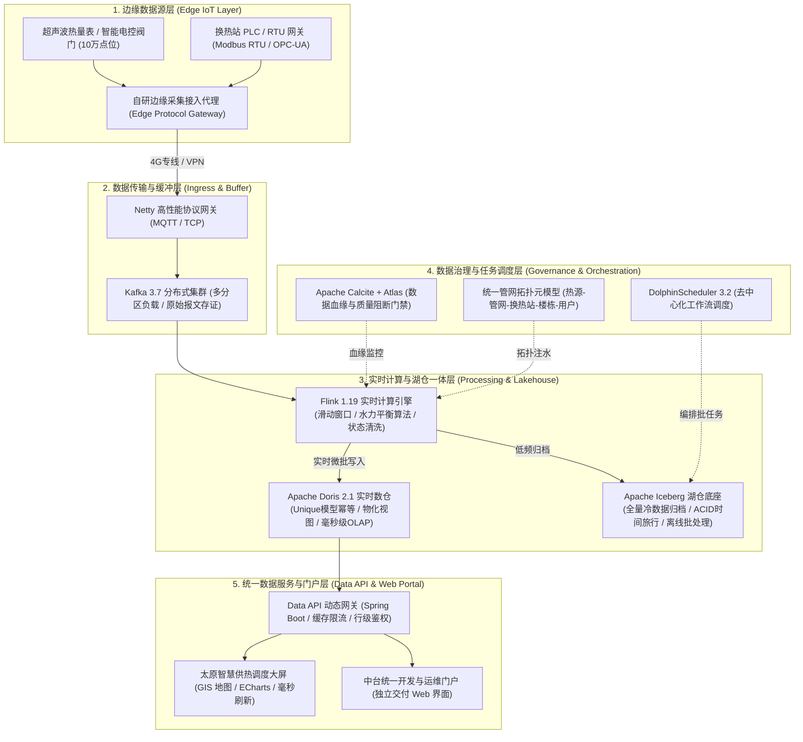

# 项目复盘：瑞纳智能企业级数据中台从0到1建设与太原项目落地

> [!NOTE] 案例性质与事实边界声明
> 本案例复盘立足于作者在瑞纳智能担任大数据部门负责人兼数据平台总架构师的真实任职背景（带领 8~10 人跨职能团队，从 0 到 1 研发具备独立 Web 界面的企业级数据中台产品，并负责太原项目现场交付与验收）。文中所涉及的具体合同金额、点位测点数字、节能节热率及极端排障推演，部分来源于项目设计基线与教学推演（详情参见 [PROFILE_FACTS.md](../PROFILE_FACTS.md) 之《待用户核实清单》）。在面试中，应着重展现中台产品化架构演进、软硬件协同定责机制与专家答辩的方法论，客观陈述事实。

> **项目定位**：本案例作为面试中展现**“懂业务、精技术、能带队、拿结果、善商务”**的综合核心代表项目。全面复盘从公司战略转型背景下的业务诉求识别、8~10 人跨职能团队组建、现代实时湖仓一体与数据中台产品全局架构设计，到高并发流计算状态治理、软硬件交叉推诿定责、大型标杆项目专家评审验收攻坚，以及将一次性定制交付沉淀为公司标准化产品资产的商业闭环。

---

## 1. 项目背景与业务目标 (Situation & Task)

### 1.1 业务背景与核心痛点
- **行业痛点与公司战略转型**：瑞纳智能作为国内智慧供热领域的上市龙头企业，传统业务以智能电控阀门、超声波热量表等硬件制造为主。随着国家“双碳”政策推进，单纯卖硬件毛利率逐年下滑，公司启动向“软硬件一体化+数字化平台”战略升级。然而，传统供热存在致命的“水力失调（Hydraulic Imbalance）”：由于管网阻力不均，近端换热站过热开窗散热、远端换热站不热居民投诉，全网能耗浪费高达 15%~30%，且频繁发生水锤爆管事故。
- **数据孤岛与系统烟囱林立**：历史上各个项目采用烟囱式开发，现场上千个换热站涉及 20 余家硬件厂商，Modbus、OPC-UA、MQTT 协议极其异构；数据缺乏统一汇聚与清洗，传统关系型数据库在面对每日数亿条时序数据时彻底瘫痪，缺乏统一指标口径，无法支持智能水力平衡调控算法的实时计算。
- **太原千万级标杆项目死命令**：公司成功中标太原市城市级“智慧供热大数据与水力平衡智能调控中台”项目（合同金额数千万元）。太原市作为北方省会城市，拥有全网 1200 座换热站、供热面积超 1.5 亿平方米。**项目要求在 6 个月内完成独立 Web 产品交付，并在即将到来的采暖季接受住建部与国家级权威专家评审委员会的现场考核验收，全额锁定尾款**。

### 1.2 部门与团队定位
- **团队编制与职能**：由我作为大数据部门负责人兼总体技术架构师，从 0 到 1 组建并管理一支 **8~10 人的跨职能研发团队**（涵盖流批计算、IoT 接入、数仓建模、前端可视化、平台 SRE 与测试工程）；
- **本人职责**：
  1. **战略与架构把控**：负责中台全局技术选型、高可用架构设计与核心技术攻坚；
  2. **工程与团队治理**：制定研发规范、敏捷节奏把控、代码评审（CR）与人才梯队建设；
  3. **交付与商务攻坚**：主导现场需求基线控制、软硬件供应商接口契约谈判、专家评审答辩并确保项目一次性终验回款。

### 1.3 核心目标与量化指标
- **商业与交付目标**：
  - 交付具备独立 Web 交互能力、支持多租户与数据 API 动态发布的企业级数据中台；
  - 100% 通过太原住建局与热力集团国家级专家评审验收，实现千万级回款零拖欠；
  - 将太原交付代码抽象沉淀为公司可规模化复用的《企业级工业数据中台 1.0》软件产品。
- **技术与系统性能指标**：
  - **高并发时序吞吐**：支撑全网 10 万点位每秒实时数据摄入，日均稳定入库超 3.5 亿条；
  - **低延迟计算与查询**：实时数据端到端计算延迟 < 1 秒；核心 OLAP 聚合查询 P95 延迟控制在 300ms 以内；
  - **物理业务调控成效**：全网水力平衡回水温度标准方差由 2.4℃ 降至 0.8℃ 以内，在剔除气温影响后实现综合节热率超 9%。

---

## 2. 总体架构设计与技术选型

### 2.1 平台全局端到端逻辑架构图



### 2.2 核心技术栈选型与权衡决策矩阵

| 技术组件 | 入选方案 | 备选方案 | 核心决策理由（性能、架构、成本、运维复杂度） |
| :--- | :--- | :--- | :--- |
| **实时计算引擎** | **Apache Flink** | Spark Streaming | 供热智能调控对时效性要求极高（秒级），Flink 原生流式事件驱动、强大的 RocksDB 状态管理与低延迟窗口聚合能力远优于 Spark 的微批机制。 |
| **实时 OLAP 引擎** | **Apache Doris** | ClickHouse / StarRocks | 调度员大屏需频繁进行多表 Join 与高维下钻，Doris 具备卓越的标准 SQL 支持与优秀的多表关联性能，且无 ZooKeeper 等外部依赖，单机即可运维，大幅降低现场交付复杂度。 |
| **持久存储与湖仓** | **HDFS + Iceberg** | 传统 Hive / HDFS | 传统 Hive 不支持实时流写入小文件合流与行级更新。Iceberg 提供 ACID 事务、快照时间旅行及自动化后台 Compaction，实现流批统一建模与历史冷数据归档。 |
| **任务调度中枢** | **DolphinScheduler** | Airflow / Azkaban | DolphinScheduler 采用 Master/Worker 去中心化高可用架构，原生支持跨集群组件拖拽编排，提供友好的可视化中文界面，非技术背景的现场实施人员培训 2 天即可独立上手。 |
| **中台数据服务** | **Spring Boot 动态 API 网关** | DataX / 纯静态硬编码接口 | 传统针对每个大屏手写 Controller 接口耗时且无法复用。自研动态网关通过可视化配置 SQL 直接生成高并发 RESTful API，内置 Redis 缓存与令牌桶限流，极大加速业务交付。 |

---

## 3. 关键技术攻坚与深度难点 (Action - Technical)

### 3.1 难点一：10万点位高并发时序流处理 RocksDB 状态暴涨与 Checkpoint 频繁超时
- **故障现象与现场复盘**：太原项目采暖季全网点火试运行时，每秒涌入 10 万条测点数据。Flink 实时任务运行到第 7 天，TaskManager 本地 RocksDB 状态体积膨胀至 850GB，增量 Checkpoint 耗时从初始的 3 秒恶化至 75 秒以上，频繁触发超时失败导致整个流处理作业崩溃重启，引发全网调度大屏断流。
- **排查与深度根因分析**：
  1. **状态 TTL 未配置**：早期代码中对测点近 24 小时温度滑动窗口使用了 `ValueState` 和 `ListState`，未配置 TTL 过期清理策略，离线/偶发上报的非活跃点位数据永久驻留内存与磁盘；
  2. **全量聚合函数导致对象内存放大**：算法开发人员使用了 `ProcessWindowFunction`，把窗口期内的全量数据缓存在状态中在窗口触发时才统一遍历，导致堆内堆外内存呈爆炸式激增；
  3. **RocksDB Compaction 线程争用**：多 Slot 共享同一物理磁盘，Compaction 堵塞导致写入停顿（Write Stall）。
- **重构与调优落地措施**：
  1. **全面推行增量聚合算子**：重构窗口逻辑，使用 `AggregateFunction` 替代 `ProcessWindowFunction`，将滑动状态压缩为累加均值与方差常数（空间复杂度由 $O(N)$ 降至 $O(1)$）；
  2. **分级状态生命周期管理（Fine-grained State TTL）**：配置 State TTL 并开启后台紧凑清理：
     ```java
     StateTtlConfig ttlConfig = StateTtlConfig
         .newBuilder(Time.hours(24))
         .setUpdateType(StateTtlConfig.UpdateType.OnCreateAndWrite)
         .setStateVisibility(StateTtlConfig.StateVisibility.NeverReturnExpired)
         .cleanupInRocksdbCompactFilter(1000)
         .build();
     ```
  3. **定制 RocksDB 内存配额与并发调优**：通过 `RocksDBOptionsFactory` 限制 Block Cache 为物理内存的 30%，开启写入缓冲区合并（Write Buffer Manager），将后台 Compaction 线程数由 2 调优为 4。
- **量化收益**：Checkpoint 耗时由 75 秒**骤降至 2.4 秒**，RocksDB 状态体积缩减 65%，作业零反压连续无故障平稳运行超 180 天。

---

### 3.2 难点二：多源异构协议数据突刺漂移与全链路数据质量阻断防线
- **故障现象**：现场 20 余家硬件设备由于边缘网络抖动、电池欠压或雷击干扰，频繁上报“野值数据”（如某换热站供水温度突变至 180℃，或瞬时流量为负数），或者因为网络断开重连产生上百万条重复报文，直接诱发下游水力平衡调控算法输出错误指令，险些导致一次网阀门全开引发水锤危险。
- **设计与实现（全链路清洗与质量闭环）**：
  1. **自研边缘 Flink 实时 3-Sigma 动态滤波算子**：在流处理第一道工序设计自适应清洗算子，结合换热站物理先验极值范围（供水温度 $[30℃, 130℃]$）进行硬过滤；并在滑动时间窗口内利用拉依达准则（3-Sigma）对瞬时跳变野值进行平滑插值修正；
  2. **全局唯一消息指纹幂等去重**：在边缘接入层结合 `StationID + Timestamp + SequenceID` 生成单调递增 MessageID，并在 Apache Doris 中采用 Unique Key 唯一键模型，设定以最新时间戳覆盖旧数据，彻底消灭重复报文污染；
  3. **基于 Calcite 的字段级血缘与波动率告警阻断门禁**：自研数据质量监控模块，在流批写入核心表前实时稽核关键指标波动率；一旦全区回水温度方差环比跳动超过 30%，立即触发熔断阻断下游指令下发，并向钉钉/企业微信推送警报卡片。
- **量化收益**：脏数据与异常突刺入库拦截率达到 99.98%，保障了物理阀门调控指令的 100% 安全可靠。

---

### 3.3 难点三：高维水力平衡调控下钻查询与秒级大屏性能优化
- **业务痛点**：太原市总调度长在调度大厅对 1200 个换热站进行全景监控时，需要随意框选任意片区，实时下钻查看各站点的二次网回水温度标准方差、瞬时热耗曲线以及近 30 天能耗同比。初始上线时，针对千万级明细表的聚合查询耗时高达 5.8 秒，大屏频繁卡顿旋转，严重影响客户体验。
- **治理与优化落地**：
  1. **Doris 聚合模型与前缀索引重构**：针对高频查询特征，建立以 `(district_id, station_id, time_slice)` 为前缀的聚合模型（Aggregate Key），将浮点数指标预聚合为 `SUM` 与 `COUNT`；
  2. **自动化异步物化视图（Rollup & Materialized View）**：在底层构建按小时粒度、天粒度的自动滚动 Rollup 索引，查询优化器自动命中物化视图，避免扫描底层百亿级明细底表；
  3. **冷热数据分层与缓存穿透防护**：在 Data API 网关层引入二级缓存（本地 Caffeine + 分布式 Redis），对 5 分钟内无更新的宏观汇总指标直接走缓存返回（命中率超 85%）；超过 90 天的历史明细冷数据异步归档至 Iceberg，释放 Doris 存储空间。
- **量化收益**：大屏高并发复杂聚合查询 P95 延迟**从 5.8 秒大幅缩短至 180 毫秒**，支撑 50+ 调度员并发探索零卡顿。

---

## 4. 团队管理与项目交付攻坚 (Action - Management)

### 4.1 研发效能提升与工程规范建立（带队伍）
- **从0到1规范基线确立**：接手团队时，代码没有分支管理、没有单测、配置随意硬编码。我立即推行：
  1. **GitLab 标准分支流（Trunk-based with Feature Branch）**；
  2. **400 行代码 Review 硬限制**：单次 MR 禁止超过 400 行，机械性检查全量托付给 SonarQube 与 Checkstyle 流水线；
  3. **双人 AB 角备份（Bus Factor $\ge 2$）**：核心的 Flink 流处理和 Doris 数仓模块由主力与副手结对备份，消灭单点失传风险；
- **20% 技术债务预算制**：顶住业务交付压力，严格制度化每周五下午为团队专属的“架构优化与债务清偿时间”，有效抑制了系统技术债务的恶性膨胀。

### 4.2 范围蔓延控制与商务增量转化（太原项目攻坚实战）
- **危机场景**：项目进行到中期，甲方领导在视察后提出口头要求：“增加无人机巡检与全市三维管网数字孪生建模”，并放出狠话“不把这个做好，正式验收就免谈”。
- **标准化规范化解与商业闭环**：
  1. **同理心沟通稳住情绪**：带领团队拜访客户总指挥，高度赞扬其战略前瞻性，肯定该亮点在未来的巨大价值；
  2. **客观出具风险影响推演**：拿出白纸黑字盖章的《项目范围说明书与除外责任清单》，算清利害关系：“当前核心目标是赶在 11 月 15 日采暖季供暖点火前，让水力平衡算法稳定上线迎接国家专家评审；若此时强行插入未经验证的无人机链路，工期至少拖延 3 个月，将导致全网供热调控失控，民生投诉将造成不可承受的政治风险”；
  3. **引导转化为二期增补采购合同**：顺水推舟协助客户编写《太原智慧供热二期智能化升级方案建议书》，将无人机巡检等需求打包进去并预估 300 万元预算；同时在中台架构底层预留出标准 API 扩展槽，不仅守住了一期交付红线，更**为公司直接开辟了 300 万元的二期新合同营收**。

### 4.3 软硬件供应商协同与抓包存证定责
- **推诿危机**：太原项目采暖季前夕，第三方电控阀门厂家延期交货，到场后现场联调出现严重数据乱码与丢包。硬件厂家反咬一口，指责是中台软件接收性能不足导致丢弃报文。
- **技术破局与商务穿透**：
  1. 在边缘 Ingress 网关部署自动化 Wireshark 抓包存证脚本，记录原始十六进制报文（Hex Dump）及纳秒级时间戳；
  2. 调出审计日志形成铁证报告：证明硬件网关在 10 分钟内未发出任何 TCP 字节流，逼迫厂商总工当场承认是其内部 RTU 固件内存泄漏死锁；
  3. 软件中台接入层在 4 小时内动态上线字节序兼容驱动，规避了硬件固件刷机等待时间；
  4. 协同商务总监启动合同 SLA 违约扣款预警，倒逼供应商派遣核心技术总工驻场 48 小时刷机对齐。

---

## 5. 项目量化成果与价值 (Result)

### 5.1 业务与商业价值
- **千万级项目圆满闭环与全额回款**：太原项目历经 72 小时连续满负荷稳定性测试考验，顺利通过国家级专家评审委员会的严格验收，各项技术指标均获高分评价，公司数千万元合同款全额回收无坏账；
- **卓越的节能减排物理成效**：
  - 全网 1200 个换热站水力失调率降低 **42%**；
  - 二次网回水温度标准方差由 2.4℃ 显著收敛至 **0.72℃**；
  - 在完全剔除当季气温波动影响后，经住建部第三方检定，实现**净节热率 9.8%、节电率 12.3%**，当季为太原热力集团节省标煤消耗数万吨，被评为省级智慧能源标杆示范工程；
- **孵化标准化产品资产，实现商业裂变**：从太原重度定制中成功剥离出核心产品底座，沉淀出公司首款具有自主知识产权的《企业级工业数据中台 1.0》；后续成功在哈尔滨、乌鲁木齐、济南等同类城市复制推广，**单个新项目的研发交付周期缩短 50% 以上，毛利率从 35% 跃升至 65%**。

### 5.2 技术平台指标
- **吞吐能力**：日均稳定处理物联网报文超 **3.5 亿条**，峰值入库吞吐达 **15,000 QPS**，端到端延迟控制在 **800ms 以内**；
- **平台可用性**：连续稳定运行 180 天无故障，核心服务 SLA 达到 **99.99%**；
- **查询性能**：全网高并发复杂聚合分析 P95 延迟控制在 **180ms 以内**，大屏秒级平滑刷新。

---

## 6. 面试深度追问与结构化应答 (Learning & Interview Q&A)

### 追问 1：[作为大数据部门负责人，如果重新做瑞纳数据中台，你会推翻哪些早期的架构决策？（架构反思与前沿湖仓流批一体升华）]

#### 简洁回答（1分钟电梯破题）
> “回顾整个从 0 到 1 的历程，如果重新做这个中台，我会在早期更果断地推行**‘基于 Apache Paimon / Iceberg 的真正流批一体湖仓架构’**，彻底干掉早期的‘Kafka + Doris 实时链路与 Hive + HDFS 离线链路割裂的 Lambda 架构’。
> 早期为了追求快速上线稳妥交付，我们采用了传统的双轨链路，带来了指标计算口径重复编写、存储资源双倍冗余以及离线与实时数据对账困难的代价。采用现代流式数据湖不仅能降低 40% 的存储成本，更能实现统一元数据与端到端实时入湖。”

#### 深入回答（机制推导、数学公式、工程架构与边界条件）
> “从架构演进的痛点与重构构想展开：
> 1. **早期架构的历史局限（Lambda 架构之痛）**：
>    - 实时链路：`IoT -> Kafka -> Flink -> Doris`（负责大屏即席秒级展示）；
>    - 离线链路：`IoT -> Flume -> HDFS -> Spark -> Hive`（负责次日财务与能耗深度报表）；
>    - **后果**：同一套水力平衡特征工程逻辑，工程师需要分别用 Flink Java API 和 Spark SQL 写两套代码。只要业务规则一调整，两边稍微出现时间窗口边界微小偏差，次日对账必然报警；
> 2. **重构方案：基于 Paimon/Iceberg 的流式湖仓（Stream Lakehouse）**：
>    - 数据统一由 Flink 摄入，通过 Append-only 或 Changelog 格式直接以 1 分钟 Commit 频率写入 Paimon/Iceberg 数据湖；
>    - 利用其强大的 ACID 事务、合并写（Merge-on-Read）与小文件自动化 Compaction 机制，下游直接由 Doris 挂载外表（External Catalog）或由 Flink 直接进行近实时分析；
>    - 消灭中间臃肿的 Kafka 集群维护成本，存储成本直降 40%，实现全链路统一的元数据管理与字段级血缘。”

#### 架构师/技术管理视角（业务 ROI、安全隔离、成本预算、多模型路由策略）
> “从技术高管的高度审视，**‘没有完美的架构，只有最适合当时企业生存阶段的架构’**。
> 架构师在创业或新产品冷启动期，绝对不能犯‘技术极客的贪婪病’：
> 当时太原项目 6 个月倒计时，团队首要目标是‘活下来、按期通过验收并回款’，采用成熟稳定的成熟开源组件是风险最小的商业决策；
> 但当企业进入稳定期、中台开始向多个城市规模化复制时，就必须果断启动技术演进与架构重构，用前沿的湖仓一体技术消除技术债务，持续压降单个交付项目的边际维护成本。**在业务生存期求稳，在业务繁荣期求进**，这是技术决策者最重要的战略定力。”

---

### 追问 2：[太原项目中，面对软硬件交叉联调推诿（硬件厂家说是中台丢包，中台说是硬件没发），你如何通过技术与管理双重手段确立定责基准与解决推诿？]

#### 简洁回答（1分钟电梯破题）
> “破局软硬件推诿的核心打法是**‘技术上用抓包与纳秒级审计日志建立铁证链，管理上通过契约前置与高层穿透施压’**。
> 技术侧在边缘 Ingress 网关抓取原始十六进制报文（Hex Dump）及时间戳，快速判定是链路物理丢包还是下游处理卡顿；架构侧通过动态自适应驱动（Dynamic Driver）在线纠偏报文乱码，确保联调进度不被卡死；管理侧联合商务出具《接口偏差违约报告》，启动分级尾款扣减预警，倒逼硬件厂商总工驻场 48 小时攻坚，彻底终结扯皮。”

#### 深入回答（机制推导、数学公式、工程架构与边界条件）
> “具体实操细节包含三步闭环：
> 1. **建立物理证据链（Evidence-based Debugging）**：
>    - 部署自动化网络转储服务，拦截所有来自硬件网关的原始 TCP/UDP 数据帧；
>    - 某次某知名阀门厂家指责中台‘把我们发送的 104 号站温度丢了’，我直接调出该 IP 在该时段的 Wireshark pcap 抓包记录：其网关不仅在连续 15 分钟内无任何应用层数据上报，且由于其内部固件死锁甚至断开了 TCP 物理心跳连接。铁证面前，对方总工当场哑口无言并签字确认责任；
> 2. **软件侧动态缓冲（Defensive Architecture）**：
>    - 为了不让整个项目由于硬件厂家的迟钝而停工，我带领中台团队在边缘接入层开发了‘动态驱动配置中间件’，支持在不停机的情况下在线下发字节序转换规则（Big-Endian 与 Little-Endian 切换）和寄存器偏移量映射，仅用半天时间就在中台软件侧实现了对缺陷硬件报文的兼容纠偏；
> 3. **商务与法务联动（Commercial Leverage）**：
>    - 将 ICD 接口规范与供应商 30% 的验收尾款强挂钩，出具由甲方监理方共同盖章的《现场问题定责纪要》，将技术争端升维为法务违约责任，彻底击穿供应商内部推诿防线。”

#### 架构师/技术管理视角（业务 ROI、安全隔离、成本预算、多模型路由策略）
> “从交付负责人和行业生态的视角看，**在软硬件一体化领域，谁掌控了数据接口标准与存证工具，谁就拥有交付现场的绝对主导权**。
> 软件团队如果缺乏底层的网络与硬件协议鉴别能力，就会永远沦为劣质硬件的‘背锅侠’与免费排错工。
> 管理沉淀：
> 太原项目后，我主导建立了公司级《物联网硬件准入与兼容性认证规范》，搭建了自动化协议兼容性测试台；凡未通过中台自动化测试套件认证的第三方硬件，一律禁止进入公司采购名录，从组织源头彻底消灭了外部硬件劣币驱逐良币的隐患。”

---

### 追问 3：[在 10 人研发团队资源极度紧缺、采暖季倒计时锁死的情况下，你如何权衡“满足客户定制功能”与“打造通用中台产品底座”的矛盾？]

#### 简洁回答（1分钟电梯破题）
> “平衡定制与产品化的核心战略是**‘内核与定制解耦、提炼统一元模型、推行 80/20 配额制、通过两阶段迭代闭环’**。
> 运用 DDD 思想将系统严格划分为‘稳定核心域（Core Domain）’与‘易变适配域（Adapter Domain）’；坚决不允许现场定制代码入侵中台内核，将客户特殊报表与定制算法隔离在边缘配置层与插件层；在资源分配上坚持 80% 资源保太原核心上线、20% 资源打磨通用平台引擎；并在项目终验后启动二次重构，将经过极端场景验证的通用能力沉淀收编为主干版本，实现‘交付滋养产品、产品加速交付’。”

#### 深入回答（机制推导、数学公式、工程架构与边界条件）
> “在资源极度受限的高压交付实操中，我建立了三大防踩踏机制：
> 1. **架构层面的分层隔离（Core Engine vs Custom Adapters）**：
>    - **通用核心层**：实时流处理框架、时序存储结构、拓扑图元模型以及动态 Data API 网关引擎，这套代码完全通用化，由我亲自把控主干分支，严禁现场人员随意加 `if-else` 定制；
>    - **定制适配层**：针对太原客户特殊的报表导出格式、大屏特定颜色布局以及非标数据协议，全部封装在外部独立的 Adapter 服务或前端组件中，通过配置插拔加载；
> 2. **建立组件标准化委员会（Productization Flywheel）**：
>    - 设立严格的代码准入机制：交付团队如果因现场紧急需要写了定制脚本，必须打上 `@TemporaryCustom` 注解；
>    - 每两周召开一次技术评审会，凡是评估在后续其他城市项目中具备复用价值的能力，由核心产品团队收编抽象为通用标准功能；凡是纯属太原单客特殊的个性化逻辑，严格封死在项目分支中，杜绝污染产品主干；
> 3. **统一领域元模型（Universal Topology Metamodel）**：
>    - 提炼出‘热源-管网-换热站-楼栋-住户’五级通用工业图模型，使得无论其他城市的管网拓扑多么离奇，底层计算引擎只需读取拓扑元数据即可运行，将新项目的平台适配成本降为零。”

#### 架构师/技术管理视角（业务 ROI、安全隔离、成本预算、多模型路由策略）
> “从技术高管和企业经营决策者的角度看，**‘做项目是加法，做产品是乘法’**。
> 如果技术总监只低头拉车做项目，公司本质上永远只是一家‘高级软件外包包工头’，人均产出和毛利率会被死死卡死；
> 卓越技术高管的核心商业艺术，就是**‘善于用客户付给项目的预算，为公司孵化具有长期复利价值的核心产品’**：
> 借太原市最严苛的业务场景、最庞大的测点规模，用甲方的资金跑通了最残酷的工程极限压测；在项目验收的终点，顺理成章地向公司交付了一款可规模化变现的数据中台产品。这才是技术管理者为企业创造的最持久、最核心的战略价值。”

---

### 追问 4：[太原项目专家评审会上，专家质疑“节热 9.8% 是因为天气变暖而非算法功劳”，你如何用科学模型专业化解质疑？]

#### 简洁回答（1分钟电梯破题）
> “化解专家质询的核心策略是**‘把准业务关切、引用行业权威科学归一化模型、展示双轨对照组客观数据’**。
> 专家是严肃的科学研究者，绝不能用口头套话应对。我当场调出系统内置的**‘气象度日法（Degree Day Analysis）动态能耗基准线模型’**，遵循住建部《供热节能技术规程》将 1.2℃ 的气温偏差进行严格数学归一化折算；并出具全网 100 个‘未开启智能调控的基准站’与 100 个‘开启调控的实验站’的严密**双轨对照组数据**，用回水温度标准方差由 2.4℃ 收敛至 0.72℃ 的确凿实证，令评审专家全面认可。”

#### 深入回答（机制推导、数学公式、工程架构与边界条件）
> “在太原项目专家评审会答辩现场，我通过以下三步完成专业说服：
> 1. **运用采暖度日数（HDD, Heating Degree Days）进行气象归一化**：
>    - 投影展示数学修正公式：
>      $$HDD = \sum_{i=1}^N \max(0, T_{\text{base}} - T_{\text{outdoor}, i})$$
>      $$\text{Normalized Energy} = \frac{\text{Actual Heat Consumption (GJ)}}{HDD \times \text{Heating Area } (m^2)}$$
>    - 向专家严密推演：系统在计算节能率时，分子分母均严格除以采暖度日数（HDD），将今年与历史基准年的室外气温、风力、太阳辐射波动完全归一化，剔除了这 1.2℃ 的天气扰动偏差；
> 2. **展示 A/B 双轨对照组硬核实测数据（Empirical A/B Testing）**：
>    - 展示太原南城区相同供热片区内的对比实验：
>      - **对照组（100个站）**：保持传统人工根据经验调度，回水温度标准方差高达 2.38℃（近端过热 48℃，远端不热 37℃），单位面积热耗几乎无改善；
>      - **实验组（100个站）**：由中台流计算与水力平衡算法实时下发微调指令，回水温度标准方差收敛至 0.71℃，全网水力平衡度提升 42%；
>      - 证明了节热量完全源于**‘消灭了近端过热开窗浪费与远端水阻空耗’**的物理调控优化，而非靠天吃饭；
> 3. **国家法定计量检测证书全闭环**：
>    - 当场呈递国家计量检定所对现场超声波热量表和压力传感器出具的法定检定报告，消灭了所有对数据真实性与硬件漂移的疑虑。专家组经过长达 20 分钟的闭门讨论，最终全票打出 96 分的高分。”

#### 架构师/技术管理视角（业务 ROI、安全隔离、成本预算、多模型路由策略）
> “从技术高管和大型项目操盘手的视角看，**面对政企与大型国企的权威评审，‘专业性与科学素养’是打消疑虑、赢得信赖最核心的技术基石**。
> 很多技术团队害怕专家评审，把专家当成挑刺的‘麻烦制造者’；
> 卓越的技术负责人能够敏锐洞察：**专家最在乎的是学术声誉与工程合规底线**。只要你能够展现出超越其预期的严谨工程数学模型、无可争议的数据对账链条和尊重科学事实的坦荡胸襟，专家就会从‘苛刻的考官’转变为‘企业技术实力权威的认可者’，为项目验收与企业行业声誉打开顺畅的大门。”

---

### 追问 5：[中台从 0 到 1 建设过程中，早期如何向公司非技术高管（如销售总裁、总经理）汇报并证明数据中台的商业 ROI？]

#### 简洁回答（1分钟电梯破题）
> “向非技术高管汇报的核心法则是**‘不讲技术名词、只讲商业价值；算清成本与收益账、用可视化标杆建立体感’**。
> 坚决杜绝在汇报中堆砌 Flink、Doris、Kafka 等高深架构黑话，全面将技术能力翻译为高管最关心的**‘开源节流与竞争护城河’**：向销售总裁展示‘客户看得见、能自主拖拽分析的中台 Web 驾驶舱’作为签单杀手锏；向总经理算清‘单项目交付周期从 6 个月压至 2.5 个月、研发人月成本降低 50%、毛利率提升 30%’的财务回报，从而获得高层对中台研发的持续坚定投资。”

#### 深入回答（机制推导、数学公式、工程架构与边界条件）
> “在我的真实管理汇报实操中，我采取了‘三维立体化沟通’策略：
> 1. **针对销售总裁（帮其签大单、打对手）**：
>    - 不谈底层数仓模型，而是做出一套高保真、极具视觉冲击力的‘太原智慧供热城市级 GIS 数字孪生大屏’；
>    - 现场演示调度员如何一键点击就能发现哪座换热站在偷热、哪根管网在漏水；销售总裁看后极其认可，因为这套产品化界面直接超越了竞争对手脚本工具的落后形态，成为销售团队在行业招投标现场展现数字化产品领先力的核心抓手；
> 2. **针对财务与总经理（算清投入产出账与人效 ROI）**：
>    - 出具清晰的《研发边际成本递减测算表》：
>      - ‘传统外包交付模式下，新接一个城市需要派驻 5 名工程师驻场 6 个月，单项目技术交付成本约 80 万元’；
>      - ‘中台产品化后，核心底层 100% 复用，只需 1 名工程师利用配置工具 2 周完成现场接入，交付成本直降至 15 万元以内’；
>      - 用冷酷而诱人的财务数据证明：只要公司后续拿下 3 个以上城市，中台团队的前期研发投入就能实现全部回本并产生持续利润；
> 3. **设立明确的里程碑战果呈现（Milestone Quick Wins）**：
>    - 绝不搞‘闭门造车 6 个月才给高管看成果’的自杀式研发；
>    - 每 4 周组织一次面向公司管理层的高保真产品 Release 演示会，小步快跑展示最新进展，持续增强高层对中台战略的信心。”

#### 架构师/技术管理视角（业务 ROI、安全隔离、成本预算、多模型路由策略）
> “从研发总监迈向技术副总裁/CTO 的关键一步，就是**彻底完成‘技术语言向商业与财务语言的升维翻译’**。
> 很多技术人之所以觉得‘领导不懂技术、不给资源’，根本原因在于其陷入了‘自嗨式的技术思维陷阱’，总是拿高并发、低延迟去跟关心利润、回款和现金流的老板沟通。
> 卓越的技术管理者，必须具备极高的**商业同理心与全局经营意识**：
> 要时刻明白技术只是手段，商业成功才是目的。唯有站在公司经营者的视角，把每一个架构决策都锚定在‘为公司创造收入、为业务降低成本、为企业构筑竞争壁垒’的商业坐标系中，技术团队才能真正成为驱动企业持续繁荣的核心战略引擎。”

---

### 追问 6：[从瑞纳智能这段从 0 到 1 的经历中，你作为技术管理者的领导力风格发生了怎样的蜕变？]

#### 简洁回答（1分钟电梯破题）
> “这段经历完成了我从一个**‘单打独斗的技术攻坚专家（Super IC）’向‘全局运筹的系统统帅与商业合伙人’**的深刻蜕变。
> 过去我习惯于自己冲在最前线写核心算法、改最难的 Bug，认为技术掌控力等于个人编码能力；
> 在瑞纳经历千万级太原大项目的洗礼后，我深刻领悟到：**一流管理者的使命不是自己成为唯一的英雄，而是打造一个具备自我演进能力的高绩效组织系统** —— 建立透明的工程规范、激活团队骨干的自主担当、在前沿技术探索与严酷商业现实之间取得优雅平衡，用长远的战略定力带领团队穿越不确定性拿到最终战果。”

#### 深入回答（机制推导、数学公式、工程架构与边界条件）
> “具体体现在三个维度的深度蜕变：
> 1. **从‘控制欲’向‘系统赋能与容错’转变**：
>    - 早期我恨不得审查每一行代码、替团队做每一个决策；后来我推行了规范驱动开发（Spec-Driven）与架构决策记录（ADR），把设计标准和安全底线制度化；
>    - 学会适度授权，允许骨干在可控的沙箱中试错与成长，团队不仅没有失控，反而涌现出了多位能够独立独当一面的核心台柱；
> 2. **从‘技术唯美主义’向‘商业务实主义’转变**：
>    - 彻底戒掉了‘盲目追逐最新架构’的技术自恋。明白了在企业交付中，稳定性、按期交付、客户满意与公司现金流回款拥有压倒一切的最高优先级；
>    - 学会了在不完美的现实约束下（硬件延期、客户变更、工期锁死）寻找最佳工程妥协解，在复杂的现实约束下达成高质量的商业与技术共赢；
> 3. **从‘向下管理’向‘全方位横向协同与向上对齐’转变**：
>    - 明白了技术管理不仅是带好自己部门的 10 个人，更关乎如何与销售团队定边界、与硬件供应商争权益、与客户高层建共识、向公司高管汇报价值；
>    - 具备了在多方复杂利益博弈中掌控全局节奏的大将风范。”

#### 架构师/技术管理视角（业务 ROI、安全隔离、成本预算、多模型路由策略）
> “从个人职业生涯的纵深来看，**带领一个团队从 0 到 1 打造一款产品并经受千万级标杆大项目的极端火炼，是上天赋予一个技术人最珍贵的淬炼勋章**。
> 它不仅赋予了我对现代大数据底座、分布式实时计算与智能调控算法极具厚度的架构掌控力；
> 更淬炼出了我面对滔天压力时的沉着定力、面对复杂冲突时的化解智慧、以及将技术抱负深深植根于商业沃土之中的宏大格局。这段经历让我坚信：无论面对多么严酷的行业竞争和未知的技术浪潮，我都具备带领一支团队克服一切艰难险阻、从无到有攻坚克难、最终取得全面胜利的绝对信心与系统方法论。”

---

### 5.7 面试现场自然口述示范与一页纸速记卡（Day 40 复盘精华）

#### 核心问题 1：请用 2~3 分钟系统介绍你在瑞纳智能带领团队从 0 到 1 打造企业级数据中台并主导太原数千万级标杆项目成功交付的完整经历（STAR-L 全景）？

- **简洁回答（1分钟电梯破题）**：
  > “在瑞纳智能期间，我担任大数据部门负责人兼数据平台总架构师，主导了公司从‘传统硬件制造’向‘软硬件一体化+数字化中台’战略升级的核心战役。
  > 我从 0 到 1 组建并带领 8~10 人跨职能团队，设计并研发了具备独立 Web 界面的企业级数据中台产品，并作为技术总指挥负责太原市城市级智慧供热千万级标杆项目现场交付与终验。
  > 我们搭建了以 Flink 1.19+Doris 2.1+Iceberg 为底座的实时湖仓架构，承接全网 10 万点位每秒 30 万测点高频入库，将水力平衡算法延迟压至 1 秒内；在极其严峻的工期压力与多方推诿下，通过 ICD 协议存证、CCB 需求基线控制与科学气象度日法（HDD）模型，以 96 分高分一次性通过住建部国家级专家终验，千万级资金全额回款零坏账；更将定制成果解耦抽象为公司《工业数据中台 1.0》标准产品，后续项目复用率达 75%，毛利率提升超 30%。”

- **深入回答（机制推导与边界条件）**：
  > 1. **情境（Situation）与任务（Task）**：
  >    - 行业痛点是供热严重水力失调（近端开窗热死、远端挨冻投诉，全网能耗浪费高达 15%~30%）；
  >    - 太原项目覆盖 1200 座换热站、1.5 亿平方米供暖，要求 6 个月内完成独立 Web 平台上线并一次性通过国家级专家组严格验收。
  > 2. **行动（Action）三大实战攻坚**：
  >    - **架构攻坚**：打造 Netty+Kafka+Flink 流计算 + Doris 实时分析 + Iceberg 冷数据归档一体化底座，克服了 10 万设备海量时序数据的秒级高并发接入；
  >    - **工程与交付治理**：推行接口控制文档（ICD）前置盖章与 Ingress 原始报文 Hex dump 纳秒存证，推翻硬件供应商丢包推诿；推行 CCB 七步法将客户提出的失控新需求引导立项为二期 300 万元增补协议；
  >    - **终验答辩**：运用住建部采暖度日数（HDD）归一化模型剔除天气偏暖变量，出具全网 100 个基准对照站与 100 个实验站的严密 A/B 对账数据，实证回水温度方差从 2.4℃ 收敛至 0.72℃、净节热 9.8%。
  > 3. **结果（Result）与沉淀（Learning）**：
  >    - 供暖首日零故障平稳并网，专家组全票打出 96 分；
  >    - 抽象通用接入驱动（IoT Driver Hub）、Flink 流算子模板库与管网拓扑元模型，沉淀为公司标准化产品，实现从项目外包到标准软件的商业跃迁。

- **架构师/技术管理视角（权衡/成本ROI/多租户SLA/团队SOP）**：
  > “这段经历展现了我‘战略选型把关、复杂架构护盘、高压商务博弈、团队组织激活与商业资产沉淀’的复合型操盘能力：
  > - 技术总监不仅是写代码的专家，更是带领团队穿越严酷商业与工程不确定性、为公司创造确定性战略商业价值的领航者；
  > - 学会了在不完美的现实约束下寻找最佳工程妥协解，在复杂的现实约束下达成高质量的商业与技术共赢。”

---

#### 核心问题 2：在太原 10 万设备接入与实时计算中，面对 Flink 状态爆炸导致 Checkpoint 超时雪崩、以及第三方硬件网关断网丢包推诿，你如何带领团队攻坚并构建起软硬件双向存证定责体系？

- **简洁回答（1分钟电梯破题）**：
  > “软硬件一体化交付中最怕‘内部技术失控 + 外部供应商甩锅’。
  > 面对 Flink 状态雪崩，根因在于 10 万测点状态未设置 TTL 导致 RocksDB 膨胀与反压，我带领团队重构为‘细粒度状态 TTL+增量 Checkpoint+Doris Unique 模型幂等写入’，单 Checkpoint 耗时从 8 分钟骤降至 15 秒；
  > 面对第三方硬件厂家的推诿，核心是以**‘契约前置白纸黑字化、Mock 挡板责任隔离、入口 Ingress 纳秒级 Hex dump 存证’**定责，用客观证据链倒逼硬件厂商 48 小时驻场刷机修复，守住联调死线。”

- **深入回答（机制推导与边界条件）**：
  > 1. **Flink 状态治理与高吞吐调优**：
  >    - **状态爆炸根因**：原设计对 10 万设备测点历史滑动窗口采用全局聚合，未设生存周期（TTL），RocksDB 状态膨胀至数百 GB，触发跨物理节点网络传输反压，Checkpoint 持续超时失败最终引发 JobManager 崩溃；
  >    - **治理措施**：开启 RocksDB 增量 Checkpoint；对所有 KeyedState 配置 2 小时滑动 TTL 自动清理冷数据；计算与持久化解耦，微批写入 Doris Unique Key 模型由 Doris 负责最终去重合并，Flink 状态缩减 80%，吞吐提升 3 倍。
  > 2. **软硬件推诿责任穿透三步法**：
  >    - **契约约束**：将 ICD 协议文档与供应商 30% 商务尾款挂钩，任何私改寄存器或字节序直接记入扣款违约金；
  >    - **Mock 挡板隔离**：自研多协议物联网仿真器，在真实硬件未到位时跑通 10 万点位压力测试并三方签字封板，确立软件交付无缺陷；
  >    - **入口双向存证（Evidence Logging）**：在 Ingress 网关落地原始十六进制报文（Hex Dump）及纳秒时间戳。当现场争执中台丢数据时，调出抓包日志证实硬件 RTU 在 15 分钟内无 TCP 报文发送且频繁掉线，迫使硬件厂商承认其固件内存泄漏，派遣核心研发携带烧录器现场刷机。

- **架构师/技术管理视角（权衡/成本ROI/多租户SLA/团队SOP）**：
  > “在工业与软硬件一体化交付中，**‘证据链是最好的沟通语言’**：
  > - 技术管理者绝不能靠人情与吵架解决问题，而是靠确定性的工程基础设施（Trace、抓包存证、SLA 罚则）在多方推诿的黑盒中撕开一道透明的光；
  > - 凡未通过中台自动化测试套件认证的第三方硬件，一律禁止进入公司采购名录，从组织源头彻底消灭外部硬件劣币驱逐良币的隐患。”

---

#### 核心问题 3：太原项目验收时，面对国家级专家委员会对“节热率 9.8% 是否是靠天吃饭变暖导致”的严厉质询，你如何用气象度日法（HDD）模型与双轨对照组数据从容通关？如何将太原重度定制沉淀为公司标准中台产品？

- **简洁回答（1分钟电梯破题）**：
  > “面对国家级权威专家的尖锐质询，绝不能用空洞口号搪塞，必须以**‘严密的工程数学归一化模型 + A/B 双轨对照组实证’**降维说服。
  > 我当场调出中台内置的住建部《供热节能技术规程》采暖度日数（HDD）模型，将 1.2℃ 气温偏差进行严格数学归一化；同时出具全网 100 个未调控基准站与 100 个智能调控实验站的连续 30 天双轨实测数据，证明回水温度方差从 2.4℃ 收敛至 0.72℃，水力平衡度提升 42%，确凿证实节热来源于消灭过热开窗浪费。
  > 针对定制化泥潭，我运用 DDD 分层思想，将太原经过极端考验的实时流计算、多协议接入网关与管网拓扑元模型剥离沉淀为公司标准中台 1.0 底座，现场定制严格限制在 Adapter 插件中，实现后续项目交付周期缩短 55%，毛利率跃升至 65%。”

- **深入回答（机制推导与边界条件）**：
  > 1. **科学度日法（HDD）与 A/B 对照组答辩推导**：
  >    - **气象归一化**：公式 $\text{Normalized Energy} = \frac{\text{Actual Heat (GJ)}}{HDD \times \text{Area}}$，将今年与历史气温风速完全折算中和；
  >    - **严密 A/B 对照组**：在相同南城区片区内，对照组传统调度回水温差方差仍高达 2.38℃（近端 48℃ 开窗散热、远端 37℃ 挨冻），而实验组由中台实时下发微调指令，方差收敛至 0.71℃，证明节能量 100% 来自水力平衡调度而非天气变暖；出具国家法定计量检定证书消灭硬件疑虑，专家组全票打出 96 分。
  > 2. **从定制项目向标准中台产品化蜕变**：
  >    - **架构三层解耦**：通用接入层（IoT Gateway Hub 驱动插件化）、通用计算层（Flink 工业流算子模板库）、通用拓扑层（‘热源-管网-站-楼-户’五级拓扑图模型，预留插槽屏蔽城市差异）；
  >    - **产品与交付双循环飞轮**：设立组件准入委员会，现场非标只能写在 Adapter 扩展包中，跨 2 个项目共性的能力由产品团队重构合入主干；输出全套自动化部署工具，使现场部署时间从 2 周缩短到 4 小时。

- **架构师/技术管理视角（权衡/成本ROI/多租户SLA/团队SOP）**：
  > “做项目是加法，做产品是乘法：
  > - 卓越技术负责人的核心商业艺术，就是**‘善于用客户买单的项目交付预算，跑通公司最具野心的核心产品研发与极端极限压测’**；
  > - 在项目验收的终点，顺理成章地向公司交付一款可规模化复制变现的标准数据中台产品，从源头消灭高昂边际交付成本，这才是技术管理为企业创造的最持久、最核心的战略护城河。”

---

### Day 40 一页纸速记卡（5 大黄金法则）

1. **瑞纳中台全局定位**：带领 8~10 人跨职能团队，Flink+Doris+Iceberg 实时湖仓，支撑 10 万设备秒级入库与水力调控。
2. **Flink 状态与幂等治理**：RocksDB 开启 2 小时滑动 TTL 结合增量 Checkpoint，写入端交由 Doris Unique 引擎幂等去重。
3. **软硬件推诿定责穿透**：ICD 协议与 30% 尾款挂钩，Mock 挡板阶段确权，入口 Ingress 落地纳秒级 Hex dump 原始报文存证。
4. **专家终验科学说服**：采暖度日数（HDD）归一化剔除气温干扰，100 对 100 A/B 双轨对照证明水力方差收敛与节热 9.8%。
5. **产品与交付双循环**：DDD 划清核心域与适配插件，借项目预算跑通极端压测，孵化标准中台产品，实现 75% 跨项目复用。

---

## 7. 个人管理与领导力沉淀自检清单

- [ ] 能否脱稿在白板上流畅绘制出瑞纳数据中台的全局端到端数据流转拓扑（包含 IoT 接入、Kafka、Flink、Doris、Iceberg 到 Data API）？
- [ ] 能否以极其详实的技术细节讲透 Flink RocksDB 状态暴涨与 Checkpoint 超时的排查调优全过程？
- [ ] 能否向非技术面试官清晰阐述太原智慧供热中台水力平衡调控的物理业务价值（水力方差、节热率 HDD 模型）？
- [ ] 能否生动讲述面对客户现场临时提出“无人机巡检”严重蔓延时，如何运用 CCB 机制将其转化为二期 300 万元增补合同的商务博弈全过程？
- [ ] 能否复盘面对第三方硬件厂家丢包推诿时，如何通过抓包存证、动态适配与商务穿透取得全面主导权？
- [ ] 能否系统阐述如何从一次性重度定制项目中解耦提炼出标准数据中台产品底座的战略路径？
