# 项目复盘：思科、美的集团与 Zoom 核心技术攻坚与多维交叉互证

> **项目定位**：本案例作为面试中展现**“深厚技术底蕴、多维业务场景适应力、国际化大厂视野与高并发高可用架构硬核功底”**的关键互证案例库。系统复盘在**美的集团（制造业百亿数字化转型与全局数据中台治理）**、**思科（跨国分布式架构与全球网络遥测流处理平台）**以及 **Zoom（全球亿级在线音视频会议海量日志与高可用低延迟可观测性底座）** 的三大经典战役。与瑞纳智能从 0 到 1 的创业式管理形成完美互补，展现一个拥有 14 年研发经验的资深架构师在“外企顶尖规范、硅谷互联网极致并发、传统制造复杂业务治理”三大领域的全景技术广度与工程领导力。

---

## 1. 项目背景与业务目标 (Situation & Task)

### 1.1 美的集团：百亿级制造业数字化转型与跨事业部数据治理
- **业务背景与痛点**：美的集团作为全球化白色家电制造航母，旗下拥有家用空调、中央空调、洗衣机、冰箱等数十个高度独立的事业部（BU）。各事业部自建 ERP、MES、CRM 与供应链系统，数据烟囱林立。集团层面缺乏统一的主数据与指标口径（同一款压缩机在不同事业部的物料编码与成本核算方式截然不同），导致供应链备料严重滞后、仓储库存周转率低下，集团高层无法获得实时的全价值链经营分析看板；
- **本人角色与使命**：担任大数据架构师，负责集团级数据中台底层架构重构、统一元数据模型设计、千亿级离线/实时数仓分层建设与跨事业部数据标准治理。

### 1.2 思科（Cisco）：全球网络设备海量遥测（Telemetry）流处理平台
- **业务背景与痛点**：思科作为全球网络通信霸主，运行在全球各大骨干网与企业数据中心的数百万台路由器、交换机与安全网关，每秒向思科云端推送海量的 NetFlow、IPFIX、SNMP 与遥测性能报文（日均数据量达数十 PB）。传统批处理分析延迟高达数小时，无法实时捕获全球分布式 DDoS 攻击、路由黑洞与链路抖动；
- **本人角色与使命**：担任合肥研发中心高级工程师，参与全球跨时区分布式研发团队，负责构建高吞吐、低延迟的网络遥测流计算分析引擎，实现全球核心网络事件的秒级异常检测与自愈告警。

### 1.3 Zoom：全球亿级音视频在线会议海量日志与低延迟分析链路
- **业务背景与痛点**：全球突发公共事件期间，Zoom 日均会议参与人数从千万级瞬间爆炸式增长至 3 亿+。海量音视频会议产生的丢包率、抖动（Jitter）、延迟、音画同步与信令日志呈数十倍吞吐激增（峰值数百万 QPS）。任何一次局部网络中断或服务端抖动，都可能引发全球大面积会议掉线与商业舆情危机。系统要求在极低资源开销下，实现全链路实时日志收集、分布式 Trace 串联与秒级故障定界；
- **本人角色与使命**：担任高级工程师，负责高并发日志摄入通道优化、Kafka 极速吞吐零丢失保障、实时分析告警引擎以及分布式可观测性中枢架构调优。

---

## 2. 总体架构设计与技术选型

### 2.1 三大代表性攻坚案例的技术全景架构图

```mermaid
flowchart TB
    subgraph Midea_Arch["1. 美的集团: 跨事业部统一数字化中台 (Governance & Warehouse)"]
        M_Sources["各事业部 ERP / MES / WMS (MySQL/Oracle)"]
        M_CDC["Canal / Flink CDC 增量采集"]
        M_DWH["Hive/HDFS 分层数仓 (ODS -> DWD -> DWS -> ADS)"]
        M_Atlas["Apache Atlas 统一元模型 + 统一物料主数据 MDM"]
        M_Doris["Apache Doris 实时经营驾驶舱"]
        
        M_Sources --> M_CDC --> M_DWH --> M_Doris
        M_Atlas -.->|血缘治理| M_DWH
    end

    subgraph Cisco_Arch["2. 思科: 全球网络遥测流批一体系统 (Telemetry Stream Engine)"]
        C_Devices["全球交换机 / 路由器 (NetFlow / IPFIX)"]
        C_Ingress["高性能 UDP/TCP 接入网关集群"]
        C_Kafka["Geo-Distributed Kafka (多数据中心同步 MirrorMaker)"]
        C_Flink["Flink 实时事件流分析 (滑动窗口 / 会话重组)"]
        C_TSDB["时序数据库 OpenTSDB / Druid (毫秒级网络拓扑)"]
        
        C_Devices --> C_Ingress --> C_Kafka --> C_Flink --> C_TSDB
    end

    subgraph Zoom_Arch["3. Zoom: 亿级在线会议全链路日志与可观测性底座 (High-Concurrency Observability)"]
        Z_Clients["全球移动端/PC/Room 客户端 (实时音视频遥测)"]
        Z_Edge["全球 Edge Envoy 网关 (Anycast 智能路由)"]
        Z_Kafka["Kafka 极速集群 (批量聚合 / 端到端压缩)"]
        Z_Realtime["实时流分析引擎 (秒级 QoE 音视频质量告警)"]
        Z_ES["ClickHouse + ES 索引集群 (PB级日志检索 / Trace串联)"]
        
        Z_Clients --> Z_Edge --> Z_Kafka --> Z_Realtime
        Z_Kafka --> Z_ES
    end
```

### 2.2 跨公司工程文化、架构决策与权衡矩阵

| 评估维度 | **思科 (Cisco - 外企研发)** | **美的集团 (大型制造集团)** | **Zoom (硅谷互联网大厂)** |
| :--- | :--- | :--- | :--- |
| **核心工程文化** | **严谨规范、流程至上、RFC 契约**。推行严格的设计评审、自动化 CI/CD 与开源合规。 | **强业务导向、精益制造、ROI 成本优先**。注重对供应链与生产排产的端到端提效。 | **极客创新、极高并发、极致可用性（99.999%）**。崇尚小步快跑、故障零容忍与快速止血。 |
| **架构设计哲学** | 追求高可靠、标准网络协议兼容、跨国多数据中心异地容灾与高扩展性。 | 追求数据口径强一致、主数据规范统一、复杂多对多层级关联与存算分离降本。 | 追求极限吞吐、无锁并发（Lock-free）、微秒级序列化与抗洪峰雪崩能力。 |
| **团队协同范式** | 中美跨时区异步协同、英文文档与全球白板研讨、规范代码评审。 | 跨事业部强势推动、建立数据治理行政门禁、与业务部门拉齐 KPI 对账。 | 全球多活节点协同、SRE 故障演练（Chaos Engineering）、24/7 轮值响应。 |

---

## 3. 关键技术攻坚与深度难点 (Action - Technical)

### 3.1 难点一（美的集团）：千万级单表严重数据倾斜与跨事业部数据血缘治理
- **业务痛点**：美的中央空调与家用空调在汇总销售与生产出库宽表时，由于某些超级爆款单品（如某型号变频挂机）或特定大型电商大促渠道的记录数达到数千万条，Spark/Hive 离线计算在 Shuffle 阶段发生严重**数据倾斜（Data Skew）**：99% 的 Task 在 2 分钟内完成，唯独 1 个 Task 运行 3 小时最后 OOM 失败，导致整个集团次日财务早报频频延期。
- **排查与深度根因**：
  - 关联键（Join Key）和分组键（Group Key）存在大量空值 `NULL` 或特定枚举默认值；
  - 核心单品的订单行记录超出常规百倍，导致哈希分流后全部倾斜到同一个 Reduce 分区。
- **架构重构与调优落地**：
  1. **两阶段加盐聚合机制（Two-Phase Salt Aggregation）**：
     - 在 Map 端通过公式 `Concat(Key, "_", Random(1, 32))` 将单一的热点 Key 打散为 32 个不同的虚拟 Key，先进行局部部分聚合；
     - 在第二阶段去掉随机后缀，进行全量全局聚合。彻底打平了 Reducer 的负载，单个倾斜 Task 运行时间从 **3 小时骤降至 6 分钟**；
  2. **空值分离与过滤**：在 Join 阶段，将非法的 `NULL` 与默认占位符用随机负数替换，使其均匀散列到不同分片，消除空值倾斜；
  3. **基于 Calcite 的跨事业部元数据血缘图谱自动化**：自研 SQL 血缘解析工具，对全集团 15,000+ 离线任务进行 AST 语法分析，自动建立端到端字段级血缘图谱。一旦上游业务库发生非标准字段修改，提前 12 小时在预发环境告警阻断。

---

### 3.2 难点二（思科）：全球网络遥测海量乱序流计算与 Watermark 动态调优
- **业务痛点**：思科全球数百万网络节点通过 UDP/IPFIX 协议上报遥测报文。跨国公网网络抖动剧烈，跨洋传输延迟差异极大（美东到美西延迟 80ms，亚太到美西延迟 250ms），且偶发网络路由切换导致长达数分钟的报文阻塞与突发到达，流处理计算引擎面临极度严重的**乱序（Out-of-Order）与迟到数据（Late Data）挑战**。
- **技术突破与解决方案**：
  1. **自适应动态周期 Watermark 推进机制**：
     - 传统固定的 Bounded-Out-Of-Orderness Watermark（如固定容忍 5 秒）在网络抖动时导致大量正常迟到数据被丢弃，在网络平稳时又产生无谓的延迟；
     - 自研基于网络延迟移动平均值（EMA, Exponential Moving Average）与 P99 抖动测算的**动态水位线调节器**，根据链路健康度动态在 1 秒到 8 秒之间平滑伸缩；
  2. **双层状态缓存与重试容错（Side Output & Resequencing）**：
     - 结合 Flink 的侧道输出（Side Output）机制：对超出 Watermark 窗口边界的严重迟到数据（占比 < 0.05%），不直接丢弃，而是转入侧道写入 Doris 延迟补齐流，触发微批局部重新对账；
  3. **基于 Netty 的无锁化环形缓冲区（Disruptor RingBuffer）**：在接入层利用 LMAX Disruptor 消除线程锁争用，单机承载 80 万 QPS UDP 报文极速解包，CPU 上下文切换减少 60%。

---

### 3.3 难点三（Zoom）：亿级并发实时会议日志零丢包与高可用防雪崩架构
- **业务痛点**：Zoom 在全球拥有数十个数据中心。当某国在周一早 9 点迎来开会早高峰时，日志上报流量瞬间激增 5~8 倍。传统日志收集器在遭遇突发流量或下游 Kafka 短暂抖动时，客户端本地内存被填满，导致日志丢失（Log Dropping）；更严重的是，若日志收集逻辑发生阻塞，反向拖慢了客户端核心音视频推流主线程，引发大面积会议卡顿。
- **高可用与极速吞吐架构攻坚**：
  1. **内存级环形缓冲区与非阻塞异步隔离（Non-blocking RingBuffer Isolation）**：
     - 音视频核心推流线程与日志监控线程做严格的**线程池与内存隔离（Bulkheading）**；
     - 采用无锁环形队列（RingBuffer），日志线程若发生短时阻塞，直接启动降级策略（丢弃 DEBUG 级日志、保留 WARN/ERROR 级），坚决不让非功能性监控拖垮主呼叫会话；
  2. **Kafka 极速吞吐调优（Throughput Maximization）**：
     - **批量聚合与端到端压缩**：客户端将单条日志攒批为 128KB 的 Micro-batch，开启 Zstandard（zstd）压缩算法（在极高压缩比下兼具极高解压性能，网络带宽直接节省 55%）；
     - **零拷贝与顺序写盘**：服务端配置 `acks=1` 配合强分区哈希，网卡流量直通 PageCache，使 Kafka 单集群写入吞吐突破 200 万条/秒；
  3. **ClickHouse + Elasticsearch 冷热分层检索中枢**：
     - 将近 3 天的高频排障指标存入 ClickHouse（利用向量化执行引擎实现亿级聚合秒级响应）；
     - 将全量日志文本经格式化后存入冷热分离的 ES 集群，通过自动滚动索引（Index Lifecycle Management, ILM）实施生命周期淘汰，彻底消灭了 ES 节点频繁 Full GC OOM 的恶疾。

---

## 4. 团队管理与项目交付攻坚 (Action - Management)

### 4.1 国际化跨文化团队协作与敏捷规范（思科与 Zoom 经验）
- **中美跨时区异步工作法（Async-First Workflow）**：
  - 在跨国团队中，开会是最昂贵的成本。我全面推行“文档先行（Documentation-First）”：任何重大技术重构必须先编写严密的 RFC（Request for Comments）英文提案，在 GitHub/GitLab PR 中进行异步白板批注与讨论；
  - 白天中国团队提交代码与测试报告，晚上美国团队完成审查并部署预发环境，形成**“24 小时永不停歇的日不落研发飞轮”**；
- **极度严苛的代码评审（Code Review）红线**：在外企文化浸润下，建立起了深厚的工程敬畏感。任何单次提交必须附带完整的单元测试与基准性能测试报告（Benchmark），培养了我对并发死锁、内存逃逸与接口兼容性极其敏锐的审查嗅觉。

### 4.2 大型传统制造企业（美的）推行跨部门技术治理
- **打破“占山为王”的事业部壁垒**：
  - 各事业部早期视数据为私有资产，不愿共享。我联合集团财务总监与数字化转型办，推行**“数据治理利益捆绑与反哺机制”**：
  - 明确各事业部共享数据后，将直接免费接入中台的“精准备料预测”与“全球供应链协同调度”算法能力，帮助事业部直接将库存周转天数减少 8 天；用实打实的业务利益置换技术阻力；
- **建立制度化数据质量红线（Data SLA SOP）**：制定《美的集团数据资产入湖标准》，对数据脏乱、格式不符的事业部接口设立自动化扣分门禁，推动全集团数据标准化率由 45% 跃升至 92%。

---

## 5. 项目量化成果与价值 (Result)

### 5.1 美的集团量化收益
- **计算与存储成本大幅优化**：通过数仓分层治理、冷热归档与倾斜优化，集团大数据计算集群日均 Job 失败率从 4.8% 降至 **0.15%**，服务器计算资源利用率提升 **35%**，年度节省硬件与云资源采购成本数百万元；
- **业务经营提效**：集团高层战略经营分析大盘的数据产出时效从“次日中午 12:00”大幅提前至**“清晨 6:30”**，报表准时交付率由 82% 提升至 **99.8%**，强力支撑了全集团供应链精益调度。

### 5.2 思科（Cisco）量化收益
- **时序分析延迟断崖式下降**：全球网络异常流量检测端到端延迟从过去的 45 分钟级压缩至 **3 秒以内**；
- **平台吞吐能力跃升**：系统稳定支撑全球每日数十 PB 级遥测时序数据流，在发生全球骨干网光纤中断与重大 DDoS 攻击时，自动化调度自愈系统成功规避了多次潜在的重大网络瘫痪风险。

### 5.3 Zoom 量化收益
- **亿级并发超高可用支撑**：在疫情期间日活参与度激增 30 倍的极端洪峰下，日志链路支撑起峰值超 **200 万 QPS** 的瞬时写入，实现了核心会议服务 **99.999% 的超高可用性**；
- **SRE 故障排查效率质的飞跃**：端到端分布式 Trace 链路追踪实现 100% 串联，线上用户报障问题的平均根因定位时间（MTTR）从传统的 **30 分钟大幅压缩至 3 分钟以内**。

---

## 6. 面试深度追问与结构化应答 (Learning & Interview Q&A)

### 追问 1：[你在外企（思科、Zoom）、大型制造集团（美的）以及民营上市公司（瑞纳）都工作过，这三类截然不同的企业在技术选型、研发文化与管理风格上有何本质差异？你是如何自适应切换并取得成功的？]

#### 简洁回答（1分钟电梯破题）
> “这三类企业代表了三种截然不同的**组织基因与生存哲学**：
> - **外企大厂（思科、Zoom）**：以**‘技术极客、高并发高可用、严密规范与异步自驱’**为核心，崇尚工程确定性与全球视野；
> - **大型制造集团（美的）**：以**‘深厚业务复杂度、强管控治理、ROI 商业变现与跨部门博弈’**为核心，考验系统落地与利益协同；
> - **民营上市公司（瑞纳智能）**：以**‘结果导向、从0到1拓荒、软硬件闭环与高压交付’**为核心，考验主观能动性与全栈操盘能力。
> 我之所以能自如切换，核心在于我始终保持**‘架构因地制宜、管理因人施策、价值对齐组织首要目标’**的自适应弹性。”

#### 深入回答（机制推导、数学公式、工程架构与边界条件）
> “从文化内核、技术决策与组织协同三个维度深度复盘：
> 1. **思科/Zoom（国际化外企）：流程规范与架构极致的‘正规军’打法**：
>    - **技术决策**：极其敬畏代码质量。一个小接口改动必须写全单元测试、基准性能测试（JMH）并经过两名 Senior 工程师的严格 Review；
>    - **管理认知**：工程师自驱性极高，管理者更多扮演‘障碍清除者（Servant Leader）’，通过建立透明的 RFC 提案机制与异步沟通规范，最大化释放个体创造力；
> 2. **美的集团（千亿传统巨头）：复杂业务与政治协同的‘重装装甲兵’打法**：
>    - **技术决策**：业务复杂度远高于技术复杂度。技术方案不能只看优雅，必须看对业务生产排产、财务记账和供应链周转的影响；
>    - **管理认知**：跨部门阻力巨大。不能拿纯技术道理压人，必须学会用商业利益置换技术合作，擅长借公司高层之势推动制度化数据门禁落地；
> 3. **瑞纳智能（从0到1的上市先锋）：刺刀见红的高压‘突击队’打法**：
>    - **技术决策**：以快速上线、稳定回款为第一准则。采用成熟开源组件，架构留足扩展余量，在泥泞中寻找最现实的工程最优解；
>    - **管理认知**：从零搭建团队，既要当架构师画蓝图，又要当攻坚队长带队排障，还要当商务谈判官守住需求基线。全面展现了技术与管理操盘的广度与韧性。”

#### 架构师/技术管理视角（业务 ROI、安全隔离、成本预算、多模型路由策略）
> “从技术高管和核心决策者的视野来看，**优秀技术人才与平庸技术人员的分水岭，就在于能否‘脱离技术舒适区，融入组织的大局生态’**。
> 很多技术人死守‘外企那一套’，到了民企觉得乱、到了制造业觉得土；或者在小公司习惯了野蛮生长，到了大厂觉得流程繁琐受制于人。
> 顶级管理者的领导力准则：
> **‘把外企的规范与高可用武器库，转化为提升团队效能的底座；把传统大型企业的商业博弈与成本意识，转化为捍卫项目 ROI 的护甲；把创业型企业的狼性拼搏与交付定力，转化为带领团队攻城拔寨的利刃’**。
> 多维经历的深度交融，塑造了我极具厚度的架构包容力与适应不同组织土壤的强大领导力。”

---

### 追问 2：[在 Zoom 面对全球亿级并发的海量音视频日志链路中，当某个机房发生网络光纤中断或日志流量突刺 5 倍时，你们是如何保证日志零丢失且核心监控不雪崩的？]

#### 简洁回答（1分钟电梯破题）
> “保障海量日志极致可靠性的核心打法是**‘非阻塞异步隔离、多层弹性缓冲、端到端背压与优雅降级’**。
> 架构上在客户端推行无锁 RingBuffer 将日志采集与音视频主线程彻底物理解耦，绝不让监控反噬业务；在传输层利用 Anycast 智能路由与 Kafka 多副本保证秒级流量旁路切换；在服务端构建‘削峰填谷弹性消费池’与动态采样机制，当流量超过水位阈值时优先保障 P0 核心故障指标，将非核心审计日志无感降级并异步落盘补录，实现系统高可用与数据零丢失的平衡。”

#### 深入回答（机制推导、数学公式、工程架构与边界条件）
> “从网络传输、内存模型与集群高可用深度展开：
> 1. **客户端：物理线程池隔离与环形缓冲区（Bulkhead & RingBuffer）**：
>    - 音视频 WebRTC 引擎主线程只负责媒体编解码与网络推流；
>    - 所有的质量监控埋点（QoE Telemetry）仅向内存中预分配的无锁 RingBuffer 发送指针地址（开销 < 5 微秒）；
>    - 独立的日志推送线程进行批处理打包（Batching），若遇到瞬时网络阻塞，仅由日志后台线程进行本地临时加密文件持久化，主通话进程绝不发生哪怕 1 毫秒的阻塞挂起；
> 2. **网络层：Anycast BGP 动态故障迁移（Failover）**：
>    - 当某区域数据中心发生光纤挖断或基础设施故障时，Edge 网关通过 BGP 协议在 5 秒内将 Anycast 路由宣告撤销；
>    - 全球客户端自动平滑切换至最近的备用数据中心节点，中间未发送的日志报文在客户端本地断点续传队列中暂存，待连接重建后自动重放补录；
> 3. **服务端：Kafka 分区弹性与动态采样降级（Backpressure & Shedding）**：
>    - Kafka 集群采用多 Broker 分区负载，预留 50% 的容量冗余缓冲区；
>    - 当下游消费集群检测到处理延迟积压恶化时，触发服务端动态控制指令：自动将非核心的 DEBUG/TRACE 级别日志切换为动态降采样（如抽样率降为 10%），全力腾出 CPU 与 I/O 资源优先保障全网断流、崩溃、掉线等 P0 级严重事故的实时告警与 Trace 串联。”

#### 架构师/技术管理视角（业务 ROI、安全隔离、成本预算、多模型路由策略）
> “从大型分布式可观测性系统架构师的视角来看，**监控系统在发生灾难时绝不能成为‘推倒系统的最后一块骨牌’**。
> 很多初级团队设计的日志监控系统，平时好好的，一旦生产系统发生大故障、报错刷屏时，监控系统先被上亿条错误日志直接打满死锁崩溃，导致一线运维人员彻底沦为‘盲人’，这是极其低级的架构反模式。
> 高可用核心铁律：
> **‘自保永远是监控系统的第一守则’**。
> 必须在架构设计的每一层（从客户端采样、网络通道、内存缓冲区到持久化）都植入冷酷的‘熔断、隔离与降级’机制。唯有在狂风暴雨中依然坚挺的监控，才能真正成为照亮生产故障暗室的可靠灯塔。”

---

### 追问 3：[在美的集团做跨事业部数据中台与数仓治理时，各业务部门“占山为王”不愿共享数据甚至数据口径冲突，作为架构师你如何打破部门壁垒并推行统一治理？]

#### 简洁回答（1分钟电梯破题）
> “打破部门数据壁垒的核心策略是**‘利益驱动先于行政命令、统一主数据标准确立标杆、自上而下与自下而上双向穿透’**。
> 坚决不与业务部门争吵技术规范，而是通过**‘给业务算清收益账’**：向事业部展示共享数据后中台反哺的‘精准销量预测与备料周期缩短 8 天’的真金白银收益；联合集团高管建立统一的主数据管理委员会（MDM），将‘数据标准化率与接口可用性’纳入各事业部年终绩效考核；从最具痛点的供应链和财务对账场景切入，以点带面建立标杆，推动全集团数据资产的大统一。”

#### 深入回答（机制推导、数学公式、工程架构与边界条件）
> “在处理千亿级传统制造企业的跨组织博弈实操中，我总结出‘三步破局法’：
> 1. **第一步：建立跨部门数据治理委员会与法律契约（Governance Matrix）**：
>    - 联合集团数字化副总裁与财务总监，出台《美的集团数据资产统一管理宪章》；
>    - 明确规则：**数据资产所有权归集团，事业部享有知情权与使用权**。将跨系统数据调用从‘人情申请’升级为‘中台统一权限中心（RBAC/ABAC）自动审批’，消除事业部对‘数据被滥用越权’的安全顾虑；
> 2. **第二步：统一主数据编码（MDM, Master Data Management）核心战役**：
>    - **最大痛点**：空调事业部叫‘压缩机_2020’，冰箱事业部叫‘Compressor_TypeB’，实际上是同一供应商的同一物料；
>    - 带领架构团队耗时 3 个月，建立全集团统一的物料主数据元模型，基于业务规则引擎推行‘全生命周期全局唯一编码（Universal Item Code）’；
>    - 阻断机制：各事业部 ERP 新建物料必须通过中台 MDM 查重，杜绝新增烟囱；
> 3. **第三步：以点带面，打造‘高ROI标杆场景’形成示范效应**：
>    - 率先联合‘家用空调事业部’打造了‘全国电商与线下渠道全链路智能库存调拨大盘’；
>    - 接入中台统一计算后，该事业部由于数据实时拉通，跨区域调货成本下降 18%，爆款单品缺货率下降 60%；
>    - 其他原本观望、抵触的事业部（洗衣机、冰箱）看到实打实的业务战果后，态度从‘消极抵制’瞬间转变为‘主动排队申请接入中台’，治理局势全面盘活。”

#### 架构师/技术管理视角（业务 ROI、安全隔离、成本预算、多模型路由策略）
> “从集团级总架构师的视角审视，**‘数据治理本质上是一场深刻的组织权力重组与生产关系变革，技术只是其表象’**。
> 如果架构师只把自己当成个‘画架构图的搞技术的’，试图靠写几篇规约文档去感化业务部门，结果必然是被官僚壁垒撞得粉身碎骨。
> 架构师的高阶领导力体现为：
> **‘懂政治、通业务、善借势、精落地’**。
> 能够敏锐识别企业内部不同利益主体的核心诉求，将抽象的技术指标绑定到业务部门最饥渴的 KPI（利润、周转率、绩效）上，把枯燥的‘数据合规’包装成业务部门争抢的‘增长利器’。唯有如此，数据中台才能从一个受气的成本中心，跃升为驱动整个集团跨越式发展的核心神经中枢。”

---

### 追问 4：[在思科的跨国分布式团队中，面对中美跨时区协作、语言文化差异与代码架构分歧，你如何高效推动一个关键技术方案的落地？]

#### 简洁回答（1分钟电梯破题）
> “跨国跨文化协同的核心是**‘文档先行（RFC 机制）、用事实与基准测试（Benchmark）说话、同理心倾听与建立全球信任’**。
> 杜绝低效的跨洋跨时区口头争吵，推行严谨的 RFC（Request for Comments）提案机制，将架构分歧细化为量化的‘延迟、吞吐、内存与向前兼容性’对比数据；在沟通中尊重文化差异，做到‘对事不对人’；通过在核心技术攻坚中交付无可挑剔的高质量代码与严密单测，逐步赢得美方架构师的深度技术信任，从而顺利推动全球技术方案的一致性落地。”

#### 深入回答（机制推导、数学公式、工程架构与边界条件）
> “在思科跨国团队推动一项核心流处理调优方案（如重构动态 Watermark 算法）的真实落地实操：
> 1. **推行规范的 RFC 提案流程（Architecture as Code）**：
>    - 撰写详尽的英文 RFC 架构提案，严格包含：**Problem Statement（问题陈述）、Proposed Architecture（方案拓扑）、Alternatives Considered（为何不采用其他备选方案）、Risks & Trade-offs（潜在风险与妥协）**；
>    - 在 GitHub 上发起 Pull Request，让中美两地架构师在同一个文档下进行逐行异步批注研讨，把所有的争论显性化、白纸黑字化；
> 2. **用‘基准测试数据（Benchmark Data）’终结主观争执**：
>    - 当某位美方资深首席工程师对我的自适应 Watermark 算法的内存开销提出质疑时，我不做无谓的言语辩解；
>    - 耗时 3 天搭建了模拟全球 100 万节点网络抖动的压力测试集群，运行 JMH 基准测试与全链路压测，绘制出直观的对比图表：证明新方案不仅将迟到数据丢弃率降低 92%，且得益于无锁环形队列，单节点内存仅增加 3.2MB；
>    - 面对无可挑剔的客观数据报告，美方专家当场打出‘LGTM（Looks Good To Me）’并全票赞同合入；
> 3. **建立跨时区协作的‘同理心与工作节奏’**：
>    - 尊重彼此的时区与休息时间，严禁无预警半夜拉人开会；
>    - 复杂的争议问题，提前在邮件中梳理好 1、2、3 个具体的选择项（Multiple Choices）与利弊分析，把 1 小时的漫长会议压缩为 15 分钟的精准决策会。”

#### 架构师/技术管理视角（业务 ROI、安全隔离、成本预算、多模型路由策略）
> “从国际化视野与技术领导力的维度来看，**‘跨国团队的技术影响力，从来不是靠职位赋予的，而是靠专业素养与契约精神赢得的’**。
> 在全球化分布式的顶尖技术团队中，没有人会迷信权威，大家只迷信两样东西：**‘第一是严密的逻辑，第二是确凿的数据’**。
> 具备国际化大厂视野的架构师：
> 能够跨越语言与文化的藩篱，用全球公认的软件工程语言、严谨的数学逻辑与开放包容的胸怀凝聚共识。无论团队身处硅谷、合肥还是班加罗尔，都能像一台精密的瑞士钟表一样高效协同运转，这是驾驭现代化跨国复杂软件工程必备的顶级职业素养。”

---

### 追问 5：[在经历过 Zoom 这种互联网大厂极致的高并发高可用淬炼后，你如何把这些“大厂高可用武器库”降维赋能给传统工业/物联网企业（如瑞纳智能）？]

#### 简洁回答（1分钟电梯破题）
> “大厂技术赋能传统工业的关键是**‘取其神而化其形，降维但不生搬硬套’**。
> 工业互联网虽然没有互联网百亿级用户并发，但其面对的**‘现场环境恶劣性、异构协议杂乱度以及物理安全零容忍度’**远超互联网！
> 我将在 Zoom 和思科淬炼出的**‘异步解耦、全链路抓包存证、优雅降级与防御性编程’**三大法宝移植到瑞纳智慧供热中台：用互联网级的高可用流处理框架驾驭工业时序数据，用冷酷的物理隔离防线兜底网络抖动，成功帮助传统企业建立起超越同行的工业级高可靠护城河。”

#### 深入回答（机制推导、数学公式、工程架构与边界条件）
> “从工业物理特性与互联网架构降维赋能的深度融合展开：
> 1. **认清两者的本质差异，杜绝‘大厂技术自恋’**：
>    - 互联网场景：挂了一两个请求可以重试，用户刷新一下即可；主要解决吞吐量与弹性伸缩问题；
>    - 工业物联网场景：一个错误的控制指令下发，可能导致换热站水锤爆管、几万户居民挨冻甚至人员伤亡！对‘确定性、顺序性与幂等性’的要求呈指数级提升；
> 2. **三套‘大厂武器’的成功降维实操**：
>    - **武器一：无锁异步化与线程池隔离（Bulkheading）**：在瑞纳接入层，将脆弱的 Modbus/OPC-UA 解析与下游 Flink 流计算彻底解耦。即便现场某台网关发送畸形报文导致解析线程崩溃，直接隔离重启，绝不污染全局核心计算进程；
>    - **武器二：抓包审计与全链路可观测性（Observability & Tracing）**：把 Zoom 的端到端 Trace 理念引入供热管网，给每一个采集报文打上全局唯一链路 ID，穿透边缘网关、Kafka、Flink 到大屏展示；当太原现场出现‘数据对不上’时，能在 10 秒内调出完整生命周期日志定责，彻底终结了软硬件扯皮历史；
>    - **武器三：边缘断网自愈与两级降级（Graceful Degradation）**：借鉴大厂断网弱网防御经验，在换热站边缘网关配置 Local Fallback 本地控制策略：即便与云端中台网络断开 72 小时，边缘依然能依据本地历史模型自主维持水力平衡基础供暖；网络恢复后自动断点补录，实现真正的工业级高可用。”

#### 架构师/技术管理视角（业务 ROI、安全隔离、成本预算、多模型路由策略）
> “从产业互联网战略升级的高度看，**‘中国制造业数字化转型的最大瓶颈，在于懂传统工业的不懂现代软件工程，懂互联网高并发的又搞不懂工业机理’**。
> 既经历过顶尖外企与互联网大厂最严苛的工程洗礼，又深扎过传统工业与数字政府最泥泞的交付一线，这种**‘复合型跨界架构底蕴’**是行业内极其稀缺的核心资产。
> 卓越架构师的最高价值：
> 就是充当这两种文明之间的‘超级翻译官与连接器’。把互联网先进的高并发工程生产力注入传统制造的血脉，同时对工业物理规律保持最敬畏的谦卑，带领传统企业完成从‘傻大黑粗的设备制造’向‘软硬件一体的智慧平台领军者’的伟大涅槃。”

---

### 追问 6：[回顾 14 年的技术与管理长跑，从一名普通工程师成长为大数据部门负责人与总架构师，你认为决定一个技术人职业高度最核心的 3 项底层能力是什么？]

#### 简洁回答（1分钟电梯破题）
> “决定技术管理者职业高度的底层基石，绝非背诵了多少框架语法，而是三大元能力：
> 第一是**‘穿透表象深挖底层物理原理的架构穿透力’**，知其然更知其所以然；
> 第二是**‘跳出技术视角算清商业账与战略账的商业共情力’**，懂得技术永远服务于商业成功；
> 第三是**‘面对滔天压力与复杂不确定性时带领团队攻城拔寨的领导定力’**，永远给团队带来确定感、安全感与胜利的信心。”

#### 深入回答（机制推导、数学公式、工程架构与边界条件）
> “这三项能力是我在 14 年软件研发与技术管理生涯中用无数踩坑血泪凝结出的核心心法：
> 1. **架构穿透力（First-Principles Architectural Depth）**：
>    - 技术框架层出不穷，今天流行 Hadoop，明天是 Flink，后天是 AI Agent。如果只停留在‘调 API 搬砖’层面，35 岁必然面临技术贬值危机；
>    - 拥有架构穿透力的人，能够看透计算机科学的底层不变式：操作系统内存模型、I/O 多路复用、分布式共识算法、CAP 权衡与缓存设计。底座扎得足够深，无论外界技术浪潮如何翻滚，都能在几天内看清本质并降维打击；
> 2. **商业共情力（Business Empathy & Value Alignment）**：
>    - 彻底告别‘为了技术而技术’的学生气。懂得理解老板为什么焦虑、销售为什么承诺、客户为什么挑剔；
>    - 懂得算清投入产出比（ROI）：明白何时应该为了抢占市场窗口适度借技术债务，何时应该果断重构还债。让技术的每一次呼吸都与企业的商业脉搏同频共振；
> 3. **领导定力与担当（Leadership Resilience & Radical Ownership）**：
>    - 在顺境中带团队谁都会；但在太原项目采暖季倒计时、现场硬件频频暴雷、客户威胁不签验收单、专家在台上严厉质询的生死时刻，作为负责人，你能不能沉得住气、扛得住雷、压得住场？
>    - 领导者的定力是整个团队的‘定海神针’。敢于向上扛起全部责任，向下为团队构筑遮风挡雨的工程沙箱，在最泥泞的沼泽中依然能够指明胜利的方向并兑现战果。”

#### 架构师/技术管理视角（业务 ROI、安全隔离、成本预算、多模型路由策略）
> “站在 14 年职业生涯承前启后的全新起点上，**我把过往在思科、美的、Zoom 与瑞纳智能积累的每一次成功经验与每一次惨烈教训，都融铸成了我个人最坚不可摧的底层操作系统**。
> 面对人工智能大模型（AI Agent）引领的新一轮科技革命与企业级数字化重构的历史洪流：
> 我不仅拥有深厚的全栈分布式技术底座与工程管控力，更具备经历过千万级标杆交付淬炼出的战略视野与高管领导力。我渴望在未来的更大舞台上，带领一支优秀的团队，将前沿的 AI 与现代数据中台技术真正转化为驱动企业飞跃式发展的澎湃生产力，再次开创属于我们这个时代的商业与技术传奇！”

---

## 7. 个人管理与领导力沉淀自检清单

- [ ] 能否脱稿在白板上流畅对比思科（外企流处理）、美的（大型制造数仓治理）与 Zoom（高并发日志链路）的核心技术拓扑？
- [ ] 能否以极其严谨的技术细节讲透 Spark/Hive 千万级单表数据倾斜的两阶段加盐聚合调优全过程？
- [ ] 能否深刻剖析 Zoom 在亿级高并发洪峰下，如何通过无锁环形队列与线程隔离保障日志零丢包且不反噬业务？
- [ ] 能否用同理心和商业利益置换的视角，讲述在美的集团如何打破各事业部数据壁垒推行统一数据中台的实操历程？
- [ ] 能否生动讲述在思科跨国团队中，如何通过英文 RFC 机制与 JMH 基准测试数据说服美方资深架构师？
- [ ] 能否将 14 年多维工作经历升华提炼为“技术穿透力、商业共情力与领导定力”三位一体的高管胜任力模型？
