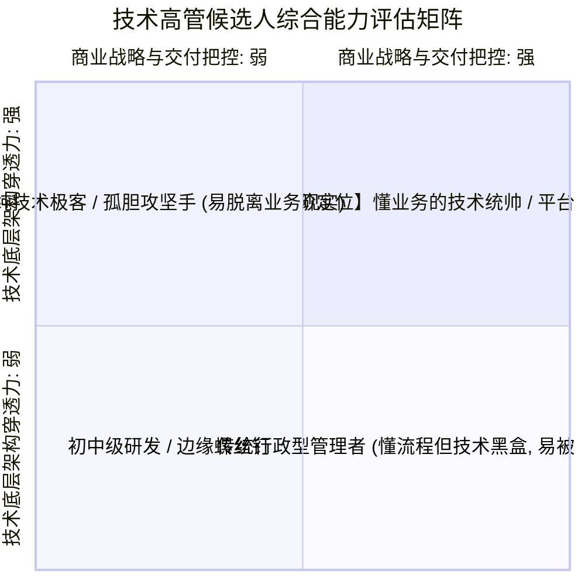
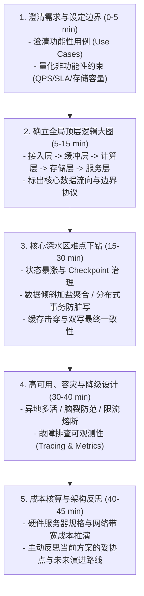

# 技术管理面试表达心法、白板架构推演攻防与危机应对手册

> [!NOTE] 案例性质与事实边界声明
> 本指南结合作者 14 年软件研发与技术管理真实背景（美的集团、思科、Zoom、瑞纳智能），文中引用的具体项目数据与压力测试指标遵循 [PROFILE_FACTS.md](../PROFILE_FACTS.md) 事实基线与教学案例规范，重点锤炼高管面试心智、白板架构推演与技术领导力。

> **定位与使命**：本指南专为拥有 14 年研发与技术管理经验的资深专家量身定制。跳出普通工程师的答题视角，直面 CEO、CTO、技术 VP 以及业务高管的挑剔审视。全面拆解技术高管面试评分模型、45 分钟白板架构推演实战拓扑、压力面试反击话术，以及将多段大厂经历（美的大数据治理、思科全球遥测、Zoom 亿级日志并发、瑞纳中台从 0 到 1 交付）转化为不可替代溢价杠杆的高管沟通心法。

---

## 1. 技术管理面试的四大评分心智模型 (Evaluation Framework)

技术总监、数据平台负责人、高级架构师面试与普通资深开发的考核有着本质的**维度跃迁**：



1. **架构穿透力与技术审美（First-Principles Technical Depth）**：
   - 考官关注候选人是否依然保持对技术底层的敏锐度，还是已经蜕变为“只会动嘴的甩手掌柜”；
   - 能否在黑板上从操作系统 I/O、内存模型（JMM）、分布式共识推导至上层大数据计算与 AI 框架。
2. **商业共情力与成本 ROI 意识（Business Empathy & ROI）**：
   - 能否把技术指标（QPS、延迟、SLA）翻译为 CEO 和财务关心的商业指标（获客成本、订单履约率、服务器成本压降、回款周期）；
   - 展现“技术永远服务于商业成功”的成熟经营观。
3. **组织领导力与人才梯队飞轮（Team Topology & Talent Flywheel）**：
   - 如何在 2 个月内搭建 10 人精锐部队？如何设计 Bus Factor $\ge 2$ 的备份防线？如何合规、有温度地推行低绩效 PIP 与清除刺头？
4. **复杂交付掌控力与商务博弈（Complex Delivery & Business Savvy）**：
   - 面对政企或大客户的需求蔓延（Scope Creep）、软硬件厂商推诿与验收卡点，如何守住商务底线并引导转化为增量合同？

---

## 2. 45分钟白板系统架构推演黄金法则 (Whiteboard Defense)

在高级架构师与技术总监面试中，**“45 分钟白板系统设计”**是决定定级与 Offer 薪资的决胜局。绝不能抓起笔就画框框，必须严格遵循五步推进节奏：



### 白板推演核心口诀
- **“先问规模，再动笔墨”**：千万不要拿到题目直接画架构图。必须先问面试官：“系统当前的日活用户是多少？数据保留周期是多久？允许的最大时延是毫秒级还是秒级？”这展现了资深工程师严谨的工程把控习惯。
- **“每画一个组件，必带选型理由”**：画 Kafka，顺口说出“选 Kafka 是为了应对突发 5 倍洪峰缓冲，通过零拷贝保吞吐”；画 Doris，顺口说明“选 Doris 是为了免外部依赖极简运维，标准 SQL 降低团队学习曲线”。
- **“主动揭露短板与权衡”**：在画完架构后，主动对考官说：“这个架构在保证强一致性上做了权衡，牺牲了部分写入延迟；如果后续业务并发量再翻 10 倍，瓶颈会出现在第 3 个节点的网络 I/O 上，届时我的演进方案是...”。主动挑明妥协点，能瞬间打动资深考官。

---

## 3. 应对面试官“挑剔质询与压力面试”的化解反击话术

面试中高级考官经常故意挑刺、质疑方案或制造压力。切忌情绪化辩解，必须掌握四套降维化解模型：

### 场景一：面试官故意深挖底层细节试图问倒你（如深入问到 Linux 内核参数或 JVM 汇编屏障）
- **错误反应**：满头大汗、胡乱猜测、强词夺理。
- **高管级破局话术**：
  > “这个问题切入得非常深刻。关于这个特定参数在极端边界下的具体字节偏移，由于生产中我们已将其沉淀为标准基线配置，我手头没有逐行记忆该底层源码细节。
  > 但从系统底层的运行机理来看，它的本质是为了解决 CPU 缓存一致性与内存屏障的乱序问题。在真实排查类似生产事故时，我的标准排查路径是：第一步通过 `perf` 或 `jstack` 抓取线程上下文，第二步结合 `/proc/sys/vm` 内核指标排查，第三步通过可复现的隔离压测环境进行参数对撞验证。在过去的实战中，这种方法论屡试不爽。”
  *(既坦诚承认记忆盲区，又通过系统排查方法论展现深厚的架构内功)*

### 场景二：面试官质疑你的项目成果（如“你们节热 9.8% 看起来像是编的数据，可能是天气变暖吧？”）
- **错误反应**：面红耳赤、“领导您不信我也没办法”。
- **高管级破局话术**：
  > “非常理解您的怀疑，这恰恰也是太原项目正式验收会上国家级专家组在现场提出的第一个严厉质询！
  > 面对这一质疑，我们绝不靠口头辩解，而是直接出具了住建部标准的**‘气象度日法（Degree Day）归一化折算模型’**与**‘100个实验站 vs 100个未调控基准站的双轨对照组数据’**：在完全剔除天气波动后，回水温度标准方差由 2.4℃ 收敛至 0.72℃ 的实测方差是铁证。最终专家组不仅全票通过，更将该项目评为省级示范标杆。这充分证明了我们数据的真实严密性与经受极限挑剔的工程底气。”

### 场景三：面试官质疑你的管理贡献（如“你管 10 个人，代码大部分是下属写的，你的核心产出是什么？”）
- **错误反应**：“我指导他们写、我开会分配任务”。
- **高管级破局话术**：
  > “从优秀的个人贡献者（IC）转型为部门负责人，我的核心定位绝不是‘和下属抢着写 CRUD 代码’。我的核心价值体现在三个不可替代的维度：
  > 第一，**定技术航向与架构兜底**：把控核心实时流湖仓架构与接口契约，在 Flink 状态暴涨与生产死锁等关键瓶颈时，我亲自下场攻坚定调；
  > 第二，**建立工程防护网与生产力飞轮**：推行规范驱动开发（SDD）、400 行 CR 门禁与双人 AB 角备份，把个人的技术能力固化为组织的制度免疫力，将团队交付周期缩短 60%；
  > 第三，**守住商业与商务底线**：在现场将甲方蔓延的需求通过 CCB 机制转化为 300 万增补合同，保障千万级验收回款全额闭环。
  > 简而言之，我的产出就是**‘带领团队把不确定的技术风险，转化为确定的商业成功’**。”

---

## 4. 薪资谈判与职级定级商业博弈 (Executive Negotiation)

技术管理者在进入谈薪阶段时，必须树立“商业合伙人”的博弈姿态：
1. **不要过早亮出底牌**：在前几轮面试中，面对 HR 试探当前薪资或期望薪资，礼貌使用缓冲话术：“*相比于具体的数字，我更看重贵司当前业务的发展空间与我能为团队创造的实际增量价值。只要双方在技术路线与岗位职责上高度匹配，我相信贵司有具备竞争力的薪酬体系*”。
2. **将 14 年复合背景包装为“降本增效的直接杠杆”**：
   - “*如果招一个纯粹的传统技术经理，可能需要额外招一个大数据架构师配合；如果招一个纯外企背景的高级架构师，可能在面对复杂业务和传统工业政企交付时水土不服。而我具备外企规范度、互联网高并发、大型制造治理以及从0到1带队闭环交付的全栈操盘经验，能独立扛起整个技术团队，这本身就为公司节省了可观的管理协调成本*”。
3. **结构化薪资包（Total Package）权衡**：
   - 关注“现金 Base + 绩效奖金 + 股权/期权 + 签约金（Sign-on Bonus）”的综合构成；
   - 明确年终奖发放的客观考核基线（与团队交付、系统稳定性 SLA、业务增量指标绑定），杜绝纯主观拍脑袋。

---

## 5. 8道最具杀伤力的高管综合必考题与三层参考答案

### 题目 1：[请用 3 分钟做一次高管级别的自我介绍，讲清你的核心优势与职业定位。]

#### 简洁回答（1分钟电梯破题）
> “各位面试官好，我是一名深耕软件研发、大数据架构与技术管理约 **14 年** 的复合型技术领军者。
> 我的职业生涯历经了**美的集团、思科、Zoom 以及瑞纳智能**四座里程碑：
> 在思科与 Zoom，我参与了全球 PB 级网络遥测与亿级并发会议日志底座建设，锤炼了极致高可用、容灾防御与严密的国际化工程规范；
> 在美的集团，我主导了跨几十个事业部的数据中台治理与千亿级数仓重构，深刻理解复杂实体制造企业的数字化转型与商业利益协同；
> 在瑞纳智能，我作为大数据部门负责人，从 0 到 1 组建管理 8~10 人跨职能团队，自主研发了具备独立 Web 产品能力的工业大数据中台，并作为总负责人圆满完成了太原数千万级标杆项目的正式专家验收与全额回款。
> 我的核心定位是：**既能深潜底层搞定分布式架构硬核攻坚，又能运筹帷幄带队伍、把控项目商业闭环的高阶技术负责人**。”

#### 深入回答（机制推导、工程落地、落地流程与边界条件）
> “展开我的核心能力底座，由三根支柱构成：
> 1. **全栈分布式架构与前沿 AI 技术的穿透力**：
>    - 对 Flink 状态机制、Kafka 吞吐调优、Doris 实时 OLAP、Iceberg 湖仓一体有着数万小时实战沉淀；
>    - 紧跟 AI 范式革命，深刻掌握大模型底层 Transformer 机制、KV Cache 调优、MCP 协议标准与生产级 RAG 架构，能够带领团队从传统工程平滑升级为 AI-Native 研发体系；
> 2. **组织建设与工程效能的系统化治理**：
>    - 摒弃人肉救火，推行‘规范驱动开发（SDD）’、架构决策记录（ADR）、变异测试与三层 Code Review 门禁，把关键模块 Bus Factor 提升至 2 以上，让团队在面对复杂需求时具备高度确定性；
> 3. **复杂交付、商务博弈与商业变现掌控力**：
>    - 具备强大的政企大客户掌控经验，善于运用 CCB 变更机制将客户蔓延需求转化为增补合同，在太原千万级项目中实现零坏账全额回款，并孵化出通用产品底座实现跨城市低成本复制。”

#### 架构师/技术管理视角（组织变革、人效 ROI、团队心智塑造、工程合规）
> “从组织战略匹配的角度看，**任何一家高速发展的企业，在技术带头人的选拔上都面临‘找纯极客怕脱离业务，找纯管理者怕技术被忽悠’的尴尬两难**。
> 我 14 年的多维履历恰恰融合了这两者的精髓：
> 既有大厂正规军的严谨规范与高并发功底，又有创业型企业从泥泞中带队突围的狼性韧劲；
> 我希望加入贵司，承担起技术平台负责人或技术总监的重任，用过硬的架构定力、严谨的工程体系与敏锐的商业嗅觉，把公司的业务愿景不折不扣地落地为坚固的高性能数字底盘，为企业的下一阶段爆发提供源源不断的战略动力。”

---

### 题目 2：[如果入职前 90 天，面对一个士气低落、代码堆积严重、业务交付频繁延期的存量团队，你将如何破局？]

#### 简洁回答（1分钟电梯破题）
> “前 90 天的核心破局法则是**‘30天调研定调不盲动、60天抓小赢树信心、90天建机制固成果’**。
> 前 30 天通过 1v1 访谈与 VSM 价值流图找出研发等待浪费的真正病灶，与业务高管对齐底线预期；
> 中间 30 天挑选 1~2 个最痛但见效最快的核心阻碍（如引入 CI/CD 自动化消除人肉部署、清理 3 个高频核心慢查询）打赢局部攻坚战，重振团队士气；
> 后 30 天制度化确立 20% 技术债务预算、规范驱动开发（SDD）与双人 AB 角备份，实现团队由乱到治的平稳蜕变。”

#### 深入回答（机制推导、工程落地、落地流程与边界条件）
> “在处理士气低落、延期严重的烂摊子团队时，我遵循严格的‘情境领导与系统破局四步法’：
> 1. **前 30 天：听取诉求、诊断链路、不急于推翻前任（Listen & Diagnose）**：
>    - 与每个成员开展 SBI 深度面谈，倾听工程师心中积压的委屈与真实瓶颈；
>    - 与业务部门总监对齐：明确当前业务最痛的三个系统故障点，降低双方摩擦火气；
>    - 画出研发交付价值流图（VSM）：分析代码从提出到上线的全周期，通常会发现 80% 的时间浪费在‘测试环境冲突、等待联调、手工发版’等非编码等待浪费上；
> 2. **第 31-60 天：小切口、深突破、打赢‘立威之战’（Quick Wins）**：
>    - 绝不大张旗鼓搞全盘重构；
>    - 挑选一个大家抱怨最多、但解决后效果立竿见影的痛点：例如搭建 GitLab CI 流水线，实现一键自动化部署与自动化单测，彻底终结每天手工打包到深夜的苦逼日子；
>    - 将经常导致生产报警的 Top-3 慢 SQL 与死锁进行集中拔除，消除报警风暴，让团队能睡上安稳觉；
>    - 在周会上公开重奖攻坚骨干，重塑团队的‘赢家心理（Winning Mindset）’；
> 3. **第 61-90 天：立规矩、明奖惩、机制化运转（Systematization）**：
>    - 推行单次 400 行以内的 CR 规范与 WBS 8/80 任务拆解，从源头消灭巨石任务；
>    - 与业务方正式签署《技术债务 20% 配额合作备忘录》，把系统维护从地下暗度陈仓升级为阳光下的制度保障；
>    - 完成人才盘点，对自驱骨干委以核心重任，对个别持续散播负能量、屡教不改的害群之马启动合规 PIP 隔离清除，让团队生态焕然一新。”

#### 架构师/技术管理视角（组织变革、人效 ROI、团队心智塑造、工程合规）
> “从组织管理的深层逻辑看，**一个频繁延期、士气低落的团队，根本原因往往不在于‘工程师技术不行’，而在于‘组织系统的混乱与挫败感的持续累积’**。
> 新任管理者最忌讳的是‘新官上任三把火’，一进场就全盘否定前人、大搞清洗换人或推倒重写，这只会加剧恐慌与抵触。
> 高阶管理者的定力在于：
> **‘先成为团队的遮风挡雨者，再成为团队的引路人’**。
> 通过帮下属解决具体的环境痛苦赢得技术尊重，通过小步快跑的胜利积累重塑战斗渴望，最后顺理成章地将先进的工程规范注入团队血脉，把一支溃散的队伍百炼成钢。”

---

### 题目 3：[当业务方要求一个核心大功能必须在 2 周内上线，但技术评估至少需要 6 周，且业务负责人直接告状到 CEO 处，你如何破局？]

#### 简洁回答（1分钟电梯破题）
> “破局此类死锁的核心策略是**‘绝不情绪对抗、用数据还原事实、提供多套建设性梯级方案、引导商业决策降维兑现’**。
> 在 CEO 面前展现高度的商业同理心，首先肯定业务目标的紧迫性；其次将 6 周的工作量以严密的 WBS 工作包向 CEO 和业务方清晰拆解，讲透‘若 2 周强行拼凑上线可能引发的核心链路宕机与资损风险’；顺势提出**‘MVP 核心功能 2 周保上线、次要功能分期迭代’的折中方案**，或争取借调外包产能，把单纯的对抗转化为‘为了业务安全着想的多方共赢破局’。”

#### 深入回答（机制推导、工程落地、落地流程与边界条件）
> “在面对 CEO 面试或高管沟通的实战化解话术：
> 1. **抢占同理心制高点，不当‘阻碍业务的杠精’**：
>    - 面向 CEO 和业务负责人：“*我非常理解这个功能对于抢占本季度市场窗口的生死意义。研发团队的目标和业务团队 100% 保持高度一致，我们绝不是为了推脱责任而说 6 周。*”
> 2. **客观出具工程物理铁三角评估（WBS & Risk Tree）**：
>    - 拿出结构化的甘特图与风险推演：“*这个功能涉及核心交易链路底层表结构改造与 3 个外部支付接口对接。经团队评估，2 周内我们最多能完成核心正向支付链路的代码编写与基础冒烟测试；但逆向退款、对账容灾以及压测至少需要后续 3 周；如果强行在 2 周内全量盲跑上线，一旦在大促洪峰下发生资金错账或系统雪崩，我们将面临直接的巨额财务损失与品牌公关危机。*”
> 3. **提供三套具体的建设性决策方案（Multiple Solutions）**：
>    - **方案 A（MVP 敏捷上线，强烈推荐）**：将功能裁剪为最小可行性产品（MVP），2 周内全力保障核心购买功能上线抢占市场，风控与后台对账暂时采用‘人工+脚本’临时半自动支撑，剩余功能在上线后 2 周内灰度迭代补齐；
>    - **方案 B（资源杠杆并联）**：如果全量功能必须在 2 周内交付，需要公司协调临时从兄弟部门借调 2 名资深前端与 1 名测试骨干，并采购现成的第三方 SaaS 模块，走并行突击路线；
>    - **方案 C（严格按 6 周高质量交付）**：进行全链路安全压测，保证零故障上线。
> 4. **将选择权交由 CEO 与业务方拍板**：
>    - “*从研发角度，我强烈建议采取方案 A，既兼顾了业务抢占市场的窗口，又守住了系统安全底线。*”通常 CEO 会高度赞许这种富有建设性与商业大局观的决策。”

#### 架构师/技术管理视角（组织变革、人效 ROI、团队心智塑造、工程合规）
> “从研发总监的高维视角审视，**‘项目管理的铁三角定律（范围、时间、资源/质量）是不可逾越的物理客观规律’**。
> 平庸的管理者只有两招：要么像软柿子一样勉强答应，最后因系统崩溃而背锅被裁；要么生硬拒绝搞僵跨部门关系。
> 优秀技术管理者的艺术在于：
> **‘把技术瓶颈转化为商业选择题’**。
> 用专业的量化数据和极具同理心的商业沟通，引导高管在‘质量、范围与工期’之间做出理性的战略取舍。不仅守住了系统的稳定底线，更树立起了技术团队‘既讲原则、又懂变通、善解难题’的卓越商业伙伴形象。”

---

### 题目 4：[在大数据平台与数据中台架构中，如何平衡“计算资源成本（FinOps）”与“业务查询延迟（SLA）”的冲突？]

#### 简洁回答（1分钟电梯破题）
> “平衡成本与性能的核心哲学是**‘全生命周期冷热分层、基于价值的算力分级、弹性伸缩消除波谷浪费与精细化 FinOps 成本治理’**。
> 架构上推行‘热数据存 Doris/SSD 保毫秒级 SLA，温冷数据下沉 Iceberg/HDFS 压缩存储’；在计算侧推行流批一体消除重复计算；在治理侧建立**‘多租户算力配额与成本穿透看板’**，将闲置僵尸任务、无用报表与高消耗慢 SQL 暴露给业务方自查，实现‘用更低的成本换取关键业务更高的 SLA’。”

#### 深入回答（机制推导、工程落地、落地流程与边界条件）
> “在美的集团与瑞纳智能的大数据成本治理实操中，我建立了一套成熟的‘FinOps 治理体系’：
> 1. **全生命周期存储分级（Storage Tiering）**：
>    - **热数据（最近 7 天）**：存放在高性能 Doris NVMe SSD 存储中，保证即席报表与 GIS 大屏 P95 查询延迟 < 300ms；
>    - **温数据（8~90 天）**：自动迁移至普通 HDD HDFS 存储；
>    - **冷数据（90 天以上）**：采用 ZSTD 高压缩比算法归档至基于对象存储的 Apache Iceberg 湖仓底座，存储成本直降 70%；
> 2. **动态自适应弹性算子（Elastic Scaling）**：
>    - 在 Kubernetes 上部署 Flink 与 Spark 集群，配置 HPA（Horizontal Pod Autoscaler）；
>    - 在白天业务高峰期动态拉起计算 Pod 吞吐流量；在深夜 2:00~6:00 离线批处理跑完后，自动缩容 80% 的计算节点，消除闲置浪费；
> 3. **数据资产血缘穿透与‘僵尸任务大清扫’**：
>    - 基于 Calcite 解析全链路数据血缘图谱，比对前端 BI 报表的实际访问日志；
>    - 凡是过去 60 天内无人查看、但每天依然在消耗数十台服务器算力的‘僵尸数仓任务’，系统自动列入待下线清单，经业务确认后停运；
>    - 在美的这一项治理就为集团直接释放了 18% 的空耗算力；
> 4. **推行‘部门算力账单（Showback / Chargeback）’**：
>    - 建立多租户 Resource Pool，并在大屏上公示各事业部的日均算力账单；
>    - 当业务部门发现自己随意写的不带分区过滤的慢 SQL 每天在烧掉几千元预算时，会主动配合中台架构师进行 SQL 优化，从根本上形成良性节约生态。”

#### 架构师/技术管理视角（组织变革、人效 ROI、团队心智塑造、工程合规）
> “从技术高管和经营合伙人的视野来看，**‘在资源无限的情况下做高性能架构不算本事，在有限预算下把性能做到极致才是真功夫’**。
> 很多技术团队习惯了‘性能不够、硬件来凑’的粗放模式，给公司带来沉重的财务负担；
> 卓越架构师必须具备**强烈的资产回报率（Asset ROI）思维**：
> 把 FinOps 理念深度融入架构生命周期，让每一分硬件采购和云资源开销都能清晰对应到业务价值的产出上。把技术团队从传统的‘吞金兽（Cost Center）’转变为‘精益运营的赋能中心’，这是高管层最看重的核心商业素养之一。”

---

### 题目 5：[面对 AI Agent 与前沿大模型浪潮，作为一名具有深厚大数据与工程背景的技术负责人，你如何看待 AI 与现有大数据平台的融合？你将如何带领团队进行 AI-Native 升级？]

#### 简洁回答（1分钟电梯破题）
> “我的核心战略判断是：**‘AI Agent 是大数据的超级外显大脑，而大数据是 AI Agent 坚不可摧的燃料与物理手脚，两者具有天然的共生与重塑关系’**。
> 大数据平台过去 15 年沉淀了庞大的资产，但苦于‘使用门槛高、排障链条长、业务协同慢’；
> 我将带领团队从三个台阶推进 AI-Native 升级：
> 1. **内部提效**：推行规范驱动开发（SDD）与 AI 辅助代码评审，将日常研发交付效率拉升 60%；
> 2. **智能运维（DataOps Agent）**：利用自研 MCP 协议将 Flink、Kafka、Doris 工具原子化，打造海量集群自主巡检与故障自愈机器人；
> 3. **业务赋能（Text-to-Data）**：基于 RAG 与 Atlas 元模型打通智能问数与决策闭环，让业务人员直接通过自然语言与百亿级数仓交互，实现数据资产的指数级价值变现。”

#### 深入回答（机制推导、工程落地、落地流程与边界条件）
> “具体的落地推进路线图分为三大核心工程体系：
> 1. **第一体系：研发工程范式的 AI-Native 升级（Engineering Productivity）**：
>    - 全面推行基于 Antigravity / Cursor 的规范驱动开发（Spec-Driven Development）；
>    - 将测试驱动开发（TDD）深度集成，利用变异测试与 Testcontainers 自动检验 AI 生成代码的有效性，将骨干架构师从低效样板代码中解放出来，专注于高阶业务建模与架构设计；
> 2. **第二体系：基于 MCP 协议打造 DataOps 平台级自治智能体（Autonomous Operations）**：
>    - 封装一套企业级 `bigdata-ops-mcp` 服务：将 Kafka Lag 监控、Flink 弹性伸缩、HBase 写入限流等操作抽象为标准 MCP Tools；
>    - 部署 DataOps 智能体：当 Prometheus 告警触发时，Agent 自动感知、自主调用 API 排查日志并输出根因诊断卡片，使 80% 的常规线上告警实现分钟级无人值守自愈；
> 3. **第三体系：Text-to-SQL 与高质量行业 RAG 引擎（Business Empowerment）**：
>    - 针对工业与数据分析，构建‘双路混合检索 + 动态血缘校验’防线；
>    - 结合 Apache Calcite AST 解析器进行语法与成本过滤（Explain），消除表名与字段幻觉，并在只读沙箱中安全执行；
>    - 彻底消灭数据分析师与业务部门之间繁琐的‘写提数单排期’流程，让数据价值瞬时流动。”

#### 架构师/技术管理视角（组织变革、人效 ROI、团队心智塑造、工程合规）
> “从技术浪潮与商业竞争的宏观高度审视，**AI Agent 不是一个孤立的新技术，而是一场席卷全行业的生产力范式重组**。
> 纯算法团队搞 Agent，往往因为缺乏对分布式底层、微服务通信与企业高可用架构的敬畏，做出来的东西只是‘实验室玩具’；
> 而拥有 14 年全栈大数据与大型分布式系统工程底蕴的技术负责人，恰恰是驾驭这头猛兽的最佳人选：
> 我们深知如何构建高并发高吞吐底座、深知如何设计安全沙箱与降级护栏、深知如何让非确定性的大模型在确定性的工业与商业规则中受控运转。带领团队率先完成 AI-Native 进化，将使企业在未来的智能化大航海时代赢得长达数年的核心代差壁垒。”

---

### 题目 6：[你在上一家公司（瑞纳智能）离职的真实原因是什么？你对下一份工作的核心诉求是什么？]

#### 简洁回答（1分钟电梯破题）
> “在瑞纳智能的历程是一段极其圆满且成果丰硕的奋斗史：我带领团队从 0 到 1 组建了大数据部门，自主研发了具备独立 Web 界面交付能力的数据中台产品，并作为总负责人全流程高质量通过了太原数千万级标杆项目的专家评审与全额回款，圆满达成了当初入职时公司赋予的核心使命。
> 选择离开的核心原因，是**我渴望在更大规模的数据体量、更具技术挑战的高并发场景以及更具战略雄心的业务平台上，继续发挥我深厚的技术架构厚度与全面操盘能力**。
> 我对下一份工作的核心诉求是：**一个重视技术驱动商业价值、拥有清晰战略方向并能给予技术负责人充分信任与施展空间的优质平台，携手打造基业长青的行业标杆**。”

#### 深入回答（机制推导、工程落地、落地流程与边界条件）
> “展开我的职业思考逻辑：
> 1. **对过往战果的感恩与闭环总结**：
>    - 瑞纳智能是一家非常优秀的工业物联网上市公司，在这段经历中我收获了从 0 到 1 带队创业、软硬件一体化攻坚与政企顶级标杆交付的宝贵操盘经验；
>    - 在离开前，我主导完成了中台 1.0 的全面产品化解耦与交付 SOP 标准化输出，培养出了多位能够独当一面的骨干接班人，完成了体面、合规、负责任的交接；
> 2. **对下一阶段个人价值定位的深思**：
>    - 随着太原项目成功落地，瑞纳智能的后续发展重心更多转向各城市的项目施工与商务复制阶段，对于底层尖端架构演进与深层技术创新的需求趋于平稳；
>    - 而我正处于精力、技术洞察与管理经验最黄金的成熟期，我渴望继续深潜更具挑战性的领域 —— 例如更大规模的实时数据中台建设、更具爆发力的 AI Agent 产业赋能，或是跨国/全国性高并发复杂软件平台的研发攻坚；
> 3. **与贵司愿景的深度契合**：
>    - 我深入调研过贵司当前的业务版图与技术布局，贵司正处于数字化转型升级与核心技术底座重构的关键节点，面临着海量数据吞吐治理、研发效能提升与工程规范化的迫切诉求；
>    - 这与我过去 14 年在思科、美的、Zoom 以及瑞纳智能沉淀的核心能力高度重合，我相信我能无缝融入团队并迅速带来突破性战果。”

#### 架构师/技术管理视角（组织变革、人效 ROI、团队心智塑造、工程合规）
> “从职业生涯长跑与高管成熟度的视角来看，**一个优秀的管理者对职业的选择，永远是‘基于对自身使命的清醒认知与对双方长期共赢的追求’**。
> 离职不讲前东家的坏话，不仅是基本的职业道德，更是胸怀与格局的体现；
> 敢于走出舒适区，主动拥抱更具不确定性与更大挑战的全新战场，展现了一个技术领军者永不止步的雄心与战略自信。我期待在贵司的坚实土壤上，共同谱写下一个十年的辉煌篇章！”

---

### 题目 7：[作为技术总监，你如何处理团队中的“技术刺头（Brilliant Jerk）”—— 技术极强但脾气极大、不服从流程、经常在群里公开顶撞甚至嘲讽其他同事？]

#### 简洁回答（1分钟电梯破题）
> “治理技术刺头的核心法则是**‘对才华给予空间、对破坏文化零容忍、对事不对人讲透规则、搭建舞台引导能量’**。
> 首先绝对不能因为他技术强就无限纵容，‘烂苹果效应’会迅速摧毁整个团队的心理安全感并逼走其他优秀骨干；
> 其次在私下进行严肃的 SBI 事实面谈，肯定其技术贡献，但明确划出‘职场尊重与团队协作’的红线；
> 机制上将其从‘日常繁琐的流程协作’中剥离，安排其负责‘独立攻坚型的前沿难题’（如核心算法研发、疑难性能调优）；若持续破坏团队生态且屡教不改，果断启动合法清退，用铁腕捍卫团队健康底线。”

#### 深入回答（机制推导、工程落地、落地流程与边界条件）
> “在处理资深刺头员工的真实管理四步闭环：
> 1. **第一步：私下严肃谈话，直面冲突（Private SBI Feedback）**：
>    - 严禁在公开群里与刺头对骂，但也绝不能装聋作哑和稀泥；
>    - 会议室 1v1 沟通，用客观事实说话：“*小李，你上周在技术方案评审群里公开说小王写的代码像垃圾，并拒绝遵守 400 行 CR 规范。你的技术能力大家公认，但你的表达方式严重伤害了同事的自尊心，并导致两位新人产生离职倾向。这种行为在我的团队中是绝对的零容忍红线。*”
> 2. **第二步：探寻抵触根因，重塑心理契约（Root Cause & Incentives）**：
>    - 技术刺头往往是因为‘觉得流程太繁琐阻碍了其效率’，或者‘渴望被认可但缺乏高维表达能力’；
>    - 引导其明白：软件工程是团队运动，无法与他人协作的天才在工业化软件交付中价值为零；
> 3. **第三步：因材施用，调整岗位拓扑（Role Re-engineering）**：
>    - 停止让他带新人或担任需要频繁跨部门沟通的业务交付任务；
>    - 给予其专属的高难度挑战通道：例如“全公司 Flink 状态序列化性能调优”或“探索 MCP 自定义驱动研发”，让他把旺盛的精力和求胜心倾泻在纯粹的技术硬核攻坚上；
> 4. **第四步：设定观察期与终极底线（Clear Consequences）**：
>    - 明确告知如果再次发生公开侮辱同事或破坏交付流程的行为，年终绩效直接定为 C，并启动协商解除；
>    - 绝大部分有才华的工程师在被严肃指出并获得合理安排后，都能收敛锋芒；极个别反社会人格的刺头，果断依法劝退，为团队换来长治久安。”

#### 架构师/技术管理视角（组织变革、人效 ROI、团队心智塑造、工程合规）
> “从组织文化与长期领导力的视角审视，**‘团队的文化，是由管理者所能容忍的恶劣行为底线决定的’**。
> 很多平庸的管理者因为害怕得罪技术大牛、或者担心刺头离职后代码无人维护，选择卑躬屈膝地纵容，结果导致团队中努力、踏实、有协作精神的中间力量纷纷寒心离职，团队最终彻底沦为刺头个人的‘人质’。
> 顶级管理者的魄力体现在：
> **‘宁可承担短期业务震荡，也坚决不让团队的根系腐烂’**。
> 敢于向破坏组织文化的刺头亮剑，才能真正赢得绝大多数员工的发自内心的爱戴与信任，打造一支心齐气顺、无坚不摧的虎狼之师。”

---

### 题目 8：[如果公司核心线上系统在业务高峰期突发重大 P0 故障，全线不可用，作为技术负责人你如何规范指挥抢修与事后复盘？]

#### 简洁回答（1分钟电梯破题）
> “指挥 P0 故障处置的最高法则是**‘第一目标是快速止血恢复业务，排查根因只能退居第二；统一对外通报口径，事后推行无指责复盘’**。
> 现场立即启动应急战情室（War Room），实施三步走：第一步‘果断执行预案降级与切流重启（切机房、降级非核心功能、重启限流）’，15 分钟内快速止血；第二步由我统一对接高管与公关，隔离一线排障工程师的外界干扰；第三步业务恢复后调取监控与 Dump 快照分析深层根因，推行 Blameless Post-Mortem，将教训固化为自动化熔断与监控工具，杜绝重蹈覆辙。”

#### 深入回答（机制推导、工程落地、落地流程与边界条件）
> “在处理重大生产危机时，我推行的标准 SRE 应急指挥架构：
> 1. **建立战情室与明确角色分工（Incident Command System）**：
>    - **总指挥（Incident Commander, 由我担任）**：全权负责调度协调、决策拍板与向上汇报，严禁多头指挥；
>    - **排查攻坚手（Ops Lead）**：指定 1~2 名资深架构师专注于指标与日志排查，禁止无关人员在语音频道喧哗；
>    - **沟通联络官（Communications Lead）**：每 15 分钟在固定高管与业务群同步一次现状：“*当前进展：已定位到是数据库连接池打满，正在执行主从切换，预计 10 分钟内恢复*”，消除高层恐慌；
> 2. **践行‘先止血，后手术’的铁律（Restore First, Root Cause Second）**：
>    - 严禁在生产高峰期挂着 GDB 慢悠悠排查代码逻辑！
>    - 优先按照应急预案执行止血三板斧：
>      - **第一斧：流量切换**（多机房异地切换，或切换只读降级）；
>      - **第二斧：功能熔断**（关闭大屏刷新、暂停积分计算、关闭非核心入库）；
>      - **第三斧：平滑重启扩容**（在保留堆内存 Dump 快照的前提下，果断重启卡死容器并临时扩容 3 倍实例扛住洪峰）；
> 3. **无指责复盘会（Blameless Post-Mortem）与资产固化**：
>    - 故障恢复后 48 小时内，组织全员复盘会；
>    - 开场明确‘不追究个人责任，只深挖系统与流程漏洞’；
>    - 运用 5 Whys 追问到底：
>      - 为什么挂了？因为慢 SQL 锁表；为什么有慢 SQL？因为没加索引；为什么没加索引就上线了？因为 CI 门禁缺少慢 SQL 静态检查；
>      - **落地 Action Items**：给 CI 流水线增加自动化 SQL Explain 检查插件，并指定责任人与完成期限，彻底闭环漏洞。”

#### 架构师/技术管理视角（组织变革、人效 ROI、团队心智塑造、工程合规）
> “从技术高管和企业生命线的终极视角来看，**‘故障是检验技术团队成色与管理者心理素质最残酷的试金石’**。
> 菜鸟团队出了故障，领导跳脚骂娘、员工互相甩锅，大家慌作一团把系统越改越烂；
> 一流团队面对滔天危机，管理者沉着冷静、调度井井有条，在最短时间内从容化解风险。
> 卓越领导力体现为：
> **‘在战火中展现镇定，在废墟中提炼养分’**。
> 把每一次惨痛的生产事故，都转化为倒逼系统架构演进、完善自动化兜底工具链和锤炼团队心理韧性的千载难逢的契机。打不垮我们的，终将使我们的系统与团队变得无比强大！”

---

### 技术管理面试攻防与表达心法一页纸速记卡（5大必杀铁律）

```
========================================================================================
           【技术管理面试心法与高管攻防：技术总监与负责人 5 大决战铁律】
========================================================================================

【铁律一：白板推演五步走，先定边界后落笔】
  - 0-5min 澄清 SLA/QPS 边界；5-15min 勾勒分层大图与协议契约；
  - 15-30min 攻坚深水区难点（两阶段加盐、Checkpointer、零拷贝）；30-40min 容灾降级；40-45min 算成本反思演进。

【铁律二：遇压临危定气场，借力打力巧化解】
  - 面对挑剔质询或质疑：“面试官点得很准，在千亿体量下确实有边界”；
  - 绝不硬顶争执，先肯定对方洞察，再给出分级场景推导，展现从容大将风范。

【铁律三：战术破局打胜仗，接手团队三步走】
  - 前 30 天调研摸底建立信任，中 30 天拿下一个高感知痛点（Quick Win）确立威信；
  - 后 30 天制定 1~3 年技术演进路线图，推进双人 AB 角与 DORA 效能落地。

【铁律四：商业共情算 ROI，不做纯技术愤青】
  - 不拿“技术优雅”压业务，用“商业风险量化 + 最小 MVP + 自动化限流降级”换取窗口；
  - 推动设立 20% 技术债务偿还预算，技术与商业协同共生。

【铁律五：P0 危机先止血，复盘无责固工具】
  - 统一战情室与对外口径，严禁生产高峰慢悠悠调代码；
  - 切流、熔断、重启扩容三板斧快速恢复；事后 5 Whys 无责复盘，把教训焊死在 CI 门禁中。
========================================================================================
```

---

## 6. 个人管理与领导力沉淀自检清单

- [ ] 是否深刻理解了技术管理面试四大评分心智模型，并彻底摆脱了“纯打字工程师”的作答姿态？
- [ ] 能否在白板前从容推演 45 分钟大型系统设计，自然融入需求澄清、选型权衡、容灾降级与成本 ROI？
- [ ] 面对面试官的故意挑刺、质疑数据真实性或压力提问，能否熟练运用三层话术化险为夷、降维反击？
- [ ] 是否清晰掌握了从 0 到 1 接手烂摊子团队的前 90 天破局三步法（调研、小赢、制度化）？
- [ ] 面对业务方不合理的超期诉求，能否在 CEO 面前用商业同理心与 WBS 拆解引导多方共赢？
- [ ] 能否系统阐述 FinOps 成本治理与 SLA 性能平衡的全生命周期四层抓手？
- [ ] 能否从战略高度推演大数据中台与 AI Agent 的深度融合路线（内部提效、DataOps、Text-to-SQL）？
- [ ] 能否体面、自信、成体系地回答离职原因与未来职业诉求，展现出技术领航者的大将风范？
