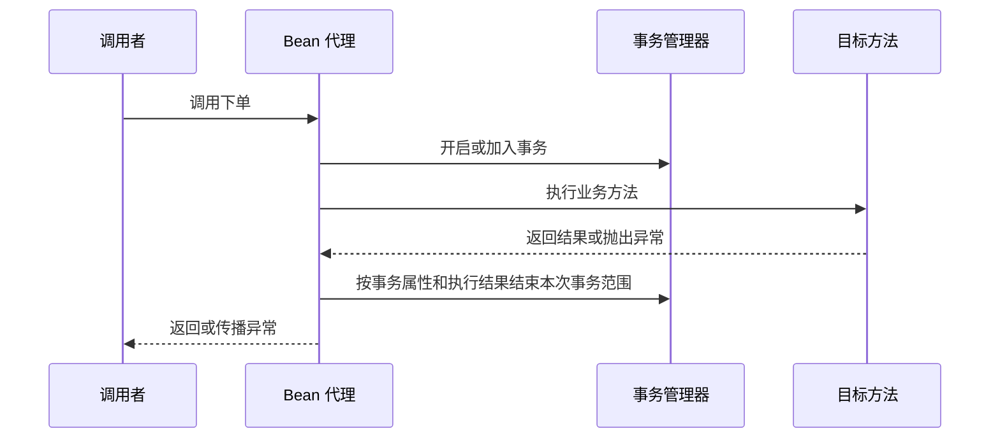

# Spring Framework 面试六题：Bean、代理与事务边界

## 1. 知识概述与业务价值

一次下单要同时写订单和明细。两个方法即便都写了事务注解，也要问三个问题：对象由谁创建，调用是否经过代理，两次写是否使用同一个事务管理器控制的资源。沿这三点推导，就能解释常见的部分提交现象。

## 2. 核心概念与关系

| 名称 | 职责 | 面试时先确认 |
| --- | --- | --- |
| IoC 容器 | 按 Bean 定义创建对象、装配依赖和管理生命周期 | 实例是否由此容器管理、作用域是什么 |
| AOP 代理 | 在匹配的方法调用前后执行通知 | 调用者持有代理还是原始对象 |
| 事务管理器 | 开启或加入事务，在边界处提交或回滚 | 哪个管理器、数据源、线程或响应式上下文 |

## 3. 底层工作机制与设计哲学

下图适用于代理模式下，外部调用一个使用命令式事务的 Spring Bean。拦截器根据事务属性作决定，业务代码执行 SQL，事务管理器负责完成事务。[Spring 声明式事务](https://docs.spring.io/spring-framework/reference/data-access/transaction/declarative/annotations.html)

## 4. 高频复杂业务场景实操与落地

> [!NOTE] 案例性质说明：以下为大促订单教学推演。

假设批量导入与在线下单共享数据库。若每笔订单持有连接期间又同步等待一个远程接口，排队会放大连接占用。先把合同要求同成同败的本地写入放在一个短事务中。需要可靠对外通知时，把待投递事件与订单一起写入同一数据库事务，由后台重试投递，消费者用事件 ID 去重。

## 5. 生产异常故障深度排查与根因分析

| 现象 | 先找的证据 | 下一步 |
| --- | --- | --- |
| 第二次写失败，第一次仍保留 | 经由哪个 Bean、哪个事务管理器，异常是否传播到拦截器 | 从真实入口注入异常，独立查询数据库结果 |
| 切到线程池后查不到刚写的数据 | 线程名称、提交时点、工作线程使用的连接 | 判断业务要求提交后执行还是允许并发 |
| 开启内层事务后连接池耗尽 | 事务传播属性、活跃和等待连接数 | 检查外层持连接时是否又等待独立连接 |

`REQUIRES_NEW` 会独立完成事务，外层资源保持占用。多人同时在外层持有连接、内层又各需一个连接，连接池可能耗尽。先评估业务是否真的需要独立提交。[Spring 传播行为](https://docs.spring.io/spring-framework/reference/data-access/transaction/declarative/tx-propagation.html)

## 6. 技术选型对比、架构演进与成本ROI

简单的服务入口可用声明式事务，边界一眼可见。批处理的每段提交或有条件重试需要精确界定边界时，`TransactionTemplate` 能直接表达代码块，但业务代码对框架的依赖更明显。两者应使用与数据源匹配的管理器。[Spring 编程式事务](https://docs.spring.io/spring-framework/reference/data-access/transaction/programmatic.html)

## 7. 技术经理与架构师实战管控

在线和回补使用独立执行器并限制数据库并发，连接总量仍须服从数据库容量。压力越过预算时让回补排队，保障在线订单。评审时要求标出事务边界和远程调用的位置。集成测试至少覆盖中途失败和重复投递，用独立事务读取最终状态，避免测试框架自己的事务掩盖缺陷。

## 8. 互联网大厂高频面试真题库

以下是公开候选人面经的六个考点。场景、故障注入和管理追问为本库扩展，面经中的个人作答不作为官方机制依据。

1. **Q1** IoC 解决了什么问题，Spring 如何装配依赖？[阿里钉钉一面](https://www.nowcoder.com/discuss/353157830410706944) · [美团 2025 暑期一面](https://www.nowcoder.com/feed/main/detail/7a197c54ad294c5496eb6146a6f740d3)
2. **Q2** Spring 管理的 Bean 从创建到销毁经过哪些关键阶段？[腾讯一面、阿里钉钉一面](https://www.nowcoder.com/discuss/353157830410706944)
3. **Q3** 两个 Bean 相互依赖时，容器能处理哪些情况？[美团系统开发一面，见美团段落](https://www.nowcoder.com/discuss/353155546041753600)
4. **Q4** Spring AOP 怎样实现，JDK 代理和子类代理的边界在哪里？[阿里钉钉三面](https://www.nowcoder.com/discuss/353156434051407872)
5. **Q5** 同一个类里的两个事务方法互相调用，内层的事务声明会生效吗？[美团平台后端一面](https://www.nowcoder.com/discuss/603340156334080000)
6. **Q6** 方法中把任务交给线程池，原事务会传过去吗？[美团平台后端一面](https://www.nowcoder.com/discuss/603340156334080000)

## 9. 结构化深度参考答案

### 题目1 IoC 与依赖注入

#### 简洁回答

订单服务声明自己需要一个仓库接口，容器根据配置找到实现，创建后通过构造器等方式交给它。这样对象只需知道对方能做什么。替换实现和单元测试都可以保留原有业务逻辑。

#### 深入回答

容器从组件扫描、配置类或 XML 建立 Bean 定义，再按类型等条件解析依赖。同一个接口有多个匹配对象且无明确优先级时，需要用限定符等消除歧义。必需依赖用构造器可以在对象创建时满足约束。默认单例的边界是每个容器、每个 Bean 定义，单例对象的可变字段仍需自行保证线程安全。[依赖注入](https://docs.spring.io/spring-framework/reference/core/beans/dependencies/factory-collaborators.html) · [Bean 作用域](https://docs.spring.io/spring-framework/reference/core/beans/factory-scopes.html)

#### 架构师/技术管理视角

多租户数据路由器可作为无状态单例，将租户标识作为方法参数传入。若把当前租户放进该单例的可变字段，并发请求可能彼此覆盖。通过同一个容器并发执行两个租户的测试就能检查这种问题。

### 题目2 Bean 生命周期

#### 简洁回答

容器实例化 Bean 并注入依赖，执行初始化回调，必要时由后处理器包装为代理，然后把可使用的引用交给调用方。容器正常关闭时会调用受管单例的销毁回调。

#### 深入回答

普通单例的依赖先于初始化就绪。配置了多种互不相同的初始化回调时，通常依次执行 `@PostConstruct`、`afterPropertiesSet()` 和自定义 init 方法。常见自动代理在初始化之后形成，所以初始化回调里调用本类事务方法不能依赖常规代理拦截。prototype 实例交出后，容器不会替调用方执行其销毁回调。[生命周期回调](https://docs.spring.io/spring-framework/reference/core/beans/factory-nature.html) · [prototype 的清理责任](https://docs.spring.io/spring-framework/reference/core/beans/factory-scopes.html)

#### 架构师/技术管理视角

数据源和消费线程池要定义清晰的资源归属。服务关闭时先停止接新任务，再限时排空并释放资源。用一次真实的上下文启动与关闭验证连接和工作线程是否退出，避免发布后旧实例一直占着资源。

### 题目3 循环依赖

#### 简洁回答

若 A 的构造器必须有 B、B 的构造器也必须有 A，两个实例都无法先完成构造。容器会报创建异常。允许循环引用时，某些单例的 setter 注入循环可借助提前暴露的引用完成装配。

#### 深入回答

一种可解路径是先实例化 A，准备注入 B 时创建 B，B 再获得 A 的早期引用，然后两边依次完成初始化。此时 B 可能看到尚未初始化完的 A，所以初始化方法里调用对方有风险。Bean 的作用域、代理和容器配置都会约束这个过程。纯构造器相互依赖时没有可提前暴露的已构造实例。[Spring 循环依赖说明](https://docs.spring.io/spring-framework/reference/core/beans/dependencies/factory-collaborators.html)

#### 架构师/技术管理视角

若“订单写入器”与“报表刷新器”双向调用，先查真正需要一致提交的业务规则。可把共同逻辑抽出，或由上层服务单向编排。允许异步时再考虑提交后通知，并同时处理通知丢失和重试。

### 题目4 AOP 与两类代理

#### 简洁回答

调用者拿到一个代理，命中切点的方法在到达目标对象之前或之后执行通知。Spring Framework 可用 JDK 接口代理，也可生成目标类的子类代理。

#### 深入回答

默认代理选择受目标是否实现接口及配置影响。接口代理对外提供接口方法，按具体类注入或强转可能失败。基于子类的代理依赖可覆写方法，final 类无法被继承，private、final 方法无法通过覆写增强。两种方式下，目标对象内部通过 this 发起的调用都会绕过外部代理。AspectJ 字节码织入走另一条路径。[Spring 代理机制](https://docs.spring.io/spring-framework/reference/core/aop/proxying.html)

#### 架构师/技术管理视角

把授权、事务和计时放在清晰可测试的入口上。评审一次代理重构时，测试要从容器取得调用者真实使用的引用，既验证通知执行，又验证业务副作用和异常传播。

### 题目5 同类事务调用

#### 简洁回答

默认代理模式下，目标对象直接执行自己的另一个方法，内层注解不会触发新的事务拦截。如果外层已经开启事务，内层的同资源写入仍可加入外层现有事务。

#### 深入回答

举例说，外层经代理以 REQUIRED 进入事务 T，内部调用标注 REQUIRES_NEW 的审计方法。这个自调用不会挂起 T 或另取一个物理事务。在同一数据源、同线程的 Spring 事务访问下，外层回滚时审计写入也会回滚。若外部入口本身没有事务，自调用也不会凭注解创建事务。需要独立边界时可拆到另一个受管 Bean 经代理调用，或显式使用事务模板。[注解与自调用](https://docs.spring.io/spring-framework/reference/data-access/transaction/declarative/annotations.html) · [传播属性](https://docs.spring.io/spring-framework/reference/data-access/transaction/declarative/tx-propagation.html)

#### 架构师/技术管理视角

请业务方确认“订单失败时审计记录是否必须保留”。若要求保留，在外层写完后注入运行时异常，断言订单回滚且审计仍存在，同时验证并发下连接池能支持两个事务边界。

### 题目6 跨线程的事务

#### 简洁回答

常规 JDBC 事务由事务管理器把资源绑定到当前执行线程。线程池里的任务没有自动继承调用方的连接和事务，外层回滚无法撤销工作线程已经独立提交的写入。

#### 深入回答

若工作线程经代理调用另一个带事务的方法，它可以开启自己的事务。异步任务还可能早于外层提交执行，读不到刚写的数据。响应式事务使用 Reactor Context，可在同一响应式管道中跨线程工作，判断依据是管道上下文。事务对象不应靠复制 ThreadLocal 或共享 JDBC 连接传给工作线程。[Transactional 的线程及响应式语义](https://docs.spring.io/spring-framework/docs/current/javadoc-api/org/springframework/transaction/annotation/Transactional.html)

#### 架构师/技术管理视角

必须原子完成的两个本地写操作保留在同一事务。需要可靠异步执行的工作可在同一事务写出待处理记录，提交后再投递；消费者按事件键幂等。验收模拟“订单刚提交，投递进程就退出”，确认恢复后能补发，并确认重复投递不会重复扣费。

## 10. 知识自检与口述推演清单

- [ ] 分别画出外部调用、this 调用、线程池调用的边界。
- [ ] 给出一个构造注入循环，解释哪一步无法完成。
- [ ] 分别预测“外层回滚、内层自调用”和“外层回滚、内层经独立事务提交”后两张表的结果。

**用数据库核对 Q5 和 Q6。** 四次实验都先写一笔订单、再写审计，最后让订单抛出同一个异常。每次换一个新数据库，退出事务后再读表。以下为 Spring Framework 6.2.19、单数据源 JDBC、默认代理模式的结果。[可运行测试](../code-demos/java-distributed-demo/src/test/java/com/tech/interview/distributed/SpringTransactionBoundaryTest.java)

| 审计方法的调用路径 | 订单行 | 审计行 | 原因 |
| --- | ---: | ---: | --- |
| 外层直接调用自身的 `REQUIRES_NEW` | 0 | 0 | 没有经过内层拦截器，两个写操作都由外层回滚。 |
| 同线程经代理调用 `REQUIRES_NEW` | 0 | 1 | 独立事务在外层失败前已提交。 |
| 同线程经代理调用 `REQUIRED` | 0 | 0 | 审计加入已有事务。 |
| 工作线程经代理调用 `REQUIRED` | 0 | 1 | 工作线程建立自己的事务。示例等待它提交后才让外层失败。 |

## 11. 知识脉络与技术图谱关联

代理与类加载器影响类型身份，线程模型决定事务资源可见范围。把框架调用图与这两个专题一起复习。[JVM 六题](./05-jvm.md) · [Java 并发与线程池](../03-java-engineering/02-concurrency-juc.md)

## 12. 权威参考与官方进阶资料

追踪 Bean 创建时查 [Spring IoC 容器](https://docs.spring.io/spring-framework/reference/core/beans.html)，解释通知是否触发时查 [AOP 代理](https://docs.spring.io/spring-framework/reference/core/aop/proxying.html)，解释最终提交结果时查 [事务传播](https://docs.spring.io/spring-framework/reference/data-access/transaction/declarative/tx-propagation.html)。
