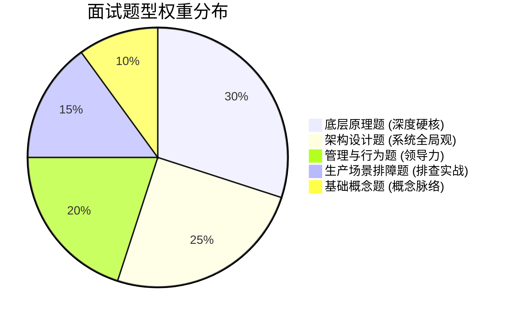

# 模块化分类面试题库索引 (Interview Question Bank)

> 本题库旨在沉淀针对 **数据平台研发负责人 / 大数据架构师 / 技术研发经理 / 技术总监** 岗位的核心题集。  
> 题目严格按照能力层级与考察类型分类，答案均采用“简洁回答 + 深入回答 + 架构师视角”的三层标准应答应答体系。

---

## 一、题型矩阵与分布

---

## 二、分类题库导航

### 1. 技术核心分类
- **[01-大数据核心计算题库](./bigdata-compute-questions.md)**：Flink、Spark、Kafka 底层机制、调度、容错与状态机。
- **[02-分布式存储与OLAP题库](./storage-olap-questions.md)**：HDFS、HBase、Doris、Hive、数据湖（Iceberg/Paimon）。
- **[03-数据中台与治理架构题库](./data-platform-questions.md)**：中台架构设计、元数据血缘、数据质量、数据资产化 API、多租户。
- **[04-Java与分布式系统工程题库](./java-distributed-questions.md)**：JVM性能调优、JUC并发、PostgreSQL/MySQL事务锁、Redis高可用、分布式一致性协议。

### 2. 管理与交付分类
- **[05-研发团队管理与效能题库](./team-management-questions.md)**：团队组建、梯队培养、绩效管理、技术方案评审、Code Review、技术债务治理。
- **[06-复杂项目管理与客户交付题库](./project-delivery-questions.md)**：需求边界把控、范围蔓延、供应商协同、太原客户交付验收实战。

### 3. 前沿AI与综合复盘分类
- **[07-AI Agent与工程化实践题库](./ai-agent-questions.md)**：LLM原理、Agent循环、Skills机制、MCP协议、企业级RAG架构。
- **[08-真实履历深度追问题库](./project-deepdive-questions.md)**：瑞纳智能中台、思科大数据、美的集团、Zoom 日志系统的深挖应答。

---

## 三、答题自评标准（四级评分制）

在自测与模拟面试中，每道题目依据以下标准自我评定或由 Agent 考评：
- **Level 1 (不及格)**：只能说出零碎八股概念，记不清核心原理，无法给出具体排查步骤或技术方案。
- **Level 2 (合格研发)**：能准确说清原理流程与关键配置，但缺乏底层源码/数据结构认知，无法深入展开。
- **Level 3 (资深架构师)**：原理深入到数据结构、网络I/O与状态流转；能结合生产踩坑经验，清晰陈述选型优缺点与适用边界。
- **Level 4 (技术领军者)**：具备高度的商业与成本意识（ROI），能把技术痛点与业务价值挂钩；能给出兼顾团队学习曲线、工程规范与交付周期的体系化解法。
