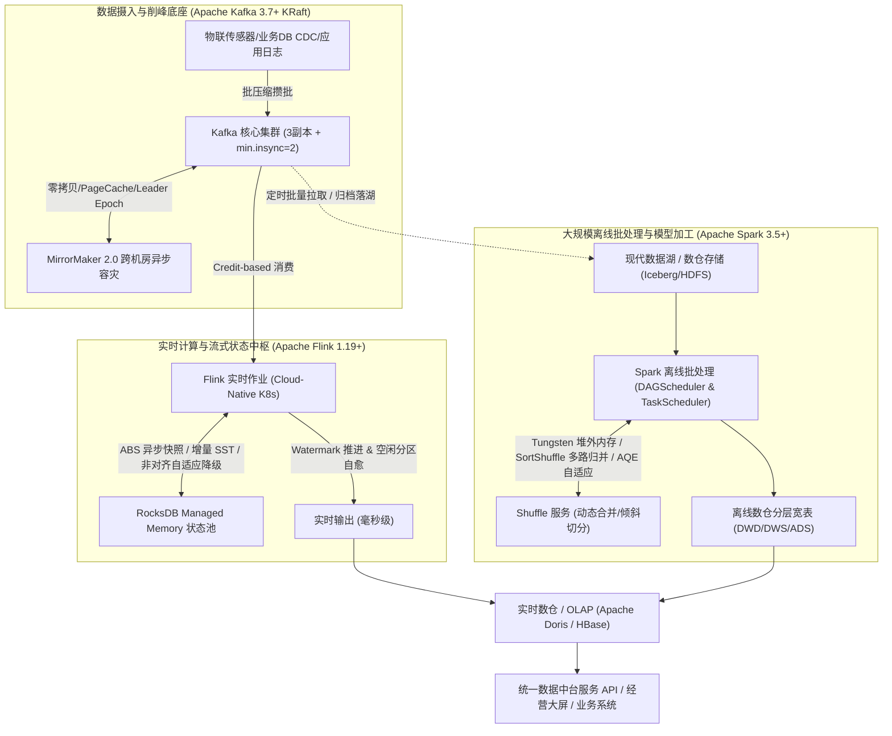

# 第一周阶段复盘：计算与传输引擎全局贯通与千万级实时数据管道架构答辩

> **学习目标定位**：全面复盘第一周（Day 01 - Day 06）涵盖的 **Flink、Kafka 与 Spark 三大核心计算与传输引擎**。打破单一组件的知识孤岛，穿透三大底座的底层设计哲学（内存、容错、网络流控、倾斜治理），沉淀横向对比矩阵。通过千万级 TPS 实时数据管道系统设计答辩与 10 道阶段综合大厂真题三层全解，夯实技术总监/首席数据架构师级别的系统全局观、成本意识与降维答辩能力。

---

## 1. 第一周知识体系全局贯通拓扑

在现代企业级数据平台（如美的、思科、Zoom、瑞纳智能数据中台）中，Flink、Kafka 与 Spark 并不是孤立运行的，而是共同构成了支撑**全链路流批一体数据中枢**的“黄金铁三角”：

---

## 2. 三大引擎横向底层架构终极对比矩阵

| 评估维度 | Apache Flink (1.19+) | Apache Kafka (3.7+ KRaft) | Apache Spark (3.5+) |
| :--- | :--- | :--- | :--- |
| **核心定位** | **高吞吐、超低延迟流批一体计算引擎** | **千万级高吞吐消息流与分布式持久化日志** | **大规模通用离线批处理与微批处理霸主** |
| **计算底层模型** | 原生事件驱动连续流（Record-by-record 流水线） | 顺序写入持久化追加日志（Append-only Log） | 内存 DAG 弹性分布式数据集（微批与批处理） |
| **内存管理哲学** | **Managed Memory 静态等分（供 RocksDB 堆外状态）**；堆内存全局共享 | **完全弃用应用层大缓存，彻底依托 Linux PageCache** | **统一内存模型（Unified Memory: Execution 与 Storage 动态借还）** |
| **网络流控与传输**| **应用层 Credit-based 流控 + Buffer Debloating 去膨胀** | **Linux sendfile 硬件级零拷贝（DMA Gather 直发网卡）** | **Netty 堆外缓冲区批量拉取 + SortShuffle 外部多路归并** |
| **分布式容错机制**| **改良版 Chandy-Lamport 异步屏障快照（ABS）+ 2PC** | **ISR 同步集合 + Leader Epoch 世代协商截断** | **RDD 血缘拓扑（Lineage）重算 + Stage 细粒度重试** |
| **数据倾斜治理** | 两阶段加盐局部聚合、Slot 物理隔离、广播流 | 分区 Key 散列化打散、合理设定 Partition 数量 | **AQE 运行态自适应倾斜切分（SkewJoin）、动态转广播** |
| **端到端延迟极限**| **亚毫秒级 ~ 毫秒级** | 毫秒级（网络与磁盘 RTT） | 数百毫秒 ~ 分钟/小时级 |
| **硬件成本偏好** | 依赖稳定 CPU 算力与充足堆外内存 | **偏好大容量物理内存（充当 PageCache）与高吞吐网络** | 依赖大内存支持 Spill 溢写与弹性计算核数 |

---

## 3. 千万级 TPS 实时数据管道综合系统设计大题（高管终面 45 分钟答辩）

### 题目：面对某全球化车联网/工业互联网平台每日 100 亿条传感器时序数据、大促峰值 200 万 TPS 脉冲写入，请设计一套兼顾极低延迟（< 500ms）、金融级零丢失、多租户 SLA 隔离与跨同城双机房容灾的完整数据平台架构方案。

#### 简洁回答（1分钟电梯破题）：
> “我的整体架构设计遵循**‘同城双活灾备、管道分流削峰、自适应流计算控时延、全链路主键幂等收敛’**四项原则：
> 底座采用 Kafka 3.7+ KRaft 架构搭建同城双活双集群，通过 MirrorMaker 2.0 异步复制保障秒级 RPO；
> 计算层采用 Flink on K8s Application 独立集群，通过 Buffer Debloating 将网络缓冲排队时延控制在 800ms 内，开启自适应非对齐快照保证大促 Checkpoint 稳定；
> 业务输出采用‘双流解耦’——核心报警与大屏通过写入 Apache Doris 主键模型实现幂等最终一致，计费链路采用 2PC 闭环；
> 辅以统一数据中台的租户配额限流与大促降级预案，以极高性价比支撑千万级流量脉冲与金融级高可用。”

#### 深入回答（拓扑设计、机制交互与推导演进）：
> “全链路架构设计拆解为四大关键闭环：
> 1. **数据摄入与同城容灾底座（Kafka KRaft & MM2）**：
>    - **集群规格规划**：部署 12 台高性能 Broker（配置 64GB 内存 + NVMe SSD，单机 10Gbps 网卡），按每分区承载 20MB/s 规划，核心 Topic 预设 64 个分区；
>    - **生产端调优**：Producer 开启 `acks=all + enable.idempotence=true`，配置 `batch.size=64KB`, `linger.ms=15ms`, `compression.type=zstd`，将万亿级网络 I/O 压缩 60% 以上；
>    - **同城双活灾备**：DC-A 主机房与 DC-B 备机房各建独立集群，MM2 依托独立 Kafka Connect 集群跨机房异步镜像，同步位点映射，主中心发生火灾断网时，域名切流，备机房秒级拉起消费。
> 2. **实时流处理中枢（Flink 弹性集群）**：
>    - **资源隔离机制**：核心告警与计费作业独占 K8s 物理节点池，非核心分析作业共享配额；
>    - **流控与时间语义**：开启 Buffer Debloating（目标时延 800ms），配置 Watermark 允许 5 秒乱序并注入 `withIdleness(30s)` 杜绝空闲分区死锁；
>    - **容错防雪崩**：开启 RocksDB 增量 Checkpoint，配置 `min-pause-between-checkpoints: 30s` 与 `aligned-checkpoint-timeout: 8s` 动态降级，大促流量洪峰下快照耗时保持在百毫秒级。
> 3. **存储端收敛与流批一致（Storage Convergence）**：
>    - 摒弃脆弱的全链路分布式锁，下游存储采用 Apache Doris 的 Unique Key 模型；
>    - Flink 写入以 `device_id + window_end` 为主键，实现天然幂等覆写（Upsert），无论是网络重发还是窗口延迟重算，对外报表展示零重复、零脏读。”

#### 架构师/技术管理视角（降维升华：权衡取舍、SLA、成本ROI与SOP）：
> “在技术管理与产品交付维度（结合在瑞纳智能主导数据中台与太原项目验收的真实经验）：
> 1. **破除‘强推 2PC 强一致’的技术误区**：很多团队为了追求理论上的 Exactly-Once，在全链路强推两阶段提交，结果大促期间 Kafka 事务超时与 Checkpoint 超时相互踩踏，引发全集群崩溃。我们在架构评审中推行**‘分类分级策略’**——资金链路 2PC，监控链路主键幂等，以极简架构换取 99.99% 的系统韧性。
> 2. **建立算力账单与大促降级预案（SOP）**：
>    - 大促前通过全链路压测，制定三级降级预案：一级降级关闭非核心调试日志，二级降级调大 Checkpoint 周期至 5 分钟减轻磁盘 I/O，三级降级开启滑动窗口步长动态拉大；
>    - 在自研数据中台产品中，将这些复杂的底层参数封装为‘金融强一致型’与‘大促高吞吐型’预设规格，一键向业务交付，降低客户现场运维难度，保障项目一次性高分通过验收。”

---

## 4. 第一周 10 道阶段高频综合自测真题（题题全解，三层递进）

### 题目1（流批一体全链路）：Flink 从 Kafka 消费数据计算后写回 Kafka，在开启端到端 Exactly-Once 时，若中间某 TaskManager 突发宕机，全链路数据是如何做到不丢不重的？

#### 简洁回答（1分钟电梯破题）：
> “全链路不重不丢依赖 **‘Source 位点可回滚 + Flink 内部状态快照 + Sink 事务性 2PC 写入’** 的协同：
> 宕机时，当前未完成的 Checkpoint 宣告失败；系统重启恢复至上一次成功的 Checkpoint，Source 将 Kafka 消费位点回滚到上次快照记录的 Offset；
> 上次 Checkpoint 之后、崩溃之前写入下游 Kafka 的临时事务数据，因从未收到 Commit 命令，在恢复时被 Flink 显式调用 `abort()` 丢弃，下游 `read_committed` 消费者永远不可见；随后从旧 Offset 重新计算并开启新事务写入，实现端到端严格精准一次。”

#### 深入回答（状态机流转与边界条件）：
> “深入到 2PC 协调器与状态机恢复细节：
> 1. **崩溃时刻的现场状态**：假设上次成功的快照为 CP 100，当前正在处理 CP 101 的数据。Sink 已经通过 Kafka Producer 向外部 Broker 写入了一批数据（处于未决 Transaction B 中），但尚未收到 JM 发送的 `notifyCheckpointComplete(101)`。
> 2. **重启恢复状态机执行**：
>    - JobMaster 发现节点心跳丢失，宣告作业失败并触发全局重启；
>    - 所有算子拉取 CP 100 的元数据进行状态初始化（`initializeState()`）；
>    - Source 算子读取 CP 100 中持久化的 Kafka Partition Offset，通知 Kafka Consumer 重置拉取位点；
>    - Sink 算子从 CP 100 状态中恢复了事务句柄列表。对于在 CP 100 之后开启但未提交的 Transaction B，Sink 主动调用 `abortTransaction()`，Kafka Broker 在物理日志中追加一条 `ControlBatch(ABORT)`；
>    - 外部消费者由于开启了 `read_committed` 隔离级别，底层直接过滤跳过这批被打上 ABORT 标记的消息，彻底杜绝了重复与脏读。”

#### 架构师/技术管理视角（权衡取舍、SLA与成本）：
> “在技术管理中，必须向团队讲清 **‘2PC 端到端精准一次的系统代价值’**：
> 很多业务方误以为只要用了 Flink+Kafka EOS，就能在毫秒级内拿到绝对精确的结果。
> 架构师必须明确指出：**下游数据的正式可见延迟直接受限于 Checkpoint 的周期**（若 Checkpoint 设为 1 分钟，下游可见延迟就是 1 分钟）。
> 如果业务要求 100ms 内必须在前端看到结果，强推 2PC 属于典型的‘南辕北辙’；此时必须向业务沟通将方案变更为‘At-Least-Once + 下游数据库（如 Doris）主键 Upsert’，以 100ms 延迟换取最终一致。”

---

### 题目2（网络流控协同）：为什么 Flink 依靠 Credit 反压，而 Kafka 依靠 Socket 缓冲与客户端限流，两者级联时如何防范级联死锁？

#### 简洁回答（1分钟电梯破题）：
> “Flink 属于流式 DAG 计算引擎，多算子逻辑复用物理连接，若依赖底层 TCP 阻塞会引发跨 Task 踩踏与心跳中断，因此采用**应用层基于信用额度（Credit）的精细流控**；
> Kafka 属于哑巴存储管道，基于点对点 Pull 模型，因此依靠**操作系统内核 Socket 缓冲结合 Broker 端的 Client Quotas 限流**；
> 两者级联时防范死锁的核心在于：**‘Flink Source 端绝不堵死 Kafka 连接，依靠反压传导自然降低拉取频率；同时保证独占缓冲（Exclusive Buffer）用于信令通行’**。”

#### 深入回答（机制推导与边界条件）：
> “从网络协议栈与阻塞传导推导：
> 1. **流控生效边界与传导机制**：
>    - 当 Flink 内部下游算子变慢，通过 Credit 耗尽机制，上游算子暂停向网络发送数据，阻力逐级回溯至 Flink 的 `KafkaSourceReader`；
>    - `KafkaSourceReader` 发现本地输出缓冲区打满，**主动暂停调用 KafkaConsumer 的 `poll()` 方法**；
>    - 此时，Kafka 客户端底层的 NetworkClient 停止从 TCP Socket 接收数据，操作系统 TCP 接收窗口迅速缩减为 0，反压通过 TCP Window Probe 传导回 Kafka Broker，Broker 暂停向该客户端推流。
> 2. **级联防死锁设计（Exclusive Buffers）**：
>    在极端内存匮乏时，如果所有缓冲区都被数据占满，信令报文（如 Credit 归还、心跳、Checkpoint Barrier）将无法发送，引发分布式死锁。Flink 在每个逻辑通道固定预留 2 个 **独占缓冲区（Exclusive Buffers）**，无论全局内存多么紧张，独占通道始终保持通信活性，确保控制流与流控协议永远能够破局。”

#### 架构师/技术管理视角（权衡取舍、SLA与成本）：
> “在平台架构设计中，最危险的不是反压，而是**‘因为反压传导太慢导致上游把中间队列挤爆’**：
> 在 Flink 消费 Kafka 的生产配置中，技术负责人必须立下红线：
> **严禁在 Flink Source 算子中使用无界自定义线程池异步拉取数据**！
> 如果在 `Source` 内部开辟独立线程池拼命 `poll()` 并塞入内存 `BlockingQueue`，会导致 Flink 原生 Credit 流控失效，外部数据源源不断涌入内存队列，直到抛出 `OutOfMemoryError`。必须严格遵守 Flink 原生的背压传递链路，让下游阻力直接映射为对 Kafka 的拉取暂停。”

---

### 题目3（Shuffle与状态对比）：Spark SortShuffle 的内存溢写与 Flink RocksDB Managed Memory 溢写的底层异同是什么？

#### 简洁回答（1分钟电梯破题）：
> “两者的共同目标都是**‘在内存受限时，将无法承载的大规模数据安全暂存到本地磁盘’**；
> **本质不同在于数据模型与生命周期**：
> Spark SortShuffle 的 Spill 溢写是**针对批处理单次计算过程的临时外排序**，数据在 Stage 结束多路归并后写成静态的 `data + index` 文件供下游拉取，计算完毕即彻底删除；
> Flink RocksDB 的 Flush 溢写是**针对连续无界流的有状态 LSM-Tree 持续持久化**，MemTable 刷写为不可变 SST 文件后长期驻留，通过多层后台 Compaction 持续合并，服务于长周期的状态查询与故障恢复。”

#### 深入回答（底层数据结构与 I/O 模式对比）：
> “从数据结构、I/O 调度与文件组织深入拆解：
> 1. **Spark SortShuffle Spill 细节**：
>    - 内存结构：`PartitionedAppendOnlyMap` 或 `PartitionedPairBuffer`；
>    - 触发机制：当内存达到预估阈值，调用 TimSort 在内存中按分区和 Key 排序，然后顺序写出为一个临时文件；
>    - 终态组织：Task 结束时将所有临时溢写文件执行外部多路归并（Merge-Sort），合并为唯一的 `data` 文件和 `index` 索引文件，其生命周期仅伴随当前 Stage。
> 2. **Flink RocksDB Flush 与 Compaction 细节**：
>    - 内存结构：C++ 层的跳表（SkipList MemTable）；
>    - 触发机制：当 MemTable 达到 64MB 限制，转换为只读 `Immutable MemTable`，由后台线程 Flush 到本地磁盘形成 Level 0 的 `.sst` 文件；
>    - 持续演进：由于是持续无界流，RocksDB 后台多线程不断执行 **Leveled Compaction（分层合并压缩）**，消除已删除数据并维持读写性能，文件通过增量 Checkpoint 被硬链接持久化到远端分布式存储。”

#### 架构师/技术管理视角（权衡取舍、SLA与成本）：
> “理解两者的物理 I/O 行为直接决定了**服务器硬件磁盘与存储分区的配置策略**：
> 1. **Spark 离线计算节点**：Shuffle 具有瞬间爆发性大吞吐写入与密集顺序读特性。建议将 Spark Shuffle 目录配置在多块高性能 SATA 机械盘或通用 NVMe 上，重点考量磁盘的**顺序写带宽**；
> 2. **Flink 实时状态计算节点**：RocksDB 的后台 Compaction 伴随着大量的随机读写与放大写。**生产环境运行大状态 Flink 作业，严禁使用机械硬盘，必须无条件配备高性能企业级 NVMe SSD**；否则 Compaction 滞后会导致写停顿（Write Stall），瞬间在流计算中引发严重的级联反压。”

---

### 题目4（云原生容器排障）：为什么大促期间 Flink、Spark 和 Kafka 会同时爆发 Exit Code 137，如何从 Linux 内核 cgroups 与 JVM 堆外统一治理？

#### 简洁回答（1分钟电梯破题）：
> “Exit Code 137 的本质是**进程的物理内存占用（RSS）突破了 Linux cgroups 的容器配额（Limit），被内核 OOM Killer 强制发送 `SIGKILL (-9)` 杀死**。
> 大促期间同时爆发，是因为三者在高并发大流量下**堆外内存（Netty Direct Buffer、RocksDB C++ 缓存、PageCache 脏页或 Glibc 内存碎片）瞬间暴涨**，但 JVM 堆内监控往往平稳，具有极高隐蔽性。
> 统一治理方针是：**‘严格杜绝容器与进程配额倒挂、留足 20%~25% 的 Overhead 堆外缓冲空间、并在底层基础镜像中全面推行 Jemalloc 替换默认 Glibc’**。”

#### 深入回答（内核触发机制与三大组件隐患）：
> “深入到 Linux 内核机制与三大组件堆外特征剖析：
> 1. **内核触发机制**：$ExitCode = 128 + 9 = 137$。K8s Pod 或 YARN NodeManager 在 `/sys/fs/cgroup/memory/memory.limit_in_bytes` 设置了硬上限。当该容器内所有进程的物理内存总和超标时，内核调用 `oom_killer`，按照 `oom_score` 挑选内存占用最大的 Java 进程直接秒杀。
> 2. **三大组件在大促时的堆外泄露源**：
>    - **Flink**：未开启 `state.backend.rocksdb.memory.managed: true`，RocksDB 底层 C++ 开辟的 BlockCache 与写缓冲失控；
>    - **Spark**：Shuffle 期间上千 Task 并发通过 Netty 拉取数据，开辟的 DirectByteBuffer 瞬间打满微薄的 10% Overhead 预算；
>    - **Kafka**：大量分区并发以及高吞吐请求，导致 JVM 本地线程栈和元空间膨胀。
> 3. **统一根治四步法**：
>    - **消除 Glibc 内存碎片（核心招式）**：Linux 默认 glibc 的 `ptmalloc` 在多线程高频申请释放堆外内存时无法及时归还操作系统。在 Docker 镜像中配置环境变量 `LD_PRELOAD=/usr/lib/x86_64-linux-gnu/libjemalloc.so.2`，内存碎片率直接压减 50% 以上；
>    - **统一配额安全垫**：Spark 强制配置 `spark.executor.memoryOverhead = 25%`；Flink 强制配置 `taskmanager.memory.jvm-overhead.fraction: 0.2`；
>    - **配额绝对对齐**：K8s 容器的 `resources.limits.memory` 必须严格等于组件计算的总物理进程大小，严禁配额倒挂。”

#### 架构师/技术管理视角（权衡取舍、SLA与成本）：
> “在技术管理与大促保障中，这是一道检验架构师**‘云原生底座治理功底’**的经典考题：
> 很多团队出事故后，唯一的反应就是‘给容器加内存’，原本 8GB 加到 16GB，16GB 加到 32GB，结果发现依然被杀，还导致集群节点资源严重碎片化。
> 作为技术总监，我的要求是：**将‘容器内存配置模型白盒化’纳入上线门禁**：
> 任何进入生产集群的组件，必须提供精确到字节的内存切分计算表（堆内、框架堆外、直接内存、Overhead 预留），凡是不配安全垫或使用默认 Glibc 的镜像一律禁止上线，以工程确定性捍卫大促大盘安全。”

---

### 题目5（时间语义与容错）：多流 Watermark Min 对齐遇到 Kafka 空闲分区与数据倾斜分区时，如何设计全链路自愈机制？

#### 简洁回答（1分钟电梯破题）：
> “多流 Watermark 遵循木桶对齐原则（Min Alignment），面临两大极端风险：**空闲分区（无数据导致水印停滞拉回负无穷）** 与 **倾斜分区（数据堆积导致某通道水印严重滞后）**。
> 全链路自愈设计是**‘空闲分区超时踢出 + 倾斜分区动态解耦 + 迟到数据分级兜底’**：
> 数据源端开启 `withIdleness(30s)` 将空闲分区置为 IDLE 移出 Min 决策；倾斜分区通过加盐在进入 Watermark 生成器前完成打散；下游窗口配置 `allowedLateness` 与侧输出流保障因网络波动产生的个别滞后数据不丢失。”

#### 深入回答（状态机流转与边界条件）：
> “详细自愈处理逻辑与流转机制：
> 1. **空闲分区自愈流转（Idle Partition）**：
>    - 当某 Kafka 分区因上游网关断电导致无数据写入，经过 `withIdleness(30s)` 阈值，Source 算子向下游广播 `WatermarkStatus.IDLE` 报文；
>    - 下游算子在遍历所有输入通道计算 $\min()$ 时，**在算法中将状态为 IDLE 的通道直接剔除**，仅依据剩余 ACTIVE 活跃通道的水印计算全局 Watermark，全链路时间时钟恢复推进；
>    - 该分区一旦再次产生新事件，立刻广播 `WatermarkStatus.ACTIVE` 状态报文，无缝重新加入全局 Min 决策。
> 2. **倾斜分区与 Watermark 滞后治理**：
>    - 若某分区数据量巨大导致处理缓慢，其 Watermark 推进远落后于其他通道。如果强制等待，会导致所有其他通道的窗口被无限期推迟输出；
>    - 治理方案：在数据进入 KeyBy 之前，先进行一次基于轮询（Rebalance）的轻量打散；或者在生成 Watermark 时，采用**单调递增时间戳抽取策略（BoundedOutOfOrderness）**，避免将偶发的严重延迟数据直接作为计算 Watermark 的样本。”

#### 架构师/技术管理视角（权衡取舍、SLA与成本）：
> “在技术管理与平台交付中，必须防范此类‘代码逻辑无报错，但大屏假死几个小时’的隐蔽生产事故：
> 在我们自研数据中台中，我们将 **`withIdleness` 作为所有流任务 SQL 代码生成的默认系统底座配置注入**；
> 同时在监控告警体系中增加**‘分区水位离散度（Watermark Skew）’告警指标**：当不同分区的 Watermark 差值超过 3 分钟时，系统自动发出 P2 告警，提醒值班人员介入排查数据源是否发生倾斜或硬件单点缓慢，将故障遏杀在萌芽状态。”

---

### 题目6（分布式事务跨组件）：Kafka 事务控制标记（Control Batch）与 Flink Checkpoint Barrier 在流处理管道中的交互边界是什么？

#### 简洁回答（1分钟电梯破题）：
> “**Checkpoint Barrier 是 Flink 算子间流水线内部的轻量快照划分信号**，仅存在于 Flink 的网络内存流控中，随数据同向流动，用于触发算子状态本地快照；
> **Control Batch 是 Kafka 磁盘物理日志中的特殊控制报文（COMMIT/ABORT）**，由 Kafka 事务协调器在 2PC 第二阶段写入，用于向外部消费者标记某批消息是否正式可见。
> 两者的交互边界在于 **Flink 的 KafkaSink（基于 `TwoPhaseCommitSinkFunction`）**：Barrier 到达 Sink 时触发事务预提交；当 JobManager 确认全局快照成功并广播通知后，Sink 才会调用 Kafka 客户端向 Kafka 发送指令，触发 Kafka 在其底层日志中真正物理写入 Control Batch。”

#### 深入回答（状态机流转与边界条件）：
> “深入到时序流转与边界协同：
> 1. **流管道内的时序流转闭环**：
>    - 数据在 Flink 算子中流转时，伴随着 `CheckpointBarrier(N)` 的平流传输。Barrier 到达普通算子，算子只对内存/RocksDB 状态做快照，完全不感知 Kafka 事务；
>    - 当 `CheckpointBarrier(N)` 到达最下游的 `KafkaSink` 算子时，Sink 算子拦截到 Barrier，**触发 2PC 的第一阶段：执行 `preCommit`**，结束当前的 Kafka 写入并开启新事务；
>    - 此时，之前写入 Kafka 的业务数据已经在 Kafka 物理磁盘上落盘，但因为还没有 Control Batch，下游 `read_committed` 消费者看不到这批数据；
>    - 全局快照成功后，JobManager 通过 RPC 向 Sink 广播 `notifyCheckpointComplete(N)`。Sink 收到后，调用 Kafka 客户端的 `commitTransaction()`；
>    - Kafka 事务协调器向各个数据分区下发 `WriteTxnMarkersRequest`，各个 Partition Leader **在 `.log` 数据文件中追加一条 `ControlBatch(COMMIT)`，推动 LSO 水位线**，下游消费者此时才正式读到这批数据！
> 2. **边界隔离与安全防护**：
>    Kafka Broker 永远看不到 Flink 的 Barrier；Flink 的下游消费者客户端也会在底层网络驱动中自动过滤掉 Kafka 的 Control Batch，业务代码完全透明。”

#### 架构师/技术管理视角（权衡取舍、SLA与成本）：
> “理解两者的交互边界是排查**跨系统超时雪崩故障**的核心抓手：
> 很多架构师在排障时搞不清‘到底是 Flink 超时了还是 Kafka 超时了’。
> 关键在于参数契约治理：**Flink 的 `checkpoint.timeout` 必须严格小于 Kafka 的 `transaction.timeout.ms`（至少预留 20% 余量）**！
> 如果 Flink 因网络反压导致 Barrier 延迟，Checkpoint 耗时 12 分钟，而 Kafka 事务超时设为 10 分钟；当 Flink 终于成功想要去写入 Control Batch 时，Kafka 早已单方面把该事务宣布死亡（Abort），导致整个流作业陷入无休止的 `ProducerFencedException` 重启雪崩。技术负责人必须建立跨系统参数联合校验机制。”

---

### 题目7（商业与架构权衡）：当业务方提出“大促期间要求系统绝对零反压、绝对零延迟、绝对零数据丢失”时，作为技术负责人，你如何用专业语言向业务高管论证“不可能三角”并达成架构共识？

#### 简洁回答（1分钟电梯破题）：
> “我会诚恳而专业地向业务高管指出：**在分布式系统的物理规律中，‘零反压、零延迟、零数据丢失’构成了性能、一致性与成本的‘不可能三角’**：
> 要想‘零反压’且‘零延迟’，系统就不能在网络拥堵时等待确认，一旦遇到单点宕机必然会丢数据（牺牲零丢失）；
> 要想实现金融级‘绝对零丢失’（开启 acks=all 与端到端 2PC 事务），系统必须等待多节点同步与磁盘刷盘，物理上必然会产生毫秒级的网络等待延迟（牺牲零延迟）；
> 试图用无限的机器资源去硬扛不可能三角，会导致服务器硬件预算呈指数级暴增（牺牲商业 ROI）。
> 我的破局策略是**‘通过数据分级分层，把有限的资源精准投入到核心业务上’**：核心交易保零丢失容忍微小延迟，前台大屏保低延迟容忍最终一致，达成技术与商业的双赢共识。”

#### 深入回答（技术推导演进与业务对齐）：
> “向高管层汇报的结构化沟通框架：
> 1. **用物理定律解释技术边界（摆事实）**：
>    - 光速与网络 RTT 存在物理极限：跨可用区通信一次就是 2~5ms，金融级零丢失要求至少 2 副本确认加上分布式快照持久化，端到端延迟物理底线就在 10ms~100ms 左右，绝对的‘零延迟’在物理世界中不存在；
>    - 反压是系统的‘刹车与保险丝’：如果拔掉保险丝（禁止反压），当流量超出峰值 3 倍时，系统内存会瞬间被打满 OOM，导致整个系统全面宕机停摆。
> 2. **展示无限冗余带来的高昂商业代价（算经济账）**：
>    - 如果为了应对万分之一概率的瞬时脉冲且保证零反压，我们必须按照平时流量的 10 倍常驻采购高配置物理服务器，大促过后 90% 的算力常年闲置，每年将增加数百万的无效云账单。
> 3. **给出结构化的替代破局方案（出招式）**：
>    - **90% 业务走高性价比路线**：设备指标监控、实时大屏走‘At-Least-Once + 幂等覆盖’，实现毫秒级超低延迟与极低机器成本；
>    - **10% 核心资产走强一致路线**：交易结算、资金扣划走‘2PC 事务’，明确约定分钟级可见性延迟；
>    - **建立三级弹性熔断降级预案**：流量突破历史极值时，自动对非核心日志采样丢弃，确保核心大盘固若金汤。”

#### 架构师/技术管理视角（降维升华：领导力、沟通艺术与管理成熟度）：
> “这道题是考察一位资深专家是否具备**‘技术高管沟通气场与商业领导力’**的经典分水岭：
> 优秀的管理者从来不是对业务需求机械地说‘做不到’，也不是一味毫无底线地‘盲目承诺’然后线上翻车。
> 在瑞纳智能主导数据中台与太原项目验收中，我多次面对甲方客户和业务部门提出‘既要、又要、还要’的严苛要求。
> 我的做法是：**将技术语言翻译为业务语言和财务语言，通过摆出技术代价矩阵，引导业务方共同进行商业价值排序**。
> 帮助业务方理清其核心 KPI 到底是什么，进而给出一套兼顾商业确定性与工程可控性的最优落地方案，这是技术决策者赢得业务团队长期信任的核心基石。”

---

### 题目8（倾斜治理选型）：Spark 3.5+ AQE 动态倾斜切分与 Flink 加盐两阶段聚合在解决数据倾斜时，各自的适用场景、底层机制与成本取舍是什么？

#### 简洁回答（1分钟电梯破题）：
> “**Spark AQE 动态倾斜切分是‘运行时引擎自适应切分’**：在 Shuffle 之后收集统计量，自动将倾斜的大分区切分为多个子分区，在另一侧表中复制对应数据协同并行拉取，**业务 SQL 零侵入，适用于有界离线批处理中的大表关联（Skew Join）**；
> **Flink 加盐两阶段聚合是‘应用层代码级主动打散’**：在流计算中主动在 Key 后拼接随机数做局部预聚合，再去除盐做全局汇总，**适用于无界实时流计算中的高频 Key 状态累加（如热门直播间计数）**；
> 离线倾斜首选 AQE 降低人力成本，流式无界聚合必须采用加盐两阶段以彻底规避单点 Task 内存暴死。”

#### 深入回答（机制推导与边界条件）：
> “从执行范式、数据流向与边界局限深入对比：
> 1. **Spark AQE Skew Join 的工作机理与代价**：
>    - *原理*：Stage 1 完成后，AQE 识别出某分区体积超过阈值（如 256MB 且是中位数 5 倍）。在调度 Stage 2 时，AQE 将这个倾斜分区切分为 4 个小的 Task；对于与该分区 Join 的右侧小表对应数据，Spark 会将其复制拉取 4 次，让 4 个 Task 分别执行部分关联，最后自动 Union。
>    - *局限与代价*：**只能解决 Join 倾斜，无法解决无 Reduce 的单点写入倾斜**；且右表对应数据被多次读取，消耗额外的网络拉取带宽；仅适用于有界批处理（需要前置 Stage 全量算完才能收集到准确统计量）。
> 2. **Flink 流式加盐两阶段聚合的工作机理与代价**：
>    - *原理*：无界流无法等待‘算完收集统计’，必须在数据流入时主动处理。在 `keyBy(city)` 前，改写为 `keyBy(city + "_" + random(0, 9))`，将单个热点城市打散到 10 个并行 Subtask 的 RocksDB 状态中独立累加；第二阶段通过普通 `keyBy(city)` 对这 10 个局部的汇总结果进行最终求和。
>    - *局限与代价*：代码有侵入性；**增加了全链路的算子层级与一次额外的网络传输**；且只适用于可结合的聚合算子（如 `sum/count`），对于复杂的不可结合窗口函数（如中位数计算）不适用。”

#### 架构师/技术管理视角（权衡取舍、SLA与成本）：
> “在技术架构规范中，推行**‘离线靠引擎自适应，流式靠工程门禁规约’**的分层治理原则：
> 1. **离线数仓侧**：强制开启 `spark.sql.adaptive.skewJoin.enabled = true`，严禁业务工程师去手写加盐 Join，减少 90% 的低级改写 Bug 与维护负担；
> 2. **实时流处理侧**：在数据接入的 API 网关与中台模板中，强制对高频大 Key 进行前置加盐打散，绝不允许带有超级热点 Key 的原始数据直接裸奔进入无界流状态算子，从源头消灭单点 OOM 风险。”

---

### 题目9（跨机房灾备一致性）：面对跨机房网络抖动，Kafka MirrorMaker 2.0 与 Flink 跨集群消费如何避免消费位点紊乱与消息死循环？

#### 简洁回答（1分钟电梯破题）：
> “核心依靠 **‘集群别名防回环（Loopback Protection）’** 与 **‘基于 Checkpoint 主题的双向 Offset 映射换算’** 机制：
> MM2 在跨机房复制时，强制为目标集群的主题添加源集群别名前缀（如 `DC-A.topic-order`），双向复制时绝不向同名主题回灌，彻底杜绝死循环；
> 面对跨机房网络抖动，Flink 严禁依赖本地 Offset 盲目复位，必须通过 MM2 提供的 `checkpoint` 主题读取跨集群 Offset 转换字典，换算得到目标集群真实对应的物理位点进行平滑断点续传。”

#### 深入回答（底层协议与位点换算细节）：
> “深入到 MM2 底层架构与位点同步机制：
> 1. **防循环镜像原理（Loopback Prevention）**：
>    - MM2 引入了专用的 `DefaultReplicationPolicy`。当把 DC-A 的 `topic-order` 复制到 DC-B 时，在 DC-B 创建的主题名称严格命名为 `DC-A.topic-order`；
>    - 当 DC-B 的 MM2 尝试反向复制时，系统通过正则检测到主题已包含 `DC-A` 前缀，**自动拒绝再次复制回源集群**，从拓扑上彻底消除了 A $\rightarrow$ B $\rightarrow$ A 的死循环风暴。
> 2. **跨集群消费位点同步（Offset Translation）**：
>    - 由于两机房写入时机和压缩不同，同一条消息在 DC-A 的 Offset=100，在 DC-B 镜像主题中的 Offset 可能变成了 95（物理位点天然不相等）；
>    - MM2 内部常驻一个 `MirrorCheckpointConnector`，周期性向目标集群写入内部主题 `__checkpoints`，记录映射三元组：`{ConsumerGroup, TopicPartition, SourceOffset, TargetOffset}`；
>    - 当灾难发生、Flink 切换至 DC-B 消费时，调用 MM2 的位点换算工具库，自动将 Flink Checkpoint 中保存的源机房位点精确转换为 DC-B 的目标位点，消除重复消费与断流漏读。”

#### 架构师/技术管理视角（权衡取舍、SLA与成本）：
> “在双机房容灾建设中，最容易出事故的就是**‘网络微抖动引发灾备链路疯狂重试把专线带宽打满’**：
> 架构负责人的工程实践准则是：
> 1. **专用传输集群隔离**：MM2 必须运行在独立的 Kafka Connect 集群上，严禁与业务消费组混部；
> 2. **建立专线限流保护门禁**：在 MM2 端配置严格的 `producer.override.max.request.size` 与网络带宽配额（如限制专线占用不超过 2Gbps），严防数据回灌把同城业务专线彻底挤瘫痪，保障核心业务交易链路的绝对通行权。”

---

### 题目10（技术管理与团队建设）：从 0 到 1 组建 10 人大数据研发团队，第一周技术体系的技术选型标准与工程代码质量门禁（SOP）如何落地？

#### 简洁回答（1分钟电梯破题）：
> “组建团队第一步绝不是盲目招人写代码，而是**‘确立技术选型收敛原则、建立白盒化质量门禁、推行以业务 SLA 为导向的敏捷交付机制’**：
> 技术选型坚持**‘收敛成熟度、拒绝盲目追新、贴合业务 ROI’**（流计算收敛至 Flink，离线批处理收敛至 Spark，消息流中枢收敛至 Kafka）；
> 工程质量落地**‘三道不可突破的红线门禁’**：
> ① CI/CD 静态扫描（禁止未加 TTL 的状态算子、禁止非幂等大表关联）；
> ② 核心代码必须经同级与负责人双重 Code Review；
> ③ 建立标准化模板库，将调优参数平台化封装，让初级工程师写不出烂代码。”

#### 深入回答（制度、工具链与人才梯队建设）：
> “从团队组建、工具链与规范推行的全套落地方案：
> 1. **10 人团队技能模型与梯队搭建配比**：
>    - 资深架构师/负责人（1人，本人）：负责技术架构选型、核心攻坚、容量规划与跨部门商务对齐；
>    - 实时流计算骨干（2人）：专注 Flink 核心链路、实时风控与大屏治理；
>    - 离线批处理与建模专家（3人）：专注 Spark 数仓分层建模、ETL 管道与治理调优；
>    - 数据平台与工具开发（2人）：负责自研中台 Web 控制台、调度系统与监控工具链研发；
>    - 数据质量与测试运维（2人）：负责集群高可用巡检、全链路压测与自动化测试用例构建。
> 2. **三道刚性代码质量门禁（SOP）**：
>    - **第一道门禁：本地与提交前扫描（Pre-commit Hooks）**：基于 SonarQube 与自研规则，扫描 SQL 与 Java 代码。凡是发现 `select *`、大表关联未加过滤分区、Flink 算子未配置 UID 的，直接阻断 Git Push；
>    - **第二道门禁：双人交叉 Code Review（CR 制度）**：CR 关注的不仅是语法，核心审查‘是否有潜在数据倾斜’、‘是否会导致 OOM’、‘是否考虑了幂等重试’，审查通过率必须达 100%；
>    - **第三道门禁：灰度发布与 Savepoint 流程（发布门禁）**：生产作业上线必须通过自动化发布脚本执行‘保存点拍摄 $\rightarrow$ 状态校验 $\rightarrow$ 蓝绿切换’，严禁任何人工直连生产执行 `kill -9`。”

#### 架构师/技术管理视角（降维升华：领导力、团队文化与商业成果兑现）：
> “在技术研发经理与部门负责人的高度（结合在瑞纳智能管理 5~10 人研发团队、主导数据中台从 0 到 1 研发与太原项目正式验收的真实历练）：
> **‘管好技术的前提是管好技术标准，带好团队的关键在于把个人能力转化为组织资产’**：
> 初创团队最容易犯的错误就是‘每个人按自己的习惯写代码’，导致代码库风格混乱、生产事故频发。
> 我的管理方法论是：**‘通过产品化与工具化，降低对个人英雄主义的依赖’**。
> 我们将 Flink、Spark、Kafka 的生产级调优经验全部固化沉淀进自研数据中台产品内部（封装成可视化 Web 拖拽与配置面板），让团队初级开发和客户现场技术人员即使不懂复杂的底层参数，也能一键产出符合金融级 SLA 的标准化流计算与离线作业。这不仅大幅提升了团队整体效能，更成为太原项目一次性通过专家评审验收的最核心团队胜任力体现。”

---

## 5. 第一周错题归纳与薄弱点闭环复盘

根据第一周 6 天高密度学习与阶段自测，将暴露出的核心薄弱认知闭环归档入库：

| 模块与主题 | 暴露的薄弱认知点 | 根因追溯与纠偏认知 | 闭环状态 |
| :--- | :--- | :--- | :---: |
| **01-Flink 架构** | 误以为 Task Slot 做了严格的 CPU 核心物理绑定（cgroups 隔离） | 纠偏：Slot 仅静态等分托管内存（Managed Memory），同一 TM 内共享 CPU 多核削峰 | **已攻坚** |
| **01-Flink 容错** | 误以为开启端到端 2PC 即可在毫秒级内实现下游数据精准可见 | 纠偏：2PC 下游可见性延迟直接被绑定死在 Checkpoint 周期（分钟级），低延迟需选幂等 | **已攻坚** |
| **02-Kafka 架构** | 以为单节点高吞吐仅仅靠“顺序写和零拷贝”，说不全 PageCache 与批压缩 | 纠偏：全面掌握四大底层支柱（顺序写、内核 PageCache 避 GC、Sendfile 零拷贝、zstd批压缩） | **已攻坚** |
| **02-Kafka 事务** | 误以为开启事务后普通消费者就读不到未决消息，忽略了 `read_committed` 配置 | 纠偏：消费者必须显式配置 `read_committed`，否则依然是读未提交脏读；LSO 负责阻断边界 | **已攻坚** |
| **03-Spark 调度** | 以为窄依赖只能是 1 对 1，不知道多对 1（如 RangeDependency）也是窄依赖 | 纠偏：宽窄依赖的唯一判据是“父分区是否被多个子分区依赖”，窄依赖天然可流水线 Pipeline 合并 | **已攻坚** |
| **03-Spark 优化** | 容器被杀（Exit 137）盲目调大堆内存（executor.memory）导致机器碎片化 | 纠偏：Exit 137 多为堆外 Overhead 超标或 Netty 泄漏，应补大 Overhead 并推行 Jemalloc | **已攻坚** |

---

## 6. 知识自检与口述推演清单

- [ ] 能否脱稿在白板上画出 Flink、Kafka 与 Spark 三大引擎协同构成的完整流批一体数据中台全局架构大图？
- [ ] 能否系统说出四大组件（Flink、Kafka、Spark、Linux内核）在大促期间同时爆发 Exit Code 137 的深层根因与统一调优方案？
- [ ] 面对“业务方要求大促期间零反压、零延时、零丢失”的不合理诉求，能否在 1 分钟内口述出‘不可能三角’的商业与技术权衡逻辑？
- [ ] 能否站在技术研发经理高度，系统阐述从 0 到 1 组建 10 人大数据团队时的技能配比、三道质量门禁与把个人经验沉淀为平台资产的方法论？

---

## 7. 权威参考与官方进阶资料

1. **分布式计算全景经典著作**：*Kleppmann, Martin. "Designing data-intensive applications: The big ideas behind reliable, scalable, and maintainable systems." O'Reilly Media, Inc., 2017.*
2. **Apache Flink 官方生产最佳实践**：[Flink Production Readiness Checklist](https://nightlies.apache.org/flink/flink-docs-release-1.19/docs/ops/production_ready/)
3. **Apache Kafka 官方安全与容灾指南**：[Kafka Security & Disaster Recovery](https://kafka.apache.org/documentation/#security)
4. **Apache Spark 生产性能调优白皮书**：[Spark Performance Tuning Best Practices](https://spark.apache.org/docs/latest/tuning.html)
