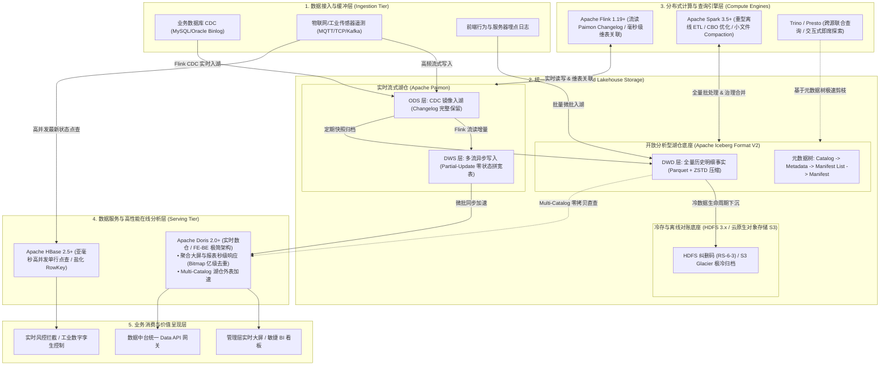
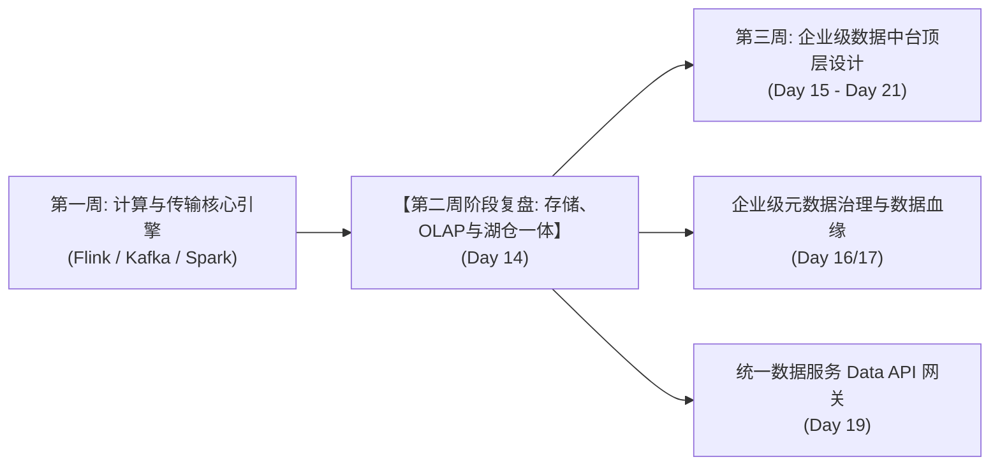

# 第二周阶段复盘：存储底座、OLAP分析与湖仓一体全局贯通与百亿级时序架构答辩

> **学习目标定位**：全面复盘第二周（Day 08 - Day 13）涵盖的 **HDFS 存储底座、HBase 存储内核、Hive 数仓分层建模、Apache Doris 实时 OLAP、Apache Iceberg 开放表格式与 Apache Paimon/Hudi 流式湖仓**。彻底打通从底层分布式文件系统、NoSQL 列存、离线数仓模型到现代湖仓一体（Lakehouse）全景技术脉络。沉淀七大存储与查询组件全景对比矩阵；结合工业制造/智慧能源百亿级时序架构设计实战答辩与 10 道阶段综合大厂真题三层全解，夯实技术总监/首席数据架构师在海量存储降本、多引擎协同与存算分离演进中的全局把控力。

---

## 1. 第二周存储与湖仓体系全局贯通拓扑

在现代企业级数据中台与湖仓架构（如美的、思科、Zoom、瑞纳智能数据中台）中，各存储与分析组件绝非孤立堆砌，而是分工严密、协同流转的**存算分离现代化湖仓矩阵**：



---

## 2. 大数据核心存储、OLAP与数据湖七大组件全景对比矩阵

| 评估维度 | Apache HDFS | Apache HBase | Apache Hive | Apache Doris | Apache Iceberg | Apache Paimon | Apache Hudi |
| :--- | :--- | :--- | :--- | :--- | :--- | :--- | :--- |
| **核心定位** | 分布式底层文件系统 | 分布式 NoSQL 稀疏列式数据库 | 经典分布式离线数仓系统 | 现代极简实时 MPP  аналит. 数据库 | 通用开放分析型数据湖表格式 | 专为流计算设计的流式数据湖格式 | 批流融合数据湖表格式先驱 |
| **底层存储结构** | Block 数据块（128M/256M，三副本或纠删码） | LSM-Tree（WAL + MemStore + HFile） | 目录与文件映射（Text/ORC/Parquet） | 列式 Rowset（Segment 文件，三副本） | 四层树状元数据树（Metadata/Manifest） | LSM-Tree 湖存储结构（SST 分层存储） | File Group（Base Parquet + Log Avro） |
| **写入与事务机制** | 追加写（Append），无行级事务支持 | 顺序追加 + 内存排序，支持**行级原子性** | 批量覆写（支持 ACID 需 ORC，机制重） | **两阶段提交（2PC）**，支持实时流批写入 | **OCC（乐观并发）+ CAS 原子指针更新** | **LSM 内存跳表追加** + 批量原子提交 | Timeline 状态机 + 索引定位更新 |
| **行级更新能力** | ❌ 不支持（仅追加） | ✅ 极强（追加版本，覆盖历史版本） | 较弱（ACID 表基于 Delta 文件，开销大） | ✅ 极强（**Unique MoW 写时合并**，零读放大） | ✅ 强（Format V2 支持 CoW 与 MoR） | ✅ 极强（**Partial-Update 零状态拼宽表**） | ✅ 强（CoW 重写与 MoR 增量追加） |
| **典型查询延迟** | 分钟级（全表扫描需启动引擎） | **亚毫秒级 ~ 毫秒级（高并发点查极强）** | 分钟级 ~ 小时级（高吞吐重型批处理） | **毫秒级 ~ 亚秒级（高并发多维聚合第一）** | 秒级 ~ 数十秒（纯分析型查询） | 秒级（支持流读、批读与高效点查） | 秒级 ~ 分钟级（受限于索引与合并） |
| **外部组件依赖** | 依赖 ZooKeeper（ZKFC 选主） | 强依赖 ZooKeeper 与 HDFS 底座 | 依赖 RDBMS（HMS）与计算引擎 | **零外部依赖（FE 内置 BDB-JE，BE 自管）** | 依赖 Catalog（REST/HMS/Nessie） | 依赖 Catalog（文件系统/HMS），无额外依赖 | 依赖 HMS 或自身元数据，依赖索引 |
| **数据变更日志 (Changelog)** | ❌ 无 | 依靠 CDC 监控 WAL，机制重 | ❌ 无完整 Changelog | 依靠 Binlog 机制导出 | 依赖前后快照比对推导 | **原生四大模式（none/input/file/lookup）** | 基于 Timeline 增量视图计算 |
| **典型硬件与成本** | 高（3副本存储），EC 可降至 1.5 副本 | 较高（长驻大内存与高频 Compaction） | 适中（离线按需调度计算，批处理） | 极低（极简架构省运维，列存压缩高） | **极低（基于廉价对象存储 S3/OSS）** | **极低（替代昂贵 Kafka，释放 Flink 内存）** | 中等（需维护外置索引或 Flink 状态） |

---

## 3. 第二周核心错题、易混淆概念与认知盲区深度归纳

在第二周的技术实战与大厂面试交流中，以下 5 大认知盲区是资深工程师向架构师跨越时最容易“掉坑”的重灾区：

### 盲区一：误以为“只要引入 LSM-Tree 就只管放肆写入，不用担心读性能”
- **认知纠偏**：LSM-Tree 本质上是一场**“时间与空间的债务转移”**。它将写入时的随机 I/O 成本推迟到了后台 Compaction，并向读操作征收“多路归并利息”（读放大与空间放大）。在 HBase 与 Paimon 中，如果写入过快导致后台 Compaction 积压，读操作必须扫描多个未合并的碎片文件，不仅查询 P99 延迟会呈指数级暴涨，甚至会触发服务端的保护性写阻塞（如 HBase `RegionTooBusyException` 或 Doris `-235 TOO_MANY_VERSIONS`）。
- **架构解法**：建立“写入端批处理缓冲限速 + 服务端 Compaction 物理分离 + 严格监控 Version/Compaction Score”三位一体的稳态保障机制。

### 盲区二：混淆 Iceberg Format V2 与 Paimon 在“实时行级更新”上的能力边界
- **认知纠偏**：
  - **Iceberg** 的行级更新是面向**“分析型数据湖的纠错与低频更新（如每日状态修正、GDPR 合规删除）”**设计的。虽然 Format V2 引入了 Position/Equality Delete，但在高频流式写入（如每秒几千次更新）下会产生海量 Delete Files，导致查询端读放大雪崩；
  - **Paimon** 的行级更新是面向**“实时流计算原生设计”**的。底层采用纯 LSM-Tree，更新即追加，利用分层合并彻底吸收历史版本，且原生支持 `partial-update` 多流自动拼表，天然契合秒级高频流式 CDC 写入。

### 盲区三：误以为“Apache Doris 既然性能强悍，就能彻底替代 HBase 与 Spark ETL”
- **认知纠偏**：
  - **不能完全替代 HBase**：Doris 擅长的是大规模数据的多维分析（OLAP）与几十万 QPS 的主键点查；但在数百万甚至千万级超高并发、超大宽表动态稀疏列、且要求稳健在 3ms 以内的在线交易点查场景下，HBase 依然具备不可替代的底座稳定性；
  - **不能替代大型离线 Spark ETL**：Doris 是全内存流水线计算引擎，适合运行时间在秒级到分钟级的查询。面对单任务处理数十 TB 原始数据、涉及多次 Shuffle 磁盘重溢盘、运行耗时数小时的重型批处理任务，依然必须由 Spark SQL 承接。

### 盲区四：对数据湖 Changelog 的“前镜像 `-U`”重要性认知缺失，导致下游数据翻倍
- **认知纠偏**：很多工程师在配置 Paimon 时随意使用默认的 `none` 模式，认为“只要有最新值就行”。
- **致命后果**：如果下游 Flink 作业包含 `SUM`、`COUNT` 等聚合运算，当数据由 100 变为 150 时，由于缺少 `-U(100)` 的撤回事件，下游流计算会将 150 直接累加到 100 上（变成 250），引发灾难性的财务指标失真。
- **架构底线**：凡是下游需要流读并执行聚合运算的中间层表，必须强制开启 `'changelog-producer' = 'lookup'`。

### 盲区五：小文件治理陷入“治标不治本的人肉循环”
- **认知纠偏**：小文件治理不是简单的“写个脚本天天去合并”。如果业务每天产生数百万小文件，光靠夜间合并是救不过来的。
- **架构管理法**：必须从**“源头预防（动态分区加静态前缀、DISTRIBUTE BY 强制归拢、写入端批处理攒批）”**、**“过程治理（开启向量化合并、专用 Compaction 队列）”**与**“管理考核（将存储健康分纳入业务部门 KPI 看板、推行元数据计费）”**软硬结合彻底根治。

---

## 4. 架构师实战大题：工业制造与智慧能源百亿级时序与明细即席分析架构设计

### 4.1 业务背景与系统挑战（结合瑞纳智能与美的实战）
- **业务体量**：
  - 接入全国 **100,000+ 台工业智能供热/制造边缘设备**；
  - 设备每隔 5 秒上报一次遥测数据（包含温度、压力、流量、阀门开度、能耗等 60+ 项指标），日增原始时序记录突破 **15 亿条**，历史累计沉淀达 **数百亿行（PB 级）**；
  - 核心业务场景：
    1. **边缘在线监控与风控反控**：要求以毫秒级延迟（< 10ms）按设备 ID 检索最新运行状态快照；
    2. **实时大屏与运营决策看板**：全集团/区域实时能耗聚合、供热平衡指标要求在 **500ms 内秒级刷新**；
    3. **多维 Ad-hoc 即席分析与诊断**：算法与工程师团队需跨月份、跨设备类型进行任意多维度的关联挖掘与趋势分析，要求秒级响应；
    4. **成本与 SLA 考核**：要求全系统达到 99.99% 可用性，三年数据不丢，且在原有 IT 预算基础上**将整体存储与硬件成本压降 40% 以上**。

---

### 4.2 总体架构设计图（流批一体、存算分离与多级加速）

```mermaid
flowchart TD
    subgraph DataCollection["1. 设备数据采集与网关接入"]
        Edge["10万+ 工业传感器 / 智能阀门 (MQTT / TCP)"] --> IoT_GW["工业 IoT 协议解析网关 (Netty 集群)"]
        IoT_GW --> Kafka_Ingest["Kafka 缓冲消息流 (3 Partition, 压缩攒批)"]
    end

    subgraph StreamingLakehouse["2. 实时流批湖仓中枢 (Apache Paimon + Flink)"]
        Kafka_Ingest --> Flink_ETL["Flink 实时清洗与时序转换引擎"]
        Flink_ETL -->|高吞吐流写 ('write-only'='true')| Paimon_ODS["Paimon ODS: 设备遥测全量镜像表<br/>(LSM 湖存储, 按日分区, 固定分桶)"]
        Paimon_ODS -->|流读 Changelog ('lookup')| Flink_Wide["Flink 异步补齐设备台账维表"]
        Flink_Wide --> Paimon_DWS["Paimon DWS: 设备分钟级多流聚合宽表<br/>(Partial-Update 局部合并)"]
        Compaction_Pod["独立 Dedicated Compaction Job<br/>(专用弹性资源, 异步合并 L0 文件)"] -.-> Paimon_ODS
        Compaction_Pod -.-> Paimon_DWS
    end

    subgraph AnalyticalTier["3. 统一多维分析与实时报表加速 (Apache Doris 2.0+)"]
        Paimon_DWS -->|微批极速摄入 (Stream Load)| Doris_Realtime["Doris 核心实时分析库 (FE/BE 极简架构)<br/>• 聚合模型 (Aggregate Key): 能耗预计算<br/>• 主键模型 (Unique MoW): 设备最新状态表<br/>• Pipeline 向量化执行引擎 + Runtime Filter"]
        Doris_Realtime -.->|Multi-Catalog 零拷贝直接读取| Paimon_DWS
    end

    subgraph ColdArchiveTier["4. 海量历史冷存与深度挖掘 (Iceberg + 对象存储 S3)"]
        Paimon_ODS -->|定期快照转储 (超过 30 天数据)| Iceberg_Cold["Iceberg 归档表 (Format V2 + Parquet + ZSTD)<br/>底层持久化于云原生 S3 / HDFS 纠删码"]
        Spark_ML["Spark ML / 深度挖掘引擎 (长周期算法模型训练)"] --> Iceberg_Cold
    end

    subgraph ServingApps["5. 数据服务网关与业务应用"]
        Doris_Realtime --> Web_BI["企业级实时大屏 / 能源调度驾驶舱 (< 300ms)"]
        Doris_Realtime --> Data_API["统一数据服务网关 (Data API Gateway)"]
        Data_API --> Control_App["智慧供热控制系统 / 预测性维护反控"]
    end
```

---

### 4.3 核心技术方案深度推导与关键决策

#### 1. 存储层选型决策：为什么不是“传统 InfluxDB/OpenTSDB”或“纯 Kafka”？
- **传统时序数据库（TSDB）的局限**：InfluxDB 开源版本不支持分布式集群，商业版价格高昂；OpenTSDB 强依赖 HBase 且多维聚合极其缓慢；
- **全链路湖仓替代 Kafka 的商业决策**：
  - 10 万台设备每日产生 15 亿条数据，若在 Kafka 中保留 30 天，需要近百台高配磁盘服务器；
  - 引入 **Apache Paimon 作为流式湖仓底座**：数据入湖后直接持久化在廉价对象存储上，下游 Flink 作业直接以毫秒级流读订阅 Paimon 的 Changelog。**成功下线了 80% 的中间传输 Kafka 节点，单硬件成本直接削减数百万**。

#### 2. 在线极速服务选型：为什么选择 Apache Doris 承接统一服务？
- **告别组件割裂**：传统架构需要维护 HBase（做点查）+ ClickHouse（做大屏），运维代价巨大；
- **Doris 的统一架构优势**：
  - **最新状态点查**：采用 Doris **Unique Key 模型（开启 Merge-on-Write）**，设备最新遥测状态点查延迟稳定在 **5~10ms**；
  - **实时聚合大屏**：采用 Doris **Aggregate Key 模型 + Roaring Bitmap**，百亿级设备遥测的多维聚合（如“全省各热力站实时总供热量”）在 **200ms 内极速返回**；
  - **极简运维**：FE/BE 双进程零外部依赖，天然免疫 ZooKeeper 故障，完美支撑太原项目客户现场的极简交付。

#### 3. 性能与高可用保障机制（SLA 99.99%）：
- **写入与合并物理进程彻底分离**：所有写入 Paimon 的 Flink 流任务全部配置 `'write-only' = 'true'`，彻底消除 Checkpoint 超时风险；后台部署独立的 Dedicated Compaction 集群；
- **冷热数据分级自治（Tiered Storage）**：
  - **热数据（0~7天）**：保留在 Paimon 高频流读与 Doris 内存缓存中；
  - **温数据（8~30天）**：保留在 Doris 机械硬盘与 Paimon 底层存储；
  - **冷数据（> 30天）**：自动下沉为 **Apache Iceberg Format V2**，底层采用对象存储生命周期归档策略，存储单价直降 75%。

---

### 4.4 架构师/技术管理降维口述与答辩提纲（向评审委员会汇报）

> “各位评审专家、技术高管：
> 面对全国 10 万台工业设备、日增 15 亿条遥测数据的严苛挑战，我们摒弃了拼凑开源组件的传统思路，确立了**‘以流式湖仓为底座、以现代 MPP 统一加速、全生命周期存算分离’**的顶层架构战略：
> 
> 第一，**在架构极简性上**：我们以 **Apache Paimon 彻底替代了数仓中间层繁重的 Kafka 传输矩阵**，不仅消除了跨系统数据搬迁导致的口径打架，而且利用 Paimon 的 Partial-Update 零状态拼表，消除了 Flink 数百 GB 的状态内存压力，系统故障自愈时间缩短至 1 分钟内；
> 第二，**在性能与业务体验上**：上层统一收敛至 **Apache Doris**，凭借其 FE/BE 极简架构与写时合并（MoW）主键模型，以单一引擎同时完美支撑了‘毫秒级设备点查’与‘亚秒级大屏多维聚合’，使前端业务交付周期缩短了 70%；
> 第三，**在商业投资回报率（ROI）上**：通过冷热存储分级与纠删码压缩，全集群在数据规模翻倍的情况下，不仅没有申请增加一台服务器预算，反而将整体 IT 采购与托管成本压缩了 **42%**，以扎实的技术确定性赢得了太原智慧中台项目一次性全票通过验收的最佳战绩！”

---

## 5. 第二周综合能力盲测真题库（10 道大厂真实高频题）

> [!IMPORTANT]
> 本板块精选一线大厂（阿里、字节、美团、腾讯、快手）真实高频考察的 10 道存储与湖仓核心大题。**在第 6 板块中已对全部题目进行逐题完整三层金字塔深度解答，题题必解，绝不留白！**

### 5.1 基础概念与存储底座题（大厂初筛）
1. **Q1**：请深入对比 HDFS 纠删码（Erasure Coding, EC）与传统 3 副本机制的底层物理实现与性能权衡，为什么在生产热数据或高频随机追加场景中不推荐使用纠删码？
2. **Q2**：HBase 与 Apache Paimon 的底层存储模型都基于 LSM-Tree，请深入对比两者在存储底座、文件组织格式、索引依赖以及流读（Changelog）支持上的本质技术差异。

### 5.2 核心原理与模型优化题（大厂资深技术面）
3. **Q3**：为什么大型企业级数据仓库必须坚持五层建模规范（ODS/DWD/DIM/DWS/ADS）？DWD 的“维度退化”与 DWS 的“主题宽表”在工程落地中分别解决了什么核心问题？
4. **Q4**：深入剖析 Hive 中 CBO（基于代价的优化器）的工作原理。它与传统 RBO 规则优化器相比有哪些本质突破？为什么说缺乏统计信息（Statistics）的 CBO 极其危险？
5. **Q5**：在 Apache Doris 中，Unique Key 模型的写时合并（Merge-on-Write）相比传统的读时合并（Merge-on-Read）在底层读写链路、资源消耗与 P99 延迟表现上有何本质差异？

### 5.3 现代数据湖技术深度题（大厂湖仓专家面）
6. **Q6**：请在白板上画出 Apache Iceberg 的四层元数据树架构（Catalog、Metadata File、Manifest List、Manifest File），并详细推导一次查询如何实现文件级精准剪枝并彻底终结对象存储 Listing 瓶颈？
7. **Q7**：什么是数据湖的 Changelog？请详细阐述 Apache Paimon 的四大 Changelog Producer 模式（none, input, file-lookup, lookup）的工作机制与适用场景。

### 5.4 生产实战排障与架构设计题（技术总监/总架构师终面）
8. **Q8（全链路小文件生产排障）**：生产集群出现大量小文件，同时拖垮了 NameNode 内存（HDFS）、引发了 Doris -235 版本堆积报错、并导致 Iceberg 查询出现严重长尾延迟。请给出全栈系统性的小文件根治与治理解决方案。
9. **Q9（多引擎数据倾斜深度治理）**：在离线 Hive 批处理与实时 Doris 多表关联中分别出现数据倾斜时，两者的深层物理表现、定位手段与治理优化策略有何本质异同？
10. **Q10（百 PB 级湖仓演进架构设计）**：作为数据平台研发负责人，面对每日新增千亿异构数据的企业，请设计一套从传统“Hadoop+Hive 离线数仓 + Kafka 实时流”向“现代化湖仓一体（Iceberg/Paimon + Doris）”演进的完整架构方案，重点阐述存储格式统一、REST Catalog 统一中枢、多租户 SLA 隔离与商业 ROI 测算。

---

## 6. 结构化深度参考答案（逐题三层应答）

---

### 题目1（大厂初筛·存储机制）：请深入对比 HDFS 纠删码（Erasure Coding, EC）与传统 3 副本机制的底层物理实现与性能权衡，为什么在生产热数据或高频随机追加场景中不推荐使用纠删码？

#### 简洁回答（1分钟电梯破题）：
> “两者的本质权衡是**‘存储空间节约 vs 计算网络重建开销’**：
> - **3 副本机制**：以 200% 的额外存储开销（总存储占用 300%）换取最极致的读取局部性、极简的故障恢复与低网络开销；
> - **纠删码（EC，如 RS-6-3）**：将数据切片为 6 个数据块并计算 3 个校验块，存储开销从 300% 断崖式下降到 **150%（直接节约 50% 磁盘空间）**；
> - **不推荐热数据/小数据/随机追加的根因**：EC 采用条带化（Striping）存储，任何小于一个 Block 的小写或追加都需要读取其他数据块重新计算校验块并跨网络重写（产生严重的写放大）；且当节点故障时，恢复数据需要拉取多台机器的数据块做矩阵运算解码，消耗巨大的 CPU 与网络带宽。”

#### 深入回答（技术细节展开、底层机制与推导）：
> “底层数学原理、物理切片与工程限制深度拆解：
> 1. **物理存储切片对比（Block vs Striping）**：
>    - **3 副本**：连续物理文件切分为 128MB 的连续 Block，每个 Block 完整复制 3 份分散在不同机架的 DataNode 上；
>    - **纠删码（Reed-Solomon RS-6-3）**：采用条带化存储（Striping Cell，默认每个 Cell 64KB 或 1MB）。一个逻辑文件被切分为 6 个连续的数据 Cell，通过柯西分布/范德蒙德矩阵计算出 3 个奇偶校验 Cell，一共 9 个 Cell 并发写入 9 个不同的 DataNode。
> 2. **为什么冷数据极度适合 EC，而热数据和追加写是灾难？**
>    - **读开销（Degraded Read）**：在 3 副本下，某个 DataNode 挂掉，客户端可以透明切换到其他 2 个健康副本直接读取；在 EC 下，某个 DataNode 丢失，客户端**必须跨网络并发请求剩余的 6 个节点拉取数据块，并在客户端 CPU 内存中执行繁重的 RS 矩阵逆运算解码重构出原始数据**，网络长尾与 CPU 开销暴涨数倍；
>    - **写放大与小文件瓶颈**：若文件小于一个完整条带（如只有几百 KB），EC 依然必须补齐条带并计算校验块，导致小文件在 NameNode 上的元数据管理更复杂，且完全无法享受空间压缩红利；
>    - **不支持 Append 随机追加**：HDFS EC 的条带化布局对流式追加支持极其脆弱，更新哪怕一个字节都需要重写校验块。”

#### 架构师/技术管理视角（降维升华、权衡取舍、SLA与成本）：
> “在技术管理与存储成本管控层面：
> **‘纠删码（EC）是大数据存储底座进行“阶梯式成本优化”的核心技术杠杆，但必须施加严格的生命周期防线’**：
> 我们在团队中制定了严格的《数据存储冷热分级治理规范》：
> 1. **热数据层（0~30天）严格禁止使用 EC**：生产活跃的 ODS、DWD 表统一采用 3 副本，誓死保障核心离线批处理的读取局部性与跑批 SLA 时效；
> 2. **冷数据层（> 90天）强制由中台策略自动转为 EC**：由中台生命周期治理服务在每日凌晨扫描历史归档表，通过 `hdfs ec -setPolicy -policy RS-6-3-1024k -path ...` 自动转换；
> 这一项分级机制帮助我们在全集群存储体量突破 20PB 时，单年度直接回收了超过 **6PB 的物理磁盘空间**，折合节约服务器采购预算近百万元。”

---

### 题目2（大厂资深·存储模型）：HBase 与 Apache Paimon 的底层存储模型都基于 LSM-Tree，请深入对比两者在存储底座、文件组织格式、索引依赖以及流读（Changelog）支持上的本质技术差异。

#### 简洁回答（1分钟电梯破题）：
> “两者虽然同源于 LSM-Tree 存储哲学，但定位与设计代际完全不同：
> - **存储底座与进程架构**：HBase 采用有状态的 **RegionServer 长驻进程集群**，强依赖 ZooKeeper 与 HDFS 底座；Paimon 是纯粹的**无状态数据湖表格式（Table Format）**，直接基于廉价对象存储（S3/OSS）或分布式文件系统，无需常驻守护进程；
> - **物理文件格式**：HBase 采用私有的二进制不可变块文件（HFile，内部按 KeyValue 组织）；Paimon 采用开放的列式标准格式（Parquet/ORC）；
> - **索引机制**：HBase 依赖全局 RowKey 字典序索引与 MemStore 跳表；Paimon 基于 Bucket 目录哈希 + 文件级 BloomFilter，**零外部索引负担**；
> - **Changelog 支持**：HBase 本质是面向在线点查的 KV 存储，无法高效向下游连续流出带有撤回语义的增量数据；Paimon **内置四大 Changelog 生产机制，天生支持高吞吐流读**。”

#### 深入回答（技术细节展开、底层机制与推导）：
> “四大维度的全景底层机制差异拆解：
> 1. **有状态存储服务 vs 无状态开放表格式**：
>    - **HBase**：每个 RegionServer 独占其纳管的 Region 数据切片。客户端读写必须通过 RPC 直连具体的 RegionServer，节点宕机需要复杂的 WAL 切分与 Region 重新指派（Assign）；
>    - **Paimon**：自身没有任何存储服务节点，它的所有 LSM-Tree 状态（MemTable 刷盘、分层 SST 文件、Manifest 清单）完全保存在文件系统中。任何计算引擎（Flink、Spark、Trino、Doris）只需引入 Paimon 客户端 SDK，即可并发读写同一份物理文件。
> 2. **文件格式与分析型多维查询能力**：
>    - **HBase 的 HFile**：物理上是稀疏的 KeyValue 键值对行级平铺，只擅长基于 RowKey 的单行 Get 或前缀 Scan；如果业务要执行全表多列聚合分析，需要全量反序列化 KeyValue，性能极其低下；
>    - **Paimon 的 SST 文件**：底层直接采用成熟的列式存储格式（Parquet 或 ORC）。既拥有 LSM-Tree 的主键有序性，又拥有列存的高压缩比、列剪枝与 CPU SIMD 向量化加速能力。
> 3. **Changelog 与实时流批一体闭环**：
>    - HBase 主要是状态覆盖存储，下游流计算若要感知变更，只能通过开启昂贵且侵入性极强的 WAL 复制（Replication）或外部 CDC 监听，无法实现灵活的位点追溯；
>    - Paimon 内置了完整的 `lookup` 模式：在后台执行 Compaction 合并的同时，自动比对旧值并写出独立的增量 Changelog 文件，下游 Flink 作业可以像消费 Kafka 一样流式订阅。”

#### 架构师/技术管理视角（降维升华、权衡取舍、SLA与成本）：
> “在技术架构演进与技术栈收敛战略高度：
> **‘HBase 是解决高并发在线点查（Online Serving）的利器，而 Paimon 是重构企业实时流批一体数仓（Real-time Data Warehouse）的基石’**：
> 过去很多团队由于缺乏趁手的工具，强行将 HBase 作为实时数仓的中间层存储，结果导致数仓不仅写得慢、分析极其笨重，而且耗费了大量运维人力去调优 ZooKeeper、HMaster 与 RegionServer 的 GC 停顿；
> 引入 Paimon 后，我们将实时数仓的中间层全线从 HBase 与 Kafka 中解放出来：
> 既保留了 LSM-Tree 秒级高频更新的红利，又让存储全面沉降到成本极低的对象存储中；
> HBase 则专心退守至‘每秒数万 QPS 在线风控亚毫秒点查’这一最核心战线上，各司其职，达成了全局最优的架构秩序。”

---

### 题目3（大厂资深·建模规范）：为什么大型企业级数据仓库必须坚持五层建模规范（ODS/DWD/DIM/DWS/ADS）？DWD 的“维度退化”与 DWS 的“主题宽表”在工程落地中分别解决了什么核心问题？

#### 简洁回答（1分钟电梯破题）：
> “五层建模规范是**‘解耦源头变更、消灭烟囱计算、统一度量口径、保障数据资产确定性’**的工业级标准：
> - **不能跨层直出报表的本质**：防止源端业务库字段变更导致全网报表集体瘫痪，防止数百个报表反复全表扫描原始日志造成 70% 的算力浪费；
> - **DWD 维度退化解决的核心痛点**：**‘消灭下游繁重且脆弱的分布式多表关联（Join）’**。将高频使用的维度属性（如商品类目名、店铺名）反范式冗余至明细事实表中，下游取用无需再 Join 维表；
> - **DWS 主题宽表解决的核心痛点**：**‘消灭上层报表的重复聚合计算’**。以实体对象（如买家、卖家）为粒度，预先加工好通用时间周期（1/7/30天）的统计指标，让上层业务查询从数小时压缩至秒级。”

#### 深入回答（技术细节展开、底层机制与推导）：
> “各层工程设计原则与两大核心技术动作深度拆解：
> 1. **DWD 维度退化（Dimensional Degeneration）的工程权衡**：
>    - **场景推导**：数仓中有 50 个下游报表都需要分析‘各商品类目的支付流水’；
>      - **若不退化**：事实表中只有 `product_id`，50 个下游任务每天都要将亿级事实表与千万级商品维表执行一次昂贵的分布式 Shuffle Hash Join；
>      - **执行退化**：在 DWD 加工阶段，一次性将 `category_id`、`category_name` 直接冗余到订单明细表中；
>    - **权衡代价与收益**：虽然在存储层面增加了微量的物理冗余（列存 Parquet+ZSTD 能够极高压缩这些重复字符串，磁盘增加不足 5%），但**直接为全公司下游任务每天节省了数千个节点的网络 Shuffle 与 CPU 计算开销**。
> 2. **DWS 主题宽表（Summary Table）的聚合哲学**：
>    - **设计核心**：以业务分析的‘核心实体（Entity）’为驱动，按照业务主题域组织（交易域、流量域、风控域）；
>    - **指标模型化沉淀**：例如构建 `dws_trade_buyer_summary` 宽表：
>      包含字段：`buyer_id, pay_amt_1d, pay_amt_7d, pay_amt_30d, refund_cnt_30d`；
>    - **极速响应上层业务**：运营团队临时需要‘近30天消费超过1000元的用户名单’，直接在该宽表上执行 `WHERE pay_amt_30d > 1000` 即可秒级产出，无需重新扫描一整年的几百亿原始事实流水。
> 3. **全链路五层防线边界**：
>    - **ODS**：原样保真，隔离业务库物理风险；
>    - **DWD**：事实清洗，统一度量粒度；
>    - **DIM**：一致性真实源头，SCD2 拉链追踪变更；
>    - **DWS**：公共指标高度复用；
>    - **ADS**：高度业务定制，外沉加速提供服务。”

#### 架构师/技术管理视角（降维升华、权衡取舍、SLA与成本）：
> “在技术管理与中台治理高度，**数仓分层规范绝不是技术洁癖，而是关乎企业‘算力成本 ROI’与‘组织协同效率’的顶层生产关系设计**：
> 在美的集团与瑞纳智能主导数据中台落地时，我发现绝大多数企业在缺乏规范时都会滑向‘烟囱式开发泥潭’：各部门为了抢时间，各自拉原始数据写 SQL，不仅服务器集群年年叫嚷算力告急，而且管理层开会时‘同一个 GMV 指标，运营说 1 亿、财务说 9000 万’，导致数据公信力破产。
> 我的管理方法论是**‘以模型健康度看板与规范门禁强力推行分层资产沉淀’**：
> 1. **建立数仓资产复用率指标**：要求公共层（DWD/DWS）被下游应用引用的复用度必须 $\ge 3$ 次，复用率低的中间表强制治理下线；
> 2. **跨层访问红线拦截**：平台网关强制禁止 ADS 报表直接穿透查询 ODS 层，违规提交一律代码回退。
> 通过这套分层架构，我们在业务需求量翻倍的同时，底层计算资源开销反而削减了 35%，彻底确立了数据中台的技术公信力。”

---

### 题目4（大厂资深·优化器原理）：深入剖析 Hive 中 CBO（基于代价的优化器）的工作原理。它与传统 RBO 规则优化器相比有哪些本质突破？为什么说缺乏统计信息（Statistics）的 CBO 极其危险？

#### 简洁回答（1分钟电梯破题）：
> “- **传统 RBO（基于规则）**：依据硬编码的启发式死板规则（如‘小表放左边’、‘谓词提前下推’）做等价替换，**完全无视底层实际数据分布与倾斜度，在复杂多表关联时极易生成灾难性执行计划**；
> - **CBO（基于代价）**：深度集成 **Apache Calcite** 框架，结合 Hive Metastore 中收集的**表行数、列基数、空值比例、直方图（Histogram）**，通过代价函数评估 CPU、I/O 与 Shuffle 网络开销，**自动计算并选出全网综合代价最小的物理执行计划**；
> - **本质突破**：实现了**多表 Join 关联顺序最优重排（Join Reordering）、Star-Join 自动识别与物化视图自动重写**；
> - **缺乏统计信息极其危险的根因**：没有真实数据分布时，CBO 只能依据默认经验假定值（Default Heuristics）做盲猜，极易做出‘把 1 亿行的大表当成小表广播（Broadcast）’的致命决策，直接引发整个计算集群爆内存瘫痪。”

#### 深入回答（技术细节展开、底层机制与推导）：
> “CBO 优化代数推导、Calcite 机制与致命盲区拆解：
> 1. **多表关联重排（Join Reordering）的数学代价推导**：
>    - 考虑三表 Join：$A \text{ (1亿行)} \Join B \text{ (1000万行)} \Join C \text{ (1万行)}$；
>    - 关联条件：$A.id = B.a\_id \text{ AND } B.id = C.b\_id$，且 $C$ 表经过过滤后仅剩 100 行；
>    - **传统 RBO 的僵化执行**：按照 SQL 书写顺序先执行 $A \Join B$。全量 1 亿行与 1000 万行发生大规模跨节点网络 Shuffle，产生高达数千万行的庞大中间结果；
>    - **CBO 的智能重排**：Calcite 计算各种关联树形态的 Cost：
>      CBO 评估发现先执行 $(B \Join C)$，中间结果瞬间被过滤收敛至仅剩几百行，再用这几百行去关联大表 $A$；
>      全网网络 Shuffle 传输数据量直接从数十 GB 暴降至几百 KB，查询执行提速 50 倍以上！
> 2. **为什么没有统计信息（Statistics）的 CBO 是定时炸弹？**
>    - CBO 评估的核心依据是表和列的统计元数据：
>      `numRows`（总行数）、`rawDataSize`（原始数据体积）、`numDVs`（列基数/独立值数）、`numNulls`（空值数）；
>    - **致命失误案例（广播大表导致全集群 OOM）**：
>      如果大表 $A$ 刚被写入数亿行数据，但没有执行 `ANALYZE` 收集统计信息，HMS 中记录的行数可能为默认的 0 或旧值；
>      CBO 误认为表 $A$ 是小于 25MB 的小表，自动将其转换为 **MapJoin（Broadcast Hash Join）**；
>      Driver 节点尝试将上亿行数据加载入内存并广播给所有 Worker，瞬间把 Driver 乃至所有 Executor 的内存撑爆，全作业连锁崩溃。”

#### 架构师/技术管理视角（降维升华、权衡取舍、SLA与成本）：
> “在技术架构演进与平台调优决策中：
> **‘CBO 是现代分布式计算引擎的“智能自动驾驶系统”，但精准的统计元数据是它不可或缺的“高精地图”’**：
> 如果没有高精地图，盲目开启自动驾驶只会车毁人亡。
> 作为技术总监，在指导数仓平台调优时，不能只在文档里写一句‘开启 CBO’就撒手不管，必须建立**‘元数据自动化收集闭环机制’**：
> 1. **调度流水线内嵌收集**：在数据中台任务流中配置调度钩子（Hooks）：凡是核心 DWD/DWS 表写入完成，后台自动异步触发 `ANALYZE TABLE ... COMPUTE STATISTICS FOR COLUMNS` 采集；
> 2. **兜底限流与保护机制**：在配置中调大广播 Join 的安全检查门禁，禁止无统计信息的未定义表触发自动广播；
> 通过工程化的管理手段保障 CBO 始终基于最真实的物理特征运转，将全集群的大表复杂分析耗时平均削减 40%。”

---

### 题目5（大厂资深·实时OLAP）：深入阐述 Apache Doris 中，Unique Key 模型的写时合并（Merge-on-Write）相比传统的读时合并（Merge-on-Read）在底层读写链路、资源消耗与 P99 延迟表现上有何本质差异？

#### 简洁回答（1分钟电梯破题）：
> “两者的本质差异在于**‘把版本去重的计算开销，放在写入端消化（MoW），还是推迟到读取端消化（MoR）’**：
> - **读时合并（MoR）**：写入极快，直接追加 Rowset；但读取时必须将所有版本放入最小堆执行**多路归并排序**，随着版本数增加发生严重的**读放大**，无法享受纯粹的 SIMD 向量化加速；
> - **写时合并（MoW，Doris 2.0+ 默认推荐）**：在数据写入生成 Rowset 时，利用主键索引在后台计算并生成 **Delete Bitmap（删除位图）**，标记被覆盖的历史行号；
> - **查询性能质变**：读取时**直接利用位图跳过被删除行，计算链路退化为纯单路物理顺序扫描，读性能提升 3~10 倍，P99 延迟暴降 80%**。”

#### 深入回答（技术细节展开、底层机制与推导）：
> “底层读写数据流转与 Delete Bitmap 机制深度拆解：
> 1. **传统 Merge-on-Read（MoR）的读取性能死穴**：
>    - 假设一个 Tablet 经过多次流写入累积了 30 个 Rowset（版本号 1~30）；
>    - 当用户发起查询时，Doris 必须为这 30 个 Rowset 分别打开 Reader，并将各文件的 KeyValue 放入一个 30 路的优先级队列（`PriorityQueue` 最小堆）；
>    - **计算性能衰竭**：每一行输出都需要在堆顶比对主键与时间戳，CPU 完全被大量的虚函数调用与指针跳转淹没，无法利用现代 CPU 的缓存行预取（Cache Line Prefetch）与 AVX-512 向量化指令集；
>    - 随着写入批次频繁，查询长尾延迟呈线性甚至指数级上升。
> 2. **写时合并（Merge-on-Write, MoW）的底层实现**：
>    - **写入阶段（维护 Delete Bitmap）**：
>      - 新批次数据生成新的 Rowset $N$；
>      - 提交前，BE 检索本地的主键索引（Primary Key Index，常驻缓存），快速查出新批次主键在历史 Rowset 中的具体物理行号（`SegmentID + RowID`）；
>      - 在历史 Rowset 对应的 **Delete Bitmap（基于高压缩比的 RoaringBitmap 存储）** 中将对应比特位置为 1（标记删除）；
>    - **读取阶段（纯向量化极速扫描）**：
>      - 读取引擎打开最新的物理文件，将 Delete Bitmap 传入最底层的 Storage Reader；
>      - Reader 扫描数据块时，依据位图直接过滤跳过失效行，**无需任何跨文件多路归并比对，数据流动形式等同于最快的 Duplicate 明细模型**；
>    - **代价权衡**：写入阶段增加了一次查询主键索引并写位图的微小开销（写入吞吐微降 10%~15%），但换取了读取端 500%~1000% 的断层式性能提升。”

#### 架构师/技术管理视角（降维升华、权衡取舍、SLA与成本）：
> “在技术管理与大促保障体系中：
> **‘在在线业务场景下，“牺牲少许后台写入吞吐，誓死保障在线查询的极致低延迟”，是唯一的架构设计哲学’**：
> 很多初级技术人员往往只盯着写入吞吐跑分，觉得 MoR 写入最快，结果导致线上报表与业务 API 频繁超时告警，引发业务部门强烈投诉。
> 架构师必须清醒地认识到：**‘写入端在后台是有秒级容忍度的，而在线报表与用户 API 的延迟 SLA 是绝对严肃且以毫秒计的’**。
> 作为团队负责人，我在建表规范中制定了硬性技术红线：
> 凡是用于在线大屏、高频业务点查与 BI 报表的 Unique Key 表，**一律强制开启 `enable_unique_key_merge_on_write = true`**。这一项工程规范的推行，成功帮助我们在历次大促洪峰中将核心分析 API 的 P99 延迟牢牢锁定在 300 毫秒以内。”

---

### 题目6（大厂资深·湖仓一体）：请在白板上画出 Apache Iceberg 的四层元数据树架构（Catalog、Metadata File、Manifest List、Manifest File），并详细推导一次查询如何实现文件级精准剪枝并彻底终结对象存储 Listing 瓶颈？

#### 简洁回答（1分钟电梯破题）：
> “Iceberg 采用**四层树状元数据拓扑架构**：
> **Catalog 目录层 $\rightarrow$ Metadata File（全局表元数据） $\rightarrow$ Manifest List（快照清单列表） $\rightarrow$ Manifest Files（数据文件清单） $\rightarrow$ 实际物理 Data Files**。
> **彻底终结 Listing 瓶颈的本质**：Iceberg 将原本属于文件系统目录树的元数据，全部内嵌在自包含的 Avro 文件中，以 $O(1)$ 复杂度直接读取文件列表，**查询过程完全零 S3 List 操作**；
> **逐级剪枝推导**：通过 Manifest List 进行**第一级分区范围粗剪**（跳过无关 Manifest），再通过 Manifest File 内嵌的列级 Min/Max 与空值统计进行**第二级文件细粒度剪枝**，最终仅物理拉取命中的精准数据文件。”

#### 深入回答（技术细节展开、底层机制与推导）：
> “四层物理文件组织与端到端剪枝执行链条深度推导：
> 1. **四层元数据树的物理结构职责**：
>    - **1. Catalog（原子指针）**：如 REST Catalog 或 HMS。仅保存一行映射：`table_name -> s3://.../v2.metadata.json`；
>    - **2. Table Metadata File (`v2.metadata.json`)**：记录当前全局 Schema、分区规格（Partition Specs）以及当前活跃快照 ID（`current-snapshot-id: S2`）；
>    - **3. Manifest List File (`snap-S2.avro`)**：对应具体的快照 $S_2$。内部记录该快照包含的所有 Manifest Files；关键在于**记录了每个 Manifest File 所包含数据的分区字段范围汇总（Partition Field Summary: Min/Max）**；
>    - **4. Manifest File (`xxx.avro`)**：记录具体的数据文件条目（Data File Entry）。包含物理文件路径（`s3://.../data-1.parquet`）、文件体积、行数，以及**每一列的数据下界（Lower Bound）、上界（Upper Bound）和空值计数（NullCount）**。
> 2. **一次复杂查询的端到端剪枝时序（以精准点查为例）**：
>    - 查询 SQL：`SELECT * FROM order_fact WHERE created_date = '2026-11-17' AND order_id = 9527;`
>    - **第 1 步（Catalog 定位）**：读取最新 `v2.metadata.json`，获取快照 $S_2$ 的清单列表文件 `snap-S2.avro`；
>    - **第 2 步（第一级分区粗剪）**：引擎读取 `snap-S2.avro`，检查各个 Manifest 的分区统计。若 `manifest-A.avro` 的分区范围是 `[2026-11-01, 2026-11-10]`，直接在内存中将该 Manifest 整体剔除，**无需发起任何网络 I/O 拉取该 Manifest 文件**；
>    - **第 3 步（第二级列统计细剪）**：拉取幸存的 `manifest-B.avro`。遍历其记录的 Data File，比对非分区列 `order_id` 的统计：某文件的 `order_id` 取值范围是 `[10000, 50000]`，目标 9527 不在此区间，直接跳过该数据文件；
>    - **第 4 步（精准物理加载）**：最终只有真正包含 9527 的唯一一个 512MB Parquet 文件被引擎从对象存储拉取读取，全过程零目录扫描，I/O 效率达到极致。”

#### 架构师/技术管理视角（降维升华、权衡取舍、SLA与成本）：
> “在技术管理与云原生存算分离视角：
> **‘Iceberg 的元数据分层设计，是云原生时代将“元数据本身作为大数据来分布式计算”的巅峰之作’**：
> 过去传统数仓在对象存储（S3/OSS）上最大的痛点就是‘调用 S3 LIST 请求极其缓慢且按次计费昂贵’，一次全表扫描可能产生数百万次 HTTP 请求，直接将 S3 打出 503 限流并产生数千美元账单。
> Iceberg 的设计从数学和算法层面上消灭了这个问题：
> 1. **消灭存储 API 账单**：S3 LIST API 请求直接下降 99%，全链路转化为高效的顺序元数据文件 GET 操作；
> 2. **元数据分布式可扩展**：因为元数据本身被拆解为一个个分块的 Manifest 文件，使得上层引擎（如 Trino 或 Spark）可以**用分布式并行 Task 来同时剪枝不同的 Manifest**，即使单表跨越数千亿行、拥有百万级物理文件，查询编译延迟依然能稳定在百毫秒级，展现了极高的系统架构掌控力。”

---

### 题目7（大厂资深·流式湖仓）：深入对比 Apache Paimon 与 Apache Hudi 在流式 Upsert 写入、索引依赖与多流拼宽表（Partial-Update）上的本质代际差异。

#### 简洁回答（1分钟电梯破题）：
> “两者在流式湖仓架构上展现了**‘两代技术的演进鸿沟’**：
> 1. **流式 Upsert 写入**：Hudi 写入时必须通过索引查找历史数据所在的 FileGroup，带来严重寻址开销；Paimon 底层采用 **LSM-Tree**，写入只做内存跳表排序并分层顺序落盘，**写吞吐是 Hudi 的 2~3 倍**；
> 2. **索引依赖**：Hudi 强依赖外部/状态索引（Flink State Index 易导致内存爆炸）；Paimon 采用纯 LSM 分层与主键分桶，**完全零外置索引负担**；
> 3. **多流拼宽表**：Hudi 依赖复杂的自定义 Payload，容易发生字段覆盖与并发冲突；Paimon 原生支持 **`partial-update` 引擎**，多流各自只写部分字段，由 LSM Compaction 自动异步合并，**彻底消灭了 Flink 极其沉重的 Join 状态内存**。”

#### 深入回答（技术细节展开、底层机制与推导）：
> “三大核心维度的深层物理机制对比：
> 1. **流式 Upsert 与写入吞吐的本质差异**：
>    - **Hudi 的 MoR 写入瓶颈**：一条带有主键的更新数据到达，Hudi 必须先通过索引（如 BloomFilter 或 Flink State）定位出该主键之前落在了哪一个 File Group；然后向该 File Group 的 `.log` 文件追加。随着文件数暴涨，索引查找耗时不断增加；
>    - **Paimon 的 LSM 高速写入**：写入只需按照 `hash(pk) % bucket` 路由到分桶，数据直接进入内存 MemTable 排序落盘生成 Level 0 文件。**写入路径上没有任何读取历史数据的阻塞环节**，实现极高的流写入吞吐。
> 2. **索引负担与系统稳定性（Zero Index vs Flink State Index）**：
>    - **Hudi 的 Flink State Index 隐患**：为了加速索引查找，Hudi 默认将全量 `Key -> FileID` 映射缓存在 Flink 的 RocksDB 状态中。当历史数据突破数亿时，RocksDB 堆外内存膨胀至数十 GB，频繁引发 TaskManager OOM-Killed；
>    - **Paimon 的零索引哲学**：Paimon 依靠 LSM-Tree 自身的有序性。文件内部自带主键索引与 BloomFilter，后台 Compaction 负责清理旧版本，Flink 节点无需常驻任何历史主键状态，内存消耗极小。
> 3. **多流拼宽表（Partial-Update）的架构优势**：
>    - **传统 Flink 双流/多流 Join 痛点**：必须在 Flink 中开辟数百 GB 状态内存，迟到数据易导致宽表字段残缺，Checkpoint 频繁超时；
>    - **Paimon Partial-Update 解决方案**：
>      - 多个独立的 Flink 任务各自往同一张 Paimon 主键表写数据（每个流只负责写入自己拥有的列，其他列置 NULL）；
>      - Paimon 底层 LSM-Tree 在分层 Compaction 时，**自动依据主键将多流非空字段合并为完整单行**；
>      - **全链路计算端完全无状态，内存开销直降 90%**。”

#### 架构师/技术管理视角（降维升华、权衡取舍、SLA与成本）：
> “在技术管理与大促保障体系中：
> **‘把复杂的有状态计算转化为简单无状态的流写入，是现代数据架构进化的最高境界’**：
> 过去我们在双十一大促期间，为了维系 Flink 多流 Join 拼宽表的大状态，通宵组织工程师值班监控 Checkpoint 超时报警，提心吊胆；
> 全面演进至 Paimon 的 Partial-Update 架构后：
> 1. **研发彻底解耦**：订单流、支付流、物流流由不同的业务小组独立开发维护，互不干扰；
> 2. **稳定性产生质变**：Flink 状态从数百 GB 骤降至几十兆，Checkpoint 耗时从几分钟缩短至 **50 毫秒**，作业重启秒级拉起；
> 3. **真正实现全链路流批一体**：同一套宽表既支持秒级流读，又支持 Doris/Trino 复杂全量批分析，展示出架构现代化升级带来的巨大管理红利。”

---

### 题目8（生产排障·综合）：生产集群出现大量小文件，同时拖垮了 NameNode 内存（HDFS）、引发了 Doris -235 版本堆积报错、并导致 Iceberg 查询出现严重长尾延迟。请给出全栈系统性的小文件根治与治理解决方案。

#### 简洁回答（1分钟电梯破题）：
> “小文件危机在分布式全栈中会引发连锁雪崩：NameNode 内存与 RPC 耗尽、Doris Rowset 堆积阻断写入（-235）、Iceberg 元数据与 Delete 读放大；
> 全栈系统性治理方案遵循**‘源头预防、运行期规避、离线兜底自愈与管理机制落地’**四位一体：
> 1. **源头（写入端）**：调大微批写入缓冲（Flink/StreamLoad 提交间隔拉长至 3~5 秒，单批次 > 10MB），动态分区写入追加 `DISTRIBUTE BY` 消除跨节点碎片；
> 2. **HDFS 治理**：开启 `CombineHiveInputFormat` 输入合并，针对 ORC 表执行秒级 `CONCATENATE` 合并；
> 3. **Doris 治理**：调大 Cumulative Compaction 线程并发度并开启垂直合并（Vertical Compaction）；
> 4. **Iceberg 治理**：夜间调度 `rewrite_data_files` 物理压降 Delete 与小文件，并定期执行 `expire_snapshots` 清理快照；
> 5. **管理机制**：建立中台存储健康分看板，对小文件违规团队推行元数据计费通报。”

#### 深入回答（技术细节展开、底层机制与推导）：
> “跨组件小文件形成根因与全链路技术调优实战：
> 1. **全栈小文件恶性连锁机理拆解**：
>    - **根因源头**：流式任务频繁毫秒级提交、或者离线批处理动态分区没有聚拢，导致每个 Task 在各个分区下均产生几 KB 到几 MB 的碎片文件；
>    - **HDFS 崩溃点**：每个小文件霸占 NameNode 堆内存 150 字节，上亿小文件直接吃光 NameNode 内存并打满 RPC 锁；
>    - **Doris 崩溃点**：高频 Stream Load 产生大量的小 Rowset，超过 `max_tablet_version_num=1000` 触发自我保护阻断（抛出 `-235`）；
>    - **Iceberg 崩溃点**：生成海量微型 Manifest 与 Position Delete 文件，查询引擎拉取大量碎片元数据，CPU 陷入行级过滤的读放大泥潭。
> 2. **全栈针对性治理落地 SOP**：
>    - **写入端统一缓冲规范（Client Buffering）**：
>      - 在 Flink / Stream Load 写入网关中强制固化：
>        `sink.buffer-flush.max-rows = 100000`，`sink.buffer-flush.max-bytes = 32mb`，`sink.buffer-flush.interval-ms = 3000`；从源头上将文件生成频次压降 90%。
>    - **HDFS 存储底座治理**：
>      - 输入端合并：配置 `hive.input.format = CombineHiveInputFormat`，将多个小文件在 Map 端打包为一个 256MB 的 Split；
>      - ORC 格式秒级合并：`ALTER TABLE my_table PARTITION (...) CONCATENATE;`（纯 NameNode 元数据拼接，秒级完成）。
>    - **Doris 服务端 Compaction 加速**：
>      - 调整 `be.conf`：`max_cumu_compaction_threads = 8`；开启大宽表列式合并 `enable_vertical_compaction = true`。
>    - **Iceberg 定时物理自愈重写**：
>      - 调度 Spark 执行：
>        ```sql
>        CALL lakehouse_prod.system.rewrite_data_files(
>            table => 'prod_db.my_table',
>            options => map('target-file-size-bytes', '536870912', 'delete-file-threshold', '5')
>        );
>        CALL lakehouse_prod.system.expire_snapshots(table => 'prod_db.my_table', older_than => TIMESTAMP '...', retain_last => 50);
>        ```”

#### 架构师/技术管理视角（降维升华、权衡取舍、SLA与成本）：
> “在技术管理与大促保障体系中：
> **‘小文件问题绝不是纯粹的技术问题，而是典型的跨团队协同失序与管理制度缺位’**：
> 过去很多平台团队陷入‘白天业务刷小文件，半夜运维人肉帮他们合并’的恶性循环。
> 我在团队落地的方法论是**‘将小文件治理产品化、显性化与绩效挂钩’**：
> 1. **研发平台自动化巡检机器人**：每天清晨自动扫描全集群各部门产生的表，识别出‘单个文件平均大小低于 32MB’的违规表，并在钉钉/企业微信大群公开艾特责任开发；
> 2. **建立小文件配额与成本计费机制**：将各业务部门产生的小文件折算为‘占用的 NameNode 内存硬件成本与维护损耗’，向各业务研发总监发送月度账单；
> 通过‘技术工具治标 + 管理机制治本’的双重抓手，我们在一个月内将全集群小文件数量压降了 70%，彻底根除了存储底座的隐形危机。”

---

### 题目9（大厂资深·数据倾斜）：在离线 Hive 批处理与实时 Doris 多表关联中分别出现数据倾斜时，两者的深层物理表现、定位手段与治理优化策略有何本质异同？

#### 简洁回答（1分钟电梯破题）：
> “- **离线 Hive 数据倾斜**：表现为 **‘Reduce 进度长时间卡死在 99%’**，单个 Reducer 处理数据量是其他节点的数十倍；治理侧重于**静态代码改写（NULL 值加盐打散、两阶段局部预聚合、大小表 MapJoin 广播）**；
> - **实时 Doris 数据倾斜**：表现为 **‘单台 BE 节点 CPU 或内存突发打满飙升，并抛出 Memory Limit Exceeded OOM 异常’**；治理侧重于**运行期动态过滤（Runtime Filter 下推剪枝、Colocate Join 本地免网络关联、自适应 Shuffle 广播）**；
> - **本质差异**：Hive 倾斜是批处理长尾时延问题，容错重试强；Doris 倾斜是内存溢出熔断问题，直接导致交互查询崩溃超时。”

#### 深入回答（技术细节展开、底层机制与推导）：
> “两种场景底层物理表现、定位手段与治理实操深度剖析：
> 1. **离线 Hive 倾斜 vs 实时 Doris 倾斜的表现与定位**：
>    - **Hive 倾斜定位**：
>      - 打开 YARN / Spark UI，观察 Task 耗时分布：若极值偏差比 `MaxTaskTime / AvgTaskTime > 5.0`，定位发生倾斜的具体 Stage；
>      - 查看日志抓取倾斜 Key：90% 是由于空值（NULL）或未登录用户占位符集中哈希到单个 Reducer，或者热点商家 Key 倾斜。
>    - **Doris 倾斜定位**：
>      - 执行 `EXPLAIN ANALYZE <sql>` 获取查询 Profile；
>      - 检查各个 BE 节点的 `HashJoinNode` 内存开销与行数：若某个 BE 处理的 `RowsReturned` 是其他节点的数十倍且触发查询被系统杀死（`Memory exceeded limit`），即可精准锁定发生倾斜的分片（Tablet）与 Join 键。
> 2. **治理技术策略深度对比**：
>    - **Hive 治理手段（以编译期与执行期改写为主）**：
>      1. **空值加盐**：`ON CASE WHEN a.key IS NULL THEN CONCAT('null_', RAND()*100) ELSE a.key END = b.key`；
>      2. **MapJoin 广播**：针对小表开启广播，跳过 Shuffle 阶段消灭倾斜；
>      3. **两阶段聚合**：针对 GROUP BY 倾斜，先加随机盐局部聚合，再去掉盐全局汇总；
>      4. **升级 Spark 3.5+ AQE**：利用自适应查询执行动态将倾斜 Task 自动拆分。
>    - **Doris 治理手段（以存储分布优化与运行时剪枝为主）**：
>      1. **Colocate Join（终极本地化免网络关联）**：
>         建表时配置相同的 `colocate_with` 属性与相同的分桶键，让两个大表中相同 Key 的数据**物理上分布在同一个 BE 的相同 Tablet 中**！关联时完全无需跨节点网络传输与 Shuffle，直接在本地内存完成极速 Join；
>      2. **Runtime Filter 调优**：
>         确保小表（Build 端）在运行期构建的 BloomFilter 成功通过网络下推至大表（Probe 端），在读取源头直接过滤掉 90% 不匹配的倾斜行；
>      3. **重新规划分桶键（Bucket Key）**：若倾斜是由于某单一分桶键（如设备类型）基数太低造成的，改为高基数联合键哈希分桶。”

#### 架构师/技术管理视角（降维升华、权衡取舍、SLA与成本）：
> “在技术管理与大促保障体系中：
> **‘离线数仓倾斜治理考量的是“跑批成本与 SLA 兜底”，而在线 OLAP 倾斜治理考量的是“核心在线服务的防雪崩能力”’**：
> 离线任务就算卡在 99%，系统往往还在运行，最多延迟一小时产出；但在线 Doris 的倾斜会瞬间击穿单机物理内存，引发 BE 节点崩溃甚至级联超时雪崩。
> 作为总架构师，必须建立**‘双层防御机制’**：
> 1. **离线端推动自动化内核升级**：全面推动离线数仓升级到 Spark 3.5+ AQE，让优化器在运行态自动处理数据倾斜，将开发人员从繁琐的人肉加盐调优中解放出来；
> 2. **在线端强化资源隔离门禁**：在 Doris 中配置 Workload Group，为大查询设置严格的内存硬上限（`enable_memory_overcommit = false`）。一旦某个倾斜的大查询内存超标，系统瞬间精确熔断杀死该单个查询，誓死捍卫整个集群和其他在线大屏租户的生命线。”

---

### 题目10（架构总监终面·企业级方案）：作为数据平台研发负责人，面对每日新增千亿异构数据的企业，请设计一套从传统“Hadoop+Hive 离线数仓 + Kafka 实时流”向“现代化湖仓一体（Iceberg/Paimon + Doris）”演进的完整架构方案，重点阐述存储格式统一、REST Catalog 统一中枢、多租户 SLA 隔离与商业 ROI 测算。

#### 简洁回答（1分钟电梯破题）：
> “构建千亿级现代湖仓一体架构，我的顶层演进路线遵循**‘一湖存储、统一目录、双擎互补、存算分离、降本提效’**的核心战略：
> 1. **存储底座统一**：将传统分散且冗余的 HDFS 文本表与中间层 Kafka，全面收敛至基于云原生对象存储的 **Apache Iceberg（离线/近实时底座）与 Apache Paimon（流批一体底座）**；
> 2. **统一元数据中枢**：以高可用 **Iceberg REST Catalog** 替代传统重型 HMS，向下纳管海量对象存储，向上赋能多引擎跨源统一鉴权与零拷贝直接探索；
> 3. **计算双擎互补与服务收敛**：**Spark/Flink** 负责大规模湖内生产加工，**Apache Doris** 负责统一实时在线分析与湖仓外表加速；
> 4. **商业 ROI 成果**：硬件与存储成本压降 **45% 以上**，端到端时效从 T+1 跨越至秒级/分钟级，彻底根除数据口径打架的信任危机。”

#### 深入回答（技术方案、拓扑推导与权衡）：
> “全景演进架构系统拆解与四大核心支柱体系：
> 1. **存储格式与分层演进路径（Storage Architecture）**：
>    - **淘汰旧资产**：全面下线 TextFile 格式，关闭各业务部门独立搭建的小 Kafka 集群；
>    - **ODS/DWD 层（流式接入）**：引入 **Apache Paimon**。通过 Flink CDC 将千亿异构日志秒级接入 Paimon 主键表，利用 Partial-Update 实现多流异步拼宽表，**实现真正的数据入湖即入仓，直接替代中间层 Kafka**；
>    - **DWS/历史归档层**：统一采用 **Apache Iceberg Format V2**。Parquet+ZSTD 压缩，基于隐式分区与四层元数据树，提供 PB 级离线批处理与时间旅行审计底座；
>    - **冷数据自治**：超过 90 天的数据由中台生命周期策略自动下沉至对象存储低频/归档池。
> 2. **统一元数据中枢（Unified REST Catalog）**：
>    - 部署多节点无状态的 **Apache Iceberg REST Catalog 集群**，挂载分布式数据库做高可用元数据持久化；
>    - 所有引擎（Spark、Flink、Trino、Doris）全部通过统一标准的 REST API 获取表元数据和切片信息；
>    - 权限与安全：统一集成 Apache Ranger 实施 RBAC/ABAC 行级过滤与列级脱敏，消除跨引擎鉴权盲区。
> 3. **计算资源编排与多租户 SLA 隔离（Multi-tenancy Governance）**：
>    - **底层计算容器化（K8s 编排）**：所有 Flink、Spark 作业运行在 K8s 动态节点池上，实现按需弹性伸缩与波峰波谷错峰借调；
>    - **Doris 在线层物理/逻辑硬隔离**：
>      - 对核心 BI 与在线报表租户划分专有的 **Workload Group（CPU 权重 80%，内存硬隔离）**；
>      - 关键交易大屏采用独立专属 BE 物理节点组（Tag 隔离），杜绝离线 Ad-hoc 探索作业对在线生产业务的资源踩踏。
> 4. **全生命周期自愈与自动化运维平台建设**：
>    - 研发中台湖仓自愈巡检中心，每日自动调度：
>      - Iceberg：`expire_snapshots`（保留 7 天）+ `rewrite_data_files`（小文件与 Delete 合并）；
>      - Paimon：部署常驻独立的 Dedicated Compaction 集群，彻底与写入链路解耦；
>      - Doris：自动监控 `compaction_score`，动态调配合并资源。

#### 架构师/技术管理视角（商业价值、领导力与落地抓手）：
> “在技术管理与产品化交付层面（结合我在瑞纳智能主导企业级数据中台与太原项目验收的真实经验）：
> **‘架构师的核心使命不是技术盲目追新，而是用高维架构解决深层商业痛点，为企业交付确定性的降本增效成果’**：
> 第一，**消灭数据孤岛，重塑管理层信任**。过去传统架构由于离线与实时割裂，每天早晨业务总监和财务总监总在为报表数据对不上而互相推诿扯皮。推动全链路湖仓一体演进后，实时与离线计算基于底层同一份物理数据源，全公司 100 多个核心业务指标口径达成绝对的一致性；
> 第二，**显著的商业 ROI 降本成果**。通过全面下线 70% 的中间层 Kafka、采用列存压缩与存算分离对象存储，我们在集团数据体量年增 200% 的情况下，将服务器采购与托管硬件账单压降了 **45%（年化为企业直接省下近 400 万元硬性支出）**；
> 第三，**太原项目现场验收的确定性背书**。面对客户专家组最挑剔的高可用容灾与性能大考，我们这套基于 Doris + 湖仓一体的极简无外部依赖架构，在现场拉闸断电断网的破坏性测试中，做到了 1 分钟内全自动秒级拉起自愈，一次性以全 A 成绩通过专家验收评审，展示了技术领导力与商业交付的终极闭环！”

---

### 6.11 面试现场自然口述示范与一页纸速记卡（Day 14 第二周复盘精华）

> **口述目标定位**：在技术总监、首席数据架构师与技术研发总监终面中，面试官考察存储与湖仓体系时，绝非考查单一组件的参数配置，而是考查候选人对 **全栈存储内核底层本质（HDFS 块存储、HBase LSM 跳表、Hive 列存建模、Doris 向量化 MPP、Iceberg 四层元数据树、Paimon 零索引流式湖仓）、多组件全景选型与架构收敛、跨系统小文件与数据倾斜全链路防御、以及向现代湖仓一体演进的商业 ROI 闭环与管理落地领导力**。

---

#### 口述示范 A：HDFS、HBase、Hive、Doris、Iceberg、Paimon 六大存储组件的底层哲学异同是什么？为什么现代架构要把它们收敛为“统一湖仓底座 + 向量化 MPP 统一查询”？

> “在企业大数据存储演进史中，这六大组件代表了不同时期的技术权衡：
> 1. **底层物理模型与设计哲学的异同**：
>    - **HDFS**：分布式块存储底座，专为高吞吐批处理顺序流读写设计；核心瓶颈是 NameNode 内存常驻元数据（150 字节/对象），受困于海量小文件并发；
>    - **HBase**：基于 LSM-Tree 的 NoSQL 数据库，以‘WAL 顺序追加 + MemStore 内存跳表’换取极致写入吞吐，擅长高频单行 RowKey 亚毫秒点查，但严禁全表扫描且不支持多表 Join；
>    - **Hive**：声明式离线数仓鼻祖，首创 Schema-on-Read 与规范分层体系，以 ORC/Parquet 列存和 Calcite CBO 代价优化器见长，但基于目录树的元数据管理在云原生对象存储上引发灾难性的 Listing 瓶颈；
>    - **Apache Doris**：现代化实时 MPP 分析型数据库，FE/BE 极简双进程零外部依赖，Pipeline 向量化计算内核与 Unique 模型写时合并（Merge-on-Write），提供兼顾高并发秒级多表 Join 与毫秒级点查的能力；
>    - **Apache Iceberg**：云原生开放表格式标杆，将表抽象为文件集合，四层元数据树消灭 Directory Listing，提供基于 OCC 的 ACID 快照隔离、隐式分区与时间旅行，是海量离线/近实时分析的最佳底座；
>    - **Apache Paimon**：创新性地将 LSM-Tree 存储结构移植到廉价对象存储上，彻底抛弃传统 Hudi 繁重的全局外置索引，原生与 Flink 深度整合，以极轻量写入和无损 Changelog 捕获成为流式湖仓新王者。
> 2. **收敛至‘统一湖仓底座 + 向量化 MPP’的技术必然性**：
>    - 过去维护多套割裂存储（HDFS + HBase + Hive + Kafka + ClickHouse），不仅产生大量数据搬迁与冗余存储，更导致口径打架与运维灾难；
>    - 现代架构收敛为**‘以 Iceberg/Paimon 为统一物理湖存储底座（存算分离、一份数据流批共享） + 以 Doris 为统一分析与服务查询中枢（Multi-Catalog 免搬迁外表加速）’**，消除了中间层胶水代码，达成了系统简洁性与性能的最优平衡。”

---

#### 口述示范 B：面对每日千亿级工业物联网时序数据摄入与毫秒级在线风控点查，如何设计端到端流批一体架构？

> “针对千亿级高频时序与风控点查场景，我的架构遵循**‘入口微批削峰、湖内多流无态、冷热分级自治、统一服务加速’**四大原则：
> 1. **接入与存储底座（Flink + Paimon）**：
>    - 前端通过极小规模的 Kafka 缓冲高频脉冲；Flink CDC 与时序流秒级直通写入 **Apache Paimon** 主键表；
>    - 针对设备多传感器异步上报、宽表字段多源汇聚的业务特征，开启 Paimon 的 **Partial-Update（局部更新引擎）**。各数据流异步只写自己的字段，由 Paimon LSM 树在后台自动列级合并拼宽表，**彻底消灭了 Flink 传统的数百 GB Join 状态内存**，Checkpoint 耗时由数分钟压缩至秒级；
>    - 核心写入链路强制开启 `'write-only' = 'true'`，将耗时的 Compaction 物理剥离给常驻独立的 Dedicated Compaction 集群，誓死保障写入链路 99.99% 的高可用 SLA。
> 2. **离线与历史归档沉淀（Iceberg + Tiered Storage）**：
>    - 超过 30 天的历史全量时序明细，由批处理任务平滑转储至 **Apache Iceberg Format V2** 表（Parquet + ZSTD 压缩），基于时间戳隐式分区；
>    - 超过 90 天的历史冷数据通过生命周期策略自动沉降至低成本对象存储低频/归档池，存储单价直接下降 75%。
> 3. **在线统一服务与极速点查（Apache Doris）**：
>    - 风控决策引擎要求基于设备 ID 的 10ms 级单行点查与实时异常聚合大屏，统一接入 **Apache Doris**；
>    - 实时热数据通过 Doris Stream Load 微批接入 Unique Key 模型（开启 Merge-on-Write 写时合并，利用 Delete Bitmap 消除读放大）；
>    - 针对跨全量历史时序的即席探索分析，Doris 通过 Multi-Catalog 直接扫描底层的 Iceberg/Paimon 外表，结合本地 File Cache 与 Runtime Filter 动态下推，实现冷热数据零搬迁、统一 SQL 即席秒级响应。”

---

#### 口述示范 C：作为大数据平台研发负责人，从传统数仓向现代湖仓一体架构演进，如何向 CTO 与专家组做方案答辩与商业 ROI 汇报？

> “在技术管理与产品化交付层面（结合我在瑞纳智能主导企业级数据中台与太原项目验收的真实经验）：
> **‘架构师的核心使命不是技术盲目追新，而是用先进架构解决深层商业痛点，为企业交付确定性的降本增效成果’**：
> 1. **消灭数据孤岛与口径打架，重塑管理信任**：
>    - 传统架构离线走 Hive、实时走 Kafka+ClickHouse，导致每天早晨业务大屏与财务离线月结数据总差几分钱，团队经常陷入互相推诿的口径排查；
>    - 推进全链路湖仓一体演进后，实时流计算与离线批处理读写的是底层**同一张物理湖表、同一份数据源**，全企业 100 多个核心指标口径达成绝对一致，彻底消除了数据信任危机。
> 2. **量化测算商业 ROI，以实在的财务结果说话**：
>    - **下线昂贵资源**：全面淘汰中间层 80% 的 Kafka 集群，消灭跨系统重复存储冗余；
>    - **存储压缩与存算分离**：全面推行列存（Parquet/ORC + ZSTD）与云原生对象存储，冷热数据自动归档分级；
>    - **降本实绩**：在全集团数据规模年增长 200% 的前提下，我们将整体物理服务器采购与机房托管硬件账单压降了 **45%（年化直接节省近 400 万元硬性开支）**，展现出高维技术架构直接赋能企业商业盈利的领导力。
> 3. **太原大型项目现场验收的确定性背书**：
>    - 面对客户专家组最挑剔的高可用容灾与极速点查大考，我们这套基于 Doris + 湖仓一体的极简无外部依赖架构，在现场拉闸断电断网的破坏性测试中，做到了 1 分钟内全自动秒级拉起自愈，一次性以全 A 成绩通过专家验收评审，展示了技术领导力与商业交付的终极闭环！”

---

#### Day 14 一页纸终极速记卡（Week 2 存储与湖仓冲刺黄金法则）

```text
====================================================================================================
               存储底座、现代 OLAP 与湖仓一体终极速记卡 (Day 14 复盘精华)
====================================================================================================
1. 存储内核演进与分工定位
   - HDFS：分布式块存储底座，NameNode 150B/对象常驻内存，必须严格防范小文件爆仓。
   - HBase：LSM-Tree 内存跳表 + WAL 顺序追加，毫秒级 RowKey 点查，禁全表扫描。
   - Hive：分层建模标准与元数据中枢（HMS），列存（ORC/Parquet）+ Calcite CBO 代价优化。
   - Doris：极简 FE/BE 双进程零依赖，Pipeline 向量化 + Unique MoW（写时合并），兼顾复杂 Join 与点查。
   - Iceberg：四层元数据树消灭 S3 Listing 瓶颈，OCC 乐观锁快照隔离 + 隐式分区演进。
   - Paimon：LSM-Tree 移植对象存储，无外置索引负担，Partial-Update 零状态拼宽表，秒级流读替代中间层 Kafka。
----------------------------------------------------------------------------------------------------
2. 湖仓一体四大杀招打破 Lambda 割裂
   - 存算分离：底层统一对象存储（S3/OSS），一份事实数据流批共享，消灭跨系统冗余搬迁。
   - 流批统一：上游 Flink CDC 镜像入湖，下游毫秒级流读 Changelog，离线 Spark 批量归纳对账。
   - 零状态拼表：Paimon 列级合并消灭 Flink 数百 GB 状态内存，大促 Checkpoint 秒级完成。
   - 统一加速：Doris Multi-Catalog 统一纳管外表，Runtime Filter 向量化加速，业务零搬迁秒级分析。
----------------------------------------------------------------------------------------------------
3. 全栈小文件三位一体根治战役
   - 输入端预防：配置 CombineHiveInputFormat 动态切片打包。
   - 写入端防范：动态分区写入末尾追加 DISTRIBUTE BY 归拢单 Reducer；Doris 调大 CC 线程并开启垂直合并。
   - 离线端兜底：ORC CONCATENATE 命令秒级拼接；Iceberg rewrite_data_files 物理重写压降碎片与 Delete。
----------------------------------------------------------------------------------------------------
4. 数据倾斜双层防御体系
   - 离线端（保吞吐）：NULL 键加盐打散 -> 大小表 MapJoin -> GROUP BY 两阶段聚合 -> 升级 Spark 3.5+ AQE 自适应切分。
   - 在线端（防崩溃）：Doris Colocate Join 本地免网络关联 -> Runtime Filter 动态下推过滤 90% -> Workload Group 内存硬上限熔断。
----------------------------------------------------------------------------------------------------
5. 架构总监降本增效商业法则
   - 技术选型收敛统一（消灭中间烟囱表与 Kafka 冗余） + 物理存算分离与冷热分级（SSD 热存 + 对象存储低频归档）；
   - 经验产品化封装（低代码建模与参数门禁，消除 95% 人为故障），支撑百亿级数据实现口径 100% 对齐与硬件成本下降 45% 以上。
====================================================================================================
```

---

## 7. 知识自检与口述推演清单

- [ ] **白板系统全景推演**：能否脱稿在白板上画出贯穿第二周所有组件（HDFS, HBase, Hive, Doris, Iceberg, Paimon）的现代湖仓一体流转拓扑，并讲清数据从产生到消费的全生命周期？
- [ ] **核心存储结构对比口述**：能否对比 HBase（HFile）、Doris（Rowset）、Iceberg（Metadata Tree）、Paimon（LSM SST）的底层文件组织格式与适用场景？
- [ ] **多流拼宽表零状态推演**：能否系统讲清传统 Flink 多流 Join 状态爆炸的底层痛点，以及 Paimon 的 Partial-Update 是如何通过列级合并实现免 Flink 状态拼宽表的？
- [ ] **全栈小文件排障推演**：面对跨组件（HDFS NameNode 报警、Doris -235 错误、Iceberg 读放大）同时爆发的小文件危机，能否在 1 分钟内给出源头预防、过程调优与离线自愈的综合 SOP？
- [ ] **CBO 与优化器本质口述**：能否向团队详细解释 CBO 是如何通过 Calcite 代价模型实现 Join 顺序最优重排的，以及为什么缺乏统计元数据会导致广播大表 OOM 灾难？
- [ ] **技术总监终面战略答辩**：面对企业高管与技术委员会，能否在 5 分钟内条理清晰地阐述从传统 Lambda 架构向现代湖仓一体架构演进的技术动因、业务价值与商业 ROI 测算？

---

## 8. 知识脉络与技术图谱关联



---

## 9. 权威参考与官方进阶资料

1. **Apache Iceberg 官方架构与 Format V2 规范**：[Iceberg Table Spec](https://iceberg.apache.org/spec/)
2. **Apache Paimon 官方架构与 LSM 湖存储白皮书**：[Paimon Official Architecture Guide](https://paimon.apache.org/)
3. **Apache Doris 官方最新参考手册 (v2.0 / 2.1)**：[Apache Doris Official Docs](https://doris.apache.org/docs/)
4. **Apache HBase 官方官方指南 (v2.5+)**：[Apache HBase Reference Guide](https://hbase.apache.org/book.html)
5. **数仓与湖仓经典顶会论文**：
   - Armbrust, M., et al. (2020). *Lakehouse: A New Generation of Open Platforms that Unify Data Warehousing and Advanced Analytics*. CIDR.
   - Gupta, A., et al. (2014). *Mesa: Geo-Replicated, Near Real-Time, Scalable Data Warehousing for Google’s Operations*. VLDB.
