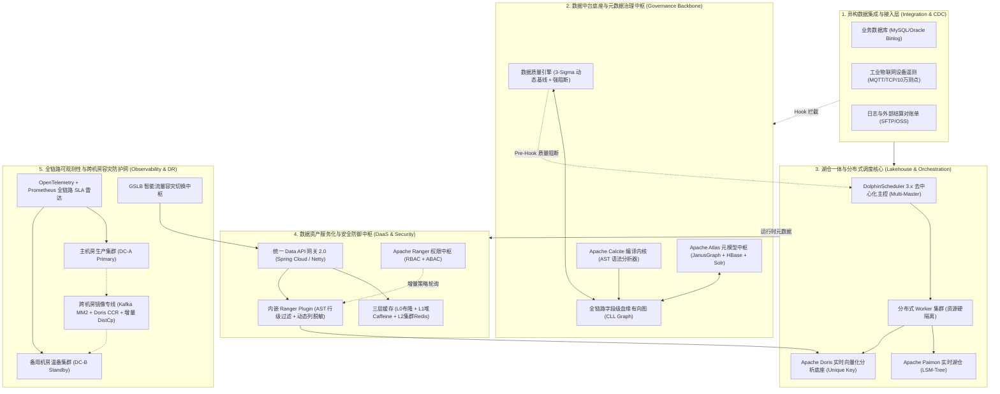
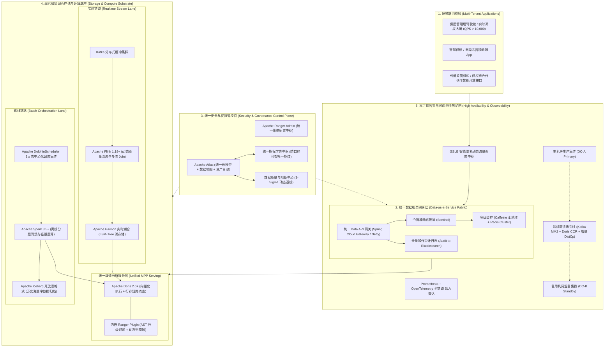
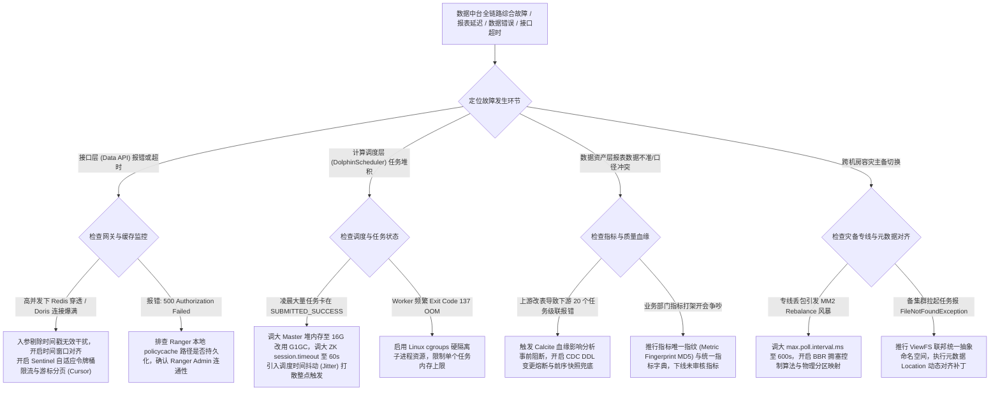

# 第三周阶段复盘：企业级数据中台顶层设计、数据治理与资产服务化架构答辩

> **学习目标定位**：全面复盘第三周（Day 15 - Day 20）涵盖的 **数据中台顶层设计与产品化路线、数据治理与元数据管理（Atlas）、数据质量与端到端血缘（Calcite）、分布式任务调度（DolphinScheduler）、数据服务 API 网关与权限脱敏（Ranger）、大数据可观测性与跨机房容灾高可用**。彻底融会贯通中台从“底层开源组件封装”到“数据资产化”、“资产服务化（DaaS）”与“全链路安全容灾治理”的商业与技术闭环。沉淀中台六大核心子系统选型横向对比矩阵；结合工业制造（美的）与智慧供热物联网（瑞纳智能太原项目 10 万设备）从 0 到 1 架构答辩演练，完成 10 道阶段综合大厂真题三层全解，夯实数据平台研发负责人、大数据总监与首席架构师在顶层设计、ROI 度量与团队工程管控上的战略定力。

---

## 1. 第三周数据中台全景技术贯通拓扑大图

在现代企业级数据中台（如美的集团数字化中台、瑞纳智能工业互联网大数据中台）中，六大中台子系统绝非孤立存在，而是环环相扣的**企业级数据操作系统与资产变现中枢**：



---

## 2. 数据中台六大核心子系统横向对比与技术决策矩阵

| 子系统模块 | 核心代表组件/选型 | 底层运行机制与关键协议 | 核心选型考量与优势 | 潜在瓶颈与架构妥协代价 | 适用企业阶段/场景 |
| :--- | :--- | :--- | :--- | :--- | :--- |
| **平台底座集成** | 云原生自研产品化中台底座 (基于 K8s/Docker) | T-shirt Sizing 规格分级、统一控制面、自动化探活健康检查 | 屏蔽底层异构环境差异，开箱即用，支持政企客户完全离线私有化独立交付 | 封装层需抹平各开源组件的版本冲突与端口占用 | 大型政企、制造私有化交付、SaaS 中台 |
| **元数据管理** | Apache Atlas (2.3+) / OpenMetadata | Type System 类型定义、Kafka 异步 Hook 总线、JanusGraph 图数据库、HBase/Solr | 成熟的工业级元模型、原生集成 Hadoop 生态、支持自动化标签继承与深层血缘图遍历 | 架构繁重，依赖 HBase/Solr，内存开销大，私有化部署运维门槛高 | 存量 Hadoop 集群、大型集团级跨引擎资产盘点 |
| **数据质量与血缘** | 自研质量规则引擎 (基于 Calcite AST + Spark/Flink) | AST 递归展开投影表达式、3-$\sigma$ 动态时序基线、Staging 分区强阻断熔断 | 与调度系统深度缝合，事前阻断上游表变更雪崩，彻底杜绝脏数据污染下游 | 静态 Calcite 解析非标 UDF 存在语法失真，需物理执行计划兜底 | 金融结算、工业测点清洗、财务核心大屏 |
| **分布式调度编排** | Apache DolphinScheduler (3.2+) | 无中心化对等协同架构（多 Master/多 Worker）、Kahn 拓扑排序算法、ZK 租约容错 | 极佳的可视化低代码拖拉拽、百万级任务秒级并发下发、原生企业级多租户与 Worker 组物理隔离 | 对底层元数据库并发读写压力大，需调优连接池 | 企业级数据中台首选、跨部门复杂批处理调度 |
| **数据资产服务化** | 统一 Data API 网关 (Netty + Apache Ranger 2.4+) | 参数化向导式动态编译、L1/L2 多级缓存、Ranger Plugin 进程内 AST 改写（行过滤与列脱敏） | 彻底消灭业务手写 JDBC，慢查询熔断，零 RPC 纳秒级鉴权，满足等保三级严格合规 | API 网关增加 2~5ms 协议序列化网络开销，不支持海量离线导出 | 高并发业务大屏、多租户 SaaS 隔离、对外开放数据接口 |
| **可观测性与容灾** | Prometheus + OpenTelemetry + Kafka MM2 + Doris CCR | 全局 TraceID 穿透打标、主备异步复制（Binlog/Snapshot）、GSLB 智能秒级改道 | 兼顾高吞吐与高可用，保证机房断电极端灾难下 15 分钟内快速恢复服务 | 无法做到跨城强一致性双写（$RPO > 0$），需维持专线带宽与备机房硬件预算 | 工业级容灾备份、核心大屏 P0 链路保障、异地灾备 |

---

## 3. 架构师白板推演：从 0 到 1 为大型跨国集团/工业能源集团设计企业级统一数据中台架构

### 3.1 业务背景与核心挑战
- **企业画像**：拥有跨国制造、供应链、电商与智慧能源业务的大型集团（或智慧城市供热生命线工程，如瑞纳智能太原项目）；
- **体量规模**：现场感知设备超 10 万台（工业传感器、PLC、智能仪表），每秒上报数十万条遥测数据；后端业务库表超 10,000 张，离线任务超 5,000 个，核心大屏要求 QPS 破万、响应小于 50ms；
- **历史痛点**：烟囱式开发导致“指标严重打架”、研发随意修改表结构导致凌晨调度级联雪崩、机房光缆被挖断后中台停摆 8 小时、客户现场要求完全在单机/微型集群内离线交付产品。

### 3.2 架构师顶层全景白板推演（45分钟答辩设计大图）



### 3.3 核心技术与管理权衡决断（Trade-offs）
1. **统一服务层选型取舍（摒弃 HBase + ClickHouse，拥抱极简 Doris）**：
   - 过去架构中，点查用 HBase、OLAP 用 ClickHouse、即席查询用 Presto，维护 3 套组件运维成本极高；
   - 架构升级后果断以 **Apache Doris 2.0+** 为核心，利用其内建的 `Unique Key` 行存短路点查支撑千亿级毫秒级高并发，利用向量化执行引擎支撑复杂聚合，组件数量削减 60%，私有化现场交付运维故障率下降 80%。
2. **安全隔离取舍（放弃硬编码 SQL 隔离，推行 Ranger 进程内 AST 改写）**：
   - 传统在 Java 代码里拼写 `WHERE dept_id = ?` 极易遗漏引发越权漏洞；
   - 统一由 **Ranger Plugin 在计算引擎进程内改写 AST 语法树**，实现行级隔离与动态脱敏，业务开发完全零感知，代码重构风险为零。
3. **容灾架构取舍（放弃昂贵且脆弱的跨城通用真双活，推行高性价比主备温备）**：
   - 将主备温备模式作为集团标准：主机房负责全量计算，备机房通过 MM2 和 CCR 准实时镜像数据；
   - 结合 GSLB 智能域名调度，在极端机房断电灾难下以 **15 分钟 RTO、1 分钟 RPO** 的确定性代价，为集团节省数千万元跨城强同步专线与双倍物理机预算。

---

## 4. 生产全链路排障根因决策树



---

## 5. 第三周高频面试真题综合自测（10题）

* **Q1 [阿里 - 中台顶层架构]**：从架构师视角，系统对比传统数据仓库（EDW）与现代数据中台（Data Middle Platform）的本质差异。企业在什么阶段不应该建数据中台？
* **Q2 [字节跳动 - 开源组件产品化交付]**：在面临大型政企或工业客户（如智慧供热、智慧水务）的内网完全物理隔离私有化独立交付时，如何将 Flink、Spark、Doris、DolphinScheduler 等复杂的开源大数据软件做成“开箱即用、低运维门槛”的商业化标准产品？
* **Q3 [美团 - 元数据与图数据库]**：深入剖析 Apache Atlas 的底层架构。为什么 Atlas 要选用图数据库（JanusGraph）作为核心引擎，而不用传统关系型数据库（MySQL）来存储元数据和数据血缘？
* **Q4 [腾讯 - 编译器与血缘提取]**：在包含多层嵌套子查询、CTE（WITH 子句）、窗口函数与 UDTF（如 explode）的复杂 SQL 中，如何利用 Apache Calcite 从底层 AST 中精准提取字段级血缘（Column-Level Lineage）？
* **Q5 [快手 - 质量风控与熔断阻断]**：在电商大促或工业物联场景中，传统的固定阈值（如行数波动 30% 告警）极易引发误报或漏报。你如何基于统计学动态基线（3-$\sigma$ / Holt-Winters）设计一套强阻断熔断（Circuit Breaker）闭环防护网？
* **Q6 [滴滴 - 任务调度去中心化]**：深入剖析 Apache DolphinScheduler 3.x 的去中心化无主架构。Master 节点是如何通过元数据库与 ZooKeeper 协同实现工作流级的高性能并发分片与分布式容错自愈的？
* **Q7 [百度 - 数据资产服务化与高性能网关]**：在面向高并发大屏与业务系统消费的统一 Data API 网关中，如何设计一套包含本地堆（Caffeine）、分布式（Redis）的多级缓存体系，并彻底解决缓存穿透、击穿与雪崩？
* **Q8 [阿里/蚂蚁 - 安全合规与动态脱敏]**：深入剖析 Apache Ranger 的插件化（Plugin）架构与 AST 改写内核。它是如何在计算引擎进程内部实现纳秒级行级权限过滤（Row Filter）与动态列掩码脱敏（Column Masking）的？
* **Q9 [美团/字节 - 容灾与业务连续性]**：如果核心物理机房突发火灾或市政断电（整机房黑天），大数据中台如何实现 15 分钟内的完整容灾接管？请详细阐述数据同步、状态对齐与流量改道的完整 SOP。
* **Q10 [数据总监/管理决策与FinOps]**：很多企业的数据中台最终沦为“成本黑洞”与“数据垃圾场”，指标打架依然如故，僵尸任务耗尽机器。作为数据平台研发负责人，你如何通过“平台门禁 + 责任人认领 + FinOps 成本分摊”建立常态化长效治理机制，向 CEO 汇报可量化的商业 ROI？

---

## 6. 10道真题结构化三层参考答案

### 题目1 [阿里 - 中台顶层架构]：从架构师视角，系统对比传统数据仓库（EDW）与现代数据中台（Data Middle Platform）的本质差异。企业在什么阶段不应该建数据中台？

#### 简洁回答（1分钟电梯破题）
数仓是**“面向报表分析的单向数据存储系统”**，中台则是**“面向业务赋能的企业级数据操作系统与资产变现中枢”**。
二者的本质代际差异体现在四点：**单向 ETL 报表输出 vs 闭环微服务 API 输出；被动响应业务提工单 vs 统一指标字典与自助式探索；烟囱式独立项目造轮子 vs 统一公共模型与多租户共享；事后手工补丁治理 vs 工具内嵌与主动元数据驱动**。
反模式边界：**业务单一、数据量不足百 GB、或组织架构上没有高管赋予跨部门统筹权力的企业，严禁盲目上马数据中台。**

#### 深入回答（机制推导与边界条件）
1. **四大维度的系统代际演进对比**：
   - **数据流动方向**：传统数仓是单向终点（`业务系统 -> ETL -> 数仓 -> BI 看板`），数据出去就断了联系；数据中台是双向闭环（`业务系统 -> 湖仓 -> 统一 API 网关 -> 反哺业务微服务/实时风控/动态调控`），数据直接参与生产业务流程；
   - **交付形态**：数仓交付的是一张张物理表或 SQL 视图；中台交付的是开箱即用的**资产产品**（标准化 RESTful API、统一指标字典、可视化大屏低代码模块、用户画像标签库）；
   - **组织与复用率**：传统模式下一个新业务线往往重新搭一套 MySQL+Hive 烟囱；中台在底座抽象出公共数据层（Common Data Model - CDM），新业务 80% 的指标直接复用公共中台资产，需求交付周期从月级缩短至天级。
2. **严禁构建中台的明确边界（Anti-Patterns）**：
   - **组织架构边界（“中台未动，组织先行”）**：中台的核心阻力从来不是技术，而是跨部门利益博弈（打破部门数据壁垒）。若公司高层没有设立拥有人事与考核权力的数据治理委员会，技术团队强建中台必然沦为无人维护的摆设；
   - **技术 ROI 边界**：若全公司数据总量小于 500GB，使用单机 PostgreSQL/MySQL 读写分离配合 Superset 就能高效运转，硬推 Hadoop/Flink/Atlas 会导致巨大的技术负债与运维资源空转。

#### 架构师/技术管理视角（权衡取舍、SLA与成本）
- **架构决策底线**：架构师要坚决抵制“为了中台而中台”的业界秀技陷阱。当业务提需求时，首先评估“自建独立管道 vs 接入中台公共模型”的边际成本。中台的价值必须通过可量化的指标进行自我证明：**业务研发提效比率（需求交付平均工时下降 40%）、硬件机器成本复用节约比率（存储计算重复率降低 30%）**。

---

### 题目2 [字节跳动 - 开源组件产品化交付]：在面临大型政企或工业客户（如智慧供热、智慧水务）的内网完全物理隔离私有化独立交付时，如何将 Flink、Spark、Doris、DolphinScheduler 等复杂的开源大数据软件做成“开箱即用、低运维门槛”的商业化标准产品？

#### 简洁回答（1分钟电梯破题）
将复杂开源大数据组件商业产品化的核心战法是**“标准容器规格封装、配置驱动控制面闭环、单机与集群架构同构、全链路一键探活巡检”**。
通过 Docker/Helm 对异构组件进行版本锁定与标准化打包；定义 **T-shirt Sizing（S/M/L）** 规格化硬件配置模板；开发统一的**无状态产品控制台（Control Plane）**管理组件生命周期；内置开箱即用的工业物模型与轻量级嵌入式元数据库，实现隔离内网“单脚本 30 分钟一键拉起”。

#### 深入回答（机制推导与边界条件）
1. **T-shirt Sizing 规格化参数自适应模板（Configuration Automation）**：
   - 现场客户机器规格参差不齐（有的只有 4 台 16C 64G 虚机，有的有几十台物理机）。严禁让现场实施工程师手动去改 `hdfs-site.xml`、`yarn-site.xml` 或 Doris `fe.conf`：
   - 预设标准规格字典：
     - **规格 S（PoC/极小型项目，4 节点）**：内存精简分配，Doris BE 限制 16GB，关闭复杂组件，集成单节点嵌入式元数据库；
     - **规格 M（常规政企交付，8~16 节点）**：开启标准 HA 高可用，内存预留 60% 算力；
     - **规格 L（超大型工业物联，32+ 节点）**：开启分布式湖仓混合存储与跨机房热备；
   - 安装部署脚本自动通过 `lscpu` 和 `free -m` 探测硬件，自动计算最佳 JVM 堆大小、并发线程数与连接池配额，实现完全免人工调优。
2. **极简轻量化底座替代与架构同构（Architecture Simplification）**：
   - 在私有化交付中，果断剔除高运维门槛组件（如用 **Apache Doris** 替代笨重的 HBase+ClickHouse+Presto 拼装栈，用 **DolphinScheduler** 替代繁杂的 Airflow，用 **轻量微服务 Data API** 替代外部复杂系统）；
   - **完全离线包机制（Offline Air-Gapped Packaging）**：将全量依赖镜像、静态前端资产、预热物模型 SQL 脚本打包为单个 `tar.gz` 离线分发包，彻底摆脱对外网 Docker Hub / Maven 仓库的依赖。

#### 架构师/技术管理视角（权衡取舍、SLA与成本）
- **现场可维护性决定商业成败**：在政企与工业交付场景下，如果现场系统崩溃需要资深架构师出差排查，项目的商业利润会被差旅与支持成本迅速吃光。架构师必须将 **“现场支持非资深运维化”** 作为产品设计目标：开发内置的“一键系统健康巡检诊断工具”，3 秒钟自动检查各组件端口、磁盘、网络丢包与核心日志，输出结构化绿色/红色健康雷达大图，使普通售后人员即可独立闭环交付。

---

### 题目3 [美团 - 元数据与图数据库]：深入剖析 Apache Atlas 的底层架构。为什么 Atlas 要选用图数据库（JanusGraph）作为核心引擎，而不用传统关系型数据库（MySQL）来存储元数据和数据血缘？

#### 简洁回答（1分钟电梯破题）
Atlas 选用图数据库 JanusGraph 的本质原因在于**元数据血缘拓扑是有向无环图（DAG），图数据库具备“无索引邻接（Index-Free Adjacency）”特性，在处理多跳深度血缘遍历时具备决定性的性能优势**。
在关系型数据库（MySQL）中，查询某张报表的 5 层依赖需要执行多次代价极高的大表自连接（Self-Join），时间复杂度呈指数级爆炸（$O(N^K)$）；而在 JanusGraph 图数据库中，顶点之间直接通过物理内存指针/直接边引用遍历，耗时仅与局部顶点的度数（Degree）相关，毫秒级即可完成 10 层深度影响分析。

#### 深入回答（机制推导与边界条件）
1. **图数据库与关系型数据库在血缘遍历中的计算模型推导**：
   - 设数仓中有 50,000 张表、1,000,000 个字段，字段依赖边总数为 5,000,000；
   - **MySQL 自连接模型**：若执行 5 层向上溯源（Root Cause Analysis），SQL 语句需要连续进行 5 次 `JOIN t_lineage l1 ON ... JOIN t_lineage l2 ON ...`：
     每次 Join 都需要在几百万行的索引树中执行 B+Tree 二分查找，IO 放大效应极强；一旦遇到跨部门公共维度表（如 `dim_user` 的入度出度高达数千），单次查询瞬间超时锁死；
   - **JanusGraph 图遍历模型**：
     每个顶点（Vertex）在物理存储中直接维护自己的出边与入边列表（Adjacency List）；
     图遍历算法（Gremlin API）从目标节点出发，沿指针直接读取相邻顶点 ID，时间复杂度为严格的 $O(D_1 + D_2 + \dots + D_k)$（$D$ 为遍历节点的度数），无论全图总数据量膨胀到多大，局部查询耗时始终恒定在毫秒级。
2. **Atlas 底层三者分工协作与类型系统（Type System）**：
   - **JanusGraph**：内存图引擎，管理顶点、边与属性的逻辑图抽象；
   - **Apache HBase**：JanusGraph 的持久化行存储后端，将图拓扑按 RowKey 散列写入，天然具备千万级 TPS 的高并发写入与弹性扩容能力；
   - **Apache Solr / Elasticsearch**：JanusGraph 的全文检索后端，负责通过模糊名称、业务注释、标签属性秒级圈定起始 Vertex，再交由图引擎向外遍历。

#### 架构师/技术管理视角（权衡取舍、SLA与成本）
- **架构包袱与权衡抉择**：Atlas 的图架构虽然在图计算能力上登峰造极，但其付出的代价是极其沉重的技术包袱——同时维护 ZK、Kafka、HBase、Solr 和 Atlas Server 五套组件。架构师在中小团队或轻量级交付时必须保持清醒：如果企业血缘深度普遍在 3 层以内且字段量在百万级以下，选用轻量级关系型模型配合递归 CTE 查询（如 OpenMetadata / DataHub 采用 MySQL/Postgres + ES）是工程复杂度更优的务实选择。

---

### 题目4 [腾讯 - 编译器与血缘提取]：在包含多层嵌套子查询、CTE（WITH 子句）、窗口函数与 UDTF（如 explode）的复杂 SQL 中，如何利用 Apache Calcite 从底层 AST 中精准提取字段级血缘（Column-Level Lineage）？

#### 简洁回答（1分钟电梯破题）
精准提取复杂 SQL 字段级血缘的核心技术是**“基于 Calcite SqlParser 生成 AST 树 $\to$ 绑定 Catalog 元数据进行符号语义消歧 $\to$ 维护作用域栈穿透 CTE 与子查询 $\to$ 深度遍历递归展开函数表达式建立列级有向边”**。
针对 CTE 采用“内联穿透替换（Inlining）”消除临时别名；针对窗口函数建立控制依赖边；针对 `LATERAL VIEW explode` 等表生成算子，扩展 Calcite 方言操作符，建立炸裂虚拟列与原集合列的衍生映射，并以引擎运行态执行计划作为 100% 容错兜底。

#### 深入回答（机制推导与边界条件）
1. **分层编译器递归解析推导算法**：
   - **作用域符号栈（Hierarchical Symbol Scope Stack）**：
     解析到 `WITH cte_a AS (SELECT id, amt * 0.9 AS real_amt FROM src)` 时，首先在内存栈顶创建独立的子作用域；
     解析 `cte_a` 的投影项，记录符号映射字典：`cte_a.id -> src.id`，`cte_a.real_amt -> {src.amt}`；
     当主查询扫描到 `FROM cte_a` 时，符号解析器沿作用域栈递归向上穿透，直接将别名替换为其底层的物理源字段，彻底抹平多层嵌套 CTE 的中间黑盒；
   - **递归表达式展开（Expression Decomposition Visitor）**：
     遍历主查询的 `SqlSelect.getSelectList()`，目标列对应一个 AST 节点：
     若为简单列节点 `SqlIdentifier`，结合元数据 Catalog 确认其所属物理表名，建立直连血缘边；
     若为复杂嵌套函数 `SqlBasicCall`（如 `COALESCE(SUM(a), 0) + MAX(b)`）：
     启动深度优先搜索（DFS）遍历其左右操作数（Operands），提取其包含的所有底层叶子节点字段 `{a, b}`，建立转换血缘边：`{src.a, src.b} -> target.col_c`。
2. **特殊复杂算子的工程处理机制**：
   - **窗口函数（Window Functions）**：如 `ROW_NUMBER() OVER (PARTITION BY dep_id ORDER BY create_time)`：
     生成的序号列虽然是数值，但其依赖 `dep_id` 和 `create_time`。在血缘图中建立从上述两列到目标排序列的 **控制依赖边（Control Dependency Edge）**；
   - **UDTF / 表生成算子（Lateral View Explode）**：
     重写 Calcite 的 `SqlUserDefinedTableFunction`，识别 `explode(item_list) t AS item_id`，将虚拟输出列 `item_id` 显式绑定为 `item_list` 的衍生列（`DERIVED_EXPLODE`）。

#### 架构师/技术管理视角（权衡取舍、SLA与成本）
- **静态分析与动态捕获的双轨容错制**：纯靠静态 Calcite 解析，面对高度非标的自定义 Java UDF 或动态反射 SQL，解析率通常只能达到 90%~95%。架构师必须建立**“静态优先（开发提交时秒级出结果）+ 引擎运行态执行计划监听（Spark QueryExecutionListener / Hive Hook 兜底）”**的双轨制，确保生产环境字段血缘覆盖率达到 99.9% 的工业级红线。

---

### 题目5 [快手 - 质量风控与熔断阻断]：在电商大促或工业物联场景中，传统的固定阈值（如行数波动 30% 告警）极易引发误报或漏报。你如何基于统计学动态基线（3-$\sigma$ / Holt-Winters）设计一套强阻断熔断（Circuit Breaker）闭环防护网？

#### 简洁回答（1分钟电梯破题）
解决固定阈值失效的核心是**“时间序列周效应分解（消除周末跌落与大促脉冲）+ 加权移动 3-$\sigma$ 动态区间 + 影子隔离写入强熔断”**。
通过抽取历史过去 $N$ 周同一周几的加权均值 $\mu$ 与标准差 $\sigma$，动态计算浮动容忍上下限 $[\mu - 2.5\sigma, \mu + 2.5\sigma]$；结合日历营销服务进行大促先验缩放；在生产流水线中推行**“写入 Staging 隐藏分区 $\to$ 探针校验通过 $\to$ 原子重命名为正式分区”**的熔断切断机制，宁可数据迟到，绝不让脏数据下沉污染下游。

#### 深入回答（机制推导与边界条件）
1. **统计学自适应基线数学模型推导**：
   - 现实业务具有极强的 **7 天周周期性（Weekly Periodicity）**；
   - 取过去 8 周同一周几的历史样本 $y_1, y_2, \dots, y_8$，引入时间衰减权重 $w_k = \alpha(1-\alpha)^k$（近期周期赋予更高权重，$\sum w_k = 1$）；
   - 计算动态加权期望 $\mu$ 与加权方差 $\sigma^2$：
     $$\mu = \sum_{k=1}^{N} w_k y_k, \quad \sigma = \sqrt{\sum_{k=1}^{N} w_k (y_k - \mu)^2}$$
   - **动态上下限生成**：
     $$\text{Upper} = (\mu + 2.5\sigma) \times \text{HolidayFactor}, \quad \text{Lower} = \max\left(0, (\mu - 2.5\sigma) \times \text{HolidayFactor}\right)$$
     引入日历大促先验修正系数 $\text{HolidayFactor}$（如 618 设为 2.5，春节设为 0.3），彻底消除特殊日期的误报。
2. **强阻断熔断器（Circuit Breaker）物理工程闭环**：
   - **沙箱写入（Sandbox Staging）**：Spark 批处理任务生成数据时，目标分区指定为隐藏路径 `pt=20261117_staging`；
   - **探针合并单次全表扫描**：将主键唯一、空值率、动态行数基线合并为一个单一 SQL 执行；
   - **熔断切断动作**：
     - 若校验通过：执行 HDFS 原子 `rename` 或 Iceberg 快照提交，毫秒级将数据暴露为正式分区并唤醒下游；
     - 若触发 P0 级严重异常：**熔断器激活，抛出阻断异常，正式分区保持上一周期快照不变（大屏不展示脏数据）；调度系统自动将下游 20+ 个依赖作业置为 `BLOCKED` 挂起状态**，并向责任人群发受灾影响范围报告。

#### 架构师/技术管理视角（权衡取舍、SLA与成本）
- **性能与资源的极致优化（探针合并）**：如果为每张表分别跑 10 条独立的质量校验 SQL，会消耗集群 30% 以上的宝贵计算算力。架构师必须推行 **“单次扫描多规则合并（Single Pass Consolidation）”**，并在存储层面直接利用 Iceberg/Doris 的快照元数据获取行数免除计算，将数据质量系统的算力开销压降在集群总算力的 3% 以内。

---

### 题目6 [滴滴 - 任务调度去中心化]：深入剖析 Apache DolphinScheduler 3.x 的去中心化无主架构。Master 节点是如何通过元数据库与 ZooKeeper 协同实现工作流级的高性能并发分片与分布式容错自愈的？

#### 简洁回答（1分钟电梯破题）
DolphinScheduler 3.x 采用**“多 Master / 多 Worker 无中心化对等微服务架构”**。
多个对等 Master 节点通过元数据库的 `Command` 队列进行行级锁或乐观锁竞争，**以工作流实例（ProcessInstance）为粒度进行分布式分片负责**，每个 Master 闭环负责自身实例的 DAG 解析与派发；通过 ZooKeeper 临时租约维持节点存活与宕机广播；配合**分布式排他锁接管与 Fencing Token 版本号机制**，在消除单点性能瓶颈的同时，彻底杜绝了 Master 脑裂灾难。

#### 深入回答（机制推导与边界条件）
1. **工作流维度的分布式分片闭环机制（Leaderless Peer Execution）**：
   - 所有定时与触发指令统一写入数据库 `t_ds_command` 表；
   - 对等的 Master 节点并发消费命令表：利用数据库原子状态扭转（`UPDATE ... WHERE status = 'INIT'`）抢占任务；
   - 一旦 Master A 抢占成功生成 `ProcessInstance`，打上 `host = Master_A_IP` 标签：
     **该工作流内部所有任务节点的 Kahn 拓扑排序解析、状态机流转、Worker 负载感知派发与重试，由 Master A 全权在本地内存闭环推进**，其他 Master 无需感知，实现了线性的水平扩展吞吐。
2. **两级分布式容错与防脑裂机制（Failover & Fencing）**：
   - **Master 宕机接管**：
     Master A 宕机或超长 Full GC，其在 ZK 的 `/nodes/master/IP_A` 临时节点租约超时被摘除；
     存活的 Master B 收到 Watcher 事件，竞争获取 ZK 分布式锁 `/lock/failover/master`；
     Master B 扫描数据库中原属 Master A 的未完成工作流，更新 `host = IP_B`，并将 `version = version + 1`；
     在本地内存反序列化重建 DAG 拓扑执行树，向 Worker 探活未完成任务并继续调度；
   - **Fencing Token 防脑裂**：
     若 Master A 从假死中恢复并试图更新数据库，其携带的旧版本号与数据库不一致（`version` 校验失败返回 0 行），Master A 发现自己已被剔除，立即执行自我熔断（Self-Fencing Kill），彻底消灭双主脑裂。

#### 架构师/技术管理视角（权衡取舍、SLA与成本）
- **多租户防踩踏隔离设计**：在大型中台中，几十个业务部门的任务混跑在同一套集群。架构师必须在调度系统推行 **Worker 组物理硬隔离**（核心财务任务绑定独立物理 Worker 节点组，开发测试任务在低配容器组运行），并在向 YARN/K8s 提交任务时强制注入环境隔离队列参数，防止实习生的大单机任务拖垮核心生产生产调度流水线。

---

### 题目7 [百度 - 数据资产服务化与高性能网关]：在面向高并发大屏与业务系统消费的统一 Data API 网关中，如何设计一套包含本地堆（Caffeine）、分布式（Redis）的多级缓存体系，并彻底解决缓存穿透、击穿与雪崩？

#### 简洁回答（1分钟电梯破题）
设计百万级 QPS 高性能 Data API 网关的核心是构建**“L0 布隆过滤器 + L1 本地纳秒级堆缓存（Caffeine） + L2 分布式集群缓存（Redis Cluster）”**的三层防御纵深。
通过规范化入参并剔除动态时间戳参数保证缓存命中率；针对**穿透**采用布隆过滤器与空对象短缓存拦截；针对**击穿**采用互斥锁与逻辑过期异步刷新；针对**雪崩**采用随机离散 TTL 与网关自适应令牌桶限流，死保底层 Doris 存储底座不被高并发冲垮。

#### 深入回答（机制推导与边界条件）
1. **多级缓存分层协作架构**：
   - **L0 布隆过滤器**：网关在内存中以极小的空间维护全量合法 ID 摘要，非法或恶意不存在的主键在 L0 层毫秒级直接拦截返回空；
   - **L1 本地堆内存（Caffeine）**：缓存超热点大屏数据，配置超短 TTL（2~5秒）。解决瞬时并发大屏刷新（QPS 破万时），90% 请求直接在本地 JVM 内存纳秒级返回，避免 Redis 网络网卡打满；
   - **L2 分布式缓存（Redis Cluster）**：配置中等 TTL（60~300秒）。采用 `CacheKey = MD5(ApiId + NormalizedSortedParams)`，在网关多节点间共享缓存。
2. **三大缓存灾难的综合工程解决方案**：
   - **防缓存穿透（Cache Penetration）**：
     对于数据库真实查询为空的结果，网关依然向 Redis 写入空对象（`EMPTY_OBJECT`），但设置极短过期时间（TTL = 30秒），防止攻击者持续轮询不存在的 Key 拖垮底层；
   - **防缓存击穿（Cache Breakdown / Hotspot Invalidation）**：
     针对超热点 Key，采用 **“逻辑过期 + 异步后台刷新”**：Redis Value 中保存 `{data: ..., expire_at: 1731835000}`。当检测到当前时间已超过 `expire_at` 时，网关先返回旧快照给调用方，同时通过线程池异步获取分布式锁去查询 Doris 更新缓存，实现调用方零等待与零毛刺；
   - **防缓存雪崩（Cache Avalanche）**：
     为所有 API 配置的基础 TTL 增加随机离散时间戳（`Base_TTL + Random(0, 30s)`），将缓存过期时间在时间轴上均匀打散，杜绝整点集中失效冲垮数据库。

#### 架构师/技术管理视角（权衡取舍、SLA与成本）
- **数据新鲜度与最终一致性契约**：多级缓存必然意味着在短时间内（几秒内）业务端看到的数据存在微小延迟。架构师必须在架构准入协议中与业务方建立 **“分析型 API 遵循最终一致性（Eventual Consistency）”** 的共识：对于企业经营看板和大屏，5 秒的数据延迟对业务决策没有任何实质负面影响，却能为技术团队节省 80% 以上的高昂服务器硬件预算。

---

### 题目8 [阿里/蚂蚁 - 安全合规与动态脱敏]：深入剖析 Apache Ranger 的插件化（Plugin）架构与 AST 改写内核。它是如何在计算引擎进程内部实现纳秒级行级权限过滤（Row Filter）与动态列掩码脱敏（Column Masking）的？

#### 简洁回答（1分钟电梯破题）
Apache Ranger 采用**“控制面集中统一、数据面插件化嵌入进程（In-Process Plugin）”**的先进设计。
它将极轻量级的安全 Jar 包直接植入计算引擎（Doris/Hive/Spark/Trino）的核心进程内部。Plugin 启动后台守护线程增量轮询同步最新策略并在本地 JVM 维护只读的 **Policy Cache**，实现**零网络 RPC 损耗的纳秒级鉴权（< 10μs）**。
在执行时，插件拦截引擎生成的 AST 语法树：通过在 `WHERE` 子句逻辑 `AND` 注入用户属性谓词实现**行级过滤**；通过将 `SELECT` 投影列标识符替换为掩码函数（如 `mask_phone()`）实现**动态列脱敏**，改写在物理优化器（CBO）前完成，底层存储完全透明且数据零修改。

#### 深入回答（机制推导与边界条件）
1. **进程内嵌入与零 RPC 架构设计（In-Process Embedment）**：
   - 传统集中式代理架构（Proxy）每次鉴权都需要发起跨网络远程调用，在高并发下网络延迟会导致吞吐量暴跌；
   - Ranger Plugin 运行在计算引擎进程内部，权限判定完全是本地内存中的位图与树状哈希比对，耗时极短；
   - 即使 Ranger Admin 服务器彻底宕机，Plugin 依靠本地内存与磁盘持久化的 `policycache.json` 快照依然正常提供鉴权，安全系统故障绝不影响生产数据流通。
2. **底层编译期 AST 语法树改写深度推导**：
   - **行级过滤改写（Row-Level Filtering）**：
     用户查询：`SELECT id, salary FROM employees WHERE salary > 10000;`
     Ranger 匹配到当前用户属于 `Dept_101` 部门，行过滤策略为 `dept_id = 101`；
     AST 拦截器截获 `SqlSelect.getWhere()`，构造复合二元操作符 `SqlBinaryOperator(AND)`，将原始条件与安全策略逻辑合并：
     $$\text{RewrittenWhere} = (\text{salary} > 10000) \land (\text{dept\_id} = 101)$$
     改写后送入优化器，底层存储直接利用前缀索引和分区分桶裁剪跳过非 101 部门的数据块，实现安全与性能双赢；
   - **动态列掩码脱敏改写（Column Masking）**：
     用户对 `phone` 字段只有脱敏权限；
     Visitor 遍历投影列表时，将 `SqlIdentifier(phone)` 节点替换为函数调用节点 `SqlBasicCall(mask_show_last_4, phone) AS phone`；
     引擎在执行物理投影时，在内存中动态输出掩码字符串，底层磁盘存储的数据始终是原始数据，无需维护两套物理库。

#### 架构师/技术管理视角（权衡取舍、SLA与成本）
- **防范侧信道推理攻击（Side-Channel Attack）**：架构师必须严控安全漏洞——若用户对 `salary` 被配置了脱敏（看不到真实金额），但他依然可以在 `WHERE salary > 50000` 条件中过滤并根据返回行数逆向推导真实数据。严谨的 Ranger 落地规范必须要求：**被配置动态掩码的敏感列，若用户无权查看明文，系统必须在 AST 校验层同时禁止该字段被作为 `WHERE`、`GROUP BY` 或 `JOIN ON` 的过滤谓词**，彻底消灭侧信道泄露风险。

---

### 题目9 [美团/字节 - 容灾与业务连续性]：如果核心物理机房突发火灾或市政断电（整机房黑天），大数据中台如何实现 15 分钟内的完整容灾接管？请详细阐述数据同步、状态对齐与流量改道的完整 SOP。

#### 简洁回答（1分钟电梯破题）
应对机房级断电的核心战法是**“平时异步增量同步、灾时一键智能改道、事后反向追数回迁”**的标准化 SOP。
一旦多可用区探针判定主机房完全失联，**指挥官下发一键切换指令 $\to$ GSLB 智能域名毫秒级将对外流量解析权重切向备机房 $\to$ 备机房存储权限从只读变更为读写 $\to$ 备用 Flink 任务加载 MM2 最新位点唤醒 $\to$ 备用调度引擎接管今日后续依赖**。全流程杜绝现场临时改配置，确保在 15 分钟内完全恢复中台核心服务。

#### 深入回答（机制推导与边界条件）
1. **跨机房主备数据同步底座（平时机制）**：
   - **实时流镜像**：Kafka MirrorMaker 2.0 持续将主机房消息单向异步复制至备机房，并在备集群定期写入 Offset 映射心跳表；
   - **离线与分析湖仓同步**：Apache Doris 开启跨集群复制（CCR），基于 Binlog 亚秒级同步至备用 Doris；底层历史数据湖通过增量 `distcp` 结合 Iceberg 快照每小时对齐。
2. **机房断电应急容灾接管 SOP 六步流水线（灾时机制）**：
   - **T+1min（仲裁确认）**：跨 3 个独立云厂商可用区的探针复核主机房网关超时，系统向值班总监发送 P0 电话呼叫，总监下发启动切换指令；
   - **T+3min（备集群提权）**：执行自动化脚本，将备用 Doris 集群和湖仓的 `READ_ONLY` 标记变更为 `READ_WRITE`，开启写入权限；
   - **T+5min（GSLB 流量改道）**：GSLB 调度系统将统一接入域名 `data-api.company.com` 的解析权重调整为：主机房 0%，备用机房 100%，上层业务调用与大屏查询瞬间改道进入备机房；
   - **T+8min（实时计算唤醒）**：备机房拉起待命的 Flink 容器，基于 MM2 换算后的位点连接备用 Kafka 开始流计算，数据开始写入备用存储；
   - **T+12min（离线调度接管）**：备机房拉起 DolphinScheduler 实例，利用 ViewFS 统一命名空间自动对齐存储路径，将断电瞬间处于 `RUNNING` 的僵尸任务批量置为重试；
   - **T+15min（SLI 验证与宣布恢复）**：自动化巡检脚本校验备用 Data API 的 20 个核心大屏接口返回 HTTP 200，宣布 RTO 达成。

#### 架构师/技术管理视角（权衡取舍、SLA与成本）
- **技术防脑裂（Split-Brain Fencing）与灾后回迁**：容灾切换最大的灾难是“主机房其实没死透（短暂网络抖动又恢复），导致双机房同时在写入造成数据分叉”。架构师必须在 SOP 中设计**“电源与网络硬切断（STONITH / Network Fencing）”**：在备用机房接管的瞬间，网络团队必须立即在核心交换机层面将主机房的入口路由物理切断；供电恢复后，主机房必须降级为只读并反向同步增量数据，待完全对齐后在深夜维护窗口平滑切回。

---

### 题目10 [数据总监/管理决策与FinOps]：很多企业的数据中台最终沦为“成本黑洞”与“数据垃圾场”，指标打架依然如故，僵尸任务耗尽机器。作为数据平台研发负责人，你如何通过“平台门禁 + 责任人认领 + FinOps 成本分摊”建立常态化长效治理机制，向 CEO 汇报可量化的商业 ROI？

#### 简洁回答（1分钟电梯破题）
数据中台治理失败的根源在于**“将管理要求寄托于人性自觉，治理动作游离于研发流程之外，中台成本缺乏量化归因”**。
作为数据负责人，我推行的常态化长效治理破局战法总结为**“标准组织化、规则门禁化、责任唯一化、成本经济化”**：
1. **组织先行**：成立跨部门数据治理委员会，推行统一指标字典准入制；
2. **工具卡点**：在开发 IDE 和 CI/CD 嵌入质量、血缘与注释门禁，不合规代码无法发布；
3. **责任到人**：推行 Data Owner 唯一责任制，杜绝公共公共账号；
4. **FinOps 闭环**：基于元数据精准核算各业务部门消耗的算力与存储账单，用经济杠杆倒逼业务主动下线僵尸表与无用任务，向 CEO 用真金白银汇报商业 ROI。

#### 深入回答（机制推导与边界条件）
1. **“平台内嵌”的代码与元数据门禁体系（Shift-Left Tooling）**：
   - 彻底消灭事后人工填报。在工程师编写 SQL 的集成开发环境中进行实时静态语法分析（基于 Calcite）：
     - 检测到没有填写表注释或字段注释率低于 90%，**点击“提交上线”按钮直接置灰并提示拦截**；
     - 新建指标自动比对“全局指标字典”计算逻辑指纹（MD5），检测到与公共资产口径相似度高于 80%，主动阻断并提示复用，从源头消灭指标打架；
   - 调度系统强制配置超时强杀、重试策略与业务代理租户，无门禁合规不赋予调度权限。
2. **推行 FinOps 成本归因与僵尸资产清退闭环**：
   - **算清账（Cost Attribution）**：基于元数据、存储大小（GB）与 Yarn/K8s 计算作业资源消耗（vCore-Hours），精准核算出“电商部每月消耗 18 万元算力，供应链部每月消耗 12 万元存储”；
   - **阶梯式清退自动化流水线**：
     - 识别算法：连续 60 天无查询、且无下游生产任务依赖的表，判定为“僵尸表”；
     - 执行“系统通知 $\to$ T+7 权限关断（模拟断流） $\to$ T+15 冷归档至低频存储 $\to$ T+30 物理销毁”的四步流水线，无需反复开会扯皮。
3. **向 CEO 汇报的量化商业 ROI 模板（瑞纳智能 / 美的实战）**：
   - **维度一：直接降本成果（Cost Savings）**：
     下线 4,200 张无主表与死表，释放底座 HDFS/Doris 存储空间达 35%，月度集群云资源支出直接**削减超 25 万元/月（每年节省 300 万元硬支出）**；
   - **维度二：研发效能提升（Engineering Efficiency）**：
     统一指标字典与 Data API 网关上线后，指标重复率从 38% 下降至 2% 以下，新业务大屏与看板的数据交付周期从 **平均 3 周大幅缩短至 2 天**；
   - **维度三：商业价值闭环（Business Enablement）**：
     在太原智慧供热项目中，基于中台数据优化调控算法，实现了全市供热能耗下降 8.5%，单采暖季为客户节约燃气供热成本超千万元，直接支撑了千万级政企大单的顺利验收。

#### 架构师/技术管理视角（权衡取舍、SLA与成本）
- **技术总监的管理心力与领导力**：推行数据治理必然会遇到业务部门的阻力（抱怨门禁太严、影响上线速度）。负责人绝不能一味强硬硬推，而要善于借势：**把治理大棒交给 CEO 和财务部（用资源账单说话），把胡萝卜留给业务开发（提供极其优秀的低代码开发、秒级找数与一键生成 API 工具）**。当业务部门尝到“在中台上开发比自己手写快 10 倍”的甜头时，中台就从“被动防守的成本中心”真正蜕变为了“驱动业务创新的效能中枢”。

---

## 7. 阶段复盘、薄弱点追踪与下一步指引

### 7.1 本周学习掌握度自检
- [x] **数据中台顶层设计与产品化路线**：掌握中台商业定位、开源组件商业化容器打包、T-shirt Sizing 规格设计与太原项目验收实战。
- [x] **数据治理体系与元数据管理**：掌握 DAMA 框架、Atlas 内核架构（Type System、Hook、JanusGraph、HBase、Solr）、统一元模型设计与常态化治理。
- [x] **数据质量与端到端数据血缘**：掌握质量六大维度、Calcite AST 字段级血缘提取机制、3-$\sigma$ 动态波动率基线与 Staging 强阻断熔断闭环。
- [x] **任务调度系统与大数据组件管理**：掌握 DolphinScheduler 去中心化架构、Kahn 拓扑排序算法、Master/Worker 故障转移容错与多租户防踩踏隔离。
- [x] **数据服务 API 与多租户权限体系**：掌握 Data API 网关动态 SQL 编译生成、三层防穿透缓存、Apache Ranger 插件化纳秒级鉴权与 AST 行过滤/列脱敏改写。
- [x] **大数据可观测性与容灾高可用**：掌握全链路 SLI/SLO 监控雷达、Kafka MM2/Doris CCR 跨机房异步同步、机房断电 15 分钟应急接管 SOP 与混沌工程演练。

### 7.2 薄弱点追踪与错题沉淀
- **薄弱点 1**：Calcite 解析复杂 SQL 时对于 UDTF（如 `LATERAL VIEW explode`）的虚拟列别名绑定逻辑不够熟练，容易混淆标量函数与表生成函数的遍历路径。
  - *改进动作*：深入复习 Calcite `SqlOperatorTable` 自定义算子重写逻辑，在 `09-review/wrong-questions.md` 中增加 AST 节点拦截的推导错题。
- **薄弱点 2**：在机房断电容灾场景中，对 ViewFS 联邦统一命名空间如何解耦硬编码 HDFS 物理路径的配置细节记忆模糊。
  - *改进动作*：复习 HDFS Router-Based Federation 规范，牢记 `viewfs://` 挂载点到物理集群的映射原理。

### 7.3 下一步计划指引（进入第四周：Java底层底座与分布式系统工程）
- **Day 22 预告**：`03-java-engineering/01-jvm-memory-gc.md` —— **JVM 内存模型、垃圾回收调优与生产排障**（深入剖析 Java 17/21 ZGC 与 G1 底层原理、三色标记与读写屏障、大并发 Exit Code 137 OOM 深度排查）。
- **学习建议**：跳出框架应用层，深入 Java 语言虚拟机底层内存布局、即时编译（JIT）优化与高并发并发编程核心机制，夯实大厂资深架构师的底层工程技术硬核厚度！

### 7.4 面试现场自然口述示范与一页纸速记卡（Day 21 / 第三周综合答辩精华）

#### 经典真题 1：作为大数据总监/首席数据架构师，如何向高管和业务方清晰定义企业级“数据中台”？中台从“底层数据孤岛”到“资产服务化（DaaS）”演进的全景架构设计核心抓手是什么？

##### 1. 简洁回答（1分钟电梯破题）
> “很多企业将数据中台误解为一个纯粹的技术集群或数仓项目，这是中台烂尾的根源。在我看来，数据中台本质上是**‘企业级的数据操作系统与数据资产变现中枢’**。
> 它的核心商业使命是解决两大矛盾：**数据复用与烟囱重复建设的矛盾、敏捷业务创新与笨重数仓交付周期的矛盾**。
> 从底层孤岛演进到资产服务化（DaaS），核心架构抓手总结为‘四化一体’：
> 1. **数据资产化（建模沉淀）**：通过 OneData 体系收敛全局唯一指标字典与分层湖仓；
> 2. **资产治理化（底线防御）**：以 Atlas 与 Calcite 构建血缘与质量门禁，阻断垃圾数据流入；
> 3. **资产服务化（极速变现）**：通过统一 Data API 网关替代传统直连，实现‘资产即 API、5分钟消费’；
> 4. **运营价值化（ROI 闭环）**：通过 FinOps 成本分摊与价值量化，让中台从成本中心转型为业务赋能中心。”

##### 2. 深入回答（机制推导与边界条件）
- **中台技术演进的核心抓手拓扑推导**：
  - **集成与计算基座收敛**：从早期的“业务各建各库、手写 Spark/Sqoop 抽取”，演进为“统一 CDC + Apache Paimon 实时湖仓 + Apache Doris 实时分析底座”，消除 90% 的重复存储；
  - **元数据与血缘全链路穿透**：通过轻量级 Hook 机制（Atlas Hook）在 Flink、Spark、Hive 执行期自动拦截元数据，利用 Calcite AST 解析引擎提取字段级血缘（Column-Level Lineage），解决“数据从哪里来、被谁用过、改表会影响哪个大屏”的黑盒痛点；
  - **服务化解耦物理底座**：坚决推行 Data API 网关，物理层收敛 HikariCP 连接池并内嵌 Apache Ranger。业务侧通过低代码向导配置，API 毫秒级生成。利用 L0 布隆 + L1 本地堆 + L2 分布式缓存抗住超高并发，实现业务与数仓物理存储的完全解耦。
- **演进边界与反模式规避**：
  - 严禁在业务场景尚不明确、缺乏真实高频消费需求时，盲目搞“大而全的中台大跃进”；
  - 必须坚持“痛点先行、标杆打样、渐进演进”：先挑选一个最具商业价值的核心业务域（如核心经营看板或供应链分析）打通端到端中台标杆链路，沉淀出标准产品化组件后，再在全集团横向复制推广。

##### 3. 架构师/技术管理视角（权衡取舍、SLA与成本）
- **美的集团与太原项目的实战心法**：
  在中台顶层设计落地过程中，最难的不是技术选型，而是**组织与机制协同**。推行中台必须采用“一把手工程 + 双轨驱动”：
  - 向上向业务总裁与 CEO 汇报“业务交付提效（天数从周到天）”与“硬支出削减（云资源成本节省）”；
  - 向下制定技术门禁（代码合并门禁、调度资源配额门禁、上线指标唯一性校验）。用工具化代替人性自觉，确保中台资产越滚越厚、体系越跑越健康。

---

#### 经典真题 2：数据治理如果变成“事后人工填报”往往注定失败。如何设计贯穿“研发前置门禁 + 字段级血缘（Calcite AST）+ 质量波动熔断（3-Sigma）+ 细粒度安全脱敏（Ranger）”的平台级一体化防御闭环？

##### 1. 简洁回答（1分钟电梯破题）
> “将数据治理做成事后人工填报表格，99% 会流于形式并最终彻底荒废。高阶数据平台的设计哲学必须是**‘治理前置化、门禁自动化、平台即治理’**：
> 1. **研发前置门禁（Shift-Left Gate）**：在 SQL 开发 IDE 与 CI/CD 流程中强嵌入 Calcite 静态语法分析，字段注释率低于 90% 或指标口径冲突直接阻断发布；
> 2. **自动提取字段血缘**：在作业编译与执行期，基于 Calcite AST 自动递归推导投影表达式，毫秒级生成端到端字段血缘图谱，彻底免去人工录入；
> 3. **数据质量强阻断熔断**：在调度流中设置 Staging 校验卡点，基于历史滑动窗口的 3-$\sigma$ 动态基线校验行数与核心汇总值。一旦发生异动，调度系统强行阻断并报警，绝不让脏数据污染下游；
> 4. **统一细粒度安全脱敏**：计算引擎内嵌 Ranger Plugin，通过 AST 纳秒级拦截改写，同表数据按角色执行动态列脱敏与行级过滤，形成自源头至出口的无缝防护闭环。”

##### 2. 深入回答（机制推导与边界条件）
- **闭环系统级流转内核**：
  1. **代码提交卡点（Calcite AST 静态校验）**：开发人员在平台 IDE 编写 SQL。点击提交时，Calcite 语法树解析器遍历 `SqlSelect` 节点，提取所有 `AS alias` 投影列。若发现元数据中不存在对应的中文业务名称或描述，前端直接置灰报错；同时比对全局指标库 MD5 指纹，发现相似度超阈值即拦截重复定义；
  2. **调度链路的质量强阻断设计（Staging + Swap 机制）**：
     - 数据并非直接覆写生产表（`dws_trade_summary`），而是先全量写入临时暂存表（`staging_dws_trade_summary`）；
     - 调度系统执行后置质量探针，拉取过去 30 天同周期的行数与金额均值 $\mu$ 与标准差 $\sigma$；
     - 若当前批次偏离超过 $3\sigma$（即发生断流、重复激增或空跑），探针直接返回 Exit Code 非零，挂起下游 ADS 调度任务并向 Data Owner 钉钉呼叫；
     - 校验通过后，执行原子分区交换（Partition Exchange / Swap）或目录覆盖，保证下游读取到的永远是 100% 质量达标的干净数据；
  3. **出口安全防御**：业务调用 Data API 网关时，网关内嵌的 Ranger Plugin 纳秒级执行策略匹配，针对普通运营角色动态注入 `mask_show_last_4(mobile)` 函数，真正实现“代码合规编写 $\to$ 运行自动溯源 $\to$ 异常动态熔断 $\to$ 出口严密脱敏”的工业级自愈闭环。

##### 3. 架构师/技术管理视角（权衡取舍、SLA与成本）
- **质量门禁与业务敏捷交付的冲突平衡**：
  如果将门禁定得过死（如任何字段空值率轻微波动就熔断整个批任务），会导致生产调度大面积卡壳，业务投诉严重。技术管理上的破局抓手是**“分级管控与渐进熔断（Tiered Degradation）”**：
  - **核心高危规则（P0 级：主键唯一、行数剧降超 50%、全表字段全空）**：执行强阻断（Block），坚决熔断下游；
  - **次要弱校验（P1/P2 级：非关键属性空值率上升 5%、长尾指标轻微波动）**：仅触发钉钉告警（Warn），不中断批流，并将告警计入该模块当月质量健康分；
  - 每周一全员公示各部门数据质量红黑榜，以制度和平台规范保障数据生命线。

---

#### 经典真题 3：很多企业的数据中台最终沦为“成本黑洞”与“数据垃圾场”，指标打架依然如故，僵尸任务耗尽机器。作为技术负责人，你如何通过“平台门禁 + 责任人认领 + FinOps 成本分摊”建立常态化长效治理机制，向 CEO 汇报可量化的商业 ROI？

##### 1. 简洁回答（1分钟电梯破题）
> “中台沦为成本黑洞的根源在于：**‘资产无主、成本公共、用得爽不花钱、建得多没人管’**。治理这一顽疾，必须采取**‘标准组织化、规则门禁化、责任唯一化、成本经济化’**的组合拳：
> 1. **全员推行 Data Owner 唯一责任制**：消灭公共账号，每张表、每个任务、每个 API 必须绑定唯一的离职可追溯的负责人，无主资产平台启动倒计时托管；
> 2. **推进平台前置开发门禁**：杜绝事后擦屁股，在开发阶段即阻断重复指标与低注释率表发布；
> 3. **建立 FinOps 算力与存储成本分摊机制**：利用元数据与 Yarn/K8s 资源日志，按部门精准核算账单，谁浪费算力谁背账；
> 4. **阶梯式自动化清退与量化向 CEO 汇报**：建立 60 天无查询自动关停下线流水线，向 CEO 汇报‘硬性云资源节省金钱’、‘指标重复率下降’与‘支撑重大商业大单落地’的三重硬核商业 ROI。”

##### 2. 深入回答（机制推导与边界条件）
- **FinOps 成本精细化核算模型与清退算法**：
  - **存储成本核算（Storage Cost）**：基于 Atlas 元数据获取每张表的物理存储大小（含 HDFS 三副本或 S3 容量），结合冷热分层单价（热存 0.15元/GB/月，冷归档 0.03元/GB/月），按所属部门加权汇总；
  - **计算成本核算（Compute Cost）**：采集 DolphinScheduler / Yarn 资源计量日志，提取每个任务消耗的 `vCore-Seconds` 与 `Memory-GB-Seconds`，折算为标准算力单元（CU）并计入各业务线；
  - **四步阶梯式自动化清退流水线**：
    - **Step 1 探测预警（Day 0）**：血缘分析发现某表已连续 60 天无任何上层查询或下游任务引用，系统打上“僵尸资产”标签，自动向 Data Owner 发送邮件通知；
    - **Step 2 模拟断流（Day +7）**：若未收到保留答辩申请，系统自动关断该表读写权限（撤销 Ranger 策略），模拟下线；若无业务投诉，进入归档待命；
    - **Step 3 冷备归档（Day +15）**：将底层 Parquet/HFile 物理文件转移至低频廉价冷存储（降本 80%），释放底座高性能 SSD/NVMe 空间；
    - **Step 4 物理销毁（Day +30）**：全流程审计留痕后执行物理 Drop，元数据标记为“已下线”。

##### 3. 架构师/技术管理视角（权衡取舍、SLA与成本）
- **向 CEO 汇报商业 ROI 的三维管理模板（真实落地经验）**：
  - **维度一：硬性财务成本节省（Hard Dollar Savings）**：
    清退 4,200 张僵尸死表与 300 多个无用批流作业，释放底座存储空间达 35%，计算算力峰值削减 22%，**直接为公司每年节省云资源硬件与网络开支超 300 万元**；
  - **维度二：研发效能倍增（Engineering Productivity）**：
    统一指标字典结合 Data API 低代码网关后，全公司指标定义重复率从 38% 彻底降至 2% 以内；跨部门取数沟通成本归零，**业务看板与数据分析交付周期从过去的平均 3 周锐减至 2 天**；
  - **维度三：核心业务商业赋能（Business Growth & Revenue）**：
    以太原供热物联网项目为例，通过中台对 10 万设备的数据清洗与精细化温控模型调度，**实现全市采暖能耗下降 8.5%，单采暖季为客户节约供热天然气成本超千万元**，成为保障该千万级政企项目以卓越评分一次性通过最终验收的核心技术支柱！

---

#### Day 21 一页纸速记卡（第三周数据中台端到端架构答辩 5 大黄金法则）

```text
========================================================================================
             Day 21：第三周阶段复盘——数据中台端到端架构答辩（速记卡）
========================================================================================
【法则一：中台四大核心跃迁（资产化、服务化、治理化、价值化）】
  - 核心定义：企业级数据操作系统与资产变现中枢，解决“烟囱重复”与“交付迟缓”的矛盾。
  - 架构四化：OneData 统一建模（资产化）+ Atlas/Calcite 闭环防御（治理化）+ 
              统一 Data API 网关（服务化）+ FinOps 成本与效能汇报（价值化）。
----------------------------------------------------------------------------------------
【法则二：全链路血缘与质量熔断（Calcite AST 静态前置分析 + 3-Sigma 动态基线）】
  - 研发门禁：开发 IDE 内置 Calcite AST 静态语法分析，注释率 < 90% 强行阻断发布。
  - 字段血缘：作业执行期自动解析投影表达式，毫秒级提取字段级有向无环图（CLL）。
  - 质量熔断：Staging 暂存表隔离，历史 30 天滑动窗口 3-Sigma 动态校验，偏离过大强行阻断下游。
----------------------------------------------------------------------------------------
【法则三：去中心化调度与防踩踏隔离（Master 无中心 + 租户资源硬隔离 + 幂等重跑）】
  - 高可用内核：DolphinScheduler 3.x Master 集群无中心分布式锁，Worker 宕机心跳超时秒级故障转移。
  - 资源防踩踏：底座 Yarn/K8s 物理硬隔离 + 引擎内部资源队列软隔离，消灭慢查踩踏。
  - 任务幂等：调度任务必须满足覆盖重跑幂等（DROP/OVERWRITE），支持任意时段无损回溯。
----------------------------------------------------------------------------------------
【法则四：资产服务化与纳秒级安全脱敏（统一网关 + Ranger 进程内 AST 改写）】
  - 网关价值：统一微服务出口替代 JDBC 直连，收敛 HikariCP 连接池，三层缓存抗千万级高并发。
  - 纳秒鉴权：Ranger 插件内嵌 Doris/Trino 进程内，增量拉取本地 Policy Cache，零 RPC 开销。
  - 动态脱敏：编译期拦截 AST，WHERE 子句注入行级过滤谓词，Project 投影列替换为掩码函数。
----------------------------------------------------------------------------------------
【法则五：FinOps 成本分摊与长效治理闭环（阶梯清退 + 经济杠杆 + 业务商业变现）】
  - 组织机制：成立数据治理委员会，推行 Data Owner 唯一责任制，无主资产倒计时托管。
  - 成本归因：按部门精准核算存储（GB）与算力（vCore-Hours）账单，以经济杠杆倒逼业务自发治理。
  - 阶梯清退：60 天无查询表走“通知 -> 权限模拟断流 -> 冷归档 -> 物理销毁”自动化四步流。
  - 商业回报：向 CEO 用“硬性开支节省金钱 + 交付提效天数 + 核心业务商业赋能成果”汇报高维 ROI。
========================================================================================
```

---
