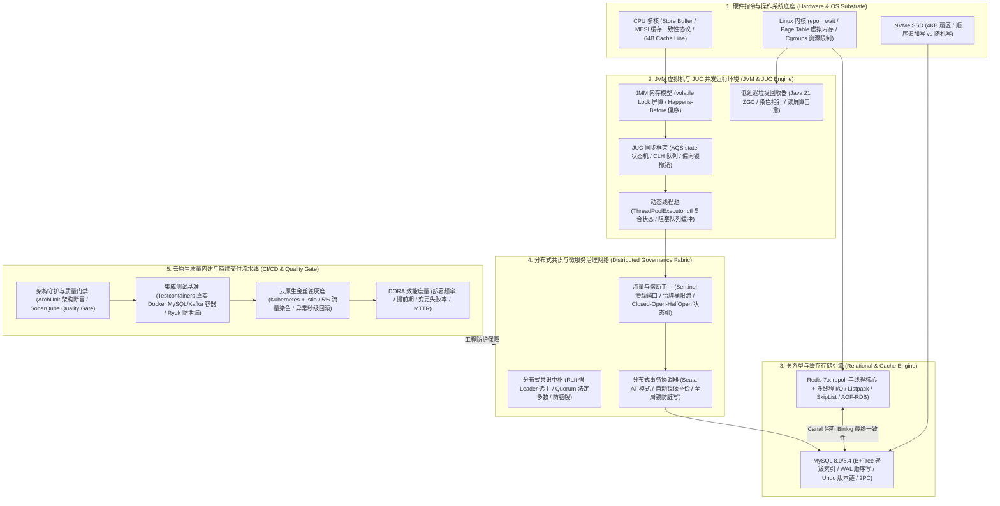
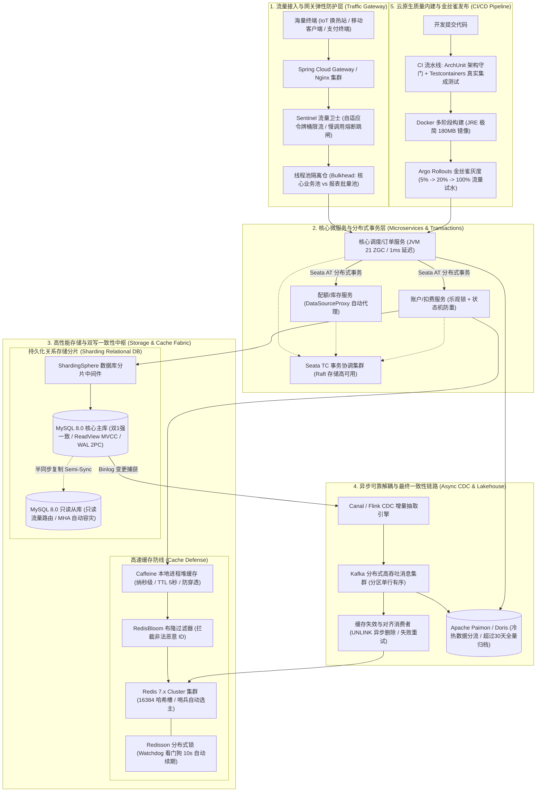
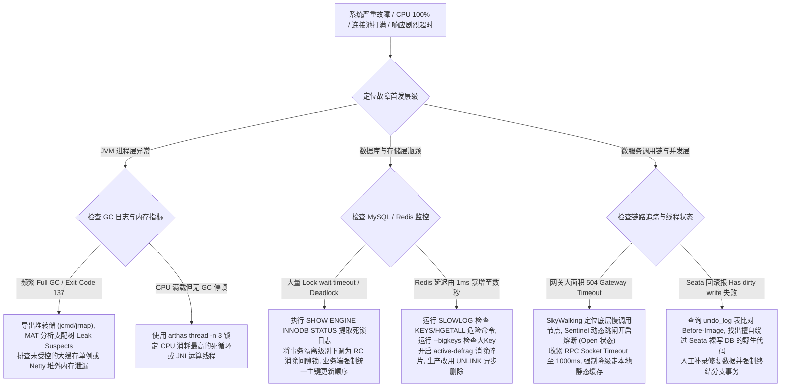
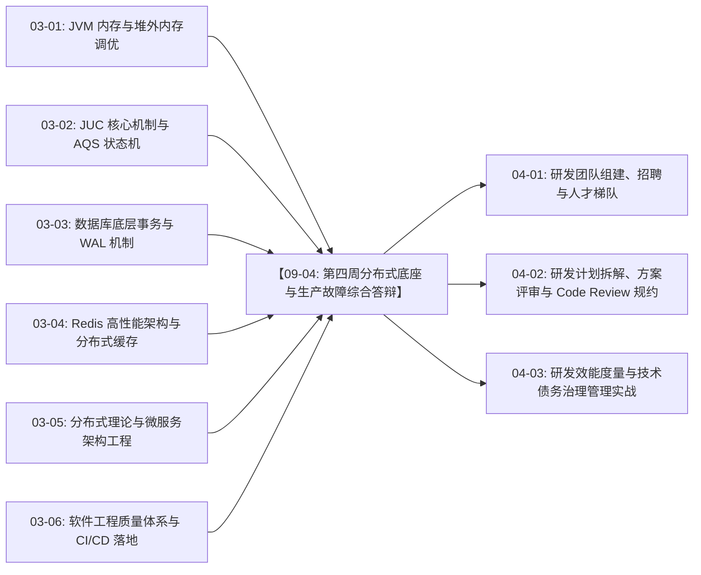

# 第四周阶段复盘：Java 底层基石、高并发存储、分布式共识与微服务工程综合答辩

> **学习目标定位**：全面复盘第四周（Day 22 - Day 27）涵盖的 **JVM 内存模型与低延迟垃圾回收（G1/ZGC）、Java 并发编程与 JUC 核心机制（AQS/线程池）、数据库底层与事务存储引擎（MVCC/WAL/2PC/锁机制）、Redis 高性能缓存与集群架构（双写一致性/分布式锁）、分布式共识与微服务治理（CAP/Raft/Seata/Sentinel）以及软件工程质量与云原生持续交付（SOLID/Testcontainers/CI-CD/金丝雀灰度）**。彻底打通从底层硬件指令、操作系统虚拟内存、数据库物理存储引擎到分布式网络拓扑与敏捷交付的完整全栈工程经络。结合思科、Zoom、美的集团以及瑞纳智能智慧供热工业中台等真实高并发高可用实战，完成 10 道阶段综合大厂真题三层全解，夯实技术总监、数据平台负责人与资深技术架构师在底层硬核功底、高管技术推演与 ROI 决策上的战略定力。

---

## 1. 第四周 Java 底座与分布式工程全景技术贯通拓扑大图

在现代企业级高并发、高可用架构中，从硬件 CPU 缓存行到分布式多节点共识，六大技术体系彼此咬合，构成了企业级核心在线交易与工业物联网底座的**全栈生命线**：



---

## 2. 第四周六大核心技术底座横向对比与架构决策矩阵

| 技术模块 | 核心代表选型与机制 | 底层核心原理与运行机制 | 核心架构优势与价值 | 潜在瓶颈与妥协代价 | 架构师首选适用场景 |
| :--- | :--- | :--- | :--- | :--- | :--- |
| **JVM 内存与GC** | Java 17/21 LTS (ZGC / G1) | 染色指针（Colored Pointers）、读屏障（Load Barrier）内存自愈、三色并发标记 | STW 停顿被压制在 1ms 以内，支持数 TB 超大堆内存，彻底消除停顿颠簸 | 吞吐量相比 ParallelGC 损失 5%~10%，弱内存屏障增加微小 CPU 开销 | 低延迟高并发微服务、大内存交易中台、实时网关 |
| **JUC 并发控制** | AQS / ThreadPoolExecutor / `@Contended` | 状态机 `state` 原子 CAS、CLH 双向队列自旋挂起、缓存行 64B 填充防伪共享 | 相比传统重量级监视器锁性能提升数倍，灵活支持共享/排他模式与中断响应 | 线程池参数配置不当极易引发任务堆积 OOM，AQS 锁争用激烈时上下文切换高 | 高吞吐网络通信、异步任务编排、非阻塞资源排队 |
| **关系型存储引擎**| MySQL 8.0+ (InnoDB) / PG 17 | B+Tree 索引组织表、WAL 预写式重做日志、ReadView 与 Undo 单向版本链、2PC 两阶段提交 | 完备 ACID 事务保障，聚簇索引范围扫描极速，Crash-Safe 崩溃秒级幂等自愈 | 随机大范围全表扫描 I/O 吞吐极低，长事务引发 Undo 膨胀与间隙锁死锁 | 核心账户支付、交易状态机、设备元数据核心资产 |
| **分布式高速缓存**| Redis 7.x (Cluster / Sentinel) | Reactor epoll I/O 多路复用、Listpack 紧凑内存、跳表 SkipList 范围检索、AOF-RDB 混合持久化 | 纯内存十万级 QPS，纳秒级延迟，多线程 I/O 突破网络单核瓶颈，数据结构丰富 | 物理内存昂贵，主从异步复制存在极端脑裂丢数据风险，BigKey 引发单线程阻塞 | 热点防穿透防护、分布式互斥锁、实时排行榜、限流计数器 |
| **分布式事务与共识**| Raft (Nacos) / Seata (AT/TCC) / Sentinel | 强 Leader 权威、Term 任期号与 Quorum 仲裁、SQL AST 自动提取前后镜像与全局锁 | 零代码侵入实现跨微服务最终一致性，解决单机分库分表与跨库资产一致性割裂 | Seata AT 模式全局锁限制极端并发吞吐，Raft 少数派分区拒绝写服务 | 跨服务订单扣款、分布式调度选主、核心接口熔断防雪崩 |
| **软件工程与CI/CD**| Testcontainers / SonarQube / Istio Canary | Docker 守护进程集成测试、ArchUnit 架构即代码静态断言、多阶段镜像构建、流量权重灰度切流 | 消除环境漂移，彻底阻断技术债务合入主干，实现生产 0 停机发布与秒级回滚 | CI 流水线引入容器构建需预留资源，金丝雀要求系统具备向下双向兼容性 | 现代化敏捷研发中台、高可用金融级云原生交付 |

---

## 3. 架构师白板推演：从 0 到 1 为千万级高并发、高可用工业物联网/跨国交易平台设计企业级系统底座

### 3.1 业务背景与核心挑战
- **业务画像**：某大型工业制造与智慧能源集团（融合美的工业物联网与瑞纳智能智慧供热系统背景），面向全国 10 万座换热站、上千万住户与全球多国制造供应链协同；
- **体量规模**：
  - 秒级上报工业遥测数据点达 **50 万条/秒**；
  - 核心交易、温控调度与计费充值峰值 QPS 突破 **30,000**；
  - 关系型业务数据累积达 **数十亿行**；
- **系统痛点**：
  - 历史系统频繁遭遇 JVM Full GC 导致长达 15 秒的“假死”引发下游告警雪崩；
  - 数据库单表突破 8000 万，慢 SQL 堆积引发连接池打满，大促期间死锁频发；
  - 缓存与数据库数据经常“对不上账”，出现用户充值未到账的严重客诉；
  - 跨微服务调用缺乏熔断隔离，下游气象接口超时导致全链路核心业务雪崩瘫痪。

### 3.2 架构师顶层全景白板推演（45分钟终面答辩全景图）



### 3.3 核心技术与管理权衡决断（Trade-offs）
1. **垃圾回收器选型裁决（全面拥抱 Java 21 ZGC）**：
   - 过去基于 CMS/G1 在堆内存达到 32GB 时，突发大促经常发生 2~5 秒的 STW 停顿，导致心跳超时触发微服务假死与拓扑颠簸；
   - 架构升级全面迁移至 **Java 21 Generational ZGC**。利用染色指针与读屏障内存自愈，将 **STW 彻底锁死在 1 毫秒以内**，虽然牺牲了约 5% 的峰值吞吐量，但换取了整个系统运行稳定性的极致确定性。
2. **缓存双写一致性取舍（放弃脆弱的“延迟双删”，拥抱“Binlog + MQ 最终一致性”）**：
   - 延迟双删的“休眠 500ms”在网络波动和主从延迟拉长时必定引发脏数据，且同步休眠白白占满应用线程池；
   - 坚决推行 **Canal 监听 Binlog + Kafka 异步失效** 架构，将业务代码与缓存清理彻底解耦，通过消息队列的重试与死信机制实现强鲁棒性的最终一致性。
3. **分布式事务取舍（核心强柔结合，旁路彻底异步）**：
   - 严禁全链路滥用刚性 2PC/XA 事务，避免底层数据库物理锁长久持有压垮系统；
   - 核心交易采用 **Seata AT 模式**（轻量级全局逻辑锁，本地物理锁极速释放），非核心链路（积分、通知、报表分析）通过 **本地消息表 + MQ 事务消息** 实现完全异步解耦。

---

## 4. 生产全链路排障根因决策树

下图汇总了第四周核心底层与分布式系统遭遇性能崩塌、内存溢出、死锁与服务雪崩时的排障决策流程：



---

## 5. 第四周高频面试真题综合自测（10题）

* **Q1 [阿里/蚂蚁 - JMM与内存模型]**：请从 CPU 硬件缓存架构（MESI 协议与 Store Buffer）到底层汇编指令，深度推导 Java 中 `volatile` 关键字是如何保障可见性与有序性的？为什么在 x86 架构下仅仅依靠 `lock addl` 就能实现全屏障效果？
* **Q2 [字节跳动 - 垃圾回收与低延迟]**：深入对比 CMS、G1 与 Java 21 ZGC 的底层实现。ZGC 是如何利用“染色指针（Colored Pointers）”与“读屏障（Load Barrier）”实现并发标记与并发整理（Relocation），从而将 STW 停顿压制在 1 毫秒以内的？
* **Q3 [美团 - JUC 并发与 AQS]**：深入剖析 AQS（AbstractQueuedSynchronizer）的内部状态机流转。独占模式与共享模式在节点出入队（CLH 变种双向链表）、`state` 变量 CAS 争用与线程挂起（`LockSupport.park`）上有何底层机制差异？
* **Q4 [腾讯 - 线程池与拒绝策略]**：ThreadPoolExecutor 的 `ctl` 变量是如何设计的？为什么线程池的核心运行流程是“先排队入阻塞队列，队列满了才扩容至最大线程数”，而不是优先创建最大线程？在生产大促中，如何设计一套线程池动态调优与报警监控体系？
* **Q5 [滴滴 - 数据库引擎与 MVCC]**：请详细阐述 MySQL InnoDB 的 MVCC ReadView 机制与 Undo Log 回滚段版本链算法。在可重复读（RR）隔离级别下到底能否彻底解决幻读？快照读与当前读在加锁上有何本质区别？
* **Q6 [快手 - 数据库锁与生产死锁排查]**：深入推导 InnoDB Next-Key Lock 的加锁规则（左开右闭区间与退化机制）。生产大促期间遭遇批量更新死锁和长事务导致 Undo 表空间无限膨胀时，技术专家的黄金排查与止血步骤是什么？
* **Q7 [拼多多 - Redis 底层结构与演进]**：Redis 单线程核心处理命令为何能达到十万级 QPS？Redis 6.0 引入多线程 I/O 的边界在哪里？Redis 7.0 为什么用 `listpack` 彻底替代了历史上的 `ziplist`？
* **Q8 [百度 - 缓存双写一致性与分布式锁]**：在百万级高并发场景下，如何保证数据库与 Redis 缓存的双写一致性？为什么“先写库，再通过 Binlog 异步失效缓存”是工业界首选？Redisson 的 Watchdog 看门狗是如何实现锁续期的？Redlock 算法的核心争议是什么？
* **Q9 [美团/字节 - 分布式共识与微服务熔断]**：深入推导 Raft 共识算法的 Leader 选举状态机与日志强行对齐规则。在微服务调用链中，Sentinel / Resilience4j 熔断器的 Closed、Open、Half-Open 状态机是如何流转的？令牌桶算法相比漏桶算法有何抗突发脉冲优势？
* **Q10 [技术总监/总架构师 - 质量体系与 DORA 效能度量]**：作为技术负责人，如何为 50 人的研发团队建立端到端的软件工程质量体系与 CI/CD 流水线？如何运用 DORA 四大黄金指标度量交付效能，并在“业务催命紧急交付”与“技术债务治理红线”之间建立制度化的平衡机制（如 20% 债务配额制）？

---

## 6. 10道真题结构化三层参考答案

---

### 题目1 [阿里/蚂蚁 - JMM与内存模型]：从 CPU 硬件缓存架构到汇编指令推导 `volatile` 原理

#### 简洁回答（1分钟电梯破题）：
> `volatile` 保障了变量的**可见性（Visibility）**与**有序性（Ordering）**，但不保障复合操作的原子性。
> 从底层物理硬件推导，现代 CPU 为了榨干流水线性能，在核心与 L1 缓存之间增加了异步写缓冲器（Store Buffer）。普通变量写入只进 Store Buffer，导致其他 CPU 核心看不到最新值（可见性失效），且可能被处理器乱序刷新到缓存（指令重排）。
> 在 x86 架构下，Java 字节码编译出的 `volatile` 写指令后会自动追加一条带有 **`lock` 前缀的汇编指令（如 `lock addl $0x0,(%esp)`）**。该指令具有两大核心物理效应：**一是强行刷新 Store Buffer 并通过 MESI 协议使其他核心对应的缓存行（Cache Line）瞬间失效，强制重新从内存读取最新值（保障可见性）；二是锁总线/锁缓存行并提供完整的全内存屏障（Full Memory Barrier），阻止屏障前后的指令跨屏障重排（保障有序性）**。

#### 深入回答（机制推导与边界条件）：
1. **CPU 硬件缓存架构与 MESI 协议缺陷推导**：
   - 现代多核 CPU 依靠 **MESI 缓存一致性协议**（Modified, Exclusive, Shared, Invalid）维持多核 L1/L2 缓存的一致。
   - **Store Buffer 性能妥协**：CPU 核心执行写指令时，如果目标缓存行处于 Shared 状态，必须向其他核心发送 Invalidate 消息并等待确认，产生停顿。硬件工程师设计了 **Store Buffer（写缓冲器）**，写操作直接扔进 Store Buffer，核心立即继续执行后续指令。
   - **灾难性后果**：Store Buffer 何时真正刷入 L1 缓存由硬件调度决定。在此期间，其他 CPU 核心无法读取到 Store Buffer 中的新值，造成严重的“内存可见性延迟”；且后续的读操作可能先于 Store Buffer 中的写操作被处理器调度执行，产生处理器级别的**“内存乱序（Store-Load 乱序）”**。
2. **JMM 规范与内存屏障映射**：
   - JSR-133 规范定义了四类抽象内存屏障：`LoadLoad`、`StoreStore`、`LoadStore`、`StoreLoad`。
   - 对 `volatile` 读写操作插入屏障规则：
     - 在 `volatile` 写之前插入 `StoreStore` 屏障，写之后插入 `StoreLoad` 屏障；
     - 在 `volatile` 读之后插入 `LoadLoad` 与 `LoadStore` 屏障。
3. **x86 架构下的极致汇编映射**：
   - x86 是强内存模型（Strong Memory Model），硬件上原生杜绝了“读-读”、“写-写”、“读-写”重排序，**唯独允许“写-读（Store-Load）”重排序**。
   - 因此在 x86 汇编层面，`StoreStore`、`LoadLoad`、`LoadStore` 全部退化为空指令（No-op，零成本）。唯独在 `volatile` 写之后，必须插入昂贵的全屏障指令。
   - JVM 经过测试，在 x86 上直接发射带有 `lock` 前缀的空操作汇编：`lock addl $0x0,(%rsp)`，其性能开销远低于显式的 `mfence` 指令。`lock` 前缀指令会强制把 CPU 核心本地 Store Buffer 中的全部脏写即刻强刷入 L1 缓存，并广播 MESI 失效信号，达到了全屏障的绝对内存保序效果。

#### 架构师/技术管理视角（权衡取舍、SLA与成本）：
> 理解硬件级内幕是架构师实施无锁高性能编程（Lock-Free）的前提：
> 1. **避免无节制的 volatile 滥用**：
>    - `volatile` 读虽然极快（在 x86 上等同于普通读），但 `volatile` 写所触发的 `lock` 汇编会强制刷新 Store Buffer 并触发总线仲裁/缓存锁，耗时是普通写操作的数十倍。在大促高频吞吐组件（如日志聚合、分布式锁计数器）中，严禁在紧凑死循环内频繁写入 `volatile` 变量。
> 2. **伪共享（False Sharing）防御**：
>    - 多个独立 `volatile` 变量若在物理上被分配在同一块 **64 字节缓存行（Cache Line）**中，一个核心修改其中一个变量，会无情触发 MESI 协议导致整个缓存行失效，连带使相邻核心频繁发生缓存未命中颠簸（Cache Bouncing）。架构师在编写并发队列（如 Disruptor）时，必须通过 **`@Contended` 注解或手动 56 字节填充（Padding）**将变量隔离在独立缓存行中，释放多核并行算力。

---

### 题目2 [字节跳动 - 垃圾回收与低延迟]：CMS、G1 与 Java 21 ZGC 底层对比及 ZGC 亚毫秒停顿推导

#### 简洁回答（1分钟电梯破题）：
> 垃圾回收器的演进本质是一部**“逐步将 STW 阶段转化为并发运行阶段”**的工程进化史：
> - **CMS**：以牺牲吞吐量为代价追求低停顿，但基于“标记-清除（Mark-Sweep）”算法，无法解决**内存碎片与并发失败（Concurrent Mode Failure）退化为单线程 SerialOld Full GC 的死穴**。
> - **G1**：将堆划分为等大 Region，引入 SATB 解决并发标记漏标，基于可预测停顿模型（Pause Time Model）挑选垃圾最多的 Region 进行“标记-复制”，但其**重定位（Relocation，对象搬移）阶段必须发生 STW 停顿**，停顿时间随堆内存增大在数十至数百毫秒级。
> - **Java 21 ZGC**：新一代低延迟收集器。核心创新在于**“染色指针（Colored Pointers）”**与**“读屏障（Load Barrier）”**，在**并发重定位阶段无需 STW**！应用线程在访问被移动的对象时，通过读屏障触发“指针自愈（Self-Healing）”，将 **STW 停顿严格压制在 1ms 以内，且停顿时间完全与堆内存大小（从数 GB 到 16TB）解耦**。

#### 深入回答（机制推导与边界条件）：
1. **ZGC 染色指针（Colored Pointers）底层物理建模**：
   - 现代 64 位 CPU 实际上只使用低 48 位虚拟地址空间（寻址能力达 256TB）。
   - ZGC 巧妙利用了**虚拟地址引用的高位未用比特（High Bits）**存储 GC 状态元数据，彻底告别了传统对象头中的 Mark Word 寻址依赖：
     - `Bit 0 ~ 41`（42位）：真实的物理对象虚拟内存偏移地址（最大支撑 4TB / 16TB 堆空间）；
     - `Bit 42`：**Marked0** 标记位（表示当前周期该对象存活）；
     - `Bit 43`：**Marked1** 标记位（与 Marked0 交替翻转使用）；
     - `Bit 44`：**Remapped** 标记位（表示该指针已经完成重定位，指向最新物理地址）；
     - `Bit 45`：**Finalizable** 标记位。
2. **读屏障（Load Barrier）与并发重定位“指针自愈”全推导**：
   - 当 ZGC 进入并发重定位阶段（Concurrent Relocate），GC 后台线程开始将某个 Region 中的存活对象从旧物理地址 $P_{old}$ 拷贝到新物理地址 $P_{new}$，并在堆外维护一张转发表（Forwarding Table）。
   - 此时，应用线程正以极高并发运行，并执行了读取对象操作：`Object o = obj.field;`。
   - **读屏障触发机制（微秒级）**：
     1. JIT 编译器在每一处对象引用加载（`Load` 指令）处插入极简指令，校验指针的 Colored Bits 是否包含 `Remapped` 标记。
     2. 若包含 `Remapped`（属于快速路径 Fast-Path，仅需一条汇编测试指令），直接放行，零性能损耗；
     3. 若不包含（进入慢速路径 Slow-Path）：说明该对象要么正在被 GC 搬迁，要么刚搬迁完但指针尚未更新。
     4. 读屏障通过查询 Forwarding Table，若已被拷贝，立即返回新地址 $P_{new}$；若尚未被拷贝，由应用线程**顺手将其并发搬移到新空间并填写转发表**；
     5. **自愈（Self-Healing）**：应用线程顺手将内存中的引用指针直接更新为 `Remapped | P_new`！下次再读取该引用时，直接走 Fast-Path，绝不会发生二次拦截。
   - 这种设计使得**对象的搬移和指针的修正完全由读屏障分散到了并发应用线程的正常读操作中，彻底消除了传统 GC 必须全局停顿（STW）才能安全修正指针引用的致命瓶颈**！

#### 架构师/技术管理视角（权衡取舍、SLA与成本）：
> 生产技术选型绝不能盲目追求概念前沿，必须算清商业与硬件 ROI 账本：
> 1. **吞吐量与延迟的权衡**：
>    - ZGC 读屏障使得每个引用加载多消耗数个 CPU 周期，因此在纯批处理离线计算（如 Spark 批处理作业）中，**ParallelGC 或 G1 的吞吐量比 ZGC 高出 8%~15%**。在离线批处理任务中盲目开启 ZGC 属于典型架构反模式。
> 2. **微服务核心在线业务的终极救星**：
>    - 对于承接用户实时交易、工业物联网高频遥测的微服务平台，数秒的 GC STW 会直接引发分布式心跳超时、微服务假死摘除与级联雪崩。技术总监在将核心在线工程升级至 Java 21 时，应果断启用 Generational ZGC，**将系统的 P99/P999 SLA 延迟指标收敛至微秒级区间**，彻底消除偶发毛刺客诉。

---

### 题目3 [美团 - JUC 并发与 AQS]：AQS 状态机、独占与共享模式及 CLH 队列底层机制

#### 简洁回答（1分钟电梯破题）：
> AQS（AbstractQueuedSynchronizer）是 Java 并发包（JUC）的核心基石，其本质是一个**“基于 volatile int state 状态机 + 改进型 CLH 双向阻塞 FIFO 队列”**的并发同步框架。
> - **独占模式（Exclusive）**：如 `ReentrantLock`，有且仅允许一个线程成功将 `state` 从 0 CAS 改为 1。未抢到锁的线程被封装为 `Node` 加入 CLH 队列尾部，通过 `LockSupport.park()` 挂起休眠；持锁线程释放时将 `state` 恢复为 0 并 `unpark` 唤醒头节点的下一个后继节点。
> - **共享模式（Shared）**：如 `CountDownLatch`、`Semaphore`，允许多个线程并发获取同步状态。其底层最核心的差异在于：**当共享模式下的一个节点成功获取资源后，它会顺着队列向后触发“传播唤醒（`doReleaseShared -> setHeadAndPropagate`）”，如同多米诺骨牌一样连续唤醒后续所有等待共享资源的后继节点**。

#### 深入回答（机制推导与边界条件）：
1. **改进型 CLH 双向链表的设计哲学推导**：
   - 原始学术界的 CLH 锁是一个仅包含前驱指针的单向链表，线程在前驱节点的变量上执行自旋（Spinning）。
   - **JUC 的改造根因**：多核 CPU 上长时间自旋等待会白白烧死 CPU 资源。因此 AQS 引入了**阻塞与唤醒机制（`park/unpark`）**：
     - 当持锁线程释放锁时，必须能够主动定位并唤醒自己的后继节点，因此 AQS 必须维护**后继指针 `next`，改造为双向链表**；
     - **尾部入队（Tail Insertion）的并发安全**：采用原子 CAS 操作循环自旋将新 Node 挂载至 tail：`compareAndSetTail(pred, node)`，成功后再将原尾节点的 `next` 指向新节点。
2. **waitStatus 状态控制状态机**：
   - `Node` 中包含关键字段 `waitStatus`：
     - `SIGNAL`（-1）：**关键标记**。表示当前节点的后继节点正处于挂起休眠状态，当前节点在释放资源或取消时，**有义务主动唤醒后继节点**。
     - `CANCELLED`（1）：节点由于超时或被中断被取消，在入队或遍历时会被自动从双向链表中摘除。
     - `PROPAGATE`（-3）：共享模式下用于传播释放状态。
3. **共享模式传播唤醒（Propagate）底层时序推导**：
   - 假设 `Semaphore` 初始许可为 3，三个等待线程在 CLH 队列中排队。
   - 某外部线程释放了 2 个许可，调用 `releaseShared(2)`，更新 `state` 并唤醒队列头节点 $Node_A$。
   - $Node_A$ 被唤醒后执行 `setHeadAndPropagate(node, propagate)`：
     1. 将自身设为新的哨兵头节点（Head）；
     2. 发现当前剩余可用资源 `propagate > 0` 或后续节点也是共享模式；
     3. 立即直接调用 `doReleaseShared()` 唤醒后继节点 $Node_B$！
     4. $Node_B$ 醒来后重复上述动作继续唤醒 $Node_C$。无需等待外部释放指令再次下发，在队列内部形成瞬时雪崩式的连锁唤醒，极大提升了多线程并发释放的吞吐效率。

#### 架构师/技术管理视角（权衡取舍、SLA与成本）：
> 深入理解 AQS 是掌握并发组件选型的底气：
> 1. **公平锁（Fair） vs 非公平锁（Nonfair）的生产裁决**：
>    - `ReentrantLock` 默认是非公平锁。非公平锁允许刚来的线程先进行一次插队 CAS 抢锁，成功则直接执行，失败才入队。
>    - **性能差异**：非公平锁吞吐量比公平锁**高出数倍甚至一个数量级**。因为公平锁强制排队会导致线程频繁陷入内核态挂起与上下文切换（Context Switch 耗时约 2~5 微秒）；非公平锁充分利用了线程刚刚运行在 CPU 上的时间片，减少了线程切换。生产环境除极特殊严格先来后到业务外，**一律强制使用默认的非公平锁**。
> 2. **锁降级与死锁防御**：
>    - 读写锁 `ReentrantReadWriteLock` 允许“写锁降级为读锁”，但**绝对严禁“读锁升级为写锁”**（两个读线程同时尝试升级为写锁会死锁在等待对方释放读锁上）。架构师在审核多线程代码时必须将此类隐式死锁列为一级审查红线。

---

### 题目4 [腾讯 - 线程池核心参数]：ThreadPoolExecutor ctl 变量设计与“队列优先”哲学

#### 简洁回答（1分钟电梯破题）：
> `ThreadPoolExecutor` 的核心控制器 `ctl` 是一个 `AtomicInteger`，**其底层通过高低位掩码将“运行状态（runState）”与“有效工作线程数（workerCount）”打包在单一 32 位整型中**：高 3 位存储 5 大运行状态（RUNNING、SHUTDOWN、STOP、TIDYING、TERMINATED），低 29 位存储线程数（最大支撑约 5.3 亿个线程），从而利用一次原子 CAS 即可实现状态与计数的复合原子更新，消除并发锁争用。
> **为什么线程池是“先排队入阻塞队列，队列满了才扩容至最大线程”，而不是直接创建最大线程？**
> 这是工业界经典的**“资源成本优先与排队论抗抖动哲学”**。操作系统线程（Kernel Thread）极其昂贵，默认占用 1MB 独立栈内存，过早创建大量线程会引发剧烈的 CPU 时间片切换和内存开销；有界队列（如 ArrayBlockingQueue）以极低内存成本充当缓冲蓄水池，先用队列平滑短时流量毛刺，只有当毛刺持续冲击导致蓄水池饱和时，系统才动用备用算力扩容至最大线程，兼顾了资源利用率与突发防御。

#### 深入回答（机制推导与边界条件）：
1. **`ctl` 位运算物理拆解推导**：
   - 内部常量定义：
     ```java
     private final AtomicInteger ctl = new AtomicInteger(ctlOf(RUNNING, 0));
     private static final int COUNT_BITS = Integer.SIZE - 3; // 29 位
     private static final int COUNT_MASK = (1 << COUNT_BITS) - 1; // 低29位全1掩码

     // 运行状态高位定义 (利用符号位与高2位)
     private static final int RUNNING    = -1 << COUNT_BITS; // 111... (最高位1，负数)
     private static final int SHUTDOWN   =  0 << COUNT_BITS; // 000...
     private static final int STOP       =  1 << COUNT_BITS; // 001...
     private static final int TIDYING    =  2 << COUNT_BITS; // 010...
     private static final int TERMINATED =  3 << COUNT_BITS; // 011...
     ```
   - 提取状态：`c & ~COUNT_MASK`；提取线程数：`c & COUNT_MASK`。
   - **设计精妙之处**：`RUNNING < SHUTDOWN < STOP < TIDYING < TERMINATED`，状态单调递增，判断状态是否处于某阶段只需直接进行整数大小比较（如 `c >= SHUTDOWN`），速度极快。
2. **拒绝策略（RejectedExecutionHandler）的生产陷阱**：
   - 四大内置策略：
     - `AbortPolicy`（默认）：抛出 `RejectedExecutionException`，快速失败；
     - `CallerRunsPolicy`：**让提交任务的调用方线程亲自执行该任务**；
     - `DiscardPolicy`：静默丢弃任务，无感知；
     - `DiscardOldestPolicy`：丢弃队列中最老的任务并重试。
   - **CallerRunsPolicy 的生产双刃剑（边界推导）**：
     - **优势**：当线程池打满时，让调用方（如 Tomcat 工作线程）亲自去执行耗时任务，能够自然减缓上游请求提交速率，起到**天然负反馈背压（Backpressure）**效果；
     - **致命陷阱**：如果调用方是核心事件派发线程（如 Netty EventLoop），一旦被强行拖去执行业务长耗时任务，**会导致整条 Netty 通信链路瞬间冻结，引发大规模客户端连接超时断开**！

#### 架构师/技术管理视角（权衡取舍、SLA与成本）：
> 线程池参数配置是生产事故的高发温床，严禁凭拍脑袋设置：
> 1. **严禁使用 `Executors` 静态工厂构造器**：
>    - `newFixedThreadPool` 内部使用无界队列 `LinkedBlockingQueue`（容量 $2^{31}-1$），极端并发下会无底线堆积几百万个任务，引发物理内存耗尽触发 Exit Code 137 OOM-Killed；
>    - `newCachedThreadPool` 最大线程数设为 `Integer.MAX_VALUE`，突发流量会瞬间创建上万个操作系统线程，引发系统 CPU 上下文切换彻底卡死。
> 2. **生产级动态线程池监控与调优（Dynamic ThreadPool SOP）**：
>    - 核心参数必须外部化（依托 Nacos / Apollo 动态配置中心），运行时通过 `setCorePoolSize()` 与 `setMaximumPoolSize()` 实现在线热调整；
>    - 建立 Prometheus 监控：当**队列使用率突破 80%** 或**线程活跃度突破 85%** 时，提前发出企业微信 P1 告警，留出容量干预窗口。

---

### 题目5 [滴滴 - 数据库引擎与 MVCC]：InnoDB MVCC、ReadView 判定及 RR 下的幻读攻防

#### 简洁回答（1分钟电梯破题）：
> InnoDB MVCC 依赖每行记录的隐藏系统列（`DB_TRX_ID` 事务版本、`DB_ROLL_PTR` 回滚指针）、Undo Log 历史链表与事务快照读生成的 **ReadView** 共同协同。
> ReadView 包含活跃事务列表 `m_ids`、低水位 `min_trx_id` 和高水位 `max_trx_id`。查询时沿 Undo 链向后递归校验，匹配属于 ReadView 创建时已提交的最新可见版本。**RC 隔离级别每次执行 SELECT 重新生成 ReadView，RR 仅在首次 SELECT 生成并复用**。
> **MySQL 在 RR 隔离级别下很大程度上消除了幻读，但并未彻底根绝**：
> - 对于**普通快照读（Snapshot Read）**，依赖 MVCC ReadView 复用，完全杜绝了幻读；
> - 对于**当前读（Current Read，如 `UPDATE / SELECT ... FOR UPDATE`）**，依赖 **Next-Key Lock（记录锁 + 间隙锁）**锁定区间，阻塞其他事务并发插入，杜绝了幻读；
> - **特殊幻读漏洞**：若事务 A 执行快照读后，通过 `UPDATE` 语句（当前读）修改了事务 B 刚插入并提交的新记录，该行的 `DB_TRX_ID` 会被变更为事务 A 自己的 ID，此时事务 A 再次执行快照读，就会惊奇地查出这行新记录，发生幻读！

#### 深入回答（机制推导与边界条件）：
1. **ReadView 四部曲判定算法状态机**：
   - 设待检查历史版本的事务 ID 为 $T$：
     1. $T == creator\_trx\_id$：自身事务修改，**可见**；
     2. $T < min\_trx\_id$：生成 ReadView 前已提交，**可见**；
     3. $T \ge max\_trx\_id$：生成 ReadView 后才启动，**绝对不可见**；
     4. $min\_trx\_id \le T < max\_trx\_id$：若 $T \in m\_ids$（当时仍活跃未提交）则**不可见**；若 $T \notin m\_ids$（已提交）则**可见**。
   - 若不可见，存储引擎顺着 `DB_ROLL_PTR` 指针拉取 Undo Log 前驱历史记录重复上述校验。
2. **快照读 vs 当前读底层执行路径差异**：
   - **快照读（Snapshot Read）**：纯粹的 `SELECT * FROM t WHERE ...`（不加任何锁指令）。执行时不向行记录或间隙施加任何排他锁，完全走 MVCC 版本链逻辑，实现“读不阻塞写，写不阻塞读”；
   - **当前读（Current Read）**：`SELECT ... FOR UPDATE`、`SELECT ... LOCK IN SHARE MODE`、`UPDATE`、`DELETE`、`INSERT`。执行时必须直接读取内存或磁盘中的**最新物理版本**，并且必须在目标行及周边间隙施加物理排他锁（X Lock / Next-Key Lock），彻底防止其他事务并发修改。

#### 架构师/技术管理视角（权衡取舍、SLA与成本）：
> 为什么绝大多数互联网一线大厂将生产默认隔离级别从官方的 RR 修改为 **`READ-COMMITTED`（RC）**？
> 1. **消灭绝大多数生产死锁**：
>    - RR 级别为了防幻读，在范围查询和等值查询未命中时引入了大量的**间隙锁（Gap Lock）和临键锁（Next-Key Lock）**，高并发并发修改极易引发锁交叉死锁；RC 级别关闭了绝大多数 Gap 锁，仅锁命中行；
> 2. **Undo Log 资源回收速度极快**：
>    - RR 级别的长事务会长时间冻结 `min_trx_id`，导致后台 Purge 线程无法回收在此之后提交的数百万条 Undo 日志，造成 `ibdata1` / Undo 表空间暴涨与全表扫描性能雪崩；RC 级别的 ReadView 在查询完毕后立即销毁，Undo 空间能被迅速回收。
> 3. **主从一致性强制约束**：
>    - 将系统切换为 RC 隔离级别时，**必须强制绑定配置 `binlog_format = ROW`**，彻底规避 Statement 格式下由于主从并发执行顺序差异导致的数据错乱风险。

---

### 题目6 [快手 - 数据库锁与生产死锁排查]：Next-Key Lock 加锁机制、长事务治理与死锁 SOP

#### 简洁回答（1分钟电梯破题）：
> **Next-Key Lock 是行记录锁（Record Lock）与间隙锁（Gap Lock）的组合，锁定的是左开右闭区间 $(a, b]$**。其加锁单位是 Next-Key Lock，查找过程访问到的对象才会加锁。在唯一索引等值查询命中时退化为**单行记录锁**；在唯一索引等值查询未命中时向右遍历至首个不满足条件的记录，退化为**开区间间隙锁 $(a, b)$**；非唯一二级索引则会加完整的 Next-Key Lock 并在右边界加间隙锁，且伴随聚簇索引回表加行排他锁。
> **面对生产突发死锁与长事务引发 Undo 暴涨的专家处理 SOP**：
> 1. **紧急止血（30秒内）**：查询 `information_schema.innodb_trx`，根据 `trx_started` 锁定持有事务最久的线程，执行 `KILL <Thread_ID>` 强制阻断，瓦解锁等待风暴；
> 2. **证据留存**：执行 `SHOW ENGINE INNODB STATUS\G` 固化 `LATEST DETECTED DEADLOCK` 死锁日志；
> 3. **根因整改**：代码层面将批量更新主键强制升序排序，长事务内部耗时 RPC 剥离，隔离级别调整为 RC，开启 `innodb_undo_log_truncate = ON` 动态截断表空间。

#### 深入回答（机制推导与边界条件）：
1. **典型批量更新死锁形成机制（加锁顺序不一致）**：
   - 设表中有两行记录：`ID = 10` 与 `ID = 20`。
   - 事务 A：批量更新两行，业务代码中执行逻辑为先更新 `ID=10`，再更新 `ID=20`；
   - 事务 B：另一个业务场景由于未做排序，并发更新这两行，执行逻辑为先更新 `ID=20`，再更新 `ID=10`；
   - **死锁形成时序**：
     - 事务 A 获取了 `ID=10` 的 X 行锁；
     - 事务 B 获取了 `ID=20` 的 X 行锁；
     - 事务 A 尝试获取 `ID=20` 的锁，被事务 B 阻塞排队；
     - 事务 B 尝试获取 `ID=10` 的锁，被事务 A 阻塞排队；
     - 双方互相持有对方所需的资源并陷入永无止境的死循环等待，触发 InnoDB 死锁检测机制（Deadlock Detector），主动选择较小代价的事务进行强制回滚。
2. **长事务拖垮系统的物理链路推导**：
   - 设事务 $T_{long}$ 开启后未显式提交。在此期间系统产生了 500 万次正常的短事务更新。
   - **Purge 线程无法推进**：InnoDB 的垃圾清理线程负责清扫已提交的 Undo 日志。由于 $T_{long}$ 的 ReadView 中 `min_trx_id` 极小，Purge 线程必须保守保留其后所有的 Undo 日志，导致 **History List Length（HLL）** 暴涨至数百万，物理磁盘被吃满数十 GB；
   - **查询 CPU 飙升 100%**：任何其他线程即使只查一行记录，由于快照读必须顺着 `DB_ROLL_PTR` 遍历多达数万个 Undo Log 节点反推历史镜像，使简单的点查耗时从 1ms 恶化到数秒，引发全站雪崩。

#### 架构师/技术管理视角（权衡取舍、SLA与成本）：
> 治理死锁与长事务的核心在于将工程规约自动化嵌入研发流水线：
> 1. **代码级严格顺序锁规约**：
>    - 在 Java 业务代码中执行批量更新或锁定多资源时，必须强制增加预处理逻辑：
>      ```java
>      // 严格按照主键自然升序排序，彻底打破死锁“环路等待”条件
>      List<Long> sortedIds = ids.stream().sorted().collect(Collectors.toList());
>      ```
> 2. **数据库引擎级超时防御门禁**：
>    - 在生产 MySQL 配置中收紧锁超时：`innodb_lock_wait_timeout = 5`（将默认的 50 秒缩短至 5 秒快速失败，绝不允许线程长久卡死占用连接池）；
>    - 配置 `SET GLOBAL max_execution_time = 5000` 限制只读 SQL 最多运行 5 秒，从物理上杜绝运维人员在生产主库通过客户端拉取超大报表产生长事务。

---

### 题目7 [拼多多 - Redis 底层结构与演进]：单线程高吞吐、多线程 I/O 边界与 Listpack 替代 Ziplist

#### 简洁回答（1分钟电梯破题）：
> Redis 单线程处理命令之所以能突破十万级 QPS，核心在于三点：**全内存纳秒级物理存取；基于 Linux epoll 的非阻塞 I/O 多路复用（单线程串行处理事件循环，消除了多线程上下文切换、锁竞争与死锁开销）；精心自研的极致轻量数据结构（SDS、Dict、SkipList）**。
> **Redis 6.0 引入多线程 I/O 的边界**：**仅用于网络套接字的数据读取、RESP 协议解析及结果写回 Socket 缓冲区**；而**所有核心命令的执行（内存键值的增删改查）依然严格在单主线程中串行执行**，因此完全没有破坏原生原子性。
> **Redis 7.0 用 `listpack` 彻底替代 `ziplist` 的根本原因**：`ziplist` 每个节点都记录了前驱长度 `prevlen`，元素突变会引发**成百上千个节点连锁扩容的“级联更新（Cascading Updates）”**，造成单线程严重卡顿；`listpack` 仅记录当前元素自身长度，彻底从物理结构上杜绝了级联更新。

#### 深入回答（机制推导与边界条件）：
1. **多线程 I/O 执行流水线全推导**：
   - 现代 10G/40G 高速网卡下，单主线程有超过 **50% 的 CPU 周期**被消耗在内核系统调用 `read()`/`write()` 与繁杂的文本协议解析上，导致 CPU 先于内存和网络被打满。
   - **流水线四阶段**：
     1. 主线程通过 `epoll_wait` 获取就绪的 Socket 连接列表；
     2. 将这些 Socket 均匀轮询分配给辅助 I/O 线程，辅助线程并行读取字节并解析为 Redis 命令对象（不执行）；
     3. **主线程独占同步执行**：主线程等待所有辅助 I/O 线程解析完毕后，严格按照顺序串行执行所有命令，修改内存数据字典；
     4. 主线程将输出数据分配给辅助 I/O 线程，辅助线程并发将数据写回 Socket，释放主线程。
2. **Listpack 对抗 Ziplist 级联更新底层结构对比**：
   - **Ziplist 结构**：`[prevlen | encoding | content]`。
     - 若前节点长度 $< 254$ 字节，`prevlen` 占 1 字节；$\ge 254$ 字节扩展为 5 字节；
     - 当在表头插入一个 300 字节新节点时，第二个节点的 `prevlen` 被迫由 1 字节扩为 5 字节，导致自身长度突破 254 字节，进而引发第三个节点扩容，造成 $O(N^2)$ 的连续内存重分配卡顿。
   - **Listpack 结构**：`[encoding-type | element-data | element-tot-len]`。
     - **每个节点仅在末尾记录当前元素自身的长度（`element-tot-len`）**；
     - 从后向前遍历时，直接读取该节点尾部的自身长度字段即可准确跳至上一个节点的末尾；
     - 任何节点的插入、修改和删除与相邻节点的元数据完全解耦，彻底消灭级联更新。

#### 架构师/技术管理视角（权衡取舍、SLA与成本）：
> 底层紧凑数据结构是企业控制云上内存基础设施采购成本的核心武器：
> 1. **利用紧凑编码节约 70% 内存成本**：
>    - 存储亿级设备遥测配置或用户画像标签时，若直接使用独立 String 存储，每个 Key 都会携带庞大的 SDS 头和 `dictEntry` 开销（单项浪费几十字节）；
>    - 通过将 Key 两级分片存入 Hash，并配置 `hash-max-listpack-entries = 512`，数据以紧凑连续字节数组存放在 `listpack` 中，**内存占用降低 70% 以上**，单年为企业省下数十万元云缓存账单。
> 2. **升级与排障红线**：
>    - 架构师应推动生产集群淘汰 4.x/5.x 老旧版本，全面迁移至 Redis 7.x 稳定版本，消灭因隐式 `ziplist` 突变导致的偶发 P99 延迟尖刺。

---

### 题目8 [百度 - 缓存双写一致性与分布式锁]：Binlog 异步失效、Redisson 看门狗与 Redlock 争议

#### 简洁回答（1分钟电梯破题）：
> 百万级并发下，**“先写数据库，再通过 Canal / Flink CDC 监听 Binlog 异步删除缓存”**是工业界公认的最佳一致性实践。
> **为什么绝不能“先删缓存，再写库”？** 因为在高并发下，线程 A 先删缓存，还未来得及写库，线程 B 并发读未命中，立即从数据库读出旧值并回填入缓存，随后线程 A 更新库完成，导致**脏数据永久驻留缓存**。
> **Redisson Watchdog（看门狗）**机制：在未显式指定 `leaseTime` 时启动时间轮定时器，**每隔 $1/3$ 租约时间（默认 10 秒）向 Redis 发送 Lua 脚本刷新锁的 TTL 为 30 秒**，业务正常运行永不过期，业务崩溃时进程消亡自动停止续期超时释放，完美防死锁。
> **Redlock 核心争议（Martin Kleppmann 论战）**：Redlock 依赖物理系统时钟单调性（时钟跳跃会破坏锁安全性）且无法防御客户端长时间 GC STW 停顿；在异步主从复制下 Master 宕机存在锁丢失风险。权衡准则是：**普通互斥防重入单集群 Redisson 足矣；金融级绝对强一致场景必须配合版本号（Fencing Token）或由强一致共识底座（etcd/ZAB/数据库行锁）保障**。

#### 深入回答（机制推导与边界条件）：
1. **先写库再删缓存的极端异常时序推导（读写竞争窗口）**：
   - 理论上仍有一处极端并发空隙：
     1. 缓存此时刚好失效；
     2. 线程 A 并发读：去 DB 查到旧值 $V_1$；
     3. 线程 B 并发写：更新 DB 为新值 $V_2$，并删除缓存；
     4. 线程 A 慢腾腾地将旧值 $V_1$ 回写填入缓存，导致脏数据产生。
   - **生产中为何无限接近于 0**：因为步骤 3（DB 物理加锁更新 + 写 Redo/Binlog）的耗时远比步骤 2（主键内存点查）慢数十倍，线程 A 几乎必然在线程 B 执行完毕前完成回写，因此该时序在实际生产中极罕见。
2. **Binlog + MQ 最终一致性闭环链路**：
   - 应用更新数据库成功后即刻返回，业务代码不维护缓存逻辑；
   - Canal 解析 MySQL 的 Row 格式 Binlog，以主键 ID 作为 Partition Key 投递至 Kafka（保证单行变更绝对有序）；
   - 专用消费者拉取消息执行 Redis `UNLINK` 异步删除，若网络失败则由 MQ 框架自动指数退避重试，结合全量缓存设置的 **TTL 兜底（如 30 分钟）**，达成强鲁棒性的最终一致性。
3. **Redlock 致命缺陷剖析（Fencing Token 解法）**：
   - 客户端 A 拿到锁后遭遇长达 40 秒的 JVM Full GC STW。此时分布式锁已超时释放，客户端 B 抢到了锁开始修改数据。客户端 A 复活后以为自己依然持有锁，继续向存储层写入，导致数据被覆盖破坏。
   - **Martin 解决方案**：加锁成功后锁协调器必须派发一个**单调递增的防护令牌（Fencing Token）**。底层存储在写入时执行 CAS 校验：若当前请求携带的 Token 低于存储中已记录的最大 Token，说明该请求是过期的“僵尸客户端”，直接无情拒绝写入。

#### 架构师/技术管理视角（权衡取舍、SLA与成本）：
> 架构设计切忌脱离业务场景追求“绝对的理论纯粹”：
> 1. **弱一致性容忍度设计**：
>    - 缓存天生是为“读加速”而生的，所有写入 Redis 的业务数据**必须强制设置 TTL**，作为防腐兜底；
> 2. **关键读强制回源 Hint**：
>    - 针对“用户修改个人密码或充值后立即跳转详情”等对一致性极度敏感的场景，前端带标记透传网关，强制路由直查主库，绕过缓存与从库延迟，以极小代价化解一致性诉求。

---

### 题目9 [美团/字节 - 分布式共识与微服务熔断]：Raft 选主与日志对齐、Sentinel 熔断状态机与令牌桶限流

#### 简洁回答（1分钟电梯破题）：
> - **Raft 算法**：通过明确的**强 Leader 权威**运转。Follower 选举超时未收到心跳自增任期号 `currentTerm` 变身 Candidate 向全网拉票，获得法定半数（Quorum）选票晋升为 Leader；所有日志严格单向由 Leader 向 Follower 广播，Leader 收到大多数 ACK 后标记已提交并应用到状态机；落后的 Follower 遇到冲突时，Leader 通过回溯 `nextIndex` 强制用自己的权威日志覆盖 Follower，保证集群绝对一致。
> - **Sentinel 熔断器状态机三态流转**：**Closed（正常闭合放行）** -> 慢调用或异常比例突破阈值跳闸进入 **Open（断开，快速失败走降级）** -> 熔断超时进入 **Half-Open（半开，放行少量探针请求测试）** -> 探针成功重置回 Closed，探针失败重新跌回 Open。
> - **令牌桶 vs 漏桶**：漏桶以绝对恒定速率流出请求，平滑但无法应对突发脉冲；**令牌桶以恒定速率发放令牌，在桶满时允许瞬时放行满格突发请求（Burst Capacity）**，兼顾平滑限流与突发抗冲击能力，是微服务网关的首选。

#### 深入回答（机制推导与边界条件）：
1. **Raft 选主安全性（Leader Completeness）数学证明推导**：
   - 铁律：**拥有最新日志的节点才有资格当选 Leader**。
   - 候选人拉票必须携带最后一条日志的 Term 和 Index，投票节点发现候选人的日志没有自己新，断然投反对票；
   - **为什么已提交日志绝不会被覆盖**：因为一条日志要被提交，必须已经被复制到**大多数节点（Majority: $\lfloor N/2 \rfloor + 1$）**上；而新 Leader 当选同样必须获得**大多数节点**的赞成票。根据鸽巢原理（Pigeonhole Principle），**赞成新 Leader 的节点集合与拥有已提交日志的节点集合必定至少存在一个交叠节点！** 这个交叠节点必定会依据日志完整性规则投出反对票，从而彻底阻止日志落后的候选人当选，保障已提交日志绝对不丢失。
2. **Sentinel 滑动窗口（LeapArray）流控计算机制**：
   - 传统固定窗口在时间临界点（如 00:59 与 01:01）极易产生两倍流量穿透；
   - Sentinel 引入滑动时间窗口：将 1 秒划分为 2 个或多个 SampleWindow 格子，当前窗口随时间滑动向前推进，实时累加统计当前有效窗口内的 QPS，杜绝临界突刺击穿。

#### 架构师/技术管理视角（权衡取舍、SLA与成本）：
> 流量治理是高可用架构的护城河：
> 1. **分级流控与柔性降级矩阵（SOP）**：
>    - 核心 P0 交易链路（如下单支付）配置高优先级保障，设置保守的令牌桶限流；
>    - 非核心 P2 链路（如推荐、评价、积分）配置慢调用熔断与自适应降级，一旦核心服务压力达到 80%，网关直接熔断非核心链路，释放算力死守核心生命线。
> 2. **规则持久化规范**：
>    - 严禁将 Sentinel 规则配置在内存中（重启丢失），必须建立 **Sentinel Dashboard + Nacos 动态数据源持久化链路**，所有参数由架构师根据全链路压测报告设定基线。

---

### 题目10 [技术总监/总架构师 - 质量体系与 DORA 效能度量]：50人团队软件工程质量体系规划与“技术债务配额制”

#### 简洁回答（1分钟电梯破题）：
> 打造 50 人研发团队的工程质量体系与 CI/CD 流水线，技术总监必须推进“**规范制度化、质量内建化、测试真实化、发布灰度化、效能客观化**”五位一体战略：
> 1. **质量内建（Shift-Left 质量左移）**：推行主干开发模型（Trunk-Based），引入 ArchUnit 自动化守护架构分层契约；在 CI 流水线中强制推行 SonarQube 质量门禁（新代码测试覆盖率 $\ge 80\%$，严重漏洞为 0，不达标禁止合并）；
> 2. **消除环境漂移**：推行 Testcontainers 容器化真实集成测试，消除虚假 Mock；产物采用多阶段 Docker 构建极简生产镜像；生产落地基于 K8s 的金丝雀灰度发布（5% 流量染色试水，异常秒级自动熔断）；
> 3. **效能度量与债务平衡**：摒弃愚蠢的代码行数考核，全面对齐 **DORA 四大黄金指标**（部署频率、变更提前期、变更失败率、服务恢复时间 MTTR）。制度化推行**“20% 技术债务配额制”（每个迭代锁死 20% 研发工时偿还高危架构债务）**，在业务交付速度与系统底层稳定之间取得最佳商业 ROI。

#### 深入回答（机制推导与边界条件）：
1. **端到端云原生质量流水线架构全图景**：
   - **Local 阶段**：IntelliJ 统一安装 SonarLint 与 CheckStyle，Git 配置 `pre-commit` 拦截敏感密码泄漏；
   - **CI 阶段（自动化质检铁笼）**：GitLab MR 触发并行流水线：
     - `Stage 1: ArchUnit 架构静态检查`（Controller 严禁调 DAO，禁止循环包依赖）；
     - `Stage 2: 单元测试`（JUnit 5 纯业务计算逻辑）；
     - `Stage 3: 集成测试`（Testcontainers 动态拉起真实 MySQL 8.0/Kafka，执行完整持久层与事务边界校验）；
     - `Stage 4: SonarQube Quality Gate`（新代码覆盖率 $< 80\%$ 直接阻塞流水线）；
   - **CD 阶段（制品不可变与金丝雀）**：
     - Docker 多阶段构建生成 180MB 极简 JRE 镜像并推送 Harbor；
     - ArgoCD 监听到 GitOps 编排更新，触发 Kubernetes 集群金丝雀发布；
     - 5% 灰度切流 30 分钟，Prometheus 自动分析 HTTP 5xx 错误率与 P99 延迟，指标异常在 **3 秒内将权重瞬时置零回滚**，全绿后全量滚动升级。
2. **DORA 研发效能四维度量指标落地推演**：
   - **部署频率（Deployment Frequency）**：由两周一次全量封版提升为**每天多次按需发布**；
   - **变更提前期（Lead Time for Changes）**：从代码提交到上线由数天压缩至 **$< 2$ 小时**；
   - **变更失败率（Change Failure Rate）**：生产发布事故率压制在 **$3\%$ 以内**；
   - **恢复服务时间（MTTR）**：线上故障秒级一键回滚，将系统平均修复时间控制在 **$10$ 分钟以内**。

#### 架构师/技术管理视角（权衡取舍、SLA与成本）：
> 卓越的技术总监必须具备强大的商业沟通定力与管理手腕：
> 1. **“20% 技术债务配额制（Debt Budget）”的管理实操**：
>    - 业务部门永远会催促 100% 抢跑新功能。技术负责人绝不能唯唯诺诺接单，必须在迭代计划会上明确宣讲规则：
>      **“每个 Sprint 必须固定划拨 20% 的 Story Points 专用于高危系统重构、补齐 Testcontainers 集成测试与消除 Sonar 技术债务！”**
>    - 若业务高管强行压缩配额，技术负责人出具量化的“稳定性风险与故障停机预估备忘录”，以商业风险量化换取高管对工程规范的敬畏与支持。
> 2. **践行无指责工程文化（Blameless Post-Mortem）**：
>    - 生产出现线上事故，严禁把责任推给某位一线工程师“粗心写错代码”。必须追问：**“为什么我们的静态扫描没有拦截这个 Bug？为什么我们的集成测试用例缺失了这个边界？为什么金丝雀没有第一时间切断流量？”**
>    - 事故复盘的唯一产出是新增一条自动化的 ArchUnit 架构规则、一个补充的真实测试用例或一项完善的流水线门禁，通过制度和工具驱动团队工程战斗力的阶梯式跃升。

---

## 7. 本周错题复盘与薄弱点攻坚闭环

在第四周学习推演中，以下三类高频易错题必须在白板上反复盲写与脱稿演练：
1. **JVM Exit Code 137 OOM-Killed 深度定位**：
   - 易错点：误以为只要发生 137 就是堆内存溢出，盲目调大 `-Xmx`，结果导致容器死得更快。
   - 核心正解：Exit Code 137 是 Linux 内核 OOM Killer 发出的 `SIGKILL` 信号。调大 `-Xmx` 反而挤压了操作系统与堆外内存空间。必须综合排查 DirectMemory、Metaspace、线程栈（1MB/线程）以及 JNI C++ 动态库内存泄漏，利用 `jcmd <pid> VM.native_memory baseline/detail` 进行堆外追踪。
2. **AQS 共享模式下的传播唤醒（Propagate）逻辑**：
   - 易错点：误以为共享模式也是由外部每次调用 `releaseShared` 逐个唤醒队列节点。
   - 核心正解：共享模式下，被唤醒的节点在成功抢到资源后，会**主动顺着队列链条向下触发 `doReleaseShared` 执行级联传播唤醒**，形成雪崩式唤醒效应。
3. **Seata AT 模式脏写（Dirty Write）致命死锁**：
   - 易错点：误以为 Seata AT 的二阶段回滚是绝对无条件的。
   - 核心正解：回滚前必须校验当前物理数据是否与一阶段 After-Image 一致。一旦有未受控的代码裸写了数据，Seata 判定发生脏写，为保护外部数据会拒绝回滚并锁死全局锁，必须人工手动补录补偿修复。

---

## 8. 知识自检与口述推演清单

- [ ] **JMM 与硬件指令推演**：能否脱稿向面试官画出 CPU Store Buffer 与 MESI 协议交互图？能否写出 x86 汇编中的 `lock addl` 指令并解释全屏障效果？
- [ ] **Java 21 ZGC 读屏障时序**：能否在白板上画出 42 位虚拟地址与 Colored Bits 结构？能否讲清 Fast-Path 与 Slow-Path 的指针自愈机制？
- [ ] **InnoDB MVCC 状态机推导**：能否准确推导 ReadView 的四项参数和判定规则？能否举出 RR 隔离级别下当前读引发幻读的具体场景？
- [ ] **Redis Listpack 杜绝级联更新**：能否画出 Ziplist 的 `prevlen` 级联扩容链路，并对比 Listpack 的自身长度结构说明为何能彻底消灭级联更新？
- [ ] **Raft 选主与平局打破**：能否脱稿讲清随机选举超时时间打散的数学价值？能否解释为何最新日志节点才能当选并证明已提交日志绝不丢失？
- [ ] **DORA 效能度量与技术债务管控**：能否站在技术总监的维度，条理清晰地向业务高管汇报可量化的研发效能指标，并为 20% 债务配额制提供强有力的商业辩护？

---

## 9. 知识脉络与技术图谱关联



---

## 10. 权威参考与官方进阶资料

1. **经典学术理论与底层规范**：
   - [JSR-133: Java Memory Model and Thread Specification](https://www.cs.umd.edu/~pugh/java/memoryModel/)
   - [In Search of an Understandable Consensus Algorithm (Raft Extended Paper)](https://raft.github.io/raft.pdf)
   - [The Java Virtual Machine Specification (Java SE 21 Edition)](https://docs.oracle.com/javase/specs/jvms/se21/html/)
2. **权威架构与工程巨著**：
   - 《深入理解 Java 虚拟机：JVM 高级特性与最佳实践（第3版）》（周志明 著）
   - 《Java 并发编程的艺术》（方腾飞、魏鹏、程晓明 著）
   - 《MySQL 是怎样运行的：从根儿上理解 MySQL》（小孩子4919 著）
   - 《Accelerate: Building and Scaling High Performing Technology Organizations》（Nicole Forsgren 著，DORA 研发效能指标圣经）
3. **开源工业级工程实践指南**：
   - [Seata Official Best Practices & Core Principles](https://seata.apache.org/zh-cn/docs/overview/what-is-seata/)
   - [Sentinel Flow Control & Circuit Breaking Guide](https://sentinelguard.io/zh-cn/docs/introduction.html)
